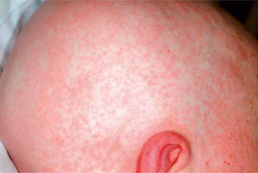
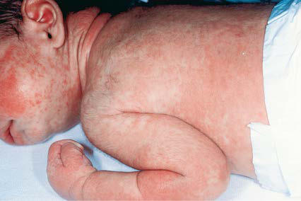

# Chapter 179: Graft-Versus-Host Disease, Rejection, and Venoocclusive Disease
> **Course:** Vikkypaedia Pediatric Basic Course (*Nelson Textbook of Pediatrics, 22nd Edition (2025)*)  
> **Part XII:** Immunology  
> **Authors:** Rachel A. Phelan and David Margolis  
> **Metrics:** 3,111 words · 3 tables/boxes · 2 figures · 0 genes · 8 flashcards · 5 MCQs  
> **Quick Navigation:** [🃏 Study 8 Flashcards](../flashcards/179_flashcards.md) · [📝 Take 5-Q MCQ Quiz](../mcqs/179_mcqs.md) · [📚 Part XII Guide](../parts/Part_XII.md) · [🧬 Syndrome & Genetics Atlas](../omim_gene_atlas.md) · [💊 Therapeutics Matrix](../therapies_matrix.md) · [🏠 Course Index](../../index.md)

## ⚡ High-Yield Nelson Pediatric Board Pearls
- ACUTE GRAFT-VERSUS-HOST DISEASE Acute GVHD is caused by the alloreactive, donor-derived T cells contained in the graft, which attack nonshared recipient’s antigens on target tissues.
- Diagnosis may benefit from skin, liver, or gastrointestinal (GI) biopsy for confirmation.
- Grade I acute GVHD (skin rash alone) has a favorable prognosis and often requires no treatment, or topical treatment alone.
- Risk for development of GVHD is increased by diagnosis of malignant disease, older donor and recipient age, and in patients given an unmanipulated allograft.
- CHRONIC GRAFT-VERSUS-HOST DISEASE Chronic GVHD develops or persists >3 months after transplantation and is the most frequent late complication of allogeneic HSCT with an incidence of approximately 25% in pediatric patients.
- Other factors that predict occurrence of chronic GVHD include older donor and recipient ages, female donor for male recipient, diagnosis of malig nancy, and use of total body irradiation (TBI) as part of the prepara tive regimen.
- GRAFT FAILURE Graft failure is a serious complication exposing patients to a high risk of fatal infection.

---
## Full Chapter Text, Tables & Figures
# Chapter 179: Graft-Versus-Host Disease, Rejection, and Venoocclusive Disease

*Rachel A. Phelan and David Margolis*

<!-- p.1750 -->
A major cause of mortality and morbidity after allogeneic hema topoietic stem cell transplantation (HSCT) is **graft-versus-host disease (GVHD)**, which is caused by engraftment of immunocom petent donor T lymphocytes in an immunologically compromised host who shows histocompatibility differences with the donor. These differences between the donor and the host may result in donor T-cell activation against either recipient major histocompatibility complex (MHC) antigens or minor histocompatibility antigens. GVHD is usually subdivided in two forms: **acute GVHD**, which occurs within 3 months after transplantation, and **chronic GVHD**, which, although related, is a different disease, occurring later and displaying some clinical and pathologic features that resemble those observed in selected autoimmune disorders (e.g., systemic sclerosis, Sjögren syndrome).

**ACUTE GRAFT-VERSUS-HOST DISEASE** Acute GVHD is caused by the alloreactive, donor-derived T cells contained in the graft, which attack nonshared recipient’s antigens on target tissues. A 3-step process generates the clinical syndrome. First, conditioning-induced tissue damage activates recipient antigen-presenting cells, which present recipient alloantigens to the donor T cells transferred with the graft and secrete **cytokines**, such as interleukin (IL)-12, favoring the polarization of T-cell response in the type 1 direction. Second, in response to recipient antigens, donor T cells become activated, proliferate, expand, and generate cytokines such as tumor necrosis factor (TNF)-α, IL-2, and inter feron (IFN)-γ. In the third step of the process, these cytokines cause tissue damage and promote differentiation of cytotoxic CD8+ T cells, which, together with macrophages, kill recipient cells and fur ther disrupt tissues.

Acute GVHD usually develops 2-8 weeks after transplantation. The primary manifestations depend on the sites of involvement and may include an erythematous maculopapular rash (Figs. 179.1 and 179.2), persistent anorexia, vomiting and/or diarrhea, and liver dis ease with increased serum levels of bilirubin, alanine transaminase (ALT), aspartate transaminase (AST), and alkaline phosphatase (ALP). Diagnosis may benefit from skin, liver, or gastrointestinal (GI) biopsy for confirmation. Endothelial damage and lymphocytic infiltrates are seen in all affected organs. The epidermis and hair follicles of the skin are damaged, the hepatic small bile ducts show segmental disruption, and there is destruction of the crypts and mucosal ulceration of the GI tract. Grade I acute GVHD (skin rash alone) has a favorable prognosis and often requires no treatment, or topical treatment alone. Grade II GVHD is a moderately severe multiorgan disease requiring immunosuppressive therapy. Grade III GVHD is a severe multiorgan disease, and grade IV GVHD is a life-threatening, often fatal condition (Table 179.1).

The standard pharmacologic prophylaxis of GVHD after an unmanipulated allograft relies mainly on posttransplant admin istration of immunosuppressive drugs, such as cyclosporine or tacrolimus or combinations of either with methotrexate or pred nisone, anti–T-cell antibodies, mycophenolate mofetil (MMF), and other immunosuppressive agents. Infusion of cyclophosphamide on days +3 and +4 after transplantation has been used as a strategy to deplete alloreactive donor T lymphocytes that become activated

after exposure to recipient antigens. This approach has been suc cessful in patients undergoing haploidentical transplantation. Pre transplantation infusion of either antithymocyte globulin (ATG) or monoclonal antibodies (mAbs) such as alemtuzumab is largely used to modulate alloreactivity of donor T cells, in particular in patients given the allograft from either an unrelated donor or a partially matched relative. An alternative approach is the removal of T lym phocytes from the graft **(T-cell depletion)**. Other approaches are being used to selectively remove the α/β T cells, which are thought to be responsible for the development of GVHD, while preserving the γ/δ T cells in order to sustain graft-versus-leukemia (GVL) and the ability to fight infection. Any form of GVHD prophylaxis may impair posttransplantation immunologic reconstitution, increasing the risk of infection-related deaths. Traditional T-cell depletion of the graft is also associated with an increased risk of leukemia recur rence in patients transplanted from an HLA-identical sibling or an unrelated volunteer.

Despite prophylaxis, significant acute GVHD develops in approx imately 30% of recipients of HSCT from matched siblings and in as many as 60% of HSCT recipients from unrelated donors. These numbers are estimates, and the actual risk of acute GVHD is highly variable depending on several factors. Risk for development of GVHD is increased by diagnosis of malignant disease, older donor and recipient age, and in patients given an unmanipulated allograft. The most important risk factor for acute GVHD is the presence of disparities for HLA molecules in the donor-recipient pair.

Acute GVHD is usually initially treated with glucocorticoids; approximately 40–50% of patients show a complete response to

*Rachel A. Phelan and David Margolis*

**Fig. 179.1** Acute graft-versus-host disease. Involvement of the scalp, ears, palms, and soles is common. (From Paller AS, Mancini AJ, eds. Hurwitz Clinical Pediatric Dermatology. 5th ed. Philadelphia: Elsevier, 2016. p 577.)

**Fig. 179.2** Acute graft-versus-host disease. Almost confluent erup tion of erythematous macules and papules in an immunodeficient neo nate treated with extracorporeal membrane oxygenation (ECMO) and transfusion of nonirradiated blood. (From Paller AS, Mancini AJ, eds. Hurwitz Clinical Pediatric Dermatology. 5th ed. Philadelphia: Elsevier; 2016. p 577.)

<!-- p.1751 -->
corticosteroids. The risk of transplantation-related mortality is much higher in patients who do not respond to corticosteroids than in those showing a complete response. Ruxolitinib, target ing the JAK signaling pathway, or other drugs targeting molecules expressed on T cells or cytokines released during the inflammatory cascade (including infliximab and etanercept targeting TNF, vedol izumab targeting α₄β₇-integrin, and tocilizumab targeting IL-6), which underlies the pathophysiology of GVHD, have been used in patients with steroid-resistant acute GVHD. Extracorporeal photo pheresis is another second-line treatment for GVHD and is most efficacious for skin GVHD. A patient’s peripheral blood is exposed to a photosensitive compound and then exposed to ultraviolet light. The cells are then reinfused into the patient. It is thought that this process results in an increase in apoptosis of lymphocytes respon sible for GVHD as well as the upregulation of anti-inflammatory cytokines and regulatory T cells. Promising results in children with steroid-resistant acute GVHD have also been obtained using **mes enchymal stromal cells**, which are able to blunt the inflammatory response associated with acute GVHD.

**CHRONIC GRAFT-VERSUS-HOST DISEASE** Chronic GVHD develops or persists >3 months after transplantation and is the most frequent late complication of allogeneic HSCT with an incidence of approximately 25% in pediatric patients. Chronic GVHD is the major cause of nonrelapse mortality and morbidity in long-term HSCT survivors. Acute GVHD is recognized as the most important factor predicting the development of the chronic form of the disease. The use of matched unrelated volunteers as donors and use of unmanipulated peripheral blood as the stem cell source have increased the incidence and severity of chronic GVHD. Other factors that predict occurrence of chronic GVHD include older donor and recipient ages, female donor for male recipient, diagnosis of malig nancy, and use of total body irradiation (TBI) as part of the prepara tive regimen.

Chronic GVHD is a disorder of immune regulation character ized by autoantibody production, increased collagen deposition and fibrosis, and clinical symptoms similar to those seen in patients with autoimmune diseases (Table 179.2). The predominant cyto kines involved in the pathophysiology of chronic GVHD are usually

#### **Table 179.1** Clinical Staging and Grading* of Acute Graft-Versus-Host Disease

| Category / Parameter | Clinical Details & Findings |
| --- | --- |
| **LOWER GI (STOOL OUTPUT/DAY)** | 0; No active (erythematous) GVHD; rash; <2 mg/dL; No or intermittent nausea,; vomiting, or anorexia; Adult: <500 mL/day or <3 episodes/day; Child: <10 mL/kg/day or <4 episodes/day; 1; Maculopapular rash <25% BSA; 2-3 mg/dL; Persistent nausea, vomiting; or anorexia; Adult: 500-999 mL/day or 3-4 episodes/day; Child: 10-19.9 mL/kg/day or 4-6 episodes/day; 2; Maculopapular rash 25–50% BSA; 3.1-6 mg/dL; Adult: 1,000-1,500 mL/day or 5-7 episodes/day; Child: 20-30 mL/kg/day or 7-10 episodes/day; 3; Maculopapular rash >50% BSA; 6.1-15 mg/dL; Adult: >1,500 mL/day or >7 episodes/day; Child: >30 mL/kg/day or >10 episodes/day; 4; Generalized erythroderma (>50%; BSA) plus bullous formation and; desquamation >5% BSA; >15 mg/dL; Severe abdominal pain with or without ileus; or grossly bloody stool (regardless of stool; volume); *Overall clinical grade (based on most severe target organ involvement):; Grade 0: no stage 1-4 of any organ.; Grade I: stage 1-2 skin without liver, upper GI, or lower GI involvement.; Grade II: stage 3 rash and/or stage 1 liver and/or stage 1 upper GI and/or stage 1 lower GI.; Grade III: stage 2-3 liver and/or stage 2-3 lower GI, with stage 0-3 skin and/or stage 0-1 upper GI.; Grade IV: stage 4 skin, liver, or lower GI involvement, with stage 0-1 upper GI.; GI, Gastrointestinal; GVH, graft-versus-host; BSA, body surface area.; From Harris AC, Young R, Devine S, et al. International, Multicenter Standardization of Acute Graft-versus-Host Disease Clinical Data Collection: A Report from the Mount Sinai Acute; GVHD International Consortium. Biol Blood Marrow Transplant. 2016;22(1):4–10. |

Disease

#### **Table 179.2** Clinical Findings in Chronic Graft-Versus-Host

| Category / Parameter | Clinical Details & Findings |
| --- | --- |
| **SYMPTOMS AND SIGNS** | Systemic; Immunodeficiency and recurrent; infections; Skin; Lichen planus, scleroderma,; hyperpigmentation or; hypopigmentation, erythema,; freckling, ichthyosis, ulcerations; Flexion contractures; Vaginal scars; Onycholysis; Nail loss; Hair; Alopecia; scarring or nonscarring; Mouth; Sicca syndrome, lichen planus,; depapillation of tongue with; variegations, scalloping of; lateral margins, xerostomia,; mucocele; Joints; Diffuse myositis/tendonitis,; arthritis, contractures; Eyes; Decreased tearing, injected; sclerae, scarring conjunctivitis,; keratopathy; Liver; Increased enzymes, cholestasis,; hepatomegaly, cirrhosis; Gastrointestinal; Failure to thrive, malabsorption,; chronic diarrhea; Esophageal strictures; Lung; Cough, dyspnea, wheezing; Bronchiolitis obliterans, chronic; rales, pneumothorax, fibrosis; Hematology; Thrombocytopenia, eosinophilia,; Howell-Jolly bodies (splenic; dysfunction) |

<!-- p.1752 -->
type II cytokines such as IL-4, IL-5, and IL-13. IL-4 and IL-5 con tribute to eosinophilia and B-cell hyperactivity with elevated IgM, IgG, and IgE titers. Associated monoclonal gammopathies indicate clonal dysregulation. Chronic GVHD is dependent on the develop ment and persistence of donor T cells that are not tolerant to the recipient. Maturation of transplanted stem cells within a damaged thymus could lead to errors in negative selection and production of cells that have not been tolerized to recipient antigens and are therefore autoreactive or, more accurately, **recipient reactive**. This ongoing immune reactivity results in clinical features resembling a systemic autoimmune disease with lichenoid and scleroderma tous skin lesions, malar rash, sicca syndrome, arthritis, joint con tractures, bronchiolitis obliterans, and bile duct degeneration with cholestasis.

Patients with chronic GVHD involving only the skin and liver have a favorable course (Figs. 179.3 and 179.4). Extensive multi organ disease may be associated with a very poor quality of life, recurrent infections associated with prolonged immunosuppressive regimens to control GVHD, and a high mortality rate. Morbidity and mortality are highest in patients with a progressive onset of chronic GVHD that directly follows acute GVHD, intermediate in those with a **quiescent onset** after resolution of acute GVHD, and lowest in patients with **de novo onset** in the absence of acute GVHD. Chronic GVHD can be classified as mild, moderate, or severe depending on extent of involvement. Single-agent prednisone is the standard treatment, although other agents have been employed with variable success. Ruxolitinib, a Janus kinase inhibitor, has been a beneficial treatment for steroid-dependent or refractory chronic GVHD. In addition, ibrutinib, a Bruton tyrosine kinase inhibitor, has been approved by the FDA for the treatment of chronic GVHD. Treatment with imatinib mesylate, which inhibits the synthesis of collagen, has been effective in some patients with chronic GVHD and sclerotic features. As a consequence of prolonged immunosup pression, patients with chronic GVHD are particularly susceptible to infections and should receive appropriate antibiotic prophylaxis, including trimethoprim/sulfamethoxazole (TMP/SMX). Chronic GVHD resolves in most pediatric patients but may require 1-3 years of immunosuppressive therapy before the drugs can be withdrawn without the disease recurring. Chronic GVHD promotes the devel opment of secondary neoplasms, in particular in patients with Fan coni anemia, and has a significant impact on quality of life.

**GRAFT FAILURE** Graft failure is a serious complication exposing patients to a high risk of fatal infection. **Primary graft failure** is defined as failure to achieve a neutrophil count of 0.5 × 109/L after transplantation. **Secondary graft failure** is loss of peripheral blood counts following initial transient engraftment of donor cells. Causes of graft failure after autologous and allogeneic transplantation include transplan tation of an inadequate stem cell dose (more frequently observed in children given cord blood transplantation) and viral infections such as with cytomegalovirus or human herpesvirus type 6, which are often associated with activation of recipient macrophages. Graft failure after allogeneic transplantation, however, is mainly caused by immunologically mediated rejection of the graft by residual recipient-type T cells that survive the conditioning regimen.

Diagnosis of graft failure resulting from immunologic mecha nisms is based on examination of peripheral blood and marrow aspirate and biopsy, along with molecular analysis of chimerism status. Persistence of lymphocytes of host origin in allogeneic transplant recipients with graft failure indicates immunologic rejection. The risk of immune-mediated graft rejection is higher in patients given HLA-disparate, T-cell–depleted grafts, reducedintensity conditioning regimens, and transplantation of low num bers of stem cells, and in recipients who are sensitized toward major HLA antigens or, less frequently, minor histocompatibility

antigens. Allosensitization develops as a consequence of preceding blood product transfusions and is observed particularly in recipi ents with aplastic anemia, sickle cell disease, and thalassemia. In HSCT for nonmalignant diseases, such as mucopolysaccharidoses, graft failure is also facilitated by the absence of previous treatment with cytotoxic and immunosuppressive drugs. In thalassemia, graft failure is promoted by expansion of recipient hematopoietic cells. GVHD prophylaxis with methotrexate, an antimetabolite, and antiinfective prophylaxis with TMP/SMX or ganciclovir may also delay engraftment.

**Treatment** of graft failure usually requires removing all poten tially myelotoxic agents from the treatment regimen and attempting a short trial of hematopoietic growth factors, such as granulocyte colony-stimulating factor. A second transplant, usually preceded

**Fig. 179.3** Chronic graft-versus-host disease (GVHD), lichenoid. After bone marrow transplantation, this patient had acute GVHD and subse quently developed cutaneous scaling papules and plaques typical of li chen planus. (From Paller AS, Mancini AJ, eds. Hurwitz Clinical Pediatric Dermatology. 5th ed. Philadelphia: Elsevier; 2016. p 577.)

**Fig. 179.4** Chronic graft-versus-host disease. Note the extensive alopecia of the scalp with dyschromia and numerous sclerodermatous plaques of the scalp and back. (From Paller AS, Mancini AJ, eds. Hur witz Clinical Pediatric Dermatology. 5th ed. Philadelphia: Elsevier; 2016. p 579.)

<!-- p.1753 -->
by a highly immunosuppressive regimen, is frequently employed to rescue patients experiencing graft failure. High-intensity regimens are generally tolerated poorly if administered within 100 days from a first transplant because of cumulative toxicities, but this risk must be balanced with the risk of infection from prolonged neutropenia and lymphocytopenia.

**VENOOCCLUSIVE DISEASE** Hepatic venoocclusive disease (VOD), also known as sinusoidal obstruction syndrome, presents with hepatomegaly, right upper quadrant tenderness, jaundice, coagulopathy, thrombocytopenia, and weight gain from fluid retention and ascites (Table 179.3). It results from endothelial damage within the liver, which can then progress to multiorgan dysfunction. Onset is usually within 30 days of transplantation, with an incidence of approximately 15%, depending on the intensity of the conditioning protocol. Risk fac tors include young age, prior hepatic disease (fibrosis, cirrhosis),

abdominal radiation, repeated transplantations, neuroblastoma, osteopetrosis, and familial hemophagocytic lymphohistiocytosis. The severe form of VOD has a high mortality rate (>80%) without treatment.

Prophylaxis has traditionally used ursodeoxycholic acid and occa sionally heparin; only **defibrotide** has demonstrated efficacy in treat ing VOD. A phase 3 study demonstrated improvement in survival and response rate to VOD in patients treated with defibrotide. Defibrotide is a combination of porcine oligodeoxyribonucleotides that reduces procoagulant activity and enhances fibrinolytic properties of endothe lial cells. Defibrotide is FDA approved for the treatment of VOD in adult and pediatric patients with renal or pulmonary dysfunction after HSCT. Defibrotide is often used as prophylaxis in Europe, with data showing efficacy, but this use is not yet approved in the United States.

*Visit Elsevier eBooks+ at eBooks.Health.Elsevier.com** for Bibliography.*

Adults

#### **Table 179.3** Severity Grading Thresholds of Sinusoidal Obstructive Syndrome Among Children, Adolescents, and Young

| Category / Parameter | Clinical Details & Findings |
| --- | --- |
| **VERY SEVERE** | ALT, AST, GLDH (mg/dL); <2× normal; 2-5× normal; 2-5× normal; >5× normal; Bilirubin (mg/dL); <2; <2; ≥ 2; Bilirubin doubles in 48 hr; Coagulopathy (not; responsive to vitamin K; administration; INR); <1.5; 1.5-1.9; >2; Need for replacement of; coagulation factors; Ascites; Mild (minimal fluid by liver,; spleen or pelvis); Moderate (<1 cm fluid); Severe (fluid in all 3; regions with >1 cm fluid; in at least 2 regions); Requires paracentesis; Weight gain (from; baseline); 2.5%; 5–10% despite diuretic use; >10%; Persistent rise; Renal function score; KDIGO 1: serum creatinine; 1.5-1.9× baseline or ≥0.3; mg/dL (≥26.5 mmol/L); increase or urine output; <0.5 mL/kg/hr for 6-12 hr; KDIGO 2: serum creatinine; 2.0-2.9× baseline or urine; output <0.5 mL/kg/hr for; ≥12 hr; KDIGO 3: serum creatinine; 3.0× baseline or increase; in serum creatinine ≥4.0-; mg/dL (≥353.6 mmol/L); or initiation of renal; replacement therapy or; decrease in eGFR to <35; mL/min per 1.73 m2; (patients <18 years) or; urine output <0.3 mL/kg/hr; for ≥24 hr or anuria for; ≥12 hr (patients <18 years); Persistent need for renal; replacement therapy; Encephalopathy |
| **CAPD ≥9** | Persistent RT; <3 days; 3-7 days; —; >7 days; Pulmonary function |
| **IMV** | ALT, Alanine aminotransferase; AST, aspartate aminotransferase; GLDH, glutamate dehydrogenase; INR, international normalized ratio; KDIGO, Kidney Disease: Improving Global; Outcomes score; eGFR, estimated glomerular infiltration rate; CAPD, Cornell Assessment of Pediatric Delirium; RT, refractory thrombocytopenia; NIV, noninvasive ventilation; IMV,; invasive mechanical ventilation.; From Mahadeo KM, Bajwa R, Abdel-Azim H, et al. Diagnosis, grading, and treatment recommendations for children, adolescents, and young adults with sinusoidal obstructive syn; drome: An international expert position statement. Lancet Haematol. 2020;7(1):e61–e72. |

<!-- p.1754 -->
