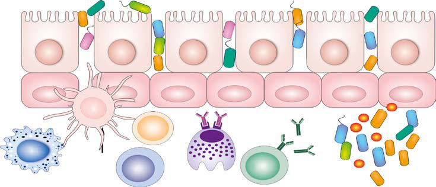
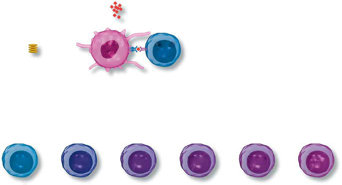

# Chapter 182: Allergy and the Immunologic Basis of Atopic Disease
> **Course:** Vikkypaedia Pediatric Basic Course (*Nelson Textbook of Pediatrics, 22nd Edition (2025)*)  
> **Part XIII:** Allergic Disorders  
> **Authors:** Cezmi A. Akdis and Scott H. Sicherer  
> **Metrics:** 7,005 words · 0 tables/boxes · 2 figures · 21 genes · 8 flashcards · 5 MCQs  
> **Quick Navigation:** [🃏 Study 8 Flashcards](../flashcards/182_flashcards.md) · [📝 Take 5-Q MCQ Quiz](../mcqs/182_mcqs.md) · [📚 Part XIII Guide](../parts/Part_XIII.md) · [🧬 Syndrome & Genetics Atlas](../omim_gene_atlas.md) · [💊 Therapeutics Matrix](../therapies_matrix.md) · [🏠 Course Index](../../index.md)

## Key Genetic & Molecular Targets
`APC`, `BTNL2`, `DNAH5`, `DPP10`, `FCER1A`, `FLG`, `FOXP3`, `GLB1`, `IL13`, `IL18R1`, `IL1RL1`, `IL2RA`, `IL4`, `ILC2`, `KIF3A`, `LRRC32`

## ⚡ High-Yield Nelson Pediatric Board Pearls
- Early development of a T-helper type 1 (Th1) response together with T-regulatory cell (Treg) response were proposed to play a role in prevention of allergic diseases.
- The biodiversity hypothesis states that the observed increase in allergies is due to a loss of symbiotic relationships with bacteria and dysbiosis caused by changes in the microbiome of the gut, skin, and respiratory system.
- The dysbiotic microbiota has been characterized by an underrepresentation of certain bacterial taxa that may produce immune regulatory and epithelial barrier healing or protective factors, such as short-chain fatty acids, retinoic acid, and vitamin D.
- Another limitation of the hygiene hypothesis and biodiversity hypothesis is that probiotics are not viable alternatives for the prevention or treatment of allergies.
- Microbial dysbiosis caused by transepithelial translocation of com mensal microbes, colonization by opportunistic pathogens, and decreased biodiversity are hallmarks of barrier damaged tissues.
- Th2 cytokines are important effector molecules in the pathogenesis of asthma and allergic diseases; acute allergic reactions are characterized by infiltra tion of Th2 cells into affected tissues.
- Chronic lesions of allergic reactions are characterized by infiltration of Th1 and Th17 cells.

---
## Full Chapter Text, Tables & Figures
# Chapter 182: Allergy and the Immunologic Basis of Atopic Disease

*Cezmi A. Akdis and Scott H. Sicherer*

<!-- p.1763 -->
Allergic or atopic patients have an altered state of reactivity to common environmental and food antigens that do not cause clinical reactions in unaffected people. Patients with clinical allergy usually produce immu noglobulin E (IgE) antibodies to the antigens that trigger their illness. The term *allergy* represents the clinical expression of IgE-mediated allergic diseases that have a familial predisposition and that manifest as hyperresponsiveness in target organs such as the lung, skin, gastroin testinal (GI) tract, and nose. The significant increase in the prevalence of allergic diseases in the last few decades is attributed to changes in environmental factors such as exposure to tobacco smoke, air pollu tion, indoor and outdoor allergens, respiratory viruses, obesity, and perhaps a decline in certain infectious diseases (hygiene hypothesis).

The incidence of allergic asthma and atopic dermatitis started to grow to epidemic proportions after the 1960s. Since 2000, the preva lence of food allergy, eosinophilic esophagitis, and drug-induced ana phylaxis has also risen to epidemic proportions. Currently more than 1 billion patients worldwide are expected to have at least one kind of allergic disease. The hygiene hypothesis, biodiversity hypothesis and epithelial barrier hypothesis are the three main hypotheses that pro pose mechanisms for the development of allergic diseases.

**HYGIENE HYPOTHESIS** The relatively recent onset of the epidemics of allergic, autoimmune, and metabolic conditions leads to the question of what might underlie their development. A prominent hypothesis is the hygiene hypothesis, which proposes that certain microorganisms or infections protect against inflammatory diseases, and that their loss, due to hygiene measures, results in an increase in allergy, asthma, and autoimmunity. Growing up on a traditional farm has a protective effect from asthma and allergies, which provides a prominent example of the hygiene hypothesis. Chil dren in Amish communities in the United States, where traditional dairy farming is practiced, are highly protected from asthma and allergies. In contrast, Hutterite communities have a significantly higher prevalence of asthma and allergies in children. Interestingly, they practice industrial ized farming with extensive cleaning measures. Early development of a **T-helper type 1 (Th1)** response together with **T-regulatory cell (Treg**) response were proposed to play a role in prevention of allergic diseases.

**BIODIVERSITY HYPOTHESIS** Allergic diseases are associated with a microbiome with increased coloni zation of opportunistic pathogens. The biodiversity hypothesis states that the observed increase in allergies is due to a loss of symbiotic relationships with bacteria and dysbiosis caused by changes in the microbiome of the gut, skin, and respiratory system. Healthy microbiota on the surface of the mucosal barrier regulates many aspects of epithelial barrier homeostasis, such as the modulation of barrier permeability and expression of epithe lial barrier molecules, angiogenesis, vascular permeability, local microin flammation, and mucosal tolerance. Young children at risk of developing

allergies have been shown to suffer from gut microbiome dysbiosis with an overall reduced microbiome diversity. The dysbiotic microbiota has been characterized by an underrepresentation of certain bacterial taxa that may produce immune regulatory and epithelial barrier healing or protective factors, such as short-chain fatty acids, retinoic acid, and vitamin D.

Several shortcomings of the hygiene and biodiversity hypotheses include the fact that water sanitation was established in many western cities in the 1920s, but allergy and asthma epidemics only started in the 1960s. The protective role of parasitic infections that increase biodiversity has been questioned for the same reason. Many parasitic infections started to decrease in 1910 in New York, whereas allergies started to increase after the 1960s. Allergic asthma is still on the rise in some cities in Asia and Africa, which have low standards of hygiene. Another limitation of the hygiene hypothesis and biodiversity hypothesis is that probiotics are not viable alternatives for the prevention or treatment of allergies. More over, studies of migrants who move from developing countries to affluent regions demonstrate a rapid increase in asthma and allergic diseases. It appears that domestic living conditions, increased birth by cesarean sec tion, antibiotic usage, dietary practices, urbanization, and indoor air pol lution are more prominent factors compared with general public hygiene.

**EPITHELIAL BARRIER HYPOTHESIS** The epithelial barrier hypothesis is a broader hypothesis that covers hygiene and biodiversity hypotheses and adds further insights in the pathogenesis and recent development of allergic diseases. The defective epithelial barrier concept also applies to many autoimmune and meta bolic diseases showing increased prevalence during the last few decades, such as diabetes, rheumatoid arthritis, multiple sclerosis, liver steatosis, and obesity. There is epidemiologic evidence from humans and disease models in laboratory animals that demonstrate that even trace amounts of certain toxic substances can damage epithelial barriers, initiate inflam mation of the epithelium, and increase microbial dysbiosis and bacterial translocation toward the inside and beneath the epithelium. The epithe lial barrier consists of four main components: the epithelial microbiota; the epithelial cell; structural proteins, such as filaggrin, loricrin, and involucrin and tight junctions and adherence junctions; and secreted epithelial products, such as mucus, antimicrobial peptides and fatty acids. Humans are exposed daily to a variety of toxins and chemicals, and substantial data demonstrate disruption of the epithelial barrier by allergens, certain bacteria and their toxins, fungi, viruses, laundry and dishwasher detergents, household cleaners, surfactants, enzymes and emulsifiers used in the food industry, cigarette smoke, particulate matter, diesel exhaust, ozone, nanoparticles, and microplastics.

Epithelial cell activation and release of epithelial cell cytokines, such as interleukin (IL)-25, IL-33, and thymic stromal lymphopoietin (TSLP) play a major role in the development and exacerbation of allergic dis eases. Local tissue inflammation opens epithelial barriers. Open epi thelial barriers in the mucosa allow the entrance of foreign substances, including allergens, into deeper tissues. Both Th1 and **T-helper type 2 (Th2)** inflammation affect the skin and mucosal epithelial barriers. Th2 cells and group 2 innate lymphoid cells (ILCs-2) play major roles utiliz ing IL-13 as major cytokines in the opening of the tight junction barrier.

Microbial dysbiosis caused by transepithelial translocation of com mensal microbes, colonization by opportunistic pathogens, and decreased biodiversity are hallmarks of barrier damaged tissues. Colonization by opportunistic pathogens in the microbiota takes place in tissues with a defective epithelial barrier. A dysregulated subepithelial immune response, local inflammation, and incorrect regeneration and remodeling take place as the continuum and chronicity of the local inflammation. Migration of inflamed cells to other affected tissues and systemic low-level immune acti vation and microinflammation are additional players in the development and exacerbation of many chronic inflammatory diseases (Fig. 182.1).

*Cezmi A. Akdis and Scott H. Sicherer*

<!-- p.1764 -->
**KEY ELEMENTS OF ALLERGIC DISEASES Allergens** Allergens are almost always *proteins,* but not all proteins are allergens. For a protein antigen to display allergenic activity, it must induce IgE production, which must lead to a type 1 hypersensitivity response on subsequent exposure to the same protein. Biochemical properties of the allergen; stimulating factors of the innate immune response around the allergen substances at the time of exposure; stability of the allergen in the tissues, digestive system, skin, or mucosa; and the dose and time of stay in lymphatic organs during the interaction with the immune system are factors that may cause an antigen to become an allergen. This is distinguished from general antigen responses, which induce a state of immune responsiveness without associated IgE production.

Most allergens are proteins with a molecular weight of 10-70 kDa. Molecules <10 kDa do not bridge adjacent IgE antibody molecules on the surfaces of mast cells or basophils. Most molecules >70 kDa do not pass through mucosal surfaces, a feature needed to reach **antigen-presenting cells (APCs)** for stimulation of the immune system. Allergens frequently contain **proteases**, which promote skin and mucosal epithelial bar rier dysfunction and increase allergen penetration into host tissues. A relatively high dose of exposure and stability of the allergenic protein in body fluids to reach the immune cells are important determinants of an allergen. Low molecular weight moieties, such as drugs, can become allergens by reacting with serum proteins or cell membrane proteins to be recognized by the immune system. Carbohydrate structures can also

be allergens and are most relevant with the increasing use of *biologics* in clinical practice; patients with cetuximab-induced anaphylaxis have IgE antibodies specific for galactose-α-1,3-galactose.

**T Cells** Everyone is exposed to potential allergens. Atopic individuals respond to allergen exposure with rapid expansion of **Th2** cells that secrete cyto kines, such as IL-4, IL-5, and IL-13, favoring IgE synthesis and eosino philia. Allergen-specific IgE antibodies associated with atopic response are detectable by serum testing or positive immediate reactions to aller gen extracts on skin-prick testing. The Th2 cytokines IL-4 and IL-13 play a key role in immunoglobulin isotype switching to IgE (Fig. 182.2). IL-5 and IL-9 are important in the differentiation and development of eosinophils. The combination of IL-3, IL-4, and IL-9 contributes to mast cell activation. T-cell and eosinophil migration to allergic inflamma tion areas are controlled by IL-4 and IL-13 upregulating their adhesion to endothelial cell walls. IL-9 is responsible for mucus production. Th2 cytokines are important effector molecules in the pathogenesis of asthma and allergic diseases; acute allergic reactions are characterized by infiltra tion of Th2 cells into affected tissues. In addition, IL-25, IL-33, and **TSLP** secreted from epithelial cells on exposure to allergens and respiratory viruses contribute to Th2 response and eosinophilia.

A fraction of the immune response to allergens results in activation and proliferation of **Th1** cells. Th1 cells are typically involved in the eradication of intracellular organisms, such as mycobacteria, because

Defective epithelial barrier healing capacity

due to inflammation

Exposure to epithelial barrier-damaging agents and opening

of the skin and mucosal barriers

Colonization of opportunistic pathogens S. aureus, Moraxella,

Haemophilus, pneumococcus

Microbial dysbiosis characterized with

decreased biodiversity and

change in commensals

Microbial translocation to inter-and subepithelial areas

Systemic immune response to commensals and opportunistic

pathogens

Chronic skin and mucosal

inflammation

**T cell**

**ILC2**

**B cell**

**MC**

**DC**

**MØ**

**Fig. 182.1** The physiopathology of the epithelial barrier hypothesis. Genetic defects in barrier-related molecules or exposure to epithelial barrier- damaging agents cause an opening of the skin and mucosal tight junction barriers. This is followed by translocation of microbiota to inter- and subepi thelial areas and colonization of opportunistic pathogens, such as Staphylococcus aureus, Moraxella, Haemophilus and pneumococcus. An immune response develops toward commensals and opportunistic pathogens in the gut and respiratory system and systemic inflammation takes place. In most cases of allergic diseases, a systemic type 2 inflammation predominates, and is directed against allergens, but also commensals and opportunistic pathogens. Anti–S. aureus antibodies show a very high prevalence in asthma, chronic sinusitis, and atopic dermatitis. This is associated with microbial dysbiosis and decreased biodiversity of commensals. Chronic inflammation in the subepithelial area develops as the main pathogenetic feature of these diseases. Defective epithelial barrier healing capacity due to inflammation and epigenetic changes take place, developing a vicious circle of leaky barriers, microbial dysbiosis, and chronic inflammation. DC, Dendritic cell; IL, interleukin; ILC, innate lymphoid cells; MC, mast cell; Mø, macrophage.

<!-- p.1765 -->
of the ability of Th1 cytokines to activate phagocytes and promote the production of opsonizing and complement-fixing antibodies. The Th1 component of allergen-specific immune response contributes to chro nicity and the effector phase in allergic disease. Activation and apopto sis of epithelial cells induced by Th1 cell–secreted interferon-γ (IFN-γ), tumor necrosis factor (TNF)-α, and Fas-ligand constitute an essential pathogenetic event for the formation of eczematous lesions in atopic dermatitis and bronchial epithelial cell shedding in asthma.

Chronic lesions of allergic reactions are characterized by infiltration of Th1 and **Th17 cells**. This is important because Th1 cytokines such as IFNγ can potentiate the function of allergic inflammatory effector cells such as eosinophils, thereby contributing to disease severity. Th17 and Th22 cells link the immune response to tissue inflammation; IL-17A and IL-17F and IL-22 are their respective prototype cytokines. Although both T-helper cell subsets play roles in immune defense to extracellular bacteria, IL-17 aug ments inflammation, whereas IL-22 plays a tissue-protective role. Cyto kines in the IL-17 family act on multiple cell types, including epithelial cells and APCs, to cause the release of chemokines, antimicrobial peptides, and proinflammatory cytokines to enhance inflammation and antimicrobial responses. In addition, Th9 cells produce IL-9, but not other typical Th1, Th2, and Th17 cytokines, and constitute a distinct population of effector T cells that promotes tissue inflammation. Figure 182.3 depicts the complex cytokine cascades involving Th1, Th2, Th9, Th17, and Th22 cells.

**Tregs** are a subset of T cells thought to play a critical role in expres sion of allergic and autoimmune diseases. These cells have the ability to suppress effector T cells of Th1, Th2, Th9, Th17, and Th22 phenotypes (Fig. 182.4). Tregs express CD4+CD25+ surface molecules and immu nosuppressive cytokines such as IL-10, IL-35, and transforming growth factor-β (TGF-β1). The forkhead box/winged-helix transcription factor gene *FOXP3* is expressed specifically by CD4+CD25+ Tregs and pro grams their development and function. Adoptive transfer of Tregs inhib its the development of airway eosinophilia and protects against airway hyperreactivity in animal models of asthma. T-cell response to allergens in healthy individuals shows a wide range, from no detectable response to involvement of active peripheral tolerance mechanisms mediated by different subsets of Tregs. Individuals who are not allergic even though they are exposed to high doses of allergens, such as beekeepers and cat

Th2

Stem cell factor Mast cell

B cell

Allergen

IgE

GM-CSF

EOS

IL-4

IL-4, IL-9

IL-13 IgE

DC

CD40L MHCTCR CD40

IL-5

IL-9

IL-9

IL-4

IL-3

**Fig. 182.2** Role of Th2 cytokines in allergic cascade. DC, Dendritic cell; EOS, eosinophil; GM-CSF, granulocyte-macrophage colony- stimulating factor; IL, interleukin.

Innate immune response stimulating

substances

IL-21, IL-18,

IL-27 *Differentiation*

*cytokines:*

*Functions:*

*Effector cytokines:*

IL-4 IL-21 IL-4 TGF-β

TGF-β, IL-6, IL-1β

IL-21, IL-23

TGF-α

IL-6

IFN-γ IL-4, IL-5, IL-9, IL-13,

IL-25, IL-31, IL-33

IL-21 IL-9, IL-10 IL-6, IL-8, IL-17A, IL-17F, IL-22, IL-26

IL-22

Intracellular

pathogens, apoptosis of

tissue cells

Helminths,

allergic inflammation,

IgE, chronic eosinophilic inflammation

Antibody synthesis Mucus production,

tissue inflammation

Extracellular

pathogens,

chronic neutrophilic inflammation

Tissue inflammation

Polarization

signals

Micromilieu: vitamins, cytokines, histamine, adenosine, aryl hydrocarbons

Antigen

DC

Th1 Th2 Th9 Th17 Th22 TFH

naive T cell

**Fig. 182.3** Effector T-cell subsets. Following antigen presentation by dendritic cells (DCs), naïve T cells differentiate into Th1, Th2, Th9, Th17, Th22, and follicular helper (TFH) effector subsets. Their differentiation requires cytokines and other cofactors that are released from DCs and also expressed in the micromilieu. T-cell activation in the presence of interleukin-4 (IL-4) enhances differentiation and clonal expansion of Th2 cells, per petuating the allergic response. IFN-γ, Interferon-γ; TGF-β, transforming growth factor-β. (From Akdis M, Palomares O, van de Veen W, et al. TH17 and TH22 cells: A confusion of antimicrobial response with tissue inflammation versus protection. J Allergy Clin Immunol. 2012;129:1438–1449.)

<!-- p.1766 -->
owners, show a detectable allergen-specific IgG4 response accompanied by IL-10–producing Tregs. It is thought that CD4+CD25+ Tregs play an important role in mitigating the allergic immune response, and that the lack of such cells may predispose to the development of allergic dis eases. Patients with pathogenic variants in the human *FOXP3* gene lack CD4+CD25+ Tregs and develop severe immune dysregulation, with poly endocrinopathy, food allergy, and high serum IgE levels (XLAAD/IPEX disease) (see Chapter 165.4). In addition to Treg cells, IL-10–secreting and allergen-specific Breg cells increase during allergen-specific immu notherapy and may play a role in allergen tolerance.

**Innate Lymphoid Cells** Immune responses in populations of lymphoid cells that lack rearranged T- and B-cell antigen receptors and surface markers for myeloid and lymphoid lineages, such as T, B, and natural killer (NK) cells, show simi larities to Th1, Th2, and Th17/Th22 types of immune responses. These latter cells are defined as **ILC1s, ILC2s,** and **ILC3s,** respectively, based on their transcription factors and cytokine production patterns. ILC1s mainly produce IFN-γ; ILC2s produce IL-5, IL-9, and IL-13; and ILC3s produce IL-17 and IL-22 without any need of antigen/allergen exposure. Strong evidence indicates that ILCs play substantial roles in protection against infection and the pathogenesis of inflammatory diseases, such as asthma, allergic diseases, and autoimmune diseases. ILCs control the mucosal environment through close interaction with epithelial cells and other tissue cells, cytokine production, and induction of chemokines that recruit suitable cell populations to initiate and promote distinct types of immune response development and tissue inflammation. ILC2s are likely involved in the induction of asthma, allergic rhinitis, eosinophilic esophagitis, and atopic dermatitis through activation by epitheliumderived cytokines (e.g., IL-33, IL-25, TSLP) and interaction with other immune cells. IL-10–secreting ILCs with an immune regulatory func tion have been reported. These cells develop from ILC2s and play sup pressive roles in allergic inflammation, particularly through IL-10.

**Antigen-Presenting Cells** Dendritic cells (DCs), Langerhans cells, monocytes, and macrophages have the ability to present allergens to T cells, thereby modulating aller gic inflammation by controlling the type of T-cell development. APCs are a heterogeneous group of cells that share the property of antigen presentation in the context of the major histocompatibility complex (MHC) and are found primarily in lymphoid organs and the skin. DCs and Langerhans cells are unique in their ability to prime naïve T cells

and are responsible for the primary immune response, or the **sensiti zation phase** of allergy. Monocytes and macrophages are thought to contribute to activating memory T-cell responses on reexposure to allergen, which characterizes the **elicitation phase** of allergy.

Peripheral DCs residing in sites such as the skin, intestinal lamina propria, and lung are relatively immature. These immature DCs take up antigens in tissues and then migrate to the T-cell areas in locally drain ing lymph nodes. The DCs undergo phenotypic and functional changes during migration, characterized by increased expression of MHC class I, MHC class II, and co-stimulatory molecules that react with CD28 expressed on T cells. In the lymph nodes, they directly present processed antigens to resting T cells to induce their proliferation and differentiation.

Mature DCs have been designated as **myeloid** or **plasmacytoid** on the basis of their ability to favor Th1 or Th2 differentiation, respectively. The critical factor for polarization to Th1 cells is the level of IL-12 pro duced by myeloid DC. In contrast, plasmacytoid DCs have low levels of IL-12. Plasmacytoid DCs particularly play a role in antiviral immu nity by rapid production of high amounts of IFN-α and help B cells for antibody production. There is considerable interest in the role of TSLP, which is overexpressed in the mucosal surfaces and skin of atopic indi viduals. TSLP enhances Th2 differentiation by inducing expression of OX40L on immature myeloid DCs in the absence of IL-12 production.

Tissue macrophages are also acting as APCs. They show two main effec tor subsets in tissues, namely the M1 and M2 macrophages. M1 macro phages are classically activated, typically by IFN-γ or lipopolysaccharide (LPS) like innate immune response stimulating substances, and pro duce proinflammatory cytokines, phagocytize microbes, and initiate an immune response. M1 macrophages produce nitric oxide (NO) or reactive oxygen intermediates (ROIs) to protect against bacteria and viruses. M2 macrophages are alternatively activated by allergen exposure and certain cytokines such as IL-4, IL-10, or IL-13. M2 macrophages will produce either polyamines to induce proliferation or proline to induce collagen production. These macrophages are associated with wound healing and tissue repair remodeling and activation of Th2 cells and ILC2s.

Presence of allergen-specific IgE on the cell surfaces of APCs is a unique feature of atopy. Importantly, the formation of high-affinity IgE receptor I (**Fc**ε**RI**)/IgE/allergen complexes on APC surfaces greatly facil itates allergen uptake and presentation. The clinical importance of this phenomenon is supported by the observation that FcεRI-positive Lang erhans cells bearing IgE molecules are a prerequisite for skin-applied, aeroallergen provocation of eczematous lesions in patients with atopic dermatitis. The role of the low-affinity IgE receptor II **(Fc**ε**RII, CD23)**

**Fig. 182.4** Control of allergen-specific immune responses. FoxP3+, CD4+, CD25+, and Tr1 cells contribute to the control of allergen-specific im mune responses in several major ways: suppression of dendritic cells (DCs) that support the generation of effector T cells; suppression of Th1, Th2, and Th17 cells; suppression of allergen-specific IgE, and induction of IgG4 and/or IgA; suppression of mast cells, basophils, and eosinophils; interaction with resident tissue cells and remodeling; and sup pression of effector T-cell migration to tissues. IL, Interleukin. (From Akdis CA, Akdis M. Mechanisms and treatment of allergic disease in the big pic ture of regulatory T cells. J Allergy Clin Immunol. 2009;123:735–746.)

Suppression of Th17 effector cells

Remodeling in

the tissues

Basophil

Mast cells

Eosinophil

T reg

DC

Th2

Th1

Th17

B cell

Direct and indirect suppressive effects on mast cells, basophils,

and eosinophils

Suppression

of Th2 effector cells

Suppression

of Th1 effector cells

Suppression of effector T cell migration to tissues

Endothelial cells

Induction of IgG4 Suppression of IgE

Suppression of inflammatory dendritic cells. Induction of IL-10-producing dendritic cells

<!-- p.1767 -->
on monocytes/macrophages is less clear, although under certain condi tions it apparently can also facilitate antigen capture. Cross linking of FcεRII, as well as FcεRI, on monocytes/macrophages leads to the release of inflammatory mediators. There is a critical role for DCs in induction of oral tolerance; tolerogenic DCs are compartmentalized within the mucosa and present antigen through a mechanism designed to produce a Th1/Treg-suppressive response that ablates allergen-specific T cells.

**Immunoglobulin E and Its Receptors** The acute allergic response depends on IgE and its ability to bind selec tively to the α chain of the high-affinity FcεRI or the low-affinity FcεRII (CD23). Cross linking of receptor-bound IgE molecules by allergen ini tiates a complex intracellular signaling cascade, followed by the release of various mediators of allergic inflammation from mast cells and basophils. The FcεRI molecule is also found on the surface of antigenpresenting DCs (e.g., Langerhans cells), but differs from the structure found on mast cells/basophils in that the FcεRI molecule found on DCs lacks the β chain. CD23 is found on B cells, eosinophils, platelets, and DCs. Cross linking and FcεRI aggregation on mast cells and basophils can also lead to anaphylaxis (see Chapter 174). Differential expression of tyrosine kinases responsible for positive and negative regulation of mast cell/basophil degranulation are thought to be responsible for this aberrant allergic response.

The induction of IgE synthesis requires two major signals. The first sig nal (signal 1) initiates IL-4 or IL-13 activation of germline transcription at the ε Ig locus, which dictates isotype specificity. The second signal (signal 2) involves the engagement of CD40 on B cells by CD40 ligand expressed on T cells. This engagement results in activation of the recombination machinery, resulting in DNA switch recombination. Interactions between several co-stimulatory molecule pairs (CD28 and B7; lymphocyte func tion–associated antigen-1 and intercellular adhesion molecule-1; CD2 and CD58) can further amplify signal 1 and signal 2 to enhance IgE synthesis. Factors that inhibit IgE synthesis include Th1-type cytokines (IL-12, IFNα, IFN-γ), IL-10 from Tregs, Breg cells, and regulatory DCs and microbial DNA containing CpG (cytosine-phosphate-guanine) repeats.

**Eosinophils** Allergic diseases are characterized by peripheral blood and tissue eosin ophilia. Eosinophils participate in both innate and adaptive immune responses and, like mast cells, contain dense intracellular granules that are sources of inflammatory proteins (see Fig. 169.1). These granule proteins include major basic protein, eosinophil-derived neurotoxin, peroxidase, and cationic protein. Eosinophil granule proteins damage epithelial cells, induce airway hyperresponsiveness, and cause degran ulation of basophils and mast cells. Major basic protein released from eosinophils can bind to an acidic moiety on the M2 muscarinic receptor and block its function, thereby leading to increased acetylcholine levels and the development of increased airway hyperreactivity. Eosinophils are also a rich source of prostaglandins and **leukotrienes (LTs);** in par ticular, cysteinyl LT C4 contracts airway smooth muscle and increases vascular permeability. Other secretory products of eosinophils include cytokines (IL-4, IL-5, TNF-α), proteolytic enzymes, and ROIs, all of which significantly enhance allergic tissue inflammation.

Several cytokines regulate the function of eosinophils in allergic dis ease. Eosinophils develop and mature in the bone marrow from myeloid precursor cells activated by IL-3, IL-5, and granulocyte-macrophage colony-stimulating factor (GM-CSF). Allergen exposure of allergic patients causes resident hematopoietic CD34 cells to express the IL-5 receptor. The IL-5 receptor activation induces eosinophil maturation, causing eosinophils to synthesize granule proteins, prolonging their survival, potentiating degranulation of eosinophils, and stimulating release of eosinophils from the bone marrow. GM-CSF also enhances proliferation, cell survival, cytokine production, and degranulation of eosinophils. Certain chemokines, such as RANTES (regulated on activa tion, normal T-cell expressed and secreted), macrophage inflammatory protein-1α (MIP-1α), and eotaxins are important for recruiting eosino phils into local allergic tissue inflammatory reactions. Eotaxins mobilize IL-5–dependent eosinophil colony–forming progenitor cells from the bone marrow. These progenitors are rapidly cleared from the blood and either return to the bone marrow or are recruited to inflamed tissue sites.

**Mast Cells** Mast cells are derived from CD34 hematopoietic progenitor cells that arise in bone marrow. On entering the circulation, they travel to peripheral tis sue, where they undergo tissue-specific maturation. Mast cell development and survival relies on interactions between the tyrosine kinase receptor c-kit expressed on the surface of mast cells and the fibroblast-derived c-kit ligand, the stem cell factor. Unlike mature basophils, mature mast cells do not typically circulate in the blood. They are instead widely distributed throughout connective tissues, where they often lie adjacent to blood ves sels and beneath epithelial surfaces that are exposed to the external envi ronment, such as the respiratory tract, GI tract, and skin. So placed, mast cells are positioned anatomically to participate in allergic reactions. At least two subpopulations of human mast cells are recognized: mast cells with tryptase and mast cells with both tryptase and chymase. Mast cells with tryptase are the predominant type found in the lung and small intestinal mucosa, whereas mast cells with both tryptase and chymase are the pre dominant type found in skin, the GI submucosa, and blood vessels.

Mast cells contain, or produce on appropriate stimulation, a diverse array of mediators that have different effects on allergic inflammation and organ function. They include preformed granule-associated media tors (histamine, serine proteases, proteoglycans) and membrane-derived lipid, cytokine, and chemokine mediators arising from de novo synthesis and release. The most important mast cell–derived lipid mediators are the **cyclooxygenase** and **lipoxygenase** metabolites of arachidonic acid, which have potent inflammatory activities. The major cyclooxygenase product of mast cells is **prostaglandin D****2**, and the major lipoxygenase products are the sulfidopeptide **LTs:** LTC4 and its peptidolytic derivatives LTD4 and LTE4. Mast cells also can produce cytokines that promote Th2type responses (IL-4, IL-13, GM-CSF) and inflammation (TNF-α, IL-6) and regulate tissue remodeling (TGF, vascular endothelial cell growth factor). Immunologic activation of mast cells and basophils typically begins with cross-linkage of IgE bound to the FcεRI with multivalent allergen. Mast cell surface FcεRI is increased by IL-4 and IgE. Surface levels of FcεRI decrease in patients receiving treatment with anti-IgE antibody that lowers serum IgE, which is of potential therapeutic interest.

**MECHANISMS OF ALLERGIC TISSUE INFLAMMATION** IgE-mediated immune responses can be classified chronologically according to three reaction patterns. The **early-phase response** is the immediate response after allergen is introduced into target organs. This response is characterized by mast cell degranulation and release of preformed mediators, occurring within an immediate time frame of 1-30 minutes after allergen exposure and resolving within 1-3 hours. Acute reactions are associated with increased local vascular perme ability, which leads to leakage of plasma proteins, tissue swelling, and increased blood flow, as well as itching, sneezing, wheezing, and acute abdominal cramps in the skin, nose, lung, and GI tract, respectively, depending on the targeted organ.

A second, **late-phase response** can occur within hours of allergen exposure, reaching a maximum at 6-12 hours and resolving by 24 hours. Late-phase responses are characterized in the skin by edema, redness, and induration; in the nose by sustained nasal blockage; and in the lung by airway obstruction and persistent wheezing. In general, late-phase responses are associated with early infiltration of neutro phils and eosinophils, followed by basophils, monocytes, macrophages, and Th2-type cells. Recruitment of inflammatory cells from the circu lation requires increased expression of adhesion molecules on their cell surfaces and expression of their ligand on endothelial cells, which are under the control of cytokines. Several hours after allergen exposure, TNF-α released by activated mast cells induces the vascular endothelial expression of cell adhesion molecules, and this change leads to transen dothelial migration of various inflammatory cells. Preferential accu mulation of eosinophils occurs through interactions between selective adhesion molecules on the eosinophil cell surface (e.g., α4β1-integrin or very late antigen-4); vascular cell adhesion molecule-1 surface expres sion can be enhanced by IL-4 and IL-13 on endothelial cells. ILC2s receive signals from the epithelial cells, such as IL-33, TSLP, and IL-25, and are activated and start to release their cytokines IL-5 and IL-13 to

<!-- p.1768 -->
**Chemokines** are chemotactic cytokines that play a central role in tissue-directed migration of inflammatory cells. RANTES, MIP-1α, monocyte chemotactic protein (MCP)-3, and MCP-4 are chemoat tractants for eosinophils and mononuclear cells, whereas eotaxins are relatively selective for eosinophils. These chemoattractants have been detected in epithelium, macrophages, lymphocytes, and eosinophils at sites of late-phase responses and allergic tissue inflammation. Blockade of these chemokines leads to significant reduction in tissue-directed migration of allergic effector cells.

In the third reaction pattern, **chronic allergic disease**, tissue inflam mation can persist for days to years. Several factors contribute to per sistent tissue inflammation, including recurrent exposure to allergens and microbial agents. The repeated stimulation of allergic effector cells such as mast cells, basophils, eosinophils, and Th2 cells contributes to unresolved inflammatory conditions. Additionally, Th2-type cytokines (IL-3, IL-5, GM-CSF) secreted during allergic reactions can prolong survival of allergic effector cells by delaying apoptosis. Local differ entiation of tissue-infiltrating eosinophil precursors induced by IL-5 results in self-generation of eosinophils, further sustaining damage of local tissue. Tissue remodeling leading to irreversible changes in target organs is also a feature of chronic allergic disease. In asthma, **remodel ing** involves thickening of the airway walls and submucosal tissue, as well as smooth muscle hypertrophy and hyperplasia, which are associ ated with a decline in lung function. This is an unexpected role for eosinophils in airway remodeling as well as chronic inflammation. In atopic dermatitis, lichenification is an obvious manifestation of skin remodeling.

Generally, it is considered that a type 2 immune response underlines a majority of asthma cases, atopic dermatitis, chronic rhinosinusitis, and allergic rhinitis as a general characteristic of an immune/inflam matory response. Type 2 immune response involves Th2 cells, type 2 B cells, ILC2, IL-4–secreting NK T cells, basophils, eosinophils, and mast cells and their major cytokines. From a complex network of cytokines, IL-4, IL-5, IL-9, and IL-13 are mainly secreted from the immune sys tem cells, and IL-25, IL-31, IL-33, and TSLP from tissue cells, particu larly epithelial cells. Many asthma-related antigens, such as protease allergens, fungal extracts, and viral infection, trigger IL-33, TSLP, and IL-25 production from epithelial cells and various immune cells and induce eosinophilic asthma–like airway inflammation through activa tion of lung ILC2s.

IL-31 plays a role in pruritus in atopic dermatitis. Th2 cytokines do not only maintain allergic inflammation but also influence tissue remodeling by activating resident cells in target organs; IL-4, IL-9, and IL-13 induce mucus hypersecretion and metaplasia of mucus cells; IL-4 and IL-13 stimulate fibroblast growth and synthesis of extracel lular matrix proteins; and IL-5 and IL-9 increase subepithelial fibrosis. TGF-β produced by eosinophils and fibroblasts can also enhance sub epithelial fibrosis. IL-11 expressed by eosinophils and epithelial cells contributes to subepithelial fibrosis, in addition to enhancing depo sition of collagen and the accumulation of fibroblasts. The resulting tissue injury amplifies further epithelial injury through proinflamma tory cytokine release, extracellular matrix deposition in target organs, and angiogenesis. Genetic predisposition to aberrant injury-repair responses may contribute to chronicity of illness. Once the allergic immune response is established, it can be self-perpetuating due to a general type 2 immune response and can lead to chronic disease in genetically predisposed individuals. The subsequent infiltration of Th1 cells and Th17 cells enhances the inflammatory potential of allergic effector cells and contributes to chronic tissue inflammatory responses through the release of proinflammatory cytokines and chemokines. In addition, an autoimmune response might be playing a causative role in allergic inflammation resulting from possible mechanisms through IgE autoantibodies, IgG autoantibodies, and Th1-cell and Th17-cell autoreactivity.

**GENETIC BASIS OF ATOPY** Allergic diseases are complex genetic conditions susceptible to envi ronmental triggers. Several major groups of genes are associated with allergic diseases: genes that regulate systemic expression of atopy

(increased IgE synthesis, eosinophilia, mast cell responses) and that are usually expressed among various allergic diseases, genes that control barrier function in specific target organs (e.g., skin in atopic dermatitis, lung in asthma, GI tract in food allergy), and genes encoding patternrecognition receptors of the innate immune system that engage micro bial pathogens and influence adaptive immune responses (Fig. 182.5). Once allergic responses have been initiated, a genetic predisposition to chronic allergic inflammation and aberrant injury-repair responses contribute to tissue remodeling and persistent disease.

Atopic diseases have a strong familial predisposition, with approx imately 60% heritability found in twin studies of asthma and atopic dermatitis. The 5q23-35 region comprises several genes implicated in allergic disease pathogenesis, including genes coding for Th2 cytokines (IL-3, IL-4, IL-5, IL-9, IL-13, GM-CSF). Among these, *IL4* is a wellstudied potential candidate gene. A nucleotide change at position 589 of the *IL4* promoter region is associated with the formation of a unique binding site for **n**uclear **f**actor for **a**ctivated **T** cells (NF-AT) transcrip tion factor, increased IL-4 gene transcription, higher NF-AT binding affinity, and increased IgE production. Similarly, *IL13* coding region variants have been associated with asthma and atopic dermatitis. An association has been found between atopy and a gain-of-function poly morphism on chromosome 16, which codes for the α subunit of the IL-4R. This finding is consistent with the important role of IL-4, IL-13, and their receptors in the immunopathogenesis of allergic diseases.

Genome-wide searches have also linked atopy to chromosome region 11q13. The gene encoding the β subunit of FcεRI-β has been proposed to be the candidate gene in this region. The β subunit gene modifies the FcεRI activity on mast cells, and several variants of FcεRI-β are associ ated with asthma and atopic dermatitis. Chromosome 6 contains genes coding for human leukocyte antigen class I and class II molecules, which regulate the specificity and intensity of the immune responses to specific allergens. IgE responses to specific allergens, such as ragweed antigen Amb a V and mite allergen *Der p* I, have been linked to specific MHC class II loci. TNF-α, a key cytokine that contributes to the influx of inflammatory cells, is also located on chromosome 6. TNF-α poly morphisms are associated with asthma. A recent genome-wide associa tion study showed that genetic polymorphisms in the gene encoding IL-33, which is a major activator of ILC2s, and its receptor IL-1RL1 (ST2) are strongly linked to asthma development.

Barrier dysfunction has a key role in the pathogenesis of allergic dis eases. Genetic linkage studies of atopic dermatitis have demonstrated the importance of chromosome 1q21, which contains a cluster of genes involved in epidermal differentiation. **Filaggrin** is a protein that is essential in the formation of the stratum corneum. Null pathogenic variants of the filaggrin gene are strongly associated with early-onset and severe atopic dermatitis. Pathogenic variants in the gene encoding the serine protease inhibitor SPINK5 has been shown to cause **Neth erton disease**, a single-gene disorder associated with erythroderma, food allergy, and high serum IgE levels. A common polymorphism in SPINK5 (in particular, Glu420Lys) increases the risk of develop ing atopic dermatitis and asthma. SPINK5 is expressed in the outer epidermis and is thought to be critical to neutralizing the proteolytic activity of *Staphylococcus aureus* and common allergens such as *Der p* I, which use these proteases to penetrate the skin to induce allergic responses. Barrier dysfunction is involved in other allergic diseases, such as asthma and rhinosinusitis, but likely involves other barrier genes, such as those encoding tight junctions. Epithelial tight junctions form a strong barrier on the apical side of mucosal epithelial cells and stratum granulosum of the skin. Epithelial tight junction defects shown in asthma and atopic dermatitis have been linked to two mechanisms, such as polymorphisms in certain claudin molecules or epigenetic reg ulation of the tight junction molecules. Epithelial cells obtained from asthmatic tissues cannot form a strong barrier in cultures. Chemical inhibition of histone deacetylases strengthens the barrier development capacity of these epithelial cells.

Candidate genes associated with asthma susceptibility have been identified by positional cloning: *GPRA* (G-protein–coupled recep tor for asthma susceptibility on chromosome 7p14), *ADAM-33* (a disintegrin and metalloproteinase 33 on chromosome 20p), and

<!-- p.1769 -->
*DPP10* (dipeptidyl peptidase 10 on chromosome 2q14). The func tions of these genes do not fit into classical pathways of atopy and therefore provide new insights into asthma pathogenesis. *GPRA* encodes a G-protein–coupled receptor, with isoforms expressed in bronchial epithelial cells and smooth muscle in asthmatic persons, suggesting an important role for these tissues in asthma. *ADAM- 33* is expressed in bronchial smooth muscle and has been linked to bronchial hyperresponsiveness. *DPP10* encodes a dipeptidyl dipeptidase that can remove the terminal 2 peptides from certain proinflammatory chemokines, a change that may modulate allergic inflammation.

**Pattern-recognition receptors** of the innate immune system, which are expressed by epithelial cells and DCs, are associated with disease susceptibility. These receptors recognize specific microbial compo nents. Polymorphisms in CD14 (engages endotoxin), Toll-like receptor 2 (which engages *S. aureus*), and T-cell immunoglobulin domain and mucin domain (which engage hepatitis A virus) correlate with asthma and/or atopic dermatitis susceptibility. Dysregulation of these frontline immune defense systems would permit abnormal response to common environmental allergens.

*Visit Elsevier eBooks+ at eBooks.Health.Elsevier.com** for Bibliography.*

**Asthma**

AB13BP, ACO1, ATG3, **BTNL2**, C11orf71, C1orf100, C5orf56, CDHR3,CDK2,CHCHD9, COL22A1, CRB1, CRCT1, CTNNA3, DENND1B, EDIL3, FAM19A2 GAB1, **GSDMA**, HPSE2, IGSF3, IKZF4, IL15RA, **IL2RA**, IL2RB, IL5RA, IL6R, KIAA1271, KLF6, KLHL5, LOC338591,

LOC729675, MKLN1, NDFIP1, NOTCH4, **ORMDL3**, PBX2, PCDH20, PDE4D, PRKCQ, PRKG1, PSAP, PTHLH, PYHIN1, RBM17, RORA, SCG3, SIM2, SLC22A5, SLC30A8, SPATS2L,

T, TLE4, TNS1, VAV3, XKR6, XPR1, ZNF432, ZNF614,

ZNF665, ZNF841

ACTL9, ADO, BAT1, CARD11, CCDC80, CREBL1, CYP24A1, EGR2, ** FLG**, GLB1, GPSM3, **KIF3A**, LOC100505634, LOC100630917, MIR1208, NCF4, NLRP10, OR10A3, ** OVOL1**, PFDN4, TNXB, ZNF365

CROCC, DAB2, DHRS7, ENTPD6, ETS1, FOXA1, GATA3, GLI3, IL1RL2, IL21R, NFATC2, PEX14, PLCL1, PPM1A, PTGER4, SEMA6A, TPD52, TTC6

ABL2, CDH13, CRIM1, DARC, DNAH5, DOCK10, EPS15, **FCER1A**, HCG27, HLA-A, HLA-G, LOC730217,

NAB2, OPRK1, OR10J3, OR6X1, SUCLG2, SYNPO2,

TLN1, TMEM108, WWP2,

ZNF71

**IL2, STAT6**

**IL13, RAD50**

**HLA region,**

**SLC25A46 LPP**

**LRRC32**

**IL18R1**

**IL1RL1**

**C6orf10**

**TLR1,         TSLP,             WDR36**

**GSDMB, IKZF3, IL33,**

**RANBP6,**

**SMAD3**

**CLEC16A,**

**ZBTB10**

**TMEM232,**

**ID2, IL4R**

Rhinitis

Serum lgE Atopy

Atopic dermatitis

**EMSY, HLA-C IL18RAP**

**ADAD1, BCL6, CAMK4, MICA,**

**TLR6, TLR10**

ANAPC1, COL21A1, FAM114A1, HLA-B, IL21, KIAA1109, MICB, MIR574,

MYC, PVT1, SGK493

**Fig. 182.5** Overlapping sets of genes have been reported in genome-wide association studies (GWASs) for asthma, rhinitis, serum immunoglobu lin E (IgE) levels, atopy, and atopic dermatitis, supporting a common genetic element within the mechanisms predisposing individuals toward differ ent allergic disease phenotypes. GWASs have also identified many genes in association with only one allergic disease phenotype; these most likely represent the tissue-specific component of each allergic disease (e.g., FLG in the epidermal barrier in atopic dermatitis). More GWASs have been conducted analyzing genetic variants associated with asthma than with other allergic diseases. In the future it is likely that more risk variants for other allergic diseases will be identified. Genes reported in more than one GWAS are shown in bold font. The genes reported for SNPs detected to be significantly associated (P ≤ 1 × 10−5) with each allergic disease phenotype were obtained by searching the National Human Genome Research Insti tute GWAS catalog. (From Holloway JW. The genetics of allergic disease and asthma. In: Leung DYM, Akdis CA, Bacharier LB, et al., eds. Pediatric Allergy Principles and Practice. 4th ed. Philadelphia: Elsevier; 2021. Fig. 3.3, p 22.)

<!-- p.1770 -->
