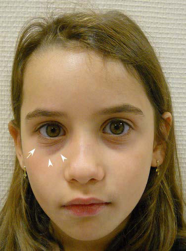

# Chapter 183: Diagnosis of Allergic Disease
> **Course:** Vikkypaedia Pediatric Basic Course (*Nelson Textbook of Pediatrics, 22nd Edition (2025)*)  
> **Part XIII:** Allergic Disorders  
> **Authors:** Supinda Bunyavanich, Jacob Kattan, and Scott H. Sicherer  
> **Metrics:** 4,567 words · 3 tables/boxes · 1 figures · 2 genes · 8 flashcards · 5 MCQs  
> **Quick Navigation:** [🃏 Study 8 Flashcards](../flashcards/183_flashcards.md) · [📝 Take 5-Q MCQ Quiz](../mcqs/183_mcqs.md) · [📚 Part XIII Guide](../parts/Part_XIII.md) · [🧬 Syndrome & Genetics Atlas](../omim_gene_atlas.md) · [💊 Therapeutics Matrix](../therapies_matrix.md) · [🏠 Course Index](../../index.md)

## Key Genetic & Molecular Targets
`DOCK8`, `STAT3`

## ⚡ High-Yield Nelson Pediatric Board Pearls
- Examination of the lips may reveal cheilitis caused by drying of the lips from continuous mouth breathing or repeated licking of the lips in an attempt to replenish moisture and relieve discomfort (lip licker’s dermatitis).
- Tachycardia may be caused by the asthma exacerbation or accompanied by jitteriness after treatment with β-agonists.
- Xerosis, or dry skin, is the most common skin abnormality of allergic children.
- Keratosis pilaris, often found on facial cheeks and extensor surfaces of the upper arms and thighs, is a benign condition character ized by skin-colored or slightly pink papules caused by keratin plugs lodged in the openings of hair follicles.
- Eosinophilia, defined as the presence of >500 eosinophils/μL in peripheral blood, is the most common hematologic abnormality of allergic patients.
- Whether identified via serologic or skin testing, detection of sIgE denotes a sensitized state (i.e., atopy or a tendency toward develop ment of allergic disease) but is not equivalent to a clinically relevant allergic diagnosis.
- Food challenges are performed when the history and results of skin tests and immunoassays for sIgE are insufficient to clarify the diagnosis of an allergy.

---
## Full Chapter Text, Tables & Figures
# Chapter 183: Diagnosis of Allergic Disease

*Supinda Bunyavanich, Jacob Kattan, and Scott H. Sicherer*

<!-- p.1771 -->
**ALLERGY HISTORY** Obtaining a complete history from the allergic patient involves elicit ing a description of all symptoms along with their timing and duration, exposure to common allergens, and responses to previous therapies. Because patients often suffer from more than one allergic disease, the presence or absence of other allergic diseases, including allergic rhi noconjunctivitis, asthma, food allergy, eosinophilic esophagitis, atopic dermatitis, and drug allergy, should be determined. A family history of allergic disease is common and is one of the most important factors predisposing a child to the development of allergies. The risk of allergic disease in a child approaches 50% when one parent is allergic and 66% when both parents are allergic, with maternal history of atopy having a greater effect than paternal history.

Several characteristic behaviors are often seen in allergic children. Because of nasal **pruritus** and **rhinorrhea**, children with allergic rhi nitis often perform the **allergic salute** by rubbing their nose upward with the palm of their hand. This repeated maneuver may give rise to the **nasal crease**, a horizontal wrinkle over the bridge of the nose. Characteristic vigorous **rubbing** of the eyes with the thumb and side of the fist is frequently observed in children with allergic conjunctivitis. The **allergic cluck** is produced when the tongue is placed against the roof of the mouth to form a seal and withdrawn rapidly in an effort to scratch the palate. The presence of other symptoms, such as fever, uni lateral nasal obstruction, and purulent nasal discharge, suggests other diagnoses.

The timing of onset and the progression of symptoms are relevant. The onset of recurrent or persistent nasal symptoms coinciding with placement in a daycare center might suggest recurrent infection rather than allergy. When patients present with a history of episodic acute symptoms, it is important to review the setting in which symptoms occur as well as the activities and exposures that immediately precede their onset. Symptoms associated with lawn mowing suggest allergy to grass pollen or fungi, whereas if symptoms occur in homes with pets, animal dander sensitivity is an obvious consideration. Reproduc ible reactions after ingestion of a specific food raise the possibility of food allergy. When symptoms wax and wane but evolve gradually and are more chronic in duration, a closer look at whether the timing and progression of symptoms correlate with exposure to a seasonal aeroal lergen is warranted.

**Aeroallergens**, such as **pollens** and fungal spores, are prominent causes of allergic disease. The concentrations of these allergens in out door air fluctuate seasonally. Correlating symptoms with **seasonal** pol lination patterns of geographically relevant plants and trees along with information provided by local pollen counts can aid in identifying the allergen. Throughout most of the United States, trees pollinate in the early spring, grasses pollinate in the late spring and early summer, and weeds pollinate in late summer through the fall. The presence of fun gal spores in the atmosphere follows a seasonal pattern in the north ern United States, with spore counts rising with the onset of warmer weather and peaking in late summer months, only to recede again with the first frost through the winter. In warmer regions of the southern United States, fungal spores and grass pollens may cause symptoms on a perennial basis.

Rather than experiencing seasonal symptoms, some patients suf fer allergic symptoms year-round. In these patients, sensitization to **perennial allergens** usually found indoors, such as dust mites, animal

dander, cockroaches, and fungi, warrants consideration. Species of certain fungi, such as *Aspergillus* and *Penicillium,* are found indoors, whereas *Alternaria* is found in both indoor and outdoor environments. Cockroach and rodent allergens are often problematic in urban envi ronments. Patients sensitive to perennial allergens often also become sensitized to seasonal allergens and experience baseline symptoms year-round with worsening during the pollen seasons.

The age of the patient is an important consideration in identifying potential allergens. Infants and young children are often first sensitized to allergens that are in their environment on a continuous basis, such as dust mites, animal dander, and fungi. Sensitization to seasonal aller gens usually takes several seasons of exposure to develop and is thus unlikely to be a significant trigger of symptoms in infants and toddlers.

**Food allergies** are more common in infants and young children, resulting primarily in cutaneous, gastrointestinal, and, less frequently, respiratory and cardiovascular symptoms. Symptoms of immediate or IgE-mediated hypersensitivity food reactions typically develop within minutes to 2 hours after ingestion of the offending food. Symptoms of non–IgE-mediated food allergies are often delayed or chronic (see Chapter 192).

Complete information from previous evaluations and prior treat ments for allergic disease should be reviewed, including impact of changes in local environment (e.g., home vs school), response to medi cations, elimination diets, and duration and impact of allergen immu notherapy (if applicable). Improvement in symptoms with medications or avoidance strategies used to treat allergic disease provides additional evidence for an allergic process.

A thorough **environmental** survey should be performed, focusing on potential sources of allergen and/or irritant exposure, particularly when respiratory symptoms (upper/lower) are reported. The age and type of the dwelling, how it is heated and cooled, the use of humidifiers or air filtration units, and any history of water damage should be noted. Forced air heating may stir up dust mite, fungi, and animal allergens. The irritant effects of wood-burning stoves, fireplaces, and kerosene heaters may provoke respiratory symptoms. Increased humidity or water damage in the home is often associated with greater exposure to dust mites and fungi. Carpeting serves as a reservoir for dust mites, fungi, and animal dander. The number of domestic pets and their movements about the house should be ascertained. Special attention should be focused on the bedroom, where a child spends a significant proportion of time. The age and type of bedding, the use of dust mite covers on pillows and mattresses, the number of stuffed animals, type of window treatments, and the accessibility of pets to the room should be reviewed. The number of smokers living in the home, and what and where they smoke is useful information. Activities that might result in exposure to allergens or respiratory irritants such as paint fumes, cleansers, sawdust, or glues should be identified. Similar information should be obtained in other environments where the child spends long periods, such as a relative’s home or school setting.

**PHYSICAL EXAMINATION** In patients with **asthma**, *spirometry* should be performed. If respira tory distress is observed, *pulse oximetry* should be performed.

The child presenting with a chief complaint of **rhinitis** or **rhino conjunctivitis** should be observed for mouth breathing, paroxysms of sneezing, sniffing/snorting, throat clearing, and rubbing of the nose and eyes (representing **pruritus**; see Chapter 184). Infants should be observed during feeding for nasal obstruction severe enough to inter fere with feeding or for more obvious signs of aspiration or gastro esophageal reflux. The frequency and nature of coughing that occurs during the interview and any positional change in coughing or wheez ing should be noted. Children with asthma should be observed for congested or wet cough, tachypnea at rest, retractions, and audible wheezes, which may worsen with crying. Patients with atopic dermati tis should be monitored for repetitive scratching and the extent of skin involvement.

Because children with severe asthma as well as those receiving chronic or frequent oral corticosteroids may experience growth sup pression, an accurate height should be plotted at regular intervals. The

*Supinda Bunyavanich, Jacob Kattan, and Scott H. Sicherer*

<!-- p.1772 -->
use of inhaled glucocorticoids in prepubertal children is associated with a small initial decrease in attained height (1 cm) that may per sist as a reduction in adult height. Poor weight gain in a child with chronic chest symptoms should prompt consideration of cystic fibro sis. Anthropometric measures are also important to monitor in those on restricted diets because of multiple food allergies or eosinophilic esophagitis. Blood pressure should be measured to evaluate for steroidinduced hypertension. The patient with acute asthma may present with **pulsus paradoxus**, defined as a drop in systolic blood pressure during inspiration >10 mm Hg. Moderate to severe airway obstruction is indi cated by a decrease of >20 mm Hg. An increased heart rate may be the result of an asthma flare or the use of a β-agonist or decongestant. Fever is not caused by allergy alone and should prompt consideration of an infectious process, which may exacerbate asthma.

Parents are often concerned about blue-gray to purple discolorations beneath their child’s lower eyelids, which can be attributed to venous stasis and are referred to as **allergic shiners** (Fig. 183.1). They are found in up to 60% of allergic patients and almost 40% of patients *without* allergic disease. Thus “shiners” may suggest, but are not diagnostic of, allergic disease. In contrast, the **Dennie-Morgan folds** (Dennie lines) are a feature of atopy (see Fig. 183.1). These are prominent infraorbital skin folds that extend in an arc from the inner canthus beneath and parallel to the lower lid margin.

In patients with **allergic conjunctivitis**, involvement of the eyes is typically bilateral (see Chapter 188). Examination of the conjunctiva reveals varying degrees of lacrimation, conjunctival injection, and edema. In severe cases, periorbital edema involving primarily the lower eyelids or **chemosis** (conjunctival edema that is gelatinous in appear ance) may be observed. The classic discharge associated with allergic conjunctivitis is usually described as “stringy” or “ropy.” In children with vernal conjunctivitis, a more severe, chronic phenotype, examina tion of the tarsal conjunctiva may reveal cobblestoning. **Keratoconus**, or protrusion of the cornea, may occur in patients with vernal conjunc tivitis or periorbital atopic dermatitis as a result of repeated trauma produced by persistent rubbing of the eyes. Children treated with highdose or chronic corticosteroids are at risk for development of posterior subcapsular cataracts.

The external ear should be examined for eczematous changes in patients with atopic dermatitis, including the postauricular area and base of the earlobe. Because otitis media with effusion is common in children with allergic rhinitis, pneumatic otoscopy should be per formed to evaluate for the presence of fluid in the middle ear and to exclude infection.

Examination of the nose in allergic patients may reveal the pres ence of a nasal crease. Nasal patency should be assessed, and the nose examined for structural abnormalities affecting nasal airflow, such as septal deviation, turbinate hypertrophy, and nasal polyps. Decrease or absence of the sense of smell should raise concern about chronic sinusitis or nasal polyps. Nasal polyps in children should raise con cerns of cystic fibrosis. The nasal mucosa in allergic rhinitis is classi cally described as pale to purple compared with the beefy-red mucosa of patients with nonallergic rhinitis. Allergic nasal secretions are typi cally thin and clear. Purulent secretions suggest another cause of rhi nitis. The frontal and maxillary sinuses should be palpated to identify tenderness to pressure that might be associated with acute sinusitis.

Examination of the lips may reveal cheilitis caused by drying of the lips from continuous mouth breathing or repeated licking of the lips in an attempt to replenish moisture and relieve discomfort **(lip licker’s dermatitis)**. Tonsillar and adenoidal hypertrophy along with a history of impressive snoring raises the possibility of obstructive sleep apnea. The posterior pharynx should be examined for the pres ence of postnasal drip and posterior pharyngeal lymphoid hyperplasia (“cobblestoning”).

Chest findings in asthmatic children vary significantly and may depend on disease duration, severity, and activity. In a child with wellcontrolled asthma, the chest should appear entirely normal on exami nation between asthma exacerbations. Examination of the same child during an acute episode of asthma may reveal hyperinflation, tachy pnea, use of accessory muscles (retractions), wheezing, and decreased air exchange with a prolonged expiratory time. Tachycardia may be caused by the asthma exacerbation or accompanied by jitteriness after treatment with β-agonists. Decreased airflow or rhonchi and wheezes over the right chest may be noted in children with mucus plugging and right middle lobe atelectasis. The presence of cyanosis indicates severe respiratory compromise. Unilateral wheezing after an episode of coughing and choking in a small child without a history of previous respiratory illness suggests **foreign body aspiration**. Wheezing limited to the larynx in association with inspiratory stridor may be seen in older children and adolescents with **vocal cord dysfunction.** Digital clubbing is rarely seen in patients with uncomplicated asthma and should prompt further evaluation to rule out other potential chronic diagnoses, such as cystic fibrosis.

The skin of the allergic patient should be examined for evidence of **urticaria/angioedema** or **atopic dermatitis** (see Chapters 189 and 186). **Xerosis**, or dry skin, is the most common skin abnormality of allergic children. **Keratosis pilaris**, often found on facial cheeks and extensor surfaces of the upper arms and thighs, is a benign condition character ized by skin-colored or slightly pink papules caused by keratin plugs lodged in the openings of hair follicles. Examination of the skin of the palms and soles may reveal thickened skin and exaggerated palmar and plantar creases **(hyperlinearity)** in children with moderate to severe atopic dermatitis.

**DIAGNOSTIC TESTING In Vitro Tests** Allergic diseases are often associated with increased numbers of eosino phils circulating in the peripheral blood and invading the tissues and secretions of target organs. **Eosinophilia**, defined as the presence of >500 eosinophils/μL in peripheral blood, is the most common hematologic abnormality of allergic patients. Seasonal increases in the number of circu lating eosinophils may be observed in sensitized patients after exposure to allergens such as tree, grass, and weed pollens. The number of circulating eosinophils can be suppressed by certain infections and systemic cortico steroids. In certain pathologic conditions, such as drug reactions, eosino philic pneumonias, and eosinophilic esophagitis, significantly increased numbers of eosinophils may be present in the target organ in the absence

**Fig. 183.1** Bilateral Dennie-Morgan folds. Several linear wrinkles beneath the lower eyelashes (arrow) associated with bilateral allergic shiners: dark circles beneath the lower eyelid (arrowheads). (From Blanc S, Bourrier T, Albertini M, et al. Dennie-Morgan fold plus dark circles: suspect atopy at first sight. J Pediatr. 2015;166:1541.)

<!-- p.1773 -->
of peripheral blood eosinophilia. Increased numbers of eosinophils are observed in a wide variety of disorders in addition to allergy; eosinophil counts >1,500 without an identifiable etiology should suggest one of the two hypereosinophilic syndromes (Table 183.1; see Chapter 169).

Nasal and bronchial secretions may be examined for the presence of eosinophils and neutrophils. The presence of eosinophils in the sputum of patients with atopic asthma is frequently seen. An increased number of eosinophils in a smear of nasal mucus with Hansel stain is a more sen sitive indicator of nasal allergies than peripheral blood eosinophilia and can aid in distinguishing allergic rhinitis from other causes of rhinitis.

An elevated **IgE** value is often found in the serum of allergic patients, because IgE is the primary antibody associated with immediate hyper sensitivity reactions. IgE values are measured in international units (IU), with 1 IU equal to 2.4 ng of IgE. Serum IgE levels gradually rise over the first years of life to peak in the teen years and decrease steadily thereafter. Additional factors, such as genetic influences, gender, cer tain diseases, and exposure to cigarette smoke and allergens, also affect serum IgE levels. Total serum IgE levels may increase 2- to 4-fold dur ing and immediately after the pollen season and then gradually decline until the next pollen season. Comparison of total IgE levels among patients with allergic diseases reveals that those with atopic dermatitis tend to have the highest levels, whereas patients with allergic asthma generally have higher levels than those with allergic rhinitis. Although average total IgE levels are higher in populations of allergic patients than in comparable populations without allergic disease, the overlap in levels is such that the diagnostic value of a total IgE level is poor. Approximately half of patients with allergic disease have total IgE levels in the normal range. However, measurement of total IgE is indicated when the diagnosis of **allergic bronchopulmonary aspergillosis** is

suspected because total serum IgE concentration >1,000 ng/mL is a criterion for diagnosis of this disorder (see Chapter 283.1). Total serum IgE may also be elevated in several nonallergic diseases (Table 183.2).

The presence of IgE specific for a particular allergen can be docu mented in  vivo by skin testing or in  vitro by the measurement of **allergen-specific IgE (sIgE)** levels in the serum (Table 183.3). The first test for documenting the presence of sIgE was called the radio allergosorbent test (RAST) because it used a radiolabeled anti-IgE antibody. RAST has been replaced by an improved generation of auto mated enzymatic sIgE immunoassays. These immunoassays typically use solid-phase supports to which allergens of an individual allergen extract are bound. A small amount of the patient’s serum is incubated with the allergen-coated support. The allergen-coated support bound to the patient’s sIgE is then incubated with enzyme-conjugated antihu man IgE. Incubation of this sIgE–antihuman IgE complex with a fluo rescent substrate of the conjugated enzyme results in the generation of fluorescence that is proportional to the amount of sIgE in the serum sample. The amount of sIgE is calculated by interpolation from a stan dard calibration curve and reported in arbitrary mass units (kilo-IU of allergen-specific antibody per unit volume of sample, kUA/L). Labora tory reports may specify classes, counts, or units, but quantification of results in kUA/L is most useful. sIgE immunoassays are available for foods, environmental allergens, insect venoms, natural rubber latex, and a small number of β-lactam drugs. The sensitivity and specific ity of immunoassays for particular allergens vary widely from 30–95%. These immunoassays are not diagnostic for allergy and should not be used for allergy screening. Only targeted sIgE levels for specific anti gens should be measured when there is a clinical indication to suspect a specific allergy.

#### **Table 183.1** Differential Diagnosis of Childhood Eosinophilia

| Category / Parameter | Clinical Details & Findings |
| --- | --- |
| **HEMATOLOGIC/ONCOLOGIC** | Neoplasm (lung, gastrointestinal, uterine); Leukemia/lymphoma; Myelofibrosis; Myeloproliferative (FIP1L1-PDGFRA positive) hypereosinophilic; syndrome; Lymphatic hypereosinophilic syndrome; Systemic mastocytosis |
| **IMMUNOLOGIC** | T-cell immunodeficiencies; Hyper-IgE (Job) syndromes; Wiskott-Aldrich syndrome; Autoimmune lymphoproliferative syndrome (ALPS); Sarcoidosis; Graft-versus-host disease; Drug hypersensitivity including drug reaction with eosinophilia and; systemic symptoms (DRESS); Postirradiation; Postsplenectomy |
| **ENDOCRINE** | Addison disease; Hypopituitarism |
| **CARDIOVASCULAR** | Loeffler disease (fibroplastic endocarditis); Congenital heart disease; Hypersensitivity vasculitis; Eosinophilic myocarditis |
| **GASTROINTESTINAL** | Benign proctocolitis; Inflammatory bowel disease; Eosinophilic gastrointestinal diseases (EGID) |
| **PHYSIOLOGIC** | Prematurity; Infants receiving hyperalimentation; Hereditary |
| **INFECTIOUS** | Parasitic (with tissue-invasive helminths, e.g., trichinosis,; strongyloidiasis, pneumocystosis, filariasis, cysticercosis, cutaneous; and visceral larva migrans, echinococcosis); Bacterial (brucellosis, tularemia, cat-scratch disease,; Chlamydia); Fungal (histoplasmosis, blastomycosis, coccidioidomycosis, allergic; bronchopulmonary aspergillosis); Mycobacterial (tuberculosis, leprosy); Viral (HIV-1, HTLV-1, hepatitis A, hepatitis B, hepatitis C, Epstein-Barr; virus) |
| **PULMONARY** | Allergic (rhinitis, asthma); Eosinophilic granulomatosis with polyangiitis (Churg-Strauss; syndrome); Loeffler syndrome; Hypersensitivity pneumonitis; Eosinophilic pneumonia (chronic, acute); Pulmonary interstitial eosinophilia |
| **DERMATOLOGIC** | Atopic dermatitis; Pemphigus; Dermatitis herpetiformis; Infantile eosinophilic pustular folliculitis; Eosinophilic fasciitis (Schulman syndrome); Eosinophilic cellulitis (Wells syndrome); Kimura disease (angiolymphoid hyperplasia with; eosinophilia); FIP1L1-PDGFRA, FIP1-like 1–platelet-derived growth factor receptor α; HTLV, human T-lymphotropic virus 1. |

<!-- p.1774 -->

#### **Table 183.3** Determination of Allergen-Specific IgE by Skin Testing vs In Vitro Testing

| Category / Parameter | Clinical Details & Findings |
| --- | --- |
| **sIgE ASSAY** | Risk of allergic reaction; Yes (especially ID); No; Relative sensitivity; High; High; Affected by antihistamines; Yes; No; Affected by corticosteroids; Usually not; No; Affected by extensive dermatitis or; dermatographism; Yes; No; Broad selection of antigens; Fewer; Yes; Immediate results; Yes; No; Expensive; No; Yes; Lability of allergens; Yes; No; Results evident to patient; Yes; No; *Skin testing may be the prick test or intradermal (ID) injection. |
| **NEOPLASTIC DISEASES** | Hodgkin disease; IgE myeloma; Bronchial carcinoma |
| **OTHER DISEASES AND DISORDERS** | Alopecia areata; Bone marrow transplantation; Burns; Cystic fibrosis; Dermatitis, chronic acral; Erythema nodosum, streptococcal infection; Guillain-Barré syndrome; Kawasaki disease; Liver disease; Medication related; Nephritis, drug-induced interstitial; Nephrotic syndrome; Pemphigus, bullous; Polyarteritis nodosa, infantile; Primary pulmonary hemosiderosis; Juvenile idiopathic arthritis |

#### **Table 183.2** Nonallergic Diseases Associated with Increased Serum IgE Concentrations

| Category / Parameter | Clinical Details & Findings |
| --- | --- |
| **PARASITIC INFESTATIONS** | Ascariasis; Capillariasis; Echinococcosis; Fascioliasis; Filariasis; Hookworm; Onchocerciasis; Malaria; Paragonimiasis; Schistosomiasis; Strongyloidiasis; Trichinosis; Visceral larva migrans |
| **INFECTIONS** | Allergic bronchopulmonary aspergillosis; Candidiasis, systemic; Coccidioidomycosis; Cytomegalovirus mononucleosis; HIV type 1 infections; Infectious mononucleosis (Epstein-Barr virus); Leprosy; Pertussis; Viral respiratory infections |
| **IMMUNODEFICIENCY** | Autosomal dominant hyper-IgE syndrome (STAT3 variants); Autosomal recessive hyper-IgE syndrome (DOCK8, TYK2 variants); IgA deficiency, selective; Nezelof syndrome (cellular immunodeficiency with immunoglobulins); Thymic hypoplasia (DiGeorge anomaly); Wiskott-Aldrich syndrome |

<!-- p.1775 -->
**Component testing** refers to diagnostic tests where sIgE is measured to specific proteins that comprise allergens (e.g., Ara h 2 from peanut, Bet v 1 from birch pollen), rather than to a mixture of the allergens extracted from the source. Testing sIgE to component allergens may add additional diagnostic value by differentiating immune responses that are directed toward clinically relevant allergenic proteins.

**In Vivo Tests Allergen skin testing** is the primary in vivo procedure for the diagno sis of allergic disease. Mast cells with sIgE antibodies attached to highaffinity receptors on their surface reside in the skin of allergic patients. The introduction of minute amounts of an allergen into the skin of the sensitized patient results in cross linking of IgE antibodies on the mast cell surface, thereby triggering local mast cell activation. Once activated, these mast cells release a variety of preformed and newly generated mediators that act on surrounding tissues. **Histamine** is the mediator most responsible for the immediate **wheal and flare reac tions** observed in skin testing. Examination of the site of a positive skin test result reveals a pruritic wheal surrounded by erythema. The time course of these reactions is rapid in onset, reaching a peak within 10-20 minutes and usually resolving over the next 30 minutes.

Skin testing is performed using the **prick/puncture technique.** With this technique, a small drop of allergen is applied to the skin surface, and a tiny amount is introduced into the epidermis by lightly pricking or puncturing the outer layer of skin through the drop of extract with a small needle or other device. When the **skin-prick test (SPT)** result is negative but the history suggestive, selective skin testing (for vaccines, venom, drugs, and aeroallergens) using the **intradermal technique** may be performed. This technique involves using a 26-gauge needle to inject 0.01-0.02 mL of an allergen extract diluted 1,000- to 10-fold into the dermis of the arm. Intradermal skin tests are *not recommended for use with food allergens* because of the risk of triggering anaphylaxis. Irritant rather than allergic reactions can occur with intradermal skin testing if higher concentrations of extracts are used. Although skinprick testing is less sensitive than intradermal skin testing, positive SPT results tend to correlate better with clinical symptoms.

The number of skin tests performed should be individualized, with the allergens suggested by the history. A positive and negative control SPT, using histamine and saline, respectively, is performed with each set of skin tests. A negative control is necessary to assess for **derma tographism**, in which reactions are caused merely by applying pres sure to overly sensitive skin. A positive control is necessary to establish the presence of a cutaneous response to histamine. Medications with antihistaminic properties, in addition to adrenergic agents such as ephedrine and epinephrine, suppress skin test responses and should be avoided for appropriate intervals (approximately five half-lives) before skin testing. Prolonged courses of systemic corticosteroids may sup press cutaneous reactivity by decreasing the number of tissue mast cells as well as their ability to release mediators.

Whether identified via serologic or skin testing, detection of sIgE denotes a sensitized state (i.e., atopy or a tendency toward develop ment of allergic disease) but is not equivalent to a clinically relevant allergic diagnosis. **Many children with positive tests have no clini cal symptoms on exposure to the allergen**. Increasingly strong test

results (higher serum sIgE results or larger SPT wheal sizes) gener ally correlate with increasing likelihood of clinical reactivity (but not severity). Neither serologic testing nor skin testing for allergy is pre dictive of reaction severity or threshold of reactivity, and these tests will be negative when the allergy is not IgE mediated, such as in food protein–induced enterocolitis syndrome. The limitations of these test modalities underscore the need for a detailed medical history that can guide the selection and interpretation of test results. **Large panels of indiscriminately performed screening tests may provide misleading information and are not recommended.**

Both serum sIgE tests and SPT are sensitive and have similar diag nostic properties. The benefits of the serologic immunoassays are that performance is not limited by the presence of skin disease (i.e., active atopic dermatitis) or medication use (i.e., antihistamines). Advan tages of skin testing are that they provide rapid results to the patient/ family during the clinic visit, do not require venipuncture, and are less costly.

Under certain circumstances, **provocation testing** is performed to examine the association between allergen exposure and the develop ment of symptoms. The bronchial provocation test most frequently performed clinically is the **methacholine challenge,** which causes potent bronchoconstriction of asthmatic but not of normal airways; it is performed to document the presence and degree of bronchial hyper reactivity in a patient with suspected asthma. After baseline spirometry values are obtained, increasing concentrations of nebulized methacho line are inhaled until a drop occurs in lung function, specifically a 20% decrease in FEV1 (forced expiratory volume in the first second of expi ration), or the patient is able to tolerate the inhalation of a set concen tration of methacholine, typically 25 mg/mL.

Oral **food challenges** are performed to determine whether a specific food causes symptoms or whether a suspected food can be added to the diet. Food challenges are performed when the history and results of skin tests and immunoassays for sIgE are insufficient to clarify the diagnosis of an allergy. These challenges may be performed in an open single-blind, double-blind, or double-blind placebo-controlled man ner and involve the ingestion of gradually increasing amounts of the suspected food at set intervals until the patient either experiences a reaction or tolerates a normal portion (i.e., one serving size) of the food openly. Although the double-blind placebo-controlled food chal lenge is currently the gold standard test for diagnosing food allergy, it is typically only performed in research studies due to the time and laborintensive nature of this method. Because of the potential for significant allergic reactions, oral food challenges should be performed only in an appropriately equipped facility with personnel experienced in the per formance of food challenges and the treatment of anaphylaxis, includ ing cardiopulmonary resuscitation.

Upper gastrointestinal **endoscopy** is required to confirm the diag nosis of **eosinophilic esophagitis**. One or more biopsy specimens from the proximal and distal esophagus must show eosinophilpredominant inflammation. With few exceptions, 15 eosinophils per high-power field (peak value) is considered a minimum threshold for the diagnosis.

*Visit Elsevier eBooks+ at eBooks.Health.Elsevier.com** for Bibliography.*

<!-- p.1776 -->
