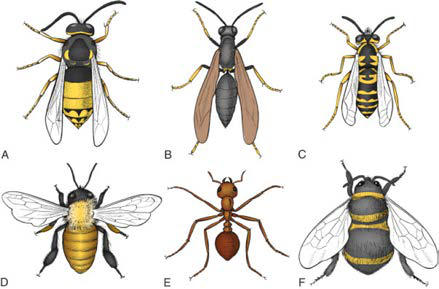

# Chapter 187: Insect Allergy
> **Course:** Vikkypaedia Pediatric Basic Course (*Nelson Textbook of Pediatrics, 22nd Edition (2025)*)  
> **Part XIII:** Allergic Disorders  
> **Authors:** Julie Wang and Scott H. Sicherer  
> **Metrics:** 3,275 words · 1 tables/boxes · 1 figures · 1 genes · 8 flashcards · 5 MCQs  
> **Quick Navigation:** [🃏 Study 8 Flashcards](../flashcards/187_flashcards.md) · [📝 Take 5-Q MCQ Quiz](../mcqs/187_mcqs.md) · [📚 Part XIII Guide](../parts/Part_XIII.md) · [🧬 Syndrome & Genetics Atlas](../omim_gene_atlas.md) · [💊 Therapeutics Matrix](../therapies_matrix.md) · [🏠 Course Index](../../index.md)

## Key Genetic & Molecular Targets
`FLG`

## ⚡ High-Yield Nelson Pediatric Board Pearls
- It is associated with generalized redness, scaling, weeping, crusting, systemic toxicity, lymphadenopathy, and fever and is usually caused by superinfection (e.g., with toxin-producing S. aureus or HSV infection) or inappropriate therapy.
- Cataracts may be a primary manifestation of AD or from extensive use of systemic and topical glucocorticoids, particularly around the eyes.
- PROGNOSIS AD generally tends to be more severe and persistent in young children, particularly if they have homozygous null pathogenic variants in their fil aggrin genes.
- Predictive factors of a poor prognosis for AD include widespread AD in childhood, FLG null pathogenic variants, concomitant allergic rhinitis and asthma, family history of AD in parents or siblings, early age at onset of AD, being an only child, and very high serum IgE levels.
- Identification and elimination of triggering factors are the mainstay for prevention of flares as well as for the long-term treatment of AD.
- Allergic reac tions caused by inhalation of airborne particles of insect origin result in acute and chronic respiratory symptoms of seasonal or perennial rhinitis, conjunctivitis, and asthma.
- Papular urticaria affecting the lower extremities in children is usu ally caused by multiple bites.

---
## Full Chapter Text, Tables & Figures
# Chapter 187: Insect Allergy

*Julie Wang and Scott H. Sicherer*

<!-- p.1819 -->
corticosteroids should be temporarily discontinued if HSV infection is suspected. Reports of life-threatening dissemination of HSV infections in patients with AD who have widespread disease mandate antiviral treatment. Persons with AD are also susceptible to **eczema vaccina tum**, which is similar in appearance to eczema herpeticum and histori cally follows smallpox (vaccinia virus) vaccination.

Cutaneous warts, coxsackievirus, and molluscum contagiosum are additional viral infections affecting children with AD.

Dermatophyte infections can also contribute to exacerbation of AD. Patients with AD have been found to have a greater susceptibility to *Trichophyton rubrum* fungal infections than nonatopic controls. There has been particular interest in the role of *Malassezia furfur* (formerly known as *Pityrosporum ovale*) in AD because it is a lipophilic yeast commonly present in the seborrheic areas of the skin. IgE antibodies against *M. furfur* have been found in patients with head and neck der matitis. A reduction of AD severity has been observed in these patients after treatment with antifungal agents.

**COMPLICATIONS Exfoliative dermatitis** may develop in patients with extensive skin involve ment. It is associated with generalized redness, scaling, weeping, crusting, systemic toxicity, lymphadenopathy, and fever and is usually caused by superinfection (e.g., with toxin-producing *S. aureus* or HSV infection) or inappropriate therapy. In some cases the withdrawal of systemic glucocor ticoids used to control severe AD precipitates exfoliative erythroderma.

Eyelid dermatitis and chronic blepharitis may result in visual impair ment from corneal scarring. **Atopic keratoconjunctivitis** is usually bilateral and can have disabling symptoms that include itching, burning, tearing, and copious mucoid discharge. Vernal conjunctivitis is associated with papillary hypertrophy or cobblestoning of the upper eyelid conjunc tiva. It typically occurs in younger patients and has a marked seasonal inci dence with spring exacerbations. **Keratoconus** is a conical deformity of the cornea believed to result from chronic rubbing of the eyes in patients with AD. Cataracts may be a primary manifestation of AD or from extensive use of systemic and topical glucocorticoids, particularly around the eyes.

**PROGNOSIS** AD generally tends to be more severe and persistent in young children, particularly if they have homozygous null pathogenic variants in their fil aggrin genes. Periods of remission occur more frequently as patients grow older. Spontaneous resolution of AD has been reported to occur after age 5 years in 40–60% of patients affected during infancy, particularly for mild disease. Earlier studies suggested that approximately 84% of children out grow their AD by adolescence; however, later studies reported that AD resolves in approximately 20% of children monitored from infancy until adolescence and becomes less severe in 65%. Of those adolescents treated for mild dermatitis, >50% may experience a relapse of disease as adults, which frequently manifests as *hand dermatitis,* especially if daily activities require repeated hand wetting. Predictive factors of a poor prognosis for AD include widespread AD in childhood, *FLG* null pathogenic variants, concomitant allergic rhinitis and asthma, family history of AD in parents or siblings, early age at onset of AD, being an only child, and very high serum IgE levels.

**PREVENTION** Breastfeeding may be beneficial. Probiotics and prebiotics may also reduce the incidence or severity of AD, but this approach is unproven. If an infant with AD is diagnosed with food allergy, the breastfeeding mother may need to eliminate the implicated food allergen from her diet. For infants with severe eczema, introduction of infant-safe forms of peanut as early as 4-6 months, after other solids are tolerated, is recommended after consul tation with the child’s pediatrician and/or allergist for allergy testing. This approach may prevent peanut allergy (see Chapter 192). Identification and elimination of triggering factors are the mainstay for prevention of flares as well as for the long-term treatment of AD.

Emollient therapy applied to the whole body for the first few months of life may enhance the cutaneous barrier and reduce the risk of eczema.

*Visit Elsevier eBooks+ at eBooks.Health.Elsevier.com** for Bibliography.*

Allergic responses to stinging or, more rarely, biting insects vary from localized cutaneous reactions to systemic anaphylaxis. **Allergic reac tions** caused by inhalation of airborne particles of insect origin result in acute and chronic respiratory symptoms of seasonal or perennial rhinitis, conjunctivitis, and asthma.

**ETIOLOGY** Most reactions to stinging and biting insects, such as those induced by wasps, mosquitoes, flies, and fleas, are limited to a primary lesion isolated to the area of the sting or bite and do not represent an aller gic response. Occasionally, insect stings or bites induce pronounced localized reactions or systemic reactions that may be based on imme diate or delayed hypersensitivity reactions. Systemic allergic responses to insects are usually attributed to IgE antibody–mediated responses, which are caused primarily by stings from venomous insects of the order **Hymenoptera** and more rarely from ticks, spiders, scorpions, and *Triatoma* (kissing bug). Members of the order Hymenoptera include *apids* (honeybee, bumblebee), *vespids* (yellow jacket, wasp, hornet), and *formicids* (fire and harvester ants) (Fig. 187.1). Among winged stinging insects, yellow jackets are the most notorious for sting ing because they are aggressive and ground dwelling, and they linger near activities involving food. Hornets nest in trees, whereas wasps build honeycomb nests in dark areas such as under porches; both are aggressive if disturbed. Honeybees are less aggressive and nest in tree hollows; unlike the stings of other flying Hymenoptera, honeybee stings almost always leave a barbed stinger with venom sac.

In the United States, fire ants are found in the Southeast, living in large mounds of soil. When disturbed, the ants attack in large numbers, anchor themselves to the skin by their mandibles, and sting multiple times in a circular pattern. Sterile pseudopustules form at the sting sites. Systemic reactions to stinging insects occur in 0.4–0.8% of chil dren and 3% of adults and account for approximately 40 deaths each year in the United States.

Although reactions to insect bites are common, IgE-mediated reac tions are infrequently reported and anaphylaxis is rare. The *Triatoma* (kissing bug) bite causes an erythematous plaque that is painless. Mos quito bites generally result in local reactions that are pruritic. Large,

*Julie Wang and Scott H. Sicherer*

A

D E F

B C

**Fig. 187.1** Representative venomous Hymenoptera. A, Hornet (Vespula maculata). B, Wasp (Chlorion ichneumerea). C, Yellowjacket (Vespula maculiforma). D, Honeybee (Apis mellifera). E, Fire ant (So lenopsis invicta). F, Bumblebee (Bombus species). (From Erickson TB, Marquez A. Arthropod envenomation and parasitism. In: Auerbach PS, Cushing TA, Harris NS, eds. Auerbach’s Wilderness Medicine. 7th ed. Philadelphia: Elsevier; 2017: Fig 41-1, p 937.)

<!-- p.1821 -->
local reactions to mosquito bites can occur in some young children; this is known as **skeeter syndrome** and is often misdiagnosed as cel lulitis. The *tabanid* species (horsefly, deerfly), typically found in rural and suburban areas, are large flies that induce painful bites.

IgE antibody–mediated allergic responses to airborne particulate matter carrying insect emanations contribute to seasonal and peren nial symptoms affecting the upper and lower airways. Seasonal allergy is attributed to exposures to a variety of insects, particularly aquatic insects such as the caddis fly and midge, or lake fly, at a time when lar vae pupate and adult flies are airborne. **Perennial allergy** is attributed to sensitization to insects such as cockroaches and ladybugs, as well as house dust mite, which is phylogenetically related to spiders rather than insects and has eight rather than six legs.

**PATHOGENESIS** Hymenoptera venoms contain numerous components with toxic and pharmacologic activity and with allergenic potential. These constitu ents include vasoactive substances such as histamine, acetylcholine, and kinins; enzymes such as phospholipase and hyaluronidase; apamin; melittin; and formic acid. The majority of patients who experience sys temic reactions after Hymenoptera stings have IgE-mediated sensitivity to antigenic substances in the venom. Some venom allergens are homol ogous among members of the Hymenoptera order; others are family specific. There is substantial cross reactivity among vespid venoms, but these venom allergies are distinct from honeybee venom allergies.

Localized skin responses to biting insects are caused primarily by vasoactive or irritant materials derived from insect saliva; they rarely occur from IgE-associated responses. Systemic IgE-mediated allergic reactions to salivary proteins of biting insects such as mosquitoes are reported but uncommon.

A variety of proteins derived from insects can become airborne and induce IgE-mediated respiratory responses, causing inhalant allergies. The primary allergen from the caddis fly is a hemocyanin-like protein, and that from the midge fly is derived from hemoglobin. Allergens from the cockroach are the best studied and are derived from cock roach saliva, secretions, fecal material, and debris from skin casts.

**CLINICAL MANIFESTATIONS** Clinical reactions to stinging venomous insects are categorized as local, large local, generalized cutaneous, systemic, toxic, and delayed/ late. Simple **local reactions** involve limited swelling and pain and gen erally last <24 hours. **Large local reactions** develop over hours and days, involve swelling of extensive areas (>10 cm) that are contigu ous with the sting site, and may last for days. **Generalized cutaneous reactions** typically progress within minutes and include cutaneous symptoms of urticaria, angioedema, and pruritus beyond the site of the sting. **Systemic reactions** are identical to anaphylaxis from other triggers and may include symptoms of generalized urticaria, laryngeal edema, bronchospasm, and hypotension. A subset of patients with hypotension and persistently elevated (once recovered) tryptase lev els may have mast cell activation syndrome (see Chapter 190). Stings from numerous insects at once may result in **toxic reactions** of fever, malaise, emesis, and nausea because of the chemical properties of the venom in large doses. Serum sickness, nephrotic syndrome, vasculi tis, neuritis, or encephalopathy may occur as **delayed/late reactions** to stinging insects.

Insect bites are usually urticarial but may be papular or vesicular. **Papular urticaria** affecting the lower extremities in children is usu ally caused by multiple bites. Occasionally, individuals have large, local reactions. IgE antibody–associated immediate- and late-phase allergic responses to mosquito bites sometimes mimic cellulitis.

Inhalant allergy caused by insects results in clinical disease similar to that induced by other inhalant allergens such as pollens. Depending on individual sensitivity and exposure, reactions may result in seasonal or perennial rhinitis, conjunctivitis, or asthma.

**DIAGNOSIS** The diagnosis of allergy from stinging and biting insects is generally evident from the history of exposure, typical symptoms, and physical findings. The diagnosis of Hymenoptera allergy rests in part on the identification of venom-specific IgE by skin-prick testing or in vitro testing. The primary reasons to pursue testing are to confirm reactivity when **venom immunotherapy** (**VIT**) is being considered or when it is clinically necessary to confirm venom hypersensitivity as a cause of a reaction. Venoms of five Hymenoptera (honeybee, yellow jacket, yel low hornet, white-faced hornet, and wasp), as well as the jack jumper ant in Australia and whole body extract of fire ant, are available for skin testing. Although skin tests are considered to be the most sensitive modality for detection of venom-specific IgE, additional evaluation with an in vitro serum assay for venom-specific IgE is recommended if skin test results are negative in the presence of a convincing history of a severe systemic reaction. In vitro tests have a 20% incidence of both false-positive and false-negative results, so it is not appropriate to exclude venom hypersensitivity based on this test alone. If initial skin-prick and in vitro test results are negative in the context of a con vincing history of a severe reaction, repeat testing is recommended before concluding that allergy is unlikely. Skin tests are usually accurate within 1 week of a sting reaction, but occasionally a refractory period is observed that warrants retesting after 4-6 weeks if the initial results are negative.

An elevated **basal tryptase** level is associated with more severe reac tions to venom stings. Therefore basal tryptase should be measured if there is a history of severe reaction to a sting, hypotensive reaction, lack of urticaria in a systemic sting reaction, or negative venom IgE in a patient who has a history of systemic reaction to a sting. As many as 40% of skin test–positive patients may not experience anaphylaxis on sting challenge, so testing without an appropriate clinical history is potentially misleading.

The diagnosis of inhalant insect allergy may be evident from a his tory of typical symptoms. A chronic respiratory symptom during longterm exposure, as may occur with cockroach allergy, is less amenable to identification by history alone. Skin-prick or in vitro immunoassay tests for specific IgE to the insect are used to confirm inhalant insect allergy. Allergy tests may be particularly warranted for potential cock roach allergy in patients with persistent asthma and known cockroach exposure.

**TREATMENT** For local cutaneous reactions caused by insect stings and bites, treat ment with cold compresses, topical medications to relieve itching, and occasionally a systemic antihistamine and oral analgesic are appropri ate. Stingers should be removed promptly by scraping, with caution not to squeeze the venom sac because doing so could inject more venom. Sting sites rarely become infected, possibly because of the antibacte rial actions of venom constituents. Vesicles left by fire ant stings that are scratched open should be cleansed to prevent secondary infection.

Anaphylactic reactions after a Hymenoptera sting are treated the same as anaphylaxis from any cause; *epinephrine is the drug of choice.* Adjunctive treatment includes antihistamines, corticosteroids, intrave nous fluids, oxygen, and transport to the emergency department (see Chapter 190). Referral to an allergist-immunologist should be consid ered for patients who have experienced a generalized cutaneous or sys temic reaction to an insect sting, who need education about avoidance and emergency treatment, who may be candidates for VIT, or who have a condition that may complicate management of anaphylaxis (e.g., use of β blockers).

**Venom Immunotherapy** Hymenoptera VIT is highly effective (95–97%) in decreasing the risk for **severe anaphylaxis**. The selection of patients for VIT depends on several factors (Table 187.1). Individuals with local reactions,

<!-- p.1822 -->
regardless of age, are not at increased risk for severe systemic reactions on a subsequent sting and are not candidates for VIT. The risk of a systemic reaction for those who experienced a large, local reaction is approximately 7%; testing or VIT is usually not recommended, and prescription of self-injectable epinephrine is considered optional but usually not necessary. There is growing evidence that VIT can reduce the size and duration of large, local reactions, and therefore VIT may be considered for those with frequent or unavoidable large, local reactions. **Those who experience severe systemic reactions, such as airway involvement or hypotension, and who have specific IgE to venom allergens, should receive immunotherapy.** Immunotherapy against winged Hymenoptera is generally not required when stings have caused only generalized urticaria or angioedema, because the risk for a systemic reaction after a subsequent sting is approximately 10% and the chance of a more severe reaction is <3%. VIT may be consid ered if there are potential high-risk cofactors such as comorbid car diovascular disease or use of specific cardiovascular medications (e.g., angiotensin-converting enzyme [ACE] inhibitors, β blockers), elevated basal tryptase level, or high likelihood of future stings. VIT is usually not indicated if there is no evidence of IgE to venom.

The incidence of adverse effects in the course of *treatment* is not trivial in adults; 50% experience large, local reactions, and about 10% experience systemic reactions. The incidence of both local and sys temic reactions is much lower in children. Patients treated with honey bee venom are at higher risk for systemic reactions to VIT than those receiving treatment with vespid venom. Individuals with mast cell dis orders are at increased risk for severe anaphylaxis and more frequent systemic reactions with VIT; thus some experts recommend basal tryptase level for risk assessment purposes.

It is uncertain how long immunotherapy with Hymenoptera venom should continue. In general, treatment duration of 3-5 years is recom mended because >80% of adults who have received 5 years of therapy tolerate challenge stings without systemic reactions for 5-10 years after completion of treatment. Long-term responses to treatment are even better for children. Follow-up over a mean of 18 years of children with moderate to severe insect sting reactions who received VIT for a mean of 3-5 years and were stung again showed a reaction rate of only 5%; untreated children experienced a reaction rate of 32%. Whereas dura tion of therapy with VIT may be individualized, it is clear that a sig nificant number of untreated children retain their allergy. Extended or lifelong treatment may be considered for those who have had lifethreatening anaphylaxis with insect stings or severe reaction during VIT, those with honeybee allergy, and those with occupational expo sures to Hymenoptera. Lifelong VIT should also be considered for

patients with mast cell disorders because they have a higher rate of failure of VIT and relapse when VIT is discontinued.

Less is known about the natural history of fire ant hypersensitivity and efficacy of immunotherapy for this allergy. The criteria for start ing immunotherapy are similar to those for hypersensitivities to other Hymenoptera, but there is stronger consideration to treat patients who have only cutaneous systemic reactions with VIT. Only whole body fire ant extract is commercially available for diagnostic skin testing and immunotherapy.

**Inhalant Allergy** The symptoms of inhalant allergy caused by insects are managed as for other causes of seasonal or perennial rhinitis (see Chapter 184), con junctivitis (see Chapter 188), and asthma (see Chapter 185).

**PREVENTION* Avoidance of stings and bites is essential.* To reduce the risk of stings, sensitized individuals should have known or suspected nests near the home removed by trained professionals, should wear gloves when gar dening, should wear long pants and shoes with socks when walking in the grass or through fields, and should avoid or be cautious about eat ing or drinking outdoors. Typical insect repellents do not guard against Hymenoptera.

Individuals who are at high risk for future severe reactions to Hyme noptera stings should have immediate access to self-injectable epi nephrine. High-risk individuals include those who have a history of severe reactions or have elevated basal tryptase level. Adults respon sible for allergic children and older patients who can self-treat must be carefully taught the indications and technique of administration for this medication. Particular attention is necessary for children in outof-home daycare centers, at school, or attending camps, to ensure that an emergency action plan is in place. The individual at risk for ana phylaxis from an insect sting should also wear medical identification jewelry indicating the allergy.

Avoidance of the insect is the preferred management of inhalant allergy. This can prove difficult, particularly for those living in apart ments, where eradication of cockroaches may be problematic. Immu notherapy for dust mites is effective and should be considered in conjunction with avoidance measures. In contrast, there is limited data regarding the efficacy of cockroach immunotherapy.

*Visit Elsevier eBooks+ at eBooks.Health.Elsevier.com** for Bibliography.*

Test Results

#### **Table 187.1** Risk of Systemic Reaction in Untreated Patients with History of Sting Anaphylaxis and/or Positive Venom Skin

| Category / Parameter | Clinical Details & Findings |
| --- | --- |
| **ANAPHYLAXIS (%)** | No reaction; Adult; 5-15; <3; Large local; All; 4-10; <; Cutaneous systemic; All; 10; <3; Anaphylaxis; Child; 40; 30; Adult; 60; 40; From Golden DBK: Insect allergy. In Burks AW, Holgate ST, O’Hehir RE, et al., eds. Middleton’s Allergy Principles and Practice, ed 9, vol 2, Philadelphia: Elsevier, 2020, Table 76.2, p. 1253. |

<!-- p.1823 -->
