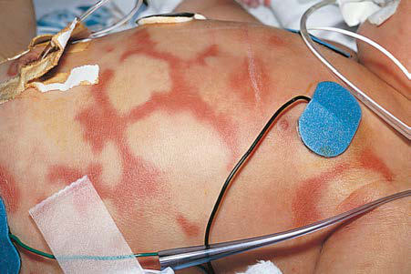
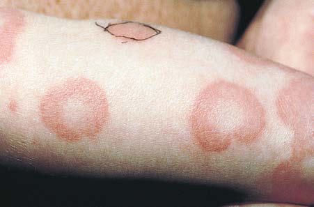

# Chapter 189: Urticaria (Hives) and Angioedema
> **Course:** Vikkypaedia Pediatric Basic Course (*Nelson Textbook of Pediatrics, 22nd Edition (2025)*)  
> **Part XIII:** Allergic Disorders  
> **Authors:** David A. Khan, Aleena Banerji, and Scott H. Sicherer  
> **Metrics:** 6,416 words · 10 tables/boxes · 2 figures · 4 genes · 8 flashcards · 5 MCQs  
> **Quick Navigation:** [🃏 Study 8 Flashcards](../flashcards/189_flashcards.md) · [📝 Take 5-Q MCQ Quiz](../mcqs/189_mcqs.md) · [📚 Part XIII Guide](../parts/Part_XIII.md) · [🧬 Syndrome & Genetics Atlas](../omim_gene_atlas.md) · [💊 Therapeutics Matrix](../therapies_matrix.md) · [🏠 Course Index](../../index.md)

## Key Chapter Topics & Subchapters
`189.1 Hereditary Angioedema` · `189.1 Hereditary Angioedema Aleena Banerji, David A. Khan, and Scott H. Sicherer`

## Key Genetic & Molecular Targets
`AR`, `BTK`, `MVK`, `NLRP3`

## ⚡ High-Yield Nelson Pediatric Board Pearls
- Acute urticaria is often caused by an allergic IgE–mediated reaction.
- Acute urticaria can also result from non–IgE-mediated stimulation of mast cells, caused by viral infections, nonsteroidal anti inflammatory drugs (NSAIDs), and opiates.
- The diagnosis of chronic urticaria is established when lesions occur on most days of the week for >6 weeks.
- Atypical aspects of the gross appearance of the hives or associated systemic symptoms should heighten concern that the urticaria or angioedema may be the manifestation of a systemic disease process.
- Cold-Dependent Disorders Cold urticaria is characterized by the development of localized pru ritus, erythema, and urticaria/angioedema after exposure to a cold stimulus.
- The diagnosis is most easily confirmed by challenge testing by holding an ice cube in place on the patient’s skin for 5 minutes.
- The diagnosis is confirmed by chal lenge testing, most commonly via the “sand bag test.” This test can be performed by using 15 lb of weights attached to a strap applied to the shoulder, thigh, or forearm for 15 minutes and observing the site over the next 24 hours for evidence of hives or edema.

---
## Full Chapter Text, Tables & Figures
# Chapter 189: Urticaria (Hives) and Angioedema

*David A. Khan, Aleena Banerji, and Scott H. Sicherer*

<!-- p.1829 -->
Urticaria affects 20% of individuals at some point in their life. Episodes of hives that last for <6 weeks are considered *acute,* whereas those that occur on most days of the week for >6 weeks are designated *chronic.* The distinction is important, because the causes and mechanisms of urticaria formation and the therapeutic approaches are different in each instance.

**ETIOLOGY AND PATHOGENESIS** Urticaria is defined as the presence of wheals (hives), angioedema, or both. **Acute urticaria** is often caused by an allergic IgE–mediated reaction (Table 189.1). This form of urticaria is a self-limited process that occurs when an allergen activates mast cells in the skin. Common causes of acute generalized urticaria include foods, drugs (particularly antibiotics), and stinging-insect venoms. If an allergen (latex, animal dander) penetrates the skin locally, hives often can develop at the site of exposure. Acute urticaria can also result from non–IgE-mediated stimulation of mast cells, caused by viral infections, nonsteroidal anti inflammatory drugs (NSAIDs), and opiates. The diagnosis of **chronic urticaria** is established when lesions occur on most days of the week for >6 weeks (Tables 189.2 and 189.3). In about half the cases, chronic urticaria is accompanied by angioedema. In 20% of chronic urticaria patients, angioedema occurs without wheals. Acute angioedema with out wheals is often a result of allergy, but recurrent isolated angioedema raises the possibility of other diagnoses.

A typical **hive** is an erythematous, pruritic, raised wheal that blanches with pressure, is transient, and resolves without residual lesions, unless the area was intensely scratched. In contrast, urticaria associated with

systemic lupus erythematosus (SLE), or other vasculitides in which a skin biopsy reveals a small-vessel vasculitis, often have distinguishing clinical features. Lesions that burn more than itch, last >24 hours, do not blanch, blister, heal with scarring, or that are associated with bleed ing into the skin (purpura) suggest urticarial vasculitis, which is a rare condition in children. Atypical aspects of the gross appearance of the hives or associated systemic symptoms should heighten concern that the urticaria or angioedema may be the manifestation of a systemic disease process (Table 189.4).

**INDUCIBLE URTICARIA** Inducible urticaria and angioedema (previously referred to as physical urticaria) share the common property of being induced by an environ mental stimulus, such as a change in temperature or direct stimulation of the skin with pressure, stroking, vibration, or light (Table 189.5; see also Table 189.2). In contrast to chronic spontaneous urticaria (CSU), the wheals of inducible urticaria are more short-lived, often lasting <1 hour.

**Cold-Dependent Disorders** Cold urticaria is characterized by the development of localized pru ritus, erythema, and urticaria/angioedema after exposure to a cold stimulus. Total body exposure, as seen with swimming in cold water, can cause anaphylaxis, resulting in hypotension, loss of consciousness, and even death if not promptly treated. The diagnosis is most easily confirmed by challenge testing by holding an ice cube in place on the patient’s skin for 5 minutes. In patients with cold urticaria, a urticarial lesion develops about 10 minutes after removal of the ice cube and on rewarming of the chilled skin. Most cases of acquired cold urticaria are idiopathic. Cold urticaria is rarely associated with the presence of **cryoproteins** such as cold agglutinins, cryoglobulins, cryofibrino gen, and the Donath-Landsteiner antibody seen in secondary syphilis (paroxysmal cold hemoglobinuria). Multiple subtypes of atypical cold urticaria with a negative ice cube test have also been reported. Cold

*David A. Khan, Aleena Banerji, and 
 Scott H. Sicherer*

#### **Table 189.1** Etiology of Acute Urticaria

| Category / Parameter | Clinical Details & Findings |
| --- | --- |
| **General** | Foods; Egg, milk, wheat, peanuts, tree nuts,; soy, shellfish, fish, direct mast cell; degranulation; Medications; Suspect all medications, even; nonprescription or homeopathic; Insect stings; Hymenoptera (honeybee, yellow jacket,; hornets, wasp, fire ants), biting insects; (papular urticaria); Infections |
| **Bacterial (streptococcal pharyngitis,** | Mycoplasma, sinusitis); Viral (hepatitis,; mononucleosis [Epstein-Barr virus],; coxsackieviruses A and B); Parasitic; (Ascaris, Ancylostoma, Echinococcus,; Fasciola, Filaria, Schistosoma,; Strongyloides, Toxocara, Trichinella); |
| **Fungal (dermatophytes, Candida)** | Contact allergy; Latex, pollen, animal saliva, nettle plants,; caterpillars; Transfusion reactions; Blood, blood products, or intravenous; immune globulin administration; From Lasley MV, Kennedy MS, Altman LC. Urticaria and angioedema. In: Altman LC,; Becker JW, Williams PV, eds. Allergy in Primary Care. Philadelphia: Saunders; 2000:; p. 232. |

#### **Table 189.2** Etiology of Chronic Urticaria

| Category / Parameter | Clinical Details & Findings |
| --- | --- |
| **General** | Spontaneous/autoimmune; Approximately 30% of chronic urticaria; cases are inducible urticaria, and; 60–70% are spontaneous; of the; spontaneous cases approximately; 20–60% have autoantibodies (see text); Inducible; Dermographism; Cholinergic urticaria; Cold urticaria (see Table 189.6); Delayed pressure urticaria; Solar urticaria; Vibratory urticaria; Aquagenic urticaria; Autoimmune diseases; Systemic lupus erythematosus; Juvenile idiopathic arthritis; Thyroid disease (Graves, Hashimoto); Celiac disease; Inflammatory bowel disease; Urticarial vasculitis; Autoinflammatory/periodic; fever syndromes; See Tables 189.3 and 189.6.; Neoplastic; Lymphoma; Mastocytosis; Leukemia; Angioedema; Hereditary angioedema; Acquired angioedema; Angiotensin-converting enzyme; inhibitors; Modified from Lasley MV, Kennedy MS, Altman LC. Urticaria and angioedema. In: Altman LC,; Becker JW, Williams PV, eds. Allergy in Primary Care. Philadelphia: Saunders; 2000:; p. 234. |

<!-- p.1830 -->
urticaria must be distinguished from the **familial cold autoinflamma tory syndrome** (see later, Diagnosis) (Table 189.6; see also Table 189.3 and Chapter 204). Because 20% of pediatric patients with cold urticaria may experience anaphylaxis, counseling on risks of anaphylaxis and prescribing epinephrine autoinjectors should be considered.

**Cholinergic Urticaria** Cholinergic urticaria is characterized by the onset of small, punctate pruritic wheals surrounded by a prominent erythematous flare and

associated with exercise, hot showers, emotional stress, and sweat ing. Once the patient cools down, the rash usually subsides in 30-60 minutes. Occasionally, symptoms of more generalized cholinergic stimulation, such as lacrimation, wheezing, salivation, and syncope, are observed. These symptoms are mediated by cholinergic nerve fibers that innervate the musculature via parasympathetic neurons and innervate the sweat glands by cholinergic fibers that travel with the sympathetic nerves. Elevated plasma histamine values parallel the onset of urticaria triggered by changes in body temperature.

#### **Table 189.3** Febrile Autoinflammatory Diseases Causing Urticaria in Children

| Category / Parameter | Clinical Details & Findings |
| --- | --- |
| **NLRP3** | (cryopyrin) |
| **AD** | Brief; minutes; to 3 days; Neonatal or; infantile; Cold-induced; pseudourticaria; Arthralgia; Conjunctivitis; Headache; Muckle-Wells; syndrome |
| **NLRP3** | (cryopyrin) |
| **AD** | 1-3 days; Neonatal, infantile,; childhood (can; be later); Widespread; pseudourticaria; Arthralgia/arthritis; Sensorineural hearing loss; Conjunctivitis/episcleritis; Headache; Amyloidosis; Neonatal-onset; multisystem; inflammatory; disease (aka; chronic infantile; neurologic; cutaneous; articular; syndrome) |
| **NLRP3** | (cryopyrin) |
| **AD** | Continuous; flares; Neonatal or; infantile; Widespread; pseudo-urticaria; Deforming osteoarthropathy,; epiphyseal overgrowth; Sensorineural hearing loss; Dysmorphic facies; Chronic aseptic meningitis,; headaches, papilledema,; seizures; Conjunctivitis/uveitis, optic; atrophy; Growth retardation; Developmental delay; Amyloidosis |
| **MVK** | (mevalonate; kinase) |
| **AR** | 3-7 days; Infancy (<2 yr); Intermittent; morbilliform or; urticarial rash; Aphthous mucosal; ulcers; Erythema nodosum; Arthralgia/arthritis; Cervical lymphadenopathy; Severe abdominal pain; Diarrhea/vomiting; Headache; Elevated IgD and IgA antibody; levels; Elevated urine mevalonic acid; during attacks; Tumor necrosis; factor receptor–; associated; periodic; syndrome |
| **AD** | >7 days; Childhood; Intermittent migratory; erythematous macules; and edematous; plaques overlying; areas of myalgia,; often on limbs; Periorbital edema; Migratory myalgia; Conjunctivitis; Serositis; Amyloidosis; Systemic-onset; juvenile idiopathic; arthritis (SoJIA); Polygenic; Varies; Daily; (quotidian); Peak onset at; 1-6 yr; Nonfixed; erythematous rash;; may be urticarial; With or without; dermographism; With or without; periorbital edema; Polyarthritis; Myalgia; Hepatosplenomegaly; Lymphadenopathy; Serositis |
| **N/A** | Infancy; Urticaria induced by; evaporative cooling; Ulcers in cold-; exposed areas; Allergies; Autoimmune disease; Recurrent sinopulmonary; infections; Elevated IgE antibody levels; Decreased IgA and IgM; antibody levels; Often elevated antinuclear; antibody titers; AD, Autosomal dominant; AR, autosomal recessive; HIDS, hyperimmunoglobulinemia D syndrome; FCAS, familial cold-induced autoinflammatory syndrome; N/A, not available;; PLAID, PLCG2-associated antibody deficiency and immune dysregulation.; From Youseff MJ, Chiu YE. Eczema and urticaria as manifestations of undiagnosed and rare diseases. Pediatr Clin North Am. 2017;64:39–56. Table 2, pp. 49–50. |

<!-- p.1831 -->
**Symptomatic Dermographism** Symptomatic dermographism (also called *dermatographism* or *urti caria factitia*) may occur as an isolated disorder or may accompany chronic urticaria or other inducible urticarias. It can be diagnosed by observing the skin after stroking it with a tongue depressor. In patients with dermographism, a linear response occurs secondary to reflex vasoconstriction, followed by pruritus, erythema, and a linear wheal caused by secondary dilation of the vessel and extravasation of plasma. Symptomatic dermographism is distinct from the more common “sim ple dermographism,” affecting 4% of the population, whereas whealing but no itch occurs with stroking the skin.

**Delayed Pressure Urticaria** Delayed pressure urticaria differs from other inducible urticaria in that symptoms typically occur 4-6 hours after pressure has been applied. Some patients may complain of swelling, with or without pruritus, secondary to pressure, without hives. Other lesions are predominantly wheals and may or may not be associated with significant swelling. When wheals are present, an infiltrative skin lesion is seen, character ized by a perivascular mononuclear cell infiltrate and dermal edema similar to that seen in CSU. Symptoms occur at sites of tight cloth ing; foot swelling is common after walking; and buttock swelling may be prominent after sitting for a few hours. This condition can coexist with CSU or can occur separately. The diagnosis is confirmed by chal lenge testing, most commonly via the “sand bag test.” This test can be performed by using 15 lb of weights attached to a strap applied to the shoulder, thigh, or forearm for 15 minutes and observing the site over the next 24 hours for evidence of hives or edema.

**Solar Urticaria** Solar urticaria is a rare disorder in which urticaria develops within minutes of direct sun exposure. Typically, pruritus occurs first, in approximately 30 seconds, followed by edema confined to the lightexposed area and surrounded by a prominent erythematous zone. The lesions usually disappear within 1-3 hours after cessation of sun expo sure. When large areas of the body are exposed, systemic symptoms may occur, including hypotension and wheezing. Solar urticaria has

been classified into six types, depending on the wavelength of light that induces skin lesions and the ability or inability to transfer the disorder passively with serum IgE.

**Aquagenic Urticaria** Patients with aquagenic urticaria demonstrate small wheals after con tact with water, regardless of its temperature, and are thereby distin guishable from patients with cold urticaria or cholinergic urticaria. Direct application of a compress of water to the skin is used to test for the presence of aquagenic urticaria. Rarely, chlorine or other trace contaminants may be responsible for the reaction.

**CHRONIC SPONTANEOUS URTICARIA** CSU is the most common form of chronic urticaria and is associated with normal routine laboratory values and no evidence of systemic dis ease. CSU differs from allergen-induced skin reactions and from physi cally induced urticaria in that histologic studies reveal cellular infiltrate predominantly around small venules. Skin examination reveals infil trative hives with palpably elevated borders, sometimes varying greatly in size and shape but generally rounded.

Biopsy of a typical lesion reveals nonnecrotizing, perivascular, mononuclear cellular infiltration. Varying histopathologic processes can occur in the skin and manifest as urticaria. Patients with urticar ial **vasculitis** can have urticaria and/or angioedema. Biopsy of these lesions in patients who may present with urticaria, arthralgias, myal gias, an elevated erythrocyte sedimentation rate (ESR), and in some cases **hypocomplementemia** as manifestations of urticarial vasculitis can reveal fibrinoid necrosis with a predominantly neutrophilic infil trate. Although urticarial vasculitis lesions are typically less blanchable, the lesions may be clinically indistinguishable from those seen in the more typical, nonvasculitic cases.

The immunopathogenesis of CSU is not entirely clear; however, mast cell activation is thought to have a key role. A key activating receptor in mast cells is the high-affinity IgE receptor (FcεRI). Two theories sug gest that autoimmune factors may lead to FcεRI activation. In **type 1 autoimmunity (aka autoallergy)**, patients have IgE autoantibodies to self-antigens such as thyroperoxidase or interleukin (IL)-24, which can cross link the IgE autoantibodies leading to mast cell activation and urticaria. In **type II autoimmunity**, patients have autoantibodies (IgG, IgM, IGA) directed against FcεRI or IgE itself, which can similarly lead to mast cell activation. Direct measurement of these autoantibodies is limited to research studies with no clear clinical utility at present. How ever, the autoallergy theory is an attractive explanation for the effec tiveness of anti-IgE therapies like omalizumab.

**Diagnosis** The diagnosis of both acute and chronic urticaria is primarily clinical and requires that the clinician be aware of the various forms of urticaria (wheals and angioedema).

**Hives** are transient, pruritic, erythematous, raised wheals that may become tense and painful. The lesions may coalesce and form poly morphous, serpiginous, or annular lesions (Figs. 189.1 and 189.2). Individual lesions usually last minutes to several hours and rarely more than 24 hours. The lesions often disappear, only to reappear at another site. **Angioedema** involves the deeper subcutaneous tissues in loca tions such as the eyelids, lips, tongue, genitals, dorsum of the hands or feet, and in the case of hereditary angioedema (HAE), the wall of the gastrointestinal (GI) tract (see Chapter 189.1).

Viral infections, drugs, and foods are the most common identifiable causes of acute urticaria in children. Allergy skin testing for foods can be helpful in identifying a cause of acute urticaria, but only when sup ported by historical evidence. The role of an offending food can then be proved by elimination and food challenge, when needed. In the absence of information implicating an ingestant cause, skin testing for foods and implementation of elimination diets are generally not use ful for either acute or chronic urticaria. Patients with delayed urticaria 3-6 hours after a meal consisting of mammalian meat should be evalu ated for IgE to galactose-α-1,3-galactose **(“alpha-gal”)**, a carbohydrate allergen. Alpha-gal has been identified as a trigger in this circumstance,

and Systemic Urticarial Syndromes

#### **Table 189.4** Distinguishing Features Between Urticaria

| Category / Parameter | Clinical Details & Findings |
| --- | --- |
| **(≥1 OF FOLLOWING)** | Only typical wheals:; Atypical “wheals”:; Erythematous edematous lesions; Infiltrated plaques; Transient (<24-36 hr); Persistent (>24-36 hr); Asymmetric distribution; Symmetric distribution; Resolution without signs; Resolution with signs (hypo/; hyperpigmentation, bruising,; or scarring); No associated different; elementary lesions (papules,; vesicles, purpura, crustae); Associated different elementary; lesions (papules, vesicles,; purpura, scaling, crustae); Pruritic (rarely stinging/burning); Not pruritic; rather painful or; burning; Possibly associated with; angioedema; Usually no associated; angioedema; No associated systemic; symptoms; Often associated with systemic; symptoms (fever, malaise,; arthralgia, abdominal pain,; weight loss, acral circulatory; abnormalities, neurologic signs; From Peroni A, Colato C, Zanoni G, Girolomoni G. Urticarial lesions: if not urticaria,; what else? The differential diagnosis of urticaria. J Am Acad Dermatol. 2009;62(4):559. |

<!-- p.1832 -->

#### **Table 189.5** Comparison of the Physical Urticarias

| Category / Parameter | Clinical Details & Findings |
| --- | --- |
| **TREATMENT** | Symptomatic; dermographism; Most frequent; Stroking skin; Minutes; 2-3 hr; Irregular; pruritic; attacks; None; Stroke skin; Passive transfer, IgE,; histamine, possible; role of adenosine; triphosphate, substance; P, possible direct; pharmacologic; mechanism; Continual; antihistamines; Delayed; dermographism; Rare; Stroking skin; 30 min to 8 hr; <48 hr; Burning, deep; swelling; None; Stroke skin,; observe early; and late; Unknown; Avoidance of; precipitants; Pressure urticaria; Frequent; Pressure; 3-12 hr; 8-24 hr; Diffuse, tender; swelling; Flulike; symptoms; Apply weight; Unknown; Avoidance of; precipitants; if; severe, omalizumab; Solar urticaria; Frequent; Various; wavelengths of; light; 2-5 min; 15 min to; 3 hr; Pruritic wheals; Wheezing,; dizziness,; syncope; Phototest; Passive transfer, reverse; passive transfer, IgE,; possible histamine; Avoidance of; precipitants;; antihistamines,; sunscreens,; antimalarials; Familial cold; urticaria; Rare; Change in skin; temperature; 30 min to 3 hr; <48 hr; Burning wheals; Tremor;; headache;; arthralgia;; fever; Expose skin to; cold air; Unknown; Avoidance of; precipitants; Essential; acquired cold; urticaria; Frequent; Cold contact; 2-5 min; 1-2 hr; Pruritic wheals; Wheezing,; syncope,; drowning; Apply ice-filled; copper beaker; to arm, immerse; Passive transfer, reverse; passive transfer, IgE; (IgM), histamine;; vasculitis can be; induced; Cyproheptadine; hydrochloride, other; antihistamines;; desensitization;; avoidance of; precipitants; Heat urticaria; Rare; Heat contact; 2-5 min (rarely; delayed); 1 hr; Pruritic wheals; None; Apply hot; water–filled; cylinder to; arm; Possibly histamine;; possibly complement; Antihistamines,; desensitization;; avoidance of; precipitants; Cholinergic; urticaria; Very frequent; General; overheating of; body; 2-20 min; 30 min to; 1 hr; Papular, pruritic; wheals; Syncope;; diarrhea;; vomiting,; salivation;; headaches; Bathe in hot; water; exercise; until; perspiring,; inject; methacholine; chloride; Passive transfer;; possible; immunoglobulin;; product of sweat gland; stimulation; histamine,; reduced protease; Application of cold; water or ice to skin;; antihistamines;; omalizumab; Aquagenic; urticaria; Rare; Water contact; Several; minutes; 30-45 min; Papular, pruritic; wheals; None reported; Apply water; compresses to; skin; Unknown; Avoidance of; precipitants;; antihistamine;; application of inert; oil; Vibratory; angioedema; Very rare; Vibrating against; skin; 2-5 min; 1 hr; Angioedema; None reported; Apply vibration; to forearm; Unknown; Avoidance of; precipitants; Ig, Immunoglobulin.; From Lee AD, Jorizzo JL. Urticaria. In: Callen JP, Jorizzo JL, Bolognia JL, et al., eds. Dermatological Signs of Internal Disease. 4th ed. Philadelphia: Elsevier; 2009: p. 59, Table 6.4. |

<!-- p.1833 -->
with sensitization linked to tick bites in specific geographic regions, such as the mid-Atlantic area of the United States. Skin testing for aero allergens is not indicated unless there is a concern about contact urti caria (animal dander or grass pollen).

Autoimmune diseases are very rare causes of chronic urticaria or angioedema. Clinically available tests marketed for chronic urticaria such as basophil activation tests (used as surrogates for detecting type 2 autoantibodies) are generally not recommended. The **differential diagnosis** of chronic urticaria includes atopic or contact dermati tis, cutaneous or systemic mastocytosis, complement-mediated mast cell degranulation as may occur with circulating immune complexes,

malignancies, mixed connective tissue diseases, and cutaneous blis tering disorders (e.g., bullous pemphigoid; see Table 189.2). Rou tine laboratory testing in chronic urticaria in the absence of other history has not been found to be cost-effective as it rarely changes management. Urticaria guidelines recommend either no testing or limited laboratory testing such as a complete blood cell count with differential and ESR or CRP. Further studies are warranted if the patient has fever, arthralgias, or elevated ESR (Table 189.7; see also Table 189.4). **HAE** is potentially life-threatening, usually associated with deficient C1 inhibitor (C1-INH) activity, and the most impor tant familial form of angioedema (see Chapter 189.1), but it is not associated with typical urticaria. In patients with eosinophilia, stools should be obtained for ova and parasite testing, because infection with helminthic parasites has been associated with urticaria. A rare syndrome of episodic (approximately 3- to 4-week intervals) angio edema less often with urticaria, weight gain, and occasionally fever with associated **hypereosinophilia** has been described in both adults and children.

Skin biopsy for diagnosis of possible **urticarial vasculitis** is rec ommended for urticarial lesions that persist at the *same location* for >24 hours, those with pigmented or purpuric components, and those that burn more than itch. Collagen vascular diseases such as SLE may manifest urticarial vasculitis as a presenting feature. The skin biopsy in urticarial vasculitis typically shows endothelial cell swelling of postcap illary venules with necrosis of the vessel wall, perivenular neutrophil infiltrate, diapedesis of red blood cells, and fibrin deposition associated with deposition of immune complexes.

**Mastocytosis** is characterized by mast cell hyperplasia in the bone marrow, liver, spleen, lymph nodes, and skin. Clinical effects of mast cell activation are common, including pruritus, flushing, urtication, abdominal pain, nausea, and vomiting. The diagnosis is confirmed by a bone marrow biopsy showing increased numbers of spindle-shaped mast cells that express CD2 and CD25. Maculo papular cutaneous mastocytosis (aka **urticaria pigmentosa)** is the most common skin manifestation of mastocytosis and may occur as an isolated skin finding. It appears as small, yellow-tan to reddish brown macules or raised papules that urticate on scratching **(Darier sign)**. This sign can be masked by antihistamines. The diagnosis is confirmed by a skin biopsy that shows increased numbers of dermal mast cells.

Inducible urticaria should be considered in any patient with chronic urticaria and a suggestive history (see Tables 189.2 and 189.5). Papular “urticaria” often occurs in small children, generally on the extremities, but the lesions are more persistent than true urticaria. It manifests as grouped or linear, highly pruritic wheals or papules mainly on exposed skin at the sites of insect bites.

**Exercise-induced anaphylaxis** manifests as varying combina tions of pruritus, urticaria, angioedema, wheezing, or hypotension after exercise (see Chapter 190). Cholinergic urticaria is differenti ated by positive results of heat challenge tests and the rare occurrence

#### **Table 189.6** Hereditary Diseases with Cold-Induced Urticaria

| Category / Parameter | Clinical Details & Findings |
| --- | --- |
| **FCAS** | Urticarial rash, arthralgia, myalgia, chills, fever, swelling of; extremities; Renal amyloidosis |
| **MWS** | Urticarial rash, arthralgia, chills, fever; Sensorineural deafness, renal amyloidosis |
| **CINCA** | Fever; Rash, arthritis, chronic meningitis, visual defect, deafness,; growth retardation, renal amyloidosis |
| **NAPS12 (FCAS2)** | Fever, arthralgia, myalgia, urticaria, abdominal pain,; aphthous ulcers, lymphadenopathy; Sensorineural deafness |
| **PLAID (FCAS3)** | Urticaria induced by evaporative cooling, sinopulmonary; infections; Serum low IgM and IgA levels; high IgE levels; decreased; B and NK cells; granulomata; antinuclear antibodies; CAPS, Cryopyrin-associated periodic syndromes; FCAS, familial cold-induced autoinflammatory syndrome; MWS, Muckle-Wells syndrome; CINCA, chronic infantile neurologic; cutaneous articular syndrome; NAPS, NLRP-12–associated periodic syndrome; PLAID, PLCG2-associated antibody deficiency and immune dysregulation; NK, natural killer; Ig,; immunoglobulin.; From Kanazawa N. Hereditary disorders presenting with urticaria. Immunol Allergy Clin N Amer. 2014;34:169–179. Table 4, p. 176. |

**Fig. 189.1** Polycyclic lesions of urticaria associated with prostaglan din E2 infusion. (From Eichenfield LF, Friedan IJ, Esterly NB. Textbook of Neonatal Dermatology. Philadelphia: Saunders; 2001: p. 300.)

**Fig. 189.2** Annular urticaria of unknown etiology. (From Eichenfield LF, Friedan IJ, Esterly NB. Textbook of Neonatal Dermatology. Philadel phia: Saunders; 2001: p. 301.)

<!-- p.1834 -->
of anaphylactic shock. The combination of ingestion of various food allergens and postprandial exercise has been associated with urticaria/ angioedema and anaphylaxis. In patients with this combination disor der, the offending food or exercise alone does not produce the reaction.

Muckle-Wells syndrome and familial cold autoinflammatory syn drome are rare, autosomal dominantly inherited conditions associ ated with recurrent urticaria-like lesions. **Muckle-Wells syndrome** is characterized by arthritis and joint pain that usually appears in adoles cence. It is associated with progressive nerve deafness, recurrent fever, elevated ESR (see Tables 189.3 and 189.6), hypergammaglobulinemia, renal amyloidosis, and a poor prognosis. **Familial cold autoinflamma tory syndrome** is characterized by a cold-induced rash that has urti carial features but is rarely pruritic. Cold exposure leads to additional symptoms such as conjunctivitis, sweating, headache, and nausea.

**Treatment** Acute urticaria is a self-limited illness requiring little treatment other than antihistamines and avoidance of any identified trigger. Hydroxyzine and diphenhydramine are sedating but are effective and frequently used for treatment of urticaria. Loratadine, fexofenadine, and cetirizine are also effective and are preferable because of reduced sedation (Table 189.8). Epinephrine 1:1,000, 0.01 mg/kg (maximum 0.5 mg) intramuscularly, usually provides rapid relief of acute, severe urticaria/angioedema but is seldom required. A short course of oral corticosteroids may be given for more severe episodes of urticaria and angioedema that are unresponsive to antihistamines.

The best treatment of inducible urticaria is avoidance of the stimulus; however, for some conditions like cholinergic urticaria, this can be very difficult. Antihistamines with appropriate updosing, should be tried in all inducible urticarias but may not be effective in many patients.

Management of chronic urticaria through dietary manipulation is not recommended by U.S. guidelines. The mainstay of therapy for chronic urticaria is the use of nonsedating or low-sedating H1 anti histamines. In those patients not showing response to standard doses, increasing the dose up to fourfold the recommended dose is recom mended; however, studies on the safety and efficacy of this approach in children are lacking. The addition of H2 antihistamines and/or leukotriene receptor antagonists (e.g., montelukast) is controversial. These medications are generally benign but evidence supporting their efficacy is weak. For chronic urticaria patients that are not well con trolled, brief courses of oral corticosteroids may be considered, but long-term corticosteroid use is not recommended. The monoclonal antibody omalizumab (anti-IgE) is approved by the US Food and Drug Administration (FDA) for the treatment of chronic urticaria in children 12 years and older. Other agents that have been used for chronic urticaria but are not approved by the FDA include cyclo sporine, tacrolimus, mycophenolate, dapsone, hydroxychloroquine, sulfasalazine, and azathioprine. Ultraviolet light therapy may also be beneficial in refractory cases. Bruton tyrosine kinase (BTK) inhibitors have demonstrated efficacy in treating chronic spontaneous urticaria and have a rapid onset of action with few side effects.

*Visit Elsevier eBooks+ at eBooks.Health.Elsevier.com** for Bibliography.*

Angioedema

#### **Table 189.7** Diagnostic Testing for Urticaria and

| Category / Parameter | Clinical Details & Findings |
| --- | --- |
| **DIAGNOSTIC TESTING** | Chronic spontaneous; urticaria; No testing required for diagnosis; Food and drug; reactions; Elimination of offending agent, skin; testing, and challenge with suspected; foods; Autoimmune urticaria; Autologous serum skin test; antithyroid; antibodies; Thyroiditis; Thyroid-stimulating hormone; antithyroid; antibodies; Infections; Appropriate cultures or serology; Collagen vascular; diseases and cutaneous; vasculitis; Skin biopsy, CH50, C1q, C4, immunofluo; rescence of tissues, antinuclear antibod; ies, cryoglobulins; Cold urticaria; Ice cube test usually positive but may be; negative in familial autoinflammatory; disorders; Solar urticaria; Exposure to defined wavelengths of light,; red blood cell protoporphyrin, fecal; protoporphyrin, and coproporphyrin; Dermographism; Stroking with narrow object (e.g., tongue; blade); Pressure urticaria; Application of pressure for defined time; and intensity; Vibratory urticaria; Vibration for 4 min; Aquagenic urticaria; Challenge with tap water at various; temperatures; Urticaria pigmentosa; Skin biopsy, test for dermographism; Hereditary angioedema; C4, C1-INH testing by protein and function; Familial cold; autoinflammatory; syndrome; Genetic testing for NALP3 pathogenic; variants |

#### **Table 189.8** Treatment of Urticaria and Angioedema

| Category / Parameter | Clinical Details & Findings |
| --- | --- |
| **ANTIHISTAMINES, TYPE H1 (SECOND GENERATION)** | Fexofenadine; 6-11 yr: 30 mg; Twice daily; >12 yr: 60 mg; Adult: 180 mg; Once daily; Loratadine; 2-5 yr: 5 mg; Once daily; >6 yr: 10 mg; Desloratadine; 6-11 mo: 1 mg; 12 mo-5 yr: 1.25 mg; Once daily; 6-11 yr: 2.5 mg; >12 yr: 5 mg; Cetirizine; 6-23 mo: 2.5 mg; Once daily; 2-6 yr: 2.5-5 mg; >6 yr: 5-10 mg; Levocetirizine; >12 yr: 10 mg; Once daily; 6 mo-5 yr: 1.25 mg; Once daily; 6-11 yr: 2.5 mg; Once daily; >12 yr: 5 mg; Once daily |
| **ANTIHISTAMINES, TYPE H2** | Cimetidine; Infants: 10-20 mg/kg/day; Divided q6-12h; Children: 20-40 mg/kg/day; Ranitidine; 1 mo-16 yr: 5-10 mg/kg/day; Divided q12h; Famotidine; 3-12 mo: 1 mg/kg/day; Divided q12h; 1-16 yr: 1-2 mg/kg/day |
| **LEUKOTRIENE PATHWAY MODIFIERS** | Montelukast; 12 mo-5 yr: 4 mg; Once daily; 6-14 yr: 5 mg; >14 yr: 10 mg; Zafirlukast; 5-11 yr: 10 mg; Twice daily |
| **IMMUNOMODULATORY DRUGS** | Omalizumab (anti; IgE); >11 yr: 300 mg; Every 28 days; Cyclosporine; 1-4 mg/kg/day; Divided q12h*; *Monitor blood pressure and serum creatinine, potassium, and magnesium levels; monthly. |

<!-- p.1835 -->

<!-- p.1836 -->

## 189.1  Hereditary Angioedema Aleena Banerji, David A. Khan, and Scott H. Sicherer

**ETIOLOGY, PATHOGENESIS, CLINICAL 
 MANIFESTATIONS, AND DIAGNOSTIC APPROACH HAE** (types 1 and 2) is an inherited autosomal dominant genetic dis ease caused by low functional levels of the plasma protein **C1-INH**. Patients typically report unpredictable episodic attacks of angioedema or deep localized swelling, most often on a hand or foot, that begin dur ing childhood or adolescence. Cutaneous nonpitting and nonpruritic edema not associated with urticaria is the most common symptom. The swelling usually becomes more severe over about several hours and then resolves over 2-5 days when left untreated. However, the dura tion of attacks can be quite variable. In some patients, attacks are pre ceded by the development of a rash, **erythema marginatum**, that is erythematous, not raised, and not pruritic. A second major symptom complex noted by patients is attacks of severe abdominal pain caused by edema of the mucosa of any portion of the GI tract. The intensity of the pain can approximate that of an acute abdomen, often resulting in unnecessary surgery, including appendectomy. Either constipation or diarrhea during these attacks can be noted. The GI edema generally follows the same time course to resolution as the cutaneous attacks. Patients may have a *prodrome,* a tightness or tingling in the area that will swell, usually lasting several hours, followed by the development of angioedema.

**Laryngeal edema**, the most worrisome complication of HAE, can cause complete respiratory obstruction with a high risk of mortal ity when untreated. Although life-threatening attacks are infrequent, more than half of patients with HAE experience laryngeal involvement at some time during their lives. Laryngeal edema can be triggered by local trauma but can also occur spontaneously without any identifi able trigger. The clinical condition may deteriorate rapidly, progressing through mild discomfort to complete airway obstruction over hours. Soft tissue edema can be readily seen when the disease involves the throat and uvula. If this edema progresses to difficulty swallowing secretions or a change in the tone of the voice, the patient may require emergency intubation or even tracheostomy to ensure an adequate airway. As symptoms are bradykinin mediated, patients with HAE typically do not respond well to treatment with epinephrine, antihista mines, or glucocorticoids.

In most cases the cause of the attack is unknown, but in some patients, trauma, infections or emotional stress clearly precipitates attacks. Drugs such as estrogen or angiotensin-converting enzyme (ACE) inhibitors that inhibit the degradation of bradykinin make the disease strikingly worse. In some females, menstruation can be associ ated with an increase in attacks. The frequency of attacks varies greatly among affected individuals and at different times in the same individ ual. Some individuals experience weekly episodes, whereas others may go years between attacks. Episodes can start at any age.

C1-INH is a member of the serpin family of proteases, similar to α-antitrypsin, antithrombin III, and angiotensinogen. These proteins stoichiometrically inactivate their target proteases by forming stable, 1:1 complexes with the protein to be inhibited. Synthesized primarily by hepatocytes, C1-INH is also synthesized by monocytes. The regu lation of the protein production is not completely understood, but it is believed that androgens may stimulate C1-INH synthesis, because patients with the disorder respond clinically to androgen therapy with elevated serum C1-INH levels. C1-INH deficiency is an autosomal dominant disease, with as many as 25% of patients giving no family history. Because all C1-INH–deficient patients are heterozygous for this gene variation, it is believed that half the normal level of C1-INH is not sufficient to prevent attacks. Figure 189.3 shows the diagnostic approach.

Although named for its action on the first component of comple ment (C1 esterase), C1-INH also inhibits components of the fibrino lytic, clotting, and kinin pathways. Specifically, C1-INH inactivates plasmin-activated Hageman factor (factor XII), activated factor XI,

plasma thromboplastin antecedent, and kallikrein. Within the comple ment system, C1-INH blocks the activation of C1 and the rest of the classical complement pathway by binding to C1r and C1s. Without adequate C1-INH, unchecked activation of C1 causes cleavage of C4 and C2, the proteins following in the complement cascade. Levels of C3 are normal. C1-INH also inhibits serine proteases associated with activation of the lectin activation pathway. The major factor respon sible for the edema formation is bradykinin, an important nonapeptide mediator that can induce leakage of postcapillary venules. Bradyki nin is derived from cleavage of the circulating protein high molecular weight kininogen by the plasma enzyme kallikrein.

A

B

**THE DIAGNOSIS OF C1-INH DEFICIENCY**

Asymptomatic pediatric patient with positive family history of C1-INH-HAE

**THE DIAGNOSIS OF PEDIATRIC C1-INH-HAE**

Pediatric patient with angioedema of unknown etiology

Positive/negative family history

C1-INH functional and antigenic

level, C4

Positive screen*

Perform initial testing on

peripheral blood after

12 mo of age

C1-INH-HAE excluded

Consider DNA analysis

Negative screen

If a pathogenic variant

has been detected in the family, and the test

is available then

Consider genetic

testing before

12 mo of age

Umbilical cord blood

C1-INH functional & antigenic levels,

C4

Repeat after 1 year of age

Until C1-INH-HAE diagnosis is ruled out with testing performed after one year of age, the pediatric patient should be considered to have inherited C1-INH deficiency.

*Normal C1-INH antigen but low C1-INH activity confirms HAE2 Angioedema with acquired C1-INH deficiency is also excluded, but HAE with normal C1-INH function, which is very rare in pediatric patients, is not ruled out

Complete after

12 mo of age

Peripheral blood C1-INH functional & antigenic levels,

C4

Neonate Infant

**Fig. 189.3** A, Diagnosis of C1-INH deficiency in families with known C1-INH hereditary angioedema (HAE). B, Diagnosis of C1-INH HAE in pediatric patients with angioedema of unknown etiology. (From Far kas H, Martinez-Saguer I, Bork K, et  al. International consensus on the diagnosis and management of pediatric patients with hereditary angioedema with C1 inhibitor deficiency. Eur J Allergy Clin Immunol. 2017;72:300–313. Fig. 1, p. 304.)

<!-- p.1837 -->
Two major genetic types of C1-INH deficiency are described that result in essentially the same phenotypic expression. The *C1-INH* gene is located on chromosome 11 in the p11-q13 region. The inheritance is autosomal dominant with incomplete penetrance. Persons inherit ing the variant gene can have a clinical spectrum ranging from asymp tomatic to severely affected. **Type 1** HAE is the most common form, accounting for approximately 80–85% of cases. Synthesis of C1-INH is blocked at the site of the faulty allele, or the protein is not secreted normally because of faulty protein processing, but secretion occurs at the normal allele. The result is secretion of the normal protein, yielding quantitative serum concentrations of C1-INH approximately 20–40% of normal. **Type 2** HAE accounts for approximately 15–20% of cases. Pathogenic variants of one of the amino acids near the active site of the inhibitor lead to synthesis of nonfunctional C1-INH protein and again less than half of the normal functioning protein. Patients with type 2 HAE have either normal or increased concentrations of the protein but low values in assays of C1-INH function.

A clinical syndrome resembling HAE termed **HAE with normal C1-INH** has been described that more commonly affects females, with a tendency to cause fewer abdominal attacks and more upper airway attacks. In this condition, no abnormalities of complement or of C1- INH have been described. A small number of affected patients have been found to have a gain-of-function abnormality of clotting factor XII, but the fundamental cause of this syndrome is still unknown. Additional pathogenic variants  including ANGPT1 (angiopoietin- 1), PLG (plasminogen), KNG1 (kininogen), MYOF (myoferlin), and HS3ST6 (heparan sulfate-glucosamine 3-*O*-sulfotransferase 6) have been identified. Acquired C1-INH is associated with low levels of C4, C1-INH, and C1q (Table 189.9).

**TREATMENT** Treatment of HAE is aimed at use of on-demand treatment when an attack starts along with long-term prophylaxis to prevent attacks. Shortterm prophylaxis is used prior to a known trigger such as a surgical or dental procedure. The medical management of HAE has improved significantly in recent years with the availability of several new safe and effective therapies approved by the FDA in the United States. To provide optimal care and restore a normal quality of life, treatment of patients with HAE needs to be individualized based on patient-specific factors including patient preference and access to emergency care.

Options for **long-term prophylaxis** in patients with HAE include an intravenous formulation of plasma-derived C1-INH concentrate (Cinryze) given twice a week. Cinryze was FDA approved in 2008 for adolescents and adults. The half-life of this plasma protein is relatively short, about 40 hours, and the approved regimen is 1,000 units twice a week. In 2017, a **subcutaneous C1-INH** concentrate formulation given twice a week was approved for long-term prophylaxis in adolescents and adults. **Lanadelumab**, a monoclonal antibody that inhibits plasma kallikrein, given subcutaneously once every 2-4 weeks, along with **berotralstat,** an oral once a day pill, which inhibits plasma kallikrein, are the newest treatment options available for long-term prophylaxis in patients with HAE (see Table 189.10). Garadacimab, a fully human recombinant monoclonal antibody targeting activated factor XII, has shown efficacy as a prophylactic agent.

**Androgens,** like the gonadotropin inhibitor danazol, were pre viously used more frequently for long-term prophylaxis to prevent attacks. Weak androgens have many side effects that preclude their use in some patients. Their use in children is problematic because of the possibility of premature closure of the epiphyses, and these agents are

#### **Table 189.9** Complement Evaluation of Patients with Recurrent Angioedema

| Category / Parameter | Clinical Details & Findings |
| --- | --- |
| **C1q** | Idiopathic angioedema; Normal; Normal; Normal; Normal; Type 1 HAE; Low; Low; Low; Normal; Type 2 HAE; Low; Normal; Low; Normal; HAE-nlC1-INH; Normal; Normal; Normal; Normal; Acquired C1-INH deficiency; Low; Low; Low; Low; Urticarial vasculitis; Low or normal; Normal; Normal; Low or normal; C1-INH, C1 inhibitor; HAE-nlC1-INH, hereditary angioedema with normal C1-INH; nl, normal.; From Joshi SR, Khan DA. Urticaria and angioedema. In: Leung DYM, Akdis CA, Bacharier LB, et al., eds. Pediatric Allergy Principles and Practice. 4th ed. Philadelphia: Elsevier; 2021:; Table 39.3, p. 338. |

#### **Table 189.10** Long-Term Prophylactic Treatment Options for Patients with Hereditary Angioedema in the United States

| Category / Parameter | Clinical Details & Findings |
| --- | --- |
| **OTHER CONSIDERATIONS** | Intravenous plasma-derived |
| **C1-INH** | 2008; Replacing missing protein; Intravenous; Dependent on plasma supply; Extensive clinical experience; Subcutaneous plasma-; derived C1-INH; 2017; Replacing missing protein; Subcutaneous; Dependent on plasma supply; Improved steady-state C1-INH levels; Lanadelumab; 2018; Plasma kallikrein inhibitor; Subcutaneous; Unknown safety in pregnancy; Infrequent dosing every 2-4 wk; Berotralstat; 2020; Plasma kallikrein inhibitor; Oral; Unknown safety in pregnancy; Once a day pill; Attenuated androgens; 1976; Increases circulating levels; of C1-INH protein; Oral; Significant adverse effects; Contraindicated in pregnancy,; lactation and children; Antifibrinolytics; 1986; Reduces complement; activation and C1-INH; protein consumption; Oral; Significant adverse effects; Inferior efficacy compared with other; agents |

<!-- p.1839 -->
