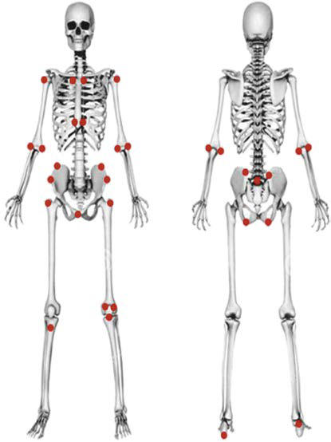

# Chapter 197: Ankylosing Spondylitis and Other Spondyloarthritides
> **Course:** Vikkypaedia Pediatric Basic Course (*Nelson Textbook of Pediatrics, 22nd Edition (2025)*)  
> **Part XIV:** Rheumatic Diseases of Childhood (Connective Tissue Diseases, Collagen Vascular Diseases)  
> **Authors:** Pamela F. Weiss  
> **Metrics:** 3,269 words · 5 tables/boxes · 2 figures · 1 genes · 8 flashcards · 5 MCQs  
> **Quick Navigation:** [🃏 Study 8 Flashcards](../flashcards/197_flashcards.md) · [📝 Take 5-Q MCQ Quiz](../mcqs/197_mcqs.md) · [📚 Part XIV Guide](../parts/Part_XIV.md) · [🧬 Syndrome & Genetics Atlas](../omim_gene_atlas.md) · [💊 Therapeutics Matrix](../therapies_matrix.md) · [🏠 Course Index](../../index.md)

## Key Genetic & Molecular Targets
`STAT3`

## ⚡ High-Yield Nelson Pediatric Board Pearls
- In India, ERA is the most common category of JIA, accounting for 35% of cases.
- The presence of psoriasis aids in diagnosis but is not required.
- Polyarthritis affecting large and small joints is most common and often reflects the activity of the intestinal inflammation.
- The gold standard for early visualiza tion of sacroiliitis is evidence of bone marrow edema adjacent to the joint on MRI with fluid-sensitive sequences such as short-T1 inversion recovery (STIR).
- DIFFERENTIAL DIAGNOSIS The onset of arthritis after a recent history of diarrhea or symptoms of urethritis or conjunctivitis may suggest reactive arthritis.
- Custom-fitted insoles and heel cups are particularly useful in the management of painful entheses around the feet, and the use of pillows to position the lower extremities while the child is in bed can be helpful.
- PROGNOSIS Observational studies suggest that ongoing disease activity for >5 years in juvenile spondyloarthritis predicts disability.

---
## Full Chapter Text, Tables & Figures
# Chapter 197: Ankylosing Spondylitis and Other Spondyloarthritides

*Pamela F. Weiss*

<!-- p.1896 -->
The diseases collectively referred to as *spondyloarthritides* include ankylosing spondylitis (AS), arthritis associated with inflamma tory bowel disease (IBD) or psoriasis, and reactive arthritis after gastrointestinal (GI) or genitourinary (GU) infections (Table 197.1 and Table 197.2). **Spondyloarthritis** is more common in adults, but all forms can present during childhood with varying symptoms and signs. Many children with spondyloarthritis are classified in the **juvenile idiopathic arthritis (JIA)** categories of **enthesitis- related arthritis (ERA)** or psoriatic arthritis. Children and adoles cents with spondyloarthritis who may not meet JIA criteria include arthritis associated with IBD, juvenile ankylosing spondylitis (JAS), and reactive arthritis.

**EPIDEMIOLOGY** JIA is diagnosed in 90 per 100,000 U.S. children every year (see Chapter 196). ERA accounts for 10–20% of JIA and has a mean age at onset of 12 years. In India, ERA is the most common category of JIA, accounting for 35% of cases. Unlike other JIA categories, males are affected more often than females, accounting for 60% of ERA cases. AS occurs in 0.2–0.5% of adults, with approximately 15% of cases beginning in childhood. These disorders can be famil ial, largely as a result of the influence of human leukocyte antigen (HLA)-B27, which is found in 90% of JAS and 50% of ERA patients compared to 7% of healthy individuals. Approximately 20% of chil dren with ERA have a family history of HLA-B27–associated dis ease, such as reactive arthritis, AS, or IBD with sacroiliitis.

**ETIOLOGY AND PATHOGENESIS** Spondyloarthritides are complex diseases in which susceptibility is largely genetically determined. Only 30% of heritability has been defined, with HLA-B27 responsible for two thirds of the total, and >100 additional genetic loci accounting for only one third. Genes that influence interleukin (IL)-23 responses (e.g., *CARD9, IL23R, JAK2, TYK2, STAT3*) and the function of HLA-B27 *(ERAP1)* are particularly important. Unusual properties of HLA-B27, such as its tendency to misfold and form abnormal cell surface structures, may have a role. Infection with certain GI or GU pathogens can trigger reactive arthri tis (see Table 197.2 and Chapter 198). Altered gut microbiota and an abnormal immune response to normal microbiota may also play a role in pathogenesis. Inflamed joints and entheses in spondyloarthritis con tain T and B cells, macrophages, osteoclasts, proliferating fibroblasts, and osteoblasts, with activation of the IL-23/IL-17 pathway. Bone loss and osteoproliferation in and around vertebral bodies and facet joints in long-standing AS contribute to significant morbidity.

**CLINICAL MANIFESTATIONS AND DIAGNOSIS** Clinical manifestations that help distinguish spondyloarthritis from other forms of juvenile arthritis include arthritis of the axial skeleton (sacroiliac joints or spine) and hips, enthesitis (inflamma tion at the site of a tendon, ligament, or joint capsule attachment to bone), symptomatic eye inflammation (acute anterior uveitis), and GI inflammation (even in the absence of IBD) (Table 197.3, but see also Table 197.1).

**Enthesitis-Related Arthritis** Children fulfill classification criteria for ERA if they have *either* arthritis and enthesitis *or* arthritis or enthesitis with at least two of the following characteristics: (1) sacroiliac joint tenderness or inflammatory lumbosacral pain, (2) presence of HLA-B27, (3) onset of arthritis in a male older than 6 years, (4) acute anterior uveitis, and (5) a family history of an HLA-B27–associated disease (ERA, sacroiliitis with IBD, reactive arthritis, or acute anterior uveitis) in a first-degree relative. Patients with psoriasis (or a family his tory of psoriasis in a first-degree relative), a positive–rheumatoid factor (RF) test result, or systemic arthritis are excluded from this group. During the first 6 months of disease the arthritis is typically

*Pamela F. Weiss*

#### **Table 197.1** Overlapping Characteristics of the Spondyloarthritides*

| Category / Parameter | Clinical Details & Findings |
| --- | --- |
| **REACTIVE ARTHRITIS** | Enthesitis; +++; +; +; ++; Axial arthritis; +++; ++; ++; +; Peripheral arthritis; +++; +++; +++; +++; HLA-B27 positive; +++; +; ++; +++; Antinuclear antibody; positive; −; ++; −; −; Rheumatoid factor positive; −; −; −; − |
| **SYSTEMIC DISEASE** | Eyes; +; +; +; +; Skin; −; +++; +; +; Mucous membranes; −; −; +; +; Gastrointestinal tract; −; −; ++++; +++; *Frequency of characteristics: −, absent; +, <25%; ++, 25–50%; +++, 50–75%; ++++, ≥75%.; From Petty RE, Laxer RM, Lindsley CB, et al., eds. Textbook of Pediatric Rheumatology, 8th ed. Philadelphia: Elsevier; 2021. |

<!-- p.1897 -->
asymmetric and involves fewer than four joints, most frequently the knees, ankles, and hips. Inflammation of the small joints of the foot, or *tarsitis,* is highly suggestive of ERA. Enthesitis is typically sym metric and affects the lower limbs. Up to 40% of children develop clinical or radiographic evidence of sacroiliac joint arthritis as part of their disease; approximately 20% have evidence of sacroiliac joint arthritis at diagnosis. When the sacroiliac or other axial joints are involved, children may experience **inflammatory back pain** (Table 197.4), hip pain, and alternating buttock pain. Patients may also

experience pain with palpation of the lower back or with pelvic compression. The risk of sacroiliac joint arthritis is highest in chil dren who are HLA-B27 positive and have an elevated C-reactive protein (CRP). Untreated sacroiliitis may, but does not always, evolve into AS; additional risk factors for progression are unclear.

**Psoriatic Arthritis** Psoriatic arthritis accounts for approximately 5% of JIA. Common clinical features of psoriatic arthritis are nail pitting (Fig. 197.1), ony cholysis, and dactylitis (sausage-like swelling of fingers or toes).

Children fulfill classification criteria for psoriatic arthritis if they have arthritis and psoriasis *or* arthritis and at least two of the follow ing: (1) dactylitis, (2) nail pitting or onycholysis, and (3) psoriasis in a first-degree relative. The presence of psoriasis aids in diagnosis but is not required. Disease onset peaks during the preschool and early adolescent years. Children with onset during the preschool years are more often female, antinuclear antibody (ANA) positive, and at risk for asymptomatic ocular inflammation. Disease onset during adoles cence is equally common among males and females. In the majority

#### **Table 197.3** Assessment in SpondyloArthritis International Society (ASAS) Classification Criteria for Spondyloarthritis (SpA)

| Category / Parameter | Clinical Details & Findings |
| --- | --- |
| **PERIPHERAL SpA** | In patients with ≥3 months back pain and age at onset <45 years; In patients with peripheral symptoms ONLY |
| **Sacroiliitis on imaging* plus one** | or more SpA feature(s) |
| **or HLA-B27 plus two or more other** | SpA features |
| **Arthritis or enthesitis or dactylitis plus** | SpA features; • Inflammatory back pain (IBP); • Arthritis; • Enthesitis (heel); • Uveitis; • Dactylitis; • Psoriasis; • Crohn disease/ulcerative colitis; • Good response to NSAIDs; • Family history for SpA |
| **• HLA-B27** | • Elevated CRP; One or more SpA feature(s):; • Uveitis; • Psoriasis; • Crohn disease/ulcerative colitis; • Preceding infection |
| **• HLA-B27** | • Sacroiliitis on imaging*; or; Two or more other SpA features:; • Arthritis; • Enthesitis; • Dactylitis; • IBP ever; • Family history for SpA; *Active (acute) inflammation on MRI highly suggestive of sacroiliitis associated with SpA. Definite radiographic sacroiliitis according to modified NY criteria.; CRP, C-reactive protein; NSAIDs, nonsteroidal antiinflammatory drugs.; Adapted from Rudwaleit M, van der Heijde D, Landewé R, et al. The development of Assessment of Spondyloarthritis International Society classification criteria for axial; spondyloarthritis. Part II. Validation and final selection. Ann Rheum Dis. 2009;68(6):777–783; and The Assessment of Spondyloarthritis International Society classification criteria for; peripheral spondyloarthritis and for spondyloarthritis in general. Ann Rheum Dis. 2011;70(1):25–31. |

Back Pain

#### **Table 197.4** Symptoms Characteristic of Inflammatory

| Category / Parameter | Clinical Details & Findings |
| --- | --- |
| **General** | Pain at night with morning stiffness (and improvement on arising); No improvement with rest; Improvement with exercise; Insidious onset; Good response to nonsteroidal antiinflammatory drugs |

#### **Table 197.2** Etiologic Microorganisms of Reactive Arthritis

| Category / Parameter | Clinical Details & Findings |
| --- | --- |
| **PROBABLE** | Chlamydia trachomatis; Shigella species; Salmonella enteritidis; Salmonella typhimurium; Yersinia enterocolitica; Yersinia pseudotuberculosis; Campylobacter jejuni and coli |
| **POSSIBLE** | Neisseria gonorrhoeae; Mycoplasma fermentans; Mycoplasma genitalium; Ureaplasma urealyticum; Escherichia coli; Cryptosporidium; Entamoeba histolytica; Giardia lamblia; Brucella abortus; Clostridium difficile; Streptococcus pyogenes; Chlamydia pneumoniae; Chlamydia psittaci; From Kim PS, Klausmeier TL, Orr DP. Reactive arthritis: a review. J Adolesc Health. 2009;44:309–315, Table 2, p. 311. |

<!-- p.1898 -->
of children, the arthritis is asymmetric and affects four or fewer joints at presentation. Large (knees and ankles) and small (fingers and toes) joints may be involved. Although distal interphalangeal joint involve ment is uncommon, it is highly suggestive of the diagnosis. Enthesitis is detectable in ∼20–75% of patients and seems to be more frequent in those who present at an older age (Table 197.5, Fig. 197.2). Axial (sacroiliac) and root (hip) joints may be affected in up to 30% of chil dren; the risk of axial arthritis is highest in those who are HLA-B27 positive.

**Juvenile Ankylosing Spondylitis** JAS frequently begins with oligoarthritis and enthesitis. The arthri tis occurs predominantly in the lower extremities and often involves the hips. In comparison to adult-onset AS, axial disease and inflammatory back pain are less frequent at disease onset, whereas enthesitis and peripheral arthritis are more common. AS is diag nosed according to the modified New York (NY) criteria if there is sufficient radiographic evidence of sacroiliitis (sacroiliitis of grade 2 or greater bilaterally or at least grade 3 unilaterally) and if the patient meets at least one clinical criterion involving inflammatory back pain, limitation of motion in the lumbar spine (Fig. 197.3), or limitation of chest expansion. JAS is present if the patient is <16 years old. Juvenile-*onset* AS is frequently used to describe adult AS when the symptoms began before 16 years of age but full criteria were not met until later.

To fulfill the modified NY criteria for AS, patients must have radiographic changes in the sacroiliac joints and clinical sequelae of axial disease. Because radiographic sacroiliitis can take many years to develop in adults and even longer in children, and clini cal sequelae may lag further behind, criteria to identify preradio graphic axial spondyloarthritis were developed by the **Assessment of SpondyloArthritis International Society**. To meet criteria for axial spondyloarthritis (SpA), patients must have at least 3 months of back pain and sacroiliitis on imaging (acute inflammation on MRI or definite radiographic sacroiliitis by NY criteria) plus one feature of SpA (inflammatory back pain, arthritis, enthesitis [heel], uveitis, dactylitis, psoriasis, Crohn disease/ulcerative colitis, good response to nonsteroidal antiinflammatory drugs [NSAIDs], family history for SpA, HLA-B27, or elevated CRP). Alternatively, patients can fulfill axial SpA criteria if they are HLA-B27 positive and have at least two SpA features. These criteria have low sensitivity and specificity in the pediatric population but, in the absence of alterna tive pediatric criteria, may be useful as a guide to evaluating prera diographic axial SpA.

**Arthritis with Inflammatory Bowel Disease** The presence of erythema nodosum, pyoderma gangrenosum, oral ulcers, abdominal pain, diarrhea, fever, weight loss, or anorexia in a

child with chronic arthritis should raise suspicion of IBD. Two patterns of arthritis complicate IBD. **Polyarthritis** affecting large and small joints is most common and often reflects the activity of the intestinal inflammation. Less frequently, **arthritis of the axial skeleton**, includ ing the sacroiliac joints, occurs. As with psoriatic arthritis, the presence of HLA-B27 is a risk factor for the development of axial disease. The severity of axial involvement is independent of the activity of the GI inflammation.

**LABORATORY FINDINGS** Laboratory evidence of systemic inflammation with elevation of the erythrocyte sedimentation rate (ESR) and/or CRP value is vari able in most spondyloarthritides and may or may not be present at the onset of disease. RF and ANAs are absent, except in chil dren with psoriatic arthritis, as many as 50% of whom are ANA positive. HLA-B27 is present in approximately 90% of children with JAS, compared with 7% of healthy individuals, but is less frequent in ERA and other SpA types.

**Imaging** Conventional radiographs detect chronic bony changes and damage but not active inflammation and are unreliable in the assessment of pediatric disease. Early radiographic changes in the sacroiliac joints include indistinct margins and erosions. **Sclerosis** typically starts on the iliac side of the joint (Fig. 197.4). Peripheral joints may exhibit periarticular **osteoporosis**, with loss of sharp cortical mar gins in areas of enthesitis, which may eventually show erosions or bony spurs (enthesophytes). Squaring of the corners of the vertebral bodies and syndesmophyte formation resulting in the classic “bam boo spine” characteristic of advanced AS are rare in early disease, particularly in childhood. CT, like radiographs, can detect chronic bony changes but not active inflammation and has the disadvantage of more radiation exposure. The gold standard for early visualiza tion of sacroiliitis is evidence of bone marrow edema adjacent to the joint on MRI with fluid-sensitive sequences such as short-T1 inversion recovery (STIR) (Figs. 197.5 and 197.6). Gadolinium does not add value to the study of the sacroiliac joints if STIR is used. MRI will reveal abnormalities before the plain radiograph. Whole

**Fig. 197.1** Nail pitting in a 9-year-old with JPsA. (From Srinivasalu H, Sikora KA, Colbert RA. Recent updates in juvenile spondyloarthritis. Rheum Dis Clin N Am. 2021;47:565–583, Fig. 2, p. 569.)

Cohorts

#### **Table 197.5** Entheseal Sites Studied in Historical JSpA

| Category / Parameter | Clinical Details & Findings |
| --- | --- |
| **PERCENTAGE** | Insertion of infrapatellar tendon; on patella; 27-44; Achilles tendon; 21-74; Interosseous ligaments of the; sacroiliac joint; 30.3; Plantar fascia insertion to; calcaneus; 12-39; Tibial tuberosity; 23-30; Quadriceps insertion to upper; poles of patella; 22-46; Second MTP; 21; Third MTP; 16; First MTP; 14; Greater trochanter; 14; Iliac crest; 14; JSpA, Juvenile spondyloarthritis; MTP, metatarsophalangeal.; From Srinivasalu H, Sikora KA, Colbert RA. Recent updates in juvenile spondyloarthritis.; Rheum Dis Clin N Am. 2021;47:565–583, Table 1, p. 567. |

<!-- p.1899 -->
body MRI may also be used to evaluate the axial skeleton in adults with early disease because it can detect vertebral lesions in addition to sacroiliac changes.

**DIFFERENTIAL DIAGNOSIS** The onset of arthritis after a recent history of diarrhea or symptoms of urethritis or conjunctivitis may suggest **reactive arthritis** (see Chapter 198). Lower back pain can be caused by strain, infectious

arthritis of the sacroiliac joint, osteomyelitis of the pelvis or spine, chronic nonbacterial osteomyelitis (CNO) of the pelvis or spine, osteoid osteoma of the posterior elements of the spine, pelvic muscle pyomyositis, or malignancies. In addition, mechanical conditions such as spondylolysis, spondylolisthesis, and Scheuermann disease should be considered. Back pain secondary to **fibromyalgia** usually affects the soft tissues of the upper back in a symmetric pattern and is associated with well-localized tender points and sleep distur bance (see Chapter 211.3). Legg-Calvé-Perthes disease (avascular necrosis of the femoral head), slipped capital femoral epiphysis, and chondrolysis may also manifest as pain over the inguinal ligament and loss of internal rotation of the hip joint, but without other SpA features, such as involvement of other entheses and/or joints. Radi ography and MRI are critical for distinguishing these conditions.

**Fig. 197.2** Anatomic sites for as sessment of enthesitis in ERA and JAS. (From Petty RE, Laxer RM, Lindsley CB, et  al., eds. Textbook of Pediatric Rheumatology, 8th ed. Philadelphia: Elsevier; 2021: Fig. 20.1, p. 254.)

**Anatomic region**

**Enthesitis exam**

Foot and ankle

Achilles tendon insertion to calcaneus Plantar fascia insertion to calcaneus Plantar fascia insertion to metatarsal heads Plantar fascia insertion to base of fifth metatarsal

Quadriceps tendon insertion to patella (2 and 10 o’clock) Infrapatellar ligament insertion to patella (6 o’clock) and tibial tuberosity

Hip extensor insertion at greater trochanter of femur Sartorius insertion at anterior superior iliac spine Posterior superior iliac spine Abdominal muscle insertions to iliac crest Gracilis and adduction insertion to pubis symphysis Hamstrings insertion to ischial tuberosity 5th lumbar spinous process

Common flexor insertion at medial epicondyle of humerus

Common extensor insertion at lateral epicondyle of humerus

Supraspinatus insertion into greater tuberosity of humerus

Costosternal junctions (1st and 7th)

Knee

Pelvis

Spine

Upper extremity

Chest

**Fig. 197.3** Loss of lumbodorsal spine mobility in a boy with anky losing spondylitis. The lower spine remains straight when the patient bends forward.

**Fig. 197.4** Well-developed sacroiliitis in a boy with ankylosing spon dylitis. Both sacroiliac joints show extensive sclerosis, erosion of joint margins, and apparent widening of the joint space.

<!-- p.1900 -->
**TREATMENT** The goals of therapy are to control inflammation, minimize pain, preserve function, and prevent ankylosis (fusion of adjacent bones) using a combination of antiinflammatory medications, physical therapy, and education. Treatment regimens for SpA include mono therapy or combination therapy with NSAIDs, disease-modifying antirheumatic drugs (DMARDs), or biologic agents. NSAIDs, such as naproxen (15-20 mg/kg/day), are frequently used to help relieve symptoms and may slow the progression of structural damage (syndesmophyte formation and growth) if used continually. With relatively mild monoarticular disease, intraarticular corticosteroids (e.g., triamcinolone acetonide/hexacetonide) may also help to con trol peripheral joint inflammation. DMARDs such as sulfasalazine (up to 50 mg/kg/day; maximum 3 g/day) or methotrexate (10 mg/ m2) may be beneficial for peripheral arthritis, but these medications have not been shown to improve axial disease in adults. For axial arthritis, it is typically necessary to add a biologic therapy. Tumor necrosis factor (TNF) inhibitors (e.g., etanercept, infliximab, adali mumab) have been efficacious in reducing symptoms and improv ing function in adults with AS. It remains unclear whether TNF inhibitors have an impact on structural damage in established AS, underscoring the need for earlier recognition and better therapies. Drugs that target IL-17 (secukinumab/ixekizumab), IL-23/IL-12

(ustekinumab), and the JAK/STAT pathway (tofacitinib/upadaci tinib) reduce clinical disease activity in adults with AS.

*Physical therapy and low-impact exercise should be included in the treatment program for all children with spondyloarthritis.* Exercise to maintain range of motion in the back, thorax, and affected joints should be instituted early in the disease course. Custom-fitted insoles and heel cups are particularly useful in the management of painful entheses around the feet, and the use of pillows to position the lower extremities while the child is in bed can be helpful.

**PROGNOSIS** Observational studies suggest that ongoing disease activity for >5 years in juvenile spondyloarthritis predicts disability. Disease remis sion occurs in <20% of children with spondyloarthritis 5 years after diagnosis. Factors associated with disease progression include tarsitis, HLA-B27 positivity, hip arthritis within the first 6 months, and dis ease onset after age 8. Important questions, such as which patients with ERA will go on to have JAS/AS, have yet to be addressed. Outcomes for JAS compared with adult-onset AS suggest that hip disease requir ing replacement is more common in children but axial disease is more severe in adults.

*Visit Elsevier eBooks+ at eBooks.Health.Elsevier.com** for Bibliography.*

**Fig. 197.5** Coronal MRI (STIR) of the pelvis in a 14-year-old boy with ERA (HLA-B27 positive). Fluid and pathology appear bright, spinal fluid also appears bright. Increased signal abnormality is observed around bilateral triradiate cartilages and greater trochanteric apophyses (arrow heads), common areas of involvement for ERA. Also, signal abnormality appears on the iliac side of the sacroiliac joints bilaterally around more curvilinear, dark, sclerotic subchondral areas representing erosions and sacroiliitis (arrows). (From Tse SM, Laxer RM. New advances in juvenile spondyloarthritis. Nat Rev Rheumatol. 2012;10;8:269–279.)

**Fig. 197.6** Short T1 inversion recovery image from whole body MRI of a 15-yr-old boy with HLA-B27–negative JSpA. The MRI shows ac tive corner inflammatory lesions of vertebral end plates at multiple levels (straight arrows) and more chronic-appearing discovertebral unit changes (curved arrow). (From Srinivasalu H, Sikora KA, Colbert RA. Recent updates in juvenile spondyloarthritis. Rheum Dis Clin N Am. 2021;47:565–583, Fig. 7, p. 574.)

<!-- p.1901 -->
