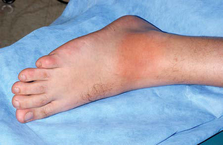
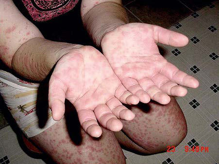

# Chapter 204: Hereditary Periodic Fever Syndromes and Other Systemic Autoinflammatory Diseases
> **Course:** Vikkypaedia Pediatric Basic Course (*Nelson Textbook of Pediatrics, 22nd Edition (2025)*)  
> **Part XIV:** Rheumatic Diseases of Childhood (Connective Tissue Diseases, Collagen Vascular Diseases)  
> **Authors:** James W. Verbsky  
> **Metrics:** 9,595 words · 9 tables/boxes · 2 figures · 21 genes · 8 flashcards · 5 MCQs  
> **Quick Navigation:** [🃏 Study 8 Flashcards](../flashcards/204_flashcards.md) · [📝 Take 5-Q MCQ Quiz](../mcqs/204_mcqs.md) · [📚 Part XIV Guide](../parts/Part_XIV.md) · [🧬 Syndrome & Genetics Atlas](../omim_gene_atlas.md) · [💊 Therapeutics Matrix](../therapies_matrix.md) · [🏠 Course Index](../../index.md)

## Key Genetic & Molecular Targets
`AR`, `CARD14`, `CIAS1`, `DADA2`, `FAM105B`, `FCAS1`, `FCAS2`, `IL36RN`, `LPIN2`, `MEFV`, `MVK`, `NALP12`, `NLRC4`, `NLRP12`, `NLRP3`, `NOD2`

## Indexed OMIM Identifiers
`#120100`, `#186580`, `#191100`, `#191190`, `#249100`, `#256040`, `#259680`, `#260920`, `#604416`, `#607115`, `#607211`, `#611762`

## ⚡ High-Yield Nelson Pediatric Board Pearls
- It is important to note that autoinflammatory disorders are rare, whereas fever in childhood caused by innocuous illness is very common.
- These include two disorders with an autosomal recessive mode of inheritance: familial Mediterranean fever (FMF; MIM249100) and hyperimmunoglobulinemia D (hyper-IgD) with periodic fever syndrome (HIDS; MIM260920).
- In addition to the previous autoinflammatory disorders, a variety of disorders are characterized by inappropriate interferon expres sion: the interferonopathies.
- Some disorders have characteristic fever patterns, whereas others have characteristic skin findings that can aid in a diagnosis.
- The hallmark cutaneous finding is an erysipeloid ery thematous rash that overlies the ankle or dorsum of the foot.
- Other clinical findings include scrotal pain caused by inflammation of the tunica vaginalis testis, febrile myalgia, exercise-induced myalgia (par ticularly common in children), and an association with various forms of vasculitis, including Henoch-Schönlein purpura, in as many as 5% of pedi atric patients.
- FMF is caused by autosomal recessive pathogenic variants in MEFV, a gene encoding a 781–amino acid protein denoted pyrin (Greek for “fever”).

---
## Full Chapter Text, Tables & Figures
# Chapter 204: Hereditary Periodic Fever Syndromes and Other Systemic Autoinflammatory Diseases

*James W. Verbsky*

<!-- p.1939 -->
The hereditary periodic fever syndromes are a group of monogenic diseases that present with recurrent bouts of fever and associated pleu ral and/or peritoneal inflammation, arthritis, and various types of skin rash. A number of identifiable disorders present with recurrent epi sodes of inflammation, although fevers *may not* be a common feature. Therefore the term **autoinflammatory diseases** is used to include all diseases that present with seemingly unprovoked episodes of inflam mation, without the high-titer autoantibodies or antigen-specific T cells typically seen in autoimmune diseases. Whereas autoimmune dis eases are disorders of the *adaptive* immune system, driven by B- and T-lymphocyte effector cells, autoinflammatory diseases largely repre sent disorders of the phylogenetically more primitive *innate* immune system, mediated by myeloid effector cells and germline-encoded receptors. Autoinflammatory diseases exhibit episodic or persistent inflammation characterized by an acute-phase response with eleva tion of the erythrocyte sedimentation rate (ESR), C-reactive protein (CRP), and serum amyloid A (AA). In some patients, untreated auto inflammatory disorders over time will lead to AA amyloidosis (see Chapter 206).

It is important to note that autoinflammatory disorders are rare, whereas fever in childhood caused by innocuous illness is very common. The approach to a child with fevers should include a detailed history, physical examination, and limited laboratory investigations to rule out other condi tions that lead to fevers, including autoimmune disorders and malignan cies (Table 204.1). If there is evidence of recurrent infections with fevers, an immune deficiency could be considered and evaluated. If the workup is reassuring, the inflammatory episodes resolve, and the child is otherwise well without unusual physical findings, observation is often warranted because these episodes are likely to resolve as the child’s immune system matures.

**CLASSIFICATION OF AUTOINFLAMMATORY DISORDERS** Because of the rapidly expanding number of autoinflammatory disorders and their varied clinical presentation, it can be difficult to group these dis orders in a meaningful manner. Some autoinflammatory disorders present with prominent fevers and are known as **hereditary periodic fever syn dromes**. These include two disorders with an *autosomal recessive* mode of inheritance: familial Mediterranean fever (**FMF**; MIM249100) and hyperimmunoglobulinemia D (hyper-IgD) with periodic fever syndrome (**HIDS**; MIM260920). Hereditary periodic fever syndromes with an *auto somal dominant* mode of inheritance include tumor necrosis factor (TNF) receptor–associated periodic syndrome (**TRAPS**; MIM191190) and a spectrum of disorders known as the *cryopyrin-associated periodic syn dromes *(CAPS)** or *cryopyrinopathies*. From mildest to most severe, CAPS include familial cold autoinflammatory syndrome (**FCAS1**; MIM120100), Muckle-Wells syndrome (**MWS**; MIM191100), and neonatal-onset mul tisystem inflammatory disease (**NOMID**; MIM607115) (also known as *chronic infantile neurologic cutaneous and articular syndrome* [**CINCA**]) (Table 204.2).

A variety of mendelian *autoinflammatory disorders* may or may not exhibit prominent fevers and are not considered periodic fever syndromes, but do have continuous or repeated episodes of spontaneous inflamma tion with unique clinical characteristics. These include the syndrome of pyogenic arthritis with pyoderma gangrenosum and acne (**PAPA**; MIM604416), deficiency of the interleukin-1 (IL-1) receptor antagonist (**DIRA**; MIM612852), **Blau syndrome** caused by pathogenic variants in *NOD2* (also known as *early-onset sarcoidosis;* MIM186580), auto inflammation with phospholipase Cγ2-associated antibody deficiency and immune dysregulation (**APLAID**; MIM614878), and deficiency of adenosine deaminase-2 (**DADA2**). Other disorders include congenital sideroblastic anemia with B-cell immunodeficiency, periodic fevers, and developmental delay **(SIFD)** caused by biallelic pathogenic variants of the *TRNT1* gene (MIM616084), autoinflammation with infantile enterocolitis caused by pathogenic variants in *NLRC4* (**AIFEC**; MIM616060), familial cold autoinflammatory syndrome type 2 caused by pathogenic variants in *NLRP12* (**FCAS2**; MIM611762), **CARD14** (MIM607211), and deficiency in IL-36 receptor antagonist (**DITRA**; 614204) (see Table 204.2).

In addition to the previous autoinflammatory disorders, a variety of disorders are characterized by inappropriate *interferon expres sion:* the **interferonopathies**. Type 1 interferons (e.g., IFN-α, IFN-β) are cytokines expressed by many cells in response to viral infections (see Table 204.2 and Chapter 205). Disorders that result in spontaneous interferon production and inflammatory manifes tations include STING-associated vasculopathy of infancy (**SAVI**; MIM615934) and chronic atypical neutrophilic dermatosis with lipodystrophy and elevated temperature (**CANDLE**; MIM256040).

There are also a number of autoinflammatory disorders with a com plex mode of inheritance. These include the syndrome of periodic fever with aphthous stomatitis, pharyngitis, and adenitis **(PFAPA)** and chronic recurrent multifocal osteomyelitis (**CRMO**; MIM259680). Other genetically complex disorders that are sometimes considered

*James W. Verbsky*

#### **Table 204.1** Differential Diagnosis of Periodic Fever

| Category / Parameter | Clinical Details & Findings |
| --- | --- |
| **HEREDITARY** | See Table 204.2 |
| **NONHEREDITARY** | A.	Infectious; 1.	 Hidden infectious focus (e.g., aortoenteric fistula, lung; sequestration); 2.	 Recurrent infection/reinfection (e.g., chronic; meningococcemia, immune deficiency); 3.	 Specific infection (e.g., Whipple disease, malaria); B.	Noninfectious inflammatory disorders; 1.	 Adult-onset Still disease; 2.	 Systemic-onset juvenile idiopathic arthritis; 3.	 Periodic fever, aphthous stomatitis, pharyngitis, and adenitis; 4.	 Schnitzler syndrome; 5.	 Behçet syndrome; 6.	 Crohn disease; 7.	 Sarcoidosis; 8.	 Orofacial granulomatosis (Melkersson-Rosenthal syndrome); C.	Neoplastic; 1.	 Lymphoma (e.g., Hodgkin disease, angioimmunoblastic; lymphoma); 2.	 Solid tumor (e.g., pheochromocytoma, myxoma, colon; carcinoma); 3.	 Hemophagocytic lymphohistiocytosis; D.	Vascular (e.g., recurrent pulmonary embolism); E.	Hypothalamic; F.	 Psychogenic periodic fever; G.	Ectodermal dysplasia; H.	Factitious or fraudulent; Adapted from Simon A, van der Meer JWM, Drenth JPH. Familial autoinflammatory; syndromes. In Firestein GS, Budd RC, Gabriel SE, et al., eds. Kelley’s Textbook of; Rheumatology, 9th ed. Philadelphia: Saunders; 2012: Table 97-2. |

<!-- p.1940 -->
For definitions of abbreviations and acronyms, see next page

**Mechanism**

Inflammasomopathies and other IL-1 family conditions

Pyrin activation

Cryopyrin activation

NLRC4 activation

NLRP12 activation

NLRP1 activation

Receptor antagonist

deficiency

Type I interferonopathies

Nucleic acid

processing

and degradation

Nucleic acid

sensing

Proteasome

IFN signaling

Other

NF-ñB and/or aberrant TNF activity

Dysregulation

of NFñB signaling

Dysregulation

of TNF

Other mechanisms

Golgi-ER transport

Intracellular

calcium signaling

tRNA biogenesis

Lipid metabolism?

ER stress?

Cytokine dysregulation

Actin assembly

Actin polymerization

**Disease**

FMF

PAAND

MKD

PAPA

Hz/Hc

PFIT

FCAS

MWS

NOMID

Majeed’s

AIFEC

FCAS/ NOMID

FCAS

NAIAD

DIRA

DITRA

Aicardi- Goutières syndrome

Monogenic SLE

SMS

SAVI

CANDLE / PRAAS, PRAID

AGS-like

SPENCD

HA20

RELA haploinsuf.

ORAS

LUBAC deficiency

Blau

TRAPS

DADA2

CRIA

COPA

PLAID

APLAID

SIFD

LACC1 deficiency

VEO-IBD

ARPC1B deficiency

CDC42 deficiency

**Gene**

MEFV

MEFV

MVK

PSTPIP1

PSTPIP1

WDR1

NLRP3

NLRP3

NLRP3

LPIN2

NLRC4

NLRC4

NLRP12

NLRP1

IL1RN

IL36RN

TREX1, ADAR1, RNASEH2A/B/C, SAMHD1, IFIH1

DNASE1/2/1L3, complements

IFIH1, DDX58a

TMEM137

PSMB4, PSMA3, PSMB8, POMP, PSMG2, PSMB9, PSMB10

USP18, ISG15, STAT2

ACP5

TNFAIP3

RELA

OTULIN

HOIL1, HOIP

NOD2

TNFRSF1A

ADA2

RIPK1

COPA

PLCG2

PLCG2

TRNT1

LACC1/FAMIN

IL-10, IL10RA, IL10RB

ARPC1B

CDC42

**Inheritance**

AR or AD

AD

AR

AD

AD

AR

AD

AD

AD

AR

AD

AD

AD

AD

AR

AR

AR (AD: IFIH1)

AR (AD: DNASE1)

AD

AD

Digenic, AR (AD: POMP)

AR

AR

AD

AD

AR

AR

AD

AD

AR

AD

AD

AD

AD

AR

AR

AR

AR

AR

**Clinical presentation**

Fever, pain, (abdominal, chest, joint), rash

Fever, myalgia, myositis, rash, abscesses

Fever, pain (abdominal, extremity), vomiting, rash

Pyoderma gangrenosum, arthritis

Rash, FTT, hepatosplenomegaly, neutropenia

Fever, infection, oral inflammation, perianal ulceration

Cold urticaria, extremity pain, conjunctivitis, fever

Urticarial rash, extremity pain, hearing loss, conjunctivitis, fever

CNS inflammation, urticaria, knee arthropathy, fever

Osteomyelitis, fevers, rash, dyserythropoietic anemia

Enterocolitis, rash, arthritis, fever

Cold urticaria, extremity pain, fever, CNS disease

Ocular, laryngeal, skin dyskeratosis, fever, arthritis

Cold urticaria, extremity pain, fever

Pustular rash, osteomyelitis, periostitis, fever,

Pustular psoriasis, fever, malaise

Fever, neurologic decline, encephalopathy, cerebral calcification, chilblains, autoantibodies

Autoantibodies, cytopenias, glomerulonephritis, skin rash, oral ulcers, arthritis

Calcification of aorta / cardiac valves, osteopenia, acro-osteolysis, dental anomalies

Chilblain’s rash, small vessel vasculitis, arthritis, ILD

Fever, joint contractures, annular plaques, eyelid swelling, hepatosplenomegaly, lipodystrophy, FTT, developmental delay, anemia

Skin ulcerations, seizures, hydrocephalus, cerebral calcifications, respiratory failure

Skeletal dysplasia, short stature, cerebral calcification, cytopenias, autoantibodies

Oral, gastrointestinal and genital ulcerations, fever, arthritis, recurrent infection

Oral and gastrointestinal ulcerations, cytopenias, lymphoproliferative disease

Fever, panniculitis, diarrhea, arthritis, FTT

Fever, recurrent infection, FTT, hepatosplenomegaly, amylopectin-like deposits in muscles

Granulomatous dermatitis, uveitis, polyarticular arthritis Episodic fever, abdominal pain, headache, conjunctivitis, painful centrifugal rash Systemic vasculitis, fever, rash, stroke, cytopenias, hypogammaglobulinemia

Fever, lymphadenopathy, hepatosplenomegaly

Arthritis, ILD, diffuse alveolar hemorrhage, autoantibodies

Cold urticaria, atopy, granulomatous dermatitis, hypogammaglobulinemia, infection, autoantibodies

Blistering skin lesions, ILD, bronchiolitis, eye inflammation, enterocolitis, immunodeficiency

Fever, developmental delay, seizures, microcytic anemia hypogammaglobulinemia

Fever, systemic JIA, oligoarticular/polyarticular JIA

Early-onset colitis, FTT

Platelet abnormalities, bleeding, recurrent infection, small vessel vasculitis, eczema, arthritis

Neurodevelopmental defects, facial dysmorphism cytopenias, recurrent infection, fever, rash

**Targeted**

**therapy**

IL-1, colch.

IL-1, colch.

IL-1

IL-1, TNF

IL-1, TNF

IL-18

IL-1

IL-1

IL-1

IL-1

IL-1, IL-18

IL-1

TNF, IL-1

IL-1, TNF

IL-1

TNF, IL- 17/12/23?

JAK, RTI?

JAK?

JAK?

JAK

JAK

JAK

?

TNF, IL-1, JAK?

TNF

TNF

TNF?

TNF

IL-1, TNF

TNF, HSCT

IL-6?

IL-17? JAK?

?

?

TNF

?

HSCT, IL-1?

?

IL-1

#### **Table 204.2** The Monogenic Autoinflammatory Diseases

| Category / Parameter | Clinical Details & Findings |
| --- | --- |
| **General** | Continued |

<!-- p.1941 -->
autoinflammatory include **systemic-onset juvenile idiopathic arthritis** (see Chapter 196), **Behçet disease** (see Chapter 202), and **Crohn disease** (see Chapter 382.2).

Distinguishing autoinflammatory disorders from one another can be difficult because their presentations can be variable and have sig nificant overlap. Some disorders have characteristic fever patterns (Fig. 204.1), whereas others have characteristic skin findings that can aid in a diagnosis (Table 204.3). Others can have characteristic physi cal features or organ involvement. Some of these disorders have bone involvement (Table 204.4). Other clinical features can also be helpful, such as ethnicity, age of onset, triggers, laboratory testing, and response to therapies (Table 204.5). Genetic panels are often used to screen for most, if not all, of these defects in a single test, rather than individual genetic assessment based on clinical findings.

**AUTOINFLAMMATORY DISEASES WITH PERIODIC OR PROMINENT FEVERS** The first descriptions of autoinflammatory disorders focused on genetic diseases that presented with prominent fevers: the periodic fever syndromes.

**Familial Mediterranean Fever** FMF is a recessively inherited autoinflammatory disease usually charac terized by recurrent, short-lived (1-3 days), self-limited episodes of fever, serositis, monoarticular or pauciarticular arthritis, or an erysipeloid rash, sometimes complicated by AA amyloidosis. Most patients with FMF present with symptoms in childhood, with 90% presenting before age 20. Clinical features of FMF may include fever, serositis presenting as pleuritic chest pain or severe abdominal pain, arthritis, and rash. The pleural pain is typically unilateral, whereas the abdominal pain (sterile peritonitis) can be generalized or localized to one quadrant, similar to other forms of perito nitis. FMF-associated arthritis occurs primarily in the large joints, may be accompanied by large, neutrophil-rich effusions, and is usually nonerosive and nondestructive. The hallmark cutaneous finding is an erysipeloid ery thematous rash that overlies the ankle or dorsum of the foot (Fig. 204.2). Other clinical findings include scrotal pain caused by inflammation of the tunica vaginalis testis, febrile myalgia, exercise-induced myalgia (par ticularly common in children), and an association with various forms of vasculitis, including Henoch-Schönlein purpura, in as many as 5% of pedi atric patients. FMF episodes may be triggered by stress, menses, or infec tions. Between flares, patients are generally symptom free but may have persistent elevation of their inflammatory markers. The attack frequency can vary from weekly to one to two flares per year. Table 204.6 lists the diagnostic criteria for FMF.

FMF is caused by autosomal recessive pathogenic variants in *MEFV,* a gene encoding a 781–amino acid protein denoted *pyrin* (Greek for “fever”). Pyrin is expressed in granulocytes, monocytes, and dendritic cells (DCs) and in peritoneal, synovial, and der mal fibroblasts. The N-terminal—approximately 90 amino acids of pyrin—is the prototype for a motif (the PYRIN domain) that mediates protein-protein interactions and is found in >20 different human proteins that regulate inflammation and apoptosis. Many of the FMF-associated pathogenic variants in pyrin are found at the C-terminal B30.2 domain of pyrin, encoded by exon 10 of *MEFV.* More than 50 such FMF pathogenic variants are listed in an online database (https://infevers.umai-montpellier.fr/web/), almost all of

which are missense substitutions. Homozygosity for the M694V pathogenic variant may be associated with an earlier age of onset, arthritis, and an increased risk of amyloidosis. The substitution of glutamine for glutamic acid at residue 148 (E148Q) is considered either a mild pathogenic variant or a functional polymorphism in the pyrin protein. The carrier frequency of FMF pathogenic vari ants among several Mediterranean populations is very high, sug gesting the possibility of a heterozygote advantage.

FMF occurs primarily among ethnic groups of Mediterranean ancestry, most frequently in people of Jewish, Turkish, Armenian, Arab, or Italian descent. Because of a higher frequency of the M694V pathogenic variant, FMF is more severe and more readily recognized in the Sephardic (North African) than the Ashkenazi (East European) Jewish population. With the advent of genetic testing, pathogenic vari ant–positive FMF has been documented worldwide, although at lower frequency than in the Mediterranean basin and Middle East.

Through PYRIN-domain interactions, pyrin can activate caspase-1, the enzyme that converts the 31-kDa pro–IL-1β molecule into the biologically active 17-kDa IL-1β, which is a major mediator of fever and inflammation. Pyrin works to sense changes in Rho-GTPases, which can occur due to certain bacterial toxins, thus acting as a sensor of bacterial invasion. FMF pathogenic variants lead to a gain-of-function activation of caspase-1 and IL-1β–dependent inflammation, with a gene-dosage effect. These results may explain why as many as 30% of heterozygous carriers of FMF patho genic variants have biochemical evidence of inflammation.

*Prophylactic daily oral colchicine decreases the frequency, duration, and intensity of FMF flares.* This regimen also prevents the development of systemic AA amyloidosis. Colchicine is generally well tolerated and safe in children, with the most common side effects being diarrhea and other gastrointestinal (GI) complaints. Some patients develop lactose intoler ance while taking colchicine. GI side effects can be minimized by initiating therapy at a low dose (for young children, 0.3 mg/day) and slowly titrating upward. A dose-related transaminitis may also be observed; bone mar row suppression is rarely seen at the dosages prescribed for FMF. Pediatric patients may require doses of colchicine similar to those needed in adults (1-2 mg/kg/day), reflecting that children metabolize the drug more rapidly than adults. It is not always possible to find a tolerated dose of colchicine at which all symptoms are suppressed, but approximately 90% of patients have a marked improvement in disease-related symptoms. A small per centage of FMF patients are either unresponsive to or intolerant of thera peutic doses of colchicine. Based on the role of pyrin in IL-1β activation, reports have demonstrated the safety and effectiveness of the IL-1 inhibi tors *rilonacept, anakinra, and canakinumab* in FMF.

**Amyloidosis** is the most serious complication of FMF, and in its absence FMF patients may live a normal life span (see Chapter 206). Amyloidosis may develop when serum AA, an acute-phase reactant found at extremely high levels in the blood during FMF attacks, is cleaved to produce a 76– amino acid fragment that misfolds and deposits ectopically, usually in the kidneys, GI tract, spleen, lungs, testes, thyroid, and adrenals. Rarely, car diac amyloidosis may develop; macroglossia and amyloid neuropathy are generally not seen with the amyloidosis of FMF. The most common pre senting sign of AA amyloidosis is proteinuria. The diagnosis is then usually confirmed by rectal or renal biopsy. In a small number of case reports, mostly from the Middle East, amyloidosis may actually precede overt FMF attacks, presumably because of subclinical inflammation. Risk factors for the development of amyloidosis in FMF include homozygosity for the

Presented is a simplified representation of disease mechanism classification, causative gene, heritability, major clinical manifestations, and typical treatment options for a

representative range of monogenic autoinflammatory diseases. AD, Autosomal dominant; AIFEC, autoinflammation with infantile enterocolitis; APLAID, autoinflammation and PLAID; AR, autosomal recessive; CANDLE, chronic atypical

neutrophilic dermatosis with lipodystrophy and elevated temperature; CNS, central nervous system; CRIA, cleavage-resistant RIPK1-induced autoinflammatory syndrome; DADA2, deficiency of adenosine deaminase 2; DIRA, deficiency of IL-1 receptor antagonist; ER, endoplasmic reticulum; FAMIN, fatty acid metabolism-immunity nexus; FTT, failure to thrive; Haploinsuf., haploinsufficiency; HSCT, hematopoietic stem cell transplant; HOIL1, heme-oxidized IRP2 ubiquitin ligase 1; HOIP, HOIL1-interacting protein; Hz/Hc, hyperzincemia/hypercalprotectinemia; ILD, interstitial lung disease; JIA, juvenile idiopathic arthritis; LACC1, laccase domain-containing 1; MWS, Muckle-Wells syndrome; NOMID, neonatal-onset multisystem inflammatory disease; ORAS, OTULIN-related autoinflammatory syndrome; PAAND, pyrin-associated autoinflammation with neutrophilic dermatosis; PAPA, pyogenic arthritis, pyoderma gangrenosum and acne; PFIT, periodic fever, immunodeficiency, and thrombocytopenia; PLAID, PLCG2-associated antibody deficiency and immune dysregulation; PLCG2, phospholipase C gamma 2; PRAAS, proteasome-associated autoinflammatory syndrome; PRAID, POMP-related autoinflammation and immune dysregulation disease; RTI, reverse-transcriptase inhibitor; SAVI, STING-associated vasculopathy of infancy; SIFD, sideroblastic anemia with B-cell immunodeficiency, periodic fevers, and developmental delay; SLE, systemic lupus erythematosus; SMS, Singleton-Merten syndrome; SPENCD, spondyloenchondrodysplasia; tRNA, transfer ribonucleic acid; VEO-IBD, very early onset inflammatory bowel disease. From Nigrovic PA, Lee PY, Hoffman HM. Monogenic autoinflammatory disorders: Conceptual overview, phenotype, and clinical approach. J Allergy Clin Immunol. 2020;146(5):925–937, Fig. 3.

<!-- p.1942 -->
M694V *MEFV* pathogenic variant, polymorphisms of the serum AA gene (encoding AA), noncompliance with colchicine treatment, male gender, and a positive family history of AA amyloid. For unclear reasons, country of origin is also a major risk factor for amyloidosis in FMF, with patients raised in the Middle East having a much higher risk than genotypically identical patients raised in the West. Aggressive lifelong suppression of the acute-phase reactants should be the goal in patients with FMF amyloido sis, and documented cases show this may result in resorption of amyloid deposits. The natural history of untreated amyloidosis in FMF is the inexo rable progression to renal failure, often within 3-5 years.

**Hyperimmunoglobulinemia D with Periodic Fever Syndrome** HIDS, also known as **mevalonate kinase deficiency**, occurs primarily in patients of Northern European descent. HIDS is recessively inherited and caused by pathogenic variants of *MVK,* a gene that encodes mev alonate kinase (MVK). The clinical features of HIDS generally appear within the first 6 months of life. Febrile attacks last 3-7 days, with abdom inal pain often accompanied by diarrhea, nausea, and vomiting. Other clinical manifestations include cervical lymphadenopathy, diffuse macu lar rash, aphthous ulcers, headaches, and occasional splenomegaly (Figs. 204.3-204.5). Arthritis or arthralgia can be present in an oligoarticular or polyarticular pattern. Inflammatory bowel disease–like illness and Kawasaki disease–like presentation have also been reported. Attacks are often precipitated by intercurrent illness, immunizations, and surgery. Families frequently recount flares around the time of birthdays, holidays, and family vacations. The symptoms of HIDS may persist for years but tend to become less prominent in adulthood. Patients with HIDS usually have a normal life span. Unlike FMF and TRAPS, the incidence of AA amyloidosis is quite low. Complete MVK deficiency results in mevalonic aciduria that presents with severe developmental delay, ataxia, myopathy, cataracts, and failure to thrive (see Chapter 105).

MVK is expressed in multiple tissues and catalyzes the conversion of mevalonic acid to 5-phosphomevalonic acid in the biosynthesis of cho lesterol and nonsterol isoprenoids. Patients with HIDS-associated patho genic variants have greatly reduced, but not absent, MVK enzymatic activity. HIDS patients usually have low-normal serum cholesterol levels, but the deficiency of isoprenoids may cause increased IL-1β production by reduced geranylgeranylation of Rho GTPases resulting in pyrin activation. Temperature elevation may further exacerbate this process by more com plete inhibition of MVK activity, leading to a possible positive feedback loop.

The diagnosis of HIDS may be confirmed either by two pathogenic variants in *MVK* (approximately 10% of patients with seemingly typical disease have only a single identifiable pathogenic variant) or by elevated levels of mevalonate in the urine. HIDS-associated pathogenic variants are distributed throughout the MK protein, but the two most common pathogenic variants are the substitution of isoleucine for valine at residue 377 (V377I), a variant that is quite common in the Dutch population, and the substitution of threonine for isoleucine at residue 268 (I268T). The eponymous elevation in serum IgD levels *is not* universally pres ent, especially in young children; IgA levels can also be elevated. Con versely, serum IgD levels may be increased in other autoinflammatory disorders and in some chronic infections. During attacks, leukocytosis and increased serum levels of acute-phase reactants and proinflamma tory cytokines are frequently present. Table 204.7 lists diagnostic criteria for HIDS.

Standards for the **treatment** of HIDS are evolving. Very few patients respond to colchicine, and milder disease courses may respond to nonsteroidal antiinflammatory drugs (NSAIDs). Corticosteroids can be beneficial during attacks, but long-term use is not recommended. Reports have shown efficacy in the use of the TNF-α blocker *etanercept* and the IL-1 blockers *anakinra and canakinumab*.

40

39

38

37

36 0 1 2 3

Time (days)

Body temperature (°C)

40

39

38

37

36

Body temperature (°C)

0 2

Time (days)

40

39

38

37

36 0 1 2 3

Time (days)

Body temperature (°C)

40

39

38

37

36 0 1 2 3

Time (days)

Body temperature (°C)

4 5 6 7 8 9 10

4 5

40

39

38

37

36 0 1 2 3

Time (days)

Body temperature (°C)

4 5

41

6 7 8

4 6 8 10 12 14 16 18 20 22 2426

40

39

38

37

36

Body temperature (°C)

0 2

Time (hours)

4 6 8 10 12

FMF HIDS

FCAS CINCA/NOMID

TRAPS

MWS

Any temperature

curve

PERITONITIS, VOMITING, ARTHRITIS,

ERYSIPELAS-LIKE SKIN LESIONS

CERVICAL LYMPHADENOPATHY,

ERYTHEMATOUS MACULES,

ABDOMINAL PAIN, VOMITING, ARTHRALGIA

CONJUNCTIVITIS, ERYTHEMATOUS SKIN

LESIONS, MYALGIA/ARTHRALGIA,

ABDOMINAL PAIN

RASH, CHILLS, POLYARTHRALGIAS,

CONJUNCTIVITIS

CHILLS, ARTHRALGIAS, ERYTHEMATOUS RASH,

CONJUNCTIVITIS

Cold exposure

DEFORMATIVE ARTHROPATHY,

CHRONIC MENINGITIS

**Fig. 204.1** Characteristic patterns of body temperature during inflammatory attacks in the familial autoinflammatory syndromes. Interindividual variability for each syndrome is considerable, and even for the individual patient, the fever pattern may vary greatly from episode to episode. Note the different time scales on the x axes. CINCA/NOMID, Chronic infantile neurologic cutaneous and articular syndrome/neonatal-onset multisystemic inflammatory disease; FCAS, familial cold autoinflammatory syndrome; HIDS, hyper-IgD syndrome; MWS, Muckle-Wells syndrome; TRAPS, tumor necrosis factor receptor–associated periodic syndrome. (From Simon A, van der Meer JWM, Drenth JPH. Familial autoinflammatory syndromes. In Firestein GS, Budd RC, Gabriel SE, et al., eds. Kelley’s Textbook of Rheumatology, 9th ed. Philadelphia: Saunders; 2012: Fig. 97-1.)

<!-- p.1943 -->
**Tumor Necrosis Factor Receptor–Associated Periodic Syndrome** TRAPS is characterized by recurrent fevers and localized inflammation and is inherited in an autosomal dominant manner. TRAPS has a num ber of distinguishing clinical and immunologic features. It was first rec ognized in patients of Irish descent and denoted *familial Hibernian fever* to draw a contrast with FMF, but the current nomenclature was proposed when pathogenic variants in *TNFRSF1A* were discovered not only in the original Irish family but also in families from a number of other ethnic backgrounds. *TNFRSF1A* encodes the 55-kDa receptor (denoted p55, TNFR1, or CD120a) for TNF-α that is widely expressed on a number of cell types. A second 75-kDa receptor is largely restricted to leukocytes.

Patients with TRAPS typically present within the first decade of life with flares that occur with variable frequency but of often substantially longer duration than FMF or HIDS flares. The febrile episodes of TRAPS last at least 3 days and can persist for weeks. There may be pleural and peritoneal involvement. At times, patients present with signs of an acute abdomen; on exploration such patients have *sterile peritonitis,* sometimes with adhesions from previous episodes. Patients may also have nausea and frequently report constipation at the onset of flares that progresses to diarrhea by the conclusion. Ocular signs include periorbital edema and conjunctivitis. TRAPS patients may also experience severe myalgia, and on imaging, the muscle groups may have focal areas of edema. Many rashes can be seen in TRAPS patients, but the most common is an erythematous macular rash that on biopsy contains superficial and deep perivascular infiltrates of mononuclear cells. Patients often report that the rash migrates distally on a limb during its course with an underlying myalgia and can resemble

cellulitis. Other rashes include erythematous annular patches and a ser piginous rash (Fig. 204.6). Approximately 10–15% of patients with TRAPS may develop AA amyloidosis; the presence of cysteine pathogenic variants and a positive family history are risk factors for this complication. If amy loidosis does not develop, TRAPS patients have a normal life expectancy. Table 204.8 lists diagnostic criteria.

Almost all the TRAPS-associated pathogenic variants are in the extra cellular domain of the TNFR1 protein, with about one third involving the substitution of another amino acid for a highly conserved cysteine residue, thus disrupting disulfide bonds and leading to protein misfolding. A num ber of other missense pathogenic variants not involving cysteine residues have been shown to have a similar effect on TNFR1 protein folding. Mis folded TNFR1 aggregates intracellularly and leads to constitutive signal ing through mitogen-activated protein kinases or nuclear factor (NF)-κB, resulting in the release of proinflammatory cytokines such as IL-6, IL-1β and TNF-α.

Colchicine is generally not effective in TRAPS. For relatively mild disease, NSAIDs may suffice. For more severe disease with infrequent attacks, corticosteroids at the time of an attack may be effective, but it is not unusual for steroid requirements to increase over time. Etanercept is often effective in reducing the severity and frequency of flares, but lon gitudinal follow-up of TRAPS patients treated with etanercept indicates waning efficacy with time. Of note, treatment of TRAPS with anti-TNF-α monoclonal antibodies has sometimes led to a paradoxical worsening of disease. Clinical responses to the IL-1 blockers *anakinra* and *canakinumab* and to *tocilizumab,* a monoclonal anti-IL6 antibody, have been favorable in TRAPS patients.

**Cryopyrin-Associated Periodic Fever Syndrome** CAPS represents a spectrum of clinical disorders, including **familial cold autoinflammatory syndrome**, **Muckle-Wells syndrome**, and **neonatal- onset multisystem inflammatory disorder**. Although three separate clinical diagnoses have been defined, it should be emphasized that the **cryopyrinopathies** are really a *continuum* of disease severity. This spectrum of illness is caused by pathogenic variants in *NLRP3* (formerly known as *CIAS1*), which encodes a protein called **cryopyrin**; >100 disease-associated *NLRP3* pathogenic variants have been enumerated on the *Infevers* online database. Advances in next-generation sequencing have also permitted the identification of symptomatic individuals with somatic *NLRP3* mosaicism.

NLRP3 is a PYRIN domain-containing protein that is strongly expressed in myeloid cells and to a lesser degree in other tissues. It is a part of a macromolecular complex termed the *NLRP3 inflammasome* that activates pro–IL-1β to its mature form in response to a variety of endogenous danger-associated molecular patterns and pathogenassociated molecular patterns (PAMPs). Patients with cryopyrinopa thies have *gain-of-function pathogenic variants* in *NLRP3* that result in constitutive or easily triggered activation of the NLRP3 inflammasome.

The cryopyrinopathies are characterized by persistent or recurrent bouts of inflammation and an urticaria-like rash that develops early in infancy (Fig. 204.7). Histopathologic examination reveals a perivascular neutrophilic infiltrate without the mast cells or mast cell degranulation seen with true urticaria. In patients with FCAS, febrile attacks generally begin 1-3 hours after generalized cold exposure. FCAS patients also expe rience polyarthralgia of the hands, knees, and ankles, and conjunctivitis may also develop during attacks. FCAS episodes are self-limited and gen erally resolve within 24 hours. AA amyloidosis rarely occurs in FCAS. Table 204.9 lists the diagnostic criteria for FCAS.

In contrast to FCAS, the febrile episodes of MWS do not require cold exposure but are characterized by the same urticarial-like rash seen in FCAS (Fig. 204.8). Many MWS patients also develop progressive sen sorineural hearing loss, and untreated, approximately 30% of MWS patients develop AA amyloidosis. NOMID exhibits the most severe symptoms and presents in the neonatal period with a diffuse, urticarial rash, daily fevers, and dysmorphic features (Fig. 204.9). Significant joint deformities, particularly of the knees, may develop because of bony overgrowth of the epiphyses of the long bones (Fig. 204.10). NOMID patients also develop chronic aseptic meningitis, leading to increased intracranial pressure, optic disc edema, visual impairment, progressive sensorineural hearing loss, and intellectual disability (Fig. 204.11).

Diseases by Skin Manifestations

#### **Table 204.3** Clinical Grouping of Autoinflammatory

| Category / Parameter | Clinical Details & Findings |
| --- | --- |
| **NEUTROPHILIC URTICARIA (THE CRYOPYRINOPATHIES)** | Recurrent fever attacks of short duration (typically <24 hr); • CAPS/FCAS: familial cold autoinflammatory syndrome; • CAPS/MWS: Muckle-Wells syndrome |
| **• FCAS2/NLRP12** | Continuous low-grade fever; • CAPS/NOMID: neonatal-onset multisystem inflammatory disease; (NOMID)/chronic infantile neurologic cutaneous and articular syndrome |
| **LOW-GRADE FEVER ATTACKS** | • Blau syndrome/early-onset sarcoidosis (pediatric granulomatous; arthritis) |
| **PUSTULAR SKIN RASHES AND FEVER** | With inflammatory bone disease; • DIRA: deficiency of interleukin-1 receptor agonist; • Majeed syndrome; With pyogenic arthritis; • PAPA: pyogenic arthritis, pyoderma gangrenosum, and acne syndrome; Without other organ involvement; • DITRA: deficiency of interleukin-36 receptor antagonist; • CAMPS: CARD14-mediated psoriasis |
| **INFILTRATE** | • CANDLE: proteasome-associated autoinflammatory syndromes |
| **LIVEDO RETICULARIS, VASCULOPATHY WITH ULCERATIONS** | • SAVI; STING-associated vasculopathy, infantile onset |
| **LIVEDO RACEMOSA, VASCULITIS WITH ULCERATIONS** | • ADA2; adenosine deaminase-2 deficiency; CAPS, Cryopyrin-associated periodic syndromes.; Modified from Almeida de Jesus A, Goldbach-Mansky R. Monogenic autoinflammatory; diseases: Concept and clinical manifestations. Clin Immunol. 2013;147:155–174, Table 1. |

<!-- p.1944 -->
*Targeted therapy with anakinra* (a recombinant IL-1R antagonist) *has been life changing for NOMID patients,* not only controlling fever and rash but also preventing end-organ damage. Anakinra, rilonacept, and canakinumab are all effective in both FCAS and MWS; they are approved by the U.S. Food and Drug Administration (FDA) for both conditions. Aggressive IL-1 blockade has resulted in attenuation of amyloidosis in the cryopyrinopathies.

**OTHER MENDELIAN AUTOINFLAMMATORY DISEASES Syndrome of Pyogenic Arthritis with Pyoderma Gangrenosum and Acne** PAPA syndrome is a rare autosomal dominant disorder caused by patho genic variants in *PSTPIP1,* a gene that encodes the cytoskeletal proline serine threonine phosphatase–interacting protein-1 (PSTPIP1). The PSTPIP1 protein interacts with a number of immunologically important molecules, including CD2, Wiskott-Aldrich syndrome protein (WASP), and pyrin. PAPA-associated *PSTPIP1* pathogenic variants greatly increase its affinity to pyrin and cause increased IL-1β production.

Clinical manifestations of PAPA syndrome begin in early childhood with recurrent episodes of sterile, pyogenic arthritis that leads to ero sions and joint destruction, and it appears to develop spontaneously or after minor trauma. Fever is not a dominant feature. Cutaneous mani festations tend to develop in adolescence, at which time patients are prone to developing severe cystic acne (see Chapter 710). Additionally,

PAPA patients commonly develop ulcerating pyoderma gangrenosum lesions (Fig. 204.12), and some develop pathergy reactions.

The treatment of PAPA syndrome may involve the use of cortico steroids, IL-1 antagonists, and TNF-α inhibitors, sometimes in com bination. The joint manifestations of PAPA appear to respond to IL-1 blockade, whereas the cutaneous manifestations seem to respond more favorably to TNF-α blockade. Local measures, such as joint aspiration and drainage and intensive wound care, are also important in the care of PAPA patients, as is pain management for cutaneous disease. Cau tion should be taken when prescribing sulfonamides because some PAPA patients develop pancytopenia.

**Deficiency of Interleukin-1 Receptor Antagonist** DIRA is an autosomal recessive autoinflammatory disease that is dis tinct from the cryopyrinopathies. DIRA typically presents in the neo natal period with systemic inflammation and a neutrophilic pustulosis, sterile multifocal osteomyelitis, widening of the anterior ends of the ribs, periostitis, and osteopenia (Figs. 204.13 and 204.14). Although fever is not a prominent clinical feature, patients do have greatly ele vated acute-phase reactants. Multiorgan failure and pulmonary inter stitial fibrosis can occur and can be fatal.

DIRA is caused by loss-of-function pathogenic variants in *IL1RN,* encoding the IL-1R antagonist. Because of the lack of antagonistic activ ity, the cells are hyperresponsive to IL-1β stimulation. Numerous treat ments for DIRA have been tried, including NSAIDs, glucocorticoids,

↑ Myeloid cell

↑ serum TNF-α Not tested ↑ IL-1α, IL-1β, MIP-1α,

↑ serum TNF-α in

#### **Table 204.4** Autoinflammatory Bone Disorders

| Category / Parameter | Clinical Details & Findings |
| --- | --- |
| **MICE** | Ethnicity; Worldwide, but; mostly European; Arabic; European, Puerto; Rican, Arabic; Worldwide; Occurs in various; backgrounds; Fever; Uncommon; Common; Uncommon; No; Not assessed; Sites of osseous; involvement; Metaphyses of long; bones > vertebrae,; clavicle, sternum,; pelvis, others; Similar to CRMO; Anterior rib ends,; metaphyses of long; bones, vertebrae,; others; Mandible > maxilla; Rarely ribs; Vertebrae hind >; forefeet; Extraosseous; manifestations; PPP, psoriasis, IBD,; others; Dyserythropoietic; anemia, Sweet; syndrome, HSM,; growth failure; Generalized; pustulosis, nail; changes, lung; disease, vasculitis; Cervical; lymphadenopathy; Dermatitis,; extramedullary; hematopoiesis,; splenomegaly; Family history of; inflammatory; disorders; Psoriasis, PPP,; arthritis, IBD,; others; Psoriasis in some; obligate carriers; No known; associations; No known; associations; Heterozygotes normal; Inheritance; Not clear; Autosomal recessive; Autosomal recessive; Autosomal dominant;; incomplete; penetrance; Autosomal recessive; Gene defect; Unknown |
| **SH3BP2 >> PTPN11** | Pstpip2; Protein name; ?; Lipin2; IL-1Ra |
| **PSTPIP2 (MAYP)** | Protein function; ?; Fat metabolism: (PAP; enzyme activity),; ↑ message to; oxidative stress, ?; role in mitosis; Antagonist of IL-1; receptor; response to M-CSF; and RANKL, ↑; TNF-α expression in; macrophages; Macrophage; proliferation,; macrophage; recruitment to sites; of inflammation,; cytoskeletal function; Cytokine; abnormalities; TNF-α, IL-8, IL-6; ex vivo monocyte; assay; skin reveals ↑; IL-17 staining; mouse model; Cmo: ↑ serum IL-6,; MIP-1α, TNF-α, CSF- |
| **1, IP-10** | Lupo: ↑ serum MIP-1α,; IL-4, RANTES, TGF-β; CRMO, Chronic recurrent multifocal osteomyelitis; CSF, colony-stimulating factor; CMO, chronic multifocal osteomyelitis; DIRA, deficiency of interleukin-1 receptor antagonist; HSM,; hepatosplenomegaly; IBD, inflammatory bowel disease; IL, interleukin; IL-1Ra, interleukin-1 receptor antagonist; IP-10, interferon-inducible protein-10; Lupo, mouse model; M-CSF,; macrophage colony-stimulating factor; MIP-1α, macrophage inflammatory protein-1α; PAP, phosphatidate phosphatase; PPP, palmar-plantar pustulosis; PSTPIP2, proline-serine-; threonine phosphatase interacting protein; RANKL, receptor activator of nuclear factor-κB ligand; RANTES, regulated on activation, normal T cell expressed and secreted; SH3BP2,; SH3-binding protein 2; TGF, transforming growth factor; TNF-α, tumor necrosis factor alpha.; From Ferguson PJ, Laxer RM. Autoinflammatory bone disorders. In Cassidy JT, Petty RE, Laxer RM, et al., eds. Textbook of Pediatric Rheumatology, 6th ed. Philadelphia: Saunders;; 2011: Table 44-2. |

<!-- p.1945 -->
ATTACK DURATION <24 hr FCAS, FMF

1-3 days FMF, MWS, DITRA (fever)

3-7 days HIDS, PFAPA

>7 days TRAPS, PAPA

Almost always “in attack” NOMID, DIRA

INTERVAL BETWEEN ATTACKS 3-6 wk PFAPA, HIDS

>6 wk TRAPS

Mostly unpredictable All others

Truly periodic PFAPA, cyclic neutropenia

USEFUL LABORATORY TESTS Acute-phase reactants must be

normal between attacks

PFAPA

Urine mevalonic acid in attack HIDS

IgD >100 mg/dL HIDS

Proteinuria (amyloidosis) FMF, TRAPS, MWS, NOMID

RESPONSE TO THERAPY Corticosteroid dramatic PFAPA

Corticosteroid partial TRAPS, FCAS, MWS, NOMID,

PAPA*

Colchicine FMF, PFAPA (30% effective)

Cimetidine PFAPA (30% effective)

Etanercept TRAPS, FMF arthritis

Anti–IL-1 dramatic DIRA (anakinra), FCAS, MWS,

NOMID, PFAPA

Anti–IL-1 mostly TRAPS, FMF

Anti–IL-1 partial HIDS, PAPA

#### **Table 204.5** Clues That May Assist in the Diagnosis of Autoinflammatory Syndromes

| Category / Parameter | Clinical Details & Findings |
| --- | --- |
| **AGE OF ONSET** | At birth |
| **NOMID, DIRA, MWS** | Infancy and first year of life |
| **HIDS, FCAS, NLRP12** | Toddler |
| **PFAPA** | Late childhood |
| **PAPA** | Most common of; autoinflammatory; syndromes to have onset; in adulthood |
| **TRAPS, DITRA** | Variable (mostly in childhood); All others |
| **ETHNICITY AND GEOGRAPHY** | Armenians, Turks, Italian,; Sephardic Jews |
| **FMF** | Arabs; FMF, DITRA (Arab Tunisian); Dutch, French, German, Western; Europe |
| **HIDS, MWS, NLRP12** | United States |
| **FCAS** | People of West African; origin |
| **TRAPS** | Eastern Canada, Puerto; Rico |
| **DIRA** | Worldwide; All others |
| **TRIGGERS** | Vaccines |
| **HIDS** | Cold exposure |
| **FCAS, NLRP12** | Stress, menses |
| **FMF, TRAPS, MWS, PAPA, DITRA** | Minor trauma |
| **PAPA, MWS, TRAPS, HIDS** | Exercise |
| **FMF, TRAPS** | Pregnancy |
| **DITRA** | Infections; All, especially DITRA; DIRA, Deficiency of IL-1 receptor antagonist; DITRA, deficiency of IL-36 receptor antagonist (generalized pustular psoriasis); FCAS, familial cold autoinflammatory syndrome; FMF,; familial Mediterranean fever; HIDS, hyper-IgD syndrome; IL, interleukin; MWS, Muckle-Wells syndrome; NLRP, nucleotide oligomerization domain–like receptor family, pyrin; domain; NOMID, neonatal-onset multisystem inflammatory disorder; PAPA, pyogenic sterile arthritis, pyoderma gangrenosum, acne syndrome; PFAPA, periodic fever, aphthous; stomatitis, pharyngitis, adenitis; TRAPS, tumor necrosis factor receptor–associated periodic syndrome.; *For intraarticular corticosteroids.; From Hashkes PJ, Toker O. Autoinflammatory syndromes. Pediatr Clin North Am. 2012;59:447–470, Table 2. |

**Fig. 204.2** Characteristic erysipeloid erythema associated with famil ial Mediterranean fever. This rash appears during a flare and overlies the ankle or dorsum of the foot.

intravenous immunoglobulin (IVIG), methotrexate, cyclosporine, and etanercept. However, *anakinra is the treatment of choice,* essentially replacing the lost protein and resulting in a rapid clinical response. Anakinra is dosed daily, with the dose titrated to achieve a normal CRP. There are now longer-acting anti–IL-1 agents, canakinumab and rilonacept, which are effective and require less frequent dosing than anakinra.

**Blau Syndrome** Blau syndrome is a rare autosomal dominant disorder that manifests as early-onset (<5 years of age) granulomatous arthritis, uveitis, and rash. The arthritis may affect the ankles and wrists and may lead to flexion contractures of the fingers and toes (camptodactyly). **Early-onset sar coidosis** presents with a similar clinical picture, sometimes with visceral involvement, and both conditions are caused by pathogenic variants in the caspase recruitment domain protein 15 (CARD15), also known as *nucleotide-binding oligomerization domain-2 protein* (NOD2). NOD2

<!-- p.1946 -->
is an intracellular sensor of bacterial products in DCs, myelomonocytic cells, and Paneth cells. Pathogenic variants in the NACHT oligomeriza tion domain of this protein cause Blau syndrome/early-onset sarcoid osis, whereas variants primarily in the leucine-rich repeat domain are associated with susceptibility to **Crohn disease**. Corticosteroids have been the mainstay of therapy for Blau syndrome, but are limited by side effects. Methotrexate, cyclosporin, and mycophenolate have all been

tried with variable results. TNF-α inhibitors have been reported to be beneficial; IL-1 antagonism has shown variable effects.

**Autoinflammation with Phospholipase C****γ****2****–Associated Antibody Deficiency and Immune Dysregulation** APLAID is a dominantly inherited disorder characterized by recurrent blistering skin lesions, bronchiolitis, arthralgia, ocular inflammation, enterocolitis, absence of autoantibodies, and immunodeficiency. Rash is the first manifestation of APLAID, which is described as a full-body epidermolysis bullosa–like eruption. Over time, this rash changes to recurrent plaques and vesiculopustular lesions that are triggered by heat and sunlight. Colitis also presents in childhood before age 5 years. Ocular manifestations begin before age 1 year and include corneal ulcerations and erosions as well as cataracts. Immune manifestations include markedly decreased class-switched memory B cells, resulting in low IgM and IgA.

Patients with APLAID show a gain-of-function missense variant or deletion of the autoinhibitory region of phospholipase Cγ2 (PLCγ2), leading to increased activity of downstream mediators and stimulation of lymphocytes. Despite the enhanced signaling, the resulting popu lations of immune cells have poor function. Interestingly, a different pathogenic variant in the PLCγ2 complex leads to a syndrome known

Fever (FMF)*

#### **Table 204.6** Diagnostic Criteria for Familial Mediterranean

| Category / Parameter | Clinical Details & Findings |
| --- | --- |
| **MAJOR CRITERIA** | 1.	 Typical attacks† with peritonitis (generalized); 2.	 Typical attacks with pleuritis (unilateral) or pericarditis; 3.	 Typical attacks with monoarthritis (hip, knee, ankle); 4.	 Typical attacks with fever alone; 5.	 Incomplete abdominal attack |
| **MINOR CRITERIA** | 1.	 Incomplete attacks‡ involving chest pain; 2.	 Incomplete attacks involving monoarthritis; 3.	 Exertional leg pain; 4.	 Favorable response to colchicine; *Requirements for a diagnosis of FMF are one or more major criteria or two or more; minor criteria.; †Typical attacks are defined as recurrent (three or more of the same type), febrile; (≥38°C), and short (lasting between 12 hr and 3 days).; ‡Incomplete attacks are defined as painful and recurrent attacks not fulfilling the criteria; for a typical attack.; From Livneh A, Langevitz P, Zemer D, et al. Criteria for the diagnosis of familial; Mediterranean fever. Arthritis Rheum. 1997;40:1879–2045. |

**Fig. 204.3** Polymorphic rash on the hands, arms, and legs of a patient with hyper-IgD syndrome (HIDS). (From Takada K, Aksentijevich I, Ma hadevan V, et al. Favorable preliminary experience with etanercept in two patients with the hyperimmunoglobulinemia D and periodic fever syndrome. Arthritis Rheum 2003;48:2646.)

**Fig. 204.4** Petechiae on the leg of a hyper-IgD syndrome patient dur ing a febrile attack. (From Simon A, van der Meer JWM, Drenth JPH. Fa milial autoinflammatory syndromes. In Firestein GS, Budd RC, Gabriel SE, et al., eds. Kelley’s Textbook of Rheumatology, 9th ed. Philadelphia: Saunders; 2012: Fig. 97-7.)

**Fig. 204.5** Aphthous ulceration detected on the tongue of a patient with hyper-IgD syndrome. (Courtesy Dr. K. Antila, North Carelian Cen tral Hospital, Joensuu, Finland; from Simon A, van der Meer JWM, Drenth JPH. Familial autoinflammatory syndromes. In Firestein GS, Budd RC, Gabriel SE, et al., eds. Kelley’s Textbook of Rheumatology, 9th ed. Philadelphia: Saunders; 2012: Fig. 97-8.)

#### **Table 204.7** Diagnostic Indicators of Hyper-IgD Syndrome

| Category / Parameter | Clinical Details & Findings |
| --- | --- |
| **AT TIME OF ATTACKS** | 1.	 Elevated erythrocyte sedimentation rate and leukocytosis; 2.	 Abrupt onset of fever (≥38.5°C); 3.	 Recurrent attacks; 4.	 Lymphadenopathy (especially cervical); 5.	 Abdominal distress (e.g., vomiting, diarrhea, pain); 6.	 Skin manifestations (e.g., erythematous macules and papules); 7.	 Arthralgias and arthritis; 8.	 Splenomegaly |
| **CONSTANTLY PRESENT** | 1.	 Elevated IgD (above upper limit of normal) measured on; two occasions at least 1 mo apart*; 2.	 Elevated IgA (≥2.6 g/L) |
| **SPECIFIC FEATURES** | 1.	 Pathogenic variants in mevalonate kinase gene; 2.	 Decreased mevalonate kinase enzyme activity; *Extremely high serum concentrations of IgD are characteristic but not obligatory.; From Firestein GS, Budd RC, Gabriel SE, et al. (eds): Kelley & Firestein’s Textbook of; Rheumatology, 10th ed. Philadelphia: Elsevier, 2017: Table 97-4, p. 1674. |

<!-- p.1947 -->
as **PLC**γ**2****-associated antibody deficiency and immune dysregulation (PLAID)**, characterized by cold-induced urticaria, hypogammaglobu linemia with resulting susceptibility to infection, and autoimmunity.

Because of the low number of affected patients described, there are no agreed treatment regimens for APLAID. Patients have been treated with NSAIDs, and corticosteroids can be effective, but side effects limit their long-term use. TNF-α inhibitors and IL-1 inhibitors have been used with some success.

**Deficiency of Adenosine Deaminase 2 (DADA2)** DADA2 is an autoinflammatory disorder caused by loss-of-function pathogenic variants in *CECR1,* encoding adenosine deaminase 2. DADA2 presents with recurrent fevers and a spectrum of *vascular* manifestations that includes livedo racemosa, early-onset ischemic lacunar strokes, and

systemic vasculitis of medium-size vessels similar to **polyarteritis nodosa**. The lacunar strokes, typically affecting the deep brain nuclei and the brain stem, transpire before age 5 years and typically occur during inflammatory episodes. The livedoid rash is also a prominent feature during inflammatory episodes, and biopsies demonstrate a predominance of neutrophils and macrophages as well as vasculitis in medium-sized vessels. Acute-phase

A C B

**Fig. 204.6** Cutaneous manifestations of tumor necrosis factor receptor–associated periodic syndrome. A, Right flank of a patient with the T50M pathogenic variant. B, Serpiginous rash involving the face, neck, torso, and upper extremities of a child with the C30S pathogenic variant. C, Erythe matous, macular patches with crusting on the flexor surface of the right arm of a patient with the T50M pathogenic variant. (From Hull KM, Drewe, Aksentijevich I, et al. The TNF receptor-associated periodic syndrome [TRAPS]: Emerging concepts of an autoinflammatory syndrome, Medicine (Baltimore). 2002;81:349–368.)

Factor Receptor–Associated Periodic Syndrome (TRAPS)

#### **Table 204.8** Diagnostic Indicators of Tumor Necrosis

| Category / Parameter | Clinical Details & Findings |
| --- | --- |
| **General** | 1.	 Recurrent episodes of inflammatory symptoms spanning >6-mo; duration (several symptoms generally occur simultaneously); a.	 Fever; b.	 Abdominal pain; c.	 Myalgia (migratory); d.	 Rash (erythematous macular rash occurs with myalgia); e.	 Conjunctivitis or periorbital edema; f.	 Chest pain; g.	 Arthralgia or monoarticular synovitis; 2.	 Episodes last >5 days on average (although variable); 3.	 Responsive to glucocorticosteroids but not colchicine; 4.	 Affects family members in autosomal dominant pattern (although; may not always be present); 5.	 Any ethnicity may be affected; From Hull KM, Drewe E, Aksentijevich I, et al. The TNF receptor-associated periodic; syndrome (TRAPS): emerging concepts of an autoinflammatory disorder. Medicine; (Baltimore). 2002;81:349–368. |

**Fig. 204.7** Urticarial-like rash. Inflammatory clinical manifestations and organ damage in the IL-1–mediated diseases; in neonatal-onset multisystem inflammatory disease (NOMID), which is the severe form of cryopyrin-associated periodic syndromes (CAPS); and deficiency of IL-1 receptor antagonist (DIRA). This rash is not truly urticarial and occurs due to neutrophil infiltrates into the skin. (From Jesus AA, Goldbach- Mansky R. IL-1 blockade in autoinflammatory syndromes. Annu Rev Med. 2014;65:223–244, Fig. 2.)

<!-- p.1948 -->
reactants are typically elevated. Other features include ophthalmologic involvement, various degrees of lymphopenia, hypogammaglobulinemia, hepatosplenomegaly, portal hypertension, and pancytopenia due to bone marrow aplasia. Patients may meet criteria for polyarteritis nodosa and can exhibit digit necrosis and Raynaud phenomenon.

ADA2 is produced primarily by monocytes and macrophages, is found in plasma, and appears to act as a growth and differentiation factor for a subset of inflammatory macrophages. Numerous antiin flammatories have been tried in patients with DAD2, including glu cocorticoids and cyclophosphamide. TNF-α inhibitors (etanercept or adalimumab) are the mainstay of treatment, and anecdotal reports have shown a benefit with anakinra. Macrophages and monocytes are the main sources of ADA2, raising the possibility of bone marrow transplant to achieve a permanent cure.

**Sideroblastic Anemia with Immunodeficiency, Fevers, and Developmental Delay** SIFD is a syndrome characterized by systemic inflammation, fevers, enteritis, and sideroblastic anemia and caused by biallelic pathogenic variants in *TRNT1*. SIFD presents in infancy with fever, elevated inflam matory markers, gastroenteritis, and anemia. Bone marrow biopsies demonstrate ringed sideroblasts. Other features include hypogamma globulinemia, B-cell lymphopenia, developmental delay, and variable neurodevelopmental degeneration, seizures, and sensorineural hearing loss. Brain imaging was notable for cerebellar atrophy, delayed white matter myelination, and decreased perfusion. Other isolated clinical features include nephrocalcinosis, aminoaciduria, ichthyotic skin, car diomyopathy, and retinitis pigmentosa. TRNT1 is an RNA polymerase that is necessary for maturation of cytosolic and mitochondrial transfer RNAs by the addition of two cytosines and one adenosine to the transfer

Autoinflammatory Syndrome (FCAS)

#### **Table 204.9** Diagnostic Criteria for Familial Cold

| Category / Parameter | Clinical Details & Findings |
| --- | --- |
| **General** | 1.	 Recurrent intermittent episodes of fever and rash that primarily; follow generalized cold exposures; 2.	 Autosomal dominant pattern of disease inheritance; 3.	 Age of onset <6 mo; 4.	 Duration of most attacks <24 hr; 5.	 Presence of conjunctivitis associated with attacks; 6.	 Absence of deafness, periorbital edema, lymphadenopathy, and; serositis; From Hoffman HM, Wanderer AA, Broide DH. Familial cold autoinflammatory; syndrome: phenotype and genotype of an autosomal dominant periodic fever. J Allergy; Clin Immunol. 2001;108:615–620. |

**Fig. 204.8** Urticarial-like skin rash in a patient with Muckle-Wells syn drome. (Courtesy Dr. D.L. Kastner, National Institutes of Health, Bethes da, Maryland; from Simon A, van der Meer JWM, Drenth JPH. Familial autoinflammatory syndromes. In Firestein GS, Budd RC, Gabriel SE, et al., eds. Kelley’s Textbook of Rheumatology, 9th ed. Philadelphia: Saunders; 2012: Fig. 97-14.)

**Fig. 204.9** A 3-yr-old female with NOMID/CINCA disease. Note the markedly deformed hands, rash, frontal bossing, and large head. (From Padeh S. Periodic fever syndromes. Pediatr Clin North Am. 2005;52:577–560.)

**Fig. 204.10** Metaphyseal bone overgrowth. Inflammatory clini cal manifestations and organ damage in the IL-1–mediated diseas es; in NOMID, the severe form of CAPS; and DIRA. (From Jesus AA, Goldbach-Mansky R. IL-1 blockade in autoinflammatory syndromes.

<!-- p.1949 -->
A B

**Fig. 204.11** A, Leptomeningeal enhancement. B, Hydrocephalus and cerebral atrophy. Inflammatory clinical manifestations and organ dam age in the IL-1–mediated diseases, NOMID (severe form of CAPS) and DIRA. (From Jesus AA, Goldbach-Mansky R. IL-1 blockade in autoin flammatory syndromes. Annu Rev Med. 2014;65:223–244, Fig. 2G,H.)

**Fig. 204.12** Pyoderma gangrenosum lesions in a patient with PAPA syndrome and the A230T pathogenic variant in PSTPIP1. Note the dif fuse scarring indicative of prior lesions on his upper back.

**Fig. 204.13** Pustular rash. Inflammatory clinical manifestations and organ damage in the IL-1–mediated diseases, NOMID (severe form of CAPS) and DIRA. This can also be seen in deficiency of the IL-36 re ceptor antagonist (DITRA). (From Jesus AA, Goldbach-Mansky R. IL-1 blockade in autoinflammatory syndromes. Annu Rev Med 2014;65:223– 244, Fig. 2B.)

Symptomatic treatment with regular blood transfusions and immu noglobulin replacement therapy is the mainstay of SIFD therapy. Iron overload from the transfusion often requires chelation therapy. Anakinra relieved the febrile episodes in one patient but did not alter the other clinical manifestations. Patients with SIFD have a high mortality rate. One patient underwent hematopoietic bone marrow transplantation at 9 months of age that resulted in correction of the hematologic and immuno logic abnormalities.

**Deficiency of Interleukin-36 Receptor Antagonist** DITRA is characterized by episodes of diffuse erythematous pustu lar rash (generalized pustular psoriasis), fevers, general malaise, and systemic inflammation. Attacks can be triggered by events such as

infections, pregnancy, or menstruation or can occur randomly. The underlying genetic etiology has been determined to be autosomal reces sive pathogenic variants in the *IL36RN* gene, which encodes an IL-36R antagonist. IL-36 is related to and acts similarly to an IL-1R antagonist, preventing production of inflammatory cytokines such as IL-8. Inter estingly, the rash of DITRA is similar to the rash of DIRA (IL-1R defi ciency; see earlier), but DITRA is largely skin limited. DITRA has been treated with various modalities, including vitamin A analogs, cyclospo rine, methotrexate, and TNF-α inhibitors. The use of anakinra has been described in case reports and results in alleviation of the symptoms.

**Familial Cold Autoinflammatory Syndrome Type 2** Pathogenic variants in *NLRP12* lead to a periodic fever syndrome char acterized by fevers >40°C, arthralgias, and myalgias lasting from 2 to 10 days. This disorder is named FCAS2 because these episodes can be precipitated by cold. Clinical findings may include an urticarial-like rash, abdominal pain and vomiting, aphthous ulcers, and lymphade nopathy. As with MWS, sensorineural hearing loss and optic neuri tis have been described. NALP12 is a member of the CATERPILLAR family of proteins, which are important in innate immunity. Similar to toll-like receptors (TLRs) that act to recognize PAMPs, NLRP12 also senses PAMPs and can lead to the activation of the inflammasome and

**Fig. 204.14** A, Widening of multiple ribs (asterisks) and clavi cles (arrows) in DIRA osteomy elitis. B, Chest deformity. Inflam matory clinical manifestations and organ damage in the IL-1- mediated diseases NOMID and DIRA. (From Jesus AA, Goldbach- Mansky R. IL-1 blockade in auto inflammatory syndromes. Annu Rev Med. 2014;65:223–244, Fig. 2E,F.)

A B

<!-- p.1950 -->
generation of IL-1β. Treatment of *NALP12* pathogenic variants was dif ficult until the advent of anti–IL-1 agents (e.g., anakinra), which are the preferred treatment for FCAS2 and result in remarkable resolution of symptoms. Colchicine can be partially effective, and systemic gluco corticoids can reduce the duration of the attacks.

**Autoinflammation with Enterocolitis** A disorder caused by pathogenic variants in *NLRC4* was described with neonatal-onset enterocolitis, fever, and inflammatory episodes. Inflammatory markers are typically elevated, including CRP and fer ritin. **Macrophage activation syndrome**, characterized by pancyto penia, hypertriglyceridemia, and coagulopathies, is common during acute flares, which can be precipitated by emotional and physical stress. Recurrent myalgias with febrile episodes often occur as well. This disorder is caused by gain-of-function missense pathogenic vari ants in NOD-like receptor C4 (NLRC4), which normally aids in the activation of the inflammasome. The resulting protein leads to con stitutive production of IL-1. The mainstay of treatment is anti–IL-1 agents such as anakinra, canakinumab, and rilonacept. Before their diagnosis, patients with *NLRC4* pathogenic variants had been treated with colchicine and oral glucocorticoids, with varying success.

**Majeed Syndrome** Majeed syndrome is an autosomal recessive disorder caused by patho genic variants in the *LPIN2* gene (see Table 204.4). The clinical mani festation of Majeed syndrome begin in childhood with recurrent fevers, sterile osteomyelitis, congenital dyserythropoietic anemia (CDA), neu trophilic dermatosis, failure to thrive, and hepatomegaly. Treatment of Majeed syndrome has included NSAIDs, corticosteroids, and IL-1R antagonists. How pathogenic variants in *LPIN2* lead to an autoinflam matory disorder is not known.

**NF-****κ****B Disorders** Although the majority of the previous autoinflammatory disorders involve the IL-1 pathway, a variety of newer disorders that affect the NF-κB signaling has been discovered. NF-κB consists of several tran scription factors that are sequestered in the cytoplasm bound to the inhibitory proteins IκBα, and when activated, these inhibitors are degraded via the ubiquitin pathway allowing for the nuclear translo cation of NF-κB and gene transcription. Several autoinflammatory disorders have been linked to the NF-κB pathway. **Otulipenia** is an autoinflammatory disorder that presents in infancy with episodes of recurrent fevers, joint swelling, painful nodular red rash, GI inflamma tion/diarrhea, and failure to thrive. Biopsies of rash will show a neutro philic dermatosis and small/medium vessel vasculitis. Otulipenia is due to autosomal recessive variants in the *FAM105B* gene that encode otu lin, a protein that inhibits deubiquitination  of this pathway resulting in constitutional activation of NF-κB. Effective treatment with anti-TNF therapy has been described, with less success with other agents. Another related autoinflammatory disorder has been described that is caused by haploinsufficiency in the *TNFAIP3* gene, which encodes the A20 pro tein. This is autosomal dominantly inherited and also affects deubiqui tination. Patients with this disorder present as familial Behçet disease with systemic inflammation, oral and genital ulcers, uveitis, and fevers.

**Interferonopathies** See Chapter 205.

**GENETICALLY COMPLEX AUTOINFLAMMATORY DISEASES Periodic Fever, Aphthous Stomatitis, Pharyngitis, and Adenitis** PFAPA is the most common recurrent fever syndrome in children. It usu ally presents between ages 2 and 5 years with recurring episodes of fever, malaise, exudative-appearing tonsillitis with negative throat cultures, cer vical lymphadenopathy, oral aphthae, and, less often, headache, abdominal pain, and arthralgia. The episodes last 4-6 days, regardless of antipyretic or antibiotic treatment, and often occur with clocklike regularity on 3- to

6-week cycles. Findings during the episodes may include mild hepato splenomegaly, mild leukocytosis, and elevated acute-phase reactants. Both the frequency and the intensity of the episodes diminish with increasing age. The etiology and pathogenesis of PFAPA remain unknown.

Most patients show dramatic response to a single oral dose of pred nisone (0.6-2.0 mg/kg), although this approach does not prevent recur rence and may actually shorten the interval between flares. Cimetidine at 20-40 mg/kg/day is reported to be effective at preventing recurrences in approximately one third of cases. Small series have shown that anakinra may be effective during a flare, but because corticosteroids are effective, this may not be a cost-effective approach. Colchicine may extend the time between flares. Complete resolution has been reported after tonsil lectomy, although medical management should be the first approach.

**Chronic Recurrent Multifocal Osteomyelitis** CRMO is a form of inflammatory bone disease most frequently seen in children (see Table 204.4). Histologically and radiologically, CRMO is virtually indistinguishable from infectious osteomyelitis (Fig. 204.15). Patients typically present with bone pain and may also have fever, soft tissue swelling, and elevated acute-phase reactants. Cultures are ster ile. Typically involved bones include the distal femur, proximal tibia or fibula, spine, and pelvis. Both metaphyseal and epiphyseal lesions may occur; premature physeal closure may develop. Less frequently involved bones include the clavicle and mandible. The differential diagnosis includes infectious osteomyelitis, histiocytosis, and malignancy (neu roblastoma, lymphoma, leukemia, Ewing sarcoma). **SAPHO** (synovitis, acne, pustulosis, hyperostosis, and osteitis) may be an adult equivalent to CRMO. The etiology of sporadic CRMO is unknown. CRMO is seen in Majeed syndrome (see earlier), in association with inflammatory bowel disease, and with inflammatory skin disease such as palmoplan tar pustulosis. Initial therapy includes NSAIDs. Second-line treatments include corticosteroids, TNF inhibitors, and bisphosphonates.

*Visit Elsevier eBooks+ at eBooks.Health.Elsevier.com** for Bibliography.*

C

A

D

B

E

**Fig. 204.15** Clavicular involvement in chronic recurrent multifocal os teomyelitis. Adolescent female with unilateral clavicular involvement. A, Plain radiograph of the right clavicle at presentation reveals widening of the medial two-thirds, with associated periosteal reaction. B, Cor responding CT scan of the right clavicle demonstrates expansion of the medial right clavicle with areas of increased sclerosis accompanied by a surrounding periosteal reaction (arrow). C, Flare of disease 18 months later showing further clavicular enlargement (clinical photo). D, Plain radiograph of the right clavicle at that time demonstrates marked inter val sclerosis and thickening. E, MRI at the same time shows increased signal intensity on fat-suppressed contrast-enhanced T1-weighted im ages of the right medial clavicle consistent with continued inflamma tion. (Images courtesy Dr. Paul Babyn, University of Saskatchewan and Saskatchewan Health Authority, Saskatchewan, Canada.)

<!-- p.1951 -->
