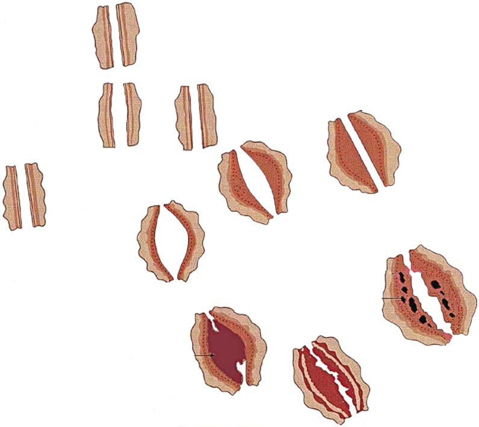
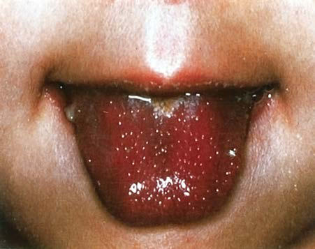

# Chapter 208: Kawasaki Disease
> **Course:** Vikkypaedia Pediatric Basic Course (*Nelson Textbook of Pediatrics, 22nd Edition (2025)*)  
> **Part XIV:** Rheumatic Diseases of Childhood (Connective Tissue Diseases, Collagen Vascular Diseases)  
> **Authors:** Mindy S. Lo, Mary Beth F. Son, and Jane W. Newburger  
> **Metrics:** 6,986 words · 6 tables/boxes · 2 figures · 0 genes · 8 flashcards · 5 MCQs  
> **Quick Navigation:** [🃏 Study 8 Flashcards](../flashcards/208_flashcards.md) · [📝 Take 5-Q MCQ Quiz](../mcqs/208_mcqs.md) · [📚 Part XIV Guide](../parts/Part_XIV.md) · [🧬 Syndrome & Genetics Atlas](../omim_gene_atlas.md) · [💊 Therapeutics Matrix](../therapies_matrix.md) · [🏠 Course Index](../../index.md)

## ⚡ High-Yield Nelson Pediatric Board Pearls
- In a patient with an inflammasomopathy caused by gain-of-function pathogenic variants in NLRC4, administration of the recombinant IL-18BP resulted in rapid and sustained improvement, including the resolution of all MAS-like features.
- Additional symptoms other than the principal clinical criteria are common in the 10 days before diagnosis of KD, which may be explained in part by the finding that up to a third of patients with KD have confirmed, concurrent infections.
- Cardiac involvement is the most important manifestation of KD.
- Almost all the morbidity and mortality in KD occur in patients with large or giant coronary artery aneurysms, defined by the 2017 American Heart Association (AHA) scientific statement on the diagnosis and treatment of KD as having a z score ≥10 or an abso lute dimension of ≥8 mm.
- Rupture of a giant aneurysm is a rare complication that generally occurs in the first month after illness onset and may present as hemopericardium with tampon ade.
- This presentation may be confused with bac terial or viral cervical lymphadenitis and may delay the diagnosis and treatment.
- Persistence of high fever, lack of response to antibiotics, and subsequent development of other signs of KD suggest the diagnosis.

---
## Full Chapter Text, Tables & Figures
# Chapter 208: Kawasaki Disease

*Mindy S. Lo, Mary Beth F. Son, and Jane W. Newburger*

<!-- p.1964 -->
If response to glucocorticoids is not satisfactory, cyclosporine A (2-7 mg/kg/day) is usually added to the treatment regimen based on several reports describing the rapid resolution of MAS features in response to this medication. Cyclosporine is preferentially used orally, and careful monitoring for toxicity is required, especially if it is administered intra venously. In many patients, administration of cyclosporine A not only provides rapid control of symptoms but also avoids excessive use of steroids. Case reports support the use of tacrolimus as an alternative to cyclosporine A, as it is often effective and has a desirable safety profile.

There is also reported efficacy with the use of anakinra for MAS. Because MAS episodes may be triggered by disease flare, biologics that neutralize IL-1 could extinguish the underlying inflammation driving the cytokine storm. There are several case reports and two case series of anakinra treat ment for MAS with promising results, particularly when used in higher doses. However, in established SJIA, continuous treatment with standard doses of anti–IL-1 and anti-IL-6 biologic therapies does not absolutely protect against MAS even if the underlying disease responds well to the treatment. In the phase 3 clinical trial of canakinumab, IL-1 blockade did not confer full protection from MAS even in patients with fully controlled SJIA. These results suggest that IL-1 inhibition effectively treats MAS in many patients, but does not completely prevent the occurrence of MAS, particularly in the setting of viral infection in treated subjects.

Intravenous immune globulin treatment has been successful in virus-associated reactive HLH. Rituximab—a treatment that depletes B lymphocytes, the main type of cells harboring EBV virus—has been successfully used in EBV-induced lymphoproliferative disease and could be considered in EBV-driven MAS.

If MAS remains active despite the use of corticosteroids, anakinra, and cyclosporine A, the HLH-2004 treatment protocol developed by the HLH Study Group of the International Histiocyte Society may be considered. In addition to steroids and cyclosporine A, this protocol includes etoposide (or VP16), a podophyllotoxin derivative that inhibits DNA synthesis by forming a complex with topoisomerase II and DNA. However, this pro tocol is limited by the toxicity of etoposide and its likelihood of causing kidney and liver damage. In addition, severe bone marrow suppression, overwhelming infection, and death have been reported. The use of lower doses of etoposide (50-100 mg/m2 range rather than 150 mg/m2, as sug gested by the HLH-2004 protocol) has been advocated by some groups.

It has also been suggested that antithymocyte globulin (ATG) might be a safer alternative to etoposide, particularly in patients with renal and hepatic impairment. ATG depletes both CD4+ and CD8+ T cells through complement-dependent cell lysis. Mild depletion of mono cytes is noted in some patients as well. Although this treatment was tol erated well in reported cases, infusion reactions are frequently reported with the use of ATG, and adequate laboratory and supportive medical resources must be readily available if this treatment is used. Occasional reports describe successful use of cyclophosphamide to control MAS, mainly in patients with SLE.

The monoclonal antibody tocilizumab is very effective in treating SJIA. However, in a phase 3 clinical trial of tocilizumab in SJIA, several patients developed MAS. Similar to canakinumab, at the time of MAS presentation, underlying SJIA in most of these patients was well con trolled. Furthermore, tocilizumab can cause normalization of some of the laboratory parameters of MAS, without actually altering the course of MAS activity itself, providing false reassurance of disease control.

In a patient with an inflammasomopathy caused by gain-of-function pathogenic variants in *NLRC4,* administration of the recombinant IL-18BP resulted in rapid and sustained improvement, including the resolution of all MAS-like features. It remains unclear whether a simi lar therapeutic intervention might be effective in MAS as well. Based on their essential roles in transmitting cytokine-induced signals, par ticularly from IFN-γ, the JAK/STAT pathways have become a target for pharmacologic manipulation in inflammatory diseases. Ruxolitinib, a potent inhibitor of JAK1 and JAK2, has been shown to ameliorate the disease-influencing patterns of JAK/STAT-dependent gene expression in animal models of pHLH, but it remains to be determined whether this treatment will be routinely effective in patients with MAS.

*Visit Elsevier eBooks+ at eBooks.Health.Elsevier.com** for Bibliography.*

Kawasaki disease (KD), formerly known as *mucocutaneous lymph node syndrome* and *infantile polyarteritis nodosa,* is an acute febrile illness of childhood seen worldwide, with the highest incidence occurring in Asian children. KD is a systemic inflammatory disorder manifesting as a vasculitis with a predilection for the coronary arteries. Approximately 20–25% of untreated children develop **coronary artery abnormalities (CAAs)**, including aneurysms, whereas <5% of children treated with intravenous immunoglobulin (IVIG) develop CAA. Nonetheless, KD is the leading cause of acquired heart disease in children in most devel oped countries, including the United States and Japan.

**ETIOLOGY** The cause of KD remains unknown. Certain epidemiologic and clini cal features support an infectious origin, including the young agegroup affected; epidemics with wavelike geographic spread of illness; the self-limited nature of the acute febrile illness; and the clinical features of fever, rash, enanthem, conjunctival injection, and cervical lymphadenopathy. Further evidence of an infectious trigger includes the infrequent occurrence of the illness in infants <3 months old, pos sibly the result of protective maternal antibodies, and the rarity of cases in adults, possibly the result of prior exposures with subsequent immunity. Furthermore, the number of hospitalizations per year for KD significantly decreased during the COVID-19 pandemic, both in Japan and the United States, possibly due to low circulating causative viruses. However, there are also features that are not consistent with an infectious origin; it is unusual to have multiple cases present at the same time within a family or daycare center. Furthermore, no single infectious etiologic agent has been successfully identified, despite an exhaustive search. Other environmental triggers such as airborne tox ins and climate shifts have also been speculated to play a role.

Genetic factors clearly influence the pathogenesis of KD, as evi denced by the higher risk of KD in Asian children regardless of country of residence and in siblings and children of individuals with a history of KD. The concordance rate among identical twins is approximately 13%. Linkage studies and genome-wide association studies (GWAS) have identified significant potential associations between polymorphisms in the *ITPKC* gene, a T-cell regulator, with increased susceptibility to KD and more severe disease. Other candidate genes for KD identified by GWAS include *CASP3, BLK,* and *FCGR2A.* Lastly, multiple alleles in different human leukocyte antigen (HLA) regions have been reported to influence risk for KD.

**EPIDEMIOLOGY** For the majority of patients, KD is a disease of early childhood, and nearly all epidemiologic studies show a higher susceptibility to KD in males. Large database studies suggest that the hospitalization rate for KD in the United States has been mostly stable over time, although the proportion of hospitalizations complicated by “KD shock syndrome” has increased over time. In 2017, the Kids’ Inpatient Database esti mated 19.3 hospitalizations/100,000 children <4 years of age. Children of Asian/Pacific Islander descent had the highest rates of KD among all racial groups.

In other countries, such as the United Kingdom, South Korea, and Japan, the rate of KD seems to be increasing. In Japan, nationwide sur veys have been administered every 2 years to monitor trends in KD incidence. In 2018 the highest recorded rate thus far of 359 per 100,000 children ages 0-4 years was described, with the highest rate in young children ages 9-11 months. Fortunately, the proportion of Japanese

*Mindy S. Lo, Mary Beth F. Son, and 
 Jane W. Newburger*

<!-- p.1966 -->
Media

Intima

Adventitia

Elastica interna

**Necrotizing**

**arteritis**

Aneurysm

formation

Possible progression to a normal luminal dimension

Further progression and ? possible interaction with atherosclerosis risk factors

Calcification

Organization of thrombus and recanalization

**Occlusive thrombus formation**

Destruction of intima, elastica interna, media and, variably, adventitia

**1. Subacute/chronic vasculitis 2. Luminal myofibroblastic proliferation 3. Laminar nonocclusive thrombosis**

Myocardial infarction

Complex stenosis

Ischemic heart disease

Mild, transient dilation (resolves within 4–6 wk)

No coronary artery changes

**Fig. 208.1** Natural history of coronary artery abnormalities. (Modified from Kato H. Cardiovascular complications in Kawasaki disease: coronary artery lumen and long-term consequences. Prog Pediatr Cardiol. 2004;19:137–145.)

patients with coronary aneurysms and myocardial infarction has decreased over time, at 2.6% for the former in the most recent survey.

Several risk-stratification models have been constructed to deter mine which patients with KD are at highest risk for CAA. Predictors of poor outcome across several studies include young age; being male; persistent prolonged fever; poor response to IVIG; and laboratory abnormalities, including neutrophilia, thrombocytopenia, transami nitis, hyponatremia, hypoalbuminemia, elevated levels of N-terminal brain natriuretic protein, and elevated C-reactive protein (CRP) levels. Asian, Pacific Islander, and Hispanic ethnicity are also risk factors for CAA. Three risk scores for IVIG resistance, which refers to incom plete response to the first treatment, have been constructed by Japa nese researchers; of these, the **Kobayashi score** is the most widely used and has high sensitivity and specificity. Unfortunately, when applied to non-Japanese populations, these scores do not appear to be as accurate in identifying children at risk for IVIG resistance and CAA. Body sur face area (BSA)–adjusted coronary artery dimensions on initial echo cardiography are good predictors of CAA development. In a North American cohort, coronary artery *z* scores ≥2.0 are predictive of CAA development; similar findings have been reported in Japanese cohorts as well. Accordingly, coronary artery *z* scores at initial presentation are useful imaging biomarkers that can be used to guide adjunctive therapy for high-risk patients.

**PATHOLOGY** KD is a vasculitis that predominantly affects medium-size arteries. The coronary arteries are most often involved, although other arter ies (e.g., axillary, subclavian, femoral, popliteal, brachial) can also develop dilation. A three-phase process to the arteriopathy of KD has been described. The first phase is a neutrophilic necrotizing arteritis

occurring in the first 2 weeks of illness that begins in the endothelium and moves through the coronary wall. Saccular aneurysms may form from this arteritis. The second phase is a subacute/chronic vasculitis driven by lymphocytes, plasma cells, and eosinophils, which may last weeks to years and results in fusiform aneurysms. The vessels affected by the subacute/chronic vasculitis then develop smooth muscle cell myofibroblasts, which may cause diminution of internal lumen dimen sion and progressive stenosis in the third phase. Thrombi may form in the lumen and obstruct blood flow (Fig. 208.1).

**CLINICAL MANIFESTATIONS** Fever is characteristically high (≥38.3°C [101°F]), persistent, and unre sponsive to antipyretics. The duration of fever without treatment is generally 1-2 weeks but may be as short as 5 days or may persist for 3-4 weeks. In addition to fever, the **five principal clinical criteria** of KD are (1) bilateral *nonexudative* conjunctival injection with limbal spar ing; (2) erythema of the oral and pharyngeal mucosa with strawberry tongue and red, cracked lips; (3) edema (induration) and erythema of the hands and feet; (4) rash of various forms (maculopapular, urticarial, erythema multiforme–like, scarlatiniform, and rarely, micropustular or psoriatic-like); and (5) nonsuppurative cervical lymphadenopathy, usually unilateral, with node size >1.5 cm (Table 208.1 and Figs. 208.2- 208.5). Superficial perineal desquamation is common in the acute phase. Periungual desquamation of the fingers and toes begins 2-3 weeks after the onset of illness and may progress to involve the entire hand and foot (Fig. 208.6).

Additional symptoms other than the principal clinical criteria are common in the 10 days before diagnosis of KD, which may be explained in part by the finding that up to a third of patients with KD have confirmed, concurrent infections. Gastrointestinal (GI)

<!-- p.1967 -->
0 20 Percentage of Cases

100 10 30 50 40 70 80 60 90

Fever Strawberry tongue

Conjunctivitis Desquamation Polymorphous skin rashes

Induration

Pyuria

BCG

LAP Diarrhea

CAD Arthritis

**Fig. 208.2** Clinical symptoms and signs of Kawasaki disease. Sum mary of clinical features from 110 cases of Kawasaki disease seen in Ka ohsiung, Taiwan. LAP, Lymphadenopathy in head and neck area; BCG, reactivation of bacille Calmette-Guérin inoculation site; CAD, coronary artery dilation, defined by an internal diameter >3 mm. (From Wang CL, Wu YT, Liu CA, et al. Kawasaki disease: infection, immunity and genetics. Pediatr Infect Dis J. 2005;24:998–1004.)

**Fig. 208.3** Kawasaki disease. Strawberry tongue in patient with mu cocutaneous lymph node syndrome. (Courtesy Tomisaku Kawasaki, MD. From Hurwitz S. Clinical Pediatric Dermatology, 2nd ed. Philadelphia: Saunders; 1993.)

#### **Table 208.1** Clinical and Laboratory Features of Kawasaki Disease

| Category / Parameter | Clinical Details & Findings |
| --- | --- |
| **EPIDEMIOLOGIC CASE DEFINITION (CLASSIC CLINICAL CRITERIA)*** | Fever persisting at least 5 days†; Presence of at least four principal features:; Changes in extremities; • Acute: erythema of palms, soles; edema of hands, feet; • Subacute: periungual peeling of fingers, toes in wk 2 and 3; Polymorphous exanthem; Bilateral bulbar conjunctival injection without exudate; Erythema and cracking of lips, strawberry tongue, and/or erythema; of oral and pharyngeal mucosa; Cervical lymphadenopathy (>1.5 cm diameter), usually unilateral; Exclusion of other diseases with similar findings‡ |
| **Cardiovascular System** | Myocarditis, pericarditis, valvular regurgitation, cardiogenic; shock; Coronary artery abnormalities; Aneurysms of medium-sized noncoronary arteries; Peripheral gangrene; Aortic root enlargement |
| **Respiratory System** | Peribronchial and interstitial infiltrates on chest; radiograph; Pulmonary nodules |
| **Musculoskeletal System** | Arthritis, arthralgias (pleocytosis of synovial fluid) |
| **Gastrointestinal Tract** | Diarrhea, vomiting, abdominal pain; Hepatitis, jaundice; Hydrops of gallbladder; Pancreatitis; Parotitis |
| **Central Nervous System** | Extreme irritability; Aseptic meningitis (pleocytosis of cerebrospinal; fluid); Facial nerve palsy; Sensorineural hearing loss |
| **Genitourinary System** | Urethritis/meatitis, hydrocele |
| **Other Findings** | Desquamating rash in groin; Retropharyngeal phlegmon; Anterior uveitis by slit-lamp examination; Erythema, induration at bacille Calmette-Guérin inoculation site |
| **DISEASE** | Leukocytosis with neutrophilia and immature forms; Elevated erythrocyte sedimentation rate; Elevated C-reactive protein; Elevated nitrogen-terminal pro B-type natriuretic peptide; (NT-proBNP); Anemia; Abnormal plasma lipids; Hypoalbuminemia; Hyponatremia; Thrombocytosis after wk 1§; Sterile pyuria; Elevated serum transaminase; Elevated serum γ-glutamyl transpeptidase; Pleocytosis of cerebrospinal fluid; Leukocytosis in synovial fluid; *Patients with fever at least 5 days and fewer than four principal criteria can be diagnosed with Kawasaki disease when coronary artery abnormalities are detected by two-dimensional; echocardiography or angiography.; †In the presence of four or more principal criteria, particularly when redness and swelling of the hands and feet are present, Kawasaki disease diagnosis can be made on day 4 of; illness. Experienced clinicians who have treated many patients with Kawasaki disease may establish a diagnosis before day 4 in rare cases.; ‡See the differential diagnosis (Table 208.3).; §Rarely infants present with thrombocytopenia and disseminated intravascular coagulation.; From McCrindle BW, Rowley A, Newburger JW, et al. Diagnosis, treatment, and long-term management of Kawasaki disease: a scientific statement for health professionals from the; American Heart Association. Circulation. 2017;135(17):e927–e999. |

<!-- p.1968 -->
symptoms (vomiting, diarrhea, or abdominal pain) occur in >60% of patients, and at least one respiratory symptom (rhinorrhea or cough) occurs in 35%. Other clinical findings can include significant irritabil ity that is especially prominent in infants and likely caused by aseptic meningitis, mild hepatitis, hydrops of the gallbladder, urethritis and meatitis with sterile pyuria, uveitis, and arthritis. Arthritis may occur early in the illness or may develop in the second or third week. Small or

large joints may be affected, and the arthralgias may persist for several weeks. Patients previously vaccinated with bacillus Calmette-Guerin (BCG) may show reactivation at the inoculation site. Clinical features that are *not consistent* with KD include exudative/purulent conjunc tivitis; exudative pharyngitis; generalized lymphadenopathy; discrete oral lesions (e.g., ulceration); splenomegaly; and bullous, petechial, or vesicular rashes.

Cardiac involvement is the most important manifestation of KD. Myocarditis may occur in patients with acute KD and may manifest as tachycardia disproportionate to fever, along with diminished left ventricular systolic function. Occasionally, patients with KD present in cardiogenic shock **(KD shock syndrome)**, with hypotension and greatly diminished left ventricular function. In addition, KD shock syndrome may manifest with thrombocytopenia, a high band count, and a high CRP. Case series of KD shock syndrome indicate that these patients may be at higher risk for coronary artery dilation. Pericarditis with a small pericardial effusion can also occur during the acute ill ness. Mitral regurgitation of at least mild severity is evident on echo cardiography in 10–25% of patients at presentation but diminishes over time, except among rare patients with coronary aneurysms and ischemic heart disease. Up to 25% of untreated patients develop CAA by Japanese Ministry of Health criteria in the second to third week of illness; initially these are usually asymptomatic and detected by echo cardiography. Almost all the morbidity and mortality in KD occur in patients with **large or giant coronary artery aneurysms**, defined by the 2017 American Heart Association (AHA) scientific statement on the diagnosis and treatment of KD as having a *z* score ≥10 or an abso lute dimension of ≥8 mm. Specifically, large or giant aneurysms are associated with the greatest risk of later thrombosis or stenosis, angina, and myocardial infarction (Figs. 208.7 and 208.8A). Rupture of a giant aneurysm is a rare complication that generally occurs in the first month after illness onset and may present as hemopericardium with tampon ade. Axillary, popliteal, iliac, or other systemic medium-sized muscular arteries may also become aneurysmal, but always in the setting of giant coronary aneurysms (see Fig. 208.8B); these usually regress.

Occasionally KD presents initially with only fever and lymphade nopathy **(node-first KD)**. This presentation may be confused with bac terial or viral cervical lymphadenitis and may delay the diagnosis and treatment. Persistence of high fever, lack of response to antibiotics, and subsequent development of other signs of KD suggest the diagnosis. Children with node-first KD tend to be older (4 vs 2 years) and have more days of fever and higher CRP levels. In addition to cervical ade nopathy, many node-first patients had retropharyngeal and peritonsil lar inflammation on CT scans (Fig. 208.9). Patients with node-first KD have a higher incidence of coronary aneurysms. Patients with infec tious adenitis usually respond to antibiotics; they may have abscesses noted on imaging studies (ultrasonography or CT).

KD can be divided into three clinical phases. The **acute febrile phase** is characterized by fever and the other acute signs of illness and usually lasts 1-2 weeks. The **subacute phase** is associated with desquamation, thrombocytosis, development of CAA, and the highest risk of sudden death in patients who develop aneurysms; it generally lasts 3 weeks. The **convalescent phase** begins when all clinical signs of illness have disappeared and continues until the erythrocyte sedimentation rate (ESR) returns to normal, typically 6-8 weeks after the onset of illness.

**LABORATORY AND RADIOLOGY FINDINGS** There is no diagnostic test for KD, but patients usually have character istic laboratory findings. The leukocyte count is often elevated, with a predominance of neutrophils and immature forms. Normocytic, nor mochromic anemia is common. The platelet count is generally normal in the first week of illness and rapidly increases by the second to third week of illness, sometimes exceeding 1 million/mm3. An elevated ESR or CRP value is universally present in the acute phase of illness. The ESR may remain elevated for weeks, in part from the effect of IVIG. Sterile pyuria, mild elevations of the hepatic transaminases, hyperbili rubinemia, and cerebrospinal fluid pleocytosis may also be present. KD is unlikely if the ESR, CRP, and platelet counts are normal after 7 days of fever.

**Fig. 208.4** Kawasaki disease. Congestion of bulbar conjunctiva in a patient with mucocutaneous lymph node syndrome. (Courtesy Tomi saku Kawasaki, MD. From Hurwitz S. Clinical Pediatric Dermatology, 2nd ed. Philadelphia: Saunders; 1993.)

**Fig. 208.5** Kawasaki disease. Indurative edema of the hands in a pa tient with mucocutaneous lymph node syndrome. (Courtesy Tomisaku Kawasaki, MD. From Hurwitz S. Clinical Pediatric Dermatology, 2nd ed. Philadelphia: Saunders; 1993.)

**Fig. 208.6** Kawasaki disease. Desquamation of the fingers in a pa tient with mucocutaneous lymph node syndrome. (Courtesy Tomisaku Kawasaki, MD. From Hurwitz S. Clinical Pediatric Dermatology, 2nd ed. Philadelphia: Saunders; 1993.)

<!-- p.1969 -->
Two-dimensional echocardiography is the most useful test to monitor for development of CAA. Although frank aneurysms are rarely detected in the first week of illness, coronary arteries are commonly dilated. Coro nary artery dimensions, adjusted for BSA (*z* scores), may increase over the first 6 weeks of illness, and higher *z* scores at the time of diagnosis are the strongest risk factor for the presence of coronary aneurysms 2-8 weeks after illness onset. Children with non-KD febrile illnesses also have mildly increased *z* scores compared with nonfebrile controls, but to a lesser degree than patients with KD. Aneurysms have been defined with the use of absolute dimensions by the Japanese Ministry of Health and are classified as small (≤4 mm internal diameter [ID]), medium (>4 to ≤8 mm ID), or giant (>8 mm ID). Some experts believe that a *z* score– based system for classification of aneurysm size may be more discrimi nating, because it adjusts the coronary dimension for BSA. The AHA *z* score classification system is noted in Table 208.2.

**Echocardiography** should be performed at diagnosis and again after 1-2 weeks of illness. If the results are normal, a repeat study should be performed 6-8 weeks after onset of illness. If results of either of the initial studies are abnormal or the patient has recurrent fever or symp toms, more frequent echocardiography or other studies may be neces sary. In patients in whom CAA has not developed in the first 4-6 weeks of illness, the patient may be discharged from cardiology care, although follow-up through 12 months may be considered. Children and fami lies should be counseled regarding healthy diet and the importance of exercise at regular primary care visits. For patients with CAA, the type of testing and the frequency of cardiology follow-up visits are tailored to the patient’s coronary artery status (see Table 208.2).

**DIAGNOSIS** The diagnosis of KD is based on the presence of characteristic clinical signs. For **classic KD**, the diagnostic criteria require the presence of fever for at least 5 days and at least four of five of the other princi pal characteristics of the illness (see Table 208.1). The diagnosis of KD should be made within 10 days, and ideally within 7 days, of fever onset to improve coronary artery outcomes. In **incomplete KD**, patients have persistent fever but fewer than four of the five characteristic clini cal signs. In patients with incomplete KD, laboratory and echocardio graphic data can assist in the diagnosis (Fig. 208.10). Incomplete cases occur most frequently in infants, who also have the highest likelihood of development of CAA. Ambiguous cases should be referred to a cen ter with experience in the diagnosis of KD. Establishing the diagnosis with prompt initiation of treatment is essential to prevent potentially devastating coronary artery disease. For this reason, it is recommended that *any infant age ≤**6 months with fever for ≥**7 days and signs of systemic inflammation without explanation undergo echocardiography to assess the coronary arteries.*

**DIFFERENTIAL DIAGNOSIS** Adenovirus, measles, and scarlet fever lead the list of common child hood infections that mimic KD (Table 208.3). Children with **adenovi rus** typically have exudative pharyngitis and exudative conjunctivitis, allowing differentiation from KD. A common clinical problem is the differentiation of **scarlet fever** from KD in a child who is a group A streptococcal carrier. Patients with scarlet fever typically have a rapid clinical response to appropriate antibiotic therapy. Such treatment for 24-48 hours with clinical reassessment generally clarifies the diagnosis. Furthermore, ocular findings are quite rare in group A streptococcal pharyngitis and may assist in the diagnosis of KD.

Features of **measles** that distinguish it from KD include exudative conjunctivitis, Koplik spots, rash that begins on the face and hairline and behind the ears, and leukopenia. **Cervical lymphadenitis** can be the initial diagnosis in children who are ultimately recognized to have KD. Less com mon infections such as Rocky Mountain spotted fever and leptospirosis are occasionally confused with KD. **Rocky Mountain spotted fever** is a poten tially lethal bacterial infection, and appropriate antibiotics should not be withheld if the diagnosis is under consideration. Its distinguishing features include pronounced myalgias and headache at onset, centripetal rash, and petechiae on the palms and soles. **Leptospirosis** can also be an illness of considerable severity. Risk factors include exposure to water contaminated

LAD RCA

**Fig. 208.7** Coronary angiograms in 6-yr-old boy with Kawasaki dis ease. Left, Giant aneurysm of the left anterior descending coronary ar tery (LAD) with obstruction. Right, Giant aneurysm of the right coronary artery (RCA) with an area of severe narrowing. (From Newburger JW, Takahashi M, Gerber MA, et al. Diagnosis, treatment, and long-term management of Kawasaki disease. Pediatrics. 2004;114:1708–1733.)

A B

**Fig. 208.8** MRI of coronary and peripheral artery aneurysms in Kawa saki disease. A, Image of left ventricular outflow tract showing a giant right coronary artery (RCA) aneurysm with nonocclusive thrombus (yellow arrow) and a giant left main coronary artery (LMCA) aneurysm. Ao, Aorta; AoV, aortic valve; LV, left ventricle; RV, right ventricle. B, Aneurysms in the axillary and subclavian arteries and the iliac and femoral arteries (ar rows). (From McCrindle BW, Rowley A, Newburger JW, et al. Diagnosis, treatment, and long-term management of Kawasaki disease: a scientific statement for health professionals from the American Heart Association. Circulation 2017;135[17]:e927–e999, Fig. 2G and H, p. e935.)

A B

**Fig. 208.9** Contrast-enhanced CT in 3-yr-old boy with Kawasaki dis ease. A, Right-sided cervical lymphadenopathy (arrows), peritonsillar hypodense area (curved arrow), and swelling of right palatine tonsil (arrowhead). B, Right-sided cervical lymphadenopathy with perinodal infiltration (arrows) and intranodal focal low attenuation (arrowheads). (From Kato H, Kanematsu M, Kato Z, et  al. Computed tomographic findings of Kawasaki disease with cervical lymphadenopathy. J Comput Assist Tomogr. 2012;36[1]:138–142, Fig. 1, p. 139.)

<!-- p.1970 -->
with urine from infected animals. The classic description of leptospirosis is of a biphasic illness with a few asymptomatic days between an initial period of fever and headache and a late phase with renal and hepatic fail ure. In contrast, patients with KD have consecutive days of fever at diagno sis and rarely have renal or hepatic failure.

Drug hypersensitivity reactions, including Stevens-Johnson syn drome, share some characteristics with KD. Drug reaction features such as the presence of oral ulcerations and a normal or minimally elevated ESR are not seen in KD. **Systemic juvenile idiopathic arthritis** (sJIA) is also characterized by fever and rash, but physical findings include dif fuse lymphadenopathy and hepatosplenomegaly. Arthritis may or may not be present in the initial illness. Fevers typically show a quotidian or double-quotidian pattern, in contrast to the unremitting fevers seen in KD. Laboratory findings may include coagulopathy, elevated fibrin deg radation product values, and hyperferritinemia. Interestingly, there are reports of children with sJIA who have echocardiographic evidence of CAA. Coronary aneurysms have also been reported in Behçet disease, primary cytomegalovirus infection, granulomatosis with polyangiitis, lupus, infantile polyarteritis nodosa, hyper-IgE syndrome, hyper-IgD syndrome (mevalonic aciduria), and meningococcemia.

Children with KD may present with **Kawasaki disease shock syndrome,** with a clinical picture similar to that of toxic shock syn drome or of the multisystem inflammatory syndrome in children associated with COVID-19 (MIS-C; see Chapter 311). Features of **toxic shock syndrome** that are not usually seen in KD include renal insufficiency, coagulopathy, pancytopenia, and myositis. With COVID-19 disease, some children developed a KD-like ill nesses presenting in cardiogenic shock. **multisystem inflammatory syndrome in children (MIS-C)**, also known as *pediatric inflamma tory multisystem syndrome temporally associated with SARS-CoV-2* (PIMS-TS), occurs 2-6 weeks after infection with SARS-CoV-2. The initial infection may be asymptomatic. Children with MIS-C may show conjunctival injection, oropharyngeal changes, and rashes similar to that seen in KD. CAAs have also been described in MIS- C, but the risk of CAA in MIS-C does not strictly correlate with criteria for incomplete or complete KD. Furthermore, patients are often older and have a greater degree of myocardial dysfunction as compared with KD; distinguishing laboratory features include greater hyperferritinemia, more pronounced cytopenias, and ele vated d-dimer in MIS-C (Table 208.4).

#### **Table 208.2** Classification of Coronary Artery Dilation or Aneurysms (after AHA Guidance with Modification)

| Category / Parameter | Clinical Details & Findings |
| --- | --- |
| **CLINIC** | 1; No involvement at any; time point; (z score<2); 2 wk; 6 wk; 6 mo; 12 mo; Discharge if normal; at 12 mo; None; No; No—annual cardiac; and general health; review with GP; recommended*; 2; Dilation only; (2< z score ≤2.5): resolves; within 1 year; 2 wk; 6 wk; 6 mo; 12 mo; Discharge if normal; at 12 mo; None; No; No—annual cardiac; and general health; review with GP; recommended*; 3; Small aneurysm; (2.5≤ z score <5):; (a) current or persistent; (b) decreased to normal; or z score <2.5; 2 wk; 6 wk; 6 mo; 12 mo; Annual review; Coronary angiography (preferably; CT) at 12 mo as baseline; Consider stress imaging for inducible; myocardial ischemia every 2 years; Imaging (echo) for coronary; surveillance annually; Yes; Yes; 4; Medium aneurysm; (5 ≤z score <10):; (a) persistent aneurysm; (b) decreased to normal or; z score <2.5; 2 wk; 6 wk; 6 mo; 12 mo; Annual review; Coronary angiography (preferably; CT) at 12 mo as baseline; Consider stress imaging for inducible; myocardial ischemia annually; Imaging (echo, CT,† or MRI) for coronary; thrombus surveillance annually; Yes; Yes; 5; Giant aneurysm; (z score ≥10 or ≥8 mm):; (a) persistent giant; aneurysm; (b) persistent aneurysm; (but regressed to medium; or small aneurysms); (c) regressed to normal; dimensions; 2 wk; 6 wk; 3 mo; 6 mo; 9 mo; 12 mo; Then every 6 mo; Coronary angiography (preferably; CT) at 6-12 mo as baseline; Consider stress imaging for inducible; myocardial ischemia annually; Imaging (echo, CT,† or MRI) for; coronary thrombus surveillance; every 6 mo; Yes; Yes; *GP review should include clinical examination, blood pressure measurement, general health discussion, and advice on avoidance of cardiovascular risk factors and lifestyle choices,; including maintaining a healthy weight, reducing the risk of diabetes, avoiding smoking, and taking regular exercise. This provides the opportunity to discuss any parent or patient; questions and concerns.; †CT should not be used repeatedly if possible. Use MRI or ultrasound where possible to reduce radiation exposure.; ADP, Adenosine diphosphate; AHA, American Heart Association; FBC, full blood count; GP, general practitioner; PSP, person-specific protocol.; From McCrindle BW, Rowley AH, Newburger JW, et al. Diagnosis, treatment, and long-term management of Kawasaki disease: A scientific statement for health professionals from the; American Heart Association [published correction appears in Circulation. 2019 Jul 30;140(5):e181-e184]. Circulation. 2017;135(17):e927–e999.). |

<!-- p.1971 -->
**TREATMENT** Patients with acute KD should be treated with 2 g/kg of IVIG as a single infusion, usually administered over 10-12 hours within 10 days of dis

Evaluation of suspected incomplete Kawasaki disease1

Assess laboratory tests

Serial clinical and laboratory re-evaluation if

fevers persist Echocardiogram if typical

peeling6 develops

Treat5

NO

YES

1)   Anemia for age 2)   Platelet count of ≥450,000 after the 7th day of fever 3)   Albumin ≤3.0 g/dL 4)   Elevated ALT level 5)   WBC count of ≥15,000/mm3

6)   Urine ≥10 WBC/hpf

CRP<3.0 mg/dL and ESR<40 mm/hr CRP≥3.0 mg/dL and/or ESR≥40 mm/hr

3 or more laboratory findings:

Positive echocardiogram4 **OR**

Children with fever ≥5 days and 2 or 3 compatible clinical criteria2 **OR**

infants with fever for ≥7 days without other explanation3

**Fig. 208.10** Algorithm for the evaluation of suspected incomplete Kawasaki disease (KD). 1In the absence of a gold standard for diagnosis of KD, this algorithm cannot be evidence based, but rather represents the informed opinion of the expert committee. Consultation with an expert should be sought any time assistance is needed. 2Clinical findings of KD are listed in Table 208.1. Characteristics suggesting that another diagnosis should be considered include exudative conjunctivitis, exudative pharyngitis, ulcerative intraoral lesions, bullous or vesicular rash, generalized adenopathy, and splenomegaly. 3Infants ≤6 months of age are most likely to develop prolonged fever without other clinical criteria for KD; these infants are at particularly high risk of developing coronary artery abnormalities. 4Echocardiography is considered positive for purposes of this algorithm if any of three conditions are met: z score of left anterior descending coronary artery or right coronary artery ≥2.5; coronary artery aneurysm is observed; or three or more other suggestive features exist, including decreased left ventricular function, mitral regurgitation, pericardial effusion, or z scores in the left anterior descending coronary artery or right coronary artery of 2-2.5. 5If the echocardiogram is positive, treatment should be given within 10 days of fever onset or after the 10th day of fever in the presence of clinical and laboratory signs (C-reactive protein [CRP], erythrocyte sedimentation rate [ESR]) of ongoing inflammation. 6Typical peeling begins under the nail beds of fingers and toes. ALT, Alanine transaminase; WBC, white blood cell. (From McCrindle BW, Rowley A, Newburger JW, et al. Diagnosis, treatment, and long-term management of Kawasaki disease: A scientific statement for health professionals from the American Heart Association. Circulation. 2017;135:e927–e999, Fig. 2, p. e937.)

Inflammatory Syndrome in Children (MIS-C) with Kawasaki Disease

#### **Table 208.4** Comparing and Contrasting Multisystem

| Category / Parameter | Clinical Details & Findings |
| --- | --- |
| **KAWASAKI DISEASE** | Mean age 8-12 years; Mean age <5 years; Fever >24 hr; Fever >5 days; GI symptoms common (severe; abdominal pain) (50–90%); GI complaints not common; (∼20%); Myocarditis/myocardial dysfunction; (left ventricular dysfunction); Myocardial function normal/; mildly reduced*; Coronary artery dilation or; aneurysms (25–50%); Coronary artery abnormalities; such as aneurysms common if; untreated; Hypotension; Normal BP*; Renal involvement more common; Renal involvement rare; Proinflammatory state common; Proinflammatory state common; Lymphopenia common; Lymphopenia not common; Thrombocytopenia; Thrombocytosis; Elevated ferritin; Ferritin usually normal; *Except in Kawasaki shock syndrome (∼5%).; GI, Gastrointestinal.; Modified from Naka F, Melnick L, Gorelik M, et al. A dermatologic perspective on; multisystem inflammatory syndrome in children. Clin Dermatol. 2021;39(1):163–168, Table 5. |

#### **Table 208.3** Differential Diagnosis of Kawasaki Disease

| Category / Parameter | Clinical Details & Findings |
| --- | --- |
| **VIRAL INFECTIONS*** | Adenovirus; Enterovirus; Measles; Epstein-Barr virus; Cytomegalovirus |
| **BACTERIAL INFECTIONS** | Scarlet fever; Rocky Mountain spotted fever; Leptospirosis; Bacterial cervical lymphadenitis ± retropharyngeal phlegmon; Meningococcemia; Urinary tract infection |
| **RHEUMATOLOGIC DISEASE** | Systemic-onset juvenile idiopathic arthritis; Behçet disease; Rheumatic fever; Polyarteritis nodosa; Takayasu arteritis |
| **OTHER** | Multisystem inflammatory syndrome in children (MIS-C) associated; with COVID-19; Toxic shock syndromes; Serum sickness; Staphylococcal scalded skin syndrome; Macrophage activation syndrome (may also complicate Kawasaki disease); Hemophagocytic lymphohistiocytosis; Drug hypersensitivity reactions; Stevens-Johnson syndrome; Aseptic meningitis; Autoinflammatory diseases |

<!-- p.1972 -->
In addition, moderate-dose (30-50 mg/kg/day divided every 6 hours) aspirin should be administered until the patient is afebrile, then low ered to antiplatelet doses (3-5 mg/kg/day). Other NSAIDs should *not* be given during therapy with aspirin because they may block aspirin’s antiplatelet effect. The mechanism of action of IVIG in KD is likely multifaceted, but treatment results in defervescence and resolution of clinical signs of illness in approximately 85% of patients. Using Japa nese Ministry of Health criteria, the prevalence of coronary disease is 20–25% in children treated with aspirin alone and falls to <5% in those treated with IVIG and aspirin within the first 10 days of illness. In chil dren diagnosed after the 10th day of fever, IVIG should still be offered to patients with persistent fever, abnormal dimensions of the coronary arteries, or signs of systemic inflammation. Low-dose aspirin is contin ued for its antithrombotic effect until 6-8 weeks after illness onset and is then discontinued in patients who have had normal echocardiogra phy findings throughout the course of their illness. Patients with CAA continue with aspirin therapy longer and may require anticoagulation, depending on the degree of coronary dilation (see later).

*Glucocorticoids* have been used as primary therapy with the first dose of IVIG in hopes of improving coronary outcomes. A North American trial using a single pulse dose of intravenous methylprednisolone (30 mg/ kg) with IVIG as primary therapy did not improve coronary outcomes. However, a trial in Japan using the Kobayashi score to identify high-risk children demonstrated improved coronary outcomes with a regimen of

methylprednisolone/prednisolone (2 mg/kg/day, divided every 12 hours) plus IVIG as primary therapy. Furthermore, a systematic review and meta-analysis of 16 comparative studies demonstrated that early treat ment with glucocorticoids improved coronary artery outcomes in chil dren with KD. These data suggest that primary glucocorticoid therapy in addition to standard of care (IVIG plus aspirin) may be helpful in chil dren at *high risk* for CAA. Fewer data are available to support the use of TNF alpha inhibitors for prevention of coronary artery aneurysms.

**IVIG-resistant KD** (nonresponders) occurs in approximately 15% of patients and is defined by persistent or recrudescent fever 36 hours after completion of the initial IVIG infusion. Patients with IVIG resis tance are at increased risk for CAA. Therapeutic options for the child with IVIG resistance include a second dose of IVIG (2 g/kg), a taper ing course of glucocorticoids, infliximab, or possibly anakinra (Table 208.6). For the most severely affected patients with enlarging coronary aneurysms, additional therapies such as cyclosporine or cyclophospha mide may be administered, with consultation from specialists in pedi atric rheumatology and cardiology.

**COMPLICATIONS** Acute KD is complicated in 1–2% of patients by macrophage activa tion syndrome (MAS; see Chapter 207), a syndrome of life-threatening hyperinflammation on the spectrum of hemophagocytic lymphohis tiocytosis. MAS may mimic MIS-C. These patients may present with hyperferritinemia, coagulopathy, thrombocytopenia, and shock, war ranting more aggressive immunosuppressive therapy.

In all phases of KD, patients with giant coronary aneurysms may experience myocardial infarction, angina, and sudden death due to thrombosis. For this reason, aspirin is continued indefinitely in chil dren with coronary aneurysms (Table 208.7). When aneurysms are moderate-sized, dual antiplatelet therapy (e.g., aspirin and clopidogrel) is sometimes administered. For those with large or giant aneurysms, anti coagulation with warfarin or low-molecular-weight heparin is added to aspirin. For acute thrombosis that occasionally occurs in an aneurysmal or stenotic coronary artery, thrombolytic therapy may be lifesaving. In very rare circumstances of severe, giant aneurysms, rupture can occur.

Long-term follow-up of patients with CAAs is tailored to the past (i.e., worst-ever) and current coronary status, with a schedule of testing recom mended in the 2017 AHA scientific statement on KD (see Table 208.2). Testing may include echocardiography, assessment for inducible ischemia, advanced imaging (CT, MRI, or invasive angiography), physical activ ity counseling, and cardiovascular risk factor assessment and manage ment. Patients with coronary artery stenosis and inducible ischemia may be managed with coronary artery bypass grafting (CABG) or catheter

#### **Table 208.6** Treatment Options for IVIG-Resistant Patients with Kawasaki Disease*

| Category / Parameter | Clinical Details & Findings |
| --- | --- |
| **MOST FREQUENTLY ADMINISTERED** | IVIG: second infusion; Pooled polyclonal IG; 2 g/kg IV; IVIG + methylprednisolone/; prednisolone; IVIG + glucocorticoid; IVIG: 2 g/kg IV + methylprednisolone 2 mg/kg/d IV divided every 12 hr; until afebrile, then oral prednisolone 2 mg/kg/d divided twice daily; Infliximab; Monoclonal antibody against TNF-α; Single infusion: 5-10 mg/kg IV |
| **ALTERNATIVE TREATMENTS** | Anakinra; Recombinant IL-1β receptor antagonist; 2-8 mg/kg/day given by subcutaneous injection or IV infusion; Cyclosporine; Inhibitor of calcineurin-NFAT pathway; IV: 3 mg/kg/d divided every 12 hr; PO: 4-8 mg/kg/d divided every 12 hr; Adjust dose to achieve trough 50-150 ng/mL; 2 hr peak level 300-600 ng/mL; Cyclophosphamide; Alkylating agent blocks DNA replication; 10-15 mg/kg IV, 1 or 2 doses; Plasma exchange; Replaces plasma with albumin; 1-5 cycles; *IVIG resistance is defined as persistent or recrudescent fever at least 36 hr and <7 days after completion of first IVIG infusion. The top three treatments have been most frequently; used, although no comparative effectiveness trial has been performed. Pulsed high-dose corticosteroid treatment is not recommended. The alternative treatments have been used; in a limited number of patients with KD.; CRP, C-reactive protein; IG, immunoglobulin; IL, interleukin; IV, intravenous(ly); IVIG, intravenous immune globulin; NFAT, nuclear factor of activated T cells; PO, oral; TNF, tumor necrosis factor. |

#### **Table 208.5** Treatment of Kawasaki Disease

| Category / Parameter | Clinical Details & Findings |
| --- | --- |
| **ACUTE STAGE** | Standard risk:; Intravenous immune globulin 2 g/kg over 10-12 hr; and; Aspirin 30-50 mg/kg/day divided every 6 hr orally until patient is; afebrile for at least 48 hr; High risk* for coronary artery abnormalities:; Intravenous immune globulin and aspirin as above, plus; methylprednisolone 2 mg/kg/d IV divided q12hr until afebrile, then; prednisolone orally until CRP normalized, then taper over 2-3 wk |
| **CONVALESCENT STAGE** | Aspirin 3-5 mg/kg once daily orally until 6- after illness onset if normal; coronary findings throughout course; *High risk for coronary artery abnormalities is defined as age <6 months or baseline; left anterior descending (LAD) or right circumflex artery (RCA) z-score greater than or; equal to 2.5. |

<!-- p.1974 -->
