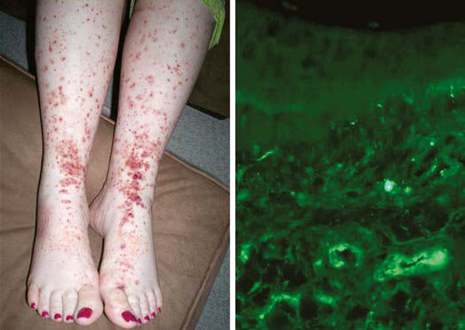

# Chapter 210: Vasculitis Syndromes
> **Course:** Vikkypaedia Pediatric Basic Course (*Nelson Textbook of Pediatrics, 22nd Edition (2025)*)  
> **Part XIV:** Rheumatic Diseases of Childhood (Connective Tissue Diseases, Collagen Vascular Diseases)  
> **Authors:** Vidya Sivaraman, Edward C. Fels, and Stacy P. Ardoin  
> **Metrics:** 11,147 words · 17 tables/boxes · 2 figures · 8 genes · 8 flashcards · 5 MCQs  
> **Quick Navigation:** [🃏 Study 8 Flashcards](../flashcards/210_flashcards.md) · [📝 Take 5-Q MCQ Quiz](../mcqs/210_mcqs.md) · [📚 Part XIV Guide](../parts/Part_XIV.md) · [🧬 Syndrome & Genetics Atlas](../omim_gene_atlas.md) · [💊 Therapeutics Matrix](../therapies_matrix.md) · [🏠 Course Index](../../index.md)

## Key Chapter Topics & Subchapters
`210.1 Henoch-Schönlein Purpura (IgA Vasculitis)` · `210.2 Takayasu Arteritis` · `210.3 Polyarteritis Nodosa and Cutaneous Polyarteritis Nodosa` · `210.4 Antineutrophilic Cytoplasmic Antibody– Associated Vasculitis` · `210.5 Other Vasculitis Syndromes: Hypersensitivity, CNS, and COVID-19 Related` · `210.1 Henoch-Schönlein Purpura (IgA Vasculitis) Vidya Sivaraman, Edward C. Fels, and Stacy P. Ardoin` · `210.2 Takayasu Arteritis Vidya Sivaraman, Edward C. Fels, and Stacy P. Ardoin`

## Key Genetic & Molecular Targets
`CECR1`, `HTRA1`, `MEFV`, `MVK`, `NLRP3`, `NOD2`, `NOTCH3`, `TNFRSF1A`

## ⚡ High-Yield Nelson Pediatric Board Pearls
- A nomenclature system from the 2012 International Chapel Hill Consensus Conference has proposed using the pathologic diagnosis rather than eponyms for vas culitis nomenclature.
- Demonstration of vessel injury and inflammation on biopsy or vascular imaging is required to confirm a diagnosis of vasculitis.
- Henoch-Schönlein purpura (HSP) is the most common vasculitis of childhood and is characterized by leukocytoclastic vasculitis and immunoglobulin A deposition in the small vessels in the skin, joints, gastrointestinal tract, and kidney.
- CLINICAL MANIFESTATIONS The hallmark of HSP is its rash: palpable purpura starting as pink mac ules or wheals and developing into petechiae, raised purpura, or larger ecchymoses.
- Neurologic manifestations of HSP, caused by hypertension (poste rior reversible encephalopathy syndrome) or central nervous system (CNS) vasculitis, may also occur, including intracerebral hemor rhage, seizures, headaches, depressed level of consciousness, cranial or peripheral neuropathies, and behavior changes.
- DIAGNOSIS The diagnosis of HSP is clinical and often straightforward when the typical rash is present.
- However, in at least 25% of cases, the rash appears after other manifestations, making early diagnosis challenging.

---
## Full Chapter Text, Tables & Figures
# Chapter 210: Vasculitis Syndromes

*Vidya Sivaraman, Edward C. Fels, and Stacy P. Ardoin*

<!-- p.1978 -->
multiorgan or CNS involvement. Most children requiring treatment experience considerable improvement with corticosteroids, although a significant number have morbid sequelae, mainly involving the lungs and eyes. Children with early-onset sarcoidosis have a poorer progno sis and generally experience a more chronic, progressive disease course. The greatest morbidity is associated with ocular involvement, includ ing cataract formation, development of synechiae, and loss of visual acuity or blindness. Long-term systemic treatment may be required for the eye disease. Progressive polyarthritis may result in joint destruc tion. The overall mortality rate in older children with sarcoidosis is low.

Serial pulmonary function tests and chest radiographs are useful in following the course of lung involvement. Monitoring for other organ involvement should also include electrocardiogram with consideration of an echocardiogram, urinalysis, renal function tests, and measure ments of hepatic enzymes and serum calcium. Other potential indi cators of disease activity include inflammatory markers and serum ACE, although changes in ACE level do not always correlate with other indicators of disease status. Given the frequency of asymptomatic eye disease and the ocular morbidity associated with pediatric sarcoidosis, all patients should have an ophthalmologic examination at presenta tion with monitoring at regular intervals, perhaps every 3-6 months, as recommended in children with JIA.

*Visit Elsevier eBooks+ at eBooks.Health.Elsevier.com** for Bibliography.*

**INTRODUCTION** Childhood vasculitis encompasses a broad spectrum of diseases that share inflammation of the blood vessels as the central pathophysiology. The pathogenesis of the vasculitides is generally idiopathic. Some forms of vasculitis are associated with infectious agents and medications, whereas others may occur in the setting of preexisting autoimmune or autoinflammatory diseases. The pattern of vessel injury provides insight into the form of vasculitis and serves as a framework to delineate the different vasculitic syndromes. The distribution of vascular injury includes *small vessels* (capillaries, arterioles, and postcapillary venules), *medium vessels* (renal arteries, mesenteric vasculature, and coronary arteries), and *large vessels* (the aorta and its proximal branches) (Fig. 210.1). Additionally, some forms of small vessel vasculitis are char acterized by the presence of **antineutrophil cytoplasmic antibodies (ANCAs)**, whereas others are associated with **immune complex** depo sition in affected tissues. A combination of clinical features, histologic appearance of involved vessels, and laboratory data is used to classify vasculitis (Tables 210.1-210.4). A nomenclature system from the 2012 International Chapel Hill Consensus Conference (see Table 210.1) has proposed using the pathologic diagnosis rather than eponyms for vas culitis nomenclature. For example, Henoch-Schönlein purpura would be referred to as IgA vasculitis. Additionally, the classification crite ria endorsed by the European League Against Rheumatism (EULAR), Pediatric Rheumatology International Trial Organization (PRINTO), and Pediatric Rheumatology European Society (PRES) have been vali dated in childhood vasculitis (see Table 210.2).

*Vidya Sivaraman, Edward C. Fels, and 
 Stacy P. Ardoin*

**Immune Complex Small Vessel Vasculitis**

Cryoglobulinemic Vasculitis IgA Vasculitis (Henoch-Schönlein) Hypocomplementemic Urticarial Vasculitis (Anti-C1q Vasculitis)

**ANCA-Associated Small Vessel Vasculitis** Microscopic Polyangiitis Granulomatosis with Polyangiitis (Wegener’s) Eosinophilic Granulomatosis with Polyangiitis (Churg-Strauss)

**Medium Vessel Vasculitis**

Polyarteritis Nodosa Kawasaki Disease

**Large Vessel Vasculitis**

Takayasu Arteritis Giant Cell Arteritis

Anti-GBM Disease

**Fig. 210.1** Distribution of vessel involvement in large, medium, and small vessel vasculitis. There is substantial overlap with respect to arte rial involvement, and all three major categories of vasculitis can affect any size artery. Large vessel vasculitis affects large arteries more often than other vasculitides. Medium vessel vasculitis predominantly affects medium arteries. Small vessel vasculitis predominantly affects small vessels, but medium arteries and veins may be affected, although im mune complex small vessel vasculitis rarely affects arteries. Not shown is variable vessel vasculitis, which can affect any type of vessel, from aorta to veins. The diagram depicts (from left to right) aorta, large ar tery, medium artery, small artery/arteriole, capillary, venule, and vein. ANCA, Antineutrophil cytoplasmic antibody; GBM, glomerular base ment membrane. (From Jennette JC, Falk RJ, Bacon PA, et al. 2012 Revised International Chapel Hill Consensus Conference Nomenclature of Vasculitides. Arthritis Rheum. 2013;65:1–11, Fig. 2, p. 4.)

Childhood vasculitis varies from a relatively benign and self-limited disease such as Henoch-Schönlein purpura (IgA vasculitis) to cata strophic disease with end-organ damage, as seen in granulomatosis with polyangiitis (formerly Wegener granulomatosis). Vasculitis generally manifests as a heterogeneous multisystem disease. Although some fea tures, such as purpura, are easily identifiable, others, such as hypertension secondary to renal artery stenosis or glomerulonephritis, can be subtler. Ultimately, the key to recognizing vasculitis relies heavily on *pattern rec ognition.* Demonstration of vessel injury and inflammation on biopsy or vascular imaging is required to confirm a diagnosis of vasculitis.

Clues to the diagnosis of a vasculitis disorder are noted in Table 210.3, and a broad diagnostic approach is noted in Table 210.5.

*Visit Elsevier eBooks+ at eBooks.Health.Elsevier.com** for Bibliography.*

## 210.1  Henoch-Schönlein Purpura (IgA Vasculitis) Vidya Sivaraman, Edward C. Fels, and Stacy P. Ardoin

Henoch-Schönlein purpura (**HSP**) is the most common vasculitis of childhood and is characterized by leukocytoclastic vasculitis and immunoglobulin A deposition in the small vessels in the skin, joints, gastrointestinal tract, and kidney. HSP is also referred to as **IgA vas culitis**, based on the presence of vasculitis with predominance of IgA deposits affecting small vessels.

<!-- p.1980 -->

<!-- p.1981 -->

#### **Table 210.1** 2012 Chapel Hill Consensus Conference on Nomenclature of Systemic Vasculitis

| Category / Parameter | Clinical Details & Findings |
| --- | --- |
| **LARGE VESSEL VASCULITIS (LVV)*** | Giant cell (temporal) arteritis (GCA); Granulomatous arteritis of the aorta and its major branches with a predilection for the extracranial; branches of the carotid artery; Often involves the temporal artery; Usually occurs in patients older than 50 yr of age and often associated with polymyalgia rheumatica†; Takayasu arteritis (TAK); Granulomatous inflammation of the aorta and its major branches; Usually occurs in patients much younger than 50 yr of age |
| **MEDIUM VESSEL VASCULITIS (MVV)*** | Polyarteritis nodosa (PAN); Necrotizing inflammation of medium-sized or small arteries without glomerulonephritis or vasculitis; in arterioles, capillaries, or venules and not associated with ANCAs; Kawasaki disease (KD); Arteritis involving large, medium-sized, and small arteries associated with mucocutaneous; lymph node syndrome; Coronary arteries are often involved; Aorta and veins may be affected; Usually occurs in children |
| **ANCA-associated vasculitis (AAV)** | Granulomatosis with polyangiitis (Wegener) |
| **(GPA)** | Granulomatous inflammation involving the respiratory tract associated with necrotizing vasculitis; affecting small- to medium-sized vessels; Necrotizing glomerulonephritis is common; Eosinophilic granulomatosis with polyangiitis; (Churg-Strauss) (EGPA); Eosinophilic and granulomatous inflammation involving the respiratory tract accompanied by; necrotizing vasculitis affecting small to medium-sized vessels associated with asthma and eosinophilia; Microscopic polyangiitis (MPA); Necrotizing vasculitis with few or no immune deposits, affecting small vessels; Necrotizing arteritis involving small and medium-sized arteries may be present; Necrotizing glomerulonephritis is common; Pulmonary capillaritis often occurs |
| **Immune Complex Small Vessel Vasculitis** | IgA vasculitis (Henoch-Schönlein) (IgAV); Vasculitis characterized by immunoglobin A–dominant immune deposits affecting small vessels; Typically involves skin, gut, and glomeruli. Arthralgias and arthritis are common; Cryoglobulinemic vasculitis (CPV); Vasculitis with cryoglobulin immune deposits affecting small vessels associated with cryoglobulinemia; Skin and glomeruli are often involved; Anti–glomerular basement membrane; (anti-GBM) disease; Vasculitis affecting pulmonary and renal capillaries with deposition of anti–glomerular basement; membrane antibodies; Hypocomplementemic urticarial vasculitis; Associated with anti-Clq antibodies; Affects kidney, joints, lungs, and eyes |
| **VARIABLE VESSEL VASCULITIS (VVV)** | Behçet disease (BD); Cogan syndrome (CS); Affects arteries and veins with thrombosis, arteritis, and arterial aneurysms; Oral and/or genital aphthous ulcers and can involve skin, eyes, joints, and central nervous system; Affects small, medium, or large arteries; aortitis, aortic, and mitral valvulitis |
| **SINGLE-ORGAN VASCULITIS (SOV)** | Cutaneous leukocytoclastic angiitis; Vasculitis; Isolated cutaneous leukocytoclastic angiitis without systemic vasculitis or glomerulonephritis; Cutaneous arteritis; Cutaneous vasculitis not associated with systemic vasculitis; Primary central nervous system vasculitis; CNS vasculitis not associated with systemic vasculitis; Isolated aortitis; Aortitis not associated with systemic vasculitis; Others |
| **VASCULITIS ASSOCIATED WITH SYSTEMIC DISEASE** | Lupus vasculitis; Rheumatoid vasculitis; Sarcoid vasculitis; Others |
| **VASCULITIS ASSOCIATED WITH PROBABLE ETIOLOGY** | Hepatitis C–associated cryoglobulinemia vasculitis; Hepatitis B–associated vasculitis; Syphilis-associated vasculitis; Drug-associated immune complex vasculitis; Drug-associated ANCA associated vasculitis; Cancer-associated vasculitis; Others; *Large vessels: aorta and its larger branches directed toward major anatomic regions; medium vessels: renal, hepatic, coronary, and mesenteric arteries; small vessels: venules,; capillaries, arterioles, and intraparenchymal distal arteries and arterioles. |

<!-- p.1982 -->
**EPIDEMIOLOGY** HSP occurs worldwide and affects all ethnic groups. The incidence is estimated at 14-20 per 100,000 children per year and affects males more than females, with a 1.2-1.8:1 male/female ratio. Approximately 90% of HSP cases occur in children, usually between ages 3 and 10 years. HSP is distinctly less common in adults, who often have severe and chronic complications. HSP is more common in the winter and spring and is unusual in summer months. Many cases of HSP follow a documented upper respiratory infection.

**PATHOLOGY** Skin biopsies demonstrate **leukocytoclastic vasculitis** of the der mal capillaries and postcapillary venules. The inflammatory infiltrate includes neutrophils and monocytes. Renal histopathology typically shows endocapillary proliferative glomerulonephritis, ranging from a focal segmental process to extensive crescentic involvement. In all tis sues, immunofluorescence identifies IgA deposition in walls of small vessels (Fig. 210.2), accompanied to a lesser extent by deposition of C3, fibrin, and IgM.

**PATHOGENESIS** The exact pathogenesis of HSP remains unknown. Given the seasonal ity of HSP and the frequency of preceding upper respiratory infections, infectious triggers such as group A β-hemolytic streptococcus, *Staphy lococcus aureus, Mycoplasma,* and adenovirus have been suspected. The common finding of deposition of IgA, specifically IgA1, suggests that HSP is a disease mediated by IgA and IgA immune complexes. HSP occasionally clusters in families, suggesting a genetic component. HLA-B34 and HLA-DRB1*01 alleles have been linked to HSP nephri tis. Patients with familial Mediterranean fever, hereditary periodic fever syndromes, and complement deficiencies are at increased risk for developing HSP, suggesting that genetically determined immune dys regulation may contribute.

**CLINICAL MANIFESTATIONS** The hallmark of HSP is its **rash**: palpable purpura starting as pink mac ules or wheals and developing into petechiae, raised purpura, or larger ecchymoses. Occasionally, bullae and ulcerations develop. The skin lesions are usually symmetric and occur in gravity-dependent areas (lower extremities), the extensor aspect of the upper extremities, or on pressure points (buttocks) (Figs. 210.2 and 210.3). The skin lesions often evolve in groups, typically lasting 3-10 days, and may recur up to 4 months after initial presentation. Subcutaneous edema localized to the dorsa of the hands and feet, periorbital area, lips, scrotum, or scalp is also common.

Musculoskeletal involvement, including arthritis and arthralgias, is common, occurring in up to 75% of children with HSP. The arthritis tends to be self-limited and oligoarticular, with a predilection for large joints such as the knees and ankles, and does not lead to deformities. Periarticular swelling and tenderness without erythema or effusions are common. The arthritis usually resolves within 2 weeks but can recur.

Gastrointestinal (GI) manifestations occur in up to 80% of children with HSP and include abdominal pain, vomiting, diarrhea, paralytic ileus, and melena. Intussusception, mesenteric ischemia, and intestinal perforation are rare but serious complications. Endoscopic evaluation is usually not needed but may identify vasculitis of the intestinal tract.

Renal involvement occurs in up to 30% of children with HSP, mani festing as microscopic hematuria, proteinuria, hypertension, frank nephritis, nephrotic syndrome, and acute or chronic renal failure. However, progression to end-stage renal disease (ESRD) is uncommon in children (1–2%) (see Chapter 560.3). Renal manifestations can be delayed for several months after the initial illness, so close follow-up with serial urinalyses and blood pressure monitoring is necessary.

Neurologic manifestations of HSP, caused by hypertension (poste rior reversible encephalopathy syndrome) or central nervous system (CNS) vasculitis, may also occur, including intracerebral hemor rhage, seizures, headaches, depressed level of consciousness, cranial or peripheral neuropathies, and behavior changes. Other, less common potential manifestations of HSP are inflammatory eye disease, carditis, pulmonary hemorrhage, orchitis, and testicular torsion.

**DIAGNOSIS** The diagnosis of HSP is clinical and often straightforward when the typical rash is present. However, in at least 25% of cases, the rash appears after other manifestations, making early diagnosis challenging.

Vasculitis

#### **Table 210.2** EULAR/PRES Classification of Childhood

| Category / Parameter | Clinical Details & Findings |
| --- | --- |
| **I. PREDOMINANTLY LARGE-SIZED VESSEL VASCULITIS** | • Takayasu arteritis |
| **II. PREDOMINANTLY MEDIUM-SIZED VESSEL VASCULITIS** | • Childhood polyarteritis nodosa; • Cutaneous polyarteritis; • Kawasaki disease |
| **III. PREDOMINANTLY SMALL-SIZED VESSEL VASCULITIS** | A. Granulomatous; • Wegener granulomatosis*; • Churg-Strauss syndrome*; B. Nongranulomatous; • Microscopic polyangiitis; • Henoch-Schönlein purpura; • Isolated cutaneous leukocytoclastic vasculitis; • Hypocomplementemic urticarial vasculitis |
| **IV. OTHER VASCULITIDES** | • Behçet disease; • Vasculitis secondary to infection (including hepatitis B–associated; polyarteritis nodosa), malignancies, and drugs (including; hypersensitivity vasculitis); • Vasculitis associated with connective tissue diseases; • Isolated vasculitis of the central nervous system; • Cogan syndrome; • Unclassified; *This classification predated the removal of eponyms and histopathologic; subclassification by the CHCC 2012.; From Ozen S, Ruperto N, Dillon MJ, Bagga A, Barron K, Davin JC, et al. EULAR/PReS; endorsed consensus criteria for the classification of childhood vasculitides. Ann Rheum; Dis. 2006;65:936–941. |

#### **Table 210.3** Features that Suggest a Vasculitic Syndrome

| Category / Parameter | Clinical Details & Findings |
| --- | --- |
| **CLINICAL FEATURES** | Fever, weight loss, fatigue of unknown origin; Skin lesions (palpable purpura, fixed urticaria, livedo reticularis,; nodules, ulcers); Neurologic lesions (headache, mononeuritis multiplex, focal central; nervous system lesions); Arthralgia or arthritis, myalgia, or myositis, serositis; Hypertension, hematuria, renal failure; Pulmonary infiltrates or hemorrhage; Myocardial ischemia, arrhythmias |
| **LABORATORY FEATURES** | Increased erythrocyte sedimentation rate or C-reactive protein level; Leukocytosis, anemia, thrombocytosis; Eosinophilia; Antineutrophil cytoplasmic antibodies; Elevated factor VIII–related antigen (von Willebrand factor); Cryoglobulinemia; Circulating immune complexes; Hematuria; From Petty RE, Laxer RM, Lindsley CB, Wedderburn LR. Textbook of Pediatric; Rheumatology, 7th ed. Philadelphia: Saunders; 2016. |

<!-- p.1983 -->

#### **Table 210.6** summarizes the EULAR/PRES classification criteria for HSP. Most patients are afebrile.

The **differential diagnosis** for HSP depends on specific organ involvement, but usually includes other small vessel leukocytoclastic vasculitides (Table 210.7), infections, acute poststreptococcal glomer ulonephritis, hemolytic-uremic syndrome, coagulopathies, and other acute intraabdominal processes. Additional disorders in the differen tial include papular-purpuric glove and sock syndrome, systemic lupus erythematosus (SLE), other vasculitides (urticarial, hypersensitivity), and thrombocytopenia.

**Infantile acute hemorrhagic edema (AHE)**, an isolated cutaneous leukocytoclastic vasculitis that affects infants <2 years of age, resembles HSP clinically. AHE manifests as fever; tender edema of the face, scro tum, hands, and feet; and ecchymosis (usually larger than the purpura of HSP) on the face and extremities (Fig. 210.4). The trunk is spared, but petechiae may be seen in mucous membranes. The patient usu ally appears well except for the rash. The platelet count is normal or elevated, and the urinalysis results are normal. The younger age, nature of the lesions, absence of other organ involvement, and a biopsy may help distinguish infantile AHE from HSP.

**LABORATORY FINDINGS** No laboratory finding is diagnostic of HSP. Common but nonspecific findings include leukocytosis, thrombocytosis, mild anemia, and eleva tions of erythrocyte sedimentation rate (ESR) and C-reactive protein (CRP). *The platelet count is normal in HSP*. Occult blood is frequently found in stool specimens. Serum albumin levels may be low because of renal or intestinal protein loss. Autoantibody testing such as anti nuclear antibody (ANA) is not useful diagnostically except to exclude other diseases. Serum IgA values are often elevated but are not rou tinely measured. Assessment of renal involvement with blood pressure, urinalysis, and serum creatinine is necessary.

Ultrasound is often used in the setting of GI complaints to look for bowel wall edema or the rare occurrence of an associated intussuscep tion. Barium enema can also be used to both diagnose and treat intus susception. Although often unnecessary in typical HSP, biopsies of skin and kidney can provide important diagnostic information, particularly

in atypical or severe cases, and characteristically show leukocytoclastic vasculitis with IgA deposition in affected tissues.

**TREATMENT** Treatment for mild and self-limited HSP is *supportive,* with an emphasis on ensuring adequate hydration, nutrition, and analgesia. Corticosteroids are most often used to treat significant GI involve ment or other life-threatening manifestations. Glucocorticoids such as oral prednisone (1-2 mg/kg/day), or in severe cases, intravenous (IV) methylprednisolone for 1-2 weeks, followed by taper, reduce abdominal and joint pain but do not alter the overall prognosis. Cor ticosteroids are not routinely recommended for prevention of compli cations such as nephritis. Rapid tapering of corticosteroids may lead to a flare of HSP symptoms. Although few data are available to dem onstrate efficacy, intravenous immunoglobulin (IVIG) and plasma exchange are sometimes used for severe disease. In some patients, chronic HSP renal disease is managed with a variety of immunosup pressants, including azathioprine, cyclophosphamide, cyclosporine, and mycophenolate mofetil. ESRD develops in <5% of children with HSP nephritis.

**COMPLICATIONS** Acutely, serious GI involvement, including intussusception and intes tinal perforation, imparts significant morbidity and mortality. Renal disease is the major long-term complication, occurring in 1–2% of children with HSP. Renal disease can develop up to 6 months after diagnosis but rarely does so if the initial urinalysis findings are normal. Therefore, it is recommended that children with HSP undergo serial monitoring of blood pressure and urinalysis for at least 6 months after diagnosis to monitor for development of nephritis.

**PROGNOSIS** Overall, the prognosis for childhood HSP is excellent, and most children experience an acute, self-limited course lasting on average 4 weeks. However, 15–60% of children with HSP experience one or more recurrences, typically within 4-6 months of diagnosis. With each relapse, symptoms are usually milder than at presentation. Children

#### **Table 210.4** Clinicopathologic Characteristics of Vasculitides in Childhood

| Category / Parameter | Clinical Details & Findings |
| --- | --- |
| **POLYARTERITIS** | Polyarteritis nodosa; Rare; Medium-size and small muscular; arteries and sometimes arterioles; Focal segmental (often near bifurcations);; fibrinoid necrosis; gastrointestinal, renal; microaneurysms; lesions at various; stages of evolution; Kawasaki disease; Common; Coronary and other muscular; arteries; Thrombosis, fibrosis, aneurysms, especially; of coronary vessels |
| **LEUKOCYTOCLASTIC VASCULITIS** | Henoch-Schönlein purpura (IgA; vasculitis); Common; Arterioles and venules, often small; arteries and veins; Leukocytoclasis; mixed cells, eosinophils,; IgA deposits in affected vessels; Hypersensitivity angiitis; Rare; Arterioles and venules; Leukocytoclastic or lymphocytic, varying; eosinophils, occasionally granulomatous;; widespread lesions at same stage of; evolution |
| **GRANULOMATOUS VASCULITIS** | Granulomatosis with polyangiitis; (Wegener granulomatosis); Rare; Small arteries and veins, occasionally; larger vessels; Upper and lower respiratory tract,; necrotizing granulomata; glomerulonephritis; Eosinophilic granulomatosis with; polyangiitis (Churg-Strauss syndrome); Rare; Small arteries and veins, often; arterioles and venules; Necrotizing extravascular granulomata;; lung involvement; eosinophilia |
| **GIANT CELL ARTERITIS** | Takayasu arteries; Uncommon; Large arteries; Granulomatous inflammation, giant cells;; aneurysms, dissection; Temporal arteritis; Rare; Medium-size and large arteries; Granulomatous inflammation, giant cell; arteries; Adapted from Cassidy JT, Petty RE. Textbook of Pediatric Rheumatology, 6th ed. Philadelphia: Saunders; 2011. |

<!-- p.1984 -->
with a more severe initial course are at higher risk for relapse. The longterm prognosis usually depends on the severity and duration of GI or renal involvement. Chronic renal disease develops in 1–2% of children with HSP, and <5% of those with HSP nephritis go on to have ESRD.

The risk of HSP recurrence and graft loss after renal transplantation is estimated at 7.5% after 10 years.

*Visit Elsevier eBooks+ at eBooks.Health.Elsevier.com** for Bibliography.*

#### **Table 210.5** Recommendations on the Diagnosis of Rare Pediatric Systemic Vasculitides

| Category / Parameter | Clinical Details & Findings |
| --- | --- |
| **RECOMMENDATION** | 1.	 In any pediatric patient with ongoing or a history of unexplained; systemic inflammation, the diagnosis of systemic vasculitis should; be considered and referral to a pediatric rheumatologist should; be made, particularly in the presence of unexplained organ; involvement.; 2.	 Clinical features combined with laboratory evidence of inflammation; that suggest a vasculitic syndrome warranting referral to a pediatric; rheumatologist are included in the following nonexhaustive list:; • Pyrexia of unknown origin; • Vasculitic skin rash; • PNS or CNS involvement; • Unexplained arthritis, myalgia, serositis; • Unexplained pulmonary, gastrointestinal, cardiovascular, or renal; disease; 3.	 When vasculitis is suspected, the diagnosis is often difficult and; differential diagnoses are broad. The general workup for diagnosis; of a specific vasculitic syndrome should include tissue histology,; imaging, and determination of ANCA.; 4.	 In every patient in whom a specific vasculitic syndrome is suspected,; basic screening investigations, along with blood pressure; measurement, should include:; • Hematology and acute-phase reactants:; •  Full blood count, ESR, CRP, clotting, prothrombotic screen (if; patchy ischemia of digits or skin); •  Peripheral blood smear; • Basic biochemistry:; • Renal function, liver function, CPK, LDH; • Urine dipstick test of urine with UA:UC ratio or UP:UC ratio; • Infection:; • Routine pediatric infection screen; • Anti–streptolysin O antibody titer (ASOT) and/or anti–DNase b; • VZV antibody status; • Immunologic tests:; • ANA, ENA antibodies, ANCA, antiphospholipid antibodies; • Immunoglobulins IgG/IgA/IgM/IgE; • Complement (C3, C4); • RF (if nephritis or interstitial lung disease); • GBM antibody; • Radiologic/other: |
| **• CXR** | • Doppler abdominal ultrasound scan; • ECG; echocardiography; • Digital clinical photography of lesions; 5.	 When considering a specific vasculitic syndrome, depending on; presenting symptoms, tests with specific indications should be; considered:; • The following may be useful if blood pressure abnormalities:; • Four limb blood pressure measurements; • 24-hr ambulatory blood pressure monitor; • The following may be useful if evidence/suspicion of specific; organ involvement:; • CT (e.g., thorax, abdomen, brain) |
| **• MRI** | • MRI/MRA of aorta and major branches |
| **RECOMMENDATION** | • Selective contrast visceral arteriography; • Tissue biopsy (e.g., skin, nasal or sinus, kidney, sural nerve,; lung, liver, gut, temporal artery, brain); • Nail fold capillaroscopy; • Possible bone/joint involvement: radiograph of suspected sites; • Eye symptoms: ophthalmology screen; • Pulmonary symptoms: V/Q scan; • Renal involvement: Tc-99m DMSA scan; • Peripheral vascular symptoms: ultrasound scan Doppler of; peripheral arteries; • Neuropathy: nerve conduction studies; • Cerebral involvement: MRI/MRA of brain and cerebral contrast; angiography; • Organ-specific autoantibodies (e.g., ASCAs, brain/neuronal; specific autoantibodies); • Cryoglobulins or cryoprecipitants (technical expertise required),; particularly if skin involved predominantly at peripheral sites; • The following may be useful when the differential diagnosis; includes malignancy:; • Lymph node excision biopsy; • Bone marrow analysis |
| **• PET-CT** | • The following may be useful when the differential diagnosis; includes infection:; • Tuberculosis screen; • PCR for viral infection (e.g., CMV, EBV, enterovirus, adenovirus, |
| **VZV, HBV, HCV)** | • Serology for HIV, rickettsiae, Borrelia burgdorferi, Mycoplasma; • Viral serology for hepatitis B and C, parvovirus B19; • Cryoglobulins or cryoprecipitants (technical expertise required); • The following may be useful when the differential diagnosis; includes autoinflammatory syndromes:; • DNA analysis for MEFV (familial Mediterranean fever),; TNFRSF1A (TNF-α receptor–associated periodic fever syndrome; [TRAPS]), MVK (mevalonate kinase deficiency; previously; referred to as hyper-IgD syndrome [HIDS]), NLRP3 (cryopyrin-; associated periodic syndrome [CAPS]), NOD2 (Crohn/Blau/; juvenile sarcoid mutations), ADA2 (deficiency of ADA2), genetic; screening for SAVI (TMEM173) and CANDLE (PSMB8, 4, 9, and; other proteasome genes if available).; 6.	 In the clinical assessment of suspected systemic vasculitis,; a structured multiorgan assessment should take place.; 7.	 For suspected systemic vasculitis, the Pediatric Vasculitis Activity Score; (PVAS) may facilitate structured multiorgan assessment. The PVAS can; be found here: http://ard.bmj.com/content/72/10/1628.short; 8.	 At diagnosis and in ongoing follow-up of systemic vasculitis, a; PVAS score should be performed to assess disease activity.; 9.	 At diagnosis and in ongoing follow-up of systemic vasculitis, a; multiorgan assessment of damage should be undertaken.; 10.	 There is no currently validated tool to assess pediatric vasculitis; damage. This is an ongoing unmet need. The PVDI, while; unvalidated, can be assessed here: https://ard.bmj.com/content/73/; Suppl_2/696.4; PNS, Peripheral nervous system; PVAS, pediatric vasculitis activity score; PVDI, pediatric vasculitis damage index; CNS, central nervous system; CPK, creatine phosphokinase;; LDH, lactate dehydrogenase; UA:UC, urine albumin to urinary creatinine ratio; UP:UC, urine protein to urinary creatinine ratio; VZV, varicella-zoster virus; CXR, chest x-ray; ECG,; electrocardiogram; MRA, magnetic resonance angiography; V/Q, ventilation/perfusion; DMSA, dimercaptosuccinic acid; ASCA, anti–Saccharomyces cerevisiae antibodies; SAVI,; STING-associated vasculitis of infancy; CANDLE, chronic atypical neutrophilic dermatosis lipodystrophy and elevated temperature.; Modified from de Graeff N, Groot N, Brogan P, et al. European consensus-based recommendations for the diagnosis and treatment of rare paediatric vasculitides – the SHARE; initiative. Rheumatology. 2019;58(4):656–671, Table 1. |

<!-- p.1985 -->

## 210.2  Takayasu Arteritis Vidya Sivaraman, Edward C. Fels, and Stacy P. Ardoin

Takayasu arteritis (TA), also known as *pulseless disease,* is a chronic large vessel vasculitis of unknown etiology that predominantly involves the aorta and its major branches.

**EPIDEMIOLOGY** Although TA occurs worldwide and can affect all ethnic groups, the disease is most common in those of Asian descent. Age of onset is typically between 10 and 40 years. Most children are diagnosed as

adolescents, on average at age 13 years. Up to 20% of individuals with TA are diagnosed before 19 years. Younger children may be affected, but diagnosis in infancy is rare. TA preferentially affects females, with a reported 2-4:1 female/male ratio in children and adolescents and a 9:1 ratio among adults. Occlusive complications are more common in the United States, Western Europe, and Japan, whereas aneurysms pre dominate in Southeast Asia and Africa.

**PATHOLOGY** TA is characterized by inflammation of the vessel wall, starting in the vasa vasorum. Involved vessels are infiltrated by T cells, natural killer cells, plasma cells, and macrophages. Giant cells and granulomatous inflammation develop in the media. Persistent inflammation dam ages the elastic lamina and muscular media, leading to blood vessel

A B

**Fig. 210.2** Henoch-Schönlein purpura. A, Typical palpable purpura in lower extremities. B, Skin biopsy of lesion shows direct immunofluores cence of IgA (arrows) within the walls of dermal capillaries.

**Fig. 210.3** Henoch-Schönlein purpura. (From Korting GW. Haut krankheiten bei Kindern und Jungendlichen, 3rd ed. Stuttgart: FK Schattaur Verlag; 1982.)

Purpura*

#### **Table 210.6** Classification Criteria for Henoch-Schönlein

| Category / Parameter | Clinical Details & Findings |
| --- | --- |
| **RHEUMATOLOGY EUROPEAN SOCIETY CRITERIA†** | Palpable purpura (in absence of coagulopathy or thrombocytopenia); and one or more of the following criteria must be present:; • Abdominal pain (acute, diffuse, colicky pain); • Arthritis or arthralgia; • Biopsy of affected tissue demonstrating predominant IgA; deposition; • Renal involvement (proteinuria >0.3 g/24 hr), hematuria, or red; cell casts; *Classification criteria are developed for use in research and are not validated for; clinical diagnosis.; †Developed for use in pediatric populations only.; Adapted from Ozen S, Pistorio A, Iusan SM, et al. EULAR/PRINTO/PRES criteria for; Henoch-Schönlein purpura, childhood polyarteritis nodosa, childhood Wegener; granulomatosis and childhood Takayasu arteritis: Ankara 2008. Part II. Final classification; criteria. Ann Rheum Dis. 2010;69:798–806. |

Vasculitis

#### **Table 210.7** Conditions Associated with Leukocytoclastic

| Category / Parameter | Clinical Details & Findings |
| --- | --- |
| **General** | Immunoglobulin (Ig) A vasculitis (Henoch-Schönlein); Hypersensitivity vasculitis; Hypocomplementemic urticarial vasculitis; Mixed cryoglobulinemia; Cutaneous polyarteritis; Antineutrophil cytoplasmic antibody (ANCA)–associated small-vessel; vasculitis*; Goodpasture syndrome; Rheumatic disorders: systemic lupus erythematosus (SLE), juvenile; dermatomyositis, mixed connective tissue disease (MCTD),; scleroderma, juvenile idiopathic arthritis (JIA); Mucha-Habermann disease; Relapsing polychondritis; Köhlmeier-Degos syndrome; Antiphospholipid antibody syndrome; Chronic atypical neutrophilic dermatosis with lipodystrophy and; elevated temperature (CANDLE) syndrome; Malignancy-associated disease; Sweet syndrome; Cronkhite-Canada syndrome; Stevens-Johnson syndrome; Erythema elevatum diutinum |
| **COVID-19/MIS-C** | *Leukocytoclastic vasculitis may occur in cutaneous lesions in some patients with; ANCA-associated vasculitis and collagen vascular diseases.; Modified from Petty RE, Laxer RM, Lindsley CB, et al., eds. Textbook of Pediatric; Rheumatology, 8th ed. Philadelphia: Elsevier; 2021: Box 33.1, p. 457. |

<!-- p.1986 -->

<!-- p.1987 -->
dilation and the formation of aneurysms. Progressive scarring and inti mal proliferation can result in stenotic or occluded vessels. The sub clavian, renal, and carotid arteries are the most commonly involved aortic branches; pulmonary, coronary, and vertebral arteries may also be affected.

**PATHOGENESIS** The etiology of TA remains unknown. The presence of abundant T cells with a restricted repertoire of T-cell receptors in TA vascular lesions points to the importance of cellular immunity and suggests the exis tence of a specific but unknown aortic tissue antigen. Expression of interleukin (IL)-1, IL-6, and tumor necrosis factor (TNF)-α is reported to be higher in patients with active TA than in patients with inactive TA and in healthy controls. In some patient populations, IL-1 genetic poly morphisms are linked to TA. Some individuals with TA have elevated serum values of antiendothelial antibodies. The increased prevalence of TA in certain ethnic populations and its occasional occurrence in monozygotic twins and families suggest a genetic predisposition to the disease.

**CLINICAL MANIFESTATIONS** The diagnosis of TA is challenging because early disease manifesta tions are often nonspecific. As a result, diagnosis can be delayed for several months, and the time to diagnosis is usually longer in chil dren than in adults. Fever, malaise, weight loss, headache, hyperten sion, myalgias, arthralgias, dizziness, and abdominal pain are common early complaints in the *prepulseless* phase of the disease. Among chil dren, hypertension and headache are particularly common presenting manifestations and should prompt consideration of TA when present without alternative explanation. Some individuals with TA report no systemic symptoms and instead present with vascular complications. It is only after substantial vascular injury that evidence of hypoperfu sion becomes clinically evident. Later manifestations of disease include diminished pulse, asymmetric blood pressure, claudication, Raynaud phenomenon, renal failure, and symptoms of pulmonary or cardiac ischemia. Inflammation can extend to the aortic valve, resulting in

valvular insufficiency. Other findings may include pericardial effusion, pericarditis, pleuritis, splenomegaly, and arthritis.

**Supradiaphragmatic** (aortic arch) disease often manifests with CNS (stroke, transient ischemic attack) and cardiac (heart failure, palpita tions) symptoms. **Infradiaphragmatic** (midaortic syndrome) disease may produce hypertension, abdominal bruits, and pain. Most patients have involvement in both areas.

**DIAGNOSIS** Specific pediatric criteria for TA have been proposed (Table 210.8). The 2022 ACR/ EULAR classification criteria for Takayasu arteritis propose a criterion-based scoring system in adults (Table 210.9). *Radiographic demonstration of large vessel vasculitis is necessary*. A thorough physi cal examination is required to detect an aortic murmur, diminished or asymmetric pulses, and vascular bruits. Four extremity blood pres sures should be measured; >10 mm Hg asymmetry in systolic pressure is indicative of disease.

**DIFFERENTIAL DIAGNOSIS** In the early phase of TA, when nonspecific symptoms predominate, the differential diagnosis includes a wide array of systemic infections, auto immune conditions, and malignancies. Although **giant cell arteritis**, also known as *temporal arteritis,* is a common large vessel vasculitis in older adults, this entity is rare in childhood. Noninflammatory conditions that can cause large vessel compromise include fibromus cular dysplasia, Marfan syndrome, and Ehlers-Danlos syndrome.

**LABORATORY FINDINGS** The laboratory findings in TA are nonspecific, and there is no specific diagnostic laboratory test. ESR and CRP values are typically elevated, and other nonspecific markers of chronic inflammation may include leuko cytosis, thrombocytosis, anemia of chronic inflammation, and hyper gammaglobulinemia. Autoantibodies, including ANA and ANCA, are not useful in diagnosing TA except to help exclude other autoimmune diseases.

*Radiographic assessment is essential to establish large vessel arterial involvement.* Conventional arteriography of the aorta and major branches, including carotid, subclavian, pulmonary, renal, and mesenteric branches, can identify luminal defects, including dilation, aneurysms, and steno ses, even in smaller vessels such as the mesenteric arteries. Figure 210.5 shows a conventional arteriogram in a child with TA. Although not yet thoroughly validated in TA, magnetic resonance angiography (MRA) and computed tomographic angiography (CTA) also provide important information about vessel wall thickness and enhancement, although they may not image smaller vessels as well as conventional angiography. Posi tron emission tomography (PET) may detect vessel wall inflammation but has not been studied extensively. Ultrasound with duplex color flow Doppler imaging may identify vessel wall thickening and assesses arte rial flow. Echocardiography is recommended to assess for aortic valvular

**Fig. 210.4** Infantile acute hemorrhagic edema. Typical lesions on the arm of an infant. (From Eichenfield LF, Frieden IJ, Esterly NB. Textbook of Neonatal Dermatology. Philadelphia: Saunders; 2001.)

Onset Takayasu Arteritis

#### **Table 210.8** Proposed Classification Criteria for Pediatric-

| Category / Parameter | Clinical Details & Findings |
| --- | --- |
| **General** | Angiographic abnormalities (conventional, CT, or magnetic; resonance angiography) of the aorta or its main branches; and at least one of the following criteria:; • Decreased peripheral artery pulse(s) and/or claudication of; extremities; • Blood pressure difference between arms or legs of >10 mm Hg; • Bruits over the aorta and/or its major branches; • Hypertension (defined by childhood normative data); • Elevated acute-phase reactant (erythrocyte sedimentation rate or; C-reactive protein); Adapted from Ozen S, Pistorio A, Iusan SM, et al. EULAR/PRINTO/PRES criteria for; Henoch-Schönlein purpura, childhood polyarteritis nodosa, childhood Wegener; granulomatosis and childhood Takayasu arteritis: Ankara 2008. Part II. Final classification; criteria. Ann Rheum Dis. 2010;69:798–806. |

<!-- p.1988 -->
involvement. Serial vascular imaging is usually necessary to assess response to treatment and to detect progressive vascular damage.

**TREATMENT** Glucocorticoids are the mainstay of therapy, typically starting with high doses (1-2 mg/kg/day of prednisone or methylprednisolone IV) followed by gradual dosage tapering. When TA progresses or recurs, steroidsparing therapy is often required, usually involving methotrexate or aza thioprine. *Cyclophosphamide* is reserved for severe or refractory disease. Results of small case series also suggest that *mycophenolate mofetil* or anti–TNF-α therapy may be beneficial in select patients. Anti–IL-6 ther apy with tocilizumab has shown promising results in a small case series

of children with TA. Antihypertensive medications are often necessary to control blood pressure caused by renovascular disease.

**COMPLICATIONS** Progressive vascular damage can result in arterial stenoses, aneurysms, and occlusions, which produce ischemic symptoms and can be organ or life threatening. Potential ischemic complications include stroke, renal impairment or failure, myocardial infarction, mesenteric isch emia, and limb-threatening arterial disease. When these complications occur or are imminent, intervention with *surgical* vascular grafting or catheter-based angioplasty and stent placement may be necessary to restore adequate blood flow. A high rate of recurrent stenosis has been reported after angioplasty and stent placement. Aortic valve replace ment may be required if significant aortic insufficiency develops.

**PROGNOSIS** Although up to 20% of individuals with TA have a monophasic course and achieve sustained remission, most suffer relapses. Survival for indi viduals with TA has improved considerably over the decades, although higher mortality rates are reported in children and adolescents. The overall estimated survival for individuals with TA is 93% at 5 years and 87% at 10 years. However, morbidity from vascular complications remains high, particularly when there is evidence of ongoing active inflammation as detected by elevated CRP or ESR. Given the chronic endothelial insult and inflammation, children and adolescents with TA are probably at high risk for accelerated atherosclerosis. Early detection and treatment are critical to optimizing outcomes in TA.

*Visit Elsevier eBooks+ at eBooks.Health.Elsevier.com** for Bibliography.*

**Fig. 210.5** Child with Takayasu arteritis. Conventional angiogram shows massive bilateral carotid dilation, stenosis, and poststenotic dilation.

EULAR Classification Criteria for Takayasu Arteritis

≥20 mm Hg

#### **Table 210.9** 2022 American College of Rheumatology/

| Category / Parameter | Clinical Details & Findings |
| --- | --- |
| **Considerations when applying these criteria:** | • These classification criteria should be applied to classify the patient; as having Takayasu arteritis when a diagnosis of medium-vessel or; large-vessel vasculitis has been made.; • Alternate diagnoses mimicking vasculitis should be excluded; before applying the criteria. |
| **ABSOLUTE REQUIREMENTS** | Age ≤ 60 yr at time of diagnosis; Evidence of vasculitis on imaging1 |
| **ADDITIONAL CLINICAL CRITERIA** | Female sex; +1; Angina or ischemic cardiac pain; +2; Arm or leg claudication; +2; Vascular bruit2; +2; Reduced pulse in upper extemity3; +2; Carotid artery abnormality4; +2; Systolic blood pressure difference in arms; +1 |
| **ADDITIONAL IMAGING CRITERIA** | Number of affected arterial territories (select one)5; One arterial territory; +1; Two arterial territories; +2; Three arterial territories; +3; Symmetric involvement of paired arteries6; +1; Abdominal aorta involvement with renal or; mesenteric involvement7; +3 |
| ***TOTAL:** | *Sum the scores for 10 items, if present. A score of ≥ 5 points is needed for the; classification of Takayasu arteritis.; 1Evidence of vasculitis in the aorta or branch arteries must be confirmed by vascular; imaging (e.g., computed tomographic/catheter-based/magnetic resonance; angiography, ultrasonography, positron emission tomography).; 2Bruit detected by auscultation of a large artery, including the aorta, carotid,; subclavian, axillary, brachial, renal, or iliofemoral arteries.; 3Reduction or absence of pulse by physical examination of the axillary, brachial, or; radial arteries.; 4Reduction or absence of pulse of the carotid artery or tenderness of the carotid; artery.; 5Number of arterial territories with luminal damage (e.g., stenosis, occlusion, or; aneurysm) detected by angiography or ultrasonography from the following nine; territories: thoracic aorta, abdominal aorta, mesenteric, left or right carotid, left or; right subclavian, left or right renal arteries.; 6Bilateral luminal damage (stenosis, occlusion, or aneurysm) detected by angiography; or ultrasonography in any of the following paired vascular territories: carotid,; subclavian, or renal arteries.; 7Luminal damage (stenosis, occlusion, aneurysm) detected by angiography or; ultrasonography involving the abdominal aorta and either the renal or mesenteric; arteries.; From Grayson PC, Ponte C, Suppiah R, et al. 2022 American College of Rheumatology/; EULAR classification criteria for Takayasu arteritis. Ann Rheum Dis. 2022;81(12):; 1654–1660. Fig. 1. |

<!-- p.1989 -->

<!-- p.1990 -->

## 210.3  Polyarteritis Nodosa and Cutaneous Polyarteritis Nodosa Vidya Sivaraman, Edward C. Fels, and Stacy P. Ardoin

Polyarteritis nodosa (PAN) is a systemic necrotizing vasculitis affect ing small and medium-size arteries. Aneurysms and stenoses form at irregular intervals throughout affected arteries. Cutaneous PAN is lim ited to the skin.

**EPIDEMIOLOGY** PAN is rare in childhood. Males and females are equally affected, and the mean age at presentation is 9 years. The cause is unknown, but the development of PAN after infections, including group A streptococcus and chronic hepatitis B, suggests that PAN may represent a postinfec tious autoimmune response. Infections with other organisms, including Epstein-Barr virus, *Mycobacterium tuberculosis*, cytomegalovirus, parvovi rus B19, and hepatitis C virus, have also been associated with PAN. There is a possible association between PAN and familial Mediterranean fever.

**PATHOLOGY** Biopsies show **necrotizing vasculitis** with granulocytes and monocytes infiltrating the walls of small and medium-size arteries. Involvement is usually segmental and tends to occur at vessel bifurcations. Granulomatous inflammation is not present, and deposition of complement and immune complexes is rarely observed. Different stages of inflammation are found, ranging from mild inflammatory changes to panmural fibrinoid necrosis associated with aneurysm formation, thrombosis, and vascular occlusion.

**PATHOGENESIS** Immune complexes are believed to be pathogenic, but the mechanism is poorly understood. It is not known why PAN has a predilection for small and medium-size blood vessels. The inflamed vessel wall becomes thickened and narrowed, impeding blood flow and contributing to end-organ damage characteristic of this disease. Although there is no clear genetic association with PAN, PAN-like vasculitis is a component of three recently described monogenic autoinflammatory conditions.

Deficiency in **adenosine deaminase 2 (DADA2)**, caused by muta tions in the *CECR1* gene, causes a familial form of vasculitis with an autosomal recessive inheritance (see Chapter 204).

**CLINICAL MANIFESTATIONS** The clinical presentation of PAN is variable but generally reflects the distribution of inflamed vessels. Constitutional symptoms are present in most children at disease onset. Weight loss and severe abdominal pain suggest mesenteric arterial inflammation and ischemia. Reno vascular arteritis can cause hypertension, hematuria, or proteinuria, although glomerulonephritis is not typical. Cutaneous manifestations include purpura, livedo reticularis, ulcerations, digital ischemia, and painful nodules (Fig. 210.6). Arteritis affecting the nervous system can result in cerebrovascular accidents, transient ischemic attacks, psycho sis, and ischemic motor or sensory peripheral neuropathy **(mononeu ritis multiplex)**. Myocarditis or coronary arteritis can lead to heart failure and myocardial ischemia; pericarditis and arrhythmias have also been reported. Arthralgias, arthritis, or myalgias are frequently present. Less common symptoms include testicular pain that mimics testicular torsion, bone pain, and vision loss as a result of retinal arteri tis. The pulmonary vasculature is usually spared in PAN.

**DIAGNOSIS** The diagnosis of PAN requires demonstration of vessel involvement on biopsy or angiography (Table 210.10). Biopsy of cutaneous lesions shows small or medium vessel vasculitis. Kidney biopsy in patients with renal manifestations may show necrotizing arteritis. Electromyography in children with peripheral neuropathy identifies affected nerves, and sural nerve biopsy may reveal vasculitis. Conventional arteriography is the gold-standard diagnostic imaging study for PAN and reveals areas of aneurysmal dilation and segmental stenosis, the classic “beads on a string” appearance (Fig. 210.7). MRA and CTA, less invasive imaging

alternatives, are gaining acceptance but may not be as effective in iden tifying small vessel disease or in younger children.

**DIFFERENTIAL DIAGNOSIS** Early skin lesions may resemble those of HSP, although the finding of nodular lesions and the presence of systemic features help distinguish PAN. Because pulmonary vascular involvement is very rare in PAN, pulmonary lesions suggest ANCA-associated vasculitis or Goodpasture disease. Other rheumatic diseases, including SLE, have characteristic target-organ involvement and associated autoantibodies distinguishing them from PAN. Prolonged fever and weight loss should also prompt consideration of inflammatory bowel disease or malignancy.

**Deficiency of DADA2** is a mimic of PAN and should be suspected in the presence of vasculitic rash (Fig. 210.8), hypogammaglobulinemia, cytopenias, and strokes. In addition, **SAVI** (STING-associated vascu lopathy with onset in infancy) presents in infancy with ulcerating skin lesions that form eschars, cytopenias, interstitial lung disease, and fail ure to thrive (see Chapter 204).

**LABORATORY FINDINGS** Nonspecific laboratory findings include elevations of ESR and CRP, anemia, leukocytosis, and hypergammaglobulinemia. Abnormal urine sediment, proteinuria, and hematuria indicate renal disease. Labora tory findings may be normal in cutaneous PAN or similar to those of systemic PAN. Elevated hepatic enzyme values may suggest hepatitis B or C infection. Serologic tests for hepatitis (hepatitis B surface antigen and hepatitis C antibody) should be performed in all patients.

**Fig. 210.6** Purpuric and necrotic lesions on the legs of a child with polyarteritis nodosa. (From Petty RE, Laxer RM, Lindsley CB, et al., eds. Textbook of Pediatric Rheumatology, 8th ed. Philadelphia: Elsevier; 2021: Fig. 34.1, p. 468.)

<!-- p.1991 -->
**TREATMENT** Oral *prednisone* (1-2 mg/kg/day) or IV pulse *methylprednisolone* (30 mg/kg/day) are the mainstay of therapy. Oral or IV cyclophospha mide is often used as adjunctive therapy, and plasma exchange may

be warranted for life-threatening disease. If hepatitis B is identified, appropriate antiviral therapy should be initiated (see Chapter 406). Most cases of cutaneous PAN can be treated with less intense therapy such as corticosteroids alone, nonsteroidal antiinflammatory drugs (NSAIDs), and methotrexate. Azathioprine, mycophenolate mofetil, IVIG, thalidomide, cyclosporine, and anti-TNF agents such as inflix imab have all been reported as successful in the treatment of refractory cutaneous or systemic PAN. If an infectious trigger for PAN is identi fied, antibiotic prophylaxis can be considered.

**COMPLICATIONS** Cutaneous nodules may ulcerate and become infected. Hypertension and chronic renal disease may develop from renovascular involvement in PAN. Cardiac involvement may lead to decreased cardiac func tion or coronary artery disease. Mesenteric vasculitis can predispose to bowel infarction, rupture, and malabsorption. Stroke and rupture of hepatic arterial aneurysm are uncommon complications of this disorder.

**PROGNOSIS** The course of PAN varies from mild disease with few complications to a severe, multiorgan disease with high morbidity and mortality. Poor prog nostic factors in PAN include elevated serum creatinine, proteinuria, severe GI involvement, cardiomyopathy, and CNS involvement. Early and aggressive immunosuppressive therapy increases the likelihood of clinical remission. Compared with disease in adults, childhood PAN is associated with less mortality. Cutaneous PAN is unlikely to transition to systemic disease. Early recognition and treatment of the disease are important to minimizing potential long-term vascular complications.

*Visit Elsevier eBooks+ at eBooks.Health.Elsevier.com** for Bibliography.*

## 210.4  Antineutrophilic Cytoplasmic Antibody–Associated Vasculitis Vidya Sivaraman, Edward C. Fels, and Stacy P. Ardoin

The ANCA-associated vasculitides are characterized by small vessel involvement, circulating ANCAs, and a paucity of immune complex deposition in affected tissues, thus the term **pauci-immune vascu litis**. ANCA-associated vasculitis is categorized into three distinct forms: **granulomatosis with polyangiitis (GPA)** (Table 210.11),

**Fig. 201.8** Retiform purpura in a child with deficiency of adenosine deaminase type 2. (From Petty RE, Laxer RM, Lindsley CB, et al., eds. Textbook of Pediatric Rheumatology, 8th ed. Philadelphia: Elsevier; 2021, Fig. 34.3, p. 469.)

Onset Polyarteritis Nodosa*

#### **Table 210.10** Proposed Classification Criteria for Pediatric-

| Category / Parameter | Clinical Details & Findings |
| --- | --- |
| **FINDINGS** | Histopathology; Necrotizing vasculitis in medium or; small arteries; Angiographic abnormalities; Angiography showing aneurysm,; stenosis, or occlusion of medium or; small artery not from noninflammatory; cause; Cutaneous findings; Livedo reticularis, tender; subcutaneous nodules, superficial; skin ulcers, deep skin ulcers, digital; necrosis, nail bed infarctions, or; splinter hemorrhages; Muscle involvement; Myalgia or muscle tenderness; Hypertension; Systolic or diastolic blood pressure; >95th percentile for height; Peripheral neuropathy; Sensory peripheral neuropathy, motor; mononeuritis multiplex; Renal involvement; Proteinuria (>300 mg/24 hr equivalent),; hematuria or red blood cell casts,; impaired renal function (glomerular; filtration rate <50% normal); *The presence of five criteria provides 89.6% sensitivity and 99.6% specificity for the; diagnosis of childhood-onset polyarteritis nodosa.; Adapted from Ozen S, Pistorio A, Iusan SM, et al: EULAR/PRINTO/PRES criteria for; Henoch-Schönlein purpura, childhood polyarteritis nodosa, childhood Wegener; granulomatosis and childhood Takayasu arteritis: Ankara 2008. Part II. Final classification; criteria. Ann Rheum Dis. 2010;69:798–806. |

**Fig. 210.7** Child with polyarteritis nodosa. Abdominal aortogram shows bilateral renal artery aneurysms (arrows), superior mesenteric artery aneurysm (asterisk), and left common iliac artery occlusion (ar rowhead). (Courtesy Dr. M. Hogan.)

<!-- p.1992 -->

<!-- p.1993 -->
formerly Wegener granulomatosis; **microscopic polyangiitis (MPA)** (Table 210.12); and **eosinophilic granulomatosis with polyangiitis** (Table 210.13), formerly Churg-Strauss syndrome **(CSS)**. The 2022 ACR/ EULAR classification criteria for adults with GPA, MPA and EGPA employ a criterion-based scoring system for classification of these vasculitides.

**EPIDEMIOLOGY** GPA is a necrotizing, granulomatous, small and medium vessel vascu litis that occurs at all ages and targets the upper and lower respiratory tracts and the kidneys. Most cases of GPA occur in adults; the disease also occurs in children with a mean age at diagnosis of 14 years. There is a female predominance of 3-4:1, and pediatric GPA is most prevalent in the White population.

MPA is a small vessel necrotizing vasculitis with clinical features similar to those of GPA, but without granulomas and upper air way involvement. CSS is a small vessel necrotizing granulomatous (allergic granulomatosis) vasculitis associated with a history of refractory asthma and peripheral eosinophilia. MPA and CSS are rare in children, and there does not appear to be a gender predilec tion in either disease.

**PATHOLOGY** Necrotizing vasculitis is the cardinal histologic feature in both GPA and MPA. Kidney biopsies typically demonstrate crescentic glomerulonephritis with little or no immune complex deposition

(“pauci-immune”), in contrast to biopsies from patients with SLE. Although granulomatous inflammation is common in GPA and CSS, it is typically not present in MPA. Biopsies showing peri vascular eosinophilic infiltrates distinguish CSS from both MPA and GPA.

Percentages) in Children with Granulomatosis with Polyangiitis and Microscopic Polyangiitis from the ARChiVe Cohort (n = 231)

#### **Table 210.12** Presenting Manifestations (Reported as

| Category / Parameter | Clinical Details & Findings |
| --- | --- |
| **CONSTITUTIONAL/GENERAL** | 88; 85; Malaise, fatigue; 83; 77; Fever; 53; 52; Weight loss; 44; 31 |
| **RENAL** | 83; 75; Proteinuria; 72; 69; Hematuria; 72; 60; Biopsy proven; glomerulonephritis; 94 (101 of 108); 94 (30 of 32); Elevated serum creatinine; 54; 58 |
| **PULMONARY** | 74; 44; Hemoptysis/alveolar; hemorrhage; 42; 15; Nodules; 54; 0; Fixed pulmonary infiltrates; 36; 0; Oxygen dependency; 22; 13; Pleurisy; 14; 8; Requiring ventilation; 12; 4 |
| **EAR, NOSE, THROAT** | 70; 4; Nasal involvement; 53; 0; Sinusitis; 39; 0; Otitis/mastoiditis; 17; 0; Subglottic involvement; 10; 0; Hearing loss; 10; 0; Oral ulcers; 15; 4 |
| **MUSCULOSKELETAL** | 65; 52; Arthralgia/arthritis; 61*; 42; Myalgia, muscle weakness, or; myositis; 14; 19 |
| **CUTANEOUS** | 47; 52; Palpable purpura/petechia; 27; 31 |
| **EYES** | 43; 31; Nonspecific red eye; 10; 2; Conjunctivitis; 11; 6; Scleritis/episcleritis; 8; 4 |
| **GASTROINTESTINAL** | 36; 58; Nonspecific abdominal pain; 22; 38; Chronic nausea; 12; 33 |
| **NERVOUS SYSTEM** | 20; 21; Severe headache; 11; 13; Dizziness; 7; 4 |
| **CARDIOVASCULAR** | 5; 6; *Arthralgias and arthritis at disease onset were not reported separately.; GPA, Granulomatosis with polyangiitis; MPA, microscopic polyangiitis.; From Petty RE, Laxer RM, Lindsley CB, et al., eds. Textbook of Pediatric Rheumatology,; 8th ed. Philadelphia: Elsevier; 2021: Table 36.2, p. 487. |

EULAR Classification Criteria for Granulomatosis with Polyangiitis

#### **Table 210.11** 2022 American College of Rheumatology/

| Category / Parameter | Clinical Details & Findings |
| --- | --- |
| **Considerations when applying these criteria:** | • These classification criteria should be applied to classify a; patient as having granulomatosis with polyangiitis when a; diagnosis of small-vessel or medium-vessel vasculitis has been; made.; • Alternate diagnoses mimicking vasculitis should be excluded; before applying the criteria. |
| **CLINICAL CRITERIA** | Nasal involvement: bloody discharge, ulcers, crusting,; congestion, blockage, or septal defect / perforation; +3; Cartilaginous involvement (inflammation of ear or nose; cartilage, hoarse voice or stridor, endobronchial; involvement, or saddle nose deformity; +2; Conductive or sensorineural hearing loss; +1 |
| **LABORATORY, IMAGING, AND BIOPSY CRITERIA** | Positive test for cytoplasmic antineutrophil cytoplasmic; antibodies (cANCA) or antiproteinase 3 (anti-PR3); antibodies; +5; Pulmonary nodules, mass, or cavitation on chest imaging; +2; Granuloma, extravascular granulomatous inflammation, or; giant cells on biopsy; +2; Inflammation, consolidation, or effusion of the nasal/; paranasal sinuses, or mastoiditis on imaging; +1; Pauci-immune glomerulonephritis on biopsy; +1; Positive test for perinuclear antineutrophil cytoplasmic; antibodies (pANCA) or antimyeloperoxidase (anti-MPO); antibodies; –1; Blood eosinophil count ≥ 1 × 109/liter; –4 |
| ***TOTAL:** | *Sum the scores for 10 items, if present. A score of ≥ 5 points is needed for the; classification of granulomatosis with polyangiitis.; From Robson JC, Grayson PC, Ponte C, et al. 2022 American College of; Rheumatology/European Alliance of Associations for Rheumatology classification; criteria for granulomatosis with polyangiitis. Ann Rheum Dis. 2022;81(3):315–320.; Fig. 1. |

<!-- p.1994 -->
**PATHOGENESIS** The etiology of ANCA-associated vasculitis remains unknown, although neutrophils, monocytes, and endothelial cells are involved in disease pathogenesis. Neutrophils and monocytes are activated by ANCAs, specifically by the ANCA-associated anti gens proteinase-3 (PR3) and myeloperoxidase (MPO), and release proinflammatory cytokines such as TNF-α and IL-8. Localization of these inflammatory cells to the endothelium results in vascular damage characteristic of the ANCA vasculitides. Why the respira tory tract and kidneys are preferential targets in GPA and MPA is unknown.

**CLINICAL MANIFESTATIONS** The early disease course is characterized by nonspecific constitu tional symptoms, including fever, malaise, weight loss, myalgias, and arthralgias. In GPA, upper airway involvement can manifest as sinusitis, nasal ulceration, epistaxis, otitis media, and hearing loss. Lower respiratory tract symptoms in GPA include cough, wheez ing, dyspnea, and hemoptysis. Pulmonary hemorrhage can cause rapid respiratory failure. Compared with adults, childhood GPA is more frequently complicated by subglottic stenosis (Fig. 210.9). Inflammation-induced damage to the nasal cartilage can produce a saddle nose deformity (see Fig. 210.9). Ophthalmic involvement includes conjunctivitis, scleritis, uveitis, optic neuritis, and inva sive orbital pseudotumor (causing proptosis). Perineural vasculi tis or direct compression on nerves by granulomatous lesions can cause cranial and peripheral neuropathies. Hematuria, proteinuria, and hypertension in GPA signal renal disease. Cutaneous lesions include palpable purpura and ulcers. Venous thromboembolism is a rare but potentially fatal complication of GPA. The frequencies of

organ system involvement throughout the disease course in GPA are as follows: respiratory tract, 74%; kidneys, 83%; joints, 65%; eyes, 43%; skin, 47%; sinuses, 70%; and nervous system, 20%. Table 210.11 lists the classification criteria for pediatric-onset GPA. The clinical presentation of MPA closely resembles that of GPA, although sinus disease is less common; systemic features of fever, mal aise, weight loss, myalgias, and arthralgias may be dominant. MPA pre dominantly affects the kidney and lungs; other organ systems include skin, CNS, muscle, heart, and eyes (see Table 210.12).

CSS frequently causes inflammation of the upper and lower respira tory tracts, but cartilage destruction is rare. CSS may initially demon strate chronic or recurrent rhinitis/sinusitis, nasal polyposis, nonfixed pulmonary lesions, and difficult-to-treat asthma. Eosinophilia (>10% of leukocytes) with pulmonary infiltrates may precede a vasculitic phase. Other organ involvement includes skin, cardiac, peripheral neu ropathy, GI tract, and muscle. Renal involvement in CSS is uncommon.

**DIAGNOSIS** GPA should be considered in children who have recalcitrant sinusitis, pulmonary infiltrates, and evidence of nephritis. Chest radiography often fails to detect pulmonary lesions, and chest CT may show nod ules, ground-glass opacities, mediastinal lymphadenopathy, and cavi tary lesions (Fig. 210.10). The diagnosis is confirmed by the presence of c-ANCA with anti-PR3 specificity (PR3-ANCAs) and the finding of nec rotizing granulomatous vasculitis on pulmonary, sinus, or renal biopsy. The ANCA test result is positive in approximately 90% of children with GPA, and the presence of anti-PR3 increases the specificity of the test.

In MPA, ANCAs are also frequently present (70% of patients) but are usually p-ANCA with reactivity to MPO (MPO-ANCAs). MPA can be distinguished from PAN by the presence of ANCAs and the tendency for small vessel involvement. The ANCA test result is positive in 50–70% of cases of CSS, and MPO-ANCAs are more common than PR3-ANCAs. In addition, the presence of chronic asthma and periph eral eosinophilia suggests the diagnosis of CSS.

**DIFFERENTIAL DIAGNOSIS** ANCAs are absent in other granulomatous diseases, such as sarcoid osis and tuberculosis. **Goodpasture syndrome** is characterized by antibodies to glomerular basement membrane. Medications such as propylthiouracil, hydralazine, and minocycline are associated with drug-induced ANCA (usually perinuclear ANCA) vasculitis. SLE and HSP can manifest as pulmonary hemorrhage and nephritis.

**LABORATORY FINDINGS** Nonspecific laboratory abnormalities include elevated ESR and CRP values, leukocytosis, and thrombocytosis, which are present in most patients with an ANCA-associated vasculitis but are nonspecific. Anemia may be caused by chronic inflammation or pulmonary hem orrhage. ANCA antibodies show two distinct immunofluorescence patterns: *perinuclear* (p-ANCA) and *cytoplasmic* (c-ANCA). In addition, ANCAs can be defined by their specificity for PR3 or MPO antigen. GPA is strongly associated with c-ANCAs/anti-PR3 antibodies, whereas 75% of patients with MPA have a positive p-ANCA. There is no clear correla tion between ANCA titers and disease activity or relapse.

**TREATMENT** When the lower respiratory tract or kidneys are significantly involved, initial induction therapy usually consists of prednisone (oral 2 mg/ kg/day oral or IV methylprednisolone 30 mg/kg/day × 3 days) in con junction with daily oral or monthly IV cyclophosphamide. *Rituximab,* a monoclonal antibody to CD20 on activated B cells, is an option for induction therapy in ANCA-positive vasculitides, although it has been studied primarily in adults. *Plasmapheresis* in conjunction with meth ylprednisolone has a role in the therapy of patients with severe disease manifestations such as pulmonary hemorrhage or ESRD, with the poten tial for reducing dialysis dependency. Patients are transitioned to a less toxic maintenance medication (usually methotrexate, azathioprine, or

Criteria for Classification of Eosinophilic Granulomatosis with Polyangiitis Syndrome

#### **Table 210.13** American College of Rheumatology

| Category / Parameter | Clinical Details & Findings |
| --- | --- |
| **DESCRIPTION** | Asthma; History of wheezing or diffuse high-; pitched rales on expiration; Eosinophilia; Eosinophils >10% of differential; white blood cell count; History of allergy; History of seasonal allergy (e.g.,; allergic rhinitis) or documented; allergies, including food,; contactants, and others (except; for drug allergies); Mononeuropathy or; polyneuropathy; Mononeuropathy, multiple mono; neuropathies or polyneuropathy; (i.e., glove/stocking distribution); attributable to a systemic vasculitis; Pulmonary infiltrates; Migratory or transitory pulmonary; infiltrates on radiographs; attributable to a systemic vasculitis; Paranasal sinus abnormality; History of acute or chronic; paranasal sinus pain or tenderness; or radiographic opacification of; the paranasal sinuses; Extravascular eosinophils; Biopsy including artery, arteriole, or; venule, showing accumulation of; eosinophils in extravascular areas; *For classification purposes, a patient is said to have EGPA if at least four of these; criteria are present. The presence of any four or more criteria has a sensitivity of 85%; and a specificity of 99.7%.; From Petty RE, Laxer RM, Lindsley CB, et al., eds. Textbook of Pediatric Rheumatology,; 8th ed. Philadelphia: Elsevier; 2021, Fig. 36.7, p. 495. |

<!-- p.1995 -->
mycophenolate mofetil) within 3-6 months once remission is achieved. The Childhood Arthritis and Rheumatology Research Alliance has pub lished treatment guidelines for the induction and maintenance therapy of children with severe ANCA-associated vasculitides consisting of induc tion therapy with cyclophosphamide or rituximab and maintenance therapy with rituximab, methotrexate, or azathioprine. Trimethoprimsulfamethoxazole (one 160 mg/800 mg tablet 3 days/week) is often pre scribed both for prophylaxis against *Pneumocystis jirovecii* infection and to reduce upper respiratory bacterial colonization with *S. aureus,* which may trigger disease activity. If disease is limited to the upper respiratory tract, corticosteroids (1-2 mg/kg/day) and methotrexate (0.5-1.0 mg/kg/ week) may be first-line treatment. *Avacopan,* a C5a receptor inhibitor, has been shown to be effective in reducing the need for corticosteroids in addition to standard therapy in adults with ANCA-associated vasculitis but has not been studied in children.

*Mepolizumab,* an anti–IL-5 monoclonal antibody, may have a role in the treatment of eosinophilic granulomatosis with polyangiitis (CSS).

**COMPLICATIONS** Upper respiratory tract lesions can invade the orbit and threaten the optic nerve, and lesions in the ear can cause permanent hearing loss. Respiratory complications include potentially life-threatening pulmo nary hemorrhage and upper airway obstruction caused by subglottic stenosis. Chronic lung disease secondary to granulomatous inflamma tion, cavitary lesions, and scarring can predispose to infectious compli cations. Chronic glomerulonephritis may progress to ESRD in a subset of patients with advanced or undertreated disease.

**PROGNOSIS** The course is variable, but disease relapse occurs in up to 60% of patients. Mortality has been reduced with the introduction of cyclo phosphamide and other immunosuppressive agents. Compared with adults, children are more likely to develop multiorgan involvement, renal involvement, and subglottic stenosis.

*Visit Elsevier eBooks+ at eBooks.Health.Elsevier.com** for Bibliography.*

A C B

**Fig. 210.9** Adolescent with granulomatosis with polyangiitis. A and B, Anterior and lateral views of saddle nose deformity. C, Segment of subglot tic posterior tracheal irregularity (between arrows) on lateral neck radiograph.

A B

**Fig. 210.10** Radiographs of lower respiratory tract disease in granulomatosis with polyangiitis (GPA). A, Chest radiograph of 14-yr-old girl with GPA and pulmonary hemorrhage. Extensive bilateral, fluffy infiltrates are visualized. B, Chest CT scan in 17-yr-old boy with GPA. Air space consoli dation, septal thickening, and a single cavitary lesion are present. (A from Cassidy JT, Petty RE. Granulomatous vasculitis, giant cell arteritis and sarcoidosis. In Textbook of Pediatric Rheumatology, 3rd ed. Philadelphia: Saunders; 1995; B from Kuhn JP, Slovis TL, Haller JO. Caffey’s Pediatric Diagnostic Imaging, 10th ed. Philadelphia: Mosby; 2004.)

<!-- p.1996 -->

<!-- p.1997 -->

## 210.5  Other Vasculitis Syndromes: Hypersensitivity, CNS, and COVID-19 Related Vidya Sivaraman, Edward C. Fels, and Stacy P. Ardoin

Other vasculitic conditions can occur in childhood; the most common is **Kawasaki disease** (see Chapter 208). **Behçet disease** is a rare form of vasculitis seen in children of Turkish and Mediterranean descent, char acterized by the triad of recurrent aphthous stomatitis, genital ulcers, and uveitis (see Chapter 202).

**Hypersensitivity vasculitis** is a cutaneous vasculitis triggered by medication or toxin exposure. The rash consists of palpable pur pura or other nonspecific rash. Skin biopsies reveal characteristic changes of **leukocytoclastic vasculitis** (small vessels with neutro philic perivascular or extravascular neutrophilic infiltration) (Table 210.14). **Hypocomplementemic urticarial vasculitis** involves small vessels and manifests as recurrent urticaria that resolves over several days but leaves residual hyperpigmentation. This condition is associated with low levels of complement component C1q and systemic findings that include fever, GI symptoms, arthritis, and glomerulonephritis. Some patients with urticarial vasculitis have normal complement levels. **Cryoglobulinemic vasculitis** can com plicate mixed essential cryoglobulinemia and is a small vessel vas culitis affecting skin, joints, kidneys, and lungs.

**Primary angiitis of the central nervous system** represents vas culitis confined to the CNS and requires exclusion of other systemic vasculitides. **Large vessel disease** (angiography positive) may be progressive or nonprogressive and may manifest with focal deficits similar to an occlusive stroke, with hemiparesis, focal gross or fine motor deficits, language disorders, or cranial nerve deficits. Diffuse cognitive, memory, and concentration deficits and behavioral dis orders are seen in 30–40% of patients. **Small vessel disease** (angi ography negative, biopsy positive) more often results in language problems and diffuse deficits, such as cognitive, memory, behavior, and concentration problems, as well as focal seizures. In both types

of cerebral angiitis, patients may have an elevated ESR or CRP and abnormal CSF findings (increased protein, pleocytosis), although these are not consistent findings in all patients. Diagnosis remains a challenge, and brain biopsy is often indicated to confirm the diag nosis and exclude vasculitis mimics such as infections that could worsen with immunosuppressive therapy (Table 210.15).

Central Nervous System (CNS) Vasculitis in Children

#### **Table 210.15** Differential Diagnosis of Small Vessel Primary

| Category / Parameter | Clinical Details & Findings |
| --- | --- |
| **Infections** | • Bacterial: Mycobacterium tuberculosis, Mycoplasma pneumoniae,; Streptococcus pneumoniae; • Viral: Epstein-Barr virus, cytomegalovirus, enterovirus, varicella-; zoster virus, hepatitis C virus, parvovirus B19, West Nile virus; • Fungal: Candida albicans, Actinomyces, Aspergillus; • Spirochetal: Borrelia burgdorferi, Treponema pallidum |
| **Rheumatic and Inflammatory Diseases** | • Systemic vasculitis such as granulomatosis with polyangiitis,; microscopic polyangiitis, Henoch-Schönlein purpura, Kawasaki; disease, polyarteritis nodosa, Behçet disease; • Systemic lupus erythematosus, juvenile dermatomyositis,; morphea; • Inflammatory bowel disease; • Autoinflammatory syndromes; • Hemophagocytic lymphohistiocytosis; • Neurosarcoidosis; • Adenosine deaminase-2 deficiency |
| **Other** | • Drug-induced vasculitis; • Malignancy-associated vasculitis |
| **Demyelinating Diseases** | • Multiple sclerosis, acute demyelinating encephalomyelitis; (ADEM), optic neuritis, transverse myelitis |
| **Antibody-Mediated Inflammatory Brain Disease** | • Anti–NMDA receptor encephalitis, neuromyelitis optica (NMO),; antibody-associated limbic encephalitis (antibodies against; LGI, AMP, AMP-binding protein), Hashimoto encephalopathy,; celiac disease, pediatric autoimmune neuropsychiatric disorders; associated with streptococcal infections (PANDAS) |
| **T-Cell–Associated Inflammatory Brain Disease** | • Rasmussen encephalitis |
| **Other** | • Febrile infection-related epilepsy syndrome (FIRES) |
| **NONINFLAMMATORY VASCULOPATHIES** | • Hemoglobinopathies (sickle cell disease), thromboembolic; disease; • Radiation vasculopathy, graft versus host disease; • Metabolic and genetic diseases such as cerebral autosomal; dominant arteriopathy with subcortical infarcts and; leukoencephalopathy (CADASIL), mitochondrial encephalopathy; lactic acidosis and strokelike episodes (MELAS), cerebral; autosomal recessive arteriopathy with subcortical infarcts and; leukoencephalopathy (CARASIL), Moyamoya disease, Fabry disease; • Malignancy (lymphoma); Modified from Gowdie P, Twilt M, Benseler SM. Primary and secondary central nervous; system vasculitis. J Child Neurol. 2012;27:1448–1459. |

Vasculitis*

#### **Table 210.14** Criteria for Diagnosis of Hypersensitivity

| Category / Parameter | Clinical Details & Findings |
| --- | --- |
| **DEFINITION** | Age at onset >16 yr; Development of symptoms after 16 yr; of age; Medication at disease; onset; Medication that may have been a; precipitating factor was taken at the; onset of symptoms; Palpable purpura; Slightly elevated purpuric rash over; one or more areas; does not blanch; with pressure and is not related to; thrombocytopenia; Maculopapular rash; Flat and raised lesions of various sizes; over one or more areas of the skin; Biopsy, including arteriole; and venule; Histologic changes showing; granulocytes in a perivascular or; extravascular location; *For purposes of classification, a patient is said to have hypersensitivity vasculitis if at; least three of these criteria are present. The presence of three or more criteria has; a diagnostic sensitivity of 71.0% and specificity of 83.9%. The age criterion is not; applicable for children.; Adapted from Calabrese LH, Michel BA, Bloch DA, et al. The American College of; Rheumatology 1990 criteria for the classification of hypersensitivity vasculitis. Arthritis; Rheum. 1990;33:1108–1113, Table 2, p. 1110; and Petty RE, Laxer RM, Lindsley CB,; Wedderburn LR. Textbook of Pediatric Rheumatology, 7th ed. Philadelphia: Saunders;; 2016: Table 38.2, p. 511. |

<!-- p.1998 -->
**Nonprogressive angiography-positive CNS vasculitis**, also known as *transient CNS angiopathy,* represents a more benign vari ant and can be seen after varicella infection. **Cogan syndrome** is rare in children; its potential clinical manifestations include con stitutional symptoms; inflammatory eye disease such as uveitis, episcleritis, or interstitial keratitis; vestibuloauditory dysfunction (vertigo, hearing loss, tinnitus); arthritis; and large vessel vasculitis or aortitis. Cerebral autosomal dominant arteriopathy with sub cortical infarcts and leukoencephalopathy **(CADASIL)** is caused by pathogenic variants in the *NOTCH3* gene and manifests with stroke, mood changes, cognitive decline, and migraines; it is a vas culitis mimic and demonstrates osmophilic granules in cerebral arteries. Cerebral autosomal recessive arteriopathy with subcortical infarcts and leukoencephalopathy (**CARASIL**) is another mimic of angiitis caused by pathogenic variants in the *HTRA1* gene. It mani fests with early-onset hair loss, spasticity, stroke, memory loss, and personality changes.

Identification of these vasculitis syndromes requires a compre hensive history and physical examination. Table 210.16 outlines other diagnostic considerations. Although tailored to disease sever ity, treatment generally includes prednisone (up to 2 mg/kg/day). Potent immunosuppressive medications, such as cyclophospha mide, are often indicated, particularly in primary angiitis of the CNS to prevent rapid neurologic decline. For hypersensitivity vas culitis, withdrawal of the triggering medication or toxin is indicated if possible.

**COVID-19**, including multisystem inflammatory syndrome in children (**MIS-C**), has been associated with a variety of cutaneous lesions that resemble vasculitis, vasculopathy, and vasoocclusive etiologies (see Chapter 311) (Table 210.17, Fig. 210.11). Lesions include pernio (chilblain: COVID toes)–like lesions suggestive of a vasculitis. Other cutaneous manifestations include urticarial vascu litis and livedo reticularis–like or livedo racemosa—both resemble a pauci-inflammatory occlusive vasculitis. Sweet syndrome and erythema multiforme–like lesions have also been described. Most cutaneous lesions associated with known COVID-19 or MIS-C do not require a biopsy, but some of those that were biopsied have demonstrated a leukocytoclastic vasculitis.

*Visit Elsevier eBooks+ at eBooks.Health.Elsevier.com** for Bibliography.*

A B C D

**Fig. 210.11** Pernio-like lesions in children. A, A child with purpuric papules on the first, second, fourth, and fifth right digits and second proxi mal left digit. B, Digits on the same child appearing with increased erythema. C, Right toes of a child appearing with pink and dusky papules and plaques, also involving the child’s left digits (D). (From Neale H, Hawryluk EB. COVID-19 pediatric dermatology. Dermatol Clin. 2021;39:505–519, Fig. 3, p. 511.)

Vasculitis Syndromes

#### **Table 210.16** Diagnostic Considerations for Other

| Category / Parameter | Clinical Details & Findings |
| --- | --- |
| **APPROACH TO DIAGNOSIS** | Hypersensitivity vasculitis; Skin biopsy demonstrating; leukocytoclastic vasculitis; Hypocomplementemic urticarial; vasculitis; Biopsy of affected tissue; demonstrating small vessel; vasculitis; Low levels of circulating C1q; Cryoglobulinemic vasculitis; Biopsy of affected tissue; demonstrating small vessel; vasculitis; Measurement of serum; cryoglobulins; Exclusion of hepatitides B and C; infections; Primary angiitis of CNS; Conventional, CT, or MRA; evidence of CNS vasculitis; Consideration of dura or brain; biopsy; Nonprogressive angiography-; positive CNS vasculitis; Conventional, CT, or MRA; evidence of CNS vasculitis; Cogan syndrome; Ophthalmology and audiology; evaluations; Conventional, CT, or MRA; evidence of CNS or aortic; vasculitis |

Manifestations of Pediatric COVID-19

#### **Table 210.17** Acral and Nonacral Potential Cutaneous

| Category / Parameter | Clinical Details & Findings |
| --- | --- |
| **NONACRAL** | Pernio-like lesions; EM-like lesions; Plantar papules; Retiform purpura; Ecchymotic-like lesions; Livedo reticularis; Urticaria; Erythematous patches; EM-like lesions; Vesicles/papulovesicles; Herpetiform oral eruption; Roseola-like rash; Maculopapular rash; Macular eruption; Lingual papillitis; Eccrine hidradenitis; Erythema nodosum; Petechiae; Purpura; Modified from Neale H, Hawryluk EB. COVID-19 pediatric dermatology. Dermatol Clin.; 2021;39:505–519, Table 4, p. 513. |

<!-- p.1999 -->
