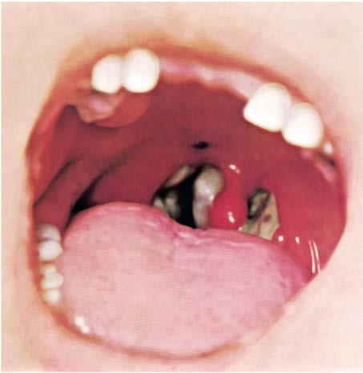
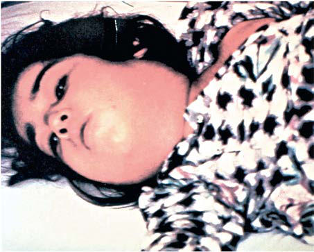

# Chapter 233: Diphtheria (Corynebacterium diphtheriae)
> **Course:** Vikkypaedia Pediatric Basic Course (*Nelson Textbook of Pediatrics, 22nd Edition (2025)*)  
> **Part XV:** Infectious Diseases  
> **Authors:** Amruta Padhye and Stephanie A. Fritz  
> **Metrics:** 5,377 words · 0 tables/boxes · 2 figures · 0 genes · 8 flashcards · 5 MCQs  
> **Quick Navigation:** [🃏 Study 8 Flashcards](../flashcards/233_flashcards.md) · [📝 Take 5-Q MCQ Quiz](../mcqs/233_mcqs.md) · [📚 Part XV Guide](../parts/Part_XV.md) · [🧬 Syndrome & Genetics Atlas](../omim_gene_atlas.md) · [💊 Therapeutics Matrix](../therapies_matrix.md) · [🏠 Course Index](../../index.md)

## ⚡ High-Yield Nelson Pediatric Board Pearls
- It has been approved for the treatment of adults with serious skin and soft tissue infections, right-sided endocarditis, and bacteremia caused by susceptible organisms.
- Most strains of VRE (both E. faecium and E. faecalis) are susceptible to daptomycin in vitro, and daptomycin has become the first-line agent for VRE treatment in many centers.
- PREVENTION Strategies for preventing enterococcal infections include timely removal of urinary and intravenous catheters and debridement of necrotic tissue.
- In order to pre vent the emergence and spread of vancomycin-resistant organisms, the Centers for Disease Control and Prevention has developed a series of guidelines for prudent vancomycin use.
- Diphtheria is an acute toxic infection caused by toxin-producing strains of Corynebacterium diphtheriae and, less often, by toxinproducing strains of Corynebacterium ulcerans.
- Although respiratory and cutaneous presentations of diphtheria are the most common, mortality is substantially higher with respiratory diphtheria.
- Classic respiratory diphtheria caused by toxigenic Cory nebacterium species is the main focus of World Health Organization (WHO) case surveillance.

---
## Full Chapter Text, Tables & Figures
# Chapter 233: Diphtheria (Corynebacterium diphtheriae)

*Amruta Padhye and Stephanie A. Fritz*

<!-- p.2193 -->
Serotonin syndrome may be seen in patients taking concomitant selec tive serotonin uptake inhibitor antidepressants. Newer oxazolidinones include tedizolid, which has better in vitro activity against enterococci and appears to have favorable pharmacokinetic and toxicity profiles when compared to linezolid.

Daptomycin is a cyclic lipopeptide that is rapidly bactericidal against a broad range of gram-positive organisms. The antibiotic inserts into the bacterial cell wall, causing membrane depolarization and cell death. It has been approved for the treatment of adults with serious skin and soft tissue infections, right-sided endocarditis, and bacteremia caused by susceptible organisms. Most strains of VRE (both *E. faecium* and *E. faecalis*) are susceptible to daptomycin in vitro, and daptomycin has become the first-line agent for VRE treatment in many centers. How ever, treatment failures occur when administered at the standard dose of 6 mg/kg/day, necessitating higher treatment doses in patients with severe invasive infections. Furthermore, daptomycin dosages may need to be higher in children when compared with adults because of more rapid renal clearance. The addition of a β-lactam antibiotic, such as ampicillin or ceftaroline, may enhance activity of daptomycin and pro vide benefit over daptomycin alone for severe VRE infections, includ ing endocarditis. Daptomycin has unreliable activity in the lung and therefore should not be used as a sole agent to treat pneumonia. Resis tance of both *S. aureus* and *Enterococcus* to daptomycin has rarely been described, sometimes arising during therapy.

Several studies and meta-analyses have suggested that clinical outcomes of invasive VRE infection are similar when linezolid and daptomycin are used. However, infection-related mortality remains significant, especially among adults, and alternative or combination therapies continue to be explored.

Ceftaroline, a fifth-generation cephalosporin with activity against methicillin-resistant *S. aureus,* has activity against many *E. faeca lis* strains but is inadequate when used alone for the treatment of *E. faecium*.

Newer tetracyclines have been developed with activity against VRE, including tigecycline, omadacycline, and eravacycline. Tigecycline is approved for use in complicated intraabdominal and skin and soft tis sue infections but fails to achieve high serum concentrations and may be associated with treatment failure for VRE BSIs. Gastrointestinal side effects are common with tigecycline and may be intolerable. Experi ence with omadacycline and eravacycline in treatment of pediatric patients with VRE infection is lacking.

Lipoglycopeptides are a newer class of antibiotics that possess a core structure similar to vancomycin with the addition of a lipid substituent. Lipoglycopeptides include telavancin, dalbavancin, and oritavancin. Only oritavancin has reliable activity against VRE, but resistance may develop, and thus far clinical experience in children is limited.

**PREVENTION** Strategies for preventing enterococcal infections include timely removal of urinary and intravenous catheters and debridement of necrotic tissue. Infection control strategies, including surveillance cul tures, patient and staff cohorting, and strict gown and glove isolation, are effective at decreasing colonization rates with VRE. Unfortunately, these organisms may persist on inanimate objects such as stethoscopes, complicating efforts to limit their nosocomial spread. In order to pre vent the emergence and spread of vancomycin-resistant organisms, the Centers for Disease Control and Prevention has developed a series of guidelines for prudent vancomycin use. Antibiotics with broad activity against anaerobic organisms are also thought to contribute to coloni zation with VRE, suggesting that prudent use of such antibiotics may also help limit spread of VRE. Decolonization strategies have been attempted but are generally ineffective in eradicating skin or gastro intestinal carriage of VRE. In particular, antimicrobial therapy is not indicated for this purpose. The role of probiotic agents in eliminating VRE colonization is currently unclear but may be a useful adjunct to prudent antimicrobial usage and other infection control interventions in limiting nosocomial spread of VRE.

*Visit Elsevier eBooks+ at eBooks.Health.Elsevier.com** for Bibliography.*

*Amruta Padhye and Stephanie A. Fritz*

Diphtheria is an acute toxic infection caused by toxin-producing strains of *Corynebacterium diphtheriae* and, less often, by toxinproducing strains of *Corynebacterium ulcerans.* Non–toxin-producing *C. diphtheria*e can also cause disease, although less severe. *C. ulcerans* is more often isolated from animal sources and can cause human disease similar to *C. diphtheriae*.

Although respiratory and cutaneous presentations of diphtheria are the most common, mortality is substantially higher with respiratory diphtheria. Classic respiratory diphtheria caused by toxigenic *Cory nebacterium* species is the main focus of World Health Organization (WHO) case surveillance. In the United States, the case definition was modified in 2019, and currently toxigenic cases of diphtheria, includ ing respiratory and nonrespiratory (e.g., skin, wound, conjunctiva, ear, genital mucosa) forms, are reportable to the Centers for Disease Con trol and Prevention (CDC).

**ETIOLOGY** Corynebacteria are aerobic, nonencapsulated, non–spore-forming, mostly nonmotile, pleomorphic, gram-positive bacilli. *C. diphtheriae* is by far the most frequently isolated agent of diphtheria. Toxigenic *C. ulcerans* can cause mastitis in cattle and respiratory infections in animals and can spread to humans through close contact with secre tions. It can cause cutaneous and respiratory illnesses that are clini cally indistinguishable from diphtheria in humans. Person-to-person transmission of *C. ulcerans* is possible, though not well established. A selective medium (e.g., cystine-tellurite blood agar or Tinsdale agar) that inhibits growth of competing organisms is required for isolation and, when reduced by *C. diphtheriae,* renders colonies gray-black. Differentiation of *C. diphtheriae* from *C. ulcerans* is based on urease activity; *C. ulcerans* is urease-positive. Four *C. diphtheriae* biotypes *(mitis, intermedius, belfanti, gravis)* are capable of causing diphtheria and are differentiated by colony morphology, hemolysis, and fermen tation reactions. The ability of either *C. diphtheriae* or *C. ulcerans* to produce diphtheritic toxin results from acquisition of a lysogenic cory nebacteriophage, which encodes the diphtheritic toxin gene and con fers diphtheria-producing potential in these strains. Demonstration of diphtheritic toxin production by the modified Elek test, an agar immu noprecipitin technique, alone or in conjunction with polymerase chain reaction (PCR) testing for carriage of the toxin gene, is necessary to confirm disease. Toxigenic and nontoxigenic strains are indistinguish able by colony type, microscopic features, or biochemical test results.

**EPIDEMIOLOGY** Unlike other diphtheroids (coryneform bacteria), which are ubiquitous in nature, *C. diphtheriae* is an exclusive inhabitant of human mucous membranes and skin. Spread is primarily by respiratory droplets, direct contact with respiratory secretions of symptomatic individu als, or exudate from infected skin lesions. Asymptomatic respiratory tract carriage is important in transmission. In areas where diphtheria is endemic, 3–5% of healthy individuals can carry toxigenic organisms, but carriage is exceedingly rare in nonendemic areas. Skin infection and skin carriage are silent reservoirs of *C. diphtheriae,* and organisms can remain viable in dust or on fomites for up to 6 months.

In the 1920s, >125,000 diphtheria cases and 10,000 diphtheria-related deaths were reported annually in the United States, with the highest fatality

<!-- p.2195 -->
rates among very young and elderly persons. The incidence then began to decrease and, with widespread use of diphtheria toxoid in the United States after World War II, declined steadily through the late 1970s. From 1996 to 2018, only 14 cases of respiratory diphtheria, including 1 fatal case, were reported in the United States, an average of ≤1 case annually. During this same period, five cases of culture-confirmed respiratory diphtheria-like ill ness caused by toxigenic *C. ulcerans* were also identified.

Despite the worldwide decrease in disease incidence, diphtheria remains endemic in many developing countries with poor immuniza tion rates against diphtheria. Since the introduction of toxoid immu nization, the disease has shifted from affecting children <15 years old to adults who lack natural exposure to toxigenic *C. diphtheriae* in the vaccine era and have low rates of booster immunization. The largest outbreak of diphtheria in the developed world since the 1960s occurred from 1990 to 1996 in the newly independent countries of the former Soviet Union, involving >150,000 cases in 14 countries. Of these, >60% of cases occurred in individuals >14 years old. Case fatality rates ranged from 3% to 23% by country. Factors contributing to the epidemic included a large population of underimmunized adults, decreased childhood immunization rates, population migration, crowding, and failure to respond aggressively during early phases of the epidemic. Cases of diphtheria among travelers from these endemic areas were transported to many countries in Europe.

WHO surveillance reports indicate that most cases of diphtheria worldwide occur in the Southeast Asia and Africa regions, reporting more than 10,000 cases worldwide in 2020. India contributes a sub stantial proportion to the global burden of diphtheria, with an average of over 4,000 cases annually reported to the WHO in the past decade.

Although diphtheria was reduced from a major cause of childhood death to a medical rarity in the Western Hemisphere in the early 20th century, recurring reminders of the fragility of this success, particu larly in conflict areas, emphasize the need to continue vigorous pro motion of those same control principles across the global community. The largest diphtheria outbreak in the refugee setting occurred when the Rohingya people were displaced from Myanmar to Bangladesh in 2017, eventually lasting over 2 years and with 7064 cases and 45 deaths reported as of November 2019. Along with outbreaks in Venezuela, Haiti, Yemen, and more recently Nigeria, these are stark reminders of the threat of re-emergence that vaccine-preventable diseases pose. Improving surveillance, vaccination coverage, and public awareness of the disease are key for control of disease during outbreaks.

When diphtheria was common, **cutaneous diphtheria** accounted for more than 50% of reported *C. diphtheriae* isolates in the United States. This indolent local infection, compared with mucosal infection, is associated with more prolonged bacterial shedding, greater contami nation of the environment, and increased transmission to the pharynx and skin of close contacts. Outbreaks are associated with homelessness, crowding, poverty, alcoholism, poor hygiene, contaminated fomites, underlying dermatosis, and introduction of new strains from exog enous sources. It is no longer a tropical or subtropical disease; 1,100 *C. diphtheriae* infections were documented in a Seattle neighborhood (the site of the last major U.S. outbreak) from 1971 to 1982; 86% were cuta neous, and 40% involved toxigenic strains. The incidence of *C. diphthe riae* isolates from cutaneous infections has risen dramatically over the past decade. Cutaneous diphtheria is an important source of toxigenic *C. diphtheriae* in the United States, and its importation from endemic areas is frequently the source of subsequent sporadic cases of respira tory tract diphtheria. Between 2015 and 2018, the CDC confirmed four cases of cutaneous diphtheria from toxin-producing *C. diphtheriae* in U.S. residents returning from travel to endemic areas. Cutaneous diph theria caused by *C. ulcerans* from travel to tropical countries or animal contact has also been increasingly reported.

In Europe, increasing reports of respiratory and systemic infections have been attributed to *C. ulcerans;* animal contact is the predominant risk factor. In the United Kingdom, from 2008 to 2017, of the 33 toxi genic cases of diphtheria, just over half of the cases were caused by *C. diphtheriae,* and the remainder were caused by *C. ulcerans*. Most of the *C. diphtheriae* cases were cutaneous, while the *C. ulcerans* cases were equally respiratory and cutaneous. Travel to an endemic area was the

major risk factor for *C. diphtheriae* acquisition, while contact with a companion animal was the major factor associated with acquisition of *C. ulcerans*. Incomplete vaccination status was strongly associated with the risk of hospitalization and death.

**PATHOGENESIS** Both toxigenic and nontoxigenic strains of *C. diphtheriae* cause skin and mucosal infection and can rarely cause invasive disease, includ ing endocarditis and bacteremia. The organism usually remains in the superficial layers of skin lesions or respiratory tract mucosa, inducing a local inflammatory reaction. The major virulence of the organism lies in its ability to produce a potent polypeptide exotoxin, the diph theritic toxin, which inhibits protein synthesis and causes local tissue necrosis and the resultant local inflammatory response. Within the first few days of respiratory tract infection (usually in the pharynx), a dense necrotic coagulum of organisms, epithelial cells, fibrin, leukocytes, and erythrocytes forms, initially white and advancing to become a graybrown, leather-like, adherent **pseudomembrane** (*diphtheria* is Greek for leather). Removal is difficult and reveals a bleeding, edematous sub mucosa. Paralysis of the palate and hypopharynx is an early local effect of diphtheritic toxin. Toxin absorption can lead to systemic manifes tations: kidney tubule necrosis, thrombocytopenia, cardiomyopathy, and demyelination of nerves. Because the latter two complications can occur 2-10 weeks after mucocutaneous infection, the pathophysiology in some cases is suspected to be immunologically mediated. Among infected adults in the Seattle outbreak, 3% with cutaneous infections and 21% with symptomatic nasopharyngeal infection demonstrated toxic myocarditis, neuropathy, or obstructive respiratory tract compli cations. All had received at least 20,000 units of equine antitoxin at the time of hospitalization.

**CLINICAL MANIFESTATIONS** The manifestations of *C. diphtheriae* infection are influenced by the anatomic site of infection, the immune status of the host, and the pro duction and systemic distribution of toxin. Although 98% of infections occur in the respiratory tract, other sites include cutaneous, conjuncti val, ear, and vaginal mucosa.

New estimates of epidemiologic and clinical aspects of diphthe ria from a comprehensive update by Truelove et al., with systematic reviews including recent literature, are summarized in Figure 233.1.

**Respiratory Tract Diphtheria** The pharynx or tonsils is the most common location of infection in the respiratory tract (75–94%), followed by the larynx (25%). Although the incubation period has traditionally been regarded to be 2-5 days (range 1-10 days), emerging data suggest that the median time from infec tion to onset of prodromal symptoms is only 1.4 days. An estimated 80% of untreated symptomatic cases progress to membranous diph theria in an average of 2-3 days after symptom onset. In tonsillar and **pharyngeal diphtheria**, sore throat is the universal early symptom. Only half of patients have fever, and fewer have dysphagia, hoarseness, malaise, or headache. Mild pharyngeal injection is followed by unilat eral or bilateral tonsillar membrane formation, which can extend to involve the uvula (which may cause toxin-mediated paralysis), soft pal ate, posterior oropharynx, hypopharynx, or glottic areas (Fig. 233.2). Underlying soft tissue edema and enlarged lymph nodes can cause a bull-neck appearance. The degree of local extension correlates directly with profound prostration, bull-neck appearance, and fatality caused by airway compromise or toxin-mediated complications (Fig. 233.3). In infants, infection of the anterior nares is more common and causes serosanguineous, purulent, erosive rhinitis with membrane formation. Shallow ulceration of the external nares and upper lip is characteristic.

The characteristic adherent pseudomembrane, extension beyond the faucial area, dysphagia, and relative lack of fever help differentiate diphtheria from **exudative pharyngitis** caused by *Streptococcus pyo genes* or Epstein-Barr virus. Vincent angina, infective phlebitis with thrombosis of the jugular veins (Lemierre syndrome), and mucositis in patients undergoing cancer chemotherapy are usually differentiated by the clinical setting. Infection of the larynx, trachea, and bronchi

<!-- p.2196 -->
Unvaccinated

individual

Vaccinated

individual

Infection with toxigenic *Clostridium*

*diphtheriae*

30% Asymptomatic

carriage

10% Prodromal symptoms

develop

90% Asymptomatic

carriage

70% Prodromal symptoms

develop

80% Membranous diphtheria develops

20% Recovery without developing fulminant

disease

5–50% Death from complications

50–95% Recovery

**Fig. 233.1** Clinical manifestations of Clostridium diphtheriae infection among unvaccinated and vaccinated individuals. Among unvaccinated individuals infected with toxigenic C. diphtheriae, prodromal symptoms develop in ∼70%, of whom 80% develop membranous diphtheria. Of those with membranous diphtheria, case fatality can be as high as 5–50%. Among vaccinated individuals infected with toxigenic C. diphtheriae, the toxoid vaccine provides protection from symptoms; 10% develop prodromal symptoms, whereas 90% become asymptomatic carriers. These symptomatic vaccinated individuals have a lower risk of severe disease and death and are more likely to recover. (Adapted from Truelove SA, Keegan LT, Moss WJ, et al. Clinical and epidemiological aspects of diphtheria: a systematic review and pooled analysis. Clin Infect Dis. 2020;71[1]:89–97.)

**Fig. 233.2** Tonsillar diphtheria. (Courtesy Franklin H. Top, MD, Profes sor and Head of the Department of Hygiene and Preventive Medicine, State University of Iowa, College of Medicine, Iowa City, IA; and Parke, Davis & Company’s Therapeutic Notes.)

**Fig. 233.3** Diphtheria. Bull-neck appearance of diphtheritic cervical lymphadenopathy. (From the Centers for Disease Control and Preven tion [CDC]. Public health image library [PHIL], image #5325. Available at: https://phil.cdc.gov/Details.aspx?pid=5325.)

<!-- p.2197 -->
can be primary or a secondary extension from the pharyngeal infec tion, presenting with hoarseness, stridor, dyspnea, and croupy cough. Differentiation from bacterial epiglottitis, severe viral laryngotracheo bronchitis, and staphylococcal or streptococcal tracheitis hinges par tially on the relative paucity of other signs and symptoms in patients with diphtheria and primarily on visualization of the adherent pseudo membrane at laryngoscopy and intubation.

Patients with laryngeal diphtheria are at significant risk for suffocation because of local soft tissue edema and airway obstruction by the diphthe ria membrane. This progression of airway obstruction in laryngeal infec tion within 1-2 weeks after symptom onset is responsible for 60–65% of overall deaths. Establishment of an artificial airway and resection of the pseudomembrane can be lifesaving, but further obstructive complica tions are common, and systemic toxic complications are inevitable.

**Cutaneous Diphtheria** Classic cutaneous diphtheria is an indolent, nonprogressive infection characterized by a superficial, ecthyma-like, nonhealing ulcer with a gray-brown membrane. Diphtheria skin infections cannot always be differentiated from streptococcal or staphylococcal impetigo, and these conditions frequently coexist. In most cases, a primary process, such as dermatosis, laceration, burn, bite, or impetigo, becomes secondarily infected with *C. diphtheriae.* Extremities are more often affected than the trunk or head. Pain, tenderness, erythema, and exudate are typical. Local hyperesthesia or hypesthesia is unusual. Respiratory tract coloni zation or symptomatic infection with toxic complications occurs in the minority of patients with cutaneous diphtheria.

**Infection at Other Sites* C. diphtheriae* occasionally causes mucocutaneous infections at other sites, such as the ear (otitis externa), the eye (purulent and ulcerative conjunctivitis), and the genital tract (purulent and ulcerative vulvovag initis). The clinical setting, ulceration, membrane formation, and sub mucosal bleeding help differentiate diphtheria from other bacterial and viral causes. Rare cases of septicemia are described and are universally fatal. Sporadic cases of endocarditis occur, and clusters among intrave nous drug users have been reported in several countries; the skin was the probable portal of entry, and almost all strains were nontoxigenic. Sporadic cases of pyogenic arthritis, mainly from nontoxigenic strains, have been reported in adults and children. Diphtheroids isolated from sterile body sites should not be routinely dismissed as contaminants without careful consideration of the clinical setting.

**DIAGNOSIS** Specimens for culture should be obtained from the nose and throat and any other mucocutaneous lesion. A portion of membrane should be removed and submitted for culture along with underlying exudate. The laboratory must be notified to use selective medium. *C. diphtheriae* survives drying. If obtained in a remote area, a dry swab specimen can be placed in a silica gel pack and sent to the laboratory. Evaluation of a direct smear using Gram stain or specific fluorescent antibody is unre liable. Culture isolates of coryneform organisms should be identified to the species level, and toxigenicity and antimicrobial susceptibility tests should be performed for *C. diphtheriae* isolates. It is recommended that all isolates be sent to a reference laboratory. In the United States, the CDC’s Pertussis and Diphtheria Laboratory provides support to local and state health departments needing assistance with isolation, identi fication, and subtyping of *C. diphtheriae* and *C. ulcerans.*

**COMPLICATIONS** Respiratory tract obstruction by pseudomembranes may require bron choscopy or intubation and mechanical ventilation. Two other tissues usually remote from sites of *C. diphtheriae* infection can be signifi cantly affected by **diphtheritic toxin**: the heart and the nervous system.

**Toxic Cardiomyopathy** Toxic cardiomyopathy occurs in 10–25% of patients with respiratory diphtheria, resulting in death in 35–60% of cases with this complication and responsible for 20–25% of deaths overall. Subtle signs of myocarditis

can be detected in most patients, especially the elderly, but the risk for sig nificant complications correlates directly with the extent and severity of exudative local oropharyngeal disease, along with a delay in administra tion of antitoxin. The first evidence of cardiac toxicity characteristically occurs 7-14 days after the onset of respiratory symptoms but can appear acutely as early as the first week of illness, a poor prognostic sign, or as late as the sixth week. Tachycardia disproportionate to fever is common and may be evidence of cardiac toxicity or autonomic nervous system dysfunction. A prolonged P-R interval and changes in the ST-T wave on an electrocardiographic tracing are relatively frequent findings; dilated and hypertrophic cardiomyopathy detected by echocardiogram has been described. Single or progressive cardiac **dysrhythmias** can occur, includ ing first-, second-, and third-degree heart block. Temporary transvenous pacing may improve outcomes. Atrioventricular dissociation and ven tricular tachycardia are also described, the latter having a high associ ated mortality. Heart failure may appear insidiously or acutely. Elevation of the serum aspartate transaminase concentration closely parallels the severity of myonecrosis. Severe dysrhythmia portends death. Histologic postmortem findings are variable: little or diffuse myonecrosis with acute inflammatory response. Recovery from toxic myocardiopathy is usually complete, although survivors of more severe dysrhythmias can have per manent conduction defects.

**Toxic Neuropathy** Neurologic complications occur in 20–25% of untreated cases, result ing in death in 50% of cases who develop them and responsible for 15% of deaths overall. They parallel the severity of primary infection and are multiphasic in onset. Acutely or 2-3 weeks after onset of oropharyn geal inflammation, hyperesthesia and local **paralysis** of the soft palate typically occur. Weakness of the posterior pharyngeal, laryngeal, and facial nerves may follow, causing a nasal quality in the voice, difficulty in swallowing, and risk for aspiration. **Cranial neuropathies** charac teristically occur in the fifth week, leading to oculomotor and ciliary paralysis, which can cause strabismus, blurred vision, or difficulty with accommodation. Symmetric demyelinating **polyneuropathy** has onset 10 days to 3 months after oropharyngeal infection and causes princi pally motor deficits with diminished deep tendon reflexes. Nerve con duction velocity studies and cerebrospinal fluid findings in diphtheritic polyneuropathy are indistinguishable from those of Guillain-Barré syndrome. Paralysis of the diaphragm may ensue. Complete neurologic recovery is likely, but rarely vasomotor center dysfunction 2-3 weeks after onset of illness can cause hypotension or cardiac failure.

Recovery from myocarditis and neuritis is often slow but usually complete. Corticosteroids do not diminish these complications and are not recommended.

**TREATMENT** Specific diphtheria **antitoxin** is the mainstay of therapy and should be administered as soon as possible, without delay on the basis of clini cal diagnosis. Because it neutralizes only free toxin, antitoxin efficacy diminishes with elapsed time after the onset of mucocutaneous symp toms. Equine diphtheria antitoxin is available in the United States only from the CDC. Physicians treating a case of suspected diphtheria should contact the CDC Emergency Operations Center at 1-770-488-7100 after consulting with their state health department. Antitoxin is avail able from CDC under expanded access investigational new drug appli cation protocol. Antitoxin is administered as a single empirical dose of 20,000-100,000 units based on the degree of severity, site, and duration of illness. Skin testing for hypersensitivity must be performed before administration of antitoxin. Patients with positive sensitivity testing or with a history of hypersensitivity reaction to horse equine protein should be desensitized. Antitoxin is probably of no value for local manifestations of cutaneous diphtheria, but its use is prudent because toxic sequelae can occur. Commercially available intravenous immunoglobulin prepa rations contain low titers of antibodies to diphtheria toxin; their use for therapy of diphtheria is not proven or approved. Antitoxin is not recom mended for asymptomatic carriers.

The role of **antimicrobial therapy** is to halt toxin production, treat localized infection, and prevent transmission of the organism

<!-- p.2198 -->
to contacts. Although *C. diphtheriae* is usually susceptible to vari ous agents in  vitro, including penicillins, erythromycin, clindamy cin, rifampin, and tetracycline, only erythromycin or penicillin are recommended for treatment. Erythromycin is marginally superior to penicillin for eradication of nasopharyngeal carriage. Resistance to erythromycin is common in populations where the drug has been used broadly, and resistance to penicillin has also been reported. Appropri ate therapy is **erythromycin** (40-50 mg/kg/day divided every 6 hours by mouth [PO] or intravenously [IV]; maximum 2 g/day), **aqueous crystalline penicillin G** (150,000 - 250,000 units/kg/day divided every 6 hr IV or intramuscularly [IM], up to 2-3 million units/day), or **pro caine penicillin** (300,000 units every 12 hr IM for those ≤10 kg in weight; 600,000 units every 12 hr IM for those >10 kg in weight) for 14 days. Once oral medications are tolerated, oral erythromycin (see dosing above) or penicillin V (50 mg/kg/day, divided every 6 hr, maxi mum 2 g per day) may be used for the remaining duration of therapy. *Antibiotic therapy is not a substitute for antitoxin therapy.* Some patients with cutaneous diphtheria have been treated for 7-10 days. Elimina tion of the organism should be documented by negative results of at least two successive cultures of specimens from the nose and throat (or skin) obtained at least 24 hours apart, collected 24 hours after comple tion of antimicrobial therapy. Treatment with erythromycin should be repeated if either culture yields *C. diphtheriae.*

Individuals untreated with antibiotics, including those with either symptomatic or asymptomatic infection, remain colonized with *C. diphtheriae* for an average of 18.5 days, with 5% remaining colonized longer than 48 days. With antibiotic treatment, they clear *C. diphthe riae* colonization within an average of 5.2 days, reducing the duration of infectiousness by 2 weeks.

**SUPPORTIVE CARE Droplet precautions** are instituted for patients with pharyngeal diphtheria; for patients with cutaneous diphtheria, **contact precautions** are observed until the results of specimen cultures taken after cessation of therapy are negative. Cutaneous wounds are cleaned thoroughly with soap and water. Bed rest is essential during the acute phase of disease, usually for ≥2 weeks until the risk for symptomatic cardiac damage has passed, with return to physical activity guided by the degree of toxicity and cardiac involvement.

**PROGNOSIS** The prognosis for patients with diphtheria depends on the virulence of the organism (subspecies *gravis* has the highest fatality rate), patient age, immunization status, site of infection, and speed of administration of the antitoxin. Mechanical obstruction from laryngeal diphtheria or bull-neck diphtheria and the complications of myocarditis account for most diphtheria-related deaths. The case fatality ratio for untreated, never-vaccinated cases is 29%, improving to 10% with antitoxin treat ment. The risk of fatality increases with every day of delayed antitoxin treatment. Children age <5 years are more likely to die from symptom atic infection than adults >20 years of age, whereas children 5-19 years of age are less likely to die from infection than adults age >20 years. At recovery, administration of diphtheria toxoid is indicated to complete the primary series or booster doses of immunization, because not all patients develop antibodies to diphtheria toxin after infection.

**PREVENTION** Protection against serious disease caused by imported or indigenously acquired *C. diphtheriae* depends on immunization. In the absence of a precisely determined minimum protective level for diphtheria anti toxin, the presumed minimum is 0.01-0.10 IU/mL. In outbreaks, 90% of individuals with clinical disease have had antibody values <0.01 IU/mL, and 92% of asymptomatic carriers have had values >0.1 IU/ mL. In serosurveys in the United States and Western Europe, where almost universal immunization during childhood has been achieved, 25% to >60% of adults lack protective antitoxin levels, with typically very low levels in elderly persons. A serosurvey in the United States (1988–1994) indicated that 60% of the overall population had protec tive immunity against diphtheria; however, this level of protection declined from 80% in persons age 12-19 years to about 30% in per sons age 60-69 years.

All suspected diphtheria cases should be reported to local and state health departments. Investigation is aimed at preventing secondary cases in exposed individuals and at determining the source and carriers to halt spread. The serial interval, or time between symptom onset of the infector/infectee pair, is a median of 5.9 days, with 5% of intervals <0.8 days and 5% longer than 21 days.

**Asymptomatic Case Contacts** All household contacts and people who have had intimate respiratory or habitual physical contact with a patient are closely monitored for ill ness for 7 days. Cultures of the nose, throat, and any cutaneous lesions are performed. Antimicrobial prophylaxis is presumed effective and is administered regardless of immunization status, using a single injec tion of benzathine penicillin G (600,000 units IM for patients weighing <30kg, or 1,200,000 units IM for patients weighing ≥30 kg or adults,) or erythromycin (40-50 mg/kg/day divided every 6 hr PO for 7-10 days; max 1 g/day). Diphtheria toxoid vaccine, in age-appropriate form, is given to immunized individuals who have not received a booster dose within 5 years. Children who have not received their fourth dose should be vaccinated. Those who have received fewer than three doses of diph theria toxoid or who have uncertain immunization status should be immunized with an age-appropriate preparation on a primary schedule.

**Asymptomatic Carriers** When an asymptomatic carrier is identified, antimicrobial prophylaxis is given for 10-14 days, and an age-appropriate preparation of diphtheria toxoid vaccination is administered immediately if a booster has not been given within 1 year. Droplet precautions (respiratory tract colonization) or contact precautions (cutaneous colonization only) are observed until at least two subsequent cultures obtained at least 24 hours apart, col lected 24 hours after cessation of therapy, have negative results.

Repeat cultures are performed about 2 weeks after completion of therapy for cases and carriers; if results are positive, an additional 10day course of oral erythromycin should be given and follow-up cul tures performed. Susceptibility testing of isolates should be performed, as erythromycin resistance is reported. Neither penicillin nor erythro mycin eradicates carriage in 100% of individuals. In one report, a single course of therapy failed in 21% of carriers. Transmission of diphtheria in modern hospitals is rare. Only those who have an unusual contact with respiratory or oral secretions should be managed as contacts. Investigation of the casual contacts of patients and carriers or persons in the community without known exposure has yielded extremely low carriage rates and is not routinely recommended.

**Vaccine** Universal immunization with diphtheria toxoid throughout life, designed to provide constant protective antitoxin antibody levels and to reduce severity of *C. diphtheriae* disease, is the only effective control measure. Although immunization does not preclude subsequent respi ratory or cutaneous carriage of toxigenic *C. diphtheriae,* it decreases local tissue spread, prevents toxic complications, diminishes trans mission of the organism, and provides herd immunity when at least 80–85% of a population is immunized. Full vaccination is highly effective in preventing symptomatic dis ease (87% with three or more doses, increasing to 99% with five doses), severe disease (defined as local and systemic symptoms plus a major complication; 81%), and death (93%). Even though vaccines do not prevent colonization, they reduce transmission by 60%, likely through reduced symptomatic shedding. Asymptomatic carriers are still able to transmit infection, albeit at only 24% the rate of symptomatic cases. In an outbreak setting, both vaccination and antibiotic treatment to clear colonization are necessary to interrupt transmission. Although full vaccination coverage can interrupt transmission in only 27% of outbreak settings, this figure increases to 70% when rapid antibiotic treatment is initiated in 90% of symptomatic cases.

The COVID-19 pandemic resulted in disruptions in immunization services in 2020, leading to 3.5 million children missing their first dose of diphtheria, tetanus, and pertussis vaccine (DTP) as compared with 2019. Global annual vaccination coverage for first-dose DTP vaccine decreased from 90% in 2019 to 87% in 2020; third-dose DTP vaccine

<!-- p.2200 -->
