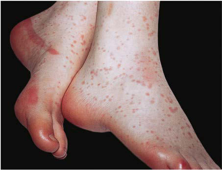
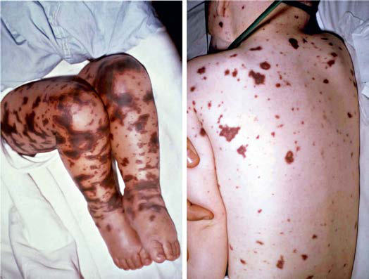

# Chapter 237: Neisseria meningitidis (Meningococcus)
> **Course:** Vikkypaedia Pediatric Basic Course (*Nelson Textbook of Pediatrics, 22nd Edition (2025)*)  
> **Part XV:** Infectious Diseases  
> **Authors:** Manish Sadarangani  
> **Metrics:** 9,909 words · 5 tables/boxes · 2 figures · 1 genes · 8 flashcards · 5 MCQs  
> **Quick Navigation:** [🃏 Study 8 Flashcards](../flashcards/237_flashcards.md) · [📝 Take 5-Q MCQ Quiz](../mcqs/237_mcqs.md) · [📚 Part XV Guide](../parts/Part_XV.md) · [🧬 Syndrome & Genetics Atlas](../omim_gene_atlas.md) · [💊 Therapeutics Matrix](../therapies_matrix.md) · [🏠 Course Index](../../index.md)

## Key Genetic & Molecular Targets
`CFHR3`

## ⚡ High-Yield Nelson Pediatric Board Pearls
- PROGNOSIS Historically, nocardiosis has been associated with significant mortal ity.
- Nonetheless, early diagnosis and intervention are important to reduce the morbidity and mortality of nocardiosis, especially in immunocompromised patients at increased risk for dis seminated disease.
- Individual susceptibility is known to involve a complex relationship among environmental, host, and bacterial fac tors, and prevention of meningococcal disease through behavior mod ification (e.g., avoiding tobacco smoke) and vaccination offers the best prospect for control.
- The applica tion of molecular approaches to epidemiology has established that (1) endemic meningococcal disease is caused by genetically heterogeneous strains, although only a small number of genetic lineages are associated with the majority of cases of invasive disease, and (2) outbreaks are usually clonal, caused by single strains.
- Disease caused by dominant hyperendemic clones has been recognized in the past 2 decades in Oregon, United States; Que bec, Canada; Normandy, France; and across New Zealand.
- In the United King dom, polymerase chain reaction (PCR) methods are used routinely for diagnosis of suspected cases, doubling the number of confirmed cases.
- In the United States, most cases of disease in the first 5 years of life are caused by capsular group B strains.

---
## Full Chapter Text, Tables & Figures
# Chapter 237: Neisseria meningitidis (Meningococcus)

*Manish Sadarangani*

<!-- p.2210 -->
Other antibacterial agents with in vitro activity against *Nocardia* spp. include but are not limited to **amikacin, amoxicillin-clavulanate, ceftriaxone, ciprofloxacin, clarithromycin, imipenem, linezolid, and minocycline**. A recent study profiling the antimicrobial suscepti bility pattern of a diverse range of *Nocardia* revealed that among 146 isolates, the susceptibilities were 100% to linezolid, 96% to amikacin, 94% to TMP-SMX, and 76% to imipenem. A similar retrospective study conducted in the United States from 1995 to 2004 revealed that 42% of the isolates were resistant to TMP-SMX. Therefore while await ing sensitivity testing in patients with *Nocardia* isolated from a clini cal specimen, it may be reasonable to administer linezolid empirically, taking into account local susceptibility data. Subsequent therapeutic decisions should be guided by final sensitivity results and consider ation of the site of infection and pharmacokinetics of the available agents. It is not clear whether parenteral administration is superior to enteral formulations. However, most experts support the use of par enteral therapy for more severe disease, including endocarditis and CNS disease.

In vitro and in vivo animal models have suggested the benefit of combination regimens for the treatment of nocardiosis. There are no clinical data to confirm the need for combination therapy; however, based on the preclinical data, there is expert support for using com bination therapy in CNS nocardiosis, in disseminated disease, and in children with an underlying immunocompromising condition. A vari ety of combination therapies have been suggested, with many experts favoring TMP-SMX, amikacin, and a carbapenem or third-generation cephalosporin. Since data on combination therapy are limited, anti biotic choices should primarily be guided by sensitivity testing of the clinical *Nocardia* isolate.

Surgical drainage of abscesses can be helpful in hastening reso lution of nocardiosis. However, no comparative data have docu mented improvement in overall outcomes with adjunctive surgical intervention, and success has been reported with medical manage ment alone in resolving deep-seated abscesses, even in the CNS. A literature review showed that among patients with CNS nocar diosis, 1-year overall mortality was approximately 20%, limited by cases lost to follow-up. Among patients who were treated with a combination of antibiotics and neurosurgical procedures, mortal ity was lower (7%). Therefore the decision to intervene surgically needs to be balanced with the potential consequences of a surgi cal procedure to drain an abscess. Intraventricular antibiotics have been reported.

The necessary duration of therapy for nocardiosis varies depend ing on the clinical presentation and the status of the patient. The opti mal duration is uncertain, but long-term therapy is common because of the propensity for relapse. Historically, superficial cutaneous infec tion has been treated for 3 months, pulmonary or systemic nocar diosis has been treated for 6-12 months, and CNS infection has been treated for at least 12 months. These intervals should only be con sidered as a guide for expected therapeutic durations. The ultimate duration should be dictated by clinical and radiographic resolution of disease.

**PROGNOSIS** Historically, nocardiosis has been associated with significant mortal ity. Fortunately, more recent reports have documented an improved rate of complete cure to approximately 80%. Predictably, attributable case fatality rates vary by disease entity. There is no attributable case fatality associated with cutaneous disease, but 10–20% attributable case fatality has been assigned to disseminated and visceral disease. CNS disease has the highest attributable case fatality rates, reaching 25%. Importantly, much of the data on case fatality rates are informed by predominantly adult cohorts, and thus there may be fewer fatal outcomes in children. Nonetheless, early diagnosis and intervention are important to reduce the morbidity and mortality of nocardiosis, especially in immunocompromised patients at increased risk for dis seminated disease.

*Visit Elsevier eBooks+ at eBooks.Health.Elsevier.com** for Bibliography.*

Section **5 Gram-Negative Bacterial Infections**

*Manish Sadarangani*

*Neisseria meningitidis* (the meningococcus) is a commensal of the human nasopharynx in approximately 10% of the population and, on rare occasions, enters the bloodstream to cause devastating invasive disease such as meningitis and meningococcal septicemia (meningo coccemia). Although a rare endemic disease in most countries, the epi demiology of meningococcal disease varies widely over time and in different geographic regions, with both hyperendemic and epidemic disease patterns occurring. Onset of disease in susceptible individu als may be very rapid, within hours, and the case fatality rate is high, especially among those presenting with septic shock, despite access to modern critical care. Individual susceptibility is known to involve a complex relationship among environmental, host, and bacterial fac tors, and prevention of meningococcal disease through behavior mod ification (e.g., avoiding tobacco smoke) and vaccination offers the best prospect for control.

**ETIOLOGY* N. meningitidis* is a gram-negative, fastidious, encapsulated, oxidasepositive, aerobic diplococcus. Differences in the chemistry of the poly saccharide capsule allow definition of 12 (previously thought to be 13) serologically distinct meningococcal capsular groups, of which 6, des ignated A, B, C, W (previously designated W135), X, and Y, are respon sible for almost all cases of disease. Meningococcal strains may be subclassified on the basis of antigenic variation in two porin proteins found in the outer membrane, **PorB** (serotype) and **PorA** (serosubtype), and **lipopolysaccharide** (immunotype), using serology. Serologic typing is being replaced by molecular typing methods, which target genes under immune selection to provide **antigen sequence typing** (based on amino acid variation in various surface proteins, including PorA and FetA). Sequencing of antigen genes (e.g., *porA, fHbp, nadA, nhba*) is an important means of monitoring pressure on meningococ cal populations by protein-based vaccines containing these antigens. Because meningococci readily exchange genetic material, typing based on a few antigens cannot provide an accurate picture of relatedness of strains, an important goal in monitoring epidemiology. **Multilocus sequence typing**, which types meningococci using variation in seven housekeeping genes, has been widely used to map the distribution of genetic lineages of meningococci (http://pubmlst.org/neisseria/) and provides a clearer picture of the genetic and epidemiologic relatedness of strains. To provide still better definition of genetic variation, in some countries, including the United Kingdom, **whole genome sequencing** is used to type meningococci and appears set to replace both antigen and multilocus sequence typing as costs continue to fall. The applica tion of molecular approaches to epidemiology has established that (1) endemic meningococcal disease is caused by genetically heterogeneous strains, although only a small number of genetic lineages are associated with the majority of cases of invasive disease, and (2) outbreaks are usually clonal, caused by single strains.

<!-- p.2212 -->
**EPIDEMIOLOGY** Meningococci are transmitted during close contact through aerosol drop lets or exposure to respiratory secretions, as by kissing. The organism does not survive for long periods in the environment. Enhanced rates of mucosal colonization and increased disease risk are associated with activi ties that increase the likelihood of exposure to a new strain or increase proximity to a carrier, thus facilitating transmission, including kissing, bar patronage, binge drinking, attendance at nightclubs, men having sex with men, and living in freshman college dormitories. Factors that damage the nasopharyngeal mucosa, such as smoking and respiratory viral infection (notably influenza), are also associated with increased rates of carriage and disease, perhaps by driving upregulation of host adhesion molecules that are receptors for meningococci. Carriage is unusual in early childhood and peaks during adolescence and young adulthood.

Meningococcal disease is a global problem, but disease rates vary by a factor of 10- to 100-fold in different geographic locations at one point in time and in the same location at different times. Most cases of meningococcal disease are sporadic, but small outbreaks (usually in schools or colleges, representing <3% of U.S. cases), **hyperendemic** disease (increased rates of disease persisting for a decade or more as a result of a single clone), and epidemic disease are all recognized pat terns. However, over the past decade, rates of meningococcal disease have declined in most industrialized countries, partly through intro duction of immunization programs and possibly aided by widespread legislation against smoking in public places. The arrival of hyperinva sive lineages and their eventual decline through development of natu ral immunity is recognized as a major driver of changes in disease rates over time. The U.S. disease rate was 1.1 cases per 100,000 population in 1999 but had fallen to 0.11 per 100,000 by 2019 (Fig. 237.1). By contrast, the rate of disease in Ireland in 1999 was >12 per 100,000, and rates of 1,000 per 100,000 have been described during epidemic disease in sub- Saharan Africa. Disease caused by dominant hyperendemic clones has been recognized in the past 2 decades in Oregon, United States; Que bec, Canada; Normandy, France; and across New Zealand. Laboratory data underreport meningococcal disease incidence rates because up to 50% of cases are not culture confirmed, particularly where prehospital antibiotics are recommended for suspected cases. In the United King dom, polymerase chain reaction (PCR) methods are used routinely for diagnosis of suspected cases, doubling the number of confirmed cases.

The highest rate of meningococcal disease occurs in infants <1 year old, probably as a result of *immunologic inexperience* (antibody that recognizes meningococcal antigens is naturally acquired during later childhood), immaturity of the alternative and lectin complement path ways, and perhaps the poor responses made by infants to bacterial poly saccharides. In the absence of immunization, incidence rates decline through childhood, except for a peak of disease among adolescents and

young adults, which may be related to increased opportunity for expo sure from social activities. The incidence of meningococcal disease is increased among persons with HIV infection.

In the United States, most cases of disease in the first 5 years of life are caused by capsular **group B** strains. After age 5 years, disease cases are mostly distributed among capsular groups C, W, and Y. In most other industrialized countries, capsular group B strains predominate at all ages, in part because of introduction of routine capsular **group C** menin gococcal conjugate vaccine among infants and/or toddlers. For unclear reasons, disease in children caused by group Y strains was uncommon in the United States before the 1990s and then began to increase. Rates of disease caused by this capsular group have also increased in several other countries but are declining in the United States. Disease caused by capsular **group W** strains has increased in the United Kingdom and in other countries in Europe and Australia as a result of a hyperinvasive clone, which appears to have originated in Latin America.

Large outbreaks of capsular **group A** meningococcal disease occurred during and immediately after the First World War and Second World War in both Europe and the United States, but since the 1990s, almost all cases caused by capsular group A strains have occurred in Eastern Europe, Russia, and developing countries. The highest incidence of cap sular group A disease has occurred in a band across sub-Saharan Africa, the *meningitis belt,* with annual endemic rates of 10-25 per 100,000 population. For more than a century, this region has experienced large capsular group A epidemics every 7-10 years, with annual rates as high as 1,000 per 100,000 population. The onset of cases in the sub-Saharan region typically begins during the dry season, possibly related to dry ing and damage to the nasopharyngeal mucosa; subsides with the rainy season; and may reemerge the following dry season. Rates of capsular group A meningococcal disease are currently falling across this region as a result of a mass vaccine implementation targeting strains bearing the A polysaccharide. However, both endemic and epidemic meningococ cal disease in this region is also caused by capsular groups C, W, and X strains. Capsular group A and **group X** are infrequent causes of disease in other areas of the world, although both A and W strains have been associated with outbreaks among pilgrims returning from the Hajj.

**PATHOGENESIS AND PATHOPHYSIOLOGY** Colonization of the nasopharynx by *N. meningitidis* is the first step in either carriage or invasive disease. Disease usually occurs 1-14 days after acquisition of the pathogen. Initial contact of meningococci with host epithelial cells is mediated by pili, which may interact with the host CD46 molecule or an integrin. Close adhesion is then medi ated by Opa and Opc binding to carcinoembryonic antigen (CEA) cell adhesion molecule receptors and integrins, respectively. Subse quent internalization of meningococci by epithelial cells is followed by transcytosis through to the basolateral tissues and dissemination into the bloodstream. Immunoglobulin A1 protease secreted by inva sive bacteria degrades secretory IgA on the mucosal surface, circum venting this first-line host defense mechanism.

Once in the bloodstream, meningococci multiply rapidly to high levels to cause septicemia (**meningococcemia**). Patients with a higher bacterial load have a more rapid clinical deterioration and longer period of hospitalization, as well as a higher risk of death and permanent sequelae. Resistance to complement-mediated lysis and phagocytosis is largely mediated by the polysaccharide capsule and **lipopolysaccha ride (LPS)**. Outer membrane vesicles released from the surface of the organism contain LPS, outer membrane proteins, periplasmic proteins, and phospholipid and play a major role in the inflammatory cascade that leads to severe disease.

Much of the tissue damage is caused by host immune mechanisms activated by meningococcal components, in particular LPS. During inva sive disease LPS is bound to a circulating plasma protein known as *LPS- binding protein.* The host receptor complex for LPS consists of toll-like receptor (TLR)-4, CD14, and myeloid differentiation protein 2. Binding of LPS to TLR-4, which is upregulated on circulating leukocytes dur ing septicemia, results in activation of a number of different cell types. An intense inflammatory reaction results from secretion of proinflam matory cytokines such as tumor necrosis factor (TNF)-α, interleukin

1.6

2010 2000 2020

Rate per 100,000 population

Year 1990 1980 1970

1.2

1.4

1.0

0.8

0.4

0.6

0.2

0.0

**Fig. 237.1** Rate of meningococcal disease, by year—United States, 1970–2020. (Modified from Cohn AC, MacNeil JR, Clark TA, et  al; Centers for Disease Control and Prevention. Prevention and control of meningococcal disease: recommendations of the Advisory Committee on Immunization Practices. MMWR Recomm Rep 2013;62[RR-2]:1–28, updated with data from the CDC meningococcal surveillance data ta bles: https://www.cdc.gov/meningococcal/surveillance/surveillance-

<!-- p.2213 -->
(IL)-1β, IL-6, IL-8, and granulocyte-macrophage colony-stimulating factor, levels of which are closely associated with plasma levels of LPS. The major antiinflammatory cytokines IL-1Rα, IL-2, IL-4, and IL-12 and transforming growth factor-β are present at very low levels. Both high and low levels have been observed for IL-10 and interferon-γ.

The pathophysiologic events that occur during meningococcal sep ticemia are largely related to microvascular injury. This injury leads to increased vascular permeability and capillary leak syndrome, pathologic vasoconstriction and vasodilation, disseminated intravascular coagula tion (DIC), and profound myocardial dysfunction. Increased vascular permeability can lead to dramatic fluid loss and severe hypovolemia. **Capillary leak syndrome** with or without aggressive fluid resuscitation (which is essential in severe cases) leads to pulmonary edema and respi ratory failure. Initial vasoconstriction is a compensatory mechanism in response to hypovolemia and results in the clinical features of pallor and cold extremities. After resuscitation, some patients experience **warm shock**, that is, intense vasodilation with bounding pulses and warm extremities, despite persistent hypotension and metabolic acidosis. Vir tually all antithrombotic mechanisms appear to be dysfunctional during meningococcal sepsis, leading to a procoagulant state and DIC. All these factors contribute to depressed myocardial function, but there is also a direct negative cytokine effect on myocardial contractility, thought to be largely mediated by IL-6. Hypoxia, acidosis, hypoglycemia, hypokale mia, hypocalcemia, and hypophosphatemia are all common features in severe septicemia and further depress cardiac function. Some patients become unresponsive to the positive inotropic effects of catecholamines and require high levels of inotropic support during intensive care man agement. These processes result in impairment of microvascular blood flow throughout the body and ultimately lead to **multiorgan failure**, which is responsible for much of the mortality.

After invasion of the circulation, meningococci may also penetrate the blood-brain barrier and enter the cerebrospinal fluid (CSF), facili tated by pili and possibly Opc. Once there, bacteria continue to pro liferate, and LPS and other outer membrane products can stimulate a proinflammatory cascade similar to that observed in the blood. This leads to upregulation of specific adhesion molecules and recruitment of leukocytes into the CSF. Central nervous system damage occurs directly by meningeal inflammation and indirectly by circulatory col lapse and causes a high rate of neurologic sequelae in affected patients. Death can occur from cerebral edema, which leads to **increased intra cranial pressure (ICP)** and cerebral or cerebellar herniation.

**Immunity** There is an inverse correlation between the incidence of disease and the prevalence of complement-dependent **serum bactericidal anti body (SBA)**. The level of SBA is highest at birth and among adults and lowest in children between 6 months and 2 years of age, when the high est incidence of disease occurs. Such antibodies are naturally elicited by asymptomatic carriage of pathogenic and nonpathogenic *Neisse ria,* such as *Neisseria lactamica,* and other antigenically related gramnegative bacteria. A similar relationship was described for capsular groups A, B, and C. Vaccine trials support these earlier findings. For the meningococcal capsular group C conjugate vaccine, an SBA titer ≥1:8 correlated strongly with postlicensure vaccine effectiveness. For capsular group B disease, the data are less certain, but the proportions of capsular group B vaccine recipients with more than fourfold rises in SBA after vaccination or SBA titers ≥1:4 have been correlated with clin ical effectiveness in studies of outer membrane vesicle vaccines. These cutoffs are therefore currently used for regulatory approval of new meningococcal vaccines. The strong association between disease risk and genetic variation in human complement factor H further supports the importance of complement-mediated protection against disease.

There is evidence that mechanisms other than complement-dependent bactericidal antibodies may be important in determining protection against meningococcal disease. Disease in individuals with complement deficiency has a different age distribution, has less severe clinical fea tures, and often involves unusual capsular groups. In particular, comple ment deficiency does not appear strongly related to an increased risk of capsular group B disease. Alternative surrogate markers of protection include the opsonophagocytic assay and antibody avidity, but no studies

have attempted to link these laboratory tests with vaccine efficacy or even population protection, as has been found with SBA.

**Host Factors** Host susceptibility is strongly related to age, as previously described, indicating that immunologic responsiveness and/or naïveté in infancy and early childhood are key determinants of risk. **Complement** is a key factor in protection against meningococcal disease. Individuals with inherited deficiencies of properdin, factor D, or terminal complement components have up to a 1,000-fold higher risk for development of meningococcal disease than complement-sufficient people. The risk of meningococcal disease is also increased in patients with acquired com plement deficiencies associated with diseases such as nephrotic syn drome, systemic lupus erythematosus (SLE), and hepatic failure and in patients treated with eculizumab, a monoclonal antibody against complement protein C5.

Among those with complement deficiencies, meningococcal disease is more prevalent during late childhood and adolescence, when carriage rates are higher than in children <10 years old; meningococcal infec tions in these patients may be recurrent. Although meningococcal dis ease can occasionally be overwhelming in patients with late complement component deficiency, cases are more typically described as being less severe than in complement-sufficient persons (with properdin defi ciency being the exception), perhaps reflecting that these cases are often caused by unusual capsular groups. In one study, one third of individuals with meningococcal disease caused by capsular groups X, Y, and W had a complement deficiency. Although protective against early infection, extensive complement activation and bacteriolysis may contribute to the pathogenesis of severe disease once bacterial invasion has occurred.

The sibling risk ratio for meningococcal disease is similar to that for other diseases where susceptibility shows polygenic inheritance, and a number of host genetic factors have now been identified to affect either susceptibility to meningococcal disease or severity of disease. The molecules implicated include proteins on epithelial surfaces, the complement cascade, pattern recognition receptors, clotting factors, and inflammatory mediators. Deficiencies in the complement pathways are consistently associated with an increased risk of meningococcal disease, with specific polymorphisms in mannose-binding lectin and factor H found to be associated with disease susceptibility. A genomewide association study of 7,522 individuals in Europe identified single nucleotide polymorphisms (SNPs) within the *CFH* and *CFHR3* genes that were associated with host susceptibility to meningococcal disease. Complement-mediated bacteriolysis is known to be extremely important in protection against meningococcal disease, giving these associations biologic plausibility. In particular, factor H attaches to various binding proteins expressed on the bacterial surface, downregulating complement activation and allowing the organism to evade host responses.

In terms of disease severity, a meta-analysis of data from smaller studies found that SNPs in genes encoding plasminogen activator inhibitor 1 *(SERPINE1)*, IL-1 receptor antagonist *(IL1RN),* and IL-1β *(IL1B)* are associated with increased mortality from meningococcal disease, as reflected in pathophysiologic changes that occur during invasive disease.

**CLINICAL MANIFESTATIONS** The most common form of meningococcal infection is asymptomatic carriage of the organism in the nasopharynx. In the rare cases where invasive disease occurs, the clinical spectrum of meningococcal dis ease varies widely, but the highest proportion of cases present with meningococcal meningitis (30–50%). Other recognized presentations include bacteremia without sepsis, meningococcal septicemia with or without meningitis, pneumonia, chronic meningococcemia, and occult bacteremia. Focal infections in various sites (e.g., myocardium, joints, pericardium, bone, eye, peritoneum, sinuses, middle ear) are well recognized, and all may progress to disseminated disease. Urethri tis, cervicitis, vulvovaginitis, orchitis, and proctitis may also occur.

**Acute meningococcal septicemia** cannot be distinguished from other viral or bacterial infections early after onset of symptoms (Table 237.1). Typical nonspecific early symptoms include fever, irritability, lethargy, respiratory symptoms, refusal to drink, and vomiting. Less

<!-- p.2214 -->
Meningococcal Disease, and Meningococcal Meningitis

#### **Table 237.1** Prevalence of Symptoms and Signs in Children and Young People with Meningococcal Septicemia,

| Category / Parameter | Clinical Details & Findings |
| --- | --- |
| **SEPTICEMIA** | Fever; 66–97% (10); 58–97% (7); 98% (1); Vomiting or nausea; 18–70% (10); 44–76% (6); Rash; 9–62% (6); 59–100% (9); 70% (1); Headache; 3–59% (7); 16–49% (5); 40% (1); Lethargy; 13–87% (6); 36–65% (3); 59% (1); Coughing |
| **N/A (0)** | 15–27% (2); 33% (1); Irritable or unsettled; 21–79% (8); 36–67% (3); 32% (1); Runny nose |
| **N/A (0)** | 24% (1); 31% (1); Muscle ache or joint pain; 23% (1); 7–65% (3); 30% (1); Refusing food or drink; 26–76% (4); 13–60% (3); 27% (1); Altered mental state*; 26–93% (6); 45–81% (3) |
| **N/A (0)** | Stiff neck; 13–74% (13); 5–71% (6) |
| **N/A (0)** | Impaired consciousness; 60–87% (4); 10–72% (2) |
| **N/A (0)** | Unconsciousness; 4–18% (4) |
| **N/A (0)** | Chills or shivering |
| **N/A (0)** | 39% (1) |
| **N/A (0)** | Photophobia; 5–16% (2); 2–31% (5) |
| **N/A (0)** | Respiratory symptoms; 25–49% (4); 16–23% (2) |
| **N/A (0)** | Breathing difficulty; 13–34% (4); 11% (1) |
| **N/A (0)** | Cold hands or feet |
| **N/A (0)** | 43% (1) |
| **N/A (0)** | Shock; 8–16% (2); 27–29% (2) |
| **N/A (0)** | Seizures; 14–38% (12); 7–17% (3) |
| **N/A (0)** | Diarrhea; 21–29% (2); 7–9% (2) |
| **N/A (0)** | Abdominal pain or distention; 17% (1); 4% (1) |
| **N/A (0)** | Leg pain |
| **N/A (0)** | 11–37% (2) |
| **N/A (0)** | Thirst |
| **N/A (0)** | 8% (1) |
| **N/A (0)** | Sore throat, coryza, or throat; infection; 18% (1); 24% (1) |
| **N/A (0)** | Ill appearance |
| **N/A (0)** | 79% (1) |
| **N/A (0)** | Capillary refill time >2 sec |
| **N/A (0)** | 83% (1) |
| **N/A (0)** | Hypotension |
| **N/A (0)** | 28% (1) |
| **N/A (0)** | Abnormal skin color |
| **N/A (0)** | 19% (1) |
| **N/A (0)** | Bulging fontanel†; 13–45% (4) |
| **N/A (0)** | Ear infection or ear, nose, and; throat infections‡; 18–49% (5) |
| **N/A (0)** | Chest infection; 14% (1) |
| **N/A (0)** | Brudzinski sign; 11–66% (2) |
| **N/A (0)** | Kernig sign; 10–53% (3) |
| **N/A (0)** | Abnormal pupils; 10% (1) |
| **N/A (0)** | Cranial nerve pair involvement; 4% (1) |

<!-- p.2215 -->
frequently, diarrhea, sore throat, and chills/shivering are reported. A maculopapular rash, which is indistinguishable from rashes seen after viral infections, is evident in approximately 10% of cases early in

walk may occur as the primary complaint in 7% of otherwise clini cally unsuspected cases. As the disease progresses, cold hands or feet and abnormal skin color may be important signs, capillary refill time becomes prolonged, and a nonblanching or petechial rash will develop in >80% of cases. In fulminant meningococcal septicemia, the disease progresses rapidly over several hours from fever with nonspecific signs to septic shock characterized by prominent petechiae and purpura **(purpura fulminans)** with poor peripheral perfusion, tachycardia (to compensate for reduced blood volume resulting from capillary leak), increased respiratory rate (to compensate for pulmonary edema), hypotension (a late sign of shock in young children), confusion, and coma (resulting from decreased cerebral perfusion). Coagulopathy, electrolyte disturbance (especially hypokalemia), acidosis, adrenal hemorrhage, renal failure, and myocardial failure may all develop (Fig. 237.3). Meningitis may be present. **Meningococcal meningitis** is indistinguishable from meningitis caused by other bacteria. Nonspecific symptoms and signs (see Table 237.1), including fever and headache, predominate, especially in the young and early in the illness. Children <5 years old rarely report head ache. More specific symptoms of photophobia, nuchal rigidity, bulging of the fontanel, and clinical signs of meningeal irritation may develop but are unusual in infants. Seizures and focal neurologic signs occur less frequently than in patients with meningitis caused by *Streptococcus pneumoniae* or *Haemophilus influenzae*. A meningoencephalitis-like picture can occur, associated with rapidly progressive cerebral edema and death from increased ICP, which may be more common with cap sular group A infection.

**Occult meningococcal bacteremia** manifests as fever with or without associated symptoms that suggest a minor viral infection. Resolution of bacteremia may occur without antibiotics, but sustained bacteremia leads to meningitis in approximately 60% of cases and to

Meningococcal Disease, and Meningococcal Meningitis—cont’d

#### **Table 237.1** Prevalence of Symptoms and Signs in Children and Young People with Meningococcal Septicemia,

| Category / Parameter | Clinical Details & Findings |
| --- | --- |
| **SEPTICEMIA** | Toxic or moribund state; 3–49% (2) |
| **N/A (0)** | Back rigidity; 46% (1) |
| **N/A (0)** | Paresis; 6% (1) |
| **N/A (0)** | Focal neurologic deficit; 6–47% (3) |
| **N/A (0)** | *This includes confusion, delirium, and drowsiness.; †The age ranges in the four studies are 0-14 yr, 0-2 yr, 0-12 mo, and 0-13 wk.; ‡One study reported the number of children and young people with ear, nose, and throat infections; the four other studies reported the number of ear infections only.; Classification of conditions presented in the table reflects the terminology used in the evidence.; N/A, Not applicable.; Data from National Collaborating Center for Women’s and Children’s Health (UK). Bacterial meningitis and meningococcal septicaemia: management of bacterial meningitis and; meningococcal septicaemia in children and young people younger than 16 years in primary and secondary care. NICE Clinical Guidelines, No 102. London: RCOG Press; 2010. |

**Fig. 237.2** Meningococcemia. A maculopapular, nonhemorrhagic rash that subsequently became petechial. (From Habif TP, ed. Clinical Dermatology, 6th ed. Philadelphia: Mosby; 2016: Fig 9-59.)

A B

**Fig. 237.3** A, Purpuric rash in 3-yr-old child with meningococcemia. B, Purpura fulminans in 11-mo-old child with meningococcemia. (From Thompson ED, Herzog KD. Fever and rash. In: Zaoutis L, Chiang V, eds. Comprehensive Pediatric Hospital Medicine. Philadelphia: Mosby; 2007: Figs. 62-6 and 62-7.)

**Fig. 237.4** Rash of chronic meningococcemia. (From Persa OD, Jaz mati N, Robinson N, et al. A pregnant woman with chronic meningo coccaemia from Neisseria meningitidis with lpxL1-mutations. Lancet. 2014;384:1900.)

<!-- p.2216 -->
**Chronic meningococcemia**, which occurs rarely, is characterized by fever, nontoxic appearance, arthralgia, headache, splenomegaly, and a maculopapular or petechial rash (Fig. 237.4). Symptoms are intermit tent, with a mean duration of illness of 6-8 weeks. Blood culture results are usually positive, but cultures may initially be sterile. Chronic menin gococcemia may spontaneously resolve, but meningitis may develop in untreated cases. Some cases have been associated with complement defi ciency and others with sulfonamide therapy. One report indicates that up to 47% of isolates from patients with chronic meningococcemia (vs <10% in acute cases) have a pathogenic variant in the *lpxl1* gene, leading to a reduced inflammatory response and a milder course of infection.

**DIAGNOSIS** The initial diagnosis of meningococcal disease should be made on clin ical assessment to avoid delay in implementation of appropriate therapy. Laboratory findings are variable but may include leukocytopenia or leukocytosis, often with increased percentages of neutrophils and band forms, and anemia, thrombocytopenia, proteinuria, and hematuria. Elevations of erythrocyte sedimentation rate (ESR) and C-reactive pro tein (CRP) may occur, but in patients with rapid onset of disease, these values may be within normal limits at presentation. Increased CRP in the presence of fever and petechiae makes the diagnosis likely. Hypoal buminemia, hypocalcemia, hypokalemia, hypomagnesemia, hypophos phatemia, hypoglycemia, and metabolic acidosis, often with increased lactate levels, are common in patients with meningococcal septicemia. Patients with coagulopathy have decreased serum concentrations of pro thrombin and fibrinogen and prolonged coagulation times.

A confirmed diagnosis of meningococcal disease is established by isolation of *N. meningitidis* from a normally sterile body fluid such as blood, CSF, or synovial fluid. Meningococci may be identified in a Gram stain preparation and/or culture of petechial or purpuric skin lesions, although this procedure is rarely undertaken, and occasionally are seen on Gram stain of the buffy coat layer of a centrifuged blood sample. Although blood culture may be positive in more than two thirds of cases before antibiotic use, culture results often are negative if the patient has been treated with antibiotics before collection of the culture specimen; data suggest that <50% are culture positive. Isolation of the organism from the nasopharynx is not diagnostic of invasive disease because the organism is a common commensal.

PCR using primers specific for meningococcal genes (e.g., *ctrA*) has high sensitivity and specificity for detection of meningococci using whole blood samples and has increased confirmation of suspected cases by >40% in the United Kingdom.

Lumbar puncture should be undertaken to establish a diagnosis of meningococcal meningitis in patients without contraindications, includ ing presence of septic shock, coagulopathy, thrombocytopenia, respira tory distress, seizures, increased ICP, or local infection. In patients with meningococcal meningitis, the cellular and chemical characteristics of the CSF are those of acute bacterial meningitis, showing gram-negative diplococci in up to 75% of cases. CSF culture results may be positive in patients with meningococcemia in the absence of CSF pleocytosis or clinical evidence of meningitis; conversely, positive CSF specimens that are gram positive are sometimes culture negative. Overdecolorized pneumococci in Gram stain preparations can be mistaken for menin gococci, and therefore empirical therapy should not be narrowed to *N. meningitidis* infection on the basis of Gram stain findings alone.

Detection of capsular polysaccharide antigens using rapid latex agglu tination tests on CSF can support the diagnosis in cases clinically con sistent with meningococcal disease, but the tests have not performed adequately in clinical practice (poor sensitivity and cross-reactivity of capsular group B test with *Escherichia coli* K1 antigen) and have been replaced by molecular diagnostic methods. Urine antigen testing is insensitive and should not be used. PCR-based assays for detection of meningococci in blood and CSF have been developed, and multiplex PCR assays that detect several bacterial species associated with meningi tis, including the meningococcus, are used in some laboratories.

**Differential Diagnosis** Meningococcal disease can appear similar to sepsis or meningi tis caused by many other gram-negative bacteria, *S. pneumoniae,*

*Staphylococcus aureus,* or group A streptococcus; to Rocky Mountain spotted fever, ehrlichiosis, or epidemic typhus; and to bacterial endo carditis. Viral and other infectious etiologies of meningoencephalitis should be considered in some cases.

Petechial **rashes** are common in viral infections (enteroviruses, influ enza and other respiratory viruses, measles virus, Epstein-Barr virus, cytomegalovirus, parvovirus) and may be confused with meningococ cal disease. Petechial or purpuric rashes are also associated with pro tein C or protein S deficiency, platelet disorders (including idiopathic thrombocytopenic purpura), Henoch-Schönlein purpura, connective tissue disorders, drug eruptions, and trauma, including nonaccidental injury. The nonpetechial, blanching maculopapular rash observed in some cases of meningococcal disease, especially early in the course, may initially be confused with a viral exanthem.

**TREATMENT Antibiotics** Empirical antimicrobial therapy should be initiated immediately after the diagnosis of invasive meningococcal infection is suspected and cul tures are obtained, using a **third-generation cephalosporin** to cover the most likely bacterial pathogens until the diagnosis is confirmed. In regions with a high rate of β-lactam–resistant *S. pneumoniae,* empiri cal *addition* of intravenous (IV) **vancomycin** is recommended (see Chapter 643.1) while awaiting the outcome of bacterial identification and sensitivity, but this is unnecessary in other settings where ceph alosporin resistance of pneumococci is very rare (in these settings a risk assessment of each case should be made). Once the diagnosis of βlactam–sensitive meningococcal disease is confirmed in the laboratory, some authorities recommend a switch to penicillin. Even with no evi dence that survival outcomes are different, however, limited evidence from one study indicates that in meningococcal purpura, necrotic skin lesions are less common among children treated with ceftriaxone than with penicillin. Furthermore, it may be cost-effective to use a oncedaily dose of ceftriaxone for therapy in younger children, and this is the recommended practice in the United Kingdom (Table 237.2). No adequate studies have investigated the optimal duration of therapy for children, but the course is generally continued for 5-7 days.

Early treatment of meningococcal infections may prevent serious sequelae, but timely early diagnosis is often difficult in the absence of petechial or purpuric skin findings. Among children presenting with petechial rashes, 1–10% may have underlying meningococcal disease, and protocols have been established to ensure that these patients are identified without exposing the >90% of cases without meningococcal disease to unnecessary parenteral antibiotic therapy (Fig. 237.5).

Isolates of *N. meningitidis* with decreased susceptibility to penicillin (minimal inhibitory concentration of penicillin of 0.1-1.0 mg/mL) have been reported from Europe, Africa, Canada, and the United States (4% of isolates in 2006). Decreased susceptibility is caused at least in part by altered penicillin-binding protein 2 and does not appear to adversely affect the response to therapy. Isolates with reduced susceptibility to third-generation cephalosporins have been described in France, but the level of reduced susceptibility is not likely to affect therapeutic out comes where these agents are used for treatment.

**Supportive Care** Most children with meningococcal disease can be managed with anti biotics and simple supportive care and will improve rapidly. However, with an overall 5–10% case fatality rate, the priority in initiating man agement of children presenting with meningococcal disease is identifica tion of the life-threatening features of the disease: shock and increased ICP. Delayed initiation of supportive therapy is associated with poor outcome, and protocols have therefore been established to aid clinicians in a step-by-step approach (http://www.meningitis.org). In all children presenting with meningococcal disease, assessment of the airway should be performed, because the airway could be compromised as a result of a depressed level of consciousness (elevated ICP in meningitis or poor cerebral perfusion in shock). In patients with meningococcal septice mia, supplementary oxygen should be used to treat hypoxia, which is caused by pulmonary edema (from capillary leak), and some patients will require endotracheal intubation. Hypovolemia requires both volume

<!-- p.2217 -->
replacement and inotropic support to maintain cardiac output. Because ongoing fluid resuscitation may lead to pulmonary edema, endotracheal intubation and ventilation should be initiated in a patient who remains in compensated shock after 40 mL/kg of fluid resuscitation to improve oxygenation and reduce work of breathing. Aggressive fluid resuscita tion with unbuffered electrolyte solutions in febrile African children led to increased mortality; similar studies in industrialized settings are required. Metabolic and hematologic abnormalities are common in meningococcal septicemia, and protocols recommend anticipation, assessment, and correction of glucose, potassium, calcium, magnesium, phosphate, clotting factors, and anemia.

Children with meningococcal meningitis should be cautiously man aged with maintenance fluids (fluid restriction is not recommended and may be harmful), and those with increased ICP should be managed with close attention to maneuvers to maintain normal cerebral perfusion. If there is shock in the presence of elevated ICP, the shock should be care fully corrected to ensure that cerebral perfusion pressure is maintained.

Many adjunctive therapies have been attempted in patients with severe meningococcal septicemia, but few have been subjected to randomized controlled trials (RCTs). Data are insufficient to recom mend the use of anticoagulant or fibrinolytic agents, extracorporeal membrane oxygenation, plasmapheresis, or hyperbaric oxygen. In well-designed clinical trials, an antibody directed against endotoxin (HA1A) did not confer any benefit in children with meningococcal disease, and although initially promising in adult sepsis, activated protein C was not useful in pediatric sepsis and was associated with an increased risk of bleeding. Recombinant bactericidal permeability increasing protein was studied in an underpowered (survival endpoint) trial and showed some potentially beneficial effects against sec ondary end-points (amputations, transfusions, functional outcome) and requires further investigation.

Although the benefits of **corticosteroids** for adjunctive therapy in pediatric *bacterial* meningitis caused by *H. influenzae* type b (Hib) are accepted, no pediatric data specifically demonstrate benefit in *menin gococcal* meningitis. However, some authorities extrapolate from ani mal data, from experience with Hib, and from compelling data from adult meningitis and recommend corticosteroids as adjunctive therapy in pediatric meningococcal meningitis, given with or soon after the first dose of antibiotics. Therapeutic doses of corticosteroids should not be used routinely in meningococcal septicemia. Some intensiv ists recommend replacement doses of corticosteroids in patients with treatment-refractory septic shock, because severe sepsis caused by meningococcus is associated with adrenal insufficiency resulting from adrenal necrosis or hemorrhage (Waterhouse-Friderichsen syndrome).

**COMPLICATIONS** Adrenal hemorrhage, endophthalmitis, arthritis, endocarditis, peri carditis, myocarditis, pneumonia, lung abscess, peritonitis, and renal infarcts can occur during acute infection. Renal insufficiency requiring dialysis may result from prerenal failure. Reactivation of latent herpes simplex virus infections is common during meningococcal infection.

A self-limiting immune complex vasculitis may occur, usually in the first 10 days after onset of the disease, resulting in various manifesta tions, including fever, rash, arthritis, and rarely, iritis, pericarditis, or carditis. The arthritis is monoarticular or oligoarticular, involves large joints, and is associated with sterile effusions that respond to nonsteroi dal antiinflammatory drugs. Because most patients with meningococ cal meningitis become afebrile by the seventh hospital day, persistence or recrudescence of fever after 5 days of antibiotics warrants evaluation for immune complex–mediated complications.

The most common complication of acute severe meningococcal sep ticemia is focal skin infarction, which typically affects the lower limbs and can lead to substantial scarring and require skin grafting. Distal tissue necrosis in purpura fulminans may require amputation (which should be delayed to allow demarcation) in approximately 2% of sur vivors. Avascular necrosis of epiphyses and epiphyseal-metaphyseal defects can result from the generalized DIC and may lead to growth disturbance and late skeletal deformities.

Deafness is the most frequent neurologic sequela of meningitis, occur ring in 5–10% of children. Cerebral arterial or venous thrombosis with resultant cerebral infarction can occur in severe cases. Meningococ cal meningitis is rarely complicated by subdural effusion or empyema or by brain abscess. Other rare neurologic sequelae include ataxia, sei zures, blindness, cranial nerve palsies, hemiparesis or quadriparesis, and obstructive hydrocephalus (manifests 3-4 weeks after the onset of illness). Behavioral and psychosocial complications of the disease are frequently reported.

**PROGNOSIS** The case fatality rate for invasive meningococcal disease is 5–10%, with clear differences related to age of the patient and meningococcal genotype. Most deaths occur within 48 hours of hospitalization in chil dren with meningococcemia. Poor prognostic factors on presentation include hypothermia or extreme hyperpyrexia, hypotension or shock, purpura fulminans, seizures, leukopenia, thrombocytopenia (includ ing DIC), acidosis, and high circulating levels of endotoxin and TNF-α. The presence of petechiae for <12 hours before admission, absence of meningitis, and low or normal ESR indicate rapid, fulminant progres sion and a poorer prognosis.

#### **Table 237.2** Treatment of Neisseria meningitidis Invasive Infections Beyond the Newborn Period

| Category / Parameter | Clinical Details & Findings |
| --- | --- |
| **NOTES** | Penicillin G; IM or IV; 300,000-400,000; units/kg/day; 4-6; (4-hourly for meningitis); 12-24 million units; Does not clear carriage, and; “prophylaxis” is required at; the end of treatment; Ampicillin; IM or IV; 200-400 mg/kg/day; 4-6; (4-hourly for meningitis); 8 g; Does not clear carriage, and; “prophylaxis” is required at; the end of treatment; Cefotaxime‡; IM or IV; 180-225 mg/kg/day; 6-8; (6-hourly for meningitis); 8-12 g; Recommended in the; neonate; Ceftriaxone; IM or IV; 75-100 mg/kg/day; 12-24; 2-4 g; Preferred treatment as; only once or twice daily,; and may reduce skin; complications |
| **ALTERNATIVE THERAPY IN THE FACE OF LIFE-THREATENING β-LACTAM ALLERGY** | Chloramphenicol* |
| **IV** | 50-100 mg/kg/day; 6; 2-4 g; Adjust based on target serum; concentrations (15-25 mg/L); Meropenem† |
| **IV** | 60-120 mg/kg/day; 8; 3-6 g; *Monitor blood levels to avoid toxicity.; †Rate of cross-reactivity in penicillin-allergic adults is 2–3%.; ‡May not be available due to manufacturing issues.; IM, Intramuscular; IV, intravenous. |

<!-- p.2218 -->
Because complement deficiency is rare in patients with capsular group B infection, screening is unlikely to be useful in detecting cases caused by this group, but some authorities recommend routine screen ing in these cases. However, with one third or more of cases of disease caused by groups X, Y, and W apparently associated with complement deficiency, it is clearly appropriate to screen after infection with non-B capsular groups.

**PREVENTION Secondary Prevention** Close contacts of patients with meningococcal disease are at increased risk of infection because such individuals are likely to be colonized with the index case’s (hyperinvasive) strain. Antibiotic prophylaxis should be offered as soon as possible to individuals who have been exposed directly to a patient’s oral secretions, for whom the risk may be 1,000 times the background rate in the population. This includes household, kissing, and close family contacts of cases, as well as child care and recent preschool contacts in the United States. Up to 30% of cases occur in the first week, but the risk persists for up to 1 year after presentation of the index case. Although prophylaxis is effective in pre venting secondary cases, coprimary cases may occur in the days after presentation of the index case, and contacts should be carefully evalu ated if they develop symptoms. Advice on management of nonclose contacts, such as those in daycare, nursery settings, or school and other

institutions, varies in different countries because the risk of a second ary case in this situation is low and opinion on risk assessment var ies. **Ceftriaxone**, **ciprofloxacin**, and **rifampin** are 90–95% effective in reducing nasopharyngeal carriage of *N. meningitidis* and are acceptable agents for prophylaxis, with ciprofloxacin the drug of choice in some countries (Table 237.3). **Azithromycin** should not be used as the firstline choice for prophylaxis but is recommended in the rare instance of ciprofloxacin resistance. Prophylaxis is not routinely recommended for medical personnel except those with exposure to aerosols of respira tory secretions, such as through mouth-to-mouth resuscitation, intu bation, or suctioning before or in the 24 hours after antibiotic therapy is initiated in the index case.

Neither penicillin nor ampicillin treatment eradicates nasopharyn geal carriage and should not be routinely used for prophylaxis. Patients with meningococcal infection treated solely with penicillin or ampicil lin are therefore at risk of relapse or transmission to a close contact and should receive antimicrobial prophylaxis with one of the agents listed in Table 237.3 before hospital discharge. The preference is to use cef triaxone for *treatment* of the index case, in which case further prophy laxis is not required. Droplet infection control precautions should be observed for hospitalized patients for 24 hours after initiation of effec tive therapy. All confirmed or probable cases of meningococcal infec tion must be reported to the local public health department according to national or regional regulations.

**Fig. 237.5** Treatment algorithm for petechial rash. *See Medi cines and Healthcare Products Regulatory Agency Drug Safety Update, 2009;3(3). Available from www.mhra.gov.uk. CRP, C- reactive protein; PCR, polymer ase chain reaction. (Data from National Collaborating Center for Women’s and Children’s Health (UK). Bacterial meningitis and meningococcal septicaemia: management of bacterial men ingitis and meningococcal sep ticaemia in children and young people younger than 16 years in primary and secondary care. NICE Clinical Guidelines, No 102. Lon don: RCOG Press; 2010.)

Child or young person

has a petechial rash

Give intravenous ceftriaxone if any of the following occur at any point during assessment, and go to bacterial meningitis or meningococcal disease pathway:

If the child or young person has an unexplained petechial rash, carry out the following investigations: • Petechiae start to spread • A rash becomes purpuric • There are signs of meningitis or septicemia • The child or young person appears ill

If petechiae are not spreading and the child or young person does not appear ill, consider:

• Other possible diagnoses • Performing full blood count and coagulation screen

• Full blood count • CRP • Coagulation screen • Blood culture • Whole-blood PCR for N. meningitidis • Blood glucose • Blood gas

Clinical diagnosis of

meningitis or

septicemia?

Yes

Yes

Yes

Yes

No

No

No

No

Does the child or young

person have a fever or

history of fever?

Is CRP and/or white blood cell count raised?

Meningococcal disease less likely but not ruled out

Treat with intravenous ceftriaxone

immediately, or with cefotaxime if

administering calcium containing

infusions*

Admit to hospital and monitor vital signs closely

Doubt remains about

the child’s or young person’s condition?

If the child or young person is at low risk of meningococcal disease and discharged after initial observation, advise parents to return to hospital if the child or young person appears ill

Assess clinical progress (vital signs) and carry out

observations at least

hourly over the next

4–6 hours

Manage for bacterial

meningitis or meningococcal disease per

local/national guidelines

Examine for signs of underlying meningitis or

septicemia (including shock) (use the lists of

symptoms and signs in the pre-hospital

management pathway)

<!-- p.2219 -->
Close contacts of cases could also be immunized to further reduce the risk of secondary infection, as described later.

**Vaccination** Meningococcal plain *polysaccharide vaccines* containing capsular polysac charides from capsular groups A + C or capsular groups A, C, W, and Y have been available since the 1960s and used in the control of outbreaks and epidemics and for high-risk groups. However, polysaccharide vaccines are poorly immunogenic in infants, do not induce immunologic mem ory, and are associated with *immunologic hyporesponsiveness* (reduced response to future doses of polysaccharide). Plain polysaccharide vaccines have been superseded by meningococcal protein-polysaccharide *conjugate vaccines,* which are generally more immunogenic than plain polysaccha rides, are immunogenic from early infancy, induce immunologic memory, and are not associated with hyporesponsiveness. The conjugate vaccines contain meningococcal polysaccharides that are chemically conjugated to a carrier protein. Three carrier proteins are used in various meningococ cal conjugate vaccines: tetanus toxoid, diphtheria toxoid, and the mutant diphtheria toxin CRM197. However, although plain polysaccharide vac cines should be considered redundant in most industrialized countries where the new-generation conjugates are available, they may still have a role in some regions where conjugates are not yet available.

The first meningococcal conjugate vaccine used was a monovalent capsular group C meningococcal conjugate vaccine **(MenC)**, introduced in the United Kingdom in 1999 and administered to all children and young people <19 years old in a mass catch-up campaign before establish ment in the routine infant immunization schedule. The MenC vaccine has proved highly effective (>95%) in controlling disease through both direct protection of the vaccinated population and induction of herd immunity, protecting the wider population. *Herd immunity* is induced through the impact of conjugate vaccines on colonization, reducing carriage and block ing transmission of meningococci among adolescents and young adults. Monovalent MenC vaccines are used widely in the industrialized countries of Western Europe, Canada, and Australia, where disease caused by cap sular group C meningococci has virtually disappeared. However, serologic surveys show that antibody levels wane, especially after infant immuni zation, and booster doses are now recommended during adolescence to sustain individual and population immunity.

Quadrivalent meningococcal A, C, Y, and W conjugate vaccines **(MenACWY)** have been available since 2005 and are routinely used for U.S. adolescents and as a single adolescent booster dose in some coun

MenACWY was initially introduced as a single dose at 11 years of age in the United States, but concerns about waning immunity led to the adop tion of a second dose. The initial reports on the effectiveness (>80%) of MenACWY in the U.S. program indicates that these vaccines are likely to provide control of disease caused by capsular groups C, W, and Y (capsular group A being unimportant currently), although the program has taken some time to become fully established. As the population of immunized adolescents and young adults in the United States grows, the effects of these vaccines on carriage of meningococci likely will reduce disease among other segments of the population through herd immu nity, assuming the transmission dynamics of Y and W meningococci are the same as for capsular group C. Although MenACWY vaccines are not currently recommended in the United States for routine use in younger age-groups in view of the low rate of disease caused by these capsular groups in infancy, they may provide broader protection in countries that are already using MenC vaccines in infant programs. Other combination vaccines containing various conjugates, including Hib-MenC (used in the United Kingdom as a 12-month booster) and Hib-MenCY, may have a role in broadening protection beyond MenC in early life. Table 237.4 outlines the current U.S. programmatic recommendations.

Individuals of any age at high risk of meningococcal disease, such as those with complement deficiency, and travelers to regions where there is a risk of epidemic meningococcal disease caused by A or W should receive MenACWY (see Table 237.4). The risk of disease among close contacts of cases of disease caused by vaccine capsular groups may be further reduced if they are offered MenACWY in addition to antimicro bial prophylaxis. A possible association between MenACWY-diphtheria toxoid and Guillain-Barré syndrome, which caused concern early after the vaccine was first used in the United States, has not been substantiated.

A capsular group A meningococcal conjugate vaccine **(MenA)** has been developed for use in the sub-Saharan African meningitis belt, and implementation in 2010 through mass vaccination appears to have interrupted disease caused by this capsular group.

The majority of disease in infants and in most industrialized coun tries is caused by capsular *group B polysaccharide–bearing meningococci*. This polysaccharide capsule has chemical identity with glycosylated protein antigens in the human fetus and, as a “self” antigen, is therefore not immunogenic in humans and leads to the theoretical risk of induc tion of autoimmunity. Vaccine development has therefore focused on subcapsular protein antigens. Several countries (e.g., Cuba, Norway, New Zealand) successfully controlled capsular group B epidemics

#### **Table 237.3** Antibiotic Prophylaxis to Prevent Neisseria meningitidis Infection*

| Category / Parameter | Clinical Details & Findings |
| --- | --- |
| **RIFAMPIN†** | Infants <1 mo¶; 5 mg/kg PO every 12 hr; 2 days (4 doses); Children ≥1 mo and adults; 15-20 mg/kg PO every 12 hr (max 600 mg); 2 days (4 doses); 90–95% |
| **CEFTRIAXONE** | Children <15 yr; 125 mg IM; 1 dose; 90–95%; Children ≥15 yr and adults; 250 mg IM; 1 dose; 90–95% |
| **CIPROFLOXACIN** | Children ≥1 mo and adults†,‡; 20 mg/kg (max 500 mg) PO; 1 dose; 90–95% |
| **AZITHROMYCIN (NOT RECOMMENDED ROUTINELY)** | All ages; 10 mg/kg (max 500 g) PO; 1 dose; 90%; *Recommended for household and kissing contacts. In the United States, chemoprophylaxis is recommended for:; • Household contact, especially children <2 yr old; • Childcare or preschool contact at any time during 7 days before onset of illness; • Direct exposure to index patient’s secretions through kissing, sharing toothbrushes, or eating utensils at any time during 7 days before onset of illness; • Mouth-to-mouth resuscitation, unprotected contact during endotracheal intubation during 7 days before onset of illness; • Frequently slept in same dwelling as index patient during 7 days before onset of illness; • Passengers seated directly next to the index case during airline flights lasting more than 8 hours (gate to gate), or passengers seated within one seat in any direction from an; index case on a flight of any duration if the index case was coughing or vomiting during the flight; • Always check with current local public health guidance for full recommendations; †Not recommended for pregnant women (ceftriaxone is agent of choice in this setting).; ‡Use only if fluoroquinolone-resistant strains of N. meningitidis have not been identified in the community.; ¶Discussion with an expert is recommended for treatment in infants age <1 mo.; IM, Intramuscularly; PO, orally (by mouth). |

<!-- p.2220 -->
prepared from blebs of outer membrane harvested from the respective epidemic strains. The principal limitation of outer membrane vesicle vaccines is that the bactericidal antibody responses induced by immu nization are limited to the vaccine strain, because the response is largely directed against the homologous PorA (serosubtype) protein, and they are therefore not considered for use in endemic settings, including the United States or most other industrialized countries.

Promising approaches for prevention of capsular group B disease have been developed over the past decade. One vaccine that was devel oped for adolescent immunization was licensed in the United States in 2014 and contains two variants of factor H–binding protein (**2FHbp**; Pfizer vaccines); it appears highly immunogenic in the target popula tion, inducing bactericidal antibodies directed against a panel of strains bearing variants of fHbp. It is currently recommended for use in highrisk groups and during outbreaks (see Table 237.4). Factor H–binding protein appears to be an important virulence determinant, aiding sur vival of meningococci in blood, and is expressed by virtually all strains.

A four-component meningococcal vaccine, **4CMenB** (Bexsero, GSK Vaccines), is licensed in Europe and North America and avail able in various other regions. This vaccine contains outer membrane

recombinant proteins: a single variant of factor H–binding protein (FHbp), neisserial adhesin A (NadA), and neisserial heparin-binding antigen (NHBA). 4CMenB vaccine induced bactericidal antibodies against strains containing the vaccine antigens in infants, toddlers, and adolescents in clinical trials. The vaccine appears to have a generally favorable safety profile, although induction of fever in infants and pain at the injection site in other age-groups are common. This vaccine has been used to control university outbreaks of capsular group B menin gococcal disease in the United States and Canada and hyperendemic disease in Quebec, Canada. Current recommendations for use in the United States are outlined in Table 237.4. It was recommended for rou tine use in the infant immunization program in the United Kingdom in 2014 and deployed from September 2015. Early data reported a 75% reduction in age-groups that were fully eligible for vaccination, with a high coverage rate of 95% (a nonsignificant vaccine effectiveness of 53% after two doses and 59% after a booster dose at 1 year of age). A large cluster randomized trial in Australia found no effect of 4CMenB on carriage of disease-causing meningococci, highlighting that the benefit of this vaccine is likely to be via direct protection.

#### **Table 237.4** Recommendations for Meningococcal Vaccination (United States, 2021)

| Category / Parameter | Clinical Details & Findings |
| --- | --- |
| **≥24 YR** | Not routinely recommended; Not routinely recommended; A single dose of MenACWY; conjugate vaccine at age 11-; 12 yr with a booster dose at age; 16 yr; Not routinely recommended; MenB series may be offered at; age 16-23 yr on basis of shared; clinical decision-making (2 doses; of MenB-FHbp or 4CMenB) |
| **≥10 YR** | Persistent complement; deficiencies (including patients; using a complement inhibitor),; functional or anatomic asplenia; 4 doses of MenACWY conjugate; vaccine at 2, 4, 6, and 12 mo*; if; commencing at age 7-23 mo, 2; doses of MenACWY conjugate; vaccine, with second dose; administered at age ≥12 mo and; ≥12 wk after first dose; 2 doses of MenACWY conjugate; vaccine at least 8 wk apart*; 2 doses of MenACWY conjugate; vaccine at least 8 wk apart*; and MenB vaccine (2 doses of; 4CMenB or 3 doses of MenB-; Hbp) †; At risk during a community; outbreak with a vaccine capsular; group covered by the relevant; vaccine; 4 doses of MenACWY conjugate; vaccine at 2, 4, 6, and 12 mo*; if; commencing at age 7-23 mo, 2; doses of MenACWY conjugate; vaccine, with second dose; administered at age ≥12 mo and; ≥12 weeks after first dose; 2 doses of MenACWY conjugate; vaccine at least 8 wk apart*; 2 doses of MenACWY conjugate; vaccine at least 8 wk apart*; or MenB vaccine (2 doses of; 4CMenB or 3 doses of MenB-; FHbp) †; depending on the capsular group; of the outbreak; Travel to or resident of countries; where meningococcal disease is; hyperendemic or epidemic‡; 4 doses of MenACWY conjugate; vaccine at 2, 4, 6, and 12 mo*; if; commencing at age 7-23 mo, 2; doses of MenACWY conjugate; vaccine, with second dose; administered at age ≥12 mo and; ≥12 weeks after first dose; 2 doses of MenACWY conjugate; vaccine at least 8 wk apart*; 2 doses of MenACWY conjugate; vaccine at least 8 wk apart*; Persons with HIV infection; 4 doses of MenACWY conjugate; vaccine at 2, 4, 6, and 12 mo*; if; commencing at age 7-23 mo, 2; doses of MenACWY conjugate; vaccine, with second dose; administered at age ≥12 mo and; ≥12 weeks after first dose; 2 doses of MenACWY conjugate; vaccine at least 8 wk apart*; 2 doses of MenACWY conjugate; vaccine at least 8 wk apart*; *Booster every 5 yr if ongoing risk (after 3 yr if <7 yr old).; †Boosters 1 yr after primary series and every 2-3 yr thereafter if remains at increased risk.; ‡For example, visitors to the “meningitis belt” of sub-Saharan Africa. Vaccination also is required by the government of Saudi Arabia for all travelers to Mecca during the annual Hajj.; Note that different MenACWY conjugate vaccines are interchangeable, but different MenB vaccines (4CMenB and MenB-FHbp) are not interchangeable; Adapted from https://www.cdc.gov/vaccines/hcp/acip-recs/vacc-specific/mening.html |

<!-- p.2221 -->
