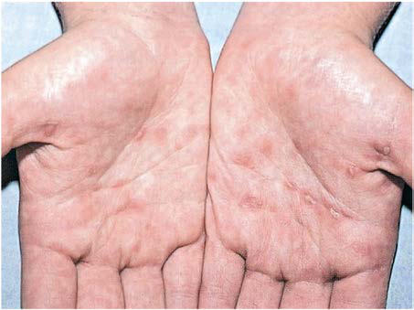
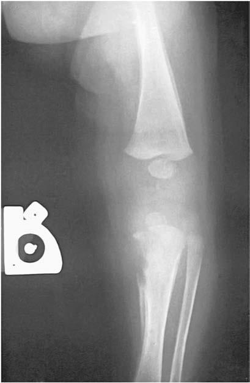

# Chapter 264: Syphilis (Treponema pallidum)
> **Course:** Vikkypaedia Pediatric Basic Course (*Nelson Textbook of Pediatrics, 22nd Edition (2025)*)  
> **Part XV:** Infectious Diseases  
> **Authors:** Alice I. Sato and H. Dele Davies  
> **Metrics:** 8,711 words · 4 tables/boxes · 2 figures · 0 genes · 8 flashcards · 5 MCQs  
> **Quick Navigation:** [🃏 Study 8 Flashcards](../flashcards/264_flashcards.md) · [📝 Take 5-Q MCQ Quiz](../mcqs/264_mcqs.md) · [📚 Part XV Guide](../parts/Part_XV.md) · [🧬 Syndrome & Genetics Atlas](../omim_gene_atlas.md) · [💊 Therapeutics Matrix](../therapies_matrix.md) · [🏠 Course Index](../../index.md)

## ⚡ High-Yield Nelson Pediatric Board Pearls
- ETIOLOGY Syphilis is caused by Treponema pallidum, a delicate, tightly spiraled, motile spirochete with finely tapered ends belonging to the family Spi rochaetaceae.
- Use of nucleic acid amplification testing by polymerase chain reaction (PCR) may have a role in diagnosis, particu larly in seronegative patients or those with discrepant serology results.
- Congenital syphilis results from transplacental transmission of spiro chetes or occasionally by intrapartum contact with infectious lesions or possibly involved mucosa without obvious lesions.
- MSM, Gay, bisexual, and other men who have sex with men; MSU, Men with unknown sex of sex partners; MSW, men who have sex with women only. (From Centers for Disease Control and Prevention.
- CS, Congenital syphilis; P&S syphilis, Primary and secondary syphilis. (From Centers for Disease Control and Prevention.
- Secondary syphilis should be con sidered in the differential diagnosis of virtually any rash of unknown etiology.
- All stages of congenital syphilis are characterized by a vas culitis, with progression to necrosis and fibrosis.

---
## Full Chapter Text, Tables & Figures
# Chapter 264: Syphilis (Treponema pallidum)

*Alice I. Sato and H. Dele Davies*

<!-- p.2378 -->
Syphilis is a chronic systemic sexually or vertically (mother to child) transmitted infection that can be easily treated if detected early but manifests with protean clinical symptoms and significant morbidity if left unchecked. (Please note that the terms *mother* and* maternal* are used to designate the birthing parent throughout this chapter and are not intended to exclude other birthing parents.)

**ETIOLOGY** Syphilis is caused by *Treponema pallidum,* a delicate, tightly spiraled, motile spirochete with finely tapered ends belonging to the family Spi rochaetaceae. The pathogenic members of this genus include *T. pallidum* subspecies *pallidum* (venereal syphilis), *T. pallidum* subspecies *pertenue* (yaws), *T. pallidum* subspecies *endemicum* (bejel or endemic syphilis), and *T. pallidum* subspecies *carateum* (pinta). Because these microor ganisms stain poorly and are below the detection limits of conventional light microscopy, detection in clinical specimens requires dark-field, phase-contrast microscopy or direct immunofluorescent or silver stain ing. *T. pallidum* has only recently been successfully grown in vitro via co-culture with mammalian tissue culture cells, and a method has now been described for inoculation of fresh and frozen needle aspirates from primary experimental syphilis lesions onto culture plates but remains to be developed for clinical use. Use of nucleic acid amplification testing by polymerase chain reaction (PCR) may have a role in diagnosis, particu larly in seronegative patients or those with discrepant serology results.

**EPIDEMIOLOGY Acquired syphilis** is transmitted almost exclusively by sexual contact, including vaginal, anal, and oral exposure. Less common modes of trans mission include transfusion of contaminated blood or direct contact with infected tissues. Syphilis in men who have sex with men (MSM) may be acquired in the absence of visible lesions. DNA-based *T. pallidum* testing has identified organisms in oral rinse or swab samples and in anal canal swabs, urine, semen, and peripheral blood; the risk is highest in secondary and early latent syphilis. The incubation period for acquired primary syphilis is about 3 weeks (range 10-90 days). After an epidemic resurgence of primary and secondary syphilis in the United States that peaked in 1989, the annual rate declined 90% to the lowest-ever rate by 2000. The total number of cases of primary and secondary syphilis has subsequently rebounded since 2000 (Fig. 264.1). MSM have been dis proportionately impacted: ∼46% of cases in 2021. Rates of primary and secondary syphilis in women remain lower than in men yet still have increased 55% during 2021. Cases of congenital syphilis reached an his toric low in 2005 but have subsequently increased annually since 2013, reflecting the rates among women. In 2021, the US national congenital syphilis rate was 77.9 cases per 100,000 live births, representing a 30.5% increase from 2020 and a 219.3% increase from 2017 (Fig. 264.2); syphi litic still births also increased over this period. The increase occurs across every region and all races and ethnicities, but marked disparities exist,

with minority groups, gay and bisexual men, and youth most affected. The COVID-19 pandemic disrupted screening programs and access to care, and increased cases are expected.

**Congenital syphilis** results from transplacental transmission of spiro chetes or occasionally by intrapartum contact with infectious lesions or possibly involved mucosa without obvious lesions. Women with primary and secondary syphilis and spirochetemia are more likely to transmit infection to the fetus than are women with latent infection. Transmis sion can occur at any stage of pregnancy, resulting in early fetal loss, pre term or low birthweight infants, stillbirths, neonatal deaths, or infants born with congenital disease. The incidence of congenital infection in offspring of untreated or inadequately treated infected women remains highest during the first 4 years after acquisition of primary infection, secondary infection, and early latent disease. Maternal (parental) factors associated with congenital syphilis include limited access to healthcare, late or no prenatal care, drug use, multiple sex partners, unprotected sex ual contact, incarceration, work in the sex trade, and inadequate treat ment of syphilis during pregnancy. Congenital syphilis may be seen in the context of untreated, inadequately treated, or undocumented treat ment before or during pregnancy. In addition, the mother may have been treated appropriately but did not have an adequate serologic response to therapy and the infant was inadequately evaluated, or the infant had documented congenital syphilis. Confirmed cases of both acquired and congenital syphilis must be reported to the local health department.

**CLINICAL MANIFESTATIONS AND LABORATORY FINDINGS** Many persons infected with syphilis are *asymptomatic for years,* or do not recognize the early signs of disease, or do not seek or have access

Cases

60,000

45,000

30,000

15,000

0 2017 2018 2019

Year

2020 2021

MSM

Women

MSW

MSU

**Fig 264.1**  Primary and secondary syphilis – Reported cases by sex and sex of sex partners 2017–2021. Note: Over the 5-yr period, 0.2% of cases were missing sex and were not included. MSM, Gay, bisexual, and other men who have sex with men; MSU, Men with unknown sex of sex partners; MSW, men who have sex with women only. *(From Centers for Disease Control and Prevention. Sexually transmitted disease surveil lance. National overview of STDs, 2021. https://www.cdc.gov/std/stat istics/2021/overview.htm**)*

3,000

2,400

1,800

1,200

600

0 2012 2015 2018 Year

2021

**CS Cases P&S Syphilis rate***

18

15

12

9

6

3

0

CS cases Female (15–44 years) P&S syphilis rate *Fig. 264.2**  Congenital syphilis — Reported cases by year of birth and rates of reported cases of primary and secondary syphilis among women age 15-44 years, United States, 2012–2021. *Per 100,000. CS, Congenital syphilis; P&S syphilis, Primary and secondary syphilis. *(From Centers for Disease Control and Prevention. Sexually transmitted dis ease surveillance. National overview of STDs, 2021. https://www.cdc.g ov/std/statistics/2021/overview.htm**)*

*Alice I. Sato and H. Dele Davies*

Section **8 Spirochetal Infections**

<!-- p.2379 -->
to treatment. The Centers for Disease Control and Prevention (CDC) recommends testing all pregnant persons and selective testing of adolescents, based on lesions or risk factors (those with other sexu ally transmitted diseases including HIV, MSM, incarcerated individu als, or persons who exchange sex for money or drugs). CDC/MMWR sexually transmitted infection (STI) guidelines should be consulted to ensure that all appropriate screening is performed. All 50 states and the District of Columbia explicitly allow minors to consent for STI services, though as of 2022, 18 states allow (but do not require) physi cians to notify parents of STI services provided to a minor (https:// www.cdc.gov/hiv/policies/law/states/minors.html). Periods of active clinical disease alternate with periods of latency (Fig. 264.3). **Primary syphilis** is characterized by a chancre and regional lymphadenitis. A **painless papule** (which may be overlooked) appears at the site of entry (usually the genitalia) 2-6 weeks after inoculation and develops into a clean, painless but highly contagious ulcer with raised borders **(chan cre)** containing abundant *T. pallidum*. Extragenital chancres can occur at other sites of primary entry and pose a diagnostic challenge. Oral lesions can be mistaken for aphthous ulcers or herpes. Lesions on the nipple can be confused with cellulitis or eczema. Adjacent lymph nodes are generally enlarged and nontender. The chancre heals spontaneously within 4-6 weeks, leaving a thin scar.

Untreated patients develop manifestations of **secondary syphilis** related to spirochetemia 2-10 weeks after the chancre heals. Manifes tations of secondary syphilis include a generalized nonpruritic macu lopapular rash, notably involving the palms and soles (Fig. 264.4). Pustular lesions can also develop. **Condylomata lata**, gray-white to erythematous wartlike plaques, can occur in moist areas around the anus, scrotum, or vagina, and white plaques **(mucous patches)** may

be found in mucous membranes. Secondary syphilis should be con sidered in the differential diagnosis of virtually any rash of unknown etiology. A **flulike illness** with low-grade fever, headache, malaise, anorexia, weight loss, sore throat, myalgias, arthralgias, and general ized lymphadenopathy is often present. Renal, hepatic, or ocular mani festations may be present. Meningitis occurs in about 30% of patients with untreated syphilis, occurring at any stage but most commonly in

Exposure

Incubation (10-90 days; mean ~21)

Primary syphilis (chancre formation)

lasts 2-6 weeks

Early latent syphilis (*asymptomatic*)

(1 year or less post-infection)

Late latent syphilis (*asymptomatic*)

(>1 yr or unknown duration

post-infection)

Tertiary syphilis

Incubation (4-8 weeks after appearance of chancre)*

Secondary syphilis

Infectious via sexual or mother-to-child

transmission

(1 year)

Infectious via mother-to-child

transmission

(5 years)

Noninfectious

Recurrence

20-30%

Central nervous

system invasion 25%-60%

~80% clearance

Cardiovascular syphilis

10% (Onset ≥ 10 years post-infection)

Gummatous disease

15% (Onset ≥ 5 years post-infection)

Tertiary syphilis

Late neurosyphilis General paresis

2%-5% (Onset ≥ 15 years post-infection)

Tabes dorsalis

2%-9% (Onset ≥ 15 years post-infection)

Early neurosyphilis

*Asymptomatic Symptomatic*

5% • Acute-subacute aseptic meningitis • Cranial neuritis • Ocular involvement • Meningovascular disease (stroke)

**Fig. 264.3** Natural course of untreated syphilis. As of January 2018, the Centers for Disease Control and Prevention renamed early and late latent syphilis early syphilis, nonprimary, nonsecondary and syphilis, unknown duration or late, respectively. *HIV infection may modify the progression of syphilis; the chancre may coexist with the secondary syphilis stage, suggesting a more rapid progression to the secondary stage. (Modified from Radolf JD, Tramont EC, Salazar JC. Syphilis [Treponema pallidum]. In: Bennett JE, Dolin R, Blaser MJ, eds. Mandell, Douglas, and Bennett’s Principles

**Fig. 264.4** Secondary syphilis. Ham-colored palmar macules on an adolescent with secondary syphilis. (From Weston WL, Lane AT, Morelli J. Color Textbook of Pediatric Dermatology, 3rd ed. St. Louis: Mosby; 2002.)

<!-- p.2380 -->
secondary syphilis (see Fig. 264.3). It is characterized by cerebrospinal fluid (CSF) pleocytosis and elevated protein level. Patients with men ingitis might not show neurologic symptoms. Even without treatment, secondary infection becomes **latent** within 1-2 months after onset of rash. Relapses with secondary manifestations can occur during the first year of latency (the **early latent period**). **Late syphilis** follows and may be either asymptomatic **(late latent)** or symptomatic **(tertiary)**. Tertiary disease follows in about one-third of untreated cases and is marked by neurologic, cardiovascular, and **gummatous lesions** (non suppurative granulomas of the skin, bone, and liver resulting from the host cytotoxic T-cell response). In the preantibiotic era, neurologic manifestations of tertiary syphilis **(tabes dorsalis** and **paresis)** were common. The clinical course of syphilis and its tissue manifestations reflect the immunopathobiology of the host humoral and delayed-type hypersensitivity responses. A robust timeline of progression through the overlapping stages occurs in immunocompromised HIV patients

**Congenital Infection** Untreated syphilis during pregnancy results in a vertical transmission rate approaching 100%, with profound effects on pregnancy outcome,

reflecting obliterating endarteritis. Fetal or perinatal death occurs in 40% of affected infants. Premature delivery can also occur. Neonates can also be infected at delivery by contact with an active genital lesion. Most infected infants are asymptomatic at birth, including up to 40% with CSF seeding, and are identified only by routine prenatal screen ing. In the absence of treatment, symptoms develop within weeks or months. Among infants symptomatic at birth or in the first few months of life, manifestations have traditionally been divided into early and late stages. All stages of congenital syphilis are characterized by a vas culitis, with progression to necrosis and fibrosis. The **early signs** appear during the first 2 years of life, and the **late signs** appear gradually dur ing the first 2 decades. Early manifestations vary and involve multiple organ systems, resulting from transplacental spirochetemia, and are analogous to the secondary stage of acquired syphilis. Hepatospleno megaly, jaundice, and elevated liver enzymes are common. Histologi cally, liver involvement includes bile stasis, fibrosis, and extramedullary hematopoiesis. Lymphadenopathy tends to be diffuse and resolve spontaneously, although shotty nodes can persist.

Coombs-negative hemolytic anemia is characteristic. Thrombocyto penia is often associated with platelet trapping in an enlarged spleen. Characteristic **osteochondritis** and **periostitis** (Fig. 264.5) and a mucocutaneous rash (Fig. 264.6A and B) manifesting with erythema tous maculopapular or vesiculobullous lesions followed by desqua mation involving the hands and feet (see Fig. 264.6C) are common. Mucous patches, persistent rhinitis **(snuffles)**, and condylomatous lesions (Fig. 264.7) are highly characteristic features of mucous mem brane involvement containing abundant spirochetes. Blood and moist, open lesions from infants with congenital syphilis and children with acquired primary or secondary syphilis are infectious until 24 hours of appropriate treatment.

Bone involvement is common. Roentgenographic abnormalities include **Wimberger lines** (demineralization of the medial proxi mal tibial metaphysis); multiple sites of osteochondritis at the wrists, elbows, ankles, and knees; and periostitis of the long bones and, rarely, the skull. The osteochondritis is painful, often resulting in irritabil ity and refusal to move the involved extremity **(pseudoparalysis of Parrot)**.

Congenital neurosyphilis is often asymptomatic in the neona tal period, although CSF abnormalities can occur even in asymp tomatic infants. Failure to thrive, chorioretinitis, nephritis, and nephrotic syndrome can also be seen. Manifestations of renal involvement include hypertension, hematuria, proteinuria, hypo proteinemia, hypercholesterolemia, and hypocomplementemia, probably related to glomerular deposition of circulating immune complexes. Less common clinical manifestations of early congenital syphilis include gastroenteritis, peritonitis, pancreatitis, pneumo nia, eye involvement (glaucoma and chorioretinitis), nonimmune hydrops, and testicular masses.

Late manifestations (children >2 years of age) are rarely seen in developed countries. These result primarily from chronic granuloma tous inflammation of bone, teeth, and the central nervous system and are summarized in Table 264.1. Skeletal changes are caused by persis tent or recurrent periostitis and associated thickening of the involved

**Fig. 264.5** Osteochondritis and periostitis in a newborn with congeni tal syphilis.

A B C

**Fig. 264.6** A and B, Papulosquamous plaques in two infants with syphilis. C, Desquamation on the palm of a newborn’s hand. (A and B from Eichenfeld LF, Frieden IJ, Esterly NB, eds. Textbook of Neonatal Dermatology. Philadelphia: WB Saunders, 2001: p. 196; courtesy Dr. Patricia Tread well.)

<!-- p.2381 -->
bone. Dental abnormalities, such as **Hutchinson teeth** (Fig. 264.8), are common. Defects in enamel formation lead to repeated caries and eventual tooth destruction. **Saddle nose** (Fig. 264.9) is a depression of the nasal root and may be associated with a perforated nasal septum.

Other late manifestations of congenital syphilis can manifest as hypersensitivity phenomena. These include unilateral or bilateral inter stitial keratitis and the **Clutton joint** (see Table 264.1). Other common ocular manifestations include choroiditis, retinitis, vascular occlusion, and optic atrophy. Soft tissue gummas (identical to those of acquired disease) and paroxysmal cold hemoglobinuria are rare hypersensitivity phenomena.

**DIAGNOSIS** Fundamental limitations of the currently available tests for syphilis are vexing, but results must always be interpreted in the context of patient history and physical examination. Physicians should remain aware of their local prevalence rates and treat presumptively when syphilis is suspected by clinical and epidemiologic data. The diagnosis of primary syphilis is confirmed when *T. pallidum* is demonstrated by dark-field microscopy or direct fluorescent antibody testing on specimens from skin lesions, placenta, or umbilical cord. Nucleic acid–based amplifica tion assays, such as PCR, are also used in some specialized laborato ries but are not commercially available. Despite the absence of a true

**Fig. 264.7** Perianal condylomata lata. (From Karthikeyan K, Thappa DM. Early congenital syphilis in the new millennium. Pediatr Dermatol. 2002;19:275–276.)

#### **Table 264.1** Late Manifestations of Congenital Syphilis

| Category / Parameter | Clinical Details & Findings |
| --- | --- |
| **DESCRIPTION/COMMENTS** | Olympian brow; Bony prominence of the forehead caused by; persistent or recurrent periostitis; Clavicular or; Higoumenakis sign; Unilateral or bilateral thickening of the; sternoclavicular third of the clavicle; Saber shins; Anterior bowing of the midportion of the tibia; Scaphoid scapula; Convexity along the medial border of the; scapula; Hutchinson teeth; Peg-shaped upper central incisors; they; erupt during sixth yr of life with abnormal; enamel, resulting in a notch along the; biting surface; Mulberry molars; Abnormal first lower (6 yr) molars; characterized by small biting surface and; excessive number of cusps; Saddle nose*; Depression of the nasal root, a result of; syphilitic rhinitis destroying adjacent bone; and cartilage; Rhagades; Linear scars that extend in a spokelike; pattern from previous mucocutaneous; fissures of the mouth, anus, and genitalia; Juvenile paresis; Latent meningovascular infection; it is rare; and typically occurs during adolescence; with behavioral changes, focal seizures, or; loss of intellectual function; Juvenile tabes; Rare spinal cord involvement and; cardiovascular involvement with aortitis; Hutchinson triad; Hutchinson teeth, interstitial keratitis, and; eighth cranial nerve deafness; Clutton joint; Unilateral or bilateral painless joint swelling; (usually involving the knees) from synovitis; with sterile synovial fluid; spontaneous; remission usually occurs after several weeks; Interstitial keratitis; Manifests with intense photophobia and; lacrimation, followed within weeks or; months by corneal opacification and; complete blindness; Eighth cranial nerve; deafness; May be unilateral or bilateral, appears at; any age, manifests initially as vertigo and; high-tone hearing loss, and progresses to; permanent deafness; *A perforated nasal septum may be an associated abnormality. |

**Fig. 264.8** Hutchinson teeth as a late manifestation of congenital syphilis.

**Fig. 264.9** Saddle nose in a newborn with congenital syphilis.

<!-- p.2382 -->
gold-standard serologic assay, serologic testing for syphilis remains the principal means for diagnosis and traditionally involves a twostep screening process with a nontreponemal test followed by a con firmatory treponemal test (Fig. 264.10A). Both test types are required for serologic-based diagnosis. False-negative tests may occur in early syphilis, and high-risk individuals may need repeat testing in 2-4 weeks if clinically indicated.

The **Venereal Disease Research Laboratory (VDRL)** and **rapid plasma reagin (RPR)** tests are sensitive **nontreponemal tests** that detect antibodies against phospholipid antigens on the treponeme surface that cross react with cardiolipin-lecithin-cholesterol antigens of damaged host cells. The quantitative results of these tests are help ful both in screening and in monitoring therapy. Titers increase with active disease, including treatment failure or reinfection, and decline with adequate treatment (Fig. 264.11). Nontreponemal tests usually become nonreactive within 1 year of adequate therapy for primary syphilis and within 2 years of adequate treatment for secondary disease. Fifteen to twenty percent of patients become **serofast** (nontreponemal titers persisting at low levels for long periods). In congenital infection, nontreponemal tests become nonreactive within a few months after adequate treatment. Certain conditions such as infectious mononucle osis and other viral infections, autoimmune diseases, and pregnancy can give false-positive VDRL results. False-positive results are less common with the use of purified cardiolipin-lecithin-cholesterol anti gen. All pregnant women should be screened early in pregnancy and at delivery. All positive maternal (parental) serologic tests for syphilis, regardless of titer, necessitate thorough investigation. Antibody excess can give a false-negative reading unless the serum is diluted **(prozone effect) as the formation of the antigen-antibody lattice needed to visualize a positive flocculation test is disrupted.** False-negative results can also occur in early primary syphilis, in latent syphilis of long duration, and in late congenital syphilis.

**Treponemal tests** traditionally are used to confirm diagnosis and measure specific *T. pallidum* antibodies (immunoglobulin [Ig] G, IgM, and IgA), which appear earlier than nontreponemal antibodies. Treponemal tests include the *T. pallidum* particle agglutination test (TP-PA, which is the preferred treponemal test) and the fluorescent treponemal antibody absorption test (FTA-ABS). Treponemal anti body titers become positive soon after initial infection and usually remain positive for life, even with adequate therapy (see Fig. 264.11). These antibody titers do not correlate with disease activity. Tradition ally they are useful for diagnosis of a first episode of syphilis and for distinguishing false-positive results of nontreponemal antibody tests but cannot accurately identify length of time of infection, response to therapy, or reinfection.

There is limited cross reactivity of treponemal antibody tests with other spirochetes, including the causative organisms of Lyme disease *(Borrelia burgdorferi),* yaws, endemic syphilis, and pinta. Only venereal syphilis and Lyme disease are found in the United States. Nontrepo nemal tests (VDRL, RPR) are uniformly nonreactive in Lyme disease.

Various enzyme-linked, chemiluminescence, and multiplex flow immunoassays to detect treponemal IgG and IgM have been devel oped. These assays have increased sensitivity and are amenable to automation and high-volume use. Rapid point-of-care tests are avail able to allow quality screening programs in resource-limited settings where the World Health Organization otherwise relies on syndromic management of STIs and patients are treated for all likely causes of their constellation of signs and symptoms. In the United States, use of immunoassays has confounded screening because it switches the traditional algorithm: the treponemal-specific testing is done before the nontreponemal testing. Because the former remain positive for life, clinical and epidemiologic data are required to provide guidelines to distinguish cured disease, early syphilis, untreated late latent dis ease, and true false-positive tests. Benefits of **reverse screening** are

Treponemal (immunoassay)

Supplemental treponemal*

Reactive

Reactive Nonreactive

Nonreactive

Step 1

Step 2

Step 3

Lab interpretation

*The supplemental treponemal test should use a unique platform and/or antigen, different from the first treponemal test.

Nonreactive

Nontreponemal

Reactive

Consistent with

current or past syphilis infection

Consistent with past or potential

early syphilis

infection

Inconclusive for syphilis infection;

potentially early infection or false

positive

No laboratory

evidence of syphilis infection

RPR or VDRL (**Nontreponemal test***)

**– Nontreponemal test** No syphilis or very recent infection testing concludes

**– Treponemal test** Biologic false-positive (see text for significance)

**+ Treponemal test** Syphilis new case or previously treated case

**+ Nontreponemal test**

Treponemal test EIA/CIA, TP-PA, TP-HA, or FTA-ABS

A

B **Fig. 264.10**  A, Traditional laboratory testing algorithm for syphilis. B, Suggested alternative testing algorithm. EIA/CIA, Enzyme immunoassay/ chemiluminescence immunoassay; FTA-ABS, fluorescent treponemal antibody absorption; *RPR*, rapid plasma reagin; TP-HA, *Treponema pallidum* hemagglutination; TP-PA, *Treponema pallidum* particle agglutination; VDRL, Venereal Disease Research Laboratory. *If nontreponemal test is posi tive qualitatively, a titer is then quantitated. *(**A**based on data from Workowski KA, Berman S; Centers for Diseases Control and Prevention. Sexually transmitted diseases treatment guidelines, 2010. MMWR Recomm Rep 2010;59[RR-12]:1–110. pp. 26–29.)*

<!-- p.2383 -->

**Fig. 264.11** Common patterns of serologic reactiv ity in syphilis patients. FTA-Abs, fluorescent trepone mal antibody absorption (test); RPR, rapid plasma reagin (test); TPHA, Treponema pallidum hemaggluti nation assay; VDRL, Venereal Disease Research Labo ratory (test). IgM by immunoassay. (From Peeling R, Ye H. Diagnostic tools for preventing and managing maternal and congenital syphilis: an overview. Bull World Health Organ. 2004;82[6]:439–446.)

100

80

60

40

20

% of patients who test positive

2 4 6 8 10 12 2 10 20

Time of infection

Weeks Years

Time post-infection

Primary

Primary

lesion

Secondary

Secondary

lesion

Latent (asymptomatic)

Tertiary Clinical

stages of syphilis

*IgM by ELISA or FTA-ABS 195 or immunoblot.

FTA-Abs

TPHA

Untreated

Treated

VDRL/RPR

IgM*

increased detection of transmissible early syphilis and of late latent disease to afford monitoring for tertiary disease. Although the CDC and American Academy of Pediatrics (AAP) Red Book continue to rec ommend the traditional screen (“conventional diagnostic approach”; see Fig. 264.10A), they have provided guidelines for interpretation of the reverse screening algorithm (see Fig. 264.10B). Reverse screening may yield false-positive results, particularly in low-prevalence popula tions where testing results should be interpreted with caution, as falsepositive testing in children may have serious adverse consequences. If reverse testing yields a positive treponemal result but a negative nontreponemal result, a second treponemal test targeting a different treponemal antigen is needed for confirmation. Interpretation of non treponemal and treponemal serologic tests in the newborn can be con founded by maternal IgG antibodies transferred to the fetus. Passively acquired antibody is suggested by a neonatal titer at least fourfold (i.e., a two-tube dilution) less than the maternal (parental) titer. This conclu sion can be verified by a gradual decline in antibody in the infant, usu ally becoming undetectable by 3-6 months of age. Conversely, an infant nontreponemal titer fourfold higher than the mother’s at the time of delivery or a persistent or rising nontreponemal titer in the infant sug gests congenital infection.

Neurologic involvement can occur at any stage of syphilis. The diagnosis of neurosyphilis remains difficult but is often established by demonstrating pleocytosis and increased protein in the CSF and a positive CSF VDRL test along with neurologic symptoms. The CSF VDRL test is specific but relatively insensitive (22–69%) for neurosyphilis. CSF PCR and IgM immunoblot tests are being stud ied but not currently recommended for use in making the diagnosis of neurosyphilis.

Dark-field or direct fluorescent antibody microscopy of scrap ings from primary lesions or congenital or secondary lesions can reveal *T. pallidum,* often before serology becomes positive, but these modalities are usually not available in clinical practice. Since 2015 dif ferent methods of PCR, including routine PCR, nested PCR, reversetranscriptase PCR, and quantitative PCR targeting different DNA gene sequences, have been used by many laboratories as methods to detect *T. pallidum* in primary disease. However, there are currently

no commercially available test kits, and each test must be validated for use in each laboratory. Furthermore, these tests are not useful for asymptomatic patients, and interpretation may be complicated by the fact that they amplify both dead and living organisms. Placen tal examination by gross and microscopic techniques can be useful in the diagnosis of congenital syphilis. The disproportionately large placentas are characterized histologically by focal proliferative villitis, endovascular and perivascular arteritis, and focal or diffuse immatu rity of placental villi.

**Congenital Syphilis** A diagnosis of congenital syphilis requires a thorough review of mater nal (parental) history of syphilis treatment preconception and the testing, treatment, and dynamics of response during the current preg nancy. Regardless of maternal (parental) treatment and the presence/ absence of symptoms in the infant, proactive evaluation and treatment of exposed neonates is critical (Fig. 264.12 and Table 264.2). Symptom atic infants should be thoroughly evaluated and treated. Figure 264.12 and Table 264.3 describe the guidelines for evaluating and managing asymptomatic infants who are considered at risk for congenital syphi lis because the maternal (parental) nontreponemal and treponemal serology is positive. Internationally adopted, refugee, and immigrant children should also be screened, regardless of history or report of treatment. Diagnostic testing risk-stratifies infants to probability of congenital infection: proven or highly probable congenital syphilis, possible congenital syphilis, congenital syphilis less likely, or congeni tal syphilis unlikely.

A diagnosis of neurosyphilis in the newborn with syphilitic infec tion is confounded by poor sensitivity of the CSF VDRL test in this age-group and lack of CSF abnormalities. A positive CSF VDRL test in a newborn warrants treatment for neurosyphilis, even though it might reflect passive transfer of antibodies from serum to CSF. It is now accepted that all infants with a presumptive diagnosis of con genital syphilis should be treated with regimens effective for neuro syphilis because central nervous system involvement cannot be reliably excluded. A diagnosis of syphilis beyond early infancy should lead to consideration of possible child abuse.

<!-- p.2384 -->
For infants with proven or highly probable disease or abnormal physical findings, complete evaluation, including serologic tests (RPR or VDRL), complete blood count with differential and platelet count, liver function tests, long-bone radiographs, ophthalmology examina tion, auditory brainstem response, and other tests as indicated, should be performed. If possible, pathologic examination of the placenta and/ or umbilical cord with specific fluorescent antitreponemal antibody staining is recommend by the AAP. For infants with a positive VDRL or RPR test result and normal physical examination whose mothers were inadequately treated, further evaluation is not necessary if 10 days of parenteral therapy are administered.

**TREATMENT** The goals of early detection and treatment include treatment of current infection and prevention of both late-stage disease and sexual or verti cal transmission. *T. pallidum* remains extremely sensitive to penicillin, with no evidence of emerging penicillin resistance, and thus penicillin remains the treatment drug of choice (additional information available in Table 264.4 and at http://www.cdc.gov/std/treatment for patients over 1 month old). Parenteral penicillin G is the only documented effective treatment for congenital syphilis, syphilis during pregnancy, and neurosyphilis and is recommended for treatment of syphilis in persons with HIV. Aqueous crystalline penicillin G is preferred over

**Conventional diagnostic approach Reverse-sequence screening approach**

Initial reactive maternal RPR/VDRL

Nonreactive maternal treponemal testa Reactive maternal treponemal testa,b

Initial positive maternal treponemal EIA/CIA screening test

Reactive maternal RPR/VDRL Nonreactive maternal RPR/VDRL

False-positive reaction: no further evaluation (if pregnant, treponemal repeat testing may be appropriate)

Reactive alternative maternal treponemal test (eg, TP-PA)a,b Nonreactive alternative maternal treponemal test (eg, TP-PA)a

• If epidemiologic risk and clinical probability of syphilis is low, no further evaluation is required • If not low, consider repeat RPR/VDRL in 2–4 wk to differentiate early primary infection from false positive

Evaluate mother’s treatment history for syphilis

Maternal treatment: • None, OR • Undocumented, OR • Less than 4 wk before delivery, OR • Nonpenicillin drug, OR • Maternal evidence/concern of reinfection/relapse (fourfold or greater increase in maternal titers)c

• Partner recently diagnosed with syphilis

Maternal penicillin treatment during pregnancy AND 4 wk or more before delivery, AND no evidence/concern of maternal reinfection or relapse

Adequate maternal treatment before pregnancy with low stable (serofast)d or negative titer AND infant examination normal; if infant examination is abnormal, proceed with evaluatione

Reactive maternal RPR/VDRL at 2–4 wk

Evaluatee

Infant physical examination normal; AND evaluation normal; AND infant RPR/VDRL same or less than fourfold the maternal RPR/VDRL titerc

Infant physical examination abnormal; OR evaluation abnormal or incomplete; OR RPR/VDRL at least fourfold greater than maternal RPR/VDRLc

Proven or highly probable congenital syphilis

Possible congenital syphilis

Congenital syphilis unlikely Congenital syphilis less likely

Proven or highly probable congenital syphilis

Infant RPR/VDRL not fourfold or greater than maternal RPR/VDRLc

Infant physical examination abnormal

Infant physical examination normal

Infant RPR/VDRL fourfold or greater than maternal RPR/VDRL titerc

Evaluatee

Infant physical examination normal; AND evaluation normal; AND infant RPR/VDRL same or less than fourfold the maternal RPR/VDRL titerc

Infant physical examination abnormal; OR evaluation abnormal or incomplete; OR RPR/VDRL at least fourfold greater than maternal RPR/VDRLc

Possible congenital syphilis

Proven or highly probable congenital syphilis

**Fig. 264.12** Algorithm for the diagnostic approach of infants born to mothers (birthing parents) with reactive serologic tests for syphilis. aTre ponema pallidum particle agglutination (TP-PA) (which is the preferred treponemal test) or fluorescent treponemal antibody absorption (FTA-ABS). bTest for human immunodeficiency virus (HIV) antibody. Infants of HIV-infected mothers do not require different evaluation or treatment for syphilis. cA fourfold change in titer is the same as a change of two dilutions. For example, a titer of 1:64 is fourfold greater than a titer of 1:16, and a titer of 1:4 is fourfold lower than a titer of 1:16. When comparing titers, the same type of nontreponemal test should be used (e.g., if the initial test was an RPR, the follow-up test should also be an RPR). dStable VDRL titers 1:2 or less or RPR 1:4 or less beyond 1 year after successful treatment are con sidered low serofast. eComplete blood cell (CBC) and platelet count; cerebrospinal fluid (CSF) examination for cell count, protein, and quantitative VDRL; other tests as clinically indicated (e.g., chest radiographs, long-bone radiographs, eye examination, liver function tests, neuroimaging, and auditory brainstem response). For neonates, pathologic examination of the placenta or umbilical cord with specific fluorescent antitreponemal anti body staining, if possible. RPR, Rapid plasma regain; VDRL, Venereal Disease Research Laboratory. (From American Academy of Pediatrics. Syphilis. In Kimberlin DW, Barnett ED, Lynfield R, Sawyer MH, eds. Red Book: 2021–2024 Report of the Committee on Infectious Diseases, 32nd ed. Itasca, IL: American Academy of Pediatrics; 2021: Fig. 3.15, p. 734.)

<!-- p.2385 -->
procaine penicillin, because it better achieves and sustains the mini mum concentration of 0.018 μg/mL (0.03 units/mL) needed for 7-10 days to achieve the prolonged treponemicidal levels required for the long dividing time of *T*. *pallidum*.

In 2023, due to manufacturing limitations and increased demand, the United States entered a period of penicillin G shortage, requir ing prioritization of pregnant persons to receive this antibiotic, as no other medication is proven to prevent vertical transmission. Penicil lin G is often preferred for IM injection in treatment of other syphilis infections as an approach to ensure adherence to therapy, and thus the shortage may lead to increased transmission.

For proven or highly probable congenital syphilis, procaine penicillin G (50,000 U/kg IM daily × 10 days) should only be used if access to IV penicillin G is limited (such as in a low-resource setting) or if IV access cannot be obtained. For infants with possible congenital syphilis, aqueous penicillin G (50,000 U/kg IV every 12 hours when 1 wk or younger, then every 8 hours for infants older than 1 wk, for a total of 10 days of therapy) is preferred, though procaine penicillin G (50,000 U/kg IM daily x 10 days) may be given. Benzathine penicillin G (50,000 U/kg IM) as a single dose can be considered but only if all components of the evaluation are normal and follow-up is certain. Infants in whom congenital syphilis is less likely may be treated with benzathine penicillin G (50,000 U/kg IM) as a single dose. If no treatment is given, infants must be closely followed until the nontreponemal test becomes nonreactive. If any portion of the assessment for congenital syphilis is abnormal or not obtained, or the CSF studies are uninterpretable, or outpatient follow-up cannot be assured, treatment with procaine penicillin G is preferred. Patients with persistent or increasing titers require repeat evaluation and treatment with a 10-day course of par enteral penicillin G, even if previously treated.

Although nonpenicillin regimens are available to the penicillinallergic patient, desensitization followed by standard penicillin ther apy is the most reliable strategy. Success of treatment also depends on the integrity of the host immune response. A transient acute systemic febrile reaction called the **Jarisch-Herxheimer reaction** (caused by massive release of endotoxin-like antigens during bacterial lysis) occurs in 15–20% of patients with acquired or congenital syphilis treated with penicillin. It is not an indication for discontinuing penicillin therapy.

Use of other agents for congenital syphilis should only be done in con sultation with a pediatric infectious diseases specialist and requires close clinical and serologic follow-up.

**Acquired Syphilis** Primary, secondary, and early latent disease is treated with a single dose of benzathine penicillin G (50,000 units/kg IM, maximum 2.4 mil lion units, in a single dose). Persons with late latent or tertiary disease require three doses at 1-week intervals. Nonpregnant penicillin-allergic patients without neurosyphilis may be treated with either doxycycline (4.4 mg/kg divided in 2 doses, max 200 mg per day, orally twice a day for 14 days) or tetracycline (25-50 mg/kg divided in 4 doses, max 2 g per day, orally for 14 days, for age ≥8 years). Emerging *azalide* and *mac rolide resistance* has been documented throughout the United States (a 23S ribosomal NA [rRNA] point mutation at position 2058) and, more recently, worldwide (a 23S rRNA point mutation at position 2059), compromising the effective use of these antibiotics. Careful serologic follow-up is always necessary. Documentation of serologic cure is an essential part of syphilis treatment. Less than a fourfold decline in titer reflects treatment failure.

The CDC recommends that all persons with syphilis be tested for HIV and other STIs. Patients diagnosed with syphilis with a negative HIV test should undergo repeat testing 3 months later. Diagnosis of syphilis in high-risk individuals, particularly men or transgender women who have sex with men, is associated with increased risk of

Congenital Syphilis

#### **Table 264.2** Clues that Suggest a Diagnosis of

| Category / Parameter | Clinical Details & Findings |
| --- | --- |
| **CLINICAL FINDINGS** | Untreated early syphilis in the; mother; Untreated latent syphilis in the; mother; An untreated mother who has; contact with a known patient; with syphilis during pregnancy; Mother treated less than 30 days; before delivery; Mother treated for syphilis; during pregnancy with a drug; other than penicillin; Mother treated for syphilis; during pregnancy without; follow-up to demonstrate; fourfold decrease in titer; Mother co-infected with HIV; Osteochondritis, periostitis; Snuffles, hemorrhagic or; mucopurulent rhinitis; Condylomata lata; Bullous lesions, palmar or plantar; rash; Mucous patches; Hepatomegaly, splenomegaly; Jaundice, hepatitis; Nonimmune hydrops fetalis; Generalized lymphadenopathy; Central nervous system signs;; elevated cell count or protein; in cerebrospinal fluid; Hemolytic anemia, diffuse; intravascular coagulation,; thrombocytopenia; Pneumonitis; Nephrotic syndrome; Placental villitis or vasculitis; (unexplained enlarged; placenta); Intrauterine growth restriction; Arranged in decreasing order of confidence of diagnosis.; Modified from Remington JS, Klein JO, Wilson CB, et al., eds. Infectious Diseases of; the Fetus and Newborn Infant, 6th ed. Philadelphia: WB Saunders; 2006:556. |

Congenital Syphilis

#### **Table 264.3** Confirmed Proven or Highly Probable

| Category / Parameter | Clinical Details & Findings |
| --- | --- |
| **Any neonate with:** | • An abnormal physical examination that is consistent with; congenital syphilis;; • A serum quantitative nontreponemal serologic titer that is; fourfold (or greater) higher than the mother’s titer at delivery (e.g.,; maternal titer = 1:2, neonatal titer ≥1:8 or maternal titer = 1:8,; neonatal titer ≥1:32); or; • A positive dark-field test or PCR of placenta, cord, lesions, or; body fluids or a positive silver stain of the placenta or cord. |
| **Recommended evaluation:** | • CSF analysis for VDRL, cell count, and protein; • Complete blood count (CBC) and differential and platelet count; • Long-bone radiographs; • Other tests as clinically indicated (e.g., chest radiograph, liver; function tests, neuroimaging, ophthalmologic examination, and; auditory brainstem response) |
| **syphilis:** | Aqueous crystalline penicillin G 100,000-150,000 units/kg body; weight/day, administered as 50,000 units/kg body weight/dose by; IV every 12 hr during the first 7 days of life and every 8 hr thereafter; for a total of 10 days* |
| **OR** | Procaine penicillin G 50,000 units/kg body weight/dose IM in a single; daily dose for 10 days; If >1 day of therapy is missed, the entire course should be restarted.; Data are insufficient regarding use of other antimicrobial agents; (e.g., ampicillin). When possible, a full 10-day course of penicillin; is preferred, even if ampicillin was initially provided for possible; sepsis. Using agents other than penicillin requires close serologic; follow-up for assessing therapy adequacy.; *Preferred therapy per the 2021-2024 AAP Red Book; From Centers for Disease Control and Prevention. Congenital syphilis. Sexually; Transmitted Diseases and Treatment Guidelines, 2021. Scenario 1. https://www.cdc.gov; /std/treatment-guidelines/congenital-syphilis.htm. |

<!-- p.2386 -->
subsequent HIV acquisition, and preexposure prophylaxis (PrEP) should be considered. Patients co-infected with HIV are at increased risk for neurologic complications and higher rates of treatment fail ure. CDC guidelines recommend the same treatment of primary and secondary syphilis as for patients who are not infected with HIV, but some experts recommend three weekly doses of benzathine penicil lin G. HIV-infected patients with late latent syphilis or latent syphilis of unknown duration should have a CSF evaluation for neurosyphilis before treatment.

Sex partners of infected persons of any stage should be evaluated and treated. Persons exposed for 90 days or less preceding diagnosis in a sex partner should be treated presumptively even if seronegative. Persons exposed for more than 90 days before the diagnosis in a sex partner should be treated if seropositive or if serologic tests are not available.

Follow-up serology should be performed on treated patients to estab lish adequacy of therapy, and all patients should be tested for other sexually transmitted diseases, including HIV. Children with acquired primary, secondary, or latent syphilis should undergo evaluation for possible sexual assault or abuse.

**Syphilis in Pregnancy** When clinical or serologic findings suggest active infection or when the diagnosis of active syphilis cannot be excluded with certainty, treatment is indicated. The goals of treatment of the pregnant per son include eradication of maternal (parental) disease, prevention of parent-to-child transmission, and treatment of fetal infection. Patients should be treated immediately with the penicillin regimen appropri ate for the pregnant person’s stage of syphilis. Those who have been

#### **Table 264.4** Recommended Treatment for Syphilis in People Older Than 1 Mo

| Category / Parameter | Clinical Details & Findings |
| --- | --- |
| **ADULTS** | Congenital syphilis in patients >1 mo old;; OR children >2 mo with late and previously; untreated congenital syphilis; Aqueous crystalline penicillin G 200,000-; 300,000 U/kg/day IV administered as; 50,000 U/kg, every 4-6 hr for 10 days*; Primary, secondary, and early latent syphilis†; Penicillin G benzathine‡ 50,000 U/kg IM, up; to the adult dose of 2.4 million U in a single; dose; If allergic to penicillin and not pregnant,; Doxycycline 4.4 mg/kg divided in 2 doses, max; 200 mg per day, orally twice a day for 14 days; (for ages ≥8 yr) |
| **OR** | Tetracycline 25-50 mg/kg divided in 4 doses,; max 2 g per day, orally for 14 days (for ages; ≥8 yr); Penicillin G benzathine 2.4 million U IM in a; single dose |
| **OR** | If allergic to penicillin and not pregnant,; doxycycline 100 mg orally twice a day for 14; days |
| **OR** | Tetracycline 500 mg orally 4 times/day for 14; days; Late latent syphilis§; Penicillin G benzathine 50,000 U/kg IM, up to; the adult dose of 2.4 million U, administered; as 3 single doses at 1-wk intervals (total; 150,000 U/kg, up to the adult dose of 7.2; million U); If allergic to penicillin and not pregnant,; Doxycycline 4.4 mg/kg divided in 2 doses,; max 200 mg per day, orally twice a day for 4; weeks (for ages ≥8 yr) |
| **OR** | Tetracycline 25-50 mg/kg divided in 4 doses,; max 2 g per day, orally for 4 weeks (for ages; ≥8 yr); Penicillin G benzathine 7.2 million U total,; administered as 3 doses of 2.4 million U IM,; each at 1-wk intervals; pregnant women who; have delays in any dose of therapy beyond; 9 days between doses should repeat the full; course of therapy |
| **OR** | If allergic to penicillin and not pregnant,; Doxycycline 100 mg orally twice a day for 4 wk |
| **OR** | Tetracycline 500 mg orally, 4 times/day for 4 wk; Tertiary; —; Penicillin G benzathine 7.2 million U total,; administered as 3 doses of 2.4 million U IM; at 1-wk intervals; If allergic to penicillin and not pregnant,; consult an infectious diseases expert; Neurosyphilis//; Aqueous crystalline penicillin G 200,000-; 300,000 U/kg/day IV every 4-6 hr for 10-14; days, in doses not to exceed the adult dose; Aqueous crystalline penicillin G 18-24 million; U per day, administered as 3-4 million U IV; every 4 hr for 10-14 days¶ |
| **OR** | Penicillin G procaine‡ 2.4 million U IM once; daily PLUS probenecid 500 mg orally 4; times/day, both for 10-14 days¶; *If the patient has no clinical manifestations of disease, the cerebrospinal fluid (CSF) examination is normal, and the CSF Venereal Disease Research Laboratory (VDRL) test result is; negative, some experts would treat with up to 3 weekly doses of penicillin G benzathine 50,000 U/kg IM. Some experts also suggest giving these patients a single dose of penicillin; G benzathine 50,000 U/kg IM after the 10-day course of intravenous aqueous penicillin.; †Early latent syphilis is defined as being acquired within the preceding year.; ‡Penicillin G benzathine and penicillin G procaine are approved for intramuscular administration only.; §Late latent syphilis is defined as syphilis beyond 1 year’s duration.; //Patients who are allergic to penicillin should be desensitized.; ¶Some experts administer penicillin G benzathine 2.4 million U IM once per week for up to 3 weeks after completion of these neurosyphilis treatment regimens.; IV, Intravenously; IM, intramuscularly.; From American Academy of Pediatrics. Syphilis. In: Kimberlin DW, Barnett ED, Lynfield R, Sawyer MH, eds. Red Book: 2021–2024 Report of the Committee on Infectious Diseases,; 32nd ed. Itasca, IL: American Academy of Pediatrics; 2021: Table 3.67, pp. 741–742. |

<!-- p.2387 -->
adequately treated in the past do not require additional therapy unless quantitative serology suggests evidence of reinfection **(fourfold eleva tion in titer)**.

Penicillin G is the only agent known to be effective for treating fetal infection and for prevention of congenital infection. Pregnant patients who are allergic to penicillin should be desensitized and treated with penicillin. If doses for late latent syphilis are delayed beyond 9 days from the prior dose, the full course of therapy needs to be repeated. Additional therapy may be considered for pregnant persons with primary, secondary, or early latent syphilis or when syphilis is diag nosed during the second half of pregnancy and sonographic evidence of fetal or placental syphilis is noted. In these cases, a second dose of benzathine penicillin G (2.4 million units IM given 1 week after the initial dose) may decrease the risk of vertical transmission. Jarisch- Herxheimer reaction in the second half of pregnancy may induce pre mature labor or fetal distress, and patients with reactions should seek obstetric attention promptly.

**Congenital Syphilis** Adequate maternal (parental) treatment at least 30 days before deliv ery is likely to prevent congenital syphilis. All infants born to pregnant persons with syphilis should be followed until nontreponemal serol ogy is negative. The infant should be treated if there is any uncertainty about the adequacy of maternal (parental) treatment. The goal of infant treatment is prevention of organ damage, skeletal deformity, and developmental delay. Any infant at risk of congenital syphilis should be evaluated for HIV.

Congenital syphilis is treated in infants up to 1 month of age with aqueous penicillin G (100,000-150,000 units/kg/24 hr IV divided every 12 hours for the first week of life and every 8 hours thereafter) or pro caine penicillin G (50,000 units/kg IM once daily) given for 10 days. Both penicillin regimens are recognized as adequate therapy for con genital syphilis, but higher concentrations of penicillin are achieved in the CSF of infants treated with intravenous aqueous penicillin G than in those treated with intramuscular procaine penicillin. Treated infants should be closely monitored at 2-, 4-, 6-, and 12-month well child care visits and serologic nontreponemal titers repeated every 2-3 months until nonreactive. Titers generally decrease by 3 months of age and become nonreactive by 6 months of age if adequately treated or if antibody was merely transplacentally acquired without infection. Infants diagnosed and treated for congenital syphilis after 1 month of age should be treated with aqueous crystalline penicillin G 200,000- 300,000 U/kg/day IV administered as 50,000 U/kg, every 4-6 hr for 10 days (Table 264.4). Nontreponemal titers may resolve more slowly if the patient was treated after 1 month old. Increasing or persistent stable titers 6-12 months after initial treatment suggest possible ongo ing infection, and repeat evaluation, including CSF, is indicated. Repeat treatment (penicillin G IV for 10 days) may be indicated. Infants with a negative nontreponemal test born to a person seroreactive at the time of delivery could have incubating congenital infection and so should be retested at 3 months. Infants with initial abnormal CSF studies only require repeat lumbar puncture if they have persistent nontreponemal serologic titers at 6-12 months old. If CSF has a persistent positive VDRL or abnormal indices not attributable to another ongoing illness, retreatment is indicated after 2 years of follow-up. At age 2 previously treated infants should receive a full developmental assessment. In a very low-risk neonate who is asymptomatic and whose mother was treated appropriately, without evidence of relapse or reinfection but with a low and stable VDRL titer (serofast), no evaluation is necessary. Some specialists, however, would treat such an infant with a single dose of benzathine penicillin G 50,000 units/kg IM.

**PREVENTION** Syphilis, including congenital syphilis, is a reportable disease in all 50 states and the District of Columbia. Testing is indicated at any

time for persons with suspicious lesions, a history of recent sexual exposure to a person with syphilis, or diagnosis of another sexu ally transmitted infection, including HIV infection. Screening for syphilis in asymptomatic, nonpregnant persons at increased risk for infection has received an A recommendation from the US Preven tive Services Task Force (USPSTF) as providing significant benefit. Direct-to-consumer test services for STIs (or “home tests”) have become more acceptable following consumer experience with simi lar testing during the COVID-19 pandemic, and best practices for implementation are an area of intense research. As of late 2023, the US CDC had posted request for comment on proposed guidelines for the use of doxycycline as post-exposure prophylaxis for bacterial STI prevention, including syphilis, to be offered to MSM and trans gender women with a history of at least one bacterial STI in the last 12 months; insufficient evidence is currently available to give recom mendations for other groups, including children, cisgender women or heterosexual men, transgender men, or other queer and nonbinary individuals. The resurgence of syphilis compels clinicians to remain cognizant of its protean manifestations to avoid missed or late diag nosis. Timely treatment lessens risk of community spread. Despite the genome sequencing of *T. pallidum* in 1998, vaccine development remains elusive, confounded by the treponeme’s ability to evade the immune system.

**Congenital Syphilis** Congenital syphilis is a preventable disease, a sentinel event indi cating multiple missed opportunities. Primary prevention is tied to prevention of syphilis in women of childbearing age, and secondary prevention with early diagnosis and prompt treatment of women and their partners. Access to and use of comprehensive prenatal care is key, with careful history taking (including interim sexual partners) at each visit. Routine prenatal screening for syphilis remains the most important factor in identifying infants at risk for developing congeni tal syphilis. Screening all women at the beginning of prenatal care is an evidence-based standard of care and legally required in all states. In pregnant women without optimal prenatal care, serologic screen ing for syphilis should be performed at the time pregnancy is diag nosed. Any person who is delivered of a stillborn infant at 20 weeks or fewer of gestation should be tested for syphilis. In communities and populations with a high prevalence of syphilis and in patients at high risk (pregnant persons with a history of incarceration, drug use, or multiple or concurrent partners), testing should be performed at least two additional times: at the beginning of the third trimes ter (28 weeks) and at delivery. Some states mandate repeat testing at delivery for all pregnant persons, underscoring the importance of preventive screening. Those at high risk for syphilis should be screened even more frequently, either monthly or, pragmatically (in the case of inconsistent prenatal care), at every medical encounter because they can have repeat infections during pregnancy or rein fection late in pregnancy. Follow-up serologic testing of all treated pregnant persons should be done after treatment to document titer decline, relapse, or reinfection.

No newborn should leave the hospital without the mother’s (par ent’s) syphilis status having been determined at least once during pregnancy or at delivery. In states conducting newborn screening for syphilis, both the parent’s and infant’s serologic results should be known before discharge. Appropriate follow-up for the treated or exposed infant should be arranged. In addition, all previously unin vestigated infants of an infected mother should be screened. Strong linkages between clinicians and public health practitioners remain essential for comprehensive prevention of acquired and congenital syphilis.

*Visit Elsevier eBooks+ at eBooks.Health.Elsevier.com** for Bibliography.*

<!-- p.2388 -->
