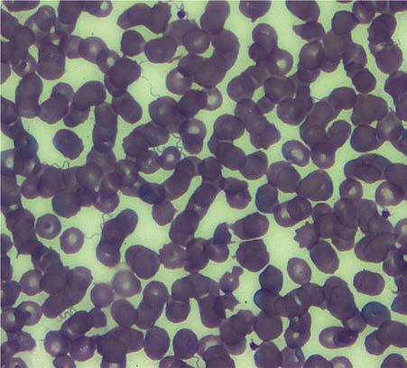
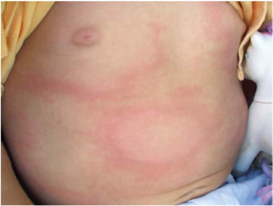

# Chapter 268: Lyme Disease (Borrelia burgdorferi)
> **Course:** Vikkypaedia Pediatric Basic Course (*Nelson Textbook of Pediatrics, 22nd Edition (2025)*)  
> **Part XV:** Infectious Diseases  
> **Authors:** Sanjeev K. Swami  
> **Metrics:** 5,910 words · 4 tables/boxes · 2 figures · 1 genes · 8 flashcards · 5 MCQs  
> **Quick Navigation:** [🃏 Study 8 Flashcards](../flashcards/268_flashcards.md) · [📝 Take 5-Q MCQ Quiz](../mcqs/268_mcqs.md) · [📚 Part XV Guide](../parts/Part_XV.md) · [🧬 Syndrome & Genetics Atlas](../omim_gene_atlas.md) · [💊 Therapeutics Matrix](../therapies_matrix.md) · [🏠 Course Index](../../index.md)

## Key Genetic & Molecular Targets
`IR3535`

## ⚡ High-Yield Nelson Pediatric Board Pearls
- Resolution of each febrile episode either by natural crisis or as a result of antimicrobial treatment is often accompanied by the Jarisch-Herxheimer reaction, which is caused by massive antigen release.
- PROGNOSIS With adequate therapy, the mortality rate for relapsing fever is <5%.
- Giving prophylactic dox ycycline for 4 days after a tick bite may prevent tick-borne relapsing fever caused by Borrelia persica.
- Lyme disease is the most common vector-borne disease in the United States and is an important public health problem.
- ETIOLOGY Lyme disease is a zoonotic infection caused by the transmission of the spirochete Borrelia burgdorferi sensu lato (broad sense) to humans via the bite of an infected tick of the Ixodes genus.
- Lyme disease was the sixth most common notifiable disease reported to the CDC in 2019 (following Chlamydia trachomatis, gonorrhea, syphilis, campylobacteriosis, and salmonellosis).
- PATHOLOGY AND PATHOGENESIS Similar to other spirochetal infections, untreated Lyme disease is characterized by asymptomatic infection, clinical disease that can occur in stages, and a propensity for cutaneous and neurologic mani festations.

---
## Full Chapter Text, Tables & Figures
# Chapter 268: Lyme Disease (Borrelia burgdorferi)

*Sanjeev K. Swami*

<!-- p.2398 -->
erythromycin is efficacious in adults, but experience in children is limited. In children younger than 8 years of age, erythromycin (50 mg/kg/day divided every 6 hours PO) for a total of 10 days is rec ommended, although there is evidence that doxycycline given for durations of less than 2 weeks is safe in children >2 years of age. Penicillin and chloramphenicol are also effective. Central nervous system involvement is usually responsive to intravenous ceftriaxone or penicillin.

Resolution of each febrile episode either by natural crisis or as a result of antimicrobial treatment is often accompanied by the Jarisch-Herxheimer reaction, which is caused by massive antigen release. Corticosteroid or antipyretic pretreatment does not prevent this reaction.

**PROGNOSIS** With adequate therapy, the mortality rate for relapsing fever is <5%. A majority of patients recover from their illness with or without treat ment after the appearance of anti-*Borrelia* antibodies, which agglu tinate, kill, or opsonize the spirochete. However, pregnant women and their neonates are at increased risk for tick-borne recurrent fever-associated complications, including adult respiratory distress syndrome, Jarisch-Herxheimer reaction, and precipitous or prema ture delivery. Neonates have up to a 33% case fatality rate. The risk of Jarisch-Herxheimer reaction appears to be much higher in louseborne relapsing fever (LBRF) (55.8%) compared to TBRF (19.3%). However, they have similar overall case fatality rates, TBRF (6.5%) and LBRF (4–10.2%).

**PREVENTION** No vaccine is available. Disease control requires avoidance or elimi nation of the arthropod vectors. In epidemics of louse-borne disease, good personal hygiene and delousing of persons, dwellings, and cloth ing with commercially available insecticides can prevent dissemina tion. The risk for tick-borne disease can be minimized in endemic areas by maintaining rodent-free dwellings. Giving prophylactic dox ycycline for 4 days after a tick bite may prevent tick-borne relapsing fever caused by *Borrelia persica.*

*Visit Elsevier eBooks+ at eBooks.Health.Elsevier.com** for Bibliography.*

**Fig. 267.2** Stained thin smear of a newborn’s peripheral blood show ing the presence of numerous spirochetes (indicated by arrows) at ×63 magnification—Colorado, 2011. (From Centers for Disease Control and Prevention [CDC]. Tickborne relapsing fever in a mother and newborn child–Colorado, 2011. MMWR Morb Mortal Wkly Rep. 2012;61:174– 176.)

Lyme disease is the most common vector-borne disease in the United States and is an important public health problem.

**ETIOLOGY** Lyme disease is a zoonotic infection caused by the transmission of the spirochete *Borrelia burgdorferi* sensu lato (broad sense) to humans via the bite of an infected tick of the *Ixodes* genus. In North America, *B. burgdorferi* sensu stricto (strict sense) causes almost all cases; another species in the upper Midwestern United States, *Borrelia mayonii* (belonging to the group *B. burgdorferi* sensu lato), also causes Lyme disease, but the illness is slightly different, with more diffuse rashes and gastrointestinal symptoms. In Europe, the species *Borrelia afzelii* and *Borrelia garinii* also cause disease. The three major outer-surface pro teins, called *OspA, OspB,* and *OspC* (which are highly charged basic proteins of molecular weights of about 31, 34, and 23 kDa, respec tively), and the 41-kDa flagellar protein are important targets for the immune response. Differences in the molecular structure of the differ ent species are associated with differences in the clinical manifestations of Lyme borreliosis in Europe and the United States. These differences include the higher incidence of radiculoneuritis in Europe.

**TRANSMISSION** In the eastern and midwestern United States, the vector for Lyme disease is **Ixodes scapularis***,* the black-legged tick that is commonly known as the **deer tick**. It is responsible for most cases in the United States. The vector on the Pacific Coast is *Ixodes pacificus,* the western black-legged tick. *Ixodes* ticks have a 2-year, three-stage life cycle. The larvae hatch in the early summer and are usually uninfected with *B. burgdorferi.* The tick can become infected at any stage of its life cycle by feeding on a host, usually a small mammal such as the white-footed mouse *(Peromyscus leucopus)*, which is a natural reservoir for *B. burg dorferi.* The larvae overwinter and emerge the following spring in the nymphal stage, which is the stage of the tick most likely to transmit the infection. The nymphs molt to adults in the fall, and then adults spend the second winter attached to white-tailed deer *(Odocoileus virginia nus)*. The females lay their eggs the following spring before they die, and the 2-year life cycle begins again.

Several factors are associated with increased risk for transmission of *B. burgdorferi* from ticks to humans. The proportion of infected ticks varies by geographic area and by the stage of the tick’s life cycle. In endemic areas in the northeastern and midwestern United States, 15–25% of nymphal ticks and 35–50% of adult ticks are infected with *B. burgdorferi.* By contrast, *I. pacificus* often feeds on lizards, which are not a competent reservoir for *B. burgdorferi,* reducing the chance that these ticks will be infected. The risk for transmission of *B. burgdorferi* from infected *Ixodes* ticks is related to the duration of feeding. Experi ments in animals show that infected nymphal ticks must feed for 36-48 hours and infected adults must feed for 48-72 hours before the risk for transmission of *B. burgdorferi* becomes substantial. If the tick is recog nized and removed promptly, transmission of *B. burgdorferi* will not occur. *Most patients with Lyme disease do not remember the tick bite that transmitted the infection.*

The habitat of tick species that carry *B. burgdorferi* may be geo graphically expanding in the United States because of climate change. *I. scapularis* also transmits other microorganisms, namely *Anaplasma*

*Sanjeev K. Swami*

<!-- p.2400 -->

**Fig. 268.1** The geographic distribution of Lyme disease cases in the United States. (From the Centers for Disease Control and Preven tion. Reported cases of Lyme disease—United States, 2019. Available at: https://www.cdc. gov/lyme/datasurveillance/maps-recent.html)

*phagocytophilum* and *Babesia microti,* as well as *Borrelia miyamo toi.* Simultaneous transmission can result in co-infections with these organisms and *B. burgdorferi.*

**EPIDEMIOLOGY** Lyme disease has been reported in more than 50 countries, including forested areas of Asia; northwestern, central, and eastern Europe; and eastern and midwestern United States. In Europe, most cases occur in the Scandinavian countries and in central Europe, especially Germany, Austria, and Switzerland, whereas in the United States, 92% of cases occurred in 16 states in 2019: Connecticut, Delaware, Maine, Mary land, Massachusetts, Minnesota, New Hampshire, New Jersey, New York, North Carolina, Pennsylvania, Rhode Island, Vermont, Virginia, West Virginia, and Wisconsin (Fig. 268.1).

In 2019, the most recent year for which U.S. data are available, more than 23,000 confirmed cases and more than 11,000 probable cases were reported. The 3-year averaged national incidence is estimated at 7.8 cases per 100,000 population, and in recent years the national incidence has ranged from a low of 7.0 cases per 100,000 (2012) to a high of 9.1 cases per 100,000 (2017). In endemic areas, the reported annual incidence ranges from 20 to 100 cases per 100,000 population, although this figure may be as high as 600 cases per 100,000 popula tion in hyperendemic areas. The reported incidence of disease by age is bimodal. There is an initial peak among children age 5-14 followed by a second peak among adults 55-69. In the United States, Lyme dis ease is diagnosed in males slightly more often than in females. Early Lyme disease usually occurs from spring to early fall, corresponding to deer tick activity. Late disease (primarily arthritis) occurs year-round. Among adults, outdoor occupation and leisure activities are risk fac tors; for children, location of residence in an endemic area is the most important risk for infection.

Lyme disease is designated a nationally notifiable disease by the CDC and Council for State and Territorial Epidemiologists. Health care providers, hospitals, laboratories, and other parties are required by law to notify local health departments when a confirmed or prob able case of Lyme disease occurs. The local health departments report cases to the state and territorial health departments; it is voluntary in turn for these authorities to report data to the CDC, and there fore the actual number of Lyme disease cases and incidence are likely underreported and underestimated. Lyme disease was the sixth most common notifiable disease reported to the CDC in 2019 (following *Chlamydia trachomatis,* gonorrhea, syphilis, campylobacteriosis, and salmonellosis).

**PATHOLOGY AND PATHOGENESIS** Similar to other spirochetal infections, untreated Lyme disease is characterized by asymptomatic infection, clinical disease that can occur in stages, and a propensity for cutaneous and neurologic mani festations. The skin is the initial site of infection by *B. burgdorferi*. Disseminated Lyme disease results from the spread of spirochetes through the bloodstream to tissues throughout the body. The spiro chete adheres to the surfaces of a wide variety of different types of cells, but the principal target organs are the skin, central and periph eral nervous systems, joints, heart, and eyes. Because the organism can persist in tissues for prolonged periods, symptoms can appear very late after initial infection.

The symptoms of disseminated Lyme disease are a result of inflam mation mediated by interleukin-1 and other lymphokines in response to the presence of the organism. It is likely that relatively few organisms actually invade the host, but cytokines serve to amplify the inflamma tory response and lead to much tissue damage. Lyme disease is charac terized by inflammatory lesions that contain both T and B lymphocytes, macrophages, plasma cells, and mast cells. The refractory symptoms of disseminated Lyme disease can have an immunogenetic basis. Per sons with certain HLA-DR allotypes may be genetically predisposed to develop chronic Lyme arthritis. An autoinflammatory response in the synovium can result in clinical symptoms long after the bacteria have been killed by antibiotics.

**CLINICAL MANIFESTATIONS** The clinical manifestations of Lyme disease are divided into early and disseminated stages. Older nomenclature included early localized dis ease, early disseminated disease, and late disease; early disseminated and late disease have been combined into disseminated disease in the current nomenclature (Table 268.1). Untreated patients can progres sively develop clinical symptoms of each stage of the disease, or they can present with disseminated disease without having had any symp toms of the early Lyme disease.

**Early Disease** The first clinical manifestation of Lyme disease in many patients is **erythema migrans** (Fig. 268.2). Although it usually occurs 7-14 days after the bite, the onset of the rash has been reported from 3 to 30 days later. The initial lesion occurs at the site of the bite. The rash is generally either uniformly erythematous or a target lesion with central clearing; rarely, there are vesicular or necrotic areas

<!-- p.2401 -->
in the center of the rash. Occasionally the rash is itchy or painful, although usually it is asymptomatic. The lesion can occur anywhere on the body, but the most common locations are the axilla, perium bilical area, thigh, and groin. It is not unusual for the rash to occur on the neck, face, or hairline, especially in young children. Without treatment, the rash gradually expands (hence the name *migrans*) to an average diameter of 15 cm and typically remains present for 1-2 weeks. Erythema migrans may be associated with systemic fea tures, including fever, myalgias, arthralgias, headache, or malaise; gastrointestinal symptoms are rare. Co-infection with *B. microti* or *A. phagocytophilum* during early infection with *B. burgdorferi* is associated with more severe systemic symptoms. **Co-infections** should be suspected with unusual features of Lyme disease, poor response to appropriate antibiotics, prolonged fever, or laboratory abnormalities that include anemia, leukopenia, thrombocytopenia, or elevated liver enzymes.

**Disseminated Disease** In the United States, approximately 20% of patients with acute *B. burgdorferi* infection develop secondary (multiple) erythema migrans lesions, a common manifestation of disseminated Lyme disease,

caused by hematogenous spread of the organisms to multiple skin sites (Fig. 268.3). The secondary lesions, which can develop several days or weeks after the first lesion, are usually smaller than the pri mary lesion and are often accompanied by more severe constitutional symptoms. The lesions may not have the classic appearance of ery thema migrans; they may lack central clearing, appear oval in shape, or have irregular borders. The most common neurologic manifesta tions are **peripheral facial nerve palsy** and **meningitis**. Peripheral (or cranial) nerves other than the facial nerve may be affected, and patients can present with multiple concurrent nerve palsies. Lyme meningitis usually has an indolent onset with days to weeks of symp toms (longer than viral meningitis) that can include headache, neck pain and stiffness, and fatigue. Fever is variably present. Patients can present with both peripheral nerve palsy *and* meningitis, but typi cally they have either central nervous system or peripheral nervous system disease.

The clinical findings of papilledema, cranial neuropathy (especially cranial nerve VII), and erythema migrans, which are present individu ally or together in up to 90% of cases, help differentiate Lyme meningi tis from viral meningitis, in which these findings are rarely present. The aseptic meningitis caused by Lyme disease can be accompanied by sig nificant elevations of intracranial pressure, which can sometimes last weeks or even months. All the cranial nerves except the olfactory have been reported to be involved with Lyme disease, but the most common are VI and especially VII. In endemic areas, Lyme disease is the leading cause of peripheral facial nerve palsy. It is often the initial or the only manifestation of Lyme disease and is sometimes bilateral. The facial paralysis usually lasts 2-8 weeks and resolves completely in most cases. Radiculoneuritis and other peripheral neuropathies can occur but are more common in Europe.

Cardiac involvement occurs in 5–15% of disseminated Lyme disease (overall <1% of Lyme infections) and usually takes the form of **heart block**, which can be first, second, or third degree, and the rhythm can fluctuate rapidly. Rarely, myocardial dysfunction (myocarditis) can occur. Patients presenting with suspected or proven disseminated Lyme disease should have a careful cardiac examination, and elec trocardiography should be strongly considered, especially if patients report chest pain, palpitations, or presyncopal symptoms. Lyme cardi tis is a treatable condition and is the only manifestation of Lyme disease that has been fatal.

Papilledema and uveitis are most common ocular conditions associ ated with Lyme disease; optic neuritis has also been reported.

**Arthritis** is the most common manifestation of disseminated Lyme disease and begins weeks to months (possibly years) after the initial infection. Lyme arthritis is classically a monoarticular, nonmigratory arthritis affecting the large joints. The knee is the

**Fig. 268.3** Multiple erythema migrans in early disseminated Lyme disease.

#### **Table 268.1** Clinical Stages of Lyme Disease

| Category / Parameter | Clinical Details & Findings |
| --- | --- |
| **MANIFESTATIONS** | Early localized; 3-30 days; Erythema migrans (single),; variable constitutional; symptoms (headache,; fever, myalgia, arthralgia,; fatigue); Disseminated; 3-12 wk; Erythema migrans (single; or multiple), worse; constitutional symptoms,; cranial neuritis,; meningitis, carditis,; ocular disease; Disseminated; >2 mo; Arthritis |

A B

**Fig. 268.2** Skin manifestations of Lyme borreliosis. A, Erythema mi grans on the upper leg, showing central clearing. B, Erythema migrans of the arm showing “bull’s-eye” appearance. (A from Stanek G, Strle F. Lyme borreliosis. Lancet. 2003;362:1639–1647.)

<!-- p.2402 -->
most commonly infected joint followed by the hip. Lyme arthritis can occasionally be oligoarticular or migratory. The hallmark of Lyme arthritis is joint swelling, which is a result of synovial effu sion and sometimes synovial hypertrophy. The swollen joint may be only mildly symptomatic, or less often, it may be painful and tender, although patients usually do not experience the severe pain and sys temic toxicity that are common with pyogenic arthritis. Micromo tion tenderness is rare with Lyme arthritis. If untreated, the arthritis can last several weeks, resolve, and then be followed by recurrent attacks in the same or other joints.

Other manifestations of Lyme disease involving the central nervous system, sometimes termed *late neuroborreliosis,* are rarely reported in children. In adults, chronic encephalitis and polyneuritis have been attributed to Lyme disease. The term *Lyme encephalopathy* has been used to describe chronic encephalitis (demonstrable by objective measures), but other literature has also used this term in reference to memory loss and other cognitive sequelae after Lyme disease has been treated. At times, the vague and mistaken term *chronic Lyme disease* has been used to describe symptomatology in persons who might have never had well-documented infection with *B. burgdorferi* at all, have serologic evidence of prior infection but current symptoms not con sistent with Lyme disease, or have persistent symptoms after having received appropriate antibiotic therapy. Prolonged treatment does not treat the chronic neuropsychiatric symptoms and at times has harmed the patient.

Some patients experience prolonged symptoms after treatment of early or disseminated Lyme disease; these symptoms frequently include fatigue, headaches, myalgias, arthralgias, and difficulty thinking. This phenomenon is termed **posttreatment Lyme disease syndrome**. The etiology for this process is unclear, but prolonged antibiotic treatment has not been shown to hasten recovery and has been associated with harm. Most patients have symptom resolution by 6 months without antibiotic therapy.

**Congenital Lyme Disease** In endemic areas, infection can occur during pregnancy, and although congenital infection appears to be a rare event, there is no recognized congenital infection syndrome associated with Lyme disease. *B. burg dorferi* has been identified from several abortuses and from a few live born children with congenital anomalies; however, the tissues in which the spirochete has been identified usually have not shown histologic evidence of inflammation. Severe skin and cardiac manifestations have been described in a few cases, but studies conducted in endemic areas have indicated that there is no difference in the prevalence of congeni tal malformations among the offspring of women with serum anti bodies against *B. burgdorferi* and the offspring of those without such antibodies.

**LABORATORY FINDINGS** Standard laboratory tests rarely are helpful in diagnosing Lyme disease because any associated laboratory abnormalities usually are nonspe cific. The peripheral white blood cell count may be either normal or elevated. The erythrocyte sedimentation rate (ESR) may be mildly elevated. Liver transaminases are occasionally mildly elevated. In Lyme arthritis, the white blood cell count in joint fluid can range from 25,000 to 100,000/mL, often with a preponderance of polymorphonuclear cells. A lower ESR (≤40) and C-reactive protein and a peripheral blood absolute neutrophil count of less than 10,000 may help to differentiate Lyme from septic arthritis. When meningitis is present, there usually is a low-grade pleocytosis with a lymphocytic and monocytic predomi nance. The cerebrospinal fluid (CSF) protein level may be elevated, but the glucose concentration usually is normal. Gram stain and routine bacterial cultures are negative. Imaging of the central nervous system (e.g., magnetic resonance imaging and single-photon emission com puted tomography) occasionally reveals abnormalities, but there is no definitive pattern in Lyme disease. The main role of imaging is to exclude other diagnoses.

**DIAGNOSIS* In the appropriate epidemiologic setting (endemic area, season), typi cal erythema migrans is pathognomonic*. Occasionally, the diagno sis of erythema migrans may be difficult because the rash initially can be confused with nummular eczema, tinea corporis, granuloma annulare, an insect bite reaction, southern tick–associated rash illness, or cellulitis. The relatively rapid expansion of erythema migrans helps distinguish it from these other skin lesions. The other clinical manifestations of Lyme disease are less specific and may be confused with other conditions; the monoarticular or oligoar ticular arthritis sometimes is confused with a septic joint or other causes of arthritis in children, such as juvenile idiopathic arthritis or rheumatic fever; the facial nerve palsy caused by Lyme disease is clinically indistinguishable from Bell palsy, although bilateral involvement is much more common with Lyme disease; Lyme men ingitis generally occurs in the warmer months, the same period that enteroviral meningitis is prevalent. Therefore for all disease mani festations other than erythema migrans, it is recommended to have laboratory confirmation of infection with *B. burgdorferi.*

Although *B. burgdorferi* has been isolated from the blood, skin, CSF, myocardium, and synovium of patients with Lyme disease, the organism is difficult to isolate in culture (cultivation is largely rele gated to research laboratories). Infection is usually identified by the detection of antibody in serum. Although some laboratories offer polymerase chain reaction as a diagnostic test for Lyme disease, its sensitivity is poor because of the low concentrations of bacteria in many sites, especially CSF. Other antigen-based tests, including a test for *B. burgdorferi* antigens in urine, are unreliable. Clinicians should be aware that some laboratories use alternative diagnostic tests and/or alternative interpretive criteria that are not evidence based, leading to a false diagnosis of Lyme disease. The CDC and the Food and Drug Administration recommend against using these tests.

**Serology** After the transmission of *B. burgdorferi* from a tick bite, specific immunoglobulin (Ig) M antibodies appear first, usually within 2 weeks, peak at 6-8 weeks, and subsequently decline. Sometimes a pro longed or recurrent elevation of IgM antibodies occurs despite effec tive antimicrobial treatment. Elevated IgM levels after 6-8 weeks are often false positives. Specific IgG antibodies usually appear between 2 and 6 weeks, peak after 4-6 months, and can remain elevated for years, particularly in patients with arthritis. The antibody response to *B. burgdorferi* may be blunted in patients with early Lyme disease who are treated promptly with an effective antimicrobial agent. *Sero diagnosis during the first 4 weeks of infection is not sensitive and may need to be repeated.*

Historically, the most common method used to detect IgG and IgM antibodies has been the enzyme-linked immunosorbent assay **(ELISA)**. *This method is sensitive but not optimally specific*. The ELISA sometimes produces false-positive results because of antibodies that cross react with other spirochetal infections (e.g., *B. miyamotoi,* syphi lis, leptospirosis, or relapsing fever), or certain viral infections (e.g., Epstein-Barr virus), or that occur in certain autoimmune diseases (e.g., systemic lupus erythematosus). The positive predictive value of the ELISA result depends primarily on the plausibility that the patient has Lyme disease based on the clinical and epidemiologic history and the physical examination **(the pretest probability)**. For patients who have been in endemic areas with opportunities for *Ixodes* tick expo sure and who have typical clinical manifestations of Lyme disease, the pretest probability is high, and positive ELISA results are usually true positives. For patients who are from nonendemic areas and/or who have little risk for *Ixodes* tick exposures and/or have nonspecific symp toms (low pretest probability), rates of false-positive results are high. Infection with *B. miyamotoi* may cause false-positive ELISA tests for Lyme disease. This syndrome of relapsing fever, headache, and myalgia

<!-- p.2403 -->
but no rash with neutropenia or thrombocytopenia is uncommon in Lyme disease.

**Western immunoblotting** is well-standardized, and there are accepted criteria for interpretation. Five of 10 IgG bands and 2 of 3 IgM bands are considered reactive. The Western blot is not as sensi tive as ELISA, especially in early infection, but is highly specific. Any positive or equivocal ELISA can be confirmed with Western blotting. The CDC recommends using IgM and IgG Western blot confirmation when symptoms have been present ≤30 days and IgG only when symptoms have been present longer than 30 days.

Two-tier testing is the recommended laboratory evaluation of most cases of Lyme disease and is associated with a high degree of sensitivity and specificity when used appropriately. Two-tier assays using serial ELISAs have been developed that have similar or better sensitivity and specificity when compared with ELISA followed by Western blot. The serial ELISA methodology can have improved turn-around time and has two quantitative tests rather than a quantitative test followed by a test that requires interpretation. Stand-alone ELISAs have also been developed that have similar sensitivity and specificity when compared with two-tier testing.

Clinicians should be aware that Lyme disease might not be the cause of a patient’s symptoms despite the presence of antibodies to *B. burgdorferi*. The test result may be falsely positive (as described for ELISA), or the patient might have been infected previously. Antibodies to *B. burgdorferi* that develop with infection can per sist for many years despite adequate treatment and clinical cure of the disease. In addition, because some people who become infected with *B. burgdorferi* are asymptomatic, the background rate of sero positivity among patients who have never had clinically apparent Lyme disease may be substantial in endemic areas. Finally, because antibodies against *B. burgdorferi* persist after successful treatment, there is no reason to obtain follow-up serologic tests.

**TREATMENT** Table 268.2 provides treatment recommendations. Most patients can be treated with oral antibiotics. Young children are generally treated with amoxicillin. Doxycycline has the advantages of good central nervous system penetration and activity against *A. phago cytophilum,* which may be transmitted at the same time as *B. burg dorferi* in certain geographic areas. Historically, children <8 years were not treated with doxycycline because of the risk of staining of the permanent teeth. Data from the CDC have shown that this is not a concern for treatment courses <2 weeks. Doxycycline oral solution is still challenging to find, so most younger children are prescribed amoxicillin. There are no data that show a difference in efficacy between amoxicillin and doxycycline for the treatment of Lyme disease. Patients who are treated with doxycycline should be alerted to the risk for developing photosensitivity in sun-exposed areas while taking the medication; thus long sleeves, long pants, and a hat are recommended for activities in direct sunlight. The only oral cephalosporin proved to be effective for the treatment of Lyme disease is cefuroxime axetil, which is an alternative for persons who cannot take doxycycline or who are allergic to penicillin. There is no reported resistance of *B. burgdorferi* to these antibiotics. Mac rolide antibiotics, including azithromycin, appear to have limited activity and are only recommended for patients allergic to all of the other active medications.

Parenteral therapy is usually recommended for patients with higher degrees of heart block or central nervous system involve ment, although oral therapy for meningitis is also considered acceptable for ambulatory patients. Patients with arthritis that fails to resolve after an initial course of oral therapy can be retreated with an oral regimen or can receive intravenous antibiotic therapy. Ceftriaxone is favored because of its excellent anti-*Borrelia* activity, tolerability, and once-daily dosing regimen, which can usually be done on an outpatient basis.

Peripheral facial nerve palsy can be treated using an oral antibiotic. Experts are divided on whether every patient with Lyme-associated facial palsy needs a CSF analysis, but clinicians should consider lumbar puncture for patients with significant headache, neck pain or stiffness, or papilledema.

Patients with symptomatic cardiac disease, second- or third-degree heart block, or significantly prolonged PR interval should be hospital ized and monitored closely. These patients should receive a parenteral antibiotic for their initial treatment. Patients with first-degree heart block can be treated with an oral antibiotic, and patients with high degrees of heart block can be transitioned to oral treatment as their heart block resolves.

Some patients develop a Jarisch-Herxheimer reaction soon after treatment is initiated; this results from lysis of the *Borrelia*. The mani festations of this reaction are low-grade fever and achiness. These symptoms resolve spontaneously within 24-48 hours, and administra tion of nonsteroidal antiinflammatory drugs often is beneficial. Nonste roidal antiinflammatory drugs also may be useful in treating symptoms of early Lyme disease and of Lyme arthritis. *Co-infections with other pathogens transmitted by Ixodes ticks should be treated according to standard recommendations.*

There is no clear evidence that posttreatment Lyme disease syn drome is related to persistence of the organism. Studies in adults have

#### **Table 268.2** Recommended Treatment of Lyme Disease

| Category / Parameter | Clinical Details & Findings |
| --- | --- |
| **PEDIATRIC DOSING** | Amoxicillin; 50 mg/kg/day in 3 divided doses; (max: 1,500 mg/day); Doxycycline; 4.4 mg/kg/day in 2 divided doses; (max: 200 mg/day) (see text; regarding doxycycline use in; children); Cefuroxime axetil; 30 mg/kg/day in 2 divided doses; (max: 1,000 mg/day); Ceftriaxone (IV)*,†; 50-75 mg/kg/day once daily; (max: 2,000 mg/day); Azithromycin‡; 10 mg/kg/day once daily ×7 days |
| **MANIFESTATION** | Erythema migrans; Doxycycline ×10 days; Amoxicillin ×14 days; Cefuroxime ×14 days; Meningitis, radiculopathy; Doxycycline ×14-21 days or; Ceftriaxone ×14 days (14-21 for; hospitalized patients); Cranial nerve palsy§; Doxycycline ×14-21 days; Cardiac disease; Oral regimen or ceftriaxone 14-; 21 days (see text for specifics); Arthritis; Oral regimen 28 days; Persistent or recurrent arthritis; after initial treatment; Oral regimen ×28 days or; Ceftriaxone 14-28 days; Borrelial lymphocytoma; Doxycycline, amoxicillin,; cefuroxime 14 days; *Penicillin G is an alternative parenteral agent but requires more frequent dosing.; †Doses of 100 mg/kg/day should be used for meningitis.; ‡For those unable to take amoxicillin or doxycycline.; §Treatment is to prevent late disease, not to treat the cranial palsy; avoid; corticosteroids. |

<!-- p.2404 -->
not shown benefit with prolonged or repeated treatment with oral or parenteral antibiotics.

**PROGNOSIS** There is a widespread misconception that Lyme disease is difficult to cure and that chronic symptoms and clinical recurrences are common. The most likely reason for apparent treatment failure is an incorrect diagnosis of Lyme disease.

The prognosis for children treated for Lyme disease is excellent. Children treated for erythema migrans rarely develop symptoms of late Lyme disease. The long-term prognosis for patients who are treated beginning in the later stages of Lyme disease also is excellent. Although chronic and recurrent arthritis may occur, especially among patients

with certain human leukocyte antigen allotypes (an autoimmune pro cess), most children who are treated for Lyme arthritis are cured and have no sequelae. Although there are rare reports of adults who have developed late neuroborreliosis, usually among persons with Lyme dis ease in whom treatment was delayed for months or years, similar cases in children are rare.

**PREVENTION** The best way to avoid Lyme disease is to avoid tick-infested areas (Table 268.3). Children should be examined for deer ticks after known or potential exposure (although many people are not able to identify the species or the stage of the tick). If a tick attachment is noted, the tick should be grasped at the mouthparts with a forceps or tweezers; if these are not available, the tick should be covered with a tissue (Table 268.4). The recommended method of tick removal is to pull directly outward without twisting; infection is usually preventable if the tick is removed before 36 hours of attachment; at this time the ticks are flat and nonen gorged (Fig. 268.4).

The overall risk for acquiring Lyme disease after a tick bite is low (1–3%) in most endemic areas. If the tick is engorged and present for >72 hours (a high-risk tick bite), the risk of infection may increase to 25% in *hyperendemic* areas. Patients and families should be advised to watch the area for development of erythema migrans and to seek medi cal attention if the rash or constitutional symptoms occur. If infection develops, early treatment of the infection is highly effective. Prophy laxis after a high-risk tick bite with a single dose of oral doxycycline in adults (200 mg) or 4.4 mg/kg in children is effective in reducing the risk of Lyme disease. The routine testing of ticks that have been removed from humans for evidence of *B. burgdorferi* is not recommended because the value of a positive test result for predicting infection in the human host is unknown.

Personal protective measures that may be effective in reducing the chance of tick bites include wearing protective clothing (long pants tucked into socks, long-sleeved shirts) when entering tick-infested areas, checking for and promptly removing ticks, and using tick repellents such as *N,N*-diethyl-3-methylbenzamide (DEET) (see Table 268.3). This chemical can safely be used on pants, socks, and shoes; care must be used with heavy or repeated application on skin,

#### **Table 268.3** Personal Prevention Measures

| Category / Parameter | Clinical Details & Findings |
| --- | --- |
| **EXPOSURE TO TICK HABITAT†** | Personal prevention measures*; Conduct a thorough tick check; of extremities, torso, and areas; where ticks may be visually; obscured (e.g., axilla, nape of; neck, hairline, in and around; ears, umbilicus, groin, popliteal; fossa); Avoid risky habitats; Bathe or shower within 2 hr; Wear light-colored clothing; Dry clothes on high heat for at; least 10 min; if not possible,; wash clothes in hot water; Wear long sleeves and pants; Tuck pants into socks or footwear; Wear permethrin-treated; clothing |
| **If an attached tick is detected** | Remove properly and clean bite; area |
| **DEET** | https://www.cdc.gov/lyme/; removal/index.html; Picaridin; Tip: Store tick (e.g., in sealed; container/plastic bag, wrapped; in clear tape, or taped to a; piece of paper). Label with; date and likely geographic; location of exposure. |
| **IR3535** | See clinician and show tick; if concerned that it is; an Ixodes spp. and has fed at; least 36 hr.; Oil of lemon eucalyptus (OLE); Monitor health for symptoms of; Lyme disease and other tick-; borne diseases; p-Methane-3,8-diol (PMD); 2-undecanone; Permethrin (for application to; clothing and gear only); *Tip: Have handy a fine-tipped tweezers, tick storage container, and hand sanitizer.; †Continue to conduct a tick check whenever possible to detect and remove feeding; ticks as soon as possible.; DEET, N,N-Diethyl-meta-toluamide; EPA, Environmental Protection Agency.; From Lantos PM, Rumbaugh J, Bockenstedt LK, et al. Clinical Practice Guidelines by the; Infectious Diseases Society of America (IDSA), American Academy of Neurology (AAN),; and American College of Rheumatology (ACR): 2020 Guidelines for the Prevention,; Diagnosis and Treatment of Lyme Disease. Clin Infect Dis. 2021;72(1):e1–e48, Table 5,; p. e13. |

Bite in the United States

#### **Table 268.4** Management of a Suspected Ixodes Tick

| Category / Parameter | Clinical Details & Findings |
| --- | --- |
| **DO NOT** | 1.	 Remove tick with clean fine-; tipped tweezers (or other; comparable device).; 1.	 Do not use other; nonmechanical methods for; tick removal.; 2.	 Identify tick. Send to a; laboratory, refer to an online; resource.; 2.	 Do not test tick for pathogens; (e.g., send for PCR).; 3.	 Determine if tick meets high-; risk criteria.; a.	 Identified as Ixodes vector; species; b.	 Bite occurred in a highly; endemic area; c.	 Attached for ≥36 hr; 3.	 Do not initiate prophylaxis in; any other scenario.; Consider initiating prophylaxis if a, b, and c are met AND it is within; 72 hr of tick removal. See dosing in the footnote*.; *Doxycycline is given as a single oral dose, 200 mg for adults and 4.4 mg/kg (up to a; maximum dose of 200 mg) for children.; PCR, Polymerase chain reaction.; From Lantos PM, Rumbaugh J, Bockenstedt LK, et al. Clinical Practice Guidelines by the; Infectious Diseases Society of America (IDSA), American Academy of Neurology (AAN),; and American College of Rheumatology (ACR): 2020 Guidelines for the Prevention,; Diagnosis and Treatment of Lyme Disease. Clin Infect Dis. 2021;72(1):e1–e48, Table 6,; p. e13. |

<!-- p.2406 -->
