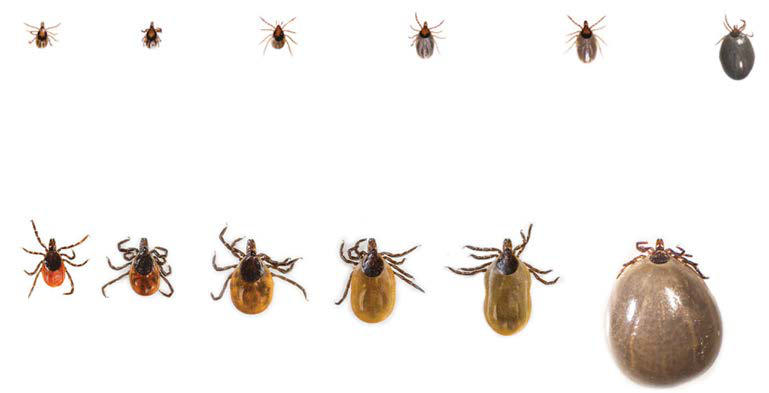

# Chapter 269: Mycoplasma pneumoniae
> **Course:** Vikkypaedia Pediatric Basic Course (*Nelson Textbook of Pediatrics, 22nd Edition (2025)*)  
> **Part XV:** Infectious Diseases  
> **Authors:** Asuncion Mejias and Octavio Ramilo  
> **Metrics:** 3,008 words · 0 tables/boxes · 2 figures · 0 genes · 8 flashcards · 5 MCQs  
> **Quick Navigation:** [🃏 Study 8 Flashcards](../flashcards/269_flashcards.md) · [📝 Take 5-Q MCQ Quiz](../mcqs/269_mcqs.md) · [📚 Part XV Guide](../parts/Part_XV.md) · [🧬 Syndrome & Genetics Atlas](../omim_gene_atlas.md) · [💊 Therapeutics Matrix](../therapies_matrix.md) · [🏠 Course Index](../../index.md)

## ⚡ High-Yield Nelson Pediatric Board Pearls
- Clinical Practice Guidelines by the Infectious Diseases Society of America [IDSA], American Academy of Neurology [AAN], and American College of Rheumatology [ACR]: 2020 Guidelines for the Preven tion, Diagnosis and Treatment of Lyme Disease.
- Among the few Mycoplasma species isolated from the human respira tory tract, Mycoplasma pneumoniae remains the most common species causing respiratory infections in school-age children and young adults and is associated with a variety of clinical manifestations.
- The onset is usually characterized by gradual development of headache, malaise, fever, and sore throat, followed by progression of lower respiratory symptoms, including hoarseness and nonproductive cough.
- Although the clini cal course in untreated patients is variable, cough, the clinical hallmark of M. pneumoniae infection, usually worsens during the first week of illness.
- Clinical findings are often less severe than suggested by the chest radiograph, explaining why the term “walking pneumonia” is often used to describe CAP caused by M. pneumoniae.
- Other respiratory illnesses occasionally caused by M. pneumoniae include undifferentiated upper respiratory tract infections; intractable, nonproductive cough; pharyngitis (usually without marked cervical lymphadenopathy); sinusitis; croup; and bronchiolitis.
- Otitis media and bullous myringitis, which also occur with other viral and bacterial infections, have been described but are rare, and their absence should not exclude the diagnosis of M. pneumoniae.

---
## Full Chapter Text, Tables & Figures
# Chapter 269: Mycoplasma pneumoniae

*Asuncion Mejias and Octavio Ramilo*

<!-- p.2405 -->
**Wait and watch Consider for prophylaxis**

**Wait and watch Consider for prophylaxis**

**Unfed Day 1.5 Day 2 Day 2.5 Day 3 Day 4**

**Unfed Day 1.5 Day 2 Day 3 Day 4 Day 7**

**Fig. 268.4** Relative sizes of engorging nymphal and adult female Ixodes scapularis (black-legged = deer tick) as a function of time spent feeding (= attachment time). Transmission of Borrelia burgdorferi requires 36-48 hr of feeding, and therefore antibiotic prophylaxis is recommended only if the tick has been attached for at least 36 hr, or 1.5 days. By itself, duration of feeding is insufficient for recommending antibiotic prophylaxis. (Top) Nymphs (Feeding time: Unfed = 0 hr; Day 1.5 = 36 hr; Day 2 = 48 hr; Day 2.5 = 60 hr; Day 3 = 72 hr; Day 4 = 96 hr). (Bottom) Adult females over the same period. Unfed nymph and adult female are the sizes of poppy and sesame seeds, respectively. Not actual size. (Courtesy of URI TickEncounter Resource Center, TickEncounter.org; From Lantos PM, Rumbaugh J, Bockenstedt LK, et al. Clinical Practice Guidelines by the Infectious Diseases Society of America [IDSA], American Academy of Neurology [AAN], and American College of Rheumatology [ACR]: 2020 Guidelines for the Preven tion, Diagnosis and Treatment of Lyme Disease. Clin Infect Dis. 2021;72[1]:e1–e48, Fig. 6.)

Among the few *Mycoplasma* species isolated from the human respira tory tract, *Mycoplasma pneumoniae* remains the most common species causing respiratory infections in school-age children and young adults and is associated with a variety of clinical manifestations.

**THE ORGANISM** Mycoplasmas are the smallest self-replicating prokaryotes known to cause disease in humans. Their size of 150-250 nm is more on the order of viruses than bacteria. *M*. *pneumoniae* is a fastidious double-stranded DNA bacterium that is distinguished by a small genome (∼800,000 base pairs) and a long doubling time, which makes culturing it a slow

*Asuncion Mejias and Octavio Ramilo*

Section **9 Mycoplasmal Infections**

process (5-20 days) compared to other bacteria. *M. pneumoniae* iso lates can be classified in two major genetic groups (subtypes 1 and 2) based on the P1 adhesion protein. Distinguishing these two subtypes is important for epidemiologic purposes. Like other mycoplasmas, *M. pneumoniae* is distinguished by the complete absence of a cell wall, resulting in (1) their dependence on host cells for obtaining essential nutrients, (2) their intrinsic resistance to β-lactam agents, and (3) their pleomorphic shape and lack of visibility on Gram staining.

**EPIDEMIOLOGY* M. pneumoniae* infections occur worldwide and throughout the year. This organism is a frequent cause of community-acquired pneumonia (CAP) in children >5 years of age and adults, accounting for ∼20% of all CAP in middle school and high school children and up to 50% of CAP in college students and military recruits. The proportion of cases increases accord ing to age, as recently shown in a large population-based study of CAP conducted in the United States (3% in <5 years, 17% in 5-9 years, and 24% in 10-17 years).

In contrast to the acute, short-lived epidemics associated with some respiratory viruses, *M. pneumoniae* infection occurs endemically world wide. Epidemic outbreaks of variable intensity occur every few years and are likely related to the alternative circulation of the two *M. pneumoniae* subtypes. Transmission occurs through the respiratory route by large droplet spread during close contact with a symptomatic person. Commu nity outbreaks have been described in closed settings (colleges, boarding schools, military bases) and can spread largely through school contacts. Attack rates within families are high, with transmission rates of 40–80% for household adult and children contacts, respectively. In contrast to many other respiratory infections, the incubation period is 2-3 weeks; hence, the course of infection in a specific population (family) may last several weeks.

The occurrence of mycoplasma illnesses is related, in part, to age and preexposure immunity. Overt illness is less common before 3 years of age but can occur. Children younger than 5 years of age appear to have milder illnesses associated with upper respiratory tract involvement, vomiting, and diarrhea. Immunity after infection is not long-lasting, as evidenced by the frequency of reinfections over time. Other pathogens

particularly in infants, because of the risk of systemic absorption and toxicity. Permethrin treatment of clothing is also an effective preven tion strategy.

*Visit Elsevier eBooks+ at eBooks.Health.Elsevier.com** for Bibliography.*

<!-- p.2407 -->
are frequently co-detected in children with *M. pneumoniae,* especially in those younger than 2 years of age, where viral co-infections have been identified in up to 30% of cases. *Asymptomatic carriage* after infection can last up to 4 months despite antibiotic therapy and may contribute to prolonged outbreaks. Children are often the reservoir from whom mycoplasma spreads. In the clinical setting, there are no available tools yet to differentiate carriage vs infection.

**PATHOGENESIS** The pathogenicity of *M. pneumoniae* is dependent on its extracellular attachment and the initiation of the host cell immune response. The mechanisms by which *M. pneumoniae* causes disease include (1) direct bacterial invasion that initiates in the cells of the ciliated respiratory epithelium, the target cells of *M. pneumoniae* infection; (2) toxin medi ated through the production of the adenosine diphosphate–ribosyl ating and vacuolating toxin termed *community-acquired respiratory distress syndrome* (CARDS), an exotoxin that may damage the respira tory tract and has been associated with more severe or even fatal dis ease; and (3) indirect immune-mediated effects, by altering antigens in the cell surface and inducing the production of autoantibodies.

The organism is an elongated snakelike structure with a one-end organ elle, which mediates the attachment to sialic acid receptors in the cilia through a complex set of adhesion transmembrane proteins (P1, P30, proteins B and C, P116, and HMW1-3). Virulent organisms attach to cili ated respiratory epithelial cell surfaces located in the bronchi, bronchioles, alveoli, and possibly upper respiratory tract and burrow down between cells, resulting in ciliostasis and eventual sloughing of the cells. This bacte rium is capable of forming biofilms, with strain-specific phenotypic differ ences, which hinder antibiotic penetration and recognition by the immune system.

Once *M. pneumoniae* reaches the lower respiratory tract, it pro motes the polyclonal activation of B lymphocytes and CD4+ T cells and amplifies the immune response with the production of various proin flammatory and antiinflammatory cytokines and chemokines, such as tumor necrosis factor-α, interleukin (IL)-8, IL-1β, Il-6, and IL-10.

Although it is well documented that specific cell-mediated immu nity and antibody titers against *M. pneumoniae* increase with age (and therefore probably follow repeated infections), the immune mecha nisms that protect against or clear the infection are not well defined. In humans, nasal IgA antibodies correlated with protection after experi mental challenge. A distinct aspect of *M. pneumoniae* is its ability to induce the production of cold agglutinins (IgM antibodies) directed against the I antigen on the erythrocyte’s surface. Even though anti body responses do not confer complete protection against reinfections, the importance of a robust humoral response is apparent, because patients with congenital antibody deficiencies, such as those with hypogammaglobulinemia, can develop severe and prolonged disease and have a higher risk of extrapulmonary manifestations. In children with sickle cell disease or sickle-related hemoglobinopathies, *M. pneu moniae* is a common infectious trigger of acute chest syndrome. These children and also children with Down syndrome can develop severe *Mycoplasma* pneumonia. On the other hand, *M. pneumoniae* does not seem to be a common infectious agent in patients with AIDS.

*M. pneumoniae* has been detected by polymerase chain reaction (PCR) in many nonrespiratory sites, including blood, pleural fluid, cerebrospinal fluid (CSF), and synovial fluid. The mechanisms of extra pulmonary disease associated with *M. pneumoniae* are unclear and appear to be different according to the duration of symptoms at the time of presentation: direct invasion vs immune-mediated.

**CLINICAL MANIFESTATIONS* M. pneumoniae* is a frequent cause of upper and lower respiratory tract infections in children and adolescents. The clinical manifestations of *M. pneumoniae* can be divided into respiratory (more common) and extrapulmonary (less common).

**Respiratory Tract Disease** Tracheobronchitis and atypical pneumonia are the most commonly rec ognized clinical syndromes associated with *M. pneumoniae*. This agent is

responsible for up to 20% of all cases of CAP. The clinical manifestations of *M. pneumoniae* pneumonia evolve according to the stage of the disease. The onset is usually characterized by gradual development of headache, malaise, fever, and sore throat, followed by progression of lower respiratory symptoms, including hoarseness and nonproductive cough. The gradual onset in children with atypical pneumonia is in contrast to the sudden onset of lobar pneumonia. Coryza and gastrointestinal manifestations are unusual and suggest a viral etiology, if present. Approximately 10% of children will develop a cutaneous maculopapular rash. Although the clini cal course in untreated patients is variable, cough, the clinical hallmark of *M. pneumoniae* infection, usually worsens during the first week of illness. Symptoms generally resolve within 2 weeks, although cough can last up to 4 weeks and may be accompanied by wheezing. Chest examination may be unrevealing, even in patients with severe cough. There may be no auscultative or percussive findings or only mini mum dry rales. Clinical findings are often less severe than suggested by the chest radiograph, explaining why the term “walking pneumonia” is often used to describe CAP caused by *M. pneumoniae*. Radiographic findings are variable and nonspecific, not allowing differentiation from viral or bacterial pathogens. Bilateral diffuse infiltrates, lobar pneumonia, or hilar lymphadenopathy can occur in up to 30% of patients. Although unusual, large pleural effusions associated with lobar infiltrates and necrotizing pneumonia have been described in patients with immunodeficiency, Down syndrome, chronic cardiopulmonary disease, and sickle cell disease. The white blood cell and differential counts are usually normal, whereas the erythrocyte sedimentation rate and C-reactive protein are often ele vated. Appropriate antibiotics shorten the duration of illness but do not reliably eradicate the organism from the respiratory tract.

**Other respiratory illnesses** occasionally caused by *M. pneumoniae* include undifferentiated upper respiratory tract infections; intractable, nonproductive cough; pharyngitis (usually without marked cervical lymphadenopathy); sinusitis; croup; and bronchiolitis. *M. pneumoniae* is a common trigger of wheezing in asthmatic children and can cause chronic colonization in the airways, resulting in lung dysfunction in adolescent and adult asthmatic patients. Otitis media and bullous myringitis, which also occur with other viral and bacterial infections, have been described but are rare, and their absence should not exclude the diagnosis of *M. pneumoniae*.

**Extrapulmonary Disease** Despite the reportedly rare isolation of *M. pneumoniae* from non respiratory sites, the improved sensitivity of PCR for *M. pneumoniae* DNA detection has led to increasing identification of this bacterium in nonrespiratory sites, particularly the central nervous system (CNS). Patients with or without respiratory symptoms can have involvement of the skin, CNS, blood, heart, gastrointestinal tract, and joints. Extra pulmonary manifestations have been documented in 11–26% of chil dren with *M. pneumoniae* infection and include: 1.	**CNS disease:** Occurs in 0.1% of all patients with *M. pneumoniae*

infection and in 7% of those requiring hospitalization. Manifesta tions include encephalitis, acute disseminated encephalomyelitis (ADEM), transverse myelitis, cerebellar ataxia, aseptic meningitis, Guillain-Barré syndrome, Bell palsy, and peripheral neuropathy. CNS disease manifestations occur 3-23 days (mean: 10 days) after onset of respiratory illness but may not be preceded by any signs of respiratory infection in up to 20% of cases. Studies in children suggest that there are two pathogenic mechanisms for *M. pneumo niae*–associated neurologic disease: the first pattern is characterized by almost absent or no prodromal respiratory symptoms (<7 days) and nonreactive IgM responses. On the other hand, the second pat tern is characterized by the presence of respiratory symptoms (most commonly cough) for ≥7 days and reactive IgM in acute serum. In the first group *M. pneumoniae* is usually identified in CSF by PCR but not in the respiratory tract, whereas in children presenting with ≥7 days of respiratory symptoms, the opposite is true. These stud ies suggest that encephalitis occurring more than 7 days after onset of prodromal symptoms is more likely to be caused by an autoim mune response to *M. pneumoniae,* whereas its occurrence early in the course of the disease may be associated with direct bacterial in vasion of the CNS. Involvement of the brainstem can result in severe

<!-- p.2408 -->
dystonia and movement disorders. The CSF may be normal or have mild mononuclear pleocytosis and/or increased CSF protein con centrations with normal glucose. Diagnosis is confirmed with posi tive CSF PCR, positive PCR from a throat swab, or demonstration of seroconversion. Findings on MRI include focal ischemic changes, ventriculomegaly, diffuse edema, or multifocal white matter inflam matory lesions consistent with postinfectious ADEM. Long-term sequelae have been reported in 23–64% of cases. 2.	**Mucocutaneous disease:** Up to 25% of children with *M. pneumoniae*

infections can have associated skin and mucosal exanthems, most no tably maculopapular rashes, urticaria, and *Mycoplasma*-induced rash and mucositis syndrome (MIRM) or Stevens-Johnson syndrome (SJS). Gianotti-Crosti syndrome and erythema nodosum are also associated with *M. pneumoniae* infections. Approximately 10% of children with *M. pneumoniae* CAP will exhibit a maculopapular rash. *Mycoplasma*induced rash and mucositis usually develop 3-21 days after initial res piratory symptoms, last less than 14 days, and are rarely associated with severe complications (Figs. 269.1 and 269.2). *M. pneumoniae* may also produce an isolated oral mucositis in absence of a rash. 3.	**Hematologic abnormalities:** Include mild degrees of hemolysis with

a positive Coombs test and minor reticulocytosis 2-3 weeks after the onset of illness. Severe hemolysis is associated with high titers of cold hemagglutinins (≥1:512) and occurs rarely. Thrombocyto penia, aplastic anemia, hemophagocytic syndrome, and coagulation defects occur occasionally.

4.	**Musculoskeletal:** Arthritis appears to be less common in children

than in adults, but monoarthritis, polyarthritis, and migratory ar thritis have been described. Rhabdomyolysis has also been docu mented, often associated with other organ system manifestations. 5.	**Other conditions***,* such as mild hepatitis, gastroenteritis, pancreati

tis, acute glomerulonephritis, iritis or uveitis, and cardiac complica tions (pericarditis, myocarditis, and rheumatic fever–like syndrome, most commonly seen in adults) are also described. Fatal *M. pneumo niae* infections are rare.

**DIAGNOSIS** No specific clinical, epidemiologic, or laboratory parameters allow for a definite diagnosis of *M. pneumoniae* infection. Nevertheless, pneumo nia in school-age children and young adults with a gradual onset and cough as prominent findings suggests *M. pneumoniae* infection. The best method for diagnosis is a combination of PCR from respiratory samples and serology (acute and convalescent), as *M. pneumoniae* colonizes the airway and has been identified in 17–25% of asymptomatic children.

**Cultures** on special media (SP4 agar media) of the throat or sputum might demonstrate the classic *M. pneumoniae* “mulberry” colonies, but growth generally requires incubation for more than 2-3 weeks. The fas tidious nutritional requirements of *Mycoplasma* make cultures slow and impractical, and few laboratories maintain the capability of culturing *M. pneumoniae*.

**Serologic tests** (immunofluorescence tests, enzyme-linked immune assays [EIAs]) to detect serum immunoglobulin (Ig) M, IgA, and IgG antibodies against *M. pneumoniae* are commercially available. IgM anti bodies have a high rate of false-positive and false-negative results. In most cases, IgM antibodies are not detected within the first week after symptom onset or in children with recurrent infections and may be posi tive for up to 6-12 months after infection, or even years, and thus may not indicate acute infection. A fourfold or greater increase in IgG anti body titers against *M. pneumoniae* between acute and convalescent sera obtained 2-4 weeks apart is diagnostic. Complement fixation assays are less sensitive and specific than EIA or immunofluorescent assays.

**Cold hemagglutinins** (cold-reacting antibodies [IgM] against red blood cells) can be detected in approximately 50% of patients with *M. pneumoniae* pneumonia. These antibodies are nonspecific, especially at titers <1:64, as modest increases in cold hemagglutinins can be observed in other viral infections. Cold agglutinin antibodies should not be used for the diagnosis of *M. pneumoniae* infections if other methods are available.

**Nucleic acid amplification test (NAATs)** for *M. pneumoniae* have replaced other diagnostic tests. PCR of a nasopharyngeal or throat swab (the combination of both increases sensitivity) for *M. pneumoniae* genomic DNA carries a sensitivity and a specificity of 80% to >97%. Different prim ers have been used to identify gene sequences of the P1 cytoadhesion pro tein or the ribosomal (r) 16S RNA. PCR allows a more rapid diagnosis in acutely ill patients and can be positive earlier in the course of infection than serologic tests. Identification of *M. pneumoniae* by PCR (or culture) from a patient with compatible clinical manifestations suggests causation.

The diagnosis of extrapulmonary disease associated with *M. pneu moniae* is challenging. Although *M. pneumoniae* has been identified by PCR in the CSF of children with encephalitis, there are currently no reliable tests for the diagnosis of CNS or other nonrespiratory sites associated with *M. pneumoniae*. Because the extrapulmonary manifes tations of *M. pneumoniae* may have an immunologic base, measuring acute and convalescent IgM and IgG antibody levels is advisable.

**TREATMENT* M. pneumoniae* illness is usually mild, and most cases of pneumonia can be managed without the need for hospitalization. Because myco plasmas lack a cell wall, they are inherently resistant to β-lactam agents that act by inhibiting the cell wall synthesis. In addition, drugs from other classes, such as trimethoprim, rifampin, or linezolid, are inactive against *M. pneumoniae*. Studies regarding the effectiveness of antimi crobial therapy for *M. pneumoniae* infections in children are contradic tory. Nevertheless, empiric treatment is often initiated in hospitalized children with CAP or severe extrapulmonary manifestations based on clinical suspicion because of the difficulty of a definitive diagnosis.

**Fig. 269.1** Lip changes found in Mycoplasma pneumoniae–associ ated mucositis.

**Fig. 269.2** Classic skin lesions found in Mycoplasma pneumoniae– associated rash.

<!-- p.2410 -->
