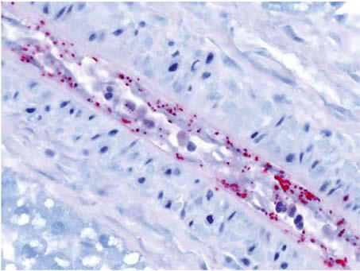
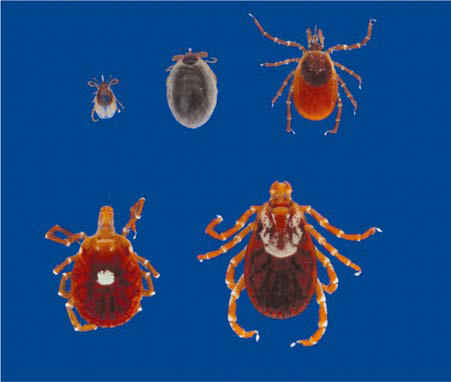

# Chapter 274: Spotted Fever Group Rickettsioses
> **Course:** Vikkypaedia Pediatric Basic Course (*Nelson Textbook of Pediatrics, 22nd Edition (2025)*)  
> **Part XV:** Infectious Diseases  
> **Authors:** Megan E. Reller and J. Stephen Dumler  
> **Metrics:** 7,259 words · 2 tables/boxes · 2 figures · 0 genes · 8 flashcards · 5 MCQs  
> **Quick Navigation:** [🃏 Study 8 Flashcards](../flashcards/274_flashcards.md) · [📝 Take 5-Q MCQ Quiz](../mcqs/274_mcqs.md) · [📚 Part XV Guide](../parts/Part_XV.md) · [🧬 Syndrome & Genetics Atlas](../omim_gene_atlas.md) · [💊 Therapeutics Matrix](../therapies_matrix.md) · [🏠 Course Index](../../index.md)

## Key Chapter Topics & Subchapters
`274.1 Rocky Mountain Spotted Fever (Rickettsia rickettsii)` · `274.2 Mediterranean Spotted Fever or Boutonneuse Fever (Rickettsia conorii)` · `274.3 Rickettsialpox (Rickettsia akari) and Flea-Borne Spotted Fever` · `274.1 Rocky Mountain Spotted Fever (Rickettsia rickettsii) Megan E. Reller and J. Stephen Dumler` · `274.3 Rickettsialpox (Rickettsia akari) and Flea-Borne Spotted Fever Megan E. Reller and J. Stephen Dumler`

## ⚡ High-Yield Nelson Pediatric Board Pearls
- Unfortunately, the most common diagnostic approach uses a serologic method that can not distinguish among related species; thus the CDC classifies sero logically defined cases as “spotted fever rickettsiosis” to reflect this uncertainty.
- Although spotted fever rickettsiosis is the most common vector-borne disease in the United States after Lyme dis ease, the proportion of these cases caused by R. rickettsii is not known.
- RMSF should be considered in the differential diagnosis of fever, headache, and rash in the summer months, especially after tick exposure.
- ETIOLOGY RMSF results from systemic infection of endothelial cells by the obli gate intracellular bacterium R. rickettsii.
- Diagnosis and management of tickborne rickettsial diseases: Rocky Mountain spotted fever and other spotted fe ver group rickettsioses, ehrlichioses, and anaplasmosis—United States.
- Diagnosis and management of tickborne rickettsial diseases: Rocky Mountain spot ted fever and other spotted fever group rickettsioses, ehrlichioses, and anaplasmosis—United States.
- Diagnosis and management of tickborne rickettsial diseases: Rocky Mountain spotted fever and other spotted fever group rickettsi oses, ehrlichioses, and anaplasmosis—United States.

---
## Full Chapter Text, Tables & Figures
# Chapter 274: Spotted Fever Group Rickettsioses

*Megan E. Reller and J. Stephen Dumler*

<!-- p.2426 -->
*Rickettsia* species were classically divided into *spotted fever* and *typhus* groups based on serologic reactions and the presence or absence of the outer membrane protein A gene *(ompA)*. Sequencing of over 150 complete genomes has refined distinctions. However, there is contro versy regarding phylogeny, and some data suggest that diversity and pathogenicity are the result of gene loss and lateral gene transfer from other prokaryotes or even eukaryotes, which further obscures accurate taxonomic classification. One proposal is to divide existing species into spotted fever and *transitional* groups based on genetic relatedness; both include pathogenic species and species not now known to cause human disease (Table 274.1). Although increasingly more is understood about the molecular basis by which these bacteria cause human illness, an alternative classification system based on pathogenetic mechanisms has not been defined.

The list of pathogens and potential pathogens in the spotted fever group has expanded dramatically in recent years. Unfortunately, the most common diagnostic approach uses a serologic method that can not distinguish among related species; thus the CDC classifies sero logically defined cases as “spotted fever rickettsiosis” to reflect this uncertainty. Among the etiologic agents of spotted fever rickettsio sis are the tick-borne agents *Rickettsia rickettsii,* the cause of Rocky Mountain or Brazilian spotted fever (RMSF); *R. conorii,* the cause of Mediterranean spotted fever (MSF) or boutonneuse fever; *R. sibirica,* the cause of North Asian tick typhus; *R. japonica,* the cause of Ori ental or Japanese spotted fever; *R. honei,* the cause of Flinders Island spotted fever or Thai tick typhus; *R. africae,* the cause of African tick bite fever; *R. akari,* the cause of mite-transmitted rickettsialpox; *R. felis*, the cause of cat flea–transmitted typhus; and *R. australis,* the cause of tick-transmitted Queensland tick typhus. The recognition that *R. parkeri* and “*R. philipii*” (*Rickettsia* 364D) both cause mild spotted fever in North America and the association of high serop revalence for spotted fever group *Rickettsia* infections in humans where *Amblyomma* ticks frequently contain *R. amblyommatis* sug gest that the full range of agents that can cause spotted fever is still to be discerned.

Infections with other members of the spotted fever and transitional groups are clinically similar to MSF, with fever, maculopapular rash, and eschar at the site of the tick bite. Israeli spotted fever (*R. conorii* infection) is generally associated with a more severe course in children, including death. African tick bite fever is relatively mild, can include a vesicular rash, and often manifests with multiple eschars. New poten tially pathogenic rickettsial species have been identified, including *R. slovaca,* the cause of tick-borne lymphadenopathy or *Dermacentor*borne necrosis and lymphadenopathy. *R. aeschlimannii, R. heilongjian gensis, R. helvetica, R. massiliae,* and *R. raoultii* are all reported to cause mild to moderate illnesses in humans, although few cases have been described. Fortunately, the vast majority of infections respond well to doxycycline treatment if instituted early in illness; however, this is a significant challenge.

*Visit Elsevier eBooks+ at eBooks.Health.Elsevier.com** for Bibliography.*

## 274.1  Rocky Mountain Spotted Fever (Rickettsia rickettsii) Megan E. Reller and J. Stephen Dumler

RMSF is the most severe rickettsial disease in the United States and Western Hemisphere. Although spotted fever rickettsiosis is the most common vector-borne disease in the United States after Lyme dis ease, the proportion of these cases caused by *R. rickettsii* is not known. Although considered uncommon, RMSF is believed to be greatly underdiagnosed and underreported. RMSF should be considered in the differential diagnosis of fever, headache, and rash in the summer months, especially after tick exposure. Because fulminant disease and death are associated with delays in treatment, patients in whom the ill ness is clinically suspected should be treated promptly.

**ETIOLOGY** RMSF results from systemic infection of endothelial cells by the obli gate intracellular bacterium *R. rickettsii.*

**EPIDEMIOLOGY** The term **Rocky Mountain spotted fever** is historical, because the agent was discovered in the Bitterroot Range of the Rocky Mountains of Mon tana. Few cases are reported from this region. Cases have been reported throughout the continental United States (except Vermont and Maine), southwestern Canada, Mexico, Central America, and South America, but not from outside of the Western Hemisphere. In 2010, the CDC reporting criteria for RMSF changed to **spotted fever group rickettsio sis**, because serology often does not distinguish *R. rickettsii* from infec tion by other spotted fever group *Rickettsia*. Additionally, cases detected by enzyme immunoassay were classified as probable. Thus in 2012, 2,802 confirmed and probable cases of spotted fever rickettsiosis were reported in *Morbidity and Mortality Weekly Reports* Summary of Notifi able Diseases. Unlike in prior years, most cases were reported from the west southcentral states, especially from Arkansas, Oklahoma, and Mis souri; high numbers of cases were also reported from North Carolina, Tennessee, Virginia, New Jersey, Georgia, Alabama, and Arizona (Fig. 274.1). The incidence of RMSF cycles over 25- to 35-year intervals, but spotted fever rickettsioses have steadily increased since 1998 over which time approximately 14% occur in individuals younger than 19 years. Habitats favored by ticks, including wooded areas or coastal grassland and salt marshes, and, in the southwestern United States and Mexico, shaded areas where dogs congregate and acquire infected ticks are those that place children at increased risk for infection. Foci of intense risk for infection are found both in rural and urban areas, most recently in Mexico and South America. Clustering of cases within families likely reflects shared environmental exposures. In the United States, 90% of cases occur between April and September, months in which humans spend the most time outdoors. The highest age-specific incidence of RMSF among children is seen in those older than 10 years of age, with males outnumbering females; however, the highest case fatality rate for RMSF is observed in those less than 10 years of age.

**TRANSMISSION** Ticks are the natural hosts, reservoirs, and vectors of *R. rickettsii* and maintain the infection in nature by transovarial transmission (pas sage of the organism from infected ticks to their progeny). Ticks har boring rickettsiae are substantially less fecund than uninfected ticks; thus horizontal transmission (acquisition of rickettsiae by taking a blood meal from transiently rickettsemic hosts such as small mam mals or dogs) contributes to maintenance of rickettsial infections in ticks. Uninfected ticks that simultaneously feed (co-feed) with infected transmitting ticks easily become infected, even if feeding on an immune host, and are also likely to be major contributors to natural transmission and maintenance. Ticks transmit the infectious agent to mammalian hosts (including humans) via infected saliva during feeding. The pathogen *R. rickettsii* in ticks becomes virulent after exposure to blood or increased temperature; thus the longer the tick is attached, the greater the risk of transmission. The principal tick

*Megan E. Reller and J. Stephen Dumler*

Section **11 Rickettsial Infections**

<!-- p.2427 -->

<!-- p.2428 -->
↓Na (mild)

↓Platelets

↓Na (mild)

↓Platelets

↓Platelets Early: IH, DFA

↓WBC Early: IH, DFA

↓WBC, ↓platelets Early: PCR on

↓Na (mild)

↓WBC

↓ Platelets

#### **Table 274.1** Summary of Rickettsial Diseases of Humans, Including Rickettsia, Orientia, Ehrlichia, Anaplasma, Neorickettsia, and Coxiella

| Category / Parameter | Clinical Details & Findings |
| --- | --- |
| **SPOTTED FEVER GROUP** | Rocky Mountain; spotted fever; Rickettsia; rickettsii; Tick bite:; Dermacentor; species (wood; tick, dog tick); Rhipicephalus; sanguineus; (brown dog tick); Dogs; Rodents; Western; hemisphere; Fever, headache, rash,*; emesis, diarrhea,; myalgias |
| **AST, ALT** | ±Leukopenia; Left shift; Early: IH, DFA, PCR; After first wk: IFA |
| **Doxycycline** | Tetracycline; Chloramphenicol; Mediterranean; spotted fever; (boutonneuse; fever); Rickettsia conorii; Tick bite: R.; sanguineus; (brown dog tick); Dogs; Rodents; Africa,; Mediterranean,; India, Middle East; Painless eschar (tache; noir) with regional; lymphadenopathy,; fever, headache, rash,*; myalgias |
| **AST, ALT** | ±Leukopenia; Left shift; Early: IH, DFA, PCR; After first wk: IFA |
| **Doxycycline** | Tetracycline; Chloramphenicol; Azithromycin; Clarithromycin; Fluoroquinolones; African tick-bite; fever; Rickettsia africae; Tick bite; Cattle; Goats?; Sub-Saharan Africa,; Caribbean; Fever, single or multiple; eschars, regional; lymphadenopathy,; rash* (can be vesicular) |
| **AST, ALT** | After 1st wk: IFA |
| **Doxycycline** | Tickborne; lymphadenopathy |
| **(TIBOLA);** | Dermacentor-; borne; necrosis and; lymphadenopathy |
| **(DEBONEL)** | Rickettsia; slovaca,; Rickettsia; raoultii,; Rickettsia; sibirica; mongolotimonae; Tick bite:; Dermacentor; ?; Europe; Eschar (scalp), painful; lymphadenopathy; ? |
| **Doxycycline** | Rickettsia spp.,; 364D genotype; “Rickettsia; philippii”; Dermacentor; occidentalis; (Pacific coast tick); California; Eschar, fever, headache,; lymphadenopathy,; malaise; Unremarkable |
| **PCR** | Doxycycline; Flea-borne spotted; fever; Rickettsia felis; Flea bite; Opossums; Cats; Dogs; Western; hemisphere,; Europe; Fever, rash,* headache; ?; Early: PCR; After first wk: IFA; Doxycycline |
| **TRANSITIONAL GROUP** | Rickettsialpox; Rickettsia akari; Mite bite; Mice; North America,; Russia, Ukraine,; Adriatic, Korea,; South Africa; Painless eschar, ulcer or; papule; tender regional; lymphadenopathy,; fever, headache, rash*; (can be vesicular); After first wk: IFA |
| **Doxycycline** | Chloramphenicol; Queensland tick; typhus; Rickettsia; australis; Ixodes holocyclus, I.; tasmani; Bandicoots; and; Rodents; Australia, Tasmania; Fever, eschar,; headache, myalgia,; lymphadenopathy; eschar or eschar; swab;; After first wk: IFA |
| **TYPHUS GROUP** | Murine typhus; Rickettsia typhi; Flea feces; Rats; Opossums; Worldwide; Fever, headache, rash,*; myalgias, emesis,; lymphadenopathy,; hepatosplenomegaly |
| **AST, ALT** | Early: DFA, PCR; After first wk: IFA |
| **Doxycycline** | Chloramphenicol |

<!-- p.2429 -->
**GROUP OR DISEASE AGENT ARTHROPOD VECTOR, 
**

**TRANSMISSION HOSTS GEOGRAPHIC**

**DISTRIBUTION PRESENTING 
**

**CLINICAL FEATURES***** COMMON LAB**

**ABNORMALITIES DIAGNOSTIC**

**TESTS TREATMENT****†**

Epidemic (louse-

borne) typhus

(recrudescent

form: Brill-Zinsser

disease)

*Rickettsia*

*prowazekii* Louse feces Humans South America,

Central America,

Mexico, Africa,

Asia, Eastern

Europe

Fever, headache,

abdominal pain, rash,*

CNS involvement

AST, ALT

↓Platelets Early: none

After first wk: IgG/

IgM, IFA

Doxycycline

Tetracycline

Chloramphenicol

Flying squirrel

(sylvatic) typhus *Rickettsia*

*prowazekii* Louse feces?

Flea feces or bite? Flying

squirrels Eastern United

States Same as above (often

milder) AST, ALT

↓Platelets Early: none

After first wk: IFA Doxycycline

Tetracycline

Chloramphenicol

SCRUB TYPHUS

Scrub typhus *Orientia*

*tsutsugamushi,*

*Orientia chuto*

*“Orientia*

*chiloensis”*

Chigger bite:

*Leptotrombidium*

spp.

Rodents? South Asia, Japan,

Indonesia, Korea,

China, Russia,

Australia, Africa,

Middle East, Chile

Fever, rash,* headache,

painless eschar,

hepatosplenomegaly,

gastrointestinal

symptoms

↓Platelets

AST, ALT Early: none

After first wk: IFA Doxycycline

Tetracycline

Chloramphenicol

Rifampicin

Azithromycin

EHRLICHIOSIS AND ANAPLASMOSIS

Human monocytic

ehrlichiosis *Ehrlichia*

*chaffeensis* Tick bite:

*Amblyomma*

*americanum* (lone

star tick)

Deer

Dogs United States,

Mexico Fever, headache,

malaise,

myalgias, rash*‡,

hepatosplenomegaly,‡

swollen hands/feet‡

AST, ALT

↓WBC

↓Platelets

↓Na (mild)

Early: PCR

After first wk: IFA Doxycycline

Tetracycline

Human granulocytic

anaplasmosis *Anaplasma*

*phagocyto-
*

*philum*

Tick bite: *Ixodes*

species

*Haemaphysalis*

*longicornis*

Rodents

Deer

Ruminants

United States,

Europe, Asia Fever, headache,

malaise, myalgias AST, ALT

↓WBC,

↓ANC

↓Platelets

Early: PCR, blood

smear After first

wk: IFA

Doxycycline

Tetracycline

Rifampin

Ewingii ehrlichiosis *Ehrlichia ewingii* Tick bite:

*Amblyomma*

*americanum* (lone

star tick)

Dogs

Deer United States

(south-central,

southeast)

Fever, headache,

malaise, myalgias AST, ALT, ↓WBC

↓Platelets Early: PCR

serology not

available

Doxycycline

Tetracycline

*Ehrlichia muris*

*eauclairensis*

infection

*Ehrlichia*

*muris* ssp*.*

*eauclairensis*

*Ixodes scapularis* ? Minnesota,

Wisconsin Fever, headache,

malaise, myalgias AST, ALT

↓WBC,

↓Platelets

Early: PCR

specific serology

not available

Doxycycline

*Neoehrlichiosis Neoehrlichia*

*mikurensis Ixodes ricinus* Small

mammals? Europe, Asia Fever, headache,

myalgias, thrombosis Neutrophilia,

anemia, elevated

CRP, AST, ALT

PCR Doxycycline

Sennetsu

neorickettsiosis *Neorickettsia*

*sennetsu* Ingestion of fish

helminth?,

ingestion of

fermented fish

Fish,

trematodes Japan, Malaysia,

Laos Fever, “mononucleosis”

symptoms,

postauricular and

posterior cervical

lymphadenopathy

Atypical

lymphocytosis Early: none

After first wk: IFA Doxycycline

Tetracycline

#### **Table 274.1** Summary of Rickettsial Diseases of Humans, Including Rickettsia, Orientia, Ehrlichia, Anaplasma, Neorickettsia, and Coxiella—cont’d

| Category / Parameter | Clinical Details & Findings |
| --- | --- |
| **General** | Continued |

<!-- p.2430 -->
**GROUP OR DISEASE AGENT ARTHROPOD VECTOR, 
**

**TRANSMISSION HOSTS GEOGRAPHIC**

**DISTRIBUTION PRESENTING 
**

**CLINICAL FEATURES***** COMMON LAB**

**ABNORMALITIES DIAGNOSTIC**

**TESTS TREATMENT****†**

Q FEVER

Q Fever: acute (for

chronic, see text) *Coxiella burnetii* Inhalation of

infected aerosols:

contact with

parturient

animals, abattoir,

contaminated

cheese and milk,

?ticks

Cattle

Sheep

Goats

Cats

Rabbits

Worldwide Fever, headache,

arthralgias, myalgias,

gastrointestinal

symptoms, cough,

pneumonia, rash

(children)

AST, ALT

WBC

↓ Platelets

Interstitial infiltrate

Early: PCR

After first wk: IFA Doxycycline

Tetracycline

Fluoroquinolones

Trimethoprim-

sulfamethoxazole

*Rash is infrequently present at initial presentation but appears during the first wk of illness. †Preferred treatment is in bold.

‡Often present in children but not adults.

ALT, Alanine aminotransferase; ANC, absolute neutrophil count; AST, aspartate aminotransferase; CNS, central nervous system; DFA, direct fluorescent antibody; IFA, indirect fluorescent antibody; IgG, immunoglobulin G; IgM,

immunoglobulin M; IH, immunohistochemistry; PCR, polymerase chain reaction; WBC, white blood cell count.

#### **Table 274.1** Summary of Rickettsial Diseases of Humans, Including Rickettsia, Orientia, Ehrlichia, Anaplasma, Neorickettsia, and Coxiella—cont’d

<!-- p.2431 -->

**Fig. 274.3** Immunohistochemical stain demonstrating Rickettsia (red) in infection of blood vessel endothelial cells. (From Biggs HM, Beh ravesh CB, Bradley KK, et al. Diagnosis and management of tickborne rickettsial diseases: Rocky Mountain spotted fever and other spotted fe ver group rickettsioses, ehrlichioses, and anaplasmosis—United States. MMWR Recomm Rep. 2016;65:1–44, Fig. 20.)

hosts of *R. rickettsii* are *Dermacentor variabilis* (the American dog tick) in the eastern United States and Canada, *Dermacentor andersoni* (the wood tick) in the western United States and Canada, *Rhipiceph alus sanguineus* (the common brown dog tick) in the southwestern United States and in Mexico, and several *Amblyomma* spp. in Central and South America (Fig. 274.2).

Dogs can serve as reservoir hosts for *R. rickettsii,* can develop RMSF themselves, and can bring infected ticks into contact with humans. Serologic studies suggest that many patients with RMSF likely acquired the illness from ticks carried by the family dog.

Humans can also become infected when trying to remove an attached tick, because *R. rickettsii*–containing tick fluids or feces can be rubbed into the open wound at the bite site or into the conjuncti vae by contaminated fingers. Inhalation of aerosolized rickettsiae has caused severe infections and deaths in laboratory workers, highlighting another mechanism of infection.

**PATHOLOGY AND PATHOGENESIS** Systemic infection is most obvious on the skin (rash), but nearly all organs and tissues are affected. After inoculation of tick saliva into the dermis, rickettsial outer surface proteins bind to the vascular endothe lial cell surface proteins, which signals focal cytoskeletal changes and endocytosis. Thereafter, rickettsia phospholipase-mediated dissolution of the endosomal membranes allows escape into the cytosol. Members of the spotted fever group actively nucleate actin polymerization on one pole to achieve directional movement, allowing some to propel into neighboring cells despite minimal initial host cell damage. The rickett siae proliferate and injure host cells by oxidative membrane alterations, protease activation, or continued phospholipase activity. It is likely that some aspects of intracellular infection are mediated by rickettsial pro tein effectors delivered into the host cell by bacterial secretion systems.

The histologic correlate of the initial macular or maculopapular rash is perivascular infiltration of lymphoid and histiocytic cells with edema but without significant endothelial damage. Proliferation of rickettsiae within the cytoplasm of infected endothelial cells leads to endothelial injury and **lymphohistiocytic or leukocytoclastic vasculitis** of small venules and capillaries, which allows extravasation of intravascular erythrocytes into the dermis and manifests as a petechial rash (Fig. 274.3). This process is systemic and ultimately results in widespread microvascular leakage,

**Fig. 274.1** Reported incidence rate* of spotted fever rickettsiosis,† by county—United States, 2000–2013. *As reported through national surveillance, per 1,000,000 persons per year. Cases are reported by county of resi dence, which is not always where the infection was ac quired. †Includes Rocky Mountain spotted fever (RMSF) and other spotted fever group rickettsioses. In 2010, the name of the reporting category changed from RMSF to spotted fever rickettsiosis. (From Biggs HM, Behravesh CB, Bradley KK, et  al. Diagnosis and management of tickborne rickettsial diseases: Rocky Mountain spot ted fever and other spotted fever group rickettsioses, ehrlichioses, and anaplasmosis—United States. MMWR Recomm Rep. 2016;65:1–44. Fig. 1.)

>60 >20 to ≤60 >5 to ≤20 >0 to ≤5 0

a b c

d e 1 mm

**Fig. 274.2** Tick vectors of agents of human rickettsial diseases. An unengaged nymph (a), engorged nymph (b), and adult female (c) of Ixodes scapularis (deer tick), the vector of Anaplasma phagocytophilum and Ehrlichia muris–like agent (EMLA), the causes of human granulo cytic anaplasmosis and EMLA ehrlichiosis, respectively. An adult female (d) of Amblyomma americanum (lone star tick), the vector of Ehrlichia chaffeensis and Ehrlichia ewingii, the causes of human monocytic ehr lichiosis and ewingii ehrlichiosis, respectively. An adult female (e) of Dermacentor variabilis (American dog tick), the vector of Rickettsia rick ettsii, the cause of Rocky Mountain spotted fever.

<!-- p.2432 -->
tissue hypoperfusion, and possibly septic shock or end-organ ischemic injury. Infrequently, inflammation leads to nonocclusive thrombi. Very rarely, small and large vessels become completely obliterated by thrombi, leading to tissue infarction or hemorrhagic necrosis. Interstitial pneu monitis and vascular leakage in the lungs can lead to noncardiogenic pulmonary edema, and meningoencephalitis can cause significant cere bral edema and herniation.

The presence of the infectious agent initiates an inflammatory cas cade, including release of cytokines and chemokines such as tumor necrosis factor, interleukin-1β, interferon-γ, and regulated upon acti vation, normal T-cell expressed and secreted (RANTES). Infection of endothelial cells by *R. rickettsii* induces surface E-selectin expression and procoagulant activity followed by chemokine recruitment of lym phocytes, macrophages, and, occasionally, neutrophils. Local inflam matory and immune responses are suspected to contribute to the vascular injury; however, the benefits of effective innate immunity are greater. Blockade of tumor necrosis factor and interferon-γ in animal models diminishes survival and increases morbidity; reactive oxygen intermediates, nitric oxide expression, and sequestration of trypto phan from rickettsiae are mechanisms by which rickettsiae are killed within cells. Direct contact of infected endothelial cells with perforinproducing CD8 T lymphocytes and interferon-γ-producing natural killer cells, accompanied by rickettsia antibody, helps control the infec tion. The timing and balance between rickettsia-mediated increases in vascular permeability and the benefits of induction of innate and adaptive immunity are likely the major determinants of severity and outcome.

**CLINICAL MANIFESTATIONS** The incubation period of RMSF in children varies from 2 to 14 days (median: 7 days). In 49% of cases, patients or their parents report a history of removing an attached tick, although the site of the tick bite is usually inapparent. Epidemiologic clues include living in or visit ing an endemic area, playing or hiking in the woods, typical season, similar illness in family members, and close contact with a dog. In patients presenting for care, the illness is initially nonspecific, and most patients are not diagnosed during their first visit with a health care practitioner. Manifestations often (>50%) include fever, rash (frequently involving the palms or soles), nausea and vomiting, and headache and, less often (<50%), myalgias, abdominal pain, diarrhea, conjunctival injection, altered mental status, lymphadenopathy, and peripheral edema. Pain and tenderness of calf muscles are particularly common in children.

The typical **clinical triad of fever, headache, and rash** is observed in 58% of pediatric patients overall, and rash involving the soles and palms first appearing after day 3 is associated with significantly higher risk of death. Fever and headache persist if the illness is untreated. Fever can exceed 40°C (104°F) and can remain persistently elevated or can fluctuate dramatically. Headache is severe, unremitting, and unre sponsive to analgesics.

Rash usually appears after only 1-2 days of illness, and an estimated 3–5% of children never develop a rash that is recognized. Initially, dis crete, pale, rose-red blanching macules or maculopapules appear; char acteristically, this initial rash is observed on the extremities, including the wrists, ankles, or lower legs (Fig. 274.4). In 65% of patients, the initial rash spreads rapidly to involve the entire body, including the soles and palms. The rash can become petechial or even hemorrhagic, sometimes with palpable purpura.

In severe disease, the petechiae can enlarge into ecchymoses, which can become necrotic (Fig. 274.5). Severe vascular obstruction secondary to the rickettsial vasculitis and thrombosis is uncommon but can result in gangrene of the digits, earlobes, scrotum, nose, or an entire limb.

**Central nervous system** infection usually manifests as changes in mental status (33%) or as photophobia (18%), seizure (17%), or meningismus (16%). Patients can also manifest ataxia, coma, or audi tory deficits. Cerebrospinal fluid parameters are usually normal, but one third have pleocytosis (<10-300 cells/μL), either mononuclear or, less often, neutrophil-dominated. Some (20%) have elevated protein (<200 mg/dL) in the cerebrospinal fluid; hypoglycorrhachia is rare.

Neuroimaging studies often reveal only subtle abnormalities. However, with advanced disease and neurologic signs, a unique but nonspecific “starry sky” appearance may be observed on brain MRI that reflects the same systemic vasculitis observed with skin lesions.

**Other** Pulmonary disease occurs more often in adults than in children. How ever, 33% of children examined have a chest radiograph interpreted as an infiltrate or pneumonia. The clinical presentation in these cases can manifest as rales, infiltrates, and noncardiogenic pulmonary edema. Other findings can include conjunctival suffusion, periorbital edema, dorsal hand and foot edema, and hepatosplenomegaly. Severe disease can include myocarditis, acute renal failure, and vascular collapse.

Persons with glucose-6-phosphate dehydrogenase deficiency are at increased risk for fulminant RMSF, defined as death from *R. rickettsii* infection within 5 days. The clinical course of fulminant RMSF is char acterized by profound coagulopathy and extensive thrombosis lead ing to kidney, liver, and respiratory failure. Features associated with increased risk of death include altered mental status, admission to an intensive care unit, need for inotropic support, coma, and need for rap idly administered intravenous fluid.

**Fig. 274.4** Maculopapular rash with central petechiae associated with Rocky Mountain spotted fever. (From Biggs HM, Behravesh CB, Bradley KK, et al. Diagnosis and management of tickborne rickettsial diseases: Rocky Mountain spotted fever and other spotted fever group rickettsi oses, ehrlichioses, and anaplasmosis—United States. MMWR Recomm Rep. 2016;65:1–44, Fig. 21.)

**Fig. 274.5** Late-stage petechial purpuric rash involving the sole of the foot in a patient with Rocky Mountain spotted fever. (From Biggs HM, Behravesh CB, Bradley KK, et al. Diagnosis and management of tickborne rickettsial diseases: Rocky Mountain spotted fever and other spotted fever group rickettsioses, ehrlichioses, and anaplasmosis— United States. MMWR Recomm Rep. 2016;65:1–44, Fig. 22.)

<!-- p.2433 -->
Occasionally, clinical signs and symptoms suggest a localized pro cess such as appendicitis or cholecystitis. Thorough evaluation usually reveals evidence of a systemic process, and unnecessary surgical inter ventions are avoided.

**LABORATORY FINDINGS** Laboratory abnormalities are common but nonspecific. Thrombocyto penia occurs in 60%, and the total white blood cell count is most often normal, with leukocytosis in 24% and leukopenia in 9%. Other charac teristic abnormalities include a left-shifted leukocyte differential, ane mia (33%), hyponatremia (<135 mEq/mL in 52%), and elevated serum aminotransferase levels (50%).

**DIAGNOSIS** Delays in diagnosis and treatment are associated with severe disease and death. Because no reliable diagnostic test is readily available to confirm RMSF during illness, which lasts from 10 days to not more than 3 weeks, the decision to treat must be based on compatible epide miologic, clinical, and laboratory features. RMSF should be considered in patients presenting spring through fall with an acute febrile illness accompanied by headache and myalgia (particularly if they report exposure to ticks or contact with a dog or have been in forested or tickinfested rural areas). A history of tick exposure, a rash (especially if on the palms or soles), a normal or low leukocyte count with a marked left shift, a relatively low or decreasing platelet count, and a low serum sodium concentration are all clues that can support a diagnosis of RMSF. In patients without a rash or in dark-skinned patients in whom a rash can be difficult to appreciate, the diagnosis can be exceptionally elusive and delayed. One half of pediatric deaths occur within 9 days of onset of symptoms. Thus treatment should not be withheld pend ing definitive laboratory results for a patient with clinically suspected illness. Further, prompt response to early treatment is diagnostically helpful.

If a rash is present, a vasculotropic rickettsial infection can be diag nosed as early as day 1 or 2 of illness with biopsy of a petechial lesion and immunohistochemical or immunofluorescent demonstration of a specific rickettsial antigen in the endothelium. Although highly spe cific, the sensitivity of this method is probably 70% at most. Further more, it can be adversely influenced by prior antimicrobial therapy, suboptimal selection of skin lesions for biopsy, and examination of insufficient tissue because of the focal nature of the infection. Tissue or blood can also be evaluated for *R. rickettsii* nucleic acids by polymerase chain reaction (PCR) at the CDC and selected public health or refer ence laboratories; PCR on blood is less sensitive than PCR on tissue and of similar sensitivity to tissue immunohistochemistry, probably because the level of rickettsemia is generally very low (<6 rickettsiae/ mL). Because eschars are rare with RMSF, scab scrapings or skin swabs are not useful specimens for the detection of rickettsemia by PCR.

Definitive diagnosis is most often accomplished by serology, which is retrospective, because a rise in titer is not seen until after the first week of illness. The gold standard for the diagnosis of RMSF is a fourfold increase in immunoglobulin G antibody titer by indi rect fluorescent antibody assay between paired acute and convales cent (at 2-4 weeks) sera, including in the case of seroconversion. A single IgG titer is neither sensitive (patients can die before serocon version) nor specific (an elevated titer can represent prior infection). IgM is nonspecific and does not confirm acute infection. With cur rent serologic methods, RMSF cannot be reliably distinguished from other spotted fever group rickettsiae infections, some of which are not known to be pathogenic. Therefore confirming acute spotted fever group rickettsia infection requires a compatible clinical illness. Cross reactions of spotted fever group rickettsiae with typhus group rickettsiae also occur, but titers may be lower for the typhus group. Cross reactions are not seen with *Ehrlichia* or *Anaplasma* infections. Currently, enzyme-linked immunosorbent assay (ELISA) serologic methods can only provide “probable” rather than confirmed evi dence of infection. Weil-Felix antibody testing should not be per formed because it lacks both sensitivity and specificity. RMSF and other spotted fever group rickettsioses are reportable diseases in the

United States; however, few reported cases include paired IgG serol ogy, PCR with sequencing, and epidemiologic and clinical metadata. Therefore little is known about the breadth, pathogenicity, and epi demiology of different spotted fever group rickettsiae in the United States or across the globe. Chronic infections by spotted fever group rickettsiae are not documented, such that positive serologic tests after 1 month or more do not reflect ongoing spotted fever group rickettsia infection.

**DIFFERENTIAL DIAGNOSIS** Other rickettsial infections are easily confused with RMSF, especially all forms of human ehrlichiosis and murine typhus and novel spotted fever group rickettsioses that result from *R. parkeri* or “*R. philipii*” str. 364D infections. RMSF can also mimic a variety of other diseases, such as meningococcemia and enterovirus infections. Negative blood cul tures can exclude meningococcemia. PCR can differentiate enterovirus from *R. rickettsii* in patients with aseptic meningitis and cerebrospi nal fluid pleocytosis. Other diseases in the differential diagnosis are typhoid fever, secondary syphilis, Lyme disease, leptospirosis, rat-bite fever, scarlet fever, toxic shock syndrome, rheumatic fever, rubella, parvovirus infection, Kawasaki disease, idiopathic thrombocytopenic purpura, thrombotic thrombocytopenic purpura, Henoch-Schönlein purpura, hemolytic uremic syndrome, aseptic meningitis, acute gastro intestinal illness, acute abdomen, hepatitis, infectious mononucleosis, hemophagocytic and macrophage activation syndromes, dengue fever, and drug reactions.

**TREATMENT** The time-proven effective therapies for RMSF are tetracyclines and chloramphenicol. The treatment of choice for suspected RMSF in patients of all ages, including children under 8 years of age, is doxycy cline (4 mg/kg/day divided every 12 hours PO or IV; maximum: 200 mg/day). Tetracycline (25-50 mg/kg/day divided every 6 hours PO; maximum: 2 g/day) is an alternative. Chloramphenicol (50-100 mg/kg/ day divided every 6 hours IV; maximum: 4 g/day) should be reserved for patients with doxycycline allergy and for pregnant women because chloramphenicol is an independent risk factor for increased mortal ity vs tetracyclines. If used, chloramphenicol should be monitored to maintain serum concentrations of 10-30 μg/mL. Chloramphenicol is preferred for pregnant women because of potential adverse effects of doxycycline on fetal teeth and bone and maternal liver function. RMSF is a life-threatening illness for which prompt therapy is imperative, and multiple recent studies demonstrate a negligible risk for tooth discol oration in children younger than 8 years of age with the use of doxycy cline. Chloramphenicol is rarely associated with aplastic anemia and is no longer available as an oral preparation in the United States. An addi tional benefit of doxycycline over chloramphenicol is its effectiveness against potential concomitant *Ehrlichia* or *Anaplasma* infection. Sul fonamides should not be used because they are associated with greater morbidity and mortality with all rickettsial infections. Other antibiot ics, including penicillins, cephalosporins, and aminoglycosides, are not effective. The use of alternative antimicrobial agents, such as fluoro quinolones and the macrolides (azithromycin and clarithromycin), has not been evaluated.

Therapy should be continued for a minimum of 5-7 days and until the patient has been afebrile for at least 3 days. Treated patients usu ally defervesce within 48 hours, so the duration of therapy is usually <10 days. Spotted fever group rickettsia infection resolves within sev eral weeks if treated appropriately; thus patients with remitting clinical manifestations after 1 month do not benefit from continued or addi tional treatment.

**SUPPORTIVE CARE** Most infections resolve rapidly with appropriate antimicrobial therapy and do not require hospitalization or other supportive care. Among those hospitalized, 36% require intensive care. Particular attention to hemodynamic status is mandatory in severely ill children because iatrogenic pulmonary or cerebral edema could be easily precipitated owing to diffuse microvascular injury of the lungs, meninges, and

<!-- p.2434 -->
brain. Judicious use of corticosteroids for meningoencephalitis has been advocated by some, but no controlled trials have been conducted.

**COMPLICATIONS** Complications of RMSF include noncardiogenic pulmonary edema from pulmonary microvascular leakage, cerebral edema from meningoencephalitis, and multiorgan damage (hepatitis, pancre atitis, cholecystitis, epidermal necrosis, and gangrene) mediated by rickettsial vasculitis and/or the accumulated effects of hypoperfusion and ischemia (acute renal failure). Long-term neurologic sequelae can occur in any child with RMSF but are more likely to occur in those hospitalized for ≥2 weeks. Examples of neurologic sequelae include speech or swallowing disorders; global encephalopathy; cer ebellar, vestibular, and motor dysfunction; hearing loss; and corti cal blindness. Learning disabilities and behavioral problems are the most common neurologic sequelae among children who have sur vived severe disease.

**PROGNOSIS** Delays in diagnosis and therapy are significant factors associated with severe illness or death. Before the advent of effective antimicrobial therapy for RMSF, the case fatality rate was 10% for children and 30% for adults. The overall case fatality rate decreased to a historic low (0.3– 0.4%) from 2003 to 2012; however, many experts attribute this decrease to detection and reporting of other less virulent emerging forms of spot ted fever group rickettsioses that cannot be readily differentiated from RMSF using current serologic tests. The overall case fatality rate of chil dren 0-9 years of age was 1.4%, but rates as high as 8.5% and 11.8% were documented in Texas (1986–1996) and in Arizona (1999–2007), respec tively, and rates as high as 30–40% are now reported from outbreaks in Mexico, Brazil, and other parts of South America. Diagnosis based on serology alone underestimates the true mortality of RMSF, because death occurs at a median of 7 days (before developing a serologic response). Deaths occur despite the availability of effective therapeutic agents, indicating the need for clinical vigilance and a low threshold for early empiric therapy. Even with administration of appropriate antimicrobi als, delayed therapy can lead to irreversible vascular or end-organ dam age and long-term sequelae or death. Early therapy in uncomplicated cases usually leads to rapid defervescence within 1-3 days and recovery within 7-10 days. A slower response may be seen if therapy is delayed. In those who survive despite no treatment, fever subsides in 2-3 weeks.

**PREVENTION** No vaccines are available. Prevention of RMSF is best accom plished by preventing or treating tick infestation in dogs, avoid ing areas where ticks reside, using insect repellents containing N,*N*-diethyl-3-methylbenzamide (DEET) or new alternatives (https://www.epa.gov/insect-repellents/find-repellent-right-you), wearing protective clothing, and carefully inspecting children after play in areas where they are potentially exposed to ticks. Recovery from infection yields lifelong immunity.

Prompt and complete removal of attached ticks helps reduce the risk for transmission because rickettsiae in the ticks need to be reac tivated to become virulent, and this requires at least several hours to days of exposure to body heat or blood. Contrary to popular belief, the application of petroleum jelly, 70% isopropyl alcohol, fingernail polish, or a hot match are not effective in removing ticks. A tick can be safely removed by grasping the mouth parts with a pair of forceps at the site of attachment to the skin and applying gentle and steady pressure to achieve retraction without twisting, thereby removing the entire tick and its mouth parts. The site of attachment should then be disinfected. Ticks should not be squeezed or crushed, because their fluids may be infectious. The removed tick should be soaked in alcohol or flushed down the toilet, and hands should be washed to avoid accidental inoculation into conjunctivae, mucous membranes, or breaks in skin. Typically, prophylactic antimicrobial therapy is not recommended because tetracyclines and chloramphenicol are only rickettsiastatic; however, the evidence to support this position is meager.

*Visit Elsevier eBooks+ at eBooks.Health.Elsevier.com** for Bibliography.*

## 274.2  Mediterranean Spotted Fever or Boutonneuse Fever (Rickettsia conorii) Megan E. Reller and J. Stephen Dumler

MSF, or boutonneuse fever, is caused by *R. conorii;* it is also called by other names, such as *Kenya tick typhus, Indian tick typhus, Israeli spot ted fever,* and *Astrakhan fever*. It is a moderately severe vasculotropic rickettsiosis in adults but comparatively milder in children, with more frequent lymphadenopathy; often, MSF is initially associated with an eschar at the site of the tick bite. Minor differences in clinical presenta tion could be associated with genetic diversity of this species.

**ETIOLOGY** MSF is caused by systemic endothelial cell infection by the obligate intracellular bacterium *R. conorii.* Similar species are distributed glob ally, such as *R. sibirica, R. heilongjiangensis,* and *R. mongolotimonae* in Russia, China, Mongolia, and Pakistan; *R. australis* and *R. honei* in Australia; *R. japonica* in Japan; *R. africae* in South Africa; and *R. parkeri* and “*R. philippii*” str. 364D in the Americas (see Table 274.1). Analysis of antigens and related DNA sequences show that all are closely related within a broad genetic clade that includes spotted fever group *Rickett sia* species such as *R. rickettsii*, the cause of RMSF.

**EPIDEMIOLOGY* R. conorii* is distributed over a large geographic region, including India, Pakistan, Russia, Ukraine, Georgia, Israel, Morocco, southern Europe, Ethiopia, Kenya, and South Africa. Reported cases of MSF in southern Europe have steadily increased since 1980, and the seroprevalence is 11–26% in some areas. The peak in reported cases occurs during July and August in the Mediterranean basin; in other regions it occurs dur ing warm months when ticks are active.

**TRANSMISSION** Transmission occurs after the bite of the brown dog tick, *R. sanguineus,* or for other *Rickettsia* spp. tick genera such as *Dermacentor, Haema physalis, Amblyomma, Hyalomma,* and *Ixodes.* Clustering of human cases of boutonneuse fever, infected ticks, and infected dogs implicates the household dog as a potential vehicle for transmission.

**PATHOLOGY AND PATHOGENESIS** The underlying pathology seen with MSF is nearly identical to that of RMSF, except that eschars are often present at the site of a tick bite where inoculation of rickettsiae occurs. The histopathology of the resultant lesion includes necrosis of dermal and epidermal tissues with a superfi cial crust; a dermis densely infiltrated by lymphocytes, histiocytes, and scattered neutrophils; and damaged capillaries and venules in the der mis. Immunohistochemical stains and nucleic acid amplification tests confirm that the lesions contain rickettsia-infected endothelial cells and potentially other cells such as macrophages. The necrosis results from both direct rickettsia-mediated vasculitis and resultant extensive local inflammation. Thus rickettsiae have ready access to lymphatics and venous blood and disseminate to cause systemic disease.

**CLINICAL MANIFESTATIONS AND LABORATORY FINDINGS** Typical findings in children include fever (37–100%), a maculopapu lar rash that appears 3-5 days after onset of fever (94–100%), hepato splenomegaly (20–83%), myalgias and arthralgias (10–42%), headache (8–63%), nausea, vomiting, or diarrhea (5–28%), and lymphadenopa thy (52–54%). In 60–90% of patients, a **painless eschar**, or **tache noire**, appears at the site of the tick bite, often on the scalp, with accompanying regional lymphadenopathy (50–60%) (Fig. 274.6). The infection can be severe, mimicking RMSF, although morbidity and fatalities in children

<!-- p.2435 -->

<!-- p.2436 -->

**Fig. 274.6** Various appearances of eschars associated with Rickettsia parkeri rickettsiosis. (From Biggs HM, Behravesh CB, Bradley KK, et al. Diagnosis and management of tickborne rickettsial diseases: Rocky Mountain spotted fever and other spotted fever group rickettsioses, ehrlichioses, and anaplasmosis—United States. MMWR Recomm Rep. 2016;65:1–44, Fig. 24.)

are less frequent than in adults. Findings can include seizures, purpu ric skin lesions, meningitis and neurologic deficits, respiratory and/ or acute renal failure, and severe thrombocytopenia. Even though the case fatality rate can be as high as 10% in adults and severe infections occur in approximately 9% of children, pediatric deaths are rare. As with RMSF, a particularly severe form occurs in patients with glucose- 6-phosphate dehydrogenase deficiency and in patients with underlying conditions such as alcoholic liver disease or diabetes mellitus.

**DIAGNOSIS** Laboratory diagnosis of MSF and related spotted fever group rickett sioses is the same as that for RMSF. Cases can be confirmed by immu nohistologic or immunofluorescent demonstration of or amplification of nucleic acids from rickettsiae in eschar crust or skin biopsies, or demonstration of seroconversion, or accompanied by a fourfold rise in serum antibody titer to spotted fever group rickettsiae between acute and convalescent sera. Antibodies to spotted fever group antigens cross react, so RMSF or other spotted fever group rickettsiosis in the United States or MSF in Europe, Africa, and Asia cannot be distinguished by these methods. When eschars are present, biopsy of the eschar with submission of tissue or a swab of the base for PCR provides consider ably higher sensitivity than PCR on blood and is advocated, if available. In vitro cultivation via centrifugation-assisted shell vial tissue culture is rarely used for clinical diagnosis. Treatment should not be withheld while waiting for diagnostic test results.

**DIFFERENTIAL DIAGNOSIS** The differential diagnosis includes conditions also associated with single eschars, such as anthrax, bacterial ecthyma, brown recluse spi der bite, rat-bite fever (caused by *Spirillum minus*), and other rickett sioses (such as rickettsialpox, African tick-bite fever, *R. parkeri* or “*R. philipii*” str. 364D rickettsiosis, and scrub typhus). The spotted fever group rickettsia *R. africae* causes African tick-bite fever, a milder illness than MSF that is often associated with multiple eschars and occasion ally a vesicular rash. African tick-bite fever can be contracted in North Africa, where MSF also occurs, and is a common infection of travel ers to sub-Saharan Africa who encounter bush or high grasslands on safari. *R. parkeri* and “*R. philipii*” str. 364D rickettsiosis are emerging infections in North and South America and in the U.S. western states, respectively. Both often present with an eschar and milder clinical manifestations similar to those observed with African tick-bite fever.

**TREATMENT AND SUPPORTIVE CARE** In adults, MSF is effectively treated with tetracycline, doxycycline, chloramphenicol, ciprofloxacin, ofloxacin, levofloxacin, azithromycin, or clarithromycin. For children, the treatment of choice is doxycycline (4 mg/kg/day divided every 12 hours PO or IV; maximum: 200 mg/ day). Tetracycline and chloramphenicol are alternatives, as for RMSF. Azithromycin (10 mg/kg/day once daily PO for 3 days) and clarithro mycin (15 mg/kg/day divided twice daily PO for 7 days) are also used.

Specific fluoroquinolone regimens effective for children have not been established, although recent reports suggest that the use of fluoroqui nolones is associated with increased disease severity as compared with doxycycline. Intensive care may be required.

**COMPLICATIONS** The complications of MSF are similar to those of RMSF. Overall, the case fatality rate is less than 2%, but fatalities are rare in children. Par ticularly severe infections have been noted in patients with underly ing medical conditions, including glucose-6-phosphate dehydrogenase deficiency and diabetes mellitus.

**PREVENTION** MSF is transmitted by tick bites, and prevention is the same as recom mended for RMSF. No vaccine is currently available.

*Visit Elsevier eBooks+ at eBooks.Health.Elsevier.com** for Bibliography.*

## 274.3  Rickettsialpox (Rickettsia akari) and Flea-Borne Spotted Fever Megan E. Reller and J. Stephen Dumler

Rickettsialpox is caused by *R. akari,* a transitional-group *Rickettsia* species that is transmitted by the mouse mite, *Allodermanyssus san guineus.* The mouse host for this mite is widely distributed in cities in the United States, Europe, and Asia. Seroepidemiologic studies sug gest a high prevalence of this infection in urban settings. The disease is uncommon and is usually mild. Unlike the situation with most forms of rickettsiosis, the macrophage is an important target cell for *R. akari.*

Rickettsialpox is best known because of its association with a varicel liform rash. In fact, this rash is a modified form of an antecedent typical macular or maculopapular rash like those seen in other vasculotropic rickettsioses and is occasionally seen with other rickettsioses such as African tick-bite fever. Clinical descriptions in children are infrequent. At presentation, most patients have fever, headache, and chills. In up to 90% of cases, there is a painless papular, ulcerative lesion, or eschar at the initial site of inoculation, which can be associated with tender regional lymphadenopathy. In some patients, the maculopapular rash becomes vesicular, involving the trunk, head, and extremities. The infection generally resolves spontaneously and does not require ther apy. However, a short course of doxycycline hastens resolution and is sometimes used in patients older than 8 years of age and in young chil dren with relatively severe illness. Complications and fatalities are rare; however, clear examples of severe disease in children like that observed with RMSF are described.

Flea-borne spotted fever, caused by *Rickettsia felis,* is often consid ered within the typhus group because of flea transmission; however, phylogenetic studies place it close to the *Rickettsia* genus spotted fever or within the “transitional” group. Similarly, a related cat flea–associ ated agent, *R. asembonensis,* was isolated from cat fleas; it and other related rickettsiae in fleas have been identified in environmental sam ples over broad geographic regions but are not known to cause human disease. Since the discovery of *R. felis* in a febrile patient from Texas by use of molecular amplification methods, and its subsequent isola tion from infected cat fleas, molecular and cross reactive serologic tests have purported to identify human infections globally, some at high rates of prevalence. Clinical isolates have yet to be made from infected humans, and many patients identified by molecular methods lack sero logic responses or even clinical signs. Its identification within mos quitoes and in conjunction with malaria further confound its role as a human pathogen. Until many of the discrepant findings observed with *R. felis* are resolved, its role as an important infectious agent in humans remains to be resolved.

*Visit Elsevier eBooks+ at eBooks.Health.Elsevier.com** for Bibliography.*

<!-- p.2437 -->

<!-- p.2438 -->
