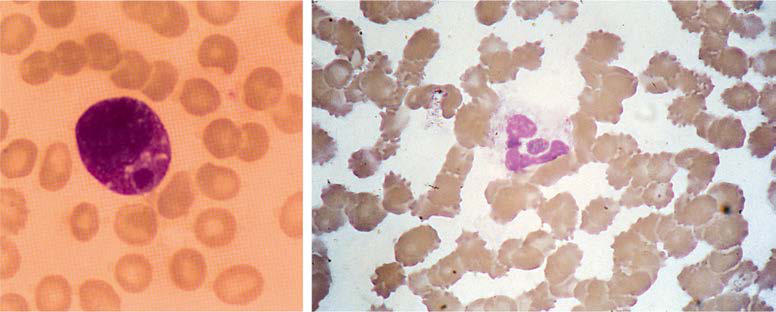

# Chapter 277: Ehrlichiosis and Anaplasmosis
> **Course:** Vikkypaedia Pediatric Basic Course (*Nelson Textbook of Pediatrics, 22nd Edition (2025)*)  
> **Part XV:** Infectious Diseases  
> **Authors:** Megan E. Reller and J. Stephen Dumler  
> **Metrics:** 3,364 words · 0 tables/boxes · 1 figures · 0 genes · 8 flashcards · 5 MCQs  
> **Quick Navigation:** [🃏 Study 8 Flashcards](../flashcards/277_flashcards.md) · [📝 Take 5-Q MCQ Quiz](../mcqs/277_mcqs.md) · [📚 Part XV Guide](../parts/Part_XV.md) · [🧬 Syndrome & Genetics Atlas](../omim_gene_atlas.md) · [💊 Therapeutics Matrix](../therapies_matrix.md) · [🏠 Course Index](../../index.md)

## ⚡ High-Yield Nelson Pediatric Board Pearls
- The treatment of choice is doxycycline (4 mg/kg/day divided every 12 hours PO or IV; maxi mum: 200 mg/day).
- PREVENTION Immediate destruction of vectors with an insecticide is important in the control of an epidemic.
- Although the infections caused by these various genera have been called ehrlichiosis, further study has identified substantial differences in biology and diagnostic approaches such that the CDC now gener ally separates these into ehrlichiosis, anaplasmosis, or undetermined ehrlichiosis/anaplasmosis.
- In ehrlichiosis, fever (∼100%), headache (77%), and myal gia (77%) are most common, but many patients also report abdomi nal pain, nausea, and vomiting.
- Rash is infrequent in anaplasmosis and most often is erythema migrans that results from concurrent Lyme disease.
- Meningoencephalitis with a lymphocyte-predominant CSF pleocy tosis is an uncommon but potentially severe complication of ehrlichi osis that appears to be rare with anaplasmosis.
- DIAGNOSIS Any delays in diagnosis or treatment are major contributors to increased morbidity or mortality in adults, where those not started on doxycycline at hospital admission are much more likely to require intensive care and undergo a significantly longer course of illness and hospitalization.

---
## Full Chapter Text, Tables & Figures
# Chapter 277: Ehrlichiosis and Anaplasmosis

*Megan E. Reller and J. Stephen Dumler*

<!-- p.2444 -->
photophobia (33%), nausea (32%), abdominal pain (30%), tinnitus (23%), constipation (23%), meningismus (17%), visual disturbances (15%), vomiting (10%), and diarrhea (7%). However, investigation of recent African outbreaks has shown a lower incidence of rash (25%) and a high incidence of delirium (81%) and cough associated with pneumonitis (70%). The rash is initially pink or erythematous and blanches. In one third of patients, red, nonblanching macules and pete chiae appear predominantly on the trunk. Infections identified during the preantibiotic era typically produced a variety of central nervous system findings, including delirium (48%), coma (6%), and seizures (1%). Estimates of case fatality rates range between 3.5% and 20% in outbreaks.

**Brill-Zinsser disease** is a form of typhus that becomes recrudes cent months to years after the primary infection, thus rarely affecting children. When bacteremic with rickettsiae, these infected patients can transmit the agent to lice, potentially providing the initial event that triggers an outbreak if hygienic conditions permit.

**TREATMENT** Recommended treatment regimens for louse-borne or sylvatic typhus are identical to those used for murine typhus. The treatment of choice is doxycycline (4 mg/kg/day divided every 12 hours PO or IV; maxi mum: 200 mg/day). Alternative treatments include tetracycline (25-50 mg/kg/day divided every 6 hours PO; maximum: 2 g/day) or chloram phenicol (50-100 mg/kg/day divided every 6 hours IV; maximum: 4 g/ day). Therapy should be continued for a minimum of 5 days and until the patient is afebrile for at least 3 days. Evidence exists that doxycycline as a single 200-mg oral dose (4.4 mg/kg if <45 kg) is also efficacious.

**PREVENTION** Immediate destruction of vectors with an insecticide is important in the control of an epidemic. Lice live in clothing rather than on the skin; thus searches for ectoparasites should include examination of clothing. For epidemic typhus, antibiotic therapy and delousing measures inter rupt transmission, reduce the prevalence of infection in the human reservoir, and diminish the impact of an outbreak. Dust containing excreta from infected lice is stable and capable of transmitting typhus, and care must be taken to prevent its inhalation. Infection confers solid protective immunity. However, recrudescence can occur years later with Brill-Zinsser disease, implying that immunity is not complete.

*Visit Elsevier eBooks+ at eBooks.Health.Elsevier.com** for Bibliography.*

**ETIOLOGY Ehrlichiosis** in humans was first described in 1987, when clusters of bacteria confined within cytoplasmic vacuoles of circulating leuko cytes (morulae), particularly **mononuclear** leukocytes, were detected in the peripheral blood of a patient with suspected Rocky Mountain spotted fever (RMSF). The etiologic agent, *Ehrlichia chaffeensis,* was cultivated from blood of an infected patient in 1990 and identified as the predominant cause of human ehrlichiosis. Investigations showed that infection by *E. chaffeensis* is transmitted by *Amblyomma ameri canum* ticks and occurs more often than RMSF in some geographic areas. By 1994, other cases in which morulae were found only in

*Megan E. Reller and J. Stephen Dumler*

**neutrophils** and lacked serologic evidence for *E. chaffeensis* infec tion led to the recognition of the species classified as *Anaplasma phagocytophilum,* which encompasses several previously described veterinary pathogens on at least two different continents and causes **anaplasmosis**.

Since these discoveries, additional species in the Anaplasmataceae family were identified as human pathogens, including (1) *Ehrlichia ewingii* in 1996, a veterinary pathogen of canine neutrophils trans mitted by *A. americanum* ticks; (2) the *Ixodes scapularis*–transmit ted *Ehrlichia muris* subsp*. eauclairensis* in 2009, only present so far in patients from Minnesota and Wisconsin in the United States; (3) infections by *Candidatus* Neoehrlichia mikurensis, presumably *Ixo des* spp. or *Haemaphysalis concinna* tick-transmitted, recognized in 2010 as a cause of sepsis-like infections of immune-compromised patients in Europe, and later as a cause of mild febrile illness in healthy individuals in China; (4) Panola Mountain *Ehrlichia,* a bac terium rarely associated with infections in humans but present in *A. americanum* ticks in the United States and with genetic features of the ruminant pathogen *Ehrlichia ruminantium*; (5) *Ehrlichia canis,* the established canine pathogen that has infected humans in Ven ezuela and possibly Costa Rica; and (6) *Anaplasma capra,* the cause of mild fever after *Ixodes persulcatus* tick bites, so far only identified in China. The latter five have not yet been established as causes of infection in children.

Although the infections caused by these various genera have been called ehrlichiosis, further study has identified substantial differences in biology and diagnostic approaches such that the CDC now gener ally separates these into ehrlichiosis, anaplasmosis, or undetermined ehrlichiosis/anaplasmosis. **Human monocytic ehrlichiosis (HME)**, or simply ehrlichiosis, describes disease characterized by infection of pre dominantly monocytes and is caused by *E. chaffeensis; *human granu locytic anaplasmosis (HGA)**, now “anaplasmosis,” describes disease related to infection of circulating neutrophils by *Anaplasma phagocyto philum;* and **ewingii ehrlichiosis** is caused by infection of granulocytes by *E. ewingii* (see Table 274.1 in Chapter 274).

All of these organisms are tick-transmitted and are small, obligate intracellular bacteria with gram-negative-type cell walls. *Neorickett sia sennetsu* is another related bacterium that is rarely recognized as a cause of human disease and is not transmitted by ticks. *E. chaffeen sis* alters host signaling and transcription once inside the cell. It survives in an endosome that enters a receptor recycling pathway to avoid phagosome-lysosome fusion and growth into a **morula**, an intravacuolar aggregate of bacteria. *A. phagocytophilum* survives in a unique vacuole that becomes decorated by microbial proteins that prevent normal endosomal trafficking and lysosome fusion. Little is known about the vacuoles in which *E. ewingii* and *E. muris* subsp. *eauclairensis* grow. These bacteria are pathogens of phagocytic cells in mammals, and characteristically each species has a specific host cell affinity: *E. chaffeensis* infects mononuclear phagocytes, and *A. phago cytophilum* and *E. ewingii* infect neutrophils. Infection leads to direct modifications in function, in part the result of changes in intracel lular signal transduction or modulation of transcription of the host cell that diminishes host defenses toward the bacterium. Yet host immune and inflammatory reactions are still activated and in part account for many of the clinical manifestations in ehrlichiosis, such as overlaps with macrophage activation syndrome or hemophago cytic lymphohistiocytosis.

**EPIDEMIOLOGY** Infections with *E. chaffeensis* occur across the southeastern, south central, and Mid-Atlantic States of the United States in a distribu tion that parallels that of RMSF; cases have also been reported in northern California. Reported cases of ehrlichiosis have more than doubled since adoption of the current surveillance case definition in 2008. Suspected cases with appropriate serologic and occasion ally molecular evidence have been reported in Europe, Africa, South America, and the Far East, including China and Korea. Human infec tions with *E. ewingii* have only been identified in the United States in

<!-- p.2446 -->

<!-- p.2447 -->
areas where *E. chaffeensis* also exists, perhaps owing to the shared tick vector. Canine infections are documented in both sub-Saharan Africa and South America.

Although the median age of patients with ehrlichiosis and anaplas mosis is generally older (>51 years), many infected children have been identified, and for ehrlichiosis, the case fatality rate is 4% in those <5 years of age. Perinatal transmission of ehrlichiosis and anaplasmosis has been documented in case reports. Little is known about the epi demiology of *E. ewingii* infections; although infections in children occur, they are recognized at a rate 100-fold less than for *E. chaffeen sis*. All infections are strongly associated with tick exposure and tick bites and are identified predominantly during May through September. Although both nymphal and adult ticks can transmit infection, nymphs are more likely to transmit disease because they are most active during the summer.

**TRANSMISSION** The predominant tick species that harbors *E. chaffeensis* and *E. ewin gii* is *A. americanum,* the lone star tick (see Fig. 274.2*d* in Chapter 274). The tick vectors of *A. phagocytophilum* are *Ixodes* spp., includ ing *I. scapularis* (black-legged or deer tick) in the eastern United States (see Fig. 274.1 in Chapter 274), *Ixodes pacificus* (western blacklegged tick) in the western United States, *Ixodes ricinus* (sheep tick) in Europe, *Ixodes persulcatus* in Eurasia, and *Haemaphysalis* spp. in China. The *Ixodes* spp. ticks also transmit *Borrelia burgdorferi, Bor relia miyamotoi, Borrelia mayonii, Babesia microti,* and tick-borne encephalitis-associated flaviviruses in Europe and Powassan viruses and *E. muris* subsp. *eauclairensis* in North America. Co-infections with these agents and *A. phagocytophilum* are documented in chil dren and adults.

*Ehrlichia* and *Anaplasma* species are maintained in nature predomi nantly by horizontal transmission (tick to mammal to tick) because the organisms are not transmitted to the progeny of infected adult female ticks (transovarial transmission). The major reservoir for *E. chaffeensis* is the white-tailed deer *(Odocoileus virginianus)*, which is found abun dantly in many parts of the United States. A reservoir for *A. phagocy tophilum* in the eastern United States appears to be the white-footed mouse, *Peromyscus leucopus.* Deer or domestic ruminants can sustain persistent asymptomatic infections, but the genetic variants in these reservoirs might not be infectious for humans. Efficient transmission requires persistent infections of mammals. Although *E. chaffeensis* and *A. phagocytophilum* can cause persistent infections in animals, clear evidence of chronic infections in humans is exceedingly rare. Transmission of *Ehrlichia* can occur within hours of tick attachment, in contrast to the 1-2 days of attachment required for transmission of *B. burgdorferi* to occur. Transmission of *A. phagocytophilum* is via the bite of the small nymphal stage of *Ixodes* spp., including *I. scapularis* (see Fig. 274.2a in Chapter 274), and is effective only after 36 hours of attachment on laboratory mice.

**PATHOLOGY AND PATHOGENESIS** Although ehrlichiosis and anaplasmosis often clinically mimic RMSF or typhus, vasculitis is rare. Pathologic findings include mild, diffuse perivascular lymphohistiocytic infiltrates; Kupffer cell hyperplasia and mild lobular hepatitis with infrequent apoptotic hepatocytes and, less frequently, centrilobular necrosis, cholestasis, and steatosis; infiltrates of mononuclear phagocytes in the spleen, lymph nodes, and bone mar row with occasional hemophagocytosis; granulomas of the liver and bone marrow in patients with *E. chaffeensis* infections; and hyperplasia of one or more bone marrow hematopoietic lineages.

The exact pathogenetic mechanisms are poorly understood, but his topathologic examinations suggest diffuse macrophage activation and poorly regulated host immune and inflammatory reactions. This acti vation results in moderate to profound leukopenia and thrombocyto penia despite a hypercellular bone marrow, and deaths often are related to hemorrhage or secondary opportunistic infections. Hepatic and other organ-specific injury occurs by a mechanism that appears to be triggered by the bacterium but is more closely related to induction of innate and adaptive immune effectors that are dysregulated in severely

affected patients. Meningoencephalitis with a mononuclear cell pleo cytosis in the cerebrospinal fluid (CSF) occurs with ehrlichiosis but is rare with anaplasmosis.

**CLINICAL MANIFESTATIONS** The clinical manifestations of ehrlichiosis, anaplasmosis, and ewin gii ehrlichiosis are similar. Many well-characterized infections of ehrlichiosis and anaplasmosis of variable severity have been reported in children, including deaths. Whereas anaplasmosis is more com mon in children, ehrlichiosis appears to be more severe. Children with ehrlichiosis are often ill for 4-12 days, shorter than in adults. Abdomi nal pain may occur disproportionately in children vs adults with anaplasmosis. In a series of children with ehrlichiosis, most required hospitalization and many (25%) required intensive care; these statistics might represent preferential reporting of severe cases. However, review of case reports and electronic surveillance of anaplasmosis to the CDC identified that 42% of patients 5-9 years of age required hospitaliza tion, and the case fatality rate is 4% among children <5 years of age. Population-based studies document that seroconversion often occurs in children who are well or who have only a mild illness. Many fewer pediatric cases of *E. ewingii* infection are reported, so the clinical mani festations related to this infection are less well characterized. The incu bation period (time from last tick bite or exposure) appears to range from 2 days to 3 weeks. Nearly 25% of patients do not report a tick bite.

Clinically, ehrlichiosis and anaplasmosis are undifferentiated febrile illnesses. In ehrlichiosis, fever (∼100%), headache (77%), and myal gia (77%) are most common, but many patients also report abdomi nal pain, nausea, and vomiting. Altered mental status accompanied by other signs of central nervous system involvement is present in 36%. Rash is a common feature (∼60%) in children. The rash is usu ally macular or maculopapular, but petechial lesions can occur. The triad of fever, headache, and rash is observed in ∼50%. Photophobia, conjunctivitis, pharyngitis, and arthralgias can occur but are less con sistently present. Lymphadenopathy, hepatomegaly, and splenomegaly are detected in nearly 50% of children with ehrlichiosis. Edema of the face, hands, and feet occurs more commonly in children than in adults, but arthritis is uncommon.

Similar but less severe manifestations occur with anaplasmosis in children, including fever (93%), headache (73%), myalgia (73%), and rigors (60%). Nausea, vomiting, abdominal pain, and anorexia occur in 30% or less of patients. Cough is present in 20%. Rash is infrequent in anaplasmosis and most often is erythema migrans that results from concurrent Lyme disease.

Meningoencephalitis with a lymphocyte-predominant CSF pleocy tosis is an uncommon but potentially severe complication of ehrlichi osis that appears to be rare with anaplasmosis. CSF protein may be elevated, and glucose may be mildly depressed in adults with ehrlichio sis meningoencephalitis, but CSF protein and glucose in affected chil dren are typically normal. In one series, 19% of adult patients with central nervous system symptoms and abnormal CSF died despite nor mal CTs of the brain.

Chronic or persistent disease with low or absent fever is very unlikely to be any form of ehrlichiosis.

**LABORATORY FINDINGS** Characteristically, most children with ehrlichiosis and anaplasmosis present with leukopenia (57–80%) and thrombocytopenia (38–93%); cytopenias reach a nadir several days into the illness. Lymphopenia is common in both ehrlichiosis and anaplasmosis. Leukocytosis can also occur, but usually after the first week of illness or with effective anti microbial treatment. Adults with pancytopenia often have a cellular or reactive bone marrow examination, and in nearly 75% of bone marrow specimens from adults with ehrlichiosis, granulomas and granuloma tous inflammation are present; this finding is not a feature of adults with anaplasmosis. Mild to markedly elevated serum hepatic transami nase levels are frequent in both ehrlichiosis (85–92%) and anaplasmo sis (40–50%). Hyponatremia (<135 mEq/L) is present in most cases. A clinical picture similar to disseminated intravascular coagulopathy has also been reported.

<!-- p.2448 -->
A B

**Fig. 277.1** Morulae in peripheral blood leukocytes in patients with human monocytic ehrlichiosis and human granulocytic anaplasmosis. A, A morula (arrow) containing Ehrlichia chaffeensis in a monocyte. B, A morula (arrowhead) containing Anaplasma phagocytophilum in a neutrophil. Wright stains, original magnifications ×1,200. E. chaffeensis and A. phagocytophilum have similar morphologies but are serologically and geneti cally distinct.

**DIAGNOSIS** Any delays in diagnosis or treatment are major contributors to increased morbidity or mortality in adults, where those not started on doxycycline at hospital admission are much more likely to require intensive care and undergo a significantly longer course of illness and hospitalization. Tick bites are not always reported; thus treatment must begin as early as possible based on epidemiologic (geographic) and clinical suspicion. Because both ehrlichiosis and anaplasmosis can be fatal, therapy should not be withheld while waiting for the results of confirmatory testing. In fact, prompt response to therapy supports the diagnosis.

Although several reports document pediatric patients with *E. chaffeensis* infection diagnosed based on typical *Ehrlichia* morulae in peripheral blood leukocytes (Fig. 277.1A), this finding is too infre quent to be considered a useful diagnostic approach. In contrast, ana plasmosis in adults presents with a small but significant percentage (1–40%) of circulating neutrophils (see Fig. 277.1B) containing typical morulae in 20–60% of patients.

*E. chaffeensis* and *A. phagocytophilum* infections are currently most frequently established by specific polymerase chain reaction assays used during the acute phase of illness when antibodies are often not detected. Both infections can be confirmed by demonstrating a four fold change in immunoglobulin G titer by indirect immunofluo rescence assay between paired sera. Serologic tests during the acute phase of infection are often negative; consequently, confirmation of acute infection requires demonstration of a fourfold rise in IgG titer in paired samples. A single specific titer of ≥128 is suggestive, but the use of IgM testing is discouraged owing to a lack of specificity. Identi fication of morulae in monocytes or macrophages for *E. chaffeensis* or in neutrophils or eosinophils for *A. phagocytophilum* by microscopy is suggestive. Demonstration of specific antigen in a tissue sample by immunohistochemistry and isolation of the organism in cell culture are not timely and are used infrequently. *E. ewingii* infection can only be confirmed by polymerase chain reaction because it has not been cultured and serologic antigens are not available. *E. ewingii* antibod ies cross react with *E. chaffeensis* in routine serologic tests. Up to 15% of patients with anaplasmosis have serologic cross reactions with *E. chaffeensis;* thus serodiagnosis depends on testing with both *E. chaffeensis* and *A. phagocytophilum* antigens and demonstrating a four fold or higher difference between titers.

**DIFFERENTIAL DIAGNOSIS** Because of the nonspecific presentation, ehrlichiosis mimics other arthropod-borne infections such as RMSF, tularemia, babesiosis, Lyme disease, murine typhus, relapsing fever, and Colorado tick fever. Other potential diagnoses often considered include otitis media, streptococcal pharyngitis, infectious mononucleosis, Kawasaki disease, endocarditis, respiratory or gastrointestinal viral syndromes, hepatitis, leptospirosis,

Q fever, collagen-vascular diseases, hemophagocytic syndromes, and leukemia. If rash and disseminated intravascular coagulopathy pre dominate, meningococcemia, bacterial sepsis, and toxic shock syn drome should also be suspected. Meningoencephalitis might suggest aseptic meningitis caused by enterovirus or herpes simplex virus, bac terial meningitis, or RMSF. Severe respiratory disease may be confused with bacterial, viral, and fungal causes of pneumonia. Mounting evi dence suggests that ehrlichiosis and anaplasmosis may be precipitating factors for hemophagocytic lymphohistiocytosis.

**TREATMENT** Both ehrlichiosis and anaplasmosis are effectively treated with tetra cyclines, especially doxycycline, and the majority of patients improve within 48 hours. In vitro tests document that both *E. chaffeensis* and *A. phagocytophilum* have minimal inhibitory concentrations to chlor amphenicol above blood levels that can be safely achieved. Therefore a short course of doxycycline is the recommended regimen. Doxycycline is used safely in children younger than 8 years of age because tooth discoloration is dose dependent and the need for multiple courses is unlikely; experience has demonstrated that adverse consequences of doxycycline use in children <8 years of age are extremely rare, in particular if courses are relatively short. Few data exist to recommend alternative therapies; however, both *E. chaffeensis* and *A. phagocytophi lum* are susceptible in vitro to rifampin, which has been used success fully to treat anaplasmosis in pregnant women and children.

The recommended regimen for patients of all ages with severe or complicated ehrlichiosis and anaplasmosis is doxycycline (for those who weigh <45 kg, 4 mg/kg/day PO or IV divided every 12 hours; maximum 200 mg/day). An alternative regimen is tetracycline (25-50 mg/kg/day divided every 6 hours PO; maximum 2 g/day). For children who weigh more than 45 kg, the adult dose, 100 mg twice daily by oral or intravenous route, can be used. Therapy should be continued for ≥5 days and until the patient has been afebrile for ≥2-4 days.

Other broad-spectrum antibiotics, including penicillins, cephalo sporins, aminoglycosides, and macrolides, are not effective. In  vitro studies suggest that fluoroquinolones are active against *A. phagocyto philum,* although at least one patient relapsed when levofloxacin was discontinued*. E. chaffeensis* is naturally resistant to fluoroquinolones owing to a single nucleotide change in *gyrA,* which suggests that *A. phagocytophilum* could also become resistant to fluoroquinolones rapidly.

**COMPLICATIONS AND PROGNOSIS** Fatal ehrlichiosis has been reported in occasional pediatric patients, where the findings included pulmonary involvement and respiratory failure in patients with or without immune compromise. The pattern of severe pulmonary involvement culminating in diffuse alveolar dam age and acute respiratory distress syndrome and secondary nosocomial

<!-- p.2450 -->
