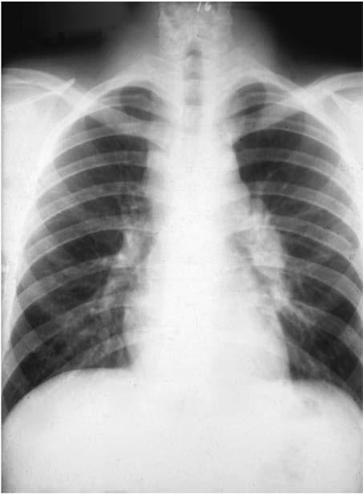

# Chapter 286: Coccidioidomycosis (Coccidioides Species)
> **Course:** Vikkypaedia Pediatric Basic Course (*Nelson Textbook of Pediatrics, 22nd Edition (2025)*)  
> **Part XV:** Infectious Diseases  
> **Authors:** Felicia A. Scaggs Huang and Rebecca C. Brady  
> **Metrics:** 3,684 words · 2 tables/boxes · 1 figures · 1 genes · 8 flashcards · 5 MCQs  
> **Quick Navigation:** [🃏 Study 8 Flashcards](../flashcards/286_flashcards.md) · [📝 Take 5-Q MCQ Quiz](../mcqs/286_mcqs.md) · [📚 Part XV Guide](../parts/Part_XV.md) · [🧬 Syndrome & Genetics Atlas](../omim_gene_atlas.md) · [💊 Therapeutics Matrix](../therapies_matrix.md) · [🏠 Course Index](../../index.md)

## Key Genetic & Molecular Targets
`STAT1`

## ⚡ High-Yield Nelson Pediatric Board Pearls
- Nonculture diagnostic techniques should be used in conjunc tion with fungal smears and cultures to facilitate the diagnosis of blastomycosis.
- ETIOLOGY Coccidioidomycosis (valley fever, San Joaquin fever, desert rheuma tism, coccidioidal granuloma) is caused by Coccidioides spp., a soildwelling dimorphic fungus.
- Infection results from inhalation of aerosolized spores.
- Visitors to endemic areas can acquire infections, and diagnosis may be delayed when they are evaluated in nonendemic areas.
- In hospi talized children, pulmonary symptoms are most common.
- A conve nience sample of 108 children in California reported that diagnosis occurred a median of 57 days after symptom onset in those with dis seminated infection (compared to 16 days in those with acute or pul monary coccidioidomycosis).
- Basilar meningitis is the most common manifestation and may be accompanied by ventriculitis, ependymitis, cerebral vasculitis, abscess, and syringomyelia.

---
## Full Chapter Text, Tables & Figures
# Chapter 286: Coccidioidomycosis (Coccidioides Species)

*Felicia A. Scaggs Huang and Rebecca C. Brady*

<!-- p.2483 -->
granulomas (pyogranulomas). *Blastomyces* yeast in tissue samples can be visualized using Gomori methenamine silver or periodic acid– Schiff stains. Yeasts are 4-29 μm in size, have a double refractile cell wall, and are characterized by broad-based budding between mother and daughter cells.

Nonculture diagnostic techniques should be used in conjunc tion with fungal smears and cultures to facilitate the diagnosis of blastomycosis. The development of a *Blastomyces* antigen test has supplanted insensitive serologic methods such as complement fixation and immunodiffusion. Urine, serum, cerebrospinal fluid, and bronchoalveolar fluid specimens can be collected for the *Blas tomyces* antigen test. Sensitivity of the urine antigen test ranges from 85% to 93% and is influenced by the burden of infection. The antigen test has similar sensitivity for *B. dermatitidis* and *B. gilchristii,* but ability to detect other species is poorly character ized. The antigen test can cross react with other dimorphic fungi, including *Histoplasma capsulatum, Paracoccidioides brasiliensis,* and *Penicillium marneffei,* decreasing the specificity to 76.9–79%. An antibody test against the BAD1 protein has been developed and has a sensitivity of 87.8% and a specificity of 94–99%; however, this test is not yet commercially available. Combination antigen and BAD1 antibody testing can increase diagnostic sensitivity to 97.6%.

**TREATMENT** Antifungal therapy is influenced by the severity of the infection, involvement of the CNS, the integrity of the host’s immune system, and pregnancy. All persons diagnosed with blastomycosis should receive antifungal therapy. **Newborns** with blastomycosis should be treated with amphotericin B deoxycholate 1 mg/kg/day. **Children with mild to moderately severe infection** can be treated with itraconazole 10 mg/kg/day (maximum: 400 mg/day) for 6-12 months. **Children with severe disease, immunodeficiency, or immunosuppression** should be treated with amphotericin B deoxycholate 0.7-1.0 mg/kg/day or lipid amphotericin B 3-5 mg/kg/day until there is clinical improve ment, generally 7-14 days, and then itraconazole 10 mg/kg/day (maxi mum: 400 mg/day) for a total of 12 months. **Central nervous system blastomycosis** requires therapy with lipid amphotericin B 5 mg/kg/day for 4-6 weeks, followed by itraconazole, fluconazole, or voriconazole for ≥12 months.

All pediatric patients of childbearing age should undergo pregnancy testing before initiation of azole antifungals. Itraconazole can increase the risk for spontaneous abortion, and fluconazole can cause cranio facial defects resembling Antley-Bixler syndrome. Voriconazole and posaconazole cause skeletal abnormalities in animal models. Treat ment of blastomycosis in **pregnant patients** consists of lipid ampho tericin B 3-5 mg/kg/day for 6-8 weeks.

For patients receiving itraconazole, the oral antifungal of choice, therapeutic drug monitoring should be performed 14 days into ther apy (goal total itraconazole level 1-5 μg/mL), and liver function tests should be monitored periodically. Because of the long half-life of itra conazole, serum drug levels can be obtained at any time of the day, irrespective of when the drug was administered. Total itraconazole level is determined by adding itraconazole and hydroxyitraconazole concentrations; hydroxyitraconazole is a metabolite that possesses antifungal activity. Voriconazole, posaconazole, and isavuconazo nium sulfate have activity against *B. dermatitidis*. Clinical experience with these drugs is growing, and treatment outcomes are promis ing. Therapeutic drug monitoring is recommended for voriconazole and posaconazole (goal trough levels 1-5 μg/mL) and can be con sidered with isavuconazonium sulfate. The echinocandins (caspo fungin, micafungin, and anidulafungin) should not be used to treat blastomycosis. Serial measurement of urine antigen levels to assess response to therapy can be a helpful adjunct in monitoring response to antifungal therapy.

*Visit Elsevier eBooks+ at eBooks.Health.Elsevier.com** for Bibliography.*

**ETIOLOGY Coccidioidomycosis** (valley fever, San Joaquin fever, desert rheuma tism, coccidioidal granuloma) is caused by *Coccidioides* spp., a soildwelling dimorphic fungus. *Coccidioides* spp. grow in the environment as spore-bearing (arthroconidia-bearing) mycelial forms. In their parasitic form, they appear as unique, endosporulating spherules in infected tissue. The two recognized species, *C. immitis* and *C. posadasii,* cause clinically indistinguishable illnesses.

**EPIDEMIOLOGY* Coccidioides* spp. inhabit soil in arid regions. *C. immitis* is primar ily found in California’s San Joaquin Valley. *C. posadasii* is endemic to southern regions of Arizona, Utah, Nevada, New Mexico, western Texas, and regions of Mexico and Central and South America. The risk of infection among long-term residents in endemic regions is 3% per year.

Population migrations into endemic areas and increasing numbers of immunosuppressed persons have caused coccidioidomycosis to become an important health problem. From 2000 to 2012 in Califor nia, 4,582 cases, 1,301 hospitalizations, and 11 deaths associated with coccidioidomycosis were reported in children, who accounted for 9.2% of total cases. From 2015 to 2016, the rate of coccidioidomycosis cases among California children increased from 2.1 per 100,000 to 5.2 per 100,000. Case and hospitalization rates were highest in males and those 12-17 years. Another recent California study showed that 55% of chil dren were hospitalized, with a median length of stay of 44 days.

Infection results from inhalation of aerosolized spores. Incidence increases during windy, dry periods that follow rainy seasons. Seismic events, archaeologic excavations, and other activities that disturb con taminated sites have caused outbreaks. Person-to-person transmission does not occur. Rarely, infections result from spores that contaminate fomites or grow beneath casts or wound dressings of infected patients. Infection has also resulted from transplantation of organs from infected donors and from mother to fetus. Visitors to endemic areas can acquire infections, and diagnosis may be delayed when they are evaluated in nonendemic areas. Spores are highly virulent, and *Coccidioides* spp. are potential agents of bioterrorism (see Chapter 763).

**PATHOGENESIS** Inhaled spores reach terminal bronchioles, where they transform into septated spherules that resist phagocytosis and within which many endospores develop. Released endospores transform into new spher ules, and the process results in an acute focus of infection. Endospores can also disseminate lymphohematogenously. Eventually, a granulo matous reaction predominates. Both recovery and protection upon reexposure depend on effective cellular immunity.

Children with congenital primary immunodeficiency disorders may be at increased risk for infection; these disorders include interleukin- 12Rβ1 deficiency, interferon-γR1 deficiency, and *STAT1* gain-offunction mutations.

**CLINICAL MANIFESTATIONS** The clinical spectrum (Fig. 286.1) encompasses pulmonary and extrapulmonary disease. Pulmonary infection occurs in 95% of cases and can be divided into primary, complicated, and residual

*Felicia A. Scaggs Huang and 
 Rebecca C. Brady*

<!-- p.2485 -->
**Primary Pulmonary Infection**

60% 40%

Asymptomatic Infection (occasional residual pulmonary cavity, nodule)

Symptomatic Infection 75-85% Spontaneous recovery 5-10% Residual pulmonary disease (cavity or nodule)

5-10% Extrapulmonary dissemination **Fig. 286.1**  Natural history of coccidioidomycosis.

infections. Approximately 60% of infections are asymptomatic. Symptoms in children are often milder than those in adults. The incidence of extrapulmonary dissemination in children approaches that of adults.

**Primary Coccidioidomycosis** The incubation period is 1-4 weeks, with an average of 10-16 days. Early symptoms include malaise, chills, fever, and night sweats. Chest dis comfort occurs in 50–70% of patients and varies from mild tightness to severe pain. Headache and/or backache are sometimes reported. Eva nescent, generalized, fine macular, erythematous or urticarial eruptions may be seen within the first few days of infection. Erythema nodosum can occur (more often in females) and is sometimes accompanied by erythema multiforme, usually 3-21 days after the onset of symptoms. The clinical constellation of erythema nodosum, fever, chest pain, and arthralgias (especially knees and ankles) is called *desert rheumatism* and *valley fever.* Profound fatigue can occur and lasts weeks to months. Of note, extrapulmonary manifestations of a primary pulmonary infection do not necessarily represent disseminated disease. In hospi talized children, pulmonary symptoms are most common. The chest examination is often normal even if radiographic findings are present. Dullness to percussion, friction rub, or fine rales may be present. Pleu ral effusions can occur and can become large enough to compromise respiratory status. Hilar and mediastinal lymphadenopathy are com mon (Fig. 286.2).

**Complicated Pulmonary Infection** Complicated infections include severe and persistent pneumonia, pro gressive primary coccidioidomycosis, progressive fibrocavitary disease, transient cavities that develop in areas of pulmonary consolidation, and empyema that follows rupture of a cavity into the pleural space. Some cavities persist, are thin walled and peripheral, and cause no symptoms; occasionally there is mild hemoptysis, and rarely there is serious hemorrhage. Rarely, acute respiratory insufficiency occurs after intense exposure; this condition is associated with high mortality rates.

**Residual Pulmonary Coccidioidomycosis** Residual pulmonary coccidioidomycosis includes fibrosis and persist ing pulmonary nodules. Nodules are present in 5–7% of infections and sometimes require differentiation from malignancy in adults.

**Disseminated (Extrapulmonary) Infection** Clinically apparent dissemination occurs in 0.5% of patients. Its inci dence is increased in infants; men; pregnant women who become infected during the second and third trimesters; persons of Filipino, African, and Latin American ancestry; and persons from other Asian backgrounds. Primary or acquired disorders of cellular immunity (Table 286.1) markedly increase the risk of dissemination. A conve nience sample of 108 children in California reported that diagnosis occurred a median of 57 days after symptom onset in those with dis seminated infection (compared to 16 days in those with acute or pul monary coccidioidomycosis).

Symptoms usually occur within 6 months of primary infection. Prolonged fever, toxicity, skin lesions, subcutaneous and/or osse ous cold abscesses, and laryngeal lesions can herald the onset. Skin

lesions have a predilection for the nasolabial area and appear initially as papules, which evolve to form pustules, plaques, abscesses, and verrucous plaques. Biopsy of these lesions demonstrates spherules. **Basilar meningitis** is the most common manifestation and may be accompanied by ventriculitis, ependymitis, cerebral vasculitis, abscess, and syringomyelia. Headache, vomiting, meningismus, and cranial nerve dysfunction are often present. Untreated meningitis is almost invariably fatal. Hydrocephalus is the most common compli cation in surviving patients. Bone infections account for 20–50% of extrapulmonary manifestations, are often multifocal, and can affect adjacent structures. Miliary dissemination and peritonitis can mimic tuberculosis.

**Fig. 286.2** Chest radiograph of a 19-yr-old male with acute primary coccidioidomycosis. There is prominent hilar lymphadenopathy and mediastinal widening.

with Active Coccidioidomycosis

#### **Table 286.1** Risk Factors for Poor Outcome in Patients

| Category / Parameter | Clinical Details & Findings |
| --- | --- |
| **PRIMARY INFECTIONS** | Severe, prolonged (≥6 wk), or progressive infection |
| **RISK FACTORS FOR EXTRAPULMONARY DISSEMINATION** | Primary or acquired cellular immune dysfunction (including; patients receiving tumor necrosis factor inhibitors or high-dose; glucocorticoids); Neonates, infants, the elderly; Male sex (adult); Filipino, African, Native American, or Latin American ethnicity; Late-stage pregnancy and early postpartum period; Standardized complement fixation antibody titer >1:16 or increasing; titer with persisting symptoms; Blood group B; Human leukocyte antigen class II allele-DRBI*1301; Diabetes mellitus |

<!-- p.2486 -->
**DIAGNOSIS** Nonspecific tests have limited usefulness. Most routine laboratory evaluations are unremarkable. Complete blood count might show an elevated eosinophil count; marked eosinophilia can accompany dis semination. As a result, a high index of suspicion is required to direct an appropriate workup, especially in patients who have visited or reside in an endemic area.

**Culture, Histopathologic Findings, and Antigen Detection** Any isolation of *Coccidioides* spp. from a patient specimen is consid ered definitive evidence of infection because the fungus is not part of the normal human microbiome. However, although diagnostic, culture is positive in only 8.3% of respiratory tract specimens and in 3.2% of all other sites. It may take several days for a specimen to grow. *Coc cidioides* spp. is isolated from clinical specimens as the spore-bearing mold form, and thus the laboratory should be informed and use spe cial precautions when the diagnosis is suspected. Inappropriate bio containment procedures can lead to infection of exposed laboratory staff. The observation of endosporulating spherules in histopathologic specimens using potassium hydroxide (KOH) preparations, calcofluor white, or hematoxylin and eosin (H&E) stains is diagnostic. Periodic acid Schiff–or Gomori–methenamine silver stains also may be used to demonstrate the fungus.

A quantitative enzyme immunoassay (EIA) (MiraVista Diagnos tics, Indianapolis, IN) that detects coccidioidal galactomannan in urine, serum, plasma, cerebrospinal fluid (CSF), or bronchoalveolar lavage fluid has excellent specificity and is positive in 70% of patients with severe infections. Although the EIA can cross react with other endemic mycoses, interpretation is often straightforward because there is negligible geographic overlap with areas endemic for other mycoses. In addition, a real-time polymerase chain reaction (PCR) assay has been developed to directly detect the fungus in tissue sam ples. The specificity is high, but sensitivity is not greater than that of routine cultures. Presently, *Coccidioides* spp. PCR is available through reference laboratories.

CSF analysis should be performed in patients with suspected dissemination. Findings in meningitis are similar to those seen with tuberculous meningitis (see Chapter 261). Eosinophilic pleocytosis may be present. Fungal stains and culture are usually negative. Volumes of 10 mL in adults have improved the yield of culture.

**Serology** Serologic tests provide valuable diagnostic information but may be falsely negative early in self-limited infections and in immunocom promised patients. Three major methods are used, including EIA, complement fixation (CF), and immunodiffusion. EIA and CF tests are best done in experienced reference laboratories because false-positive results may be reported.

Immunoglobulin (Ig) M–specific antibody becomes measurable in 50% of infected patients 1 week after onset and in 90% of infected patients by 3 weeks. EIA is sensitive and can detect IgM and IgG antibody. It is less specific than other methods; confirmation with immunodiffusion or CF may be needed. IgG antibodies measured by CF appear between the second and third week but can take several months; follow-up testing is needed if tests are negative and clinical suspicion persists. In the presence of CF titers of 1:2 or 1:4, a positive immunodiffusion test can help corroborate significance because it is less sensitive but more specific than EIA. IgG-specific antibody can persist for months, with titers elevated in proportion to the sever ity of illness. CF titers >1:16 are suggestive of dissemination. Direct comparison of the results of CF (IgG) antibody tests measured by different methodologies should be interpreted with caution. IgG anti body titers used to monitor disease activity should be tested concur rently with serum samples taken earlier in the illness using the same methodology.

*C. immitis* antibody is present in CSF in 95% of patients with men ingitis and is usually diagnostic. Rarely, “spillover” in patients without meningitis but with high IgG titers in serum can be present in CSF. Iso lation of *Coccidioides* spp. from CSF culture of patients with meningitis is uncommon, although culture of large volumes of CSF may improve sensitivity.

**Imaging Procedures** During primary infection, chest radiography may be normal or dem onstrate consolidation, single or multiple circumscribed lesions, or soft pulmonary densities. Pulmonary infiltrates in the upper lobes are more common in coccidioidal infection than in classic bacterial pneumonia. Hilar and subcarinal lymphadenopathy is often present (see Fig. 286.2). Cavities tend to be thin walled (Fig. 286.3). Pleural effusions vary in size. The presence of miliary or reticulonodular lesions is prognosti cally unfavorable. Isolated or multiple osseous lesions are usually lytic and affect cancellous bone. Lesions can affect adjacent structures, and vertebral lesions can affect the spinal cord.

**TREATMENT** Based on the few rigorous clinical trials performed in adults and the opinions of experts in the management of coccidioidomycosis, consensus treatment guidelines have been developed (Table 286.2).

A

B

**Fig. 286.3** A, Chest radiograph revealing a chronic cavitary lesion in the right lung of a female with coccidioidomycosis. B, CT showing the same cavity in the right lung.

<!-- p.2487 -->
Consultation with experts in an area of endemicity should be consid ered when formulating a management plan. Many patients with mild primary coccidioidomycosis do not require antifungal therapy. How ever, those at risk of severe or complicated disease should receive treatment.

Treatment is recommended for HIV-infected patients with active coccidioidomycosis and CD4 counts <250/μL. After successful treat ment, antifungals may be stopped if the CD4 count exceeds 250/μL. Treatment should be continued if the CD4 count remains less than 250/μL and should be given indefinitely in all HIV-infected patients with coccidioidal meningitis. Patients with other forms of chronic immunosuppression (e.g., solid organ transplant recipients) may also require lifelong therapy.

First-line agents include oral and intravenous preparations of **fluco nazole** (6-12 mg/kg; max 400-1200 mg/day) and itraconazole (2-5 mg/ kg PO twice daily; max 400 mg/day). Fluconazole is often the first-line therapy because it has high bioavailability and few side effects. Serum concentrations of itraconazole should be monitored.

**Amphotericin B** is preferred for initial treatment of severe infec tions. Amphotericin B deoxycholate is less costly than lipid formu lations and is often well tolerated in children. Once a daily dose of amphotericin B deoxycholate of 0.5-1.5 mg/kg/day is achieved, the frequency of administration can be reduced to 3 times weekly. The recommended total dosage ranges from 15-45 mg/kg and is deter mined by the clinical response. Lipid formulations of amphotericin are

recommended for patients with impaired renal function, for patients receiving other nephrotoxic agents, or if amphotericin B deoxycholate is not tolerated. Some experts prefer liposomal amphotericin to treat central nervous system infections because it achieves higher levels in brain parenchyma. Amphotericin B preparations do not cross the blood-brain barrier to effectively treat *Coccidioides* spp., but they can mask the signs of meningitis. Infections during pregnancy should be treated with amphotericin B, because the azoles are potentially terato genic. Isavuconazole, voriconazole, and posaconazole have been used successfully as salvage therapy.

**Primary Pulmonary Infection** Primary pulmonary coccidioidomycosis resolves in 95% of patients without risk factors for dissemination; antifungal therapy does not lessen the frequency of dissemination or pulmonary residua. When it is elected to defer antifungal therapy, visits are recommended at 1- to 3-month intervals for 2 years and as needed. Patients with significant or prolonged symptoms are more likely to incur benefit from antifungal agents, but there are no established crite ria upon which to base the decision. Table 286.2 summarizes commonly used indicators in adults. A treatment trial in adults with primary respi ratory infections examined outcomes of antifungal therapy prescribed on the basis of severity and compared them with an untreated group with less severe symptoms; complications occurred only in patients in the treatment group and only in those in whom treatment was stopped. If treatment is elected, a 3- to 6-month course of fluconazole (12 mg/ kg/day) or itraconazole (10 mg/kg/day) is recommended.

**Diffuse Pneumonia** Diffuse reticulonodular densities or miliary infiltrates, sometimes accompanied by severe illness, can occur in dissemination or after exposure to a large fungal inoculum. In this setting, amphotericin B is recommended for initial treatment, followed thereafter by extended treatment with high-dose fluconazole (see Table 286.2).

**Disseminated (Extrapulmonary) Infection** For nonmeningeal infection (see Table 286.2), oral fluconazole and itraconazole are effective for treating disseminated coccidioidomycosis that is not extensive, is not progressing rapidly, and has not affected the central nervous system. Some experts recommend higher doses for adults than were used in clinical trials. A subgroup analysis showed a tendency for improved response of skeletal infections that were treated with itraconazole. Amphotericin B deoxycholate is used as an alterna tive, especially if there is rapid worsening and lesions are in critical locations. Voriconazole has been used successfully as salvage therapy. The optimal duration of therapy with the azoles has not been clearly defined. Late relapses have occurred after lengthy treatment and favor able clinical response.

**Meningitis** Therapy with oral or IV fluconazole is currently preferred for coccidi oidal meningitis. In adults, a dosage of 400-1,200 mg/day is recom mended. For children, the dose is 12 mg/kg/day. Some experts use intrathecal, intraventricular, or intracisternally administered ampho tericin B in addition to an azole, believing that the clinical response may be faster. Patients who respond to the azole should continue treatment indefinitely. Hydrocephalus is common and not necessarily a marker of treatment failure. In the event of treatment failure with azoles, intrathecal amphotericin B deoxycholate is indicated, with or without the azole. Cerebral vasculitis can occur and may predispose to cerebral ischemia, infarction, or hemorrhage. The efficacy of high-dose steroids is unresolved. Salvage therapy with isavuconazole or voricon azole has been effective.

**Surgical Management** If a pulmonary cavity is located peripherally or there is recurrent bleeding or pleural extension, excision may be needed. Infrequently, bronchopleural fistula or recurrent cavitation occurs as a surgical

Coccidioidomycosis in Adults

#### **Table 286.2** Indications for Treatment of

| Category / Parameter | Clinical Details & Findings |
| --- | --- |
| **TREATMENT** | Acute pneumonia, mild; Observe without antifungal; treatment at 1- to 3-mo; intervals for 2 yr; some experts; recommend antifungal; treatment; Weight loss >10%; night sweats; >3 wk; infiltrates at least half; of one lung or parts of both; lungs; prominent or persistent; hilar lymphadenopathy;; complement fixation titers; >1:16; inability to work,; symptoms >2 mo; Treat with an azole daily for; 3-6 mo, with follow-up at 1- to; 3-mo intervals for 2 yr; Uncomplicated acute; pneumonia, special; circumstances:; immunosuppression, late; pregnancy, Filipino or African; ancestry, age >55 yr, other; chronic diseases (diabetes,; cardiopulmonary disease),; symptoms >2 mo; Treat with an azole daily for; 3-6 mo, with follow-up at 1- to; 3-mo intervals for 2 yr; Treat with amphotericin B if in; late pregnancy; Diffuse pneumonia:; reticulonodular or miliary; infiltrates suggest underlying; immunodeficiency and possible; fungemia; Treat initially with amphotericin; B if significant hypoxia or rapid; deterioration, followed by an; azole for ≥1 yr; In mild cases, an azole for ≥1 yr; Chronic pneumonia; Treat with an azole for ≥1 yr; Disseminated disease,; nonmeningeal; Treat with an azole for ≥1 yr; except in severe or rapidly; worsening cases, for; which amphotericin B is; recommended; Disseminated disease,; meningeal; Treat with fluconazole (some add; intrathecal amphotericin B) and; treat indefinitely |

<!-- p.2489 -->
