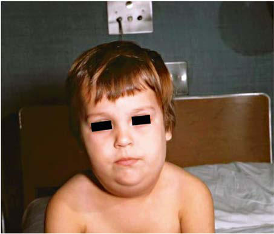

# Chapter 295: Mumps
> **Course:** Vikkypaedia Pediatric Basic Course (*Nelson Textbook of Pediatrics, 22nd Edition (2025)*)  
> **Part XV:** Infectious Diseases  
> **Authors:** Hayley A. Gans  
> **Metrics:** 3,329 words · 0 tables/boxes · 2 figures · 0 genes · 7 flashcards · 5 MCQs  
> **Quick Navigation:** [🃏 Study 7 Flashcards](../flashcards/295_flashcards.md) · [📝 Take 5-Q MCQ Quiz](../mcqs/295_mcqs.md) · [📚 Part XV Guide](../parts/Part_XV.md) · [🧬 Syndrome & Genetics Atlas](../omim_gene_atlas.md) · [💊 Therapeutics Matrix](../therapies_matrix.md) · [🏠 Course Index](../../index.md)

## ⚡ High-Yield Nelson Pediatric Board Pearls
- In 1968, just after the introduction of the mumps vaccine, 185,691 cases were reported in the United States.
- Following the recom mendation for routine use of mumps vaccine in 1977, the incidence of mumps fell dramatically in young children and shifted instead to older children, adolescents, and young adults.
- Outbreaks continued to occur even in highly vaccinated populations as a result of primary vaccine failure with one dose of vaccine and because of undervaccination of susceptible persons.
- After implementation of the two-dose recommendation for the measles-mumps-rubella (MMR) vaccine for measles control in 1989, the number of mumps cases declined further.
- An analysis of 4,039 patients with mumps seen in the first 7 months of the epidemic indicated that 63% had received more than two doses of the MMR vaccine.
- The majority of cases in vaccinated persons represent close contact thought to provide intense exposure that may overcome vaccine immunity and perhaps genotype mismatch between circulating mumps genotypes and those in the vac cine.
- Centers for Disease Control and Prevention, the American Academy of Pediat rics, and the Health Infection Control Practices Advisory Committee recommend an isolation period of 5 days after onset of parotitis for patients with mumps in both community and healthcare settings.

---
## Full Chapter Text, Tables & Figures
# Chapter 295: Mumps

*Hayley A. Gans*

<!-- p.2526 -->
Mumps is an acute self-limited infection that was once commonplace but is now uncommon in countries with widespread use of vaccination. It is characterized by fever, bilateral or unilateral parotid swelling and tenderness, and the frequent occurrence of meningoencephalitis and orchitis. Although infrequent in countries with extensive vaccination programs, mumps remains endemic in the rest of the world, warrant ing continued vaccine protection. Nonetheless, outbreaks of mumps have been reported in highly vaccinated populations in the United States, particularly among students.

**ETIOLOGY** Mumps virus is in the family Paramyxoviridae and the genus *Rubu lavirus.* It is a negative-sense single-stranded nonsegmented RNA virus encapsulated in a lipoprotein envelope possessing seven struc tural proteins. Surface glycoproteins called HN (hemagglutininneuraminidase) and F (fusion) mediate absorption of the virus to host cells and penetration of the virus into cells, respectively. Both proteins stimulate production of protective antibodies. Mumps virus exists as a single serotype with up to 12 known genotypes, and humans are the only natural host.

**EPIDEMIOLOGY** In the prevaccine era, mumps occurred primarily in young children between the ages of 5 and 9 years and in epidemics about every 4 years. Mumps infection occurred more often in the winter and spring months. In 1968, just after the introduction of the mumps vaccine, 185,691 cases were reported in the United States. Following the recom mendation for routine use of mumps vaccine in 1977, the incidence of mumps fell dramatically in young children (Fig. 295.1) and shifted instead to older children, adolescents, and young adults. Outbreaks continued to occur *even in highly vaccinated* populations as a result of primary vaccine failure with one dose of vaccine and because of undervaccination of susceptible persons. After implementation of the two-dose recommendation for the measles-mumps-rubella (MMR) vaccine for measles control in 1989, the number of mumps cases declined further. During 2001–2003, fewer than 300 mumps cases were reported each year. In 2006 the largest mumps epidemic in the past 20

years occurred in the United States. A total of 6,584 cases occurred, 85% of them in 8 midwestern states. Twenty-nine percent of the cases occurred in patients 18-24 years old, most of whom were attending college. An analysis of 4,039 patients with mumps seen in the first 7 months of the epidemic indicated that 63% had received more than two doses of the MMR vaccine. Subsequently, several outbreaks of mumps have been documented in highly vaccinated populations in the United States, several in school settings including universities and in Guam. This phenomenon is reported globally as well. The majority of cases in vaccinated persons represent close contact thought to provide intense exposure that may overcome vaccine immunity and perhaps genotype mismatch between circulating mumps genotypes and those in the vac cine. Through 2020, mumps outbreaks have continued to occur, with a peak in 2016 with 6,366 cases, which dropped to 154 in 2021.

Mumps is spread from person to person by respiratory droplets. Virus appears in the saliva from up to 7 days before to as long as 7 days after onset of parotid swelling. The period of maximum infectiousness is 1-2 days before to 5 days after onset of parotid swelling. Viral shed ding before onset of symptoms and in asymptomatic infected individu als impairs efforts to contain the infection in susceptible populations. The risk of spreading the virus increases the longer and the closer the contact a person has with someone who has mumps. The U.S. Centers for Disease Control and Prevention, the American Academy of Pediat rics, and the Health Infection Control Practices Advisory Committee recommend an isolation period of 5 days after onset of parotitis for patients with mumps in both community and healthcare settings.

**PATHOLOGY AND PATHOGENESIS** Mumps virus targets the salivary glands, central nervous system (CNS), pancreas, testes, and, to a lesser extent, thyroid, ovaries, heart, kidneys, liver, and joint synovia.

After infection, initial viral replication occurs in the epithelium of the upper respiratory tract. Infection spreads to the adjacent lymph nodes by the lymphatic drainage, and viremia ensues, spreading the virus to targeted tissues, including the meninges, salivary glands, pan creas, testes, and ovaries. Mumps virus causes necrosis of infected cells and is associated with a lymphocytic inflammatory infiltrate. Salivary gland ducts are lined with necrotic epithelium, and the interstitium is infiltrated with lymphocytes. Swelling of tissue within the testes may result in focal ischemic infarcts. The cerebrospinal fluid (CSF) fre quently contains a mononuclear pleocytosis, even in individuals with out clinical signs of meningitis.

**CLINICAL MANIFESTATIONS** The incubation period for mumps ranges from 12-25 days but is usually 16-18 days. Mumps virus infection may result in clinical presentation

*Hayley A. Gans*

160,000

140,000

120,000

100,000

80,000

60,000

40,000

20,000

0

14

**Number of mumps cases—United States, 1968–2011**

12 10 8 6 4 1 0 1985

1968 1978 1988 1998 2008

1990 2000 2005 1995 2010

Year

Year

No. cases

No. cases

(in thousands)

Mumps cases in U.S., by year 7,000

6,000

5,000

4,000

3,000

2,000

1,000

0

2000 2001 2002 2003 2004 2005 2006 2007 2008 2009 2010 2011 2012 2013 2014 2015 2016 2017

A B **Fig. 295.1**  A, Mumps cases in the United States from 1968, right after the live mumps vaccine was introduced in 1967, to 2011. There was a steady decline following introduction of the vaccine and recommendation for routine vaccination in 1977 *(arrow).* Note national increases in activity in 1986–1987, 2006. Mumps data provided were reported voluntarily to the Centers for Disease Control and Prevention (CDC) from state health departments. B, Mumps cases in the United States from 2000–2017 showing the increased activity in 2006, 2009, 2010, and 2014–2017. Mumps data provided were reported voluntarily to CDC from state health departments. *(*A,*From McLean HQ, Fiebelkorn AP, Temte JL, et al. Prevention of measles, rubella, congenital rubella syndrome and mumps. MMWR Recomm Rep. 2013;62[RR-04]:1–34; B,**From Morbidity and Mortality Weekly Report (MMWR): Notifiable Diseases and Mortality Tables. https://www.cdc.gov/mumps/outbreaks.html**.)*

<!-- p.2527 -->
ranging from asymptomatic (in the prevaccine era 15–24% of infec tions were asymptomatic; accurate estimates in the postvaccination era are difficult to measure) or nonspecific symptoms to the typical illness associated with parotitis with or without complications involving sev eral body systems. The typical patient presents with a prodrome lasting 1-2 days consisting of fever, headache, vomiting, malaise, and myalgias. Parotitis follows and may be unilateral initially but becomes bilateral in approximately 70% of cases (Fig. 295.2). The parotid gland is tender, and parotitis may be preceded or accompanied by ear pain on the ipsi lateral side. Ingestion of sour or acidic foods or liquids may enhance pain in the parotid area. As swelling progresses, the angle of the jaw is obscured, and the ear lobe may be lifted upward and outward (see Figs. 295.2 and 295.3). The opening of the Stensen duct may be red and edematous. The parotid swelling peaks in approximately 3 days and then gradually subsides over 7 days. Fever and the other systemic symptoms resolve in 3-5 days. A morbilliform rash is rarely seen. Sub mandibular salivary glands may also be involved or may be enlarged without parotid swelling. Edema over the sternum as a result of lym phatic obstruction may also occur. Symptoms in immunized individu als are the same but tend to be less severe, and parotitis may be absent.

**DIAGNOSIS** When mumps was highly prevalent, the diagnosis could be made on the basis of a history of exposure to mumps infection, an appropriate incubation period, and development of typical clinical findings. Confir mation of the presence of parotitis could be made with demonstration of an elevated serum amylase value. Leukopenia with a relative lympho cytosis was a common finding. Currently, in highly immunized popula tions patients with parotitis lasting longer than 2 days and of unknown cause, a specific diagnosis of mumps should be confirmed or ruled out by virologic or serologic examination. This step may be accomplished by isolation of the virus in cell culture, detection of viral antigen by direct immunofluorescence, or identification of nucleic acid by reverse tran scriptase polymerase chain reaction (PCR). Virus can be isolated from upper respiratory tract secretions (buccal and oropharyngeal mucosa), CSF, or urine during the acute illness; however, PCR from the oropha ryngeal secretions becomes negative quickly, especially in immunized individuals, and thus should be run within 3 days of parotid swelling. Serologic testing is usually a more convenient and available mode of diagnosis. A significant increase in serum mumps immunoglobulin G (IgG) antibody between acute and convalescent serum specimens as detected by complement fixation, neutralization hemagglutination, or enzyme immunoassay tests establishes the diagnosis. Mumps IgG anti bodies may cross react with antibodies to parainfluenza virus in sero logic testing. More commonly, an enzyme immunoassay for mumps IgM antibody is used to identify recent infection. All serologic tests are

difficult to interpret in immunized individuals, and negative test results do not rule out mumps infection. Skin testing for mumps is neither sensitive nor specific and should not be used.

**DIFFERENTIAL DIAGNOSIS** Parotid swelling may be caused by many other infectious and noninfec tious conditions, especially in sporadic cases. Viruses that cause par otitis include parainfluenza 1 and parainfluenza 3 viruses, influenza A virus, cytomegalovirus, Epstein-Barr virus, enteroviruses, lymphocytic choriomeningitis virus, and HIV. Purulent parotitis, usually caused by *Staphylococcus aureus,* is unilateral, is extremely tender, is associated with an elevated white blood cell count, and may involve purulent drain age from the Stensen duct. Submandibular or anterior cervical adenitis from a variety of pathogens may also be confused with parotitis. Other noninfectious causes of parotid swelling include obstruction of the Stensen duct, collagen vascular diseases such as Sjögren syndrome, sys temic lupus erythematosus, immunologic diseases, tumor, and drugs.

**COMPLICATIONS** The most common complications of mumps are meningitis, with or without encephalitis, and gonadal (orchitis, oophoritis) involvement. Uncommon complications include conjunctivitis, optic neuritis, pneumonia, nephritis, pancreatitis, mastitis, and thrombocytopenia. Complications can occur in the absence of parotitis, especially in immunized individuals, and overall complication rates in immunized individuals are lower than in unimmunized and are shifted toward the adult populations.

Maternal infection with mumps during the first trimester of preg nancy results in increased fetal wastage. No fetal malformations have been associated with intrauterine mumps infection. However, perina tal mumps disease has been reported in infants born to mothers who acquired mumps late in gestation.

**Meningitis and Meningoencephalitis** Mumps virus is neurotropic and is thought to enter the CNS via the choroid plexus and infect the choroidal epithelium and ependymal cells, both of which can be found in CSF along with mononuclear leukocytes. In the prevaccine era mumps represented one of the most common causes of aseptic meningitis and hearing loss among chil dren. Symptomatic CNS involvement occurs in 10–30% of infected individuals, but CSF pleocytosis has been found in 40–60% of patients with mumps parotitis. The meningoencephalitis may occur before, along with, or following the parotitis. It most commonly manifests 5 days after the parotitis. Clinical findings vary with age. Infants and young children have fever, malaise, and lethargy, whereas older chil dren, adolescents, and adults complain of headache and demonstrate

Ear-gland

axis

Parotid

gland

Sternocleidomastoid

muscle **Fig. 295.2**  Schematic of a parotid gland infected with mumps *(right)* compared with a normal gland *(left).* An imaginary line bisecting the long axis of the ear divides the parotid gland into two equal parts. These anatomic relationships are not altered in the enlarged gland. An enlarged cervical lymph node is usually posterior to the imaginary line. *(From Mumps [epidemic parotitis]. In Krugman S, Ward R, Katz SL, eds. Infectious Diseases in Children, 6th ed. St. Louis: Mosby; 1977:182.)*

**Fig. 295.3** A child with mumps showing parotid swelling. (From the Centers for Disease Control and Prevention. Public Health Image Li brary [PHIL], Image 4491. https://phil.cdc.gov/Details.aspx?pid=4491.)

<!-- p.2528 -->
meningeal signs. In a series of children with mumps and meningeal involvement, findings were fever in 94%, vomiting in 84%, headache in 47%, parotitis in 47%, neck stiffness in 71%, lethargy in 69%, and seizures in 18%. In typical cases, symptoms resolve in 7-10 days. CSF in mumps meningitis has a white blood cell pleocytosis of 200-600 μL with a predominance of lymphocytes. The CSF glucose content is normal in most patients, but a moderate hypoglycorrhachia (glucose content 20-40 mg/dL) may be seen in 10–20% of patients. The CSF protein content is normal or mildly elevated.

Less-common CNS complications of mumps include transverse myelitis, acute disseminated encephalomyelitis **(ADEM)**, aqueductal stenosis, and facial palsy. Sensorineural hearing loss is rare and has been estimated to occur in 0.5-5.0 in 100,000 cases of mumps. The hearing loss can be transient. There is some evidence that hearing loss is more likely in patients with meningoencephalitis.

**Orchitis and Oophoritis** In adolescent and adult males, orchitis is second only to parotitis as a common finding in mumps. Involvement in prepubescent boys is extremely rare, but after puberty, orchitis occurs in 30–40% of males. It begins within days following onset of parotitis in most cases and is asso ciated with moderate to high fever, chills, and exquisite pain and swelling of the testes. In 30% or less of cases, the orchitis is bilateral. Atrophy of the testes may occur, but sterility is rare even with bilateral involvement.

Oophoritis is uncommon in postpubertal females but may cause severe pain and may be confused with appendicitis when located on the right side.

**Pancreatitis** Pancreatitis may occur in mumps with or without parotid involve ment. Severe disease is rare, but fever, epigastric pain, and vomiting are suggestive. Epidemiologic studies have suggested that mumps may be associated with the subsequent development of diabetes mellitus, but a causal link has not been established.

**Cardiac Involvement** Myocarditis has been reported in mumps, and molecular studies have identified mumps virus in heart tissue taken from patients with endo cardial fibroelastosis.

**Arthritis** Arthralgia, monoarthritis, and migratory polyarthritis have been reported in mumps. Arthritis is seen with or without parotitis and usu ally occurs within 3 weeks of onset of parotid swelling. It is generally mild and self-limited.

**Thyroiditis** Thyroiditis is rare following mumps. It has not been reported with out parotitis and may occur weeks after the acute infection. Most cases resolve, but some become relapsing and result in hypothyroidism.

**TREATMENT** No specific antiviral therapy is available for mumps. Management should be aimed at reducing the pain associated with meningitis or orchitis and maintaining adequate hydration. Antipyretics may be given for fever.

**PROGNOSIS** The outcome of mumps is nearly always excellent, even when the dis ease is complicated by encephalitis, although fatal cases from CNS involvement or myocarditis have been reported. No mumps deaths have occurred in the recent outbreaks in the United States.

**PREVENTION** Immunization with the live mumps vaccine is the primary mode of prevention used in the United States. It is given as part of the MMR two-dose vaccine schedule, at 12-15 months of age for the first dose and 4-6 years of age for the second dose. If not given at 4-6 years, the second dose should be given before children enter puberty. In those traveling, two doses are recommended in individuals older than 12 months administered at least 28 days apart. Antibody develops in 94%

(range: 89–97%) after one dose. Antibody levels achieved after vaccina tion are lower than after natural infection.

The median vaccine effectiveness of mumps vaccine after one dose of vaccine is 78% (range: 49–92%) and after two doses is 88% (range: 66–95%). Duration of effectiveness is ≥10 years after one dose and ≥15 years after two doses.

During outbreaks, *a third MMR dose* administered to the at-risk population was associated with improved outbreak control with sig nificantly fewer cases in those receiving the third dose compared with those not receiving it. Despite these results, modeling supports the cur rent two-dose schedule without a routine third booster dose because the current regimen significantly controls size of outbreaks, severity of disease, and number of hospitalizations, whereas the third dose appears to be a possible strategy during an outbreak.

As a live-virus vaccine, MMR should not be administered to preg nant women or to severely immunodeficient or immunosuppressed individuals. HIV-infected patients who are not severely immunocom promised may receive the vaccine, because the risk for severe infec tion with mumps outweighs the risk for serious reaction to the vaccine. Individuals with anaphylactoid reactions to egg or neomycin may be at risk for immediate-type hypersensitivity reactions to the vaccine. Persons with other types of reactions to egg or reactions to other com ponents of the vaccine are not restricted from receiving the vaccine.

In 2006, in response to the multistate outbreak in the United States, evidence of immunity to mumps through vaccination was redefined. Acceptable presumptive evidence of immunity to mumps now consists of one of the following: (1) documentation of adequate vaccination at age 12 months or older, (2) laboratory evidence of immunity, (3) birth before 1957, and (4) documentation of physician-diagnosed mumps. Evidence of immunity through documentation of adequate vaccina tion is defined as one dose of a live mumps virus vaccine for preschoolage children and adults not at high risk and two doses for school-age children (i.e., grades K-12) and for adults at high risk (e.g., healthcare workers, international travelers, and students at post–high school edu cational institutions).

All persons who work in healthcare facilities should be immune to mumps. Adequate mumps vaccination for healthcare workers born dur ing or after 1957 consists of two doses of a live mumps virus vaccine. Healthcare workers with no history of mumps vaccination and no other evidence of immunity should receive two doses, with >28 days between doses. Healthcare workers who have received only one dose previously should receive a second dose. Because birth before 1957 is only pre sumptive evidence of immunity, healthcare facilities should consider recommending one dose of a live mumps virus vaccine for unvacci nated workers born before 1957 who do not have a history of physiciandiagnosed mumps or laboratory evidence of mumps immunity. During an outbreak, healthcare facilities should strongly consider recommend ing two doses of a live mumps virus vaccine to unvaccinated workers born before 1957 who do not have evidence of mumps immunity.

**Adverse reactions** to mumps virus vaccine are rare. Parotitis and orchitis have been reported rarely. There is inadequate information to make a causal relationship to other reactions, such as febrile seizures, deafness, rash, purpura, encephalitis, and meningitis with the strain of mumps vaccine virus used for immunization in the United States. Higher rates of aseptic meningitis following vaccination for mumps are associated with vaccine strains used elsewhere in the world, includ ing the Leningrad 3 and Urabe Am 9 strains. Transient suppression of reactivity to tuberculin skin testing has been reported after mumps vaccination.

In 2005 the quadrivalent measles, mumps, rubella, and varicella (MMRV) vaccine was made available. However, in 2010, studies showed a greater risk of febrile seizures in children 12-23 months of age 5-12 days after administration of the vaccine. No increased risk of seizures was seen in children receiving the first dose of the MMRV at older than 48 months of age. As a result, the American Academy of Pediatrics currently recommends either the MMR vaccine and separate varicella vaccine or the MMRV vaccine in children 12-47 months of age. After 48 months of age, the MMRV is generally preferred.

<!-- p.2529 -->
