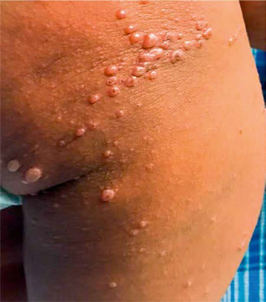

# Chapter 297: Nonpolio Enteroviruses
> **Course:** Vikkypaedia Pediatric Basic Course (*Nelson Textbook of Pediatrics, 22nd Edition (2025)*)  
> **Part XV:** Infectious Diseases  
> **Authors:** Kevin B. Messacar and Mark J. Abzug  
> **Metrics:** 8,958 words · 2 tables/boxes · 2 figures · 0 genes · 8 flashcards · 5 MCQs  
> **Quick Navigation:** [🃏 Study 8 Flashcards](../flashcards/297_flashcards.md) · [📝 Take 5-Q MCQ Quiz](../mcqs/297_mcqs.md) · [📚 Part XV Guide](../parts/Part_XV.md) · [🧬 Syndrome & Genetics Atlas](../omim_gene_atlas.md) · [💊 Therapeutics Matrix](../therapies_matrix.md) · [🏠 Course Index](../../index.md)

## ⚡ High-Yield Nelson Pediatric Board Pearls
- Given the ongoing spread of cVDPVs, alternative stable novel Sabin vaccine strains that do not revert to neurovirulence (nOPVs) were developed for all three strains (Bio Farma, Indonesia) and have been shown to be immunogenic, stable, and safe.
- Enterovirus myocarditis is characterized by perivascular and inter stitial mixed inflammatory infiltrates and myocyte damage, possi bly mediated by viral cytolytic (e.g., cleavage of dystrophin or serum response factor) and innate and adaptive immune-mediated mecha nisms.
- In utero infections are characterized by placentitis and infection of multiple fetal organs such as heart, lung, and brain.
- Development of type-specific neutralizing antibodies appears to be the most important immune defense, mediating prevention against and recovery from infection.
- In vitro and animal experiments suggest that heterotypic antibody may enhance disease caused by a different serotype.
- Nonspecific Febrile Illness Nonspecific febrile illnesses are the most common symptomatic mani festations, especially in infants and young children.
- Hand-Foot-and-Mouth Disease Hand-foot-and-mouth disease, one of the more distinctive rash syn dromes, is most frequently caused by coxsackievirus A16, sometimes in large outbreaks, and can also be caused by enterovirus A71; coxsackie A viruses 5, 6, 7, 9, and 10; coxsackie B viruses 2 and 5; and some echovi ruses.

---
## Full Chapter Text, Tables & Figures
# Chapter 297: Nonpolio Enteroviruses

*Kevin B. Messacar and Mark J. Abzug*

<!-- p.2537 -->
be provided with an International Certificate of Vaccination of Prophy laxis to record their polio vaccination and service proof of vaccination. These countries have been advised to restrict at the point of departure the international travel of any resident lacking documentation of full vaccination, whether by air, sea, or land. For countries infected with cVDPV2 with potential risk of international spread (see Fig. 296.1 and WHO website), visitors should be encouraged to follow these recom mendations (not mandated).

The WHO has mandated that infants in all countries still using bOPV should receive a dose of IPV, to offer protection against polio virus type 2. These efforts have been stymied because of the global inability to produce IPV in a large enough volume to cover all the 128 million babies born annually in the world. This problem was a crisis during the global synchronized introduction of bOPV, when several countries (e.g., India) had to use two fractional doses of IPV (1/5 dose) administered intradermally. To enhance scale-up of IPV production in countries such as India, Brazil, and China, IPV using Sabin strains of poliovirus (sIPV) were developed in Japan and China. These mitigate the stringent requirements for wild-type poliovirus culture that are normally required for IPV production. Other strategies include devel oping adjuvants for IPV (approved by the Danish Medicines Agency in 2019) and other novel *E.coli*–based adjuvants that could potentially lower the antigen quantities needed for each dose.

Given the ongoing spread of cVDPVs, alternative stable novel Sabin vaccine strains that do not revert to neurovirulence (nOPVs) were developed for all three strains (Bio Farma, Indonesia) and have been shown to be immunogenic, stable, and safe.

In countries where bOPV is included in routine immunization, it is best if it follows at least one dose of IPV or two doses of fractional intradermal IPV.

*Visit Elsevier eBooks+ at eBooks.Health.Elsevier.com** for Bibliography.*

The genus *Enterovirus* contains a large number of viruses spread via the gastrointestinal and respiratory routes that produce a broad range of illnesses in patients of all ages. Many of the manifestations predomi nantly affect infants and young children.

**ETIOLOGY** Enteroviruses are nonenveloped, single-stranded, positive-sense viruses in the Picornaviridae (small RNA virus) family, which also includes the rhinoviruses, hepatitis A virus, and parechoviruses. The original human enterovirus subgroups—polioviruses (see Chap ter 296), coxsackieviruses, and echoviruses—were differentiated by their replication patterns in tissue culture and animals (Table 297.1). Enteroviruses have been reclassified on the basis of genetic similarity into four species, human enteroviruses A-D. Specific enterovirus types are distinguished by antigenic and genetic sequence differences, with enteroviruses discovered after 1970 classified by species and number (e.g., enterovirus D68 and A71). Although more than 100 types have been described, 10-15 account for the majority of disease. No disease is uniquely associated with any specific serotype, although certain manifestations are associated with specific serotypes. *The closely related human parechoviruses can cause clinical presentations similar to those associated with enteroviruses.*

*Kevin B. Messacar and Mark J. Abzug*

#### **Table 297.1** Classification of Human Enteroviruses

| Category / Parameter | Clinical Details & Findings |
| --- | --- |
| **General** | Family; Picornaviridae; Genus; Enterovirus; Subgroups*; Poliovirus serotypes 1-3; Coxsackie A virus serotypes 1-22, 24 (23; reclassified as echovirus 9); Coxsackie B virus serotypes 1-6; Echovirus serotypes 1-9, 11-27, 29-33 (echoviruses; 10 and 28 reclassified as nonenteroviruses;; echovirus 34 reclassified as a variant of coxsackie; A virus 24; echoviruses 22 and 23 reclassified; within the genus Parechovirus); Numbered enterovirus serotypes (enterovirus 72; reclassified as hepatitis A virus); *The human enteroviruses have been alternatively classified on the basis of nucleotide; and amino acid sequences into four species (human enteroviruses A-D). |

**Epidemiology** Enterovirus infections are common, with a worldwide distribution. In temperate climates, annual epidemic peaks occur in summer/fall, although some transmission occurs year-round. Enteroviruses are responsible for 33–65% of acute febrile illnesses and 55–65% of hospital izations for suspected sepsis in infants during the summer and fall in the United States. In tropical and semitropical areas, enteroviruses typically circulate year-round. In general, only a few serotypes circulate simulta neously. Infections by different serotypes can occur within the same sea son. Factors associated with increased incidence and/or severity include young age, male sex, exposure to children, poor hygiene, overcrowding, and low socioeconomic status. More than 25% of symptomatic infec tions occur in children younger than 1 year of age. Breastfeeding reduces the risk for infection, likely via enterovirus-specific antibodies.

Humans are the only known natural reservoir for human enterovi ruses. Virus is primarily spread person to person, by the fecal-oral and respiratory routes, although types causing acute hemorrhagic conjunc tivitis may be spread via airborne transmission. Virus can be transmit ted vertically prenatally or in the peripartum period or possibly via breastfeeding. Enteroviruses can survive on environmental surfaces, permitting transmission via fomites. Enteroviruses also can frequently be isolated from water sources, sewage, and wet soil. Although con tamination of drinking water, swimming pools and ponds, and hospital water reservoirs may occasionally be responsible for transmission, such contamination is often considered the result rather than the cause of human infection. Transmission is common within families (≥50% risk of spread to nonimmune household contacts), daycare centers, play grounds, summer camps, orphanages, and hospital nurseries; severe secondary infections may occur in nursery outbreaks. Transmission risk is increased by diaper changing and decreased by handwashing. Tickborne transmission has been suggested by some authors but is not a predominant route of transmission.

Large enterovirus outbreaks have included meningitis epidemics (echoviruses 4, 6, 9, 13, and 30 commonly); epidemics of hand-footand-mouth disease with severe central nervous system (CNS) and/ or cardiopulmonary disease caused by enterovirus A71 in Asia and Australia; outbreaks of atypical, severe hand-foot-and-mouth disease caused by coxsackievirus A6 in the United States and United Kingdom; outbreaks of human enterovirus D68 respiratory illness associated with acute flaccid myelitis in the Americas, Europe, and Asia; out breaks of acute hemorrhagic conjunctivitis caused by enterovirus D70, coxsackievirus A24, and coxsackievirus A24 variant in tropical and temperate regions; and community outbreaks of uveitis. Reverse tran scription polymerase chain reaction (RT-PCR) and genomic sequenc ing help identify outbreaks and demonstrate commonality of outbreak strains, differences among epidemic strains and older prototype strains, changes in circulating viral subgroups over time, cocircula tion of multiple genetic lineages, co-infections with different entero virus serotypes, and associations between specific genogroups and/or

<!-- p.2539 -->
genetic substitutions and epidemiologic and clinical characteristics. Genetic analyses have demonstrated recombination and genetic drift that lead to evolutionary changes in genomic sequence and antigenicity and extensive genetic diversity. For example, emergence of new sub genotypes and genetic lineages of enterovirus A71 may contribute to sequential outbreaks and increases in circulation.

The incubation period is typically 3-6 days, except for a 1-3 day incu bation period for acute hemorrhagic conjunctivitis. Symptomatic and asymptomatic infected children typically shed cultivable virus from the respiratory tract for <1-3 weeks. In contrast, fecal shedding of cultivat able virus continues for as long as 7-11 weeks for acid stabile strains (e.g., poliovirus, enterovirus A71). Enterovirus RNA can be shed from mucosal sites for comparable and possibly longer periods.

**PATHOGENESIS** Cell surface macromolecules, including poliovirus receptor, integ rin very-late-activation antigen (VLA)-2, decay-accelerating factor/ complement regulatory protein (DAF/CD55), intercellular adhesion molecule-1 (ICAM-1), ICAM-5, and coxsackievirus-adenovirus recep tor, serve as viral receptors. In addition, respiratory epithelial cell sialic acids serve as receptors for enterovirus D68, enterovirus D70, and coxsackievirus A24 variants, and human scavenger receptor class B2 (SCARB2), human P-selectin glycoprotein ligand-1, and DC-SIGN are receptors for enterovirus A71. After virus attaches to a cell surface receptor, a conformational change in surface capsid proteins expels a hydrophobic pocket factor, facilitating penetration and uncoating with release of viral RNA in the cytoplasm. Translation of the positive-sense RNA produces a polyprotein that undergoes cleavage by proteases encoded in the polyprotein. Several proteins resulting from cleavage of the polyprotein guide synthesis of negative-sense RNA that serves as a template for replication of new positive-sense RNA. The genome is approximately 7,500 nucleotides long and includes a highly conserved 5′ noncoding region important for replication efficiency and a highly conserved 3′ polyA region; these regions flank a continuous region encoding viral proteins. The 5′ end is covalently linked to a small viral protein (VPg) necessary for initiation of RNA synthesis. There is significant variation within genomic regions encoding the structural proteins, leading to variability in antigenicity. Replication is followed by further cleavage of proteins and assembly into 30-nm icosahedral virions. Of the four structural proteins (VP1-VP4) in the capsid, VP1 is the most important determinant of serotype specificity. Additional reg ulatory proteins such as an RNA-dependent RNA polymerase and pro teases are also present in the virion. Approximately 104-105 virions are released from an infected cell by lysis within 5-10 hours of infection.

Following oral or respiratory acquisition, initial replication for most enteroviruses occurs in the pharynx and intestine, possibly within mucosal M cells. The acid stability of most enteroviruses favors survival in the gastrointestinal tract. Two or more enteroviruses may invade and replicate in the gastrointestinal tract simultaneously, but interference due to replication of one type often hinders growth of the heterolo gous type. Initial replication of most enteroviruses in the pharynx and intestine is followed within days by multiplication in lymphoid tissue, such as tonsils, Peyer patches, and regional lymph nodes. A primary, transient viremia **(minor viremia)** results in spread to distant parts of the reticuloendothelial system, including the liver, spleen, bone marrow, and distant lymph nodes. Host immune responses may limit replication and progression beyond the reticuloendothelial system, resulting in subclinical infection. Clinical infection occurs if replica tion proceeds in the reticuloendothelial system and virus spreads via a secondary, sustained viremia **(major viremia)** to target organs such as the CNS, heart, and skin. *Tropism to target organs is determined in part by the infecting serotype.* Some enteroviruses, such as enterovirus D68, can be acid-labile and bind sialic acid receptors on respiratory epithe lial cells in the upper and lower respiratory tract and primarily produce respiratory illness. Cytokine responses may contribute to development of respiratory disease by these viruses. Enterovirus D68 RNA has also been transiently detected by PCR in the blood of young children with enterovirus D68 pneumonia when drawn soon after illness onset.

Enteroviruses can damage a wide variety of organs and systems, including the CNS, heart, liver, lungs, pancreas, kidneys, muscle, and skin. Damage is mediated by necrosis and the inflammatory response. **CNS infections** are often associated with pleocytosis in the cerebrospi nal fluid (CSF), composed of macrophages and activated T lympho cytes, and a mixed meningeal inflammatory response. Parenchymal involvement may affect the cerebral white and gray matter, cerebellum, basal ganglia, brainstem, and spinal cord with perivascular and paren chymal mixed or lymphocytic inflammation, gliosis, cellular degen eration, and neuronophagocytosis. **Encephalitis** during enterovirus A71 epidemics has been characterized by severe involvement of the brainstem, spinal cord gray matter, hypothalamus, and subthalamic and dentate nuclei, and can be complicated by pulmonary edema, pul monary hemorrhage, and/or interstitial pneumonitis, presumed sec ondary to brainstem damage; sympathetic hyperactivity; myoclonus; ataxia; autonomic dysfunction; and CNS and systemic inflammatory responses (including cytokine and chemokine overexpression). Immu nologic cross-reactivity with brain tissue has been postulated as one mechanism responsible for neurologic damage and sequelae following enterovirus A71 infection.

Enterovirus **myocarditis** is characterized by perivascular and inter stitial mixed inflammatory infiltrates and myocyte damage, possi bly mediated by viral cytolytic (e.g., cleavage of dystrophin or serum response factor) and innate and adaptive immune-mediated mecha nisms. Chronic inflammation may persist after viral clearance.

The potential for enteroviruses to cause persistent infection is contro versial. Persistent infection in dilated cardiomyopathy and in myocar dial infarction has been suggested, but enterovirus RNA sequences and/ or antigens have been demonstrated in cardiac tissues in some, but not other, series. Infections with enteroviruses such as coxsackievirus B4, during gestation or subsequently, have been implicated as a trigger for development of β-cell autoantibodies and/or type 1 diabetes in geneti cally susceptible hosts. Persistent infection in the pancreas, intestine, or peripheral blood mononuclear cells, with downstream immunomodula tory effects, has been suggested, but data are inconsistent. Similarly, per sistent infection has been implicated in a variety of conditions, including amyotrophic lateral sclerosis, Sjögren syndrome, chronic fatigue syn drome, and gastrointestinal tumors. Early enterovirus infection was associated with reduced risk of developing lymphocytic and myeloid leukemia in a large retrospective Taiwanese cohort study.

Severe **neonatal infections** can produce hepatic necrosis, hemor rhage, inflammation, endotheliitis, and venoocclusive disease; myocar dial mixed inflammatory infiltrates, edema, and necrosis; meningeal and brain inflammation, hemorrhage, gliosis, necrosis, and white mat ter damage; inflammation, hemorrhage, thrombosis, and necrosis in the lungs, pancreas, and adrenal glands; and disseminated intravascu lar coagulation. In utero infections are characterized by placentitis and infection of multiple fetal organs such as heart, lung, and brain.

Development of type-specific neutralizing antibodies appears to be the most important immune defense, mediating prevention against and recovery from infection. Immunoglobulin (Ig) M antibodies, fol lowed by long-lasting IgA and IgG antibodies, and secretory IgA, medi ating mucosal immunity, are produced. Although local reinfection of the gastrointestinal tract can occur, replication is usually limited and not associated with disease. In vitro and animal experiments suggest that heterotypic antibody may enhance disease caused by a different serotype. Evidence also suggests that subneutralizing concentrations of serotype-specific antibody may lead to antibody-dependent enhance ment of enterovirus A71 infection. Innate and cellular defenses (mac rophages and cytotoxic T lymphocytes) may play important roles in recovery from infection. Altered cellular responses to enterovirus A71, including T lymphocyte and natural killer cell depletion, have been associated with severe meningoencephalitis and pulmonary edema.

*Hypogammaglobulinemia* and *agammaglobulinemia predispose to severe, often chronic enterovirus infections.* Similarly, perinatally infected neonates lacking maternal type-specific antibody to the infecting virus are at risk for severe disease. Enterovirus A71 disease increases after 6 months of age, when maternal serotype-specific antibody levels have

<!-- p.2540 -->
declined. Other risk factors for significant illness include young age, immune suppression (posttransplantation and lymphoid malignancy), and, according to animal models and/or epidemiologic observations, exercise, cold exposure, malnutrition, and pregnancy. Specific human leukocyte antigen genes, immune response gene (e.g., interleukin-10 and interferon-γ) polymorphisms, and low vitamin A levels have been linked to enterovirus A71 susceptibility and severe disease.

**CLINICAL MANIFESTATIONS** Manifestations are protean, ranging from asymptomatic infection to undifferentiated febrile or respiratory illnesses, often in association with exanthems and/or enanthems, to, less frequently, severe diseases such as meningoencephalitis, myocarditis, and neonatal sepsis. A majority of individuals are asymptomatic or have very mild illness, yet may serve as important sources for spread of infection. Symptomatic disease is generally more common in young children.

**Nonspecific Febrile Illness** Nonspecific febrile illnesses are the most common symptomatic mani festations, especially in infants and young children. These are difficult to differentiate clinically from serious infections such as urinary tract infection, bacteremia, and bacterial meningitis, often necessitating hospitalization with diagnostic testing and presumptive antibiotic therapy for suspected bacterial infection in young infants.

Illness usually begins abruptly with fever of 38.5–40°C (101.3– 104°F), malaise, and irritability. Associated symptoms may include lethargy, anorexia, diarrhea, nausea, vomiting, abdominal discomfort, rash, sore throat, and respiratory symptoms. Older children may have headaches and myalgias. Findings are generally nonspecific and may include mild conjunctivitis, pharyngeal injection, and cervical lymph adenopathy. Meningitis may be present, but specific clinical features such as meningeal findings or bulging anterior fontanelle distinguish ing those with meningitis are often lacking in infants. Fever lasts a mean of 3 days and occasionally is biphasic. Duration of illness is usually 4-7 days but can range from 1 day to >1 week. White blood cell (WBC) count, inflammatory biomarkers (e.g., C-reactive protein, erythrocyte sedimentation rate), and results of routine laboratory tests are gener ally normal, although transient neutropenia can be seen. Concomitant enterovirus and bacterial infection is rare but has been observed in a small number of infants, most commonly with urinary tract infections.

Enterovirus illnesses may be associated with a wide variety of skin manifestations, including macular, maculopapular, urticarial, vesicu lar, and petechial eruptions. Rare cases of idiopathic thrombocytopenic purpura have been reported. Enteroviruses have also been implicated in cases of pityriasis rosea. In general, the frequency of cutaneous man ifestations is inversely related to age. Serotypes commonly associated with rashes are echoviruses 9, 11, 16, and 25; coxsackie A viruses 2, 4, 6, 9, and 16; coxsackie B viruses 3-5; and enterovirus A71. Virus can occasionally be recovered from vesicular skin lesions.

**Hand-Foot-and-Mouth Disease** Hand-foot-and-mouth disease, one of the more distinctive rash syn dromes, is most frequently caused by coxsackievirus A16, sometimes in large outbreaks, and can also be caused by enterovirus A71; coxsackie A viruses 5, 6, 7, 9, and 10; coxsackie B viruses 2 and 5; and some echovi ruses. It is usually a mild illness, with or without low-grade fever. When the mouth is involved, the oropharynx is inflamed and often contains scattered, painful vesicles on the tongue, buccal mucosa, posterior phar ynx, palate, gingiva, and/or lips (Fig. 297.1). These lesions may ulcerate, leaving 4-8 mm shallow lesions with surrounding erythema. Maculo papular, vesicular, and/or pustular lesions may occur on the hands and fingers, feet, and buttocks and groin (see Figs. 297.1 and 297.2). Skin lesions occur more commonly on the hands than feet and are more com mon on dorsal surfaces, but frequently also affect palms and soles. Hand and foot lesions are usually tender, 3-7–mm vesicles that resolve in about 1 week. Buttock lesions do not usually progress to vesiculation. Dissemi nated vesicular rashes described as **eczema coxsackium** may complicate preexisting eczema. Coxsackievirus A6, in particular, is responsible for relatively severe, atypical hand-foot-and-mouth disease (and herpan gina) affecting adults and children that is characterized by fever, general ized rash (face, proximal extremities, and trunk, in addition to hands, feet, and buttocks), pain, dehydration, and desquamation of palms and soles (see Fig. 297.2). **Onychomadesis** (nail shedding) has been observed following coxsackievirus A6 and other coxsackievirus infections. Handfoot-and-mouth disease caused by enterovirus A71 can be associated with neurologic and cardiopulmonary involvement, especially in young children (see “Neurologic Manifestations,” later). Hand-foot-and-mouth disease caused by coxsackievirus A16 also can occasionally be associated with complications such as encephalitis, acute flaccid paralysis, myocar ditis, pericarditis, and shock.

**Herpangina** Herpangina is characterized by sudden onset of fever, sore throat, dysphagia, and painful lesions in the posterior pharynx. Tempera tures range from normal to 41°C (105.8°F); fever tends to be higher in younger patients. Headache and backache may occur in older children, and vomiting and abdominal pain occur in 25% of cases. Characteristic lesions, present on the anterior tonsillar pillars, soft palate, uvula, ton sils, posterior pharyngeal wall, and, occasionally, the posterior buccal surfaces, are discrete 1-2–mm vesicles and ulcers that enlarge over 2-3 days to 3-4 mm and are surrounded by erythematous rings that vary in size up to 10 mm. The number of lesions can range from 1 to >15 but is most commonly around 5. The remainder of the pharynx appears normal or minimally erythematous. Most cases are mild and have no complications. However, dehydration as a result of decreased oral intake may occur with more severe illness; meningitis can also some times occur. Fever generally lasts 1-4 days, and resolution of symptoms occurs in 3-7 days. A variety of enteroviruses cause herpangina, includ ing enterovirus A71, but coxsackie A viruses are implicated most often.

A C B

**Fig. 297.1** A, Oval blisters of the palms in a child with hand-foot-and-mouth disease (coxsackievirus A16 infection). B, Oval blisters on the feet of a child with hand-foot-and-mouth disease. C, Erosion of the tongue in a child with hand-foot-and-mouth disease. (From Weston WL, Lane AT, Morelli JG. Color Textbook of Pediatric Dermatology, 3rd ed. St. Louis: Mosby; 2002:109.)

<!-- p.2541 -->
**Respiratory Manifestations** Symptoms such as sore throat and coryza frequently accompany and sometimes dominate enterovirus illnesses. Other respiratory findings may include wheezing, exacerbation of asthma, apnea, pneumonia, otitis media, bronchiolitis, croup, parotitis, and pharyngotonsillitis, which may occasionally be exudative. Lower respiratory tract infec tion may be significant in immunocompromised patients. Clusters and outbreaks of cases of severe respiratory disease, including pneumonia and wheezing (both in children with a history of asthma and those unaffected by asthma), have been increasingly recognized in associa tion with multiple lineages of enterovirus D68.

**Pleurodynia (Bornholm disease)**, caused most frequently by cox sackie B viruses 3, 5, 1, and 2 and echoviruses 1 and 6, is an epidemic or sporadic illness characterized by paroxysmal thoracic pain, as a result of myositis involving chest and abdominal wall muscles and, possibly, pleural inflammation. In epidemics, which occur every 10-20 years, children and adults are affected, but most cases occur in per sons younger than age 30 years. Malaise, myalgias, and headache are followed by sudden onset of fever and spasmodic, pleuritic pain in the chest or upper abdomen aggravated by coughing, sneezing, deep breathing, or other movement. During spasms, which last from a few minutes to several hours, pain may be severe, and respirations are usu ally rapid, shallow, and grunting, suggesting pneumonia or pleural inflammation. A pleural friction rub is noted during pain episodes in <10% of patients. Chest radiographs are generally normal but can dem onstrate pulmonary infiltrates or pleural effusions. Pain localized to the abdomen may suggest colic, intestinal obstruction, appendicitis, or peritonitis. Pain usually subsides within 3-6 days but may persist for up to weeks. Symptoms may occur in a biphasic or, rarely, recurrent pat tern, with less prominent fever during recurrences. Pleurodynia may be associated with meningitis, orchitis, myocarditis, or pericarditis.

Life-threatening noncardiogenic pulmonary edema, hemorrhage, and/or interstitial pneumonitis may occur in patients with enterovirus A71 brainstem encephalitis.

**Ocular Manifestations** Epidemics of **acute hemorrhagic conjunctivitis**, primarily caused by enterovirus D70 and coxsackievirus A24/A24 variant, are explosive

and marked by high contagiousness, with spread mainly via eye-handfomite-eye transmission. School-age children, teenagers, and adults 20-50 years of age have the highest attack rates. Sudden onset of severe eye pain is associated with photophobia, blurred vision, lacrima tion, conjunctival erythema and congestion, lid edema, preauricular lymphadenopathy, and, in some cases, subconjunctival hemorrhages and superficial punctate keratitis. Subconjunctival hemorrhage is the hallmark of enterovirus D70 cases (>70%) but is more rare with cox sackievirus infections. Eye discharge is initially serous but becomes mucopurulent with secondary bacterial infection. Systemic symptoms, including fever and headache, occur in up to 20% of cases; manifes tations suggestive of pharyngoconjunctival fever occasionally occur. Recovery is usually complete within 1-2 weeks. Polyradiculoneu ropathy or acute flaccid paralysis following enterovirus D70 infection occurs occasionally. Other enteroviruses have occasionally been impli cated as causes of keratoconjunctivitis.

Epidemic and sporadic uveitis in infants caused by subtypes of enteroviruses 11 and 19 can be associated with severe complications, including destruction of the iris, cataracts, and glaucoma. Enterovi ruses have been implicated in cases of chorioretinitis, uveoretinitis, optic neuritis, and unilateral acute idiopathic maculopathy.

**Myocarditis and Pericarditis** Enteroviruses account for approximately 25–35% of cases of myocardi tis and pericarditis of proven etiology (see Chapters 488 and 489). Cox sackie B viruses are most commonly implicated, although coxsackie A viruses and echoviruses also may be causative. Adolescents and young adults (especially physically active males) are disproportionately affected. Myopericarditis may be the dominant feature, or it may be one manifestation of disseminated disease, as in neonates. Disease ranges from relatively mild to severe. Upper respiratory tract symptoms fre quently precede fatigue, dyspnea, chest pain, congestive heart failure, and dysrhythmias. Presentations may mimic myocardial infarction; sudden death may also occur (including apparent sudden infant death syndrome). A pericardial friction rub indicates pericardial involve ment. Chest radiography often demonstrates cardiac enlargement, and echocardiography may confirm ventricular dilation, reduced con tractility, and/or pericardial effusion. Electrocardiography frequently reveals ST segment, T wave, and/or rhythm abnormalities, and serum myocardial enzyme concentrations are often elevated. The acute mortality of enterovirus myocarditis is 0–4%. Recovery is complete without residual disability in the majority of patients. Occasionally, chronic cardiomyopathy, inflammatory ventricular microaneurysms, or constrictive pericarditis may result. The role of persistent infection in chronic dilated cardiomyopathy is controversial. Enteroviruses have also been implicated in late adverse cardiac events following heart transplantation and in acute cardiac events such as myocardial infarc tion, endocarditis, and peripartum cardiomyopathy. Cardiopulmonary dysfunction observed in enterovirus A71 epidemics most commonly occurs without evidence of myocarditis and may be of neurogenic ori gin; however, true myocarditis has also been described.

**Gastrointestinal and Genitourinary Manifestations** Gastrointestinal symptoms such as emesis (especially with meningitis), diarrhea (rarely severe), and abdominal pain are frequent but generally not dominant. Diarrhea, hematochezia, pneumatosis intestinalis, and necrotizing enterocolitis have occurred in premature infants during nursery outbreaks. Enterovirus infection has been implicated in acute and chronic gastritis, intussusception, chronic intestinal inflamma tion in hypogammaglobulinemic patients, sporadic hepatitis in nor mal children, severe hepatitis in neonates, and pancreatitis, which may result in transient exocrine pancreatic insufficiency.

Coxsackie B viruses are second only to mumps as causes of orchi tis, most commonly presenting in adolescents. The illness is fre quently biphasic; fever and pleurodynia or meningitis are followed approximately 2 weeks later by orchitis, often with epididymitis. Enteroviruses have also been implicated in cases of nephritis and IgA nephropathy.

**Fig. 297.2** Atypical hand-foot-and-mouth disease. Vesiculobullous rash on the right buttock and posterior thigh. (From Waldman A, Thom as L, Thacker S, et al. Vesiculobullous eruption as an atypical hand, foot, and mouth presentation. J Pediatr. 2016;179:273. Fig. B.)

<!-- p.2542 -->
**Neurologic Manifestations** Enteroviruses are the most common cause of viral **meningitis** in mumps-immunized populations, accounting for up to 90% or more of cases in which a cause is identified. Meningitis is particularly com mon in infants, especially in those younger than 3 months of age, often during community epidemics. Frequently implicated serotypes include coxsackie B viruses 2-5; echoviruses 4, 6, 7, 9, 11, 13, 16, and 30; and enteroviruses D70 and A71. Most cases in infants and young children are mild and lack specific meningeal signs, whereas nuchal rigidity is apparent in more than half of children older than 1-2 years of age. Fever is present in 50–100% and may be accompanied by irritability, malaise, headache, photophobia, nausea, emesis, anorexia, lethargy, hypotonia, rash, cough, rhinorrhea, pharyngitis, diarrhea, and/or myalgia. Some cases are biphasic, with fever and nonspecific symptoms lasting a few days and followed by return of fever with meningeal signs several days later. Fever usually resolves in 3-5 days, and other symptoms in infants and young children usually resolve within 1 week. In adults, symptoms tend to be more severe and of longer duration. CSF findings include pleocytosis (generally <500 but occasionally as high as 1,000-8,000 WBCs/μL; often predominantly polymorphonuclear cells in the first 48 hours before becoming mostly mononuclear); normal or slightly low glucose content (10% <40 mg/dL); and normal or mildly increased protein content (generally <100 mg/dL). *CSF parameters are normal in up to half of young infants despite detection of enterovirus in CSF and may also be normal in older children early after illness onset.* Acute complications occur in approximately 10% of young children, includ ing simple and complex seizures, obtundation, increased intracranial pressure, syndrome of inappropriate antidiuretic hormone secretion, ventriculitis, transient cerebral arteriopathy, and coma. The long-term prognosis for most children, even in those with acute complications, is good.

Enteroviruses are also responsible for ≥10–20% of cases of **encepha litis** with an identified cause. Frequently implicated serotypes include echoviruses 3, 4, 6, 9, and 11; coxsackie B viruses 2, 4, and 5; coxsackie A virus 9; and enterovirus A71. After initial nonspecific symptoms, there is progression to encephalopathy characterized by confusion, weakness, lethargy, and/or irritability. Symptoms are most commonly generalized, although focal findings, including focal motor seizures, hemichorea, acute cerebellar ataxia, aphasia, extrapyramidal symp toms, and/or focal imaging abnormalities, may occur. Meningeal signs and CSF indices similar to those of enteroviral meningitis are com monly present, leading to characterization of most cases as **meningo encephalitis**. Severity ranges from mild alteration in mental status to coma and decerebrate status. Long-term sequelae, including epilepsy, weakness, cranial nerve palsy, spasticity, psychomotor retardation, and hearing loss, or death may follow severe disease. Persistent or recurrent cases have been observed rarely.

Neurologic manifestations have been prominent in epidemics in Asia and Australia of enterovirus A71, and, to a lesser extent, cox sackievirus A16 disease. Many affected children have had hand-footand-mouth disease, some have had herpangina, and others have had no mucocutaneous manifestations. Neurologic syndromes in a frac tion of children have included meningitis, meningoencephalomy elitis, **acute flaccid paralysis**, Guillain-Barré syndrome, transverse myelitis, acute disseminated encephalomyelitis, cerebellar ataxia, opsoclonus-myoclonus syndrome, benign intracranial hyperten sion, and **brainstem encephalitis** (**rhombencephalitis** involving the midbrain, pons, and medulla). Enterovirus A71 rhombencephalitis is characterized by altered consciousness, myoclonus, vomiting, ataxia, nystagmus, tremor, cranial nerve abnormalities, autonomic dysfunc tion, and MRI demonstrating lesions in the brainstem, thalamus, and cerebellum. Although the disease has been mild and reversible in some children, others have had rapid progression to noncardio genic (presumed neurogenic) pulmonary edema and hemorrhage, cardiopulmonary failure, shock, and coma. High mortality rates have been reported in children younger than 5 years of age, especially in those younger than 1 year of age. Deficits such as central hypoven tilation, bulbar dysfunction, neurodevelopmental delay, cerebellar defects, attention deficit/hyperactivity–related symptoms, persistent

limb weakness, and muscle atrophy have been observed among sur vivors, especially those who experienced cardiopulmonary failure or acute flaccid paralysis during their acute illness. Although the most severe cases have been associated with enterovirus A71, similar clini cal pictures have been produced by other enterovirus serotypes (e.g., coxsackieviruses A16 and B5, echovirus 7).

Patients with **antibody or combined immunodeficiencies** (includ ing human immunodeficiency virus infection, acute lymphocytic leu kemia, and transplantation) and patients receiving anti-CD20 antibody therapy are at risk for acute or, more commonly, **chronic enterovirus meningoencephalitis**. The latter is characterized by persistent CSF abnormalities, viral detection in CSF or brain tissue for years, and recurrent encephalitis and/or progressive neurologic deterioration, including insidious intellectual or personality deterioration, altered mental status, seizures, motor weakness, and increased intracranial pressure. Although disease may wax and wane, deficits generally become progressive and ultimately are frequently fatal or lead to longterm sequelae. A **dermatomyositis-like syndrome**, hepatitis, arthritis, myocarditis, or disseminated infection may also occur. Chronic entero virus meningoencephalitis has become less common with prophylactic high-dose intravenous immunoglobulin replacement in agammaglob ulinemic patients.

A variety of nonpoliovirus enteroviruses, including enteroviruses D68, D70, A71, coxsackie A viruses 7 and 24, coxsackie B viruses, and several echoviruses, have been associated with acute flaccid paraly sis with motor weakness as a result of spinal cord anterior horn cell involvement. **Acute flaccid myelitis** is used to designate the clinical syndrome of acute flaccid limb weakness with longitudinal MRI abnor malities in the spinal cord gray matter. Neurologic abnormalities are commonly preceded by a febrile respiratory or gastrointestinal prodro mal illness around 1 week before onset. Limb involvement tends to be asymmetric and varies from one to all four limbs, with severity ranging from mild weakness to complete paralysis. Cranial nerve dysfunction, including bulbar paralysis, and respiratory failure requiring ventila tor support, similar to poliovirus poliomyelitis, have been described in acute flaccid myelitis cases associated with enterovirus D68 and enterovirus A71. Sensory involvement, encephalopathy, seizures, and supratentorial imaging changes are uncommon with enterovirus D68 infection. Functional improvements may be seen over time, but muscle atrophy with limb weakness and some degree of disability persist in the vast majority of cases. A proportion of children with acute flac cid myelitis will have a need for long-term tracheostomy, ventilation, and enteral feeding tubes as a result of persistent bulbar or respiratory paralysis, and scoliosis requiring spinal fusion, limb deformity requir ing orthotics and assistive devices, and low bone density predispos ing to fractures are common. Nerve transfer surgical procedures that involve splitting and moving functioning nerves to completely dener vated muscles have been used to improve functional outcomes in select cases.

Other neurologic syndromes include cerebellar ataxia; transverse myelitis; Guillain-Barré syndrome (including Miller Fisher variant) and axonal polyneuropathy; acute disseminated encephalomyeli tis; peripheral neuritis; optic neuritis; sudden hearing loss, tinnitus, and inner ear disorders such as vestibular neuritis; and other cranial neuropathies.

**Myositis and Arthritis** Although myalgia is common, direct evidence of muscle involvement, including rhabdomyolysis, muscle swelling, focal myositis, and poly myositis, has uncommonly been reported. A dermatomyositis-like syn drome and arthritis can be seen in enterovirus-infected patients with hypogammaglobulinemia. Enteroviruses are a rare cause of arthritis in normal hosts.

**Neonatal Infections** Neonatal infections are relatively common, with a disease incidence comparable to or greater than that of symptomatic neonatal herpes simplex virus, cytomegalovirus, and group B streptococcus infec tions. Infection frequently is caused by coxsackie B viruses 2-5 and

<!-- p.2543 -->
echoviruses 6, 9, 11, and 19, although many serotypes have been impli cated, including coxsackie B virus 1 and echovirus 30 in more recent years. Enteroviruses may be acquired vertically before, during, or after delivery, including possibly via breast milk; horizontally from family members; or by sporadic or epidemic transmission in nurseries. In utero infection can lead to fetal demise, nonimmune hydrops fetalis, or neonatal illness. Additionally, maternal and intrauterine infections have been speculatively linked to congenital anomalies; prematurity, low birthweight, and intrauterine growth restriction; neurodevelop mental sequelae; unexplained neonatal illness and death; and increased risk of type 1 diabetes and schizophrenia.

The majority of neonatal infections are asymptomatic, and symp tomatic presentations range from benign febrile illness to severe mul tisystem disease. Most affected newborns are full term and previously well. Maternal history often reveals a recent viral illness preceding or immediately following delivery, which may include fever and abdomi nal pain. Neonatal symptoms may occur as early as day 1 of life, with onset of severe disease generally within the first 2 weeks of life. Fre quent findings include fever or hypothermia, irritability, lethargy, anorexia, rash (usually maculopapular, occasionally petechial or papu lovesicular), jaundice, respiratory symptoms, apnea, hepatomegaly, abdominal distention, emesis, diarrhea, and decreased perfusion. Most patients have benign courses, with resolution of fever in an average of 3 days and of other symptoms in about 1 week. A biphasic course may occur occasionally. A minority have severe disease dominated by any combination of sepsis, meningoencephalitis, myocarditis, hepatitis, coagulopathy, and/or pneumonitis. Meningoencephalitis may be man ifested by focal or complex seizures, bulging fontanelle, nuchal rigidity, and/or reduced level of consciousness. Myocarditis, most often associ ated with coxsackie B virus infection, may be suggested by tachycardia, dyspnea, cyanosis, and cardiomegaly. Hepatitis and pneumonitis are most often associated with echovirus infection, although they may also occur with coxsackie B viruses. Gastrointestinal manifestations may be prominent in premature neonates. Laboratory and radiographic evalu ation may reveal leukocytosis, thrombocytopenia, CSF pleocytosis, CNS white matter damage, elevations of serum transaminases and bili rubin, coagulopathy, pulmonary infiltrates, and electrocardiographic changes.

Complications of severe neonatal disease include CNS necrosis and generalized or focal neurologic compromise; arrhythmias, congestive heart failure, myocardial infarction, and pericarditis; hepatic necrosis and failure; coagulopathy with intracranial or other bleeding; adrenal necrosis and hemorrhage; and rapidly progressive pneumonitis and pulmonary hypertension. Myositis, arthritis, necrotizing enterocoli tis, inappropriate antidiuretic hormone secretion, hemophagocytic lymphohistiocytosis-like presentation, bone marrow failure, and sud den death are rare events. Mortality with severe disease is significant and is most often associated with hepatitis and bleeding complications, myocarditis, and/or pneumonitis.

Survivors of severe neonatal disease may have gradual resolution of hepatic and cardiac dysfunction, although persistent hepatic dysfunc tion and residual cardiac impairment, chronic calcific myocarditis, and ventricular aneurysm may occur. Meningoencephalitis may be associated with speech and language impairment; cognitive deficits; spasticity, hypotonicity, or weakness; seizure disorders; microcephaly or hydrocephaly; and ocular abnormalities. However, many survivors appear to have no long-term sequelae. Risk factors for severe disease include illness onset in the first few days of life; maternal illness just before or after delivery; prematurity; male sex; infection by echovirus 11 or a coxsackie B virus; positive serum viral culture; absence of neu tralizing antibody to the infecting virus; and evidence of severe hepati tis, myocarditis, and/or multisystem disease.

**Transplant Recipients and Patients with Malignancies** Enterovirus infections in stem cell and solid organ transplant recipi ents may be severe and/or prolonged, causing progressive pneumonia, severe diarrhea, pericarditis, heart failure, meningoencephalitis, and disseminated disease. Enterovirus-associated hemophagocytic lym phohistiocytosis, meningitis, encephalitis, acute flaccid myelitis, and

myocarditis have been reported in children with malignancies and patients treated with anti-CD20 monoclonal antibody. Infections in these groups are associated with high fatality rates.

**DIAGNOSIS** Clues to enterovirus infection include characteristic findings such as hand-foot-and-mouth disease or herpangina lesions, consistent sea sonality, known community outbreak, and exposure to enteroviruscompatible disease. Acute flaccid myelitis due to enterovirus should be considered in the differential diagnosis of any child presenting with acute-onset limb weakness, particularly in the summer to fall during enterovirus outbreaks and when following a febrile illness. In the neo nate, history of maternal fever, malaise, and/or abdominal pain near delivery during enterovirus season is suggestive.

Traditionally, enterovirus infection has been confirmed with viral cul ture using a combination of cell lines. Sensitivity of culture ranges from 50% to 75% and can be increased by sampling of multiple sites (e.g., CSF plus oropharynx and rectum in children with meningitis). In neonates, yields of 30–70% are achieved when blood, urine, CSF, and mucosal swabs are cultured. A major limitation is the inability of most coxsackie A viruses to grow in culture. Yield may also be limited by neutralizing antibody in patient specimens, improper specimen handling, or insensi tivity of the cell lines used. Culture is relatively slow, with 3-8 days usually required to detect growth. Although cultivation of an enterovirus from any site can generally be considered evidence of recent infection, isola tion from the rectum or stool can reflect more remote shedding. Simi larly, recovery from a mucosal site may suggest an association with an illness, whereas recovery from a normally sterile site (e.g., CSF, blood, or tissue) is more conclusive evidence of causation. Serotype identification by type-specific antibody staining or neutralization of a viral isolate is generally required only for investigation of an outbreak or an unusual disease manifestation, for surveillance, or to distinguish nonpoliovirus enteroviruses from vaccine or wild-type polioviruses.

Direct testing for nucleic acid has replaced culture because of increased sensitivity and more rapid turnaround. RT-PCR detection of highly conserved areas of the enterovirus genome can detect the majority of enteroviruses in CSF; serum; urine; conjunctival, naso pharyngeal, oropharyngeal, tracheal, rectal, and stool specimens; dried blood spots; and tissues such as myocardium, liver, and brain. However, the closely related parechoviruses are not detected by most enterovirus RT-PCR primers. Sensitivity and specificity of RT-PCR are high, with results available in as short as 1 hour. Real-time, quantita tive PCR assays and nested PCR assays with enhanced sensitivity have been developed, as have enterovirus-containing multiplex PCR assays, nucleic acid sequence–based amplification assays, reverse transcrip tion loop-mediated isothermal amplification, culture-enhanced PCR assays, and PCR-based microarray assays. PCR testing of CSF from children with meningitis and from hypogammaglobulinemic patients with chronic meningoencephalitis is frequently positive despite nega tive cultures. Routine PCR testing of CSF in infants and young children with suspected meningitis during enterovirus season decreases the number of diagnostic tests, duration of hospital stay, antibiotic use, and overall costs. Enterovirus RNA may not be detected in CSF by the time of clinical presentation with neurologic syndromes associated with cer tain enteroviruses (e.g., enterovirus A71 and D68), but shedding may still be detectable in nonsterile sites (stool/rectal for enterovirus A71; respiratory for enterovirus D68). PCR testing of tracheal aspirates of children with myocarditis has good concordance with testing of myo cardial specimens. In ill neonates and young infants, PCR testing of serum and urine has higher yields than culture. Viral load in blood of neonates is correlated with disease severity; viral nucleic acid may persist in blood of severely ill newborns for up to 2 months.

Sequence analysis of amplified nucleic acid can be used for serotype identification and phylogenetic analysis and to establish a transmission link among cases. Serotype-specific (e.g., enterovirus A71, enterovi rus D68, and coxsackievirus A16) PCR assays have been developed. For enterovirus A71, the yield of specimens other than CSF and blood (oropharyngeal, nasopharyngeal, rectal, vesicle swabs, and CNS tis sue) is greater than the yield of CSF and blood, which are infrequently

<!-- p.2544 -->
positive. Enterovirus D68 is more readily detected in respiratory spec imens (i.e., nasal wash or nasopharyngeal swab) compared to stool/ rectal or CSF specimens. Routine collection and testing of respiratory and stool/rectal specimens, in addition to CSF, is warranted in neuro logic presentations potentially associated with these viruses. Of note, commercially available multiplex respiratory PCR assays generally are unable to distinguish enteroviruses (including enterovirus D68) from rhinoviruses. Antigen detection assays that target specific serotypes such as enterovirus A71 with monoclonal antibodies have also been developed.

Enterovirus infections can be detected serologically by a rise in serum or CSF of neutralizing, complement fixation, enzyme-linked immunosorbent assay, or other type-specific antibody or by detec tion of serotype-specific IgM antibody. However, serologic testing requires presumptive knowledge of the infecting serotype or an assay with sufficiently broad cross-reactivity. Sensitivity and specificity may be limiting, and cross-reactivity among serotypes may occur. Except for epidemiologic studies or cases characteristic of specific serotypes (e.g., enterovirus A71 or enterovirus D68), serology is generally less useful than culture or nucleic acid detection. Enterovirus antibodies have been detected in CSF of children with acute flaccid myelitis when viral RNA was not detectable.

**DIFFERENTIAL DIAGNOSIS** The differential diagnosis of enterovirus infections varies with the clin ical presentation (Table 297.2).

**Human parechoviruses**, members of the Picornaviridae family, produce many manifestations similar to the nonpolio enteroviruses. They are small RNA viruses that were originally classified as echo viruses. Nineteen parechoviruses have been identified that infect humans; serotypes 1 and 3 are the most common causes of symp tomatic infection. Parechovirus epidemics occur in the same season

as enterovirus infections, with a biennial pattern of circulation noted in Europe. Outbreaks have been described in the nursery setting. In young infants, parechoviruses can cause a sepsis-like illness similar to enterovirus illness and are a common, underrecognized cause of viral meningoencephalitis. More frequently than with enteroviruses, infants with parechovirus CNS infection often have no CSF pleocytosis. There is also a higher incidence of white matter MRI abnormalities and longterm neurodevelopmental deficits with parechovirus encephalitis com pared with enterovirus encephalitis. Rarely, parechoviruses have been identified in cases of hepatitis or myocarditis. Infections in older chil dren are often unrecognized or cause acute, benign febrile, respiratory, or gastrointestinal illnesses with few specific findings.

Infants suspected of having an enterovirus infection should also be considered as possibly having a parechovirus infection, because the two may be indistinguishable. A distinctive rash involving the extremities with palm and sole erythema or peripheral leukopenia in the setting of high fever during the summer-fall season are clinical findings that should also prompt consideration of parechovirus infec tion. The diagnosis of parechovirus infection is confirmed by human parechovirus-specific PCR on CSF, blood, stool, and oropharyngeal or nasopharyngeal specimens.

**TREATMENT** In the absence of a proven antiviral agent for enterovirus infections, supportive care is the mainstay of treatment. Newborns and young infants with nonspecific febrile illnesses and children with meningitis frequently require diagnostic evaluation and hospitalization for pre sumptive treatment of bacterial and herpes simplex virus infection. Neonates with severe disease and infants and children with concerning disease manifestations (e.g., myocarditis, enterovirus A71 neurologic and cardiopulmonary disease, enterovirus D68 respiratory failure, and acute flaccid myelitis) may require intensive cardiorespiratory support.

#### **Table 297.2** Differential Diagnosis of Nonpolio Enterovirus Infections

| Category / Parameter | Clinical Details & Findings |
| --- | --- |
| **NONINFECTIOUS** | Nonspecific febrile illness; Streptococcus pneumoniae,; Haemophilus influenzae type b,; Neisseria meningitidis; Influenza viruses, human; herpesviruses 6 and 7, human; parechoviruses; Rheumatologic disorders,; oncologic diseases, drug; reaction; Exanthems/enanthems; Group A Streptococcus,; Staphylococcus aureus, N.; meningitidis, T. pallidum, M.; pneumoniae; Herpes simplex virus, adenoviruses,; varicella-zoster virus, Epstein-Barr; virus, measles virus, rubella virus,; human herpesviruses 6 and 7,; human parechoviruses; Drug reaction, Stevens Johnson; syndrome, toxic epidermal; necrolysis, Kawasaki syndrome,; vasculitis; Respiratory illness/; conjunctivitis; S. pneumoniae, H. influenzae; (nontypeable and type b), N.; meningitidis, Mycoplasma; pneumoniae, Chlamydophila; pneumoniae; Adenoviruses, influenza viruses,; respiratory syncytial virus,; parainfluenza viruses, rhinoviruses,; human metapneumovirus,; coronaviruses; Asthma exacerbation,; rheumatologic uveitis, Kawasaki; syndrome; Myocarditis/pericarditis; S. aureus, H. influenzae type b, M.; pneumoniae; Adenoviruses, influenza virus,; parvovirus, cytomegalovirus; Drugs, Kawasaki syndrome,; rheumatic fever; Meningitis/encephalitis; S. pneumoniae, H. influenzae; type b, N. meningitidis,; Mycobacterium tuberculosis,; Borrelia burgdorferi, M.; pneumoniae, Bartonella; henselae, Listeria monocytogenes; Herpes simplex virus, West Nile virus,; influenza viruses, adenoviruses,; Epstein-Barr virus, mumps virus,; lymphocytic choriomeningitis virus,; arboviruses, human parechoviruses; Drugs, intravenous; immunoglobulin, Kawasaki; syndrome, autoimmune; encephalitis (e.g., anti-NMDA; receptor), acute disseminated; encephalomyelitis (ADEM),; demyelinating disorders; Acute flaccid myelitis; C. botulinum; Poliovirus, West Nile virus, Japanese; encephalitis virus, rabies virus,; adenovirus; Spinal cord infarction, antimyelin; oligodendrocyte glycoprotein; (MOG) myelitis, neuromyelitis; optica (NMO), Guillain-Barré; syndrome, ADEM, transverse; myelitis, lupus, tick paralysis; Neonatal infections; Group B Streptococcus,; gram-negative enteric bacilli,; L. monocytogenes, Enterococcus; Herpes simplex virus, adenoviruses,; cytomegalovirus, rubella virus,; human parechoviruses; Neonatal lupus, Aicardi-Goutières; syndrome |

<!-- p.2545 -->
Milrinone has been suggested as a useful agent in severe enterovirus A71 cardiopulmonary disease. Liver and cardiac transplantation have been performed for neonates with progressive end-organ failure.

Immunoglobulin has been used to treat enterovirus infections based on the importance of the humoral immune response to enterovirus infection and the observation that absence of neutralizing antibody is a risk factor for symptomatic infection. Immunoglobulin products contain neutralizing antibodies to many commonly circulating sero types, although titers vary with serotype and among products and lots. Anecdotal and retrospective, uncontrolled use of intravenous immu noglobulin or infusion of maternal convalescent plasma to treat new borns with severe disease has been associated with varying outcomes. The one randomized controlled trial was too small to demonstrate significant clinical benefits, although neonates who received immu noglobulin containing high neutralizing titers to their own isolates had shorter periods of viremia and viruria. Immunoglobulin has been administered intravenously and intraventricularly to treat hypogam maglobulinemia in patients with chronic enterovirus meningoen cephalitis and intravenously in transplant and oncology patients with severe infections, with variable success. Intravenous immunoglobulin and corticosteroids have been used for patients with neurologic disease caused by enterovirus A71, enterovirus D68, and other enteroviruses. Modulation of cytokine profiles after administration of intravenous immunoglobulin for enterovirus A71–associated brainstem encephali tis has been demonstrated. High-titer enterovirus A71 immunoglobu lin appeared promising in animal models, and clinical trials in regions with epidemic enterovirus A71 disease are ongoing. Anti–enterovirus A71 and D68 monoclonal antibodies have also been generated and evaluated in vitro and in animal models. A retrospective study sug gested that treatment of presumed viral myocarditis with immuno globulin was associated with improved outcome; however, virologic diagnoses were not made. Evaluation of corticosteroids and cyclospo rine and other immunosuppressive therapy for myocarditis has been inconclusive. Successful treatment of enterovirus myocarditis with interferon-α has been reported anecdotally, and interferon-β treat ment was associated with viral clearance, improved cardiac function, and survival in chronic cardiomyopathy associated with persistence of enterovirus (or adenovirus) genome. Activity of interferon-α against enterovirus A71 has been demonstrated with in vitro and animal mod els, but potency varies with interferon-α type.

Antiviral agents that act at various steps in the enterovirus life cycle— attachment, penetration, uncoating, translation, polyprotein processing, protease activity, replication, and assembly—are being evaluated. Candi dates include pharmacologically active chemical compounds, small inter fering RNAs and DNA-like antisense agents, purine nucleoside analogs, synthetic peptides, enzyme inhibitors of signal transduction pathways, interferon-inducers, and herbal compounds. Pleconaril, an inhibitor of attachment and uncoating, was associated with benefit in some controlled studies of enterovirus meningitis and picornavirus upper respiratory tract infections, and uncontrolled experience suggested possible benefits in high-risk infections. A randomized controlled trial of pleconaril in neo nates with severe hepatitis, coagulopathy, and/or myocarditis suggested possible virologic and clinical benefits of treatment. Pocapavir, an agent with a similar mechanism of action that is in development for treatment of poliovirus infections, has been used in a small number of cases of severe neonatal enterovirus sepsis. Vapendavir is another attachment inhibitor that is in clinical trials for rhinovirus infections and has in vitro activity against enteroviruses (including enterovirus A71) but has not entered clin ical trials for enterovirus infections. Pleconaril, pocapavir, and vapendavir are not currently available for clinical use.

Design and evaluation of candidate agents active against enterovirus A71 and enterovirus D68 are high priorities. Challenges for therapies of enterovirus A71 include limited cross-genotypic activity of candi date compounds and high viral mutagenicity that favors emergence of resistance. Lactoferrin and ribavirin have demonstrated activity with in vitro and/or animal models. The investigational agents rupin trivir and V-7404, which inhibit the 3C-protease conserved among many enteroviruses and essential for infectivity, have broad activity in vitro, including against both enterovirus A71 and enterovirus D68. DAS181 is an investigational, inhaled drug with sialidase activity that

has in vitro activity against recently circulating strains of enterovirus D68. The antidepressant fluoxetine interacts with the enterovirus 2C protein and has in vitro activity against group B and D enteroviruses; it has been used anecdotally for chronic enterovirus encephalitis associ ated with agammaglobulinemia and enterovirus D68-associated acute flaccid myelitis. A retrospective study did not demonstrate a signal of efficacy in the latter condition.

**COMPLICATIONS AND PROGNOSIS** The prognosis in the majority of enterovirus infections is excellent. Morbidity and mortality are associated primarily with myocarditis, neurologic disease, severe neonatal infections, and infections in immu nocompromised hosts.

**Prevention** The first line of defense is prevention of transmission through good hygiene, such as handwashing, avoidance of sharing utensils and drinking containers and other potential fomites, disinfection of con taminated surfaces, and avoiding community settings where exposures are likely to occur. The paucity of enterovirus circulation and associ ated hand-foot-mouth disease and respiratory and neurologic disease in 2020 during the COVID-19 pandemic provides indirect evidence of the efficacy of nonpharmaceutical interventions targeted to decrease SARS-CoV-2 spread (masking, distancing, school mitigation strate gies) against enteroviruses. Chlorination of drinking water and swim ming pools also may be an important preventative strategy. Contact precautions should be used for all patients with enterovirus infections in the hospital setting; droplet precautions should also be included for patients with respiratory syndromes and, possibly, enterovirus A71 and D68 infection. Infection control techniques such as cohorting have proven effective in limiting nursery outbreaks. Prophylactic adminis tration of immunoglobulin or convalescent plasma has been used in nursery epidemics; simultaneous use of infection control interventions makes it difficult to determine efficacy.

Pregnant women near term should avoid contact with individuals ill with possible enterovirus infections. If a pregnant woman experiences a suggestive illness, it is advisable not to proceed with emergency deliv ery unless there is concern for fetal compromise or obstetric emer gencies cannot be excluded. Rather, it may be advantageous to extend pregnancy, allowing the fetus to passively acquire protective antibod ies. A strategy of prophylactically administering immunoglobulin (or maternal convalescent plasma) to neonates born to mothers with enterovirus infections is untested.

Maintenance antibody replacement with high-dose intravenous immunoglobulin for patients with hypogammaglobulinemia has reduced the incidence of chronic enterovirus meningoencephalitis, although breakthrough infections occur. Inactivated vaccines to pre vent enterovirus A71 infections, given to children 6-35 months of age, have been demonstrated to be safe and effective (>90% against entero virus A71 hand-foot-and-mouth disease and >80% against enterovirus A71 serious disease) in phase 3 clinical trials. Three inactivated entero virus A71 vaccines have been licensed and approved for prevention of severe hand-foot-and-mouth disease in China and are being studied in other Asian countries. Other vaccine strategies for enterovirus A71, including VP1 capsid protein–based subunit, DNA, and vector vac cines; combined peptide vaccines; live-attenuated vaccines; virus-like particles; breast milk enriched with VP1 capsid protein or lactoferrin; and interferon-γ–expressing recombinant viral vectors, are also under investigation. Circulation of multiple enterovirus A71 types, antigenic drift, viral recombination, and potential immunologic cross-reactivity with brain tissue may pose challenges to development of enterovirus A71 vaccines. Vaccine candidates against EV-D68, including virus-like particle vaccines and inactivated whole virus vaccines, are in develop ment, but have not progressed beyond animal studies. Most enterovi rus vaccines do not provide cross-protection against other serotypes; however, the potential to create multivalent enterovirus vaccines tar geting several common strains with severe manifestations is under investigation.

<!-- p.2546 -->
