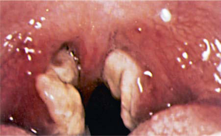
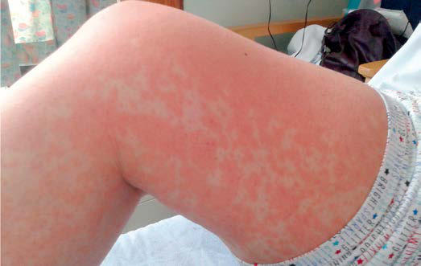

# Chapter 301: Epstein-Barr Virus
> **Course:** Vikkypaedia Pediatric Basic Course (*Nelson Textbook of Pediatrics, 22nd Edition (2025)*)  
> **Part XV:** Infectious Diseases  
> **Authors:** Terri L. Stillwell and Jason B. Weinberg  
> **Metrics:** 4,059 words · 2 tables/boxes · 2 figures · 9 genes · 8 flashcards · 5 MCQs  
> **Quick Navigation:** [🃏 Study 8 Flashcards](../flashcards/301_flashcards.md) · [📝 Take 5-Q MCQ Quiz](../mcqs/301_mcqs.md) · [📚 Part XV Guide](../parts/Part_XV.md) · [🧬 Syndrome & Genetics Atlas](../omim_gene_atlas.md) · [💊 Therapeutics Matrix](../therapies_matrix.md) · [🏠 Course Index](../../index.md)

## Key Genetic & Molecular Targets
`CD27`, `LYST`, `MAGT1`, `SH2D1A`, `STX11`, `STXBP2`, `TNFRSF9`, `UNC13D`, `XIAP`

## ⚡ High-Yield Nelson Pediatric Board Pearls
- As many as 5–10% of infectious mononucleosis–like illnesses are caused by other types of primary infections, particularly cytomegalovi rus but also pathogens such as Toxoplasma gondii, adenovirus, hepatitis viruses, and HIV.
- Primary EBV infection in adolescents and adults manifests in 30–50% of cases as the classic triad of fatigue, pharyngitis, and generalized lymphadenop athy, which constitute the major clinical manifestations of infectious mononucleosis.
- The pharyngitis is similar to that caused by streptococcal infection.
- DIAGNOSIS A presumptive diagnosis of infectious mononucleosis may be made by the presence of classic clinical symptoms with atypical lymphocytosis in the peripheral blood.
- The diagnosis is usually confirmed by serologic testing, either for heterophile antibody or specific EBV antibodies.
- Differential Diagnosis EBV is the most common cause of infectious mononucleosis.
- Infec tious mononucleosis–like illnesses may also be caused by primary infection with other pathogens, such as cytomegalovirus, T. gon dii, adenovirus, and HIV.

---
## Full Chapter Text, Tables & Figures
# Chapter 301: Epstein-Barr Virus

*Terri L. Stillwell and Jason B. Weinberg*

<!-- p.2569 -->
**Infectious mononucleosis** is the best-known clinical syndrome caused by Epstein-Barr virus (EBV). It is characterized by systemic somatic complaints consisting primarily of fatigue, malaise, fever, sore throat, and generalized lymphadenopathy. Originally described as glandular fever, it derives its name from the mononuclear lymphocytosis with atypical-appearing lymphocytes that accompany the illness.

**ETIOLOGY** EBV is a double-stranded DNA virus that is a member of the gamma herpesviruses and causes >90% of cases of infectious mononucleosis. Two distinct types of EBV, type 1 and type 2 (also called type A and type B), have been characterized and have 70–85% sequence homol ogy. EBV-1 is more prevalent worldwide, although EBV-2 is more com mon in Africa than in the United States and Europe. Both types lead to *persistent*, *lifelong*, *latent infection*. Dual infections with both types have been documented among immunocompromised persons. EBV-1 induces in vitro growth transformation of B lymphocytes more effi ciently than does EBV-2, but no type-specific disease manifestations or clinical differences have been identified.

As many as 5–10% of infectious mononucleosis–like illnesses are caused by other types of primary infections, particularly cytomegalovi rus but also pathogens such as *Toxoplasma gondii*, adenovirus, hepatitis viruses, and HIV. In the majority of EBV-negative cases of infectious mononucleosis, the exact cause remains unknown.

**EPIDEMIOLOGY** EBV infects more than 95% of the world’s population. It is transmit ted primarily via oral secretions. Among children, transmission may occur by exchange of saliva from child to child, such as occurs between children in out-of-home childcare. EBV is shed in oral secretions con sistently for more than 6 months after acute infection and then inter mittently for life. As many as 20–30% of healthy EBV-infected persons shed virus at any particular time. EBV is also found in male and female genital secretions, and some studies suggest the possibility of spread through sexual contact. Nonintimate contact, environmental sources, and fomites do not contribute to transmission of EBV.

Infection with EBV in developing countries and among socioeco nomically disadvantaged populations in developed countries usually

occurs during infancy and early childhood. In central Africa, almost all children are infected by 3 years of age. Among more affluent popu lations in industrialized countries, half of the population is infected by 6-8 years of age, with approximately 30% of infections occurring during adolescence and young adulthood. In the United States, sero prevalence increases with age, from approximately 54% for children 6-8 years to 83% for patients 18-19 years. Seroprevalence at each age is substantially higher for Mexican-Americans and non-Hispanic Blacks than for non-Hispanic Whites. Large differences are seen by family income, with highest seroprevalence in children of families with lowest income.

The epidemiology of the disease manifestations of infectious mono nucleosis is related to the age of acquisition of EBV infection. Primary infection with EBV during childhood is usually asymptomatic or mild and indistinguishable from other childhood infections. Primary EBV infection in adolescents and adults manifests in 30–50% of cases as the **classic triad of fatigue**, **pharyngitis**, **and generalized lymphadenop athy**, which constitute the major clinical manifestations of infectious mononucleosis. This syndrome may be seen at all ages but is rarely apparent in children younger than 4 years of age, when most EBV infec tions are asymptomatic, or in adults older than 40 years of age, when most individuals have already been infected by EBV. The true incidence of the syndrome of infectious mononucleosis is unknown but is esti mated to occur in 20-70 per 100,000 person-years. In young adults, the incidence increases to approximately 100 per 100,000 person-years. The prevalence of serologic evidence of past EBV infection increases with age; almost all adults in the United States are seropositive.

EBV infection has been implicated in other diseases, including both nonmalignant and malignant disorders such as lymphoproliferative diseases and lymphomas (Table 301.1). In addition, various mono genic immune susceptibility defects predispose to EBV-associated hemophagocytic lymphohistiocytosis, lymphoproliferative disorders, or lymphoma (Fig. 301.1; see also Chapter 174.3).

**PATHOGENESIS** After transmission by saliva to the oral cavity, EBV infects both oral epithelial cells and tonsillar B lymphocytes, although it is unclear which cells are the primary initial targets. Ongoing viral replication leads to viremia and dissemination of infected B lymphocytes into peripheral blood and the lymphoreticular system, including the liver and spleen. Clinical manifestations of infectious mononucleosis, which are due to the host immune response to EBV infection, occur after a 6-week incubation period following acute infection. The atypical lymphocytes that are frequently detected in patients with infectious mononucleosis are primarily CD8 T lymphocytes. Polyclonal CD8 T lymphocyte acti vation occurs early during the incubation period following infection, whereas expansion of EBV-specific CD8 T lymphocytes is detected closer to the time of symptom onset. Natural killer (NK) cells also

*Terri L. Stillwell and Jason B. Weinberg*

#### **Table 301.1** Diseases Caused by Epstein-Barr Virus Infection

| Category / Parameter | Clinical Details & Findings |
| --- | --- |
| **MALIGNANT DISEASES** | B lymphocytes; • B-lymphoproliferations (B-LPD); • Posttransplant B-LPD; • Hemophagocytic lymphohistiocytosis (HLH); • Hodgkin lymphoma (HL); • Diffuse large B cell lymphoma (DLBCL); • Burkitt lymphoma (BL); T/NK lymphocytes; • Systemic T/NK-cell type chronic active EBV (CAEBV); • Cutaneous CAEBV; • Hydroa vacciniforme–like lymphoproliferation (HVL); • Severe mosquito bite allergy (SMBA) |
| **• HLH** | • Systemic EBV+ T-cell lymphoma of; childhood (STLC); • Extranodal NK/T-cell lymphoma (ENKTL); • Aggressive NK cell leukemia (ANKL); Smooth muscle cells; • Smooth muscle tumor/leiomyoma (SMT); Epithelial cells; • Hairy leukoplakia*; • Nasopharyngeal carcinoma (NPC); • Gastric carcinoma; *Hairy leukoplakia is a benign epithelial/mucosal disease caused by uncontrolled lytic infection that occurs in immunocompromised patients. It is characterized by white patches with; hairy appearance on the tongue.; From Fournier B, Latour S. Immunity to EBV as revealed by immunodeficiencies. Curr Opin Immunol. 2021;72:107–115. Table 1. |

<!-- p.2570 -->
expand in frequency and number following infection, particularly a CD56dim CD16− NK cell subset that is more effective than other NK cell subsets at recognizing infected cells. The host immune response is effective in rapidly reducing the EBV viral load, although persistent shedding of high levels of virus can be detected in the oropharynx for up to 6 months. Intermittent shedding from the oropharynx occurs for many years following primary infection.

EBV, like the other herpesviruses, establishes lifelong latent infection after the primary infection. Latent virus persists primarily in memory B lymphocytes. The EBV genome persists as an episome in the nucleus of an infected cell and replicates with cell division. Viral integration into the cell genome is not typical. Only a few viral proteins, including the EBV-determined nuclear antigens (EBNAs), are produced during latency. These proteins are important in maintaining the viral episome during the latent state. Reactivation and new viral replication occur at a low rate in populations of latently infected cells and is responsible for intermittent viral shedding in oropharyngeal secretions of infected individuals. *Reactivation is unlikely to be accompanied by distinctive clinical symptoms*.

**CLINICAL MANIFESTATIONS** The incubation period of infectious mononucleosis in adolescents is 30- 50 days. In children, it may be shorter. The majority of cases of primary EBV infection in infants and young children are clinically silent. In older patients, the onset of illness is usually insidious and vague. Patients may complain of malaise, fatigue, acute or prolonged (>1 week) fever, head ache, sore throat, nausea, abdominal pain, and myalgia. This prodromal period may last 1-2 weeks. The complaints of sore throat and fever grad ually increase until patients seek medical care. Splenic enlargement may be rapid enough to cause left upper quadrant abdominal discomfort and tenderness, which may be the presenting complaint.

The **classic physical examination findings** are generalized lymph adenopathy (90% of cases), splenomegaly (50% of cases), and hepa tomegaly (10% of cases). Lymphadenopathy occurs most commonly in the anterior and posterior cervical nodes and the submandibular nodes and less commonly in the axillary and inguinal lymph nodes. Epitrochlear lymphadenopathy is particularly suggestive of infectious mononucleosis. Although liver enzymes are usually elevated, symp tomatic hepatitis or jaundice is uncommon. Splenomegaly to 2-3 cm below the costal margin is typical (15–65% of cases); massive enlarge ment is uncommon.

The sore throat is often accompanied by moderate to severe phar yngitis with marked tonsillar enlargement, occasionally with exudates (Fig. 301.2). Palatal petechiae at the junction of the hard and soft pal ate are frequently seen. The pharyngitis is similar to that caused by streptococcal infection. Other clinical findings may include rashes and edema of the eyelids. Rashes are usually maculopapular and have been reported in 3–15% of patients. Patients with infectious mono nucleosis who are treated with ampicillin or amoxicillin may experi ence an **ampicillin rash**, which may also occur with other β-lactam antibiotics (Fig. 301.3). This morbilliform, vasculitic rash is probably immune mediated and resolves without specific treatment. EBV can also be associated with Gianotti-Crosti syndrome, a symmetric rash on the cheeks with multiple erythematous papules, which may coalesce into plaques and persist for 15-50 days. The rash has the appearance of atopic dermatitis and may also appear on the extremities and buttocks.

**DIAGNOSIS** A presumptive diagnosis of infectious mononucleosis may be made by the presence of classic clinical symptoms with atypical lymphocytosis in the peripheral blood. The diagnosis is usually confirmed by serologic testing, either for heterophile antibody or specific EBV antibodies.

**Differential Diagnosis** EBV is the most common cause of infectious mononucleosis. Infec tious mononucleosis–like illnesses may also be caused by primary infection with other pathogens, such as cytomegalovirus, *T. gon dii*, adenovirus, and HIV. Streptococcal pharyngitis may cause sore throat and cervical lymphadenopathy indistinguishable from that of

*Hemophagocytic lymphohistiocytosis*

*B-cell lymphoproliferative disorders/Lymphoma*

*T/NK-cell cytotoxicity*

*defects*

*T-cell activation/expansion*

*defects*

*XIAP UNC13D STX11, STXBP2 RAB27 LYST PERF1*

*ITK, MAGT1,*

*CTPS1, RASGRP1,*

*DEF6, *CD70, TNFSF9**

**CD27** (20% HLH)

**TNFRSF9** (20% HLH)

**SH2D1A** (30% lymphoma)

**CD27** (20% HLH)

**TNFRSF9** (20% HLH)

**SH2D1A** (30% lymphoma)

**Fig. 301.1** Classification of gene defects predisposing to Epstein- Barr virus (EBV)-driven hemophagocytic lymphohistiocytosis (HLH) or B-cell lymphoproliferative disorders. Red circle, Gene defects associ ated with impaired cell-cytotoxicity causing HLH. Green circle, Gene defects associated with impaired T-cell activation/expansion causing B cell lymphoproliferative disorder (B-LPD)/lymphoma. Gene defects with a highly selective predisposition to EBV are in bold. In parentheses is the percentage of patients having developed HLH or B lymphoma for defects associated with both HLH and B-LPD/lymphoma. (From Fourni er B, Latour S. Immunity to EBV as revealed by immunodeficiencies. Curr Opin Immunol. 2021;72:107–115. Fig.1.)

**Fig. 301.2** Tonsillitis with membrane formation in infectious mononu cleosis. (Courtesy Alex J. Steigman, MD.)

**Fig. 301.3** Amoxicillin-induced rash in Epstein-Barr virus infection. Morbilliform maculopapular rash on the leg, which appeared shortly after starting amoxicillin. The rash is typical of that seen in the context of Epstein-Barr virus infection in patients treated with amoxicillin or am picillin. (From Norman SD, Murray IA, Shetty D, et al. Jaundice, abdomi nal pain, and fever in a young woman. Lancet. 2017;390:1713–1714. Fig. A.)

<!-- p.2571 -->
infectious mononucleosis, but it is not typically associated with hepato splenomegaly. Approximately 5% of cases of EBV-associated infectious mononucleosis have throat cultures positive for group A *Streptococcus*, representing pharyngeal streptococcal carriage. Failure of a patient with presumed streptococcal pharyngitis to improve within 48-72 hours should evoke suspicion of infectious mononucleosis. Hemato logic malignancies should also be considered in a patient with an infec tious mononucleosis–like illness, particularly when lymphadenopathy and hepatosplenomegaly are appreciated and the results of an initial laboratory evaluation are not consistent with an infectious etiology.

**Laboratory Diagnosis** The majority of patients (>90%) have a leukocytosis of 10,000-20,000 cells/μL, of which at least two thirds are lymphocytes; atypical lym phocytes usually account for 20–40% of the total number. The atypical cells are mature T lymphocytes that have been antigenically activated. Compared with regular lymphocytes microscopically, **atypical lym phocytes** are larger overall, with larger, eccentrically placed indented and folded nuclei with a lower nuclear-to-cytoplasm ratio. Although atypical lymphocytosis may be seen with many other infections associ ated with lymphocytosis, the highest degree of atypical lymphocytes is classically seen with EBV infection. Mild thrombocytopenia to 50,000-200,000 platelets/μL occurs in more than 50% of patients but only rarely is associated with purpura. Mild elevation of hepatic trans aminases occurs in approximately 75% of uncomplicated cases, but it is usually asymptomatic and without jaundice.

**Detection of Heterophile Antibodies Heterophile antibodies** are cross-reactive immunoglobulin (Ig) M antibodies that agglutinate mammalian erythrocytes but are not EBVspecific. Heterophile antibody tests, such as the **monospot** test, are positive in 90% of cases of EBV-associated infectious mononucleosis in adolescents and adults during the second week of illness, but in only up to 50% of cases in children younger than 4 years of age. Test results can remain positive for up to 12 months. The false-positive rate is low, generally <10%. A positive heterophile antibody test in a patient with classic clinical manifestations of mononucleosis strongly supports that diagnosis. However, because of the nonspecific nature of heterophile antibody testing, EBV-specific antibody testing should be performed when a precise diagnosis is necessary.

**Detection of Epstein-Barr Virus–Specific Antibodies** If the heterophile test result is negative and an EBV infection is sus pected, EBV-specific antibody testing is indicated. Measurement of antibodies to EBV proteins, including viral capsid antigen (VCA), Epstein-Barr nuclear antigen (EBNA), and early antigen (EA), are used most frequently (Fig. 301.4 and Table 301.2). The acute phase of infec tious mononucleosis is characterized by rapid IgM and IgG antibody responses to VCA in all cases and an IgG response to EA in most cases. The IgM response to VCA is transient but can be detected for at least 4 weeks and occasionally up to 3 months; in rare cases, anti-VCA IgM can persist even longer. The IgG response to VCA usually peaks late in the acute phase, declines slightly over the next several weeks to months, and then persists at a relatively stable level for life.

Anti-EA IgG antibodies are usually detectable for several months but may persist or be detected intermittently at low levels for many years. Antibodies to the diffuse-staining component of EA (EA-D) are found transiently in 80% of patients during the acute phase of infec tious mononucleosis. Antibodies to the cytoplasmic-restricted com ponent of EA (EA-R) emerge transiently in the convalescence from infectious mononucleosis. High levels of antibodies to EA-D or EA-R may be found also in immunocompromised patients with persistent EBV infections and active EBV replication.

Anti-EBNA IgG antibodies are the last to develop in infectious mononucleosis and gradually appear 3-4 months after the onset of illness and remain at low levels for life. Absence of anti-EBNA when other antibodies are present implies recent infection, whereas the pres ence of anti-EBNA implies infection occurring more than 3-4 months previously. The wide range of individual antibody responses and the

various laboratory methods used can occasionally make interpretation of an antibody profile difficult. The detection of IgM antibody to VCA is generally sufficient to confirm the diagnosis of acute EBV infection, although false positive results can still occasionally occur.

**Detection of Viral DNA** EBV DNA can be detected and viral genome copy number quantified in whole blood, peripheral blood mononuclear cells (PBMCs), and plasma using real-time polymerase chain reaction. EBV DNA can be detected in PBMCs and plasma of patients with infectious mononu cleosis for a brief period after the onset of symptoms and in PBMCs for an extended period. However, detection of EBV DNA is usually not necessary to diagnose infectious mononucleosis in immunocompetent patients with typical manifestations of disease. In contrast, serial mea surements of EBV genome copy number are often used following solid organ or hematopoietic stem cell transplantation as surveillance for posttransplant lymphoproliferative disease (PTLD). Very high or con sistently increasing EBV genome copy number suggests an increased risk for PTLD, although definitive diagnosis is typically based on tissue biopsy. The frequency and duration of monitoring EBV genome copy number is determined by the time after transplant and risk factors such as the type of transplant and the degree of immunosuppression. Serial measurement of EBV genome copy number can be useful in monitor ing response to therapy for PTLD. Measurement of EBV genome copy number can also be used for screening and to determine prognosis for some EBV-associated malignancies, such as nasopharyngeal carci noma and Hodgkin lymphoma.

**COMPLICATIONS** Severe complications are unusual in patients with infectious mononu cleosis. Splenic rupture, either spontaneous or following mild trauma, may occur in approximately 0.1% of cases but is rarely fatal. Airway obstruction due to swelling of oropharyngeal lymphoid tissue occurs in <5% of cases. A variety of neurologic conditions have been associated with EBV infectious mononucleosis. Headache is a common symptom, but symptomatic meningitis or encephalitis is uncommon. More severe neurologic manifestations, such as seizures and ataxia, may occur in 1–5% of cases. Perceptual distortions of sizes, shapes, and spatial rela tionships, known as the **Alice in Wonderland syndrome (metamor phopsia)**, may be a presenting symptom. Some reports suggest an association between infectious mononucleosis and the possible devel opment of multiple sclerosis. Hematologic abnormalities such as mild hemolytic anemia, thrombocytopenia, and neutropenia are relatively common, but aplastic anemia, severe thrombocytopenia, and severe neutropenia are rare. Other rare complications include myocarditis, interstitial pneumonia, pancreatitis, parotitis, and orchitis.

Patients with dysregulated immune responses to primary infection, such as individuals with primary or secondary **hemophagocytic lym phohistiocytosis (HLH)**, can develop severe, life-threatening com plications with primary EBV infection (see Fig. 301.1). Patients with other primary immunodeficiencies that result in failure to control EBV infection and/or abnormal inflammatory responses to infection are at risk for severe manifestations of EBV infection, often with fulminant infectious mononucleosis, chronic viremia, dysgammaglobulinemia, and lymphoproliferation. Immunodeficiencies most commonly linked to severe EBV infection tend to be those affecting aspects of NK cell, T lymphocyte, and NKT lymphocyte function. Examples include X-linked lymphoproliferative (XLP) syndrome, which is caused by variants in genes encoding the signaling lymphocytic activation mole cule (SLAM)-associated protein (SAP) or X-linked inhibitor of apopto sis (XIAP); X-linked immunodeficiency with magnesium defect, EBV infection, and neoplasia (XMEN), caused by mutations in *MAGT1*, which encodes a magnesium transporter protein; and deficiencies in interleukin-2–inducible T-cell kinase (ITK), CD27, or CD70 (see Fig. 301.1; Chapter 174.3).

**ONCOGENESIS** Infection with EBV, the first human virus to be associated with malig nancy, accounts for up to 2% of cancers worldwide (see Table 301.1).

<!-- p.2572 -->
Manipulation of infected cells by EBV can lead to transformation and oncogenesis. EBV is associated with lymphoid malignancies, such as Burkitt lymphoma, Hodgkin lymphoma, aggressive NK cell leukemia, T- and NK-cell lymphoproliferative disorder, and epithelial cell malig nancies such as nasopharyngeal carcinoma and gastric carcinoma.

**Endemic Burkitt lymphoma** is the most common childhood cancer in equatorial East Africa and Papua New Guinea. These regions are holoendemic for *Plasmodium falciparum* malaria and have a high rate of EBV infection early in life. Constant exposure to malaria is thought to act as a B lymphocyte mitogen that contributes to the polyclonal B-lymphocyte proliferation with EBV infection, impairs T lymphocyte surveillance of EBV-infected B lymphocytes, and increases the risk for developing Burkitt lymphoma. Approximately 98% of cases of endemic Burkitt lymphoma contain the EBV genome compared with only 20% of nonendemic (sporadic) Burkitt lymphoma cases in other areas of the world.

The incidence of **Hodgkin lymphoma** peaks in childhood in devel oping countries and in young adulthood in developed countries. Infec tion with EBV increases the risk for Hodgkin lymphoma by a factor of 2-4, with the risk of developing Hodgkin lymphoma peaking at 2.4 years following infectious mononucleosis. EBV is associated with more than half of cases of mixed-cellularity Hodgkin lymphoma and approximately one quarter of cases of the nodular sclerosing subtype, but it is rarely associated with lymphocyte-predominant Hodgkin

lymphoma. Immunohistochemical studies have localized EBV to the Reed-Sternberg cells and their variants, the pathognomonic malignant cells of Hodgkin lymphoma.

Numerous congenital and acquired immunodeficiency syn dromes are associated with an increased incidence of EBV-associated B-lymphocyte lymphoma, especially central nervous system lymphoma and leiomyosarcoma (see Fig. 301.1). Congenital immunodeficiencies predisposing to EBV-associated lymphoproliferation include XLP syn drome, common-variable immunodeficiency, ataxia-telangiectasia, Wiskott-Aldrich syndrome, and Chédiak-Higashi syndrome. Indi viduals with acquired immunodeficiencies resulting from anticancer chemotherapy, immunosuppression after solid organ or hematopoietic cell transplantation, or HIV infection have a significantly increased risk for EBV-associated lymphoproliferation. The lymphomas may be focal or diffuse and are usually histologically polyclonal but may become monoclonal. EBV-associated PTLD can occur following solid organ transplantation and, less commonly, allogeneic hematopoietic cell transplantation. The most important risk factors for PTLD are the degree of T lymphocyte immunosuppression and recipient EBV serostatus.

**TREATMENT** There is no specific treatment for infectious mononucleosis. The main stays of management are rest, adequate fluid and nutrition intake, and symptomatic treatment to manage fever, throat discomfort, and malaise. Bed rest is necessary only when the patient has debilitating fatigue. As soon as there is definite symptomatic improvement, the patient should be encouraged to resume normal activities. Because blunt abdominal trauma may predispose patients to splenic rupture, it is customary and prudent to advise against participation in contact sports and strenuous athletic activities during the first 2-3 weeks of ill ness or while splenomegaly is present.

*Antiviral therapy is not recommended.* Although nucleoside analogs such as acyclovir and ganciclovir inhibit viral replication in vitro and decrease the duration of oropharyngeal viral shedding in patients with infectious mononucleosis, they have not been shown to provide con sistent clinical benefit for patients with infectious mononucleosis or EBV-associated malignancies. Short courses of corticosteroids may be helpful for selected complications of infectious mononucleosis, such as airway obstruction, but there are insufficient data to support the use of corticosteroids to control typical symptoms in patients with infec tious mononucleosis. Adoptive immunotherapy involving the infusion of EBV-specific cytotoxic T lymphocytes has shown some promise in early trials for transplant recipients with PTLD and for other patients with EBV-associated malignancies.

**PROGNOSIS** The prognosis for complete recovery is excellent. The major symptoms typically last 2-4 weeks, followed by gradual recovery within 2 months of symptom onset. Cervical lymphadenopathy and fatigue may resolve more slowly. Prolonged and debilitating fatigue and malaise may wax and wane for several weeks to 6 months and are common complaints even in otherwise unremarkable cases. Occasional persistence of fatigue for a few years after infectious mononucleosis is well recog nized. There is no convincing evidence linking EBV infection or EBV reactivation to chronic fatigue syndrome.

**PREVENTION** Vaccination against EBV would be an appealing strategy to prevent acute disease (infectious mononucleosis) and complications such as EBV-associated malignancies. Early clinical trials using strategies targeting the EBV gp350 envelope glycoprotein demonstrated some protection against symptomatic infectious mononucleosis, although vaccination did not prevent EBV infection. No EBV vaccine is cur rently approved for clinical use.

*Visit Elsevier eBooks+ at eBooks.Health.Elsevier.com** for Bibliography.*

VCA-IgG

EBNA-IgG

EA-IgG

Antibody titer

0 2 4 2 4 6 1 2 3 Weeks Months Years Time after onset of symptoms

VCA-IgM

Infectious mononucleosis

**Fig. 301.4** Kinetics of antibody responses to Epstein-Barr virus (EBV) antigens in infectious mononucleosis. EA, Early antigen; EBNA, EBV- determined nuclear antigens; IgG, immunoglobulin G; IgM, immuno globulin M; VCA, viral capsid antigen.

Responses to Epstein-Barr Virus Infection

#### **Table 301.2** Correlation of Clinical Status and Antibody

| Category / Parameter | Clinical Details & Findings |
| --- | --- |
| **EBNA IgG** | Susceptible; −; −; −; −; Acute primary; infection; +; +; ±; −; Recent primary; infection; ±; +; ±; ±; Past infection; −; +; ±; +; EA, Early antigen (typically the diffuse staining component, or EA-D); EBNA, EBV-; determined nuclear antigens; EBV, Epstein-Barr virus; IgG, immunoglobulin G; IgM,; immunoglobulin M; VCA, viral capsid antigen. |

<!-- p.2573 -->
