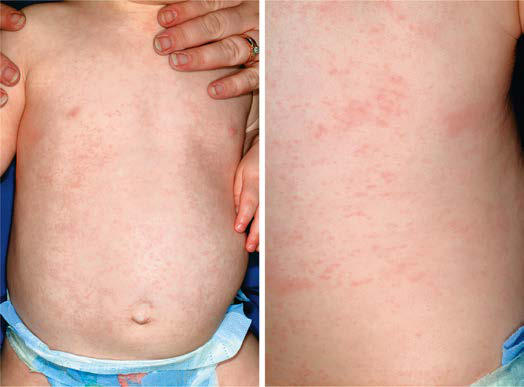

# Chapter 303: Roseola (Human Herpesviruses 6 and 7)
> **Course:** Vikkypaedia Pediatric Basic Course (*Nelson Textbook of Pediatrics, 22nd Edition (2025)*)  
> **Part XV:** Infectious Diseases  
> **Authors:** Brenda L. Tesini  
> **Metrics:** 3,556 words · 0 tables/boxes · 2 figures · 0 genes · 8 flashcards · 5 MCQs  
> **Quick Navigation:** [🃏 Study 8 Flashcards](../flashcards/303_flashcards.md) · [📝 Take 5-Q MCQ Quiz](../mcqs/303_mcqs.md) · [📚 Part XV Guide](../parts/Part_XV.md) · [🧬 Syndrome & Genetics Atlas](../omim_gene_atlas.md) · [💊 Therapeutics Matrix](../therapies_matrix.md) · [🏠 Course Index](../../index.md)

## ⚡ High-Yield Nelson Pediatric Board Pearls
- It is characterized by the abrupt onset of high fever, which may be accompanied by fussi ness.
- The mean duration of illness caused by primary HHV-6B infection is 6 days, with 15% of children having fever for 6 or more days.
- Primary infection with HHV-7 has been identified in a small number of children with roseola in whom the illness is indistinguish able from that caused by HHV-6B.
- Secondary cases of roseola caused by infection with HHV-7 have also been reported.
- Results of CSF analyses reported in patients with encephalitis thought to be caused by HHV-6 have been normal or demonstrated only minimal CSF pleocytosis with mild elevations of protein, espe cially early in the course of the disease, which may progress with time.
- DIAGNOSIS Although roseola is generally a benign self-limited disease, its diagnosis can exclude other, more serious disorders that cause fever and rash.
- A history of 3 days of high fever in an otherwise nontoxic 10-month-old infant with a blanching maculopapular rash on the trunk suggests a diagnosis of roseola.

---
## Full Chapter Text, Tables & Figures
# Chapter 303: Roseola (Human Herpesviruses 6 and 7)

*Brenda L. Tesini*

<!-- p.2582 -->
Human herpesvirus 6 (HHV-6A and HHV-6B) and human herpesvi rus 7 (HHV-7) cause ubiquitous infection in infancy and early child hood. HHV-6B is responsible for the majority of cases of **roseola infantum** (**exanthem subitum** or **sixth disease**) and is associated with other diseases, including encephalitis, especially in immunocompro mised hosts. A small percentage of children with roseola have primary infection with HHV-7.

**ETIOLOGY** HHV-6A, HHV-6B, and HHV-7 are the sole members of the Roseo lovirus genus in the Betaherpesvirinae subfamily of human herpesvi ruses. Human cytomegalovirus, the only other β-herpesvirus, shares limited sequence homology with HHV-6 and HHV-7. Morphologically all human herpesviruses are composed of an icosahedral nucleocapsid, protein-dense tegument, and lipid envelope. Within the nucleocapsid, HHV-6 and HHV-7 both contain large, linear, double-stranded DNA genomes that encode more than 80 unique proteins.

Initially, two strain groups of HHV-6 were recognized: HHV-6 vari ant A and HHV-6 variant B. Despite sharing highly conserved genomes with approximately 90% sequence identity, the two variants could be distinguished by restriction fragment length polymorphisms, reactiv ity with monoclonal antibodies, differential cell tropism, and epidemi ology. Because of these differences, the two were reclassified as separate species in the genus Roseolovirus by the International Committee on the Taxonomy of Viruses in 2012. HHV-6A detection is quite rare, and HHV-6B is the overwhelmingly predominant virus found in both immunocompetent and immunocompromised hosts. Previous reports of HHV-6A detection in children in Africa have not been substantiated in a large cohort using a more specific PCR target.

**EPIDEMIOLOGY** Primary infection with HHV-6B is acquired rapidly by essentially all children after the loss of maternal antibodies in the first few months of infancy, with 95% of children being infected by 2 years of age. The peak age of primary HHV-6B infection is 6-9 months of life, with infections occurring sporadically and without seasonal predilection or contact with other ill individuals. Infection with HHV-7 is also widespread but occurs later in childhood and at a slower rate; only 50% of children have evidence of prior infection with HHV-7 by 3 years of age. Sero prevalence reaches 75% by 6 years of age. In a small study of children with primary HHV-7 infection, the mean age of the patients was 26 months, significantly older than that of children with primary HHV-6 infection.

Preliminary data suggest that the majority of children acquire pri mary infection with HHV-6 from the saliva or respiratory droplets of asymptomatic adults or older children. However, congenital infection with HHV-6 occurs in 1% of newborns. Two mechanisms of vertical transmission of HHV-6 have been identified: transplacental infection and chromosomal integration. HHV-6 is unique among the human her pesviruses in that it is integrated at the telomere end of human chromo somes at a frequency of 0.2–2.2% of the population and is passed from parent to child via the germline. Chromosomal integration of HHV-7 has been suggested in only a single case report thus far. Chromosomal integration has been identified as the major mechanism by which HHV-6 is vertically transmitted, accounting for 86% of congenital

infections, with one third resulting from HHV-6A, a percentage much higher than in primary infection in the United States. The clinical con sequences of chromosomal integration or transplacental infection with HHV-6 have yet to be determined. In one series of infants identified with HHV-6 congenital infection, no evidence of disease was present in the early neonatal period. However, reactivation of chromosomally integrated HHV-6 virus has been demonstrated following hematopoi etic stem cell transplantation (HSCT). Primary infection with HHV-7 is presumed to be spread by the saliva of asymptomatic individuals. DNA of both HHV-6 and HHV-7 has been identified in the cervical secretions of pregnant women, suggesting an additional role for sexual or perinatal transmission of these viruses. Breast milk does not appear to play a role in transmission of either HHV-6 or HHV-7.

**PATHOLOGY AND PATHOGENESIS** Primary HHV-6B infection causes a viremia that can be demon strated by co-culture of the patient’s peripheral blood mononuclear cells with mitogen-stimulated cord blood mononuclear cells. HHV-6 has a recognizable cytopathic effect, consisting of the appearance of large refractile mononucleated or multinucleated cells with intracyto plasmic and/or intranuclear inclusions. Infected cells exhibit a slightly prolonged life span in culture; however, lytic infection predominates. HHV-6 infection also induces apoptosis of T cells. In vitro, HHV-6 can infect a broad range of cell types, including primary T cells, monocytes, natural killer cells, dendritic cells, and astrocytes. HHV-6 has also been documented to infect B-cell, megakaryocytic, endothelial, and epithe lial cell lines. Human astrocytes, oligodendrocytes, and microglia have been infected with HHV-6 ex vivo. The broad tropism of HHV-6 is consistent with the recognition that CD46, present on the surface of all nucleated cells, is a cellular receptor for HHV-6, HHV-6A in particular. CD134, a member of the TNFR superfamily, is the main entry receptor for HHV-6B and may explain some of the differences in tissue tropism noted between HHV-6A and HHV-6B. The CD4 molecule has been identified as a receptor for HHV-7. HHV-7 has been demonstrated to reactivate HHV-6 from latency in vitro, but whether this phenomenon occurs in vivo is not clear.

Primary infection with HHV-6 and HHV-7 is followed by **lifelong latency** or persistence of virus at multiple sites. HHV-6 exists in a true state of viral latency in monocytes and macrophages. The detection of replicating HHV-6 in cultures of primary CD34+ hematopoietic stem cells has also been described, suggesting that cellular differentiation is a trigger of viral reactivation. This observation is clinically significant because HHV-6 may cause either primary or reactivated infection dur ing HSCT. Additionally, HHV-6 and HHV-7 infection may be persis tent in salivary glands, and DNA of both HHV-6 and HHV-7 can be routinely detected in the saliva of both adults and children. HHV-7 can also be isolated in tissue culture from saliva, but HHV-6 cannot. HHV-6 DNA has been identified in the cerebrospinal fluid (CSF) of children, both during and subsequent to primary infection, as well as in brain tissue from immunocompetent adults at autopsy, implicating the central nervous system (CNS) as an additional important site of either viral latency or persistence. HHV-7 DNA has also been found in adult brain tissue but at a significantly lower frequency.

**CLINICAL MANIFESTATIONS** Roseola infantum (**exanthem subitum**, or **sixth disease**) is an acute, self-limited disease of infancy and early childhood. It is characterized by the abrupt onset of high fever, which may be accompanied by fussi ness. The fever usually resolves acutely after 72 hours (crisis) but may gradually fade over a day (lysis) coincident with the appearance of a faint pink or rose-colored, nonpruritic, 2- to 3-mm morbilliform rash on the trunk (Fig. 303.1). The rash usually lasts 1-3 days but is often described as evanescent and may be visible only for hours, spreading from the trunk to the face and extremities. Because the rash is vari able in appearance, location, and duration, it is not distinctive and may be missed. Associated signs are few but can include mild injection of the pharynx, palpebral conjunctivae, or tympanic membranes and

*Brenda L. Tesini*

<!-- p.2583 -->
enlarged suboccipital nodes. In Asian countries, ulcers at the uvulo palatoglossal junction **(Nagayama spots)** are commonly reported in infants with roseola.

High fever (mean: 39.7°C [103.5°F]) is the most consistent find ing associated with primary HHV-6B infection. Rash detected either during the illness or following defervescence has been reported in approximately 20% of infected children in the United States. Additional symptoms and signs include irritability, inflamed tympanic membranes, rhinorrhea and congestion, gastrointestinal complaints, and encephalopathy. Symptoms of lower respiratory tract involvement such as cough are identified significantly less fre quently in children with primary HHV-6B infection than in children with other febrile illnesses. The mean duration of illness caused by primary HHV-6B infection is 6 days, with 15% of children having fever for 6 or more days. Primary infection with HHV-6B accounts for a significant burden of illness on the healthcare system; one study found that 24% of visits to emergency departments by infants between 6 and 9 months of age were because of primary HHV-6B infection. A population-based study of primary HHV-6B infection confirmed that 93% of infants had symptoms and were more likely to visit a physician than noninfected infants. Fever was less likely to be present with HHV-6B infection in children younger than 6 months of age but was significantly more common in older infants and children.

Much less is known about the clinical manifestations of HHV-7 infection. Primary infection with HHV-7 has been identified in a small number of children with roseola in whom the illness is indistinguish able from that caused by HHV-6B. Secondary cases of roseola caused by infection with HHV-7 have also been reported. Additionally, pri mary infection with HHV-7 may be asymptomatic or may cause a non specific febrile illness lasting approximately 3 days.

**LABORATORY FINDINGS** The most characteristic laboratory findings noted in children with pri mary HHV-6B infection are lower mean numbers of total white blood cells (8,900/μL), lymphocytes (3,400/μL), and neutrophils (4,500/μL) than in febrile children without primary HHV-6B infection. Similar hematologic findings have been reported during primary infection with HHV-7. Thrombocytopenia, elevated serum transaminase values, and atypical lymphocytes have also been noted sporadically in children with primary HHV-6B infection.

Results of CSF analyses reported in patients with encephalitis thought to be caused by HHV-6 have been normal or demonstrated only minimal CSF pleocytosis with mild elevations of protein, espe cially early in the course of the disease, which may progress with time. Areas of hyperintense signal on T2 weighted and fluid attenu ation inversion recovery images of the hippocampus, uncus, and amygdala have been found on MRI, and increased metabolism within the hippocampus has been observed on positron emission tomogra phy scanning.

**DIAGNOSIS** Although roseola is generally a benign self-limited disease, its diagnosis can exclude other, more serious disorders that cause fever and rash. A history of 3 days of high fever in an otherwise nontoxic 10-month-old infant with a blanching maculopapular rash on the trunk suggests a diagnosis of roseola. **A specific diagnosis of HHV-6 is not usually necessary except in situations in which the manifestations of the infection are severe or unusual and might benefit from antiviral therapy.**

**The diagnosis of primary infection with either HHV-6 or HHV-7 is confirmed by demonstrating the presence of actively replicating virus in the patient’s blood sample coupled with seroconversion.** Viral culture is the gold standard method to document active viral replication. Unfortunately, culture is expensive, time consuming, and available only in research laboratories. Two other methods used to identify active HHV-6 replication are the detection of viral DNA by PCR on acellular fluids such as plasma or reverse transcriptase PCR on peripheral blood mononuclear cell samples designed to detect viral transcription and protein production. Quantitative PCR for HHV-6 genome copy numbers on various specimens is also frequently reported and is commercially available. However, the role of this methodology is not clear, as a specific value of DNA that can discriminate between patients with viremia and those who are culture negative has not been determined. Complicating the use of molecular assays for the detec tion of active replication of HHV-6 is the recognition that individuals with chromosomally integrated HHV-6 have persistent HHV-6 DNA in plasma, peripheral blood mononuclear cells, and CSF in the absence of disease and replicating virus.

Serologic methods such as indirect immunofluorescence assays, enzyme-linked immunosorbent assays, neutralization assays, and immunoblot have been described for the measurement of concentra tions of antibodies to HHV-6 and HHV-7 in serum or plasma and are commercially available. Although immunoglobulin M antibody is produced early in infection with HHV-6, assays designed to measure this response have not proved useful in the diagnosis of primary or reactivated infection. The absence of immunoglobulin G antibody in an infant older than 6 months of age combined with the presence of replicating virus is strong evidence of primary infection with either HHV-6 or HHV-7. Alternatively, the demonstration of seroconver sion between acute and convalescent samples also confirms primary infection but is not clinically useful in the acute care setting. Unfortu nately, serologic assays have not been found reliable in the detection of HHV-6 reactivation and cannot be used to differentiate between infec tion with HHV-6A and infection with HHV-6B. Additionally, limited antibody cross-reactivity has been demonstrated between HHV-6 and HHV-7, complicating the interpretation of serologic assays, especially if low titers are reported.

**Differential Diagnosis** Primary infection with either HHV-6B or HHV-7 usually causes an undifferentiated febrile illness that may be very difficult to dis tinguish from other common viral infections of childhood. This difficulty also applies to the early stages of roseola, before the devel opment of rash. Once the rash is present, roseola may be confused with other exanthematous diseases of childhood, especially measles and rubella. Children with **rubella** often have a prodrome charac terized by mild illness with low-grade fever, sore throat, arthralgia,

A B

**Fig. 303.1** Roseola infantum. A, Erythematous, blanching macules and papules in an infant who had high fever for 3 days preceding de velopment of the rash. B, On closer inspection some lesions reveal a subtle peripheral halo of vasoconstriction. (From Paller AS, Mancinin AJ, eds. Hurwitz Clinical Pediatric Dermatology, 3rd ed. Philadelphia: Elsevier; 2006: p. 434)

<!-- p.2584 -->
and gastrointestinal complaints, unlike those with roseola. On physi cal examination, suboccipital and posterior auricular lymph nodes are prominent up to 1 week before the rash of rubella is evident and persist during the exanthematous phase. Additionally, the rash of rubella usually begins on the face and spreads to the chest, like that in measles. The associated symptoms of **measles** virus infection include cough, coryza, and conjunctivitis, with high fever coincident with the development of rash, unlike in roseola. Roseola may also be confused with scarlet fever, though the latter is rare in children younger than 2 years of age and causes a characteristic sandpaper-like rash concur rent with fever.

Roseola may be confused with illness caused by **enterovirus infections**, especially in the summer and fall months. Drug hyper sensitivity reactions may also be difficult to distinguish from roseola. Antibiotics are frequently prescribed for children with fever from roseola before the appearance of rash. A child who then demonstrates rash after the resolution of fever may erroneously be labeled as being drug allergic.

**COMPLICATIONS** Convulsions are the most common complication of roseola and are recognized in up to one third of patients. Seizures are also the most common complication of children with documented primary HHV- 6B infection, occurring in approximately 15%, with a peak age of 12-15 months. Children with primary HHV-6B infection are also reported to have a higher frequency of partial seizures, prolonged seizures, postictal paralysis, and repeated seizures than are children with febrile seizures not associated with HHV-6. In a study limited to children with primary HHV-6B infection and seizures, 30% of patients had prolonged seizures, 29% had focal seizures, and 38% had repeated seizures. A prospective study of children 2-35 months of age with suspected encephalitis or severe febrile illness with convulsions found that 17% had primary infection with either HHV-6 or HHV-7, and status epilepticus was the most common presentation. Among children with febrile status epilepticus (FSE), primary or reactivated infection with HHV-6B or HHV-7 has been identified in approxi mately one third.

An association between recurrent seizures and reactivated or per sistent infection of the CNS by HHV-6 has also been suggested. Stud ies evaluating brain tissue specimens implicate HHV-6 in as many as 60% of patients with temporal lobe epilepsy (TLE), high viral loads being found in the hippocampus or lateral temporal lobe regions. HHV-6 is postulated to induce neuroinflammation and potential injury via innate and adaptive immune system activation as a result of the broad tissue tropism of the virus. Subsequent neuronal hyper excitability through the loss of glutamate regulatory control and increased blood-brain barrier permeability have been proposed as possible mechanisms for the development of recurrent seizures based on animal models and clinical data of patients with TLE and HHV-6 DNA detected in CNS specimens. Contrary to these findings, limited clinical data suggest that there may be a decreased risk of recurrent seizures after primary infection with HHV-6 and febrile seizures than of febrile seizures from other causes. Additionally, children with FSE associated with HHV-6B and HHV-7 had similar seizure character istics and a similar proportion of electroencephalography and MRI hippocampal abnormalities as children with FSE not associated with HHV-6B or HHV-7, suggesting a shared pathogenesis to other etiolo gies of FSE.

Case reports and small-patient series have described additional complications in children with primary HHV-6B infection, including encephalitis, acute disseminated demyelination, autoimmune enceph alitis, acute cerebellitis, hepatitis, and myocarditis. Late-developing long-term sequelae, including developmental disabilities and autisticlike features, are reported rarely in children who have CNS symptoms during primary HHV-6B infection.

Reactivation of HHV-6 has been reported in several different popu lations with and without disease with the use of various methods of detection. The best documentation of HHV-6 reactivation has been in immunocompromised hosts, especially those patients who have under gone HSCT. Such reactivation occurs in approximately 50% of patients, typically at 2-4 weeks after transplantation, and the risk of reactiva tion is associated with a lack of donor-derived HHV-6–specific T-cell immunity. Many of the clinical complications seen following HSCT have been associated with HHV-6B reactivation, including fever, rash, delayed engraftment of platelets or monocytes, and graft-versus-host disease, with variable degrees of support in the literature for each. HHV-6 reactivation has been associated with worse overall survival compared with HSCT recipients who did not experience reactivation.

HHV-6B reactivation has also been reported as a cause of encephali tis in both immunocompetent and immunocompromised hosts. A dis tinct syndrome of **posttransplant acute limbic encephalitis (PALE)** has been described primarily in patients following HSCT, especially cord blood stem cell transplantation; it is characterized by short-term memory dysfunction, confusion, and insomnia, with seizures noted either clinically or on prolonged electroencephalography monitoring. HHV-6B DNA has been identified in the CSF in the majority of these patients, with additional evidence of reactivation by detection of HHV- 6B DNA in plasma. HHV-6 proteins were identified in the astrocytes of the hippocampus in one postmortem specimen, consistent with active HHV-6B infection at the time of death. The development of PALE is associated with increased mortality and long-term neurocognitive sequelae.

**TREATMENT** Supportive care is usually all that is needed for infants with rose ola. Parents should be advised to maintain hydration and may use antipyretics if the child is especially uncomfortable with the fever. Specific antiviral therapy is not recommended for routine cases of primary HHV-6B or HHV-7 infection. Unusual or severe manifes tations of primary or presumed reactivated HHV-6B infection such as encephalitis/PALE, especially in immunocompromised patients, may benefit from treatment. Ganciclovir, foscarnet, and cidofovir all demonstrate inhibitory activity against HHV-6 in  vitro, simi lar to their activity against cytomegalovirus. Case reports suggest that all three drugs, alone or in combination, can decrease HHV-6 viral replication, as evidenced by decreased viral loads in plasma and CSF. However, clinical data regarding efficacy are sparse and contradictory, with no randomized trials to guide use. Additionally, in vitro resistance of HHV-6 to all three drugs has been described. Despite these drawbacks, treatment with ganciclovir or foscarnet as first-line agents has been recommended for a minimum of 3 weeks in patients with PALE. Foscarnet appears to be most likely to have activity against HHV-7 on the basis of in vitro testing, but no clini cal data are available.

**PROGNOSIS** Roseola is generally a self-limited illness associated with complete recovery. The majority of children with primary infections with HHV-6B and HHV-7 also recover uneventfully without sequelae. Although seizures are a common complication of primary infection with HHV-6B and HHV-7, the risk of recurrent seizures does not appear to be higher than that associated with other causes of simple febrile seizures.

**PREVENTION** Primary infections with HHV-6 and HHV-7 are widespread through out the human population with no current means of interrupting transmission.

*Visit Elsevier eBooks+ at eBooks.Health.Elsevier.com** for Bibliography.*

<!-- p.2585 -->
