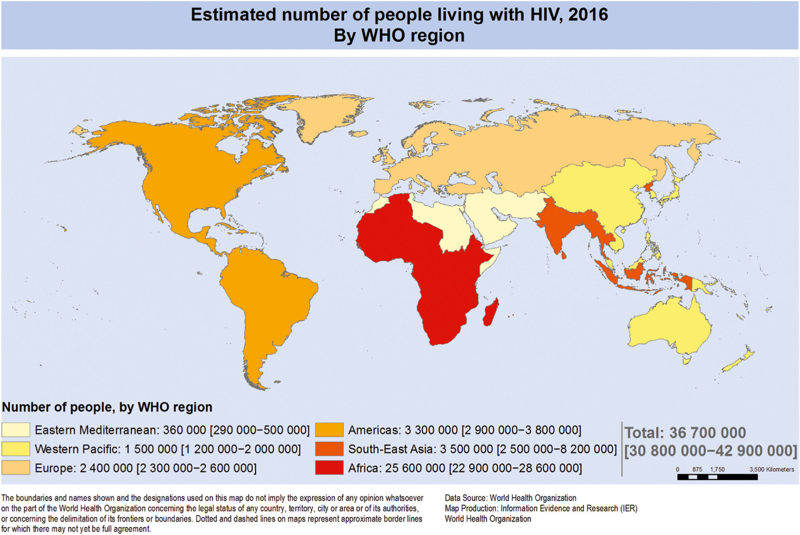
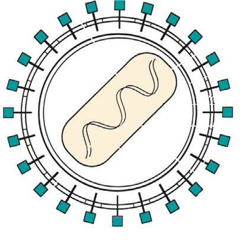

# Chapter 322: Human Immunodeficiency Virus and Acquired Immunodeficiency Syndrome
> **Course:** Vikkypaedia Pediatric Basic Course (*Nelson Textbook of Pediatrics, 22nd Edition (2025)*)  
> **Part XV:** Infectious Diseases  
> **Authors:** Ericka V. Hayes  
> **Metrics:** 29,291 words · 17 tables/boxes · 2 figures · 3 genes · 8 flashcards · 5 MCQs  
> **Quick Navigation:** [🃏 Study 8 Flashcards](../flashcards/322_flashcards.md) · [📝 Take 5-Q MCQ Quiz](../mcqs/322_mcqs.md) · [📚 Part XV Guide](../parts/Part_XV.md) · [🧬 Syndrome & Genetics Atlas](../omim_gene_atlas.md) · [💊 Therapeutics Matrix](../therapies_matrix.md) · [🏠 Course Index](../../index.md)

## Key Genetic & Molecular Targets
`GALT`, `INS`, `UGT1A1`

## ⚡ High-Yield Nelson Pediatric Board Pearls
- The diagnosis of HIV-2 infection is more difficult because of major differences in the genetic sequences between HIV-1 and HIV-2.
- It is estimated that 50% of HIV-positive youth, the highest rate of any age group, are unaware of their diagnosis.
- Recently, infant feeding recommendations for breastfeeding (or chestfeeding) persons with HIV in resource-rich settings have evolved as well, given that the risk of transmission via breastfeeding from an individual on suppressive cART is very low (<1%) (see “Prevention” for more discussion).
- In most cases, the initial infection is caused by low amounts of a single founder virus.
- Therefore disease may be prevented by drug prophylaxis or vaccine.
- With establish ment of a cellular and humoral immune response within 2-4 months, the viral load in the blood declines substantially, and patients enter a phase characterized by a lack of symptoms and a return of CD4 cells to only moderately decreased levels.
- The Centers for Disease Control and Prevention (CDC) Surveillance Case Definition for HIV infection is based on the age-specific CD4+ T-lymphocyte count or the CD4+ T-lymphocyte percentage of total lymphocytes, except when a stage 3–defining opportu nistic illness supersedes the CD4 data.

---
## Full Chapter Text, Tables & Figures
# Chapter 322: Human Immunodeficiency Virus and Acquired Immunodeficiency Syndrome

*Ericka V. Hayes*

<!-- p.2685 -->
Advances in research and major improvements in the treatment and management of HIV infection have brought about a substantial decrease in the incidence of new HIV infections and AIDS in children. Globally, from 2000–2015, there has been an estimated 70% decline in new infections in children age 0-14 years, largely the result of antiret roviral treatment (ART) of HIV-infected pregnant individuals for the prevention of vertical transmission. Of adults and children with HIV infection, 70% live in sub-Saharan Africa, where the disease continues to have a devastating impact (Fig. 322.1). Children experience more rapid disease progression than adults, with up to half of untreated chil dren dying within the first 2 years of life. This rapid progression is cor related with a higher viral burden and faster depletion of infected CD4 lymphocytes in infants and children than in adults. Accurate diagnos tic tests and the early initiation of potent drugs to inhibit HIV replica tion have dramatically increased the ability to prevent progression and control this disease.

**ETIOLOGY** HIV-1 and HIV-2 are members of the Retroviridae family and belong to the *Lentivirus* genus, which includes cytopathic viruses causing diverse diseases in several animal species. The HIV-1 genome con tains two copies of single-stranded RNA that is 9.2 kb in size. At both ends of the genome there are identical regions, called long terminal repeats, which contain the regulation and expression genes of HIV. The remainder of the genome includes three major sections: the GAG region, which encodes the viral core proteins (p24 [capsid protein: CA], p17 [matrix protein: MA], p9, and p6, which are derived from the precursor p55); the POL region, which encodes the viral enzymes (i.e., reverse transcriptase [p51], protease [p10], and integrase [p32]); and the ENV region, which encodes the viral envelope proteins (gp120 and gp41, which are derived from the precursor gp160). Other regulatory proteins, such as transactivator of transcription (tat: p14), regulator of virion (rev: p19), negative regulatory factor (nef: p27), viral protein r (vpr: p15), viral infectivity factor (vif: p23), viral protein u (vpu in HIV-1: P16), and viral protein x (vpx in HIV-2: P15), are involved in transactivation, viral messenger RNA expression, viral replication, induction of cell cycle arrest, promotion of nuclear import of viral reverse transcription complexes, downregulation of the CD4 receptors and class I major histocompatibility complex (MHC), proviral DNA synthesis, and virus release and infectivity (Fig. 322.2).

The HIV tropism to the target cell is determined by its envelope gly coprotein (Env). Env consists of two components: the surface, heavily glycosylated subunit, gp120 protein and the associated transmembrane subunit glycoprotein gp41. Both gp120 and gp41 are produced from the precursor protein gp160. The glycoprotein gp41 is very immu nogenic and is used to detect HIV-1 antibodies in diagnostic assays; gp120 is a complex molecule that includes the highly variable V3 loop. This region is immunodominant for neutralizing antibodies. The heterogeneity of gp120 presents major obstacles in establishing an

*Ericka V. Hayes*

**Fig. 322.1** Estimated number of people living with HIV in 2016 by WHO region. Data from WHO 2017 report. (Courtesy World Health Organiza tion, 2017. Global Health Observatory (GHO) data. http://www.who.int/gho/hiv/epidemic_status/cases_all/en/)

<!-- p.2686 -->
effective HIV vaccine. The gp120 glycoprotein also carries the binding site for the CD4 molecule, the most common host cell surface recep tor of T lymphocytes. This tropism for CD4+ T cells is beneficial to the virus because of the resulting reduction in the effectiveness of the host immune system. Other CD4-bearing cells include macrophages and microglial cells. The observations that CD4− cells are also infected by HIV and that some CD4+ T cells are resistant to such infections suggests that other cellular attachment sites are needed for the interac tion between HIV and human cells. Several chemokines serve as coreceptors for the envelope glycoproteins, permitting membrane fusion and entry into the cell. Most HIV strains have a specific tropism for one of the chemokines, including the fusion-inducing molecule **CXCR-4**, which acts as a co-receptor for HIV attachment to lymphocytes, and **CCR-5**, a β chemokine receptor that facilitates HIV entry into mac rophages. Several other chemokine receptors (CCR-3) have also been shown in vitro to serve as virus co-receptors. Other mechanisms of attachment of HIV to cells use nonneutralizing antiviral antibodies and complement receptors. The Fab portion of these antibodies attaches to the virus surface, and the Fc portion binds to cells that express Fc

receptors (macrophages, fibroblasts), thus facilitating virus transfer into the cell. Other cell-surface receptors, such as the mannose-binding protein on macrophages or the DC-specific, C-type lectin (DC-SIGN) on dendritic cells, also bind to the HIV-1 envelope glycoprotein and increase the efficiency of viral infectivity. Cell-to-cell transfer of HIV without formation of fully formed particles is a more rapid mechanism of spreading the infection to new cells than is direct infection by the virus.

After viral attachment, gp120 and the CD4 molecule undergo con formational changes, and gp41 interacts with the fusion receptor on the cell surface (Fig. 322.3). Viral fusion with the cell membrane allows entry of viral RNA into the cell cytoplasm. This process involves acces sory viral proteins (nef, vif) and binding of cyclophilin A (a host cel lular protein) to the capsid protein (p24). A number of HIV drugs that target the viral fusion/cell entry of the virus have been developed. The p24 protein is involved in virus uncoating, recognition by restriction factors, and nuclear importation and integration of the newly created viral DNA. Viral DNA copies are then transcribed from the virion RNA through viral reverse transcriptase enzyme activity, which builds the first DNA strand from the viral RNA and then destroys the viral RNA and builds a second DNA strand to produce double-stranded cir cular DNA (see Fig. 322.3). The HIV-1 reverse transcriptase is error prone and lacks error-correcting mechanisms. Thus many mutations arise, creating a wide genetic variation in HIV-1 isolates even within an individual patient. Many of the drugs used to fight HIV infection were designed to block the reverse transcriptase action. The circular DNA is transported into the cell nucleus, using viral accessory proteins such as vpr, where it is integrated (with the help of the virus integrase) into the host chromosomal DNA and referred to as the *provirus* (see Fig. 322.3). Drugs have been developed that block this integration step. The provirus has the advantage of latency, because it can remain dor mant for extended periods, making it extremely difficult to eradicate. The infected CD4+ T cells that survive long enough to revert to resting memory state become the HIV latent reservoir where the virus persists

RNA

Lipid bilayer

Protein Function

p10

p15

p17 p24

p32 gp41 p51/p66

gp120

Protease, processes the gag and pol polyproteins Viral replication

Matrix protein

Capsid structural protein

Viral cDNA integration Transmembrane protein Reverse transcriptase Surface protein

**Fig. 322.2** The human immunodeficiency virus and associated pro teins and their functions.

**Fig. 322.3** HIV life cycle showing the sites of action and different classes of antiretroviral drugs. (Adapted from Ralston SH, Penman ID, Strachan MWJ, Hobson R, eds. Davidson’s Principles and Practice of Medicine, 23rd ed. London: Elsevier, 2018.)

<!-- p.2687 -->
indefinitely even in patients who respond favorably to potent ART. The molecular mechanisms of this latency are complex and involve unique biologic properties of the latent provirus (e.g., absence of tat, epigenetic changes inhibiting HIV gene expression) and the nature of the cellu lar host (e.g., absence of transcription factors such as nuclear factor κB). Integration usually occurs near active genes, which allow a high level of viral production in response to various external factors such as an increase in inflammatory cytokines (by infection with other patho gens) and cellular activation. Depending on the relative expression of the viral regulatory genes (tat, rev, nef), the proviral DNA may encode production of the viral RNA genome, which, in turn, leads to produc tion of viral proteins necessary for viral assembly.

HIV-1 transcription is followed by translation (see Fig. 322.3). A capsid polyprotein is cleaved to produce the virus-specific protease (p10), among other products. This enzyme is critical for HIV-1 assem bly because it cleaves the long polyproteins into the proper functional pieces. Several HIV-1 antiprotease drugs have been developed, target ing the increased sensitivity of the viral protease, which differs from the cellular proteases. The regulatory protein vif is active in virus assembly and Gag processing. The RNA genome is then incorporated into the newly formed viral capsid that requires zinc finger domains (p7) and the matrix protein (MA: p17). The matrix protein forms a coat on the inner surface of the viral membrane, which is essential for the budding of the new virus from the host cell’s surface. As new virus is formed, it buds through specialized membrane areas, known as lipid rafts, and is released. The virus release is facilitated by the viroporin vpu, which induces rapid degradation of newly synthesized CD4 molecules that impede viral budding. In addition, vpu counteracts host innate immu nity (e.g., hampering natural killer T-cell activity).

Full-length sequencing of the HIV-1 genome demonstrated three different groups (M [main], O [outlier], and N [non-M, non-O]), prob ably occurring from multiple zoonotic infections from primates in dif ferent geographic regions. The same technique identified eight groups of HIV-2 isolates. Group M diversified to nine subtypes (or clades A to D, F to H, J, and K). In each region of the world, certain clades pre dominate, for example, clade A in Central Africa, clade B in the United States and South America, clade C in South Africa, clade E in Thailand, and clade F in Brazil. Although some subtypes were identified within group O, none was found in any of the HIV-2 groups. Clades are mixed in some patients as a result of HIV recombination, and some crossing between groups (i.e., M and O) has been reported.

**HIV-2** has a similar life cycle to HIV-1 and is known to cause infec tion in several monkey species. Subtypes A and B are the major causes of infection in humans, but rarely cause infection in children. HIV-2 differs from HIV-1 in its accessory genes (e.g., it has no *vpu* gene but contains the *vpx* gene, which is not found in HIV-1). It is most preva lent in western Africa, but increasing numbers of cases are reported from Europe and southern Asia. The diagnosis of HIV-2 infection is more difficult because of major differences in the genetic sequences between HIV-1 and HIV-2. Thus several of the standard confirmatory assays (immunoblot), which are HIV-1 specific, may give indetermi nate results with HIV-2 infection. If HIV-2 infection is suspected, a combination screening test that detects antibody to HIV-1 and HIV-2 peptides should be used. In addition, the rapid HIV detection tests have been less reliable in patients suspected to be dually infected with HIV-1 and HIV-2, because of lower antibody concentrations against HIV-2. HIV-2 viral loads also have limited availability. Notably, HIV-2 infection demonstrates a longer asymptomatic stage of infection and slower declines of CD4+ T-cell counts and is less efficiently transmit ted vertically than HIV-1, likely related to lower levels of viremia with HIV-2.

**EPIDEMIOLOGY** In 2022, the World Health Organization (WHO) estimated that 2.6 million children younger than 19 years of age worldwide were living with HIV-1 infection, with 270,000 new infections annually. Nearly 90% of these children 0-9 years of age live in sub-Saharan Africa. From 2010-2022, there has been a 58% reduction in infection in children 0-9 years of age, reflecting steady expansion of services to prevent perinatal

transmission of HIV to infants globally. Over the same period there has been a 46% reduction in new cases 10-19 years of age. Notably, there were still 100,000 deaths worldwide of children <19 years of age with HIV in 2020. As of 2022, an estimated 13.9 million children have been orphaned by AIDS (i.e., having at least one parent die from AIDS).

Globally, the vast majority of HIV infections in early childhood are the result of **vertical transmission**. In the United States, approximately 11,700 children, adolescents, or young adults were reported to be living with perinatally acquired HIV infection in 2014. The number of U.S. children with AIDS diagnosed each year increased from 1984–1992 but then declined by more than 95% to <100 cases annually by 2003, largely from the success of prenatal screening and perinatal **combina tion antiretroviral treatment (cART**) of HIV-infected pregnant indi viduals and infants. From 2014–2018, there were 507 infants born with perinatally acquired HIV in the United States and Puerto Rico, declin ing 54% over that interval, with 65 infants being born infected in 2018. As of 2019, the overall rate of perinatally acquired HIV infection in the United States was 0.8 per 100,000 births. Children of racial and ethnic minority groups are overrepresented, particularly non-Hispanic Blacks, who had a rate of 2.9 per 100,000 births in 2019. Race and eth nicity are not risk factors for HIV infection but more likely reflect other social determinants of health that may be predictive of an increased risk for HIV infection, such as lack of educational and economic opportu nities as well as decreased access and barriers to healthcare. As of 2017, Florida, Illinois, Texas, Virginia, California, Tennessee, and Maryland are the states with the highest numbers of perinatally acquired cases of HIV in the United States.

**Adolescents** (13-24 years of age) constitute an important growing population of newly infected individuals; in 2018, 21% of all new HIV infections in the United States occurred in this age-group, with 81% of youth cases occurring in young males who have sex with males (MSM). It is estimated that 50% of HIV-positive youth, the highest rate of any age group, are unaware of their diagnosis. Considering the long latency period between the time of infection and the development of clinical symptoms, reliance on AIDS case definition surveillance data significantly underrepresents the impact of the disease in adolescents. Based on a median incubation period of 8-12 years, it is estimated that 15–20% of all patients with AIDS acquired HIV infection between 13 and 19 years of age.

Risk factors for HIV infection vary by sex in adolescents. Whereas 91–93% of males between the ages of 13 and 24 years with HIV acquire infection through sex with other males, 91–93% of adolescent females with HIV are infected through heterosexual contact. Adolescent racial and ethnic minority populations are overrepresented, especially among females. Another important group are **transgender** individuals. Trans gender women in the United States have 49 times the odds of contract ing HIV compared to the general population; transgender men have rates that are lower than in transgender women but still significantly higher than the rate in the general population. Transgender individuals unfortunately have many barriers to accessing and receiving appropri ate transgender sensitive care and HIV testing and treatment that must be addressed.

**Transmission** Transmission of HIV-1 occurs via sexual contact, parenteral exposure to blood, or vertical transmission from pregnant individual to child via exposure to vaginal secretions during birth or via breast milk. The primary route of infection in the pediatric population (<15 years) is vertical transmission. Rates of vertical transmission of HIV have var ied in high- and low-resource countries; the United States and Europe have documented transmission rates in untreated pregnant individuals of 12–30%, whereas transmission rates in Africa and Haiti have been higher (25–52%), likely because of more advanced disease and the presence of co-infections. Perinatal treatment of HIV-infected preg nant persons with antiretroviral drugs has dramatically decreased the transmission rate to <2%.

**Vertical transmission** of HIV can occur before delivery **(intra uterine)**, during delivery **(intrapartum)**, or after delivery **(postpar tum** through **breastfeeding)**. Although intrauterine transmission

<!-- p.2688 -->
has been suggested by identification of HIV by culture or polymerase chain reaction (PCR) in fetal tissue as early as 10 weeks, statistical modeling data suggest that the majority of in utero transmissions likely occur in late gestation, when the vascular integrity of the placenta weakens and microtransfusions across the maternal–fetal circulation occur. It is generally accepted that 20–30% of infected newborns are infected in utero, because this percentage of infants has laboratory evidence of infection (positive viral culture or PCR) within the first week of life. Some studies have found that viral detec tion soon after birth is also correlated with an early onset of symptoms and rapid progression to AIDS, consistent with more long-standing infection during gestation.

A higher percentage of HIV-infected children acquire the virus intrapartum, evidenced by the fact that 70–80% of infected infants do not demonstrate detectable virus until after 1 week of age. The mecha nism of transmission appears to be mucosal exposure to infected blood and cervicovaginal secretions in the birth canal, and intrauterine con tractions during active labor/delivery may also increase the risk of late microtransfusions. Breastfeeding is the least-common route of vertical transmission in resource-rich nations but is responsible for as much as 40% of perinatal infections in resource-limited countries. The risk of an infant acquiring HIV through breastfeeding is 15–20% over 2 years without parental cART or infant prophylaxis. Both free and cellassociated viruses have been detected in breast milk from HIV-infected individuals. The risk for transmission through breastfeeding for indi viduals not on suppressive cART is approximately 9–16% in individu als with established infection but is 29–53% in those who acquire HIV postnatally, suggesting that the viremia experienced by the breastfeed ing individual during primary infection at least triples the risk for transmission. Where replacement feeding is readily available and safe, it is recommended that the parent substitute infant formula for breast milk if they are known to be HIV infected and not on suppressive cART or are at risk for ongoing sexual or parenteral exposure to HIV. How ever, the WHO recommends that in resource-limited countries where other diseases (diarrhea, pneumonia, malnutrition) substantially contribute to a high infant mortality rate, the benefit of breastfeeding outweighs the risk for HIV transmission, and HIV-infected persons in developing countries should exclusively breastfeed their infants for at least the first 6 months of life, ideally with parent on suppressive cART. Recently, infant feeding recommendations for breastfeeding (or chestfeeding) persons with HIV in resource-rich settings have evolved as well, given that the risk of transmission via breastfeeding from an individual on suppressive cART is very low (<1%) (see “Prevention” for more discussion).

Several risk factors influence the rate of vertical transmission: preg nant parent viral load at delivery, preterm delivery (<34 weeks’ gesta tion), and low antenatal CD4 count. The most important variable is the level of viremia; the odds of transmission may be increased more than twofold for every log10 increase in viral load at delivery. Elective cesar ean delivery has been shown to decrease transmission by 87% if used in conjunction with zidovudine therapy in the pregnant individual and infant. However, because these data predated the advent of **cART** (also called **highly active antiretroviral therapy [HAART]**), the additional benefit of cesarean section is negligible if the viral load is <1,000 cop ies/mL. It should be noted that rarely (≤0.1%), transmission may occur with viral loads <50 copies/mL.

**Transfusions of infected blood** or blood products have historically accounted for 3–6% of all pediatric AIDS cases. The period of highest risk was between 1978 and 1985, before the availability of HIV anti body–screened blood products. Whereas the prevalence of HIV infec tion in individuals with hemophilia treated before 1985 was as high as 70%, heat treatment of factor VIII concentrate and HIV antibody screening of donors has virtually eliminated HIV transmission in this population. Donor screening has dramatically reduced, but not elimi nated, the risk for blood transfusion–associated HIV infection: nucleic acid amplification testing of minipools (pools of 16-24 donations) per formed on antibody-nonreactive blood donations (to identify dona tions made during the window period before seroconversion) reduced the residual risk of transfusion-transmitted HIV-1 to approximately 1 in 2 million blood units. However, in many resource-limited countries,

screening of blood is not uniform, and the risk for transmitting HIV infection via transfusion remains in these settings.

Although HIV can be isolated rarely from saliva, it is in very low titers (<1 infectious particle/mL) and saliva has not been implicated as a transmission vehicle. Studies of hundreds of household contacts of HIV-infected individuals have found that the risk for household HIV transmission is essentially nonexistent. Only a few cases have been reported in which urine or feces (possibly devoid of visible blood) have been proposed as a possible vehicle of HIV transmission, though these cases have not been fully verified.

In the pediatric population, sexual transmission is infrequent, but a small number of cases resulting from sexual abuse have been reported. Sexual contact is the major route of transmission in the adolescent population (≥13 years), accounting for the vast majority of cases. Infec tion via shared needles with IV drug use is seen in this population, but much less frequently.

**PATHOGENESIS** HIV infection affects most of the immune system and disrupts its homeostasis (see Fig. 322.3). In most cases, the initial infection is caused by low amounts of a single founder virus. Therefore disease may be prevented by drug prophylaxis or vaccine. When the mucosa serves as the portal of entry for HIV, the first cells to be affected are the dendritic cells. These cells collect and process antigens introduced from the periphery and transport them to the lymphoid tissue. HIV does not infect the dendritic cell but binds to its DC-SIGN surface molecule, allowing the virus to survive until it reaches the lymphatic tissue. In the lymphatic tissue (e.g., lamina propria, lymph nodes), the virus selectively binds to cells expressing CD4 molecules on their surface, primarily helper T lymphocytes (CD4+ T cells) and cells of the monocyte-macrophage lineage. Other cells bearing CD4, such as microglia, astrocytes, oligodendroglia, and placental tissue containing villous Hofbauer cells, may also be infected by HIV. Additional factors (co-receptors) are necessary for HIV fusion and entry into cells. These factors include the chemokines **CXCR-4** (fusion) and **CCR-5**. Other chemokines (CCR1, CCR3) may be necessary for the fusion of cer tain HIV strains. Several host genetic determinants affect the suscep tibility to HIV infection, the progression of disease, and the response to treatment. These genetic variants vary in different populations. A deletion in the **CCR-5** gene that is protective against HIV infection (CCR-5Δ32) is relatively common in individuals of European descent but is rare in individuals of African descent. Several other genes that regulate chemokine receptors, ligands, the MHC, and cytokines also influence the outcome of HIV infection. Usually, CD4+ lymphocytes migrate to the lymphatic tissue in response to viral antigens and then become activated and proliferate, making them highly susceptible to HIV infection. This antigen-driven migration and accumulation of CD4 cells within the lymphoid tissue may contribute to the generalized lymphadenopathy characteristic of acute HIV infection in adults and adolescents. HIV preferentially infects the very cells that respond to it (HIV-specific memory CD4 cells), accounting for the progressive loss of these cells and the subsequent loss of control of HIV replication. The continued destruction of memory CD4+ cells in the gastrointes tinal tract (in the gut-associated lymphoid tissue or GALT) leads to reduced integrity of the gastrointestinal epithelium followed by leak age of bacterial particles into the blood and increased inflammatory response, which cause further CD4+ cell loss. When HIV replication reaches a threshold (usually within 3-6 weeks from the time of infec tion), a burst of plasma viremia occurs. This intense viremia causes **acute HIV infection**, formerly known as **acute retroviral syndrome** which can present similar to **influenza or mononucleosis** (fever, rash, pharyngitis, lymphadenopathy, malaise, arthralgia, fatigue, cytope nias, elevated liver enzymes) in 50–70% of infected adolescents and adults; this syndrome is not typically seen in infants. With establish ment of a cellular and humoral immune response within 2-4 months, the viral load in the blood declines substantially, and patients enter a phase characterized by a lack of symptoms and a return of CD4 cells to only moderately decreased levels. Typically, adult patients who are not treated eventually progress to achieve a virologic set point (steady state), usually ranging from 10,000-100,000 during this clinical latency.

<!-- p.2689 -->
This is in contrast to untreated infants with vertically acquired HIV who have viral loads that are much higher, resulting in faster CD4 count declines and earlier onset of significant immunodeficiency. HIV rapidly responds to the immune system pressure by developing a genetically complex population (quasi-species) that successfully evades the immune system. In addition, inappropriate use of ART increases the ability of the virus to diverge even further by selecting for mutants with fitness or resistance advantages in the presence of subtherapeutic drug levels. Early HIV-1 replication in children has no apparent clini cal manifestations. Whether tested by virus isolation or by PCR for viral nucleic acid sequences, fewer than 40% of HIV-1–infected infants demonstrate evidence of the virus at birth. The viral load increases by 1-4 months, and essentially all perinatally HIV-infected infants have detectable HIV-1 in peripheral blood by 4 months of age, except for those who may acquire infection via ongoing breastfeeding.

In adults, the long period of clinical latency (typically 8-12 years) is not indicative of viral latency. In fact, there is a very high turnover of virus and CD4 lymphocytes (more than a billion cells per day), gradu ally causing deterioration of the immune system, marked by deple tion of CD4 cells. Several mechanisms for the depletion of CD4 cells in adults and children have been proposed, including HIV-mediated single cell killing, formation of multinucleated giant cells of infected and uninfected CD4 cells (syncytia formation), virus-specific immune responses (natural killer cells, antibody-dependent cellular cytotoxic ity), superantigen-mediated activation of T cells (rendering them more susceptible to infection with HIV), autoimmunity, and programmed cell death (apoptosis). The viral burden is greater in the lymphoid organs than in the peripheral blood during the asymptomatic period. As the virions and their immune complexes migrate through the lymph nodes, they are trapped in the network of dendritic follicular cells. Because the ability of HIV to replicate in T cells depends on the state of activation of the cells, the immune activation that takes place within the microenvi ronment of the lymph nodes in HIV disease serves to promote infection of new CD4 cells, as well as subsequent viral replication within these cells. Monocytes and macrophages can be productively infected by HIV yet resist the cytopathic effect of the virus and, with their long lifespan, explain their role as reservoirs of HIV and as effectors of tissue damage in organs such as the brain. In addition, they reside in anatomic viral sanctuaries where current treatment agents are less effective.

The innate immune system responds almost immediately after HIV-1 infection by recognizing the viral nucleic acids, once the virus fuses to the infected cell, by the toll-like receptor 7. This engagement leads to activation of pro-inflammatory cytokines and interferon (IFN-α), which blocks virus replication and spread. The virus uses its Nef protein to downregulate the expression of MHC and non-MHC ligands to reduce the natural killer (NK) cell–mediated anti-HIV activity. It also modulates NK cell differentiation and maturation, dys regulates cytokine production, and increases apoptosis. Although the mechanism by which the innate system triggers the adaptive immune responses is not yet fully understood, cell-mediated and humoral responses occur early in the infection. CD8 T cells play an important role in containing the infection. These cells produce various ligands (macrophage inflammatory proteins 1α and 1β, RANTES), which suppress HIV replication by blocking the binding of the virus to the co-receptors (CCR-5). HIV-specific cytotoxic T lymphocytes (CTLs) develop against both the structural (ENV, POL, GAG) and regulatory (tat) viral proteins. The CTLs appear at the end of the acute infection, as viral replication is controlled by killing HIV-infected cells before new viruses are produced and by secreting potent antiviral factors that compete with the virus for its receptors (CCR-5). Neutralizing antibod ies appear later in the infection and seem to help in the continued sup pression of viral replication during clinical latency. There are at least two possible mechanisms that control the steady-state viral load level during the chronic clinical latency. One mechanism may be the limited availability of activated CD4 cells, which prevent a further increase in the viral load. The other mechanism is the development of an active immune response, which is influenced by the amount of viral antigen and limits viral replication at a steady state. There is no general consen sus about which of these two mechanisms is more important. The CD4 cell limitation mechanism accounts for the effect of ART, whereas the

immune response mechanism emphasizes the importance of immune modulation treatment (cytokines, vaccines) to increase the efficiency of immune-mediated control. A group of cytokines that includes tumor necrosis factor-α (TNF-α), TNF-β, interleukin-1 (IL-1), IL-2, IL-3, IL- 6, IL-8, IL-12, IL-15, granulocyte-macrophage colony-stimulating fac tor, and macrophage colony-stimulating factor plays an integral role in upregulating HIV expression from a state of quiescent infection to active viral replication. Other cytokines such as IFN-γ, IFN-β, and IL-13 exert a suppressive effect on HIV replication. Certain cytokines (IL-4, IL-10, IFN-γ, transforming growth factor-β) reduce or enhance viral replication depending on the infected cell type. The interactions among these cytokines influence the concentration of viral particles in the tissues. Plasma concentrations of cytokines need not be elevated for them to exert their effect, because they are produced and act locally in the tissues. The activation of virtually all the cellular components of the immune system (i.e., T and B cells, NK cells, and monocytes) plays a significant role in the pathologic aspects of HIV infection. Further understanding of their interactions during the infection will expand our treatment options. Commonly, HIV isolated during the clini cal latency period grows slowly in culture and produces low titers of reverse transcriptase. These isolates from earlier in clinical latency use CCR-5 as their co-receptor. By the late stages of clinical latency, the isolated virus is phenotypically different. It grows rapidly and to high titers in culture and uses CXCR-4 as its co-receptor. The switch from CCR-5 receptor to CXCR-4 receptor increases the capacity of the virus to replicate, to infect a broader range of target cells (CXCR-4 is more widely expressed on resting and activated immune cells), and to kill T cells more rapidly and efficiently. As a result, the clinical latency phase is over and progression toward AIDS is noted. The **progression of disease** is related temporally to the gradual disruption of lymph node architecture and degeneration of the follicular dendritic cell network with loss of its ability to trap HIV particles. The virus is freed to recir culate, producing high levels of viremia and an increased disappear ance of CD4 T cells during the later stages of disease.

The clinical course of HIV infection shows substantial heterogene ity. This variation is determined by both viral and host factors. HIV viruses that use co-receptor CXCR-4 in the course of the infection are associated with an accelerated deterioration of the immune system and more rapid progression to AIDS. In addition, several known host genetic determinants (e.g., variants in the human leukocyte antigen region, polymorphisms in the CCR-5 region such as CCR-5Δ32) affect disease course. There are likely additional host and viral factors yet to be identified that contribute to the variable course of HIV infection in individuals, as well. **Three distinct patterns of disease** are described in children. Approximately 15–25% of HIV-infected newborns in high resource settings present with a **rapid progression** course, with onset of AIDS and symptoms during the first few months of life and a median survival time of 6-9 months if untreated. In resource-limited settings, the majority of HIV-infected newborns will have this rapidly progress ing disease course. It has been suggested that if intrauterine infection coincides with the period of rapid expansion of CD4 cells in the fetus, the virus could effectively infect the majority of the body’s immuno competent cells. The normal migration of these cells to the marrow, spleen, and thymus would result in efficient systemic delivery of HIV, unchecked by the immature immune system of the fetus. Thus infec tion would be established before the normal ontogenic development of the immune system, causing more-severe impairment of immu nity. Most children in this group have detectable virus in the plasma (median level: 11,000 copies/mL) in the first 48 hours of life. This early evidence of viral presence suggests that the newborn was infected in utero. The viral load rapidly increases, peaking by 2-3 months of age (median: 750,000 copies/mL) and staying high for at least the first 2 years of life.

Sixty percent to 80% of perinatally infected newborns in highresource settings present with a **slower progression** of disease, with a median survival time of 6 years representing the second pattern of disease. Many patients in this group have a negative PCR result in the first week of life and are therefore considered to be infected intrapar tum. In a typical patient, the viral load rapidly increases, peaking by 2-3 months of age (median: 100,000 copies/mL) and then slowly declines

<!-- p.2690 -->
over a period of 24 months. The slow decline in viral load is in sharp contrast to the rapid decline after primary infection seen in adults. This observation can be explained only partially by the immaturity of the immune system in newborns and infants.

The third pattern of disease occurs in <5% of perinatally infected children, referred to as **long-term survivors** or **long-term nonpro gressors**, who have minimal or no progression of disease with rela tively normal CD4 counts and very low viral loads for longer than 8 years. Mechanisms for the delay in disease progression include effec tive humoral immunity and/or CTL responses, host genetic factors (e.g., human leukocyte antigen profile), and infection with an attenu ated (defective-gene) virus. A subgroup of the long-term survivors called elite survivors or elite suppressors has no detectable virus in the blood and may reflect different or greater mechanisms of protection from disease progression. Note that both groups warrant long-term close follow-up because later in their course they may begin to progress with their disease.

HIV-infected children have changes in the immune system that are similar to those in HIV-infected adults. Absolute CD4 cell depletion may be less dramatic because infants normally have a relative lympho cytosis. A value of 750 CD4 cells/μL in children younger than 1 year of age is indicative of severe CD4 depletion and is comparable to <200 CD4 cells/μL in adults. Lymphopenia is relatively rare in perinatally infected children and is usually only seen in older children or those with end-stage disease. Although cutaneous anergy is common during HIV infection, it is also frequent in healthy children younger than 1 year of age, and thus its interpretation is difficult in infected infants. The deple tion of CD4 cells also decreases the response to soluble antigens such as in vitro mitogens phytohemagglutinin and concanavalin A.

Polyclonal activation of B cells occurs in most children early in the infection, as evidenced by elevation of immunoglobulins IgA, IgM, IgE, and, particularly, IgG **(hypergammaglobulinemia)**, with high levels of anti–HIV-1 antibody. This response may reflect both dys regulation of the T-cell suppression of B-cell antibody synthesis and active CD4 enhancement of the B-lymphocyte humoral response. As a result, the antibody response to routine childhood vaccinations may be abnormal. The B-cell dysregulation precedes the CD4 depletion in many children and may serve as a surrogate marker of HIV infection in symptomatic children in whom specific diagnostic tests (PCR, culture) are not available or are too expensive. Despite the increased levels of immunoglobulins, some children lack specific antibodies or protective antibodies. Hypogammaglobulinemia is very rare (<1%).

**Central nervous system** (CNS) involvement is more common in pediatric patients than in adults. Macrophages and microglia play an important role in HIV neuropathogenesis, and data show that astro cytes may also be involved. Although the specific mechanisms for encephalopathy in children are not yet clear, the developing brain in young infants is affected by at least two mechanisms. The virus itself may directly infect various brain cells or cause indirect damage to the nervous system by the release of cytokines (IL-1α, IL-1β, TNF-α, IL-2) or reactive oxygen damage from HIV-infected lymphocytes or macrophages.

**CLINICAL MANIFESTATIONS** The clinical manifestations of HIV infection vary widely among infants, children, and adolescents. In most infants, physical examination at birth is normal. Initial symptoms may be subtle, such as lymphadenopathy and hepatosplenomegaly, or nonspecific, such as failure to thrive, chronic or recurrent diarrhea, respiratory symptoms, or oral thrush, and may be distinguishable only by their persistence. Whereas systemic and pul monary findings are common in the United States and Europe, chronic diarrhea, pneumonia, wasting, and severe malnutrition predominate in Africa. Clinical manifestations found more commonly in children than adults with HIV infection include recurrent bacterial infections, chronic parotid swelling, lymphocytic interstitial pneumonitis (LIP), and early onset of progressive neurologic deterioration; note that chronic parotid swelling and LIP are associated with a slower progression of disease.

The Centers for Disease Control and Prevention (CDC) Surveillance Case Definition for HIV infection is based on the age-specific CD4+ T-lymphocyte count or the CD4+ T-lymphocyte percentage of total lymphocytes (Table 322.1), except when a stage 3–defining opportu nistic illness (Table 322.2) supersedes the CD4 data. Age adjustment of the absolute CD4 count is necessary because counts that are rela tively high in normal infants decline steadily until age 6 years, when they reach adult norms. The CD4 count takes precedence over the CD4 T-lymphocyte percentage, and the percentage is considered only if the count is unavailable.

**Infections** Approximately 20% of AIDS-defining illnesses in children are recur rent bacterial infections caused primarily by encapsulated organisms such as *Streptococcus pneumoniae* and *Salmonella* as a result of dis turbances in humoral immunity. Other pathogens, including *Staphy lococcus*, *Enterococcus*, *Pseudomonas aeruginosa*, and *Haemophilus influenzae*, and other gram-positive and gram-negative organisms may also be seen. The most common serious infections in HIV-infected children are bacteremia, sepsis, and bacterial pneumonia, accounting for more than 50% of infections in these patients. Meningitis, urinary tract infections, deep-seated abscesses, and bone/joint infections occur less frequently. Milder recurrent infections, such as otitis media, sinus itis, and skin and soft tissue infections, are very common and may be chronic with atypical presentations.

**Opportunistic infections** are generally seen in children with severe depression of the CD4 count. In adults, these infections often repre sent reactivation of a latent infection acquired early in life. In contrast, young children generally have primary infection and often have a more fulminant course of disease reflecting the lack of prior immunity. In addition, infants <1 year of age have a higher incidence of developing stage 3–defining opportunistic infections and mortality rates compared with older children and adults even at higher CD4 counts, reflect ing that the CD4 count may overpredict the immune competence in young infants. This principle is best illustrated by **Pneumocystis jir oveci**** pneumonia** (formerly *Pneumocystis carinii*), the most common opportunistic infection in the pediatric population (see Chapter 290). The peak incidence of *Pneumocystis* pneumonia occurs at age 3-6

Total Lymphocytes

#### **Table 322.1** HIV Infection Stage* Based on Age-Specific CD4+ T-Lymphocyte Count or CD4+ T-Lymphocyte Percentage of

| Category / Parameter | Clinical Details & Findings |
| --- | --- |
| **1-5 Yr** | ≥6 Yr |
| **%** | 1; ≥1,500; ≥34; ≥1,000; ≥30; ≥500; ≥26; 2; 750-1,499; 26-33; 500-999; 22-29; 200-499; 14-25; 3; <750; <26; <500; <22; <200; <14; *Stage is based primarily on the CD4+ T-lymphocyte count. The CD4+ T-lymphocyte count takes precedence over the CD4+ T-lymphocyte percentage, and the percentage is; considered only if the count is missing.; From Centers for Disease Control and Prevention. Revised surveillance case definition for HIV infection—United States, 2014. MMWR Morb Mortal Wkly Rep. 2014;63(No RR-3):1–10. |

<!-- p.2691 -->
months in the setting of undiagnosed perinatally acquired HIV infec tion, with the highest mortality rate in children younger than 1 year of age regardless of CD4 count. Aggressive approaches to treatment have improved the outcome substantially. Although the overall incidence of opportunistic infections has markedly declined since the era of combi nation ART, opportunistic infections still occur in patients with severe immunodepletion as the result of unchecked viral replication, which often accompanies poor ART adherence.

The classic clinical presentation of *Pneumocystis* pneumonia includes an acute onset of fever, tachypnea, dyspnea, and marked hypoxemia; in some children, more indolent development of hypoxemia may pre cede other clinical or x-ray manifestations. In some cases, fever may be absent or low grade, particularly in more indolent cases. Chest x-ray findings most commonly consist of interstitial infiltrates or diffuse alveolar disease, which rapidly progresses. Chest x-ray in some cases can have very subtle findings and can mimic the radiologic appearance of viral bronchiolitis. Nodular lesions, streaky or lobar infiltrates, or pleural effusions may occasionally be seen. The diagnosis is established by demonstration of *P. jiroveci* with appropriate staining of induced sputum or bronchoalveolar fluid lavage; rarely, an open lung biopsy is necessary. Bronchoalveolar lavage and open lung biopsy have sig nificantly improved sensitivity (75–95%) for *Pneumocystis* testing than induced sputum (20–40%), such that if an induced sputum is negative,

it does not exclude the diagnosis. PCR testing on respiratory specimens is also available and is more sensitive than microscopy but also has less specificity; it is also not widely available.

The first-line therapy for *Pneumocystis* pneumonia is trimethoprimsulfamethoxazole (TMP-SMX) (15-20 mg/kg/day of the TMP component divided every 6 hours intravenously) with adjunctive corti costeroids for moderate to severe disease, usually defined as if the Pao2 is <70 mm Hg while breathing room air. After improvement, therapy with oral TMP-SMX should continue for a total of 21 days while the corticosteroids are weaned. An alternative therapy for *Pneumocystis* pneumonia includes intravenous administration of pentamidine (4 mg/kg/day). Other regimens such as TMP plus dapsone, clindamycin plus primaquine, or atovaquone are used as alternatives in adults but have not been widely used in children to date.

**Nontuberculous mycobacteria (NTM),** with *Mycobacterium avium-intracellulare* complex (MAC) being most common, may cause disseminated disease in HIV-infected children who are severely immu nosuppressed. The incidence of MAC infection in ART–naïve children >6 years with <100 CD4 cells/μL is estimated to be as high as 10%, but effective cART that results in viral suppression makes MAC infections rare. Disseminated MAC infection is characterized by fever, malaise, weight loss, and night sweats; diarrhea, abdominal pain, and, rarely, intestinal perforation or jaundice (a result of biliary tract obstruction by lymphadenopathy) may also be present. Labs may be notable for sig nificant anemia. The diagnosis is made by the isolation of MAC from blood, bone marrow, or tissue; the isolated presence of MAC in the stool does not confirm a diagnosis of disseminated MAC. Treatment can reduce symptoms and prolong life but is at best only capable of sup pressing the infection if severe CD4 depletion persists. Therapy should include at least two drugs: clarithromycin or azithromycin and etham butol. A third drug (rifabutin, rifampin, ciprofloxacin, levofloxacin, or amikacin) may be added to decrease the emergence of drug-resistant isolates. Careful consideration of possible drug interactions with anti retroviral agents is necessary before initiation of disseminated MAC therapy. Drug susceptibilities should be ascertained, and the treatment regimen should be adjusted accordingly in the event of an inadequate clinical response to therapy. Because of the great potential for toxicity with most of these medications, surveillance for adverse effects should be ongoing. Less commonly, NTM infections, including lymphadenitis, osteomyelitis, tenosynovitis, and pulmonary disease, can also be seen.

Oral candidiasis is the most common **fungal infection** seen in HIVinfected children. Oral nystatin suspension (2-5 mL qid) is often effec tive. Clotrimazole troches or fluconazole (3-6 mg/kg orally qd) are effective alternatives. Oral thrush progresses to involve the esophagus in as many as 20% of children with severe CD4 depletion, present ing with symptoms such as anorexia, dysphagia, vomiting, and fever. Treatment with oral fluconazole for 7-14 days generally results in rapid improvement in symptoms. Fungemia rarely occurs, usually in the set ting of indwelling venous catheters, and up to 50% of cases may be caused by non-*albicans* species. Disseminated histoplasmosis, coccidi oidomycosis, and cryptococcosis are rare in pediatric patients but may occur in endemic areas.

**Parasitic infections** such as intestinal cryptosporidiosis and micro sporidiosis and rarely isosporiasis or giardiasis are other opportunistic infections that cause significant morbidity. Although these intestinal infections are usually self-limited in healthy hosts, they cause severe chronic diarrhea in HIV-infected children with low CD4 counts, often leading to malnutrition. Nitazoxanide therapy is partially effec tive at improving cryptosporidia diarrhea, but immune reconstitution with cART is the most important factor for clearance of the infection. Albendazole has been reported to be effective against most microspo ridia (excluding *Enterocytozoon bieneusi* and *Vittaforma corneae*), and TMP-SMX appears to be effective for isosporiasis. Systemic fumagillin can be used to treat *Enterocytozoon* and *Vittaforma*.

**Viral infections**, especially with the herpesvirus group, pose signifi cant problems for HIV-infected children. HSV causes recurrent gingi vostomatitis, which may be complicated by local and distant cutaneous dissemination. Primary varicella-zoster virus infection (chickenpox) may be prolonged and complicated by bacterial superinfections or

HIV Infection

#### **Table 322.2** Stage 3–Defining Opportunistic Illnesses in

| Category / Parameter | Clinical Details & Findings |
| --- | --- |
| **General** | • Bacterial infections, multiple or recurrent*; • Candidiasis of bronchi, trachea, or lungs; • Candidiasis of esophagus; • Cervical cancer, invasive†; • Coccidioidomycosis, disseminated or extrapulmonary; • Cryptococcosis, extrapulmonary; • Cryptosporidiosis, chronic intestinal (>1 mo duration); • Cytomegalovirus disease (other than liver, spleen, or nodes),; onset at age >1 mo; • Cytomegalovirus retinitis (with loss of vision); • Encephalopathy attributed to HIV‡; • Herpes simplex: chronic ulcers (>1 mo duration) or bronchitis,; pneumonitis, or esophagitis (onset at age >1 mo); • Histoplasmosis, disseminated or extrapulmonary; • Isosporiasis, chronic intestinal (>1 mo duration); • Kaposi sarcoma; • Lymphoma, Burkitt (or equivalent term); • Lymphoma, immunoblastic (or equivalent term); • Lymphoma, primary, of brain; • Mycobacterium avium complex or Mycobacterium kansasii,; disseminated or extrapulmonary; • Mycobacterium tuberculosis of any site, pulmonary,†; disseminated, or extrapulmonary; • Mycobacterium, other species or unidentified species,; disseminated or extrapulmonary; • Pneumocystis jiroveci (previously known as Pneumocystis carinii); pneumonia; • Pneumonia, recurrent†; • Progressive multifocal leukoencephalopathy; • Salmonella septicemia, recurrent; • Toxoplasmosis of brain, onset at age >1 mo; • Wasting syndrome attributed to HIV‡; *Only among children age <6 yr.; †Only among adults, adolescents, and children age ≥6 yr.; ‡Suggested diagnostic criteria for these illnesses, which might be particularly important; for HIV encephalopathy and HIV wasting syndrome, are described in the following; references: Centers for Disease Control and Prevention. 1994 Revised classification; system for human immunodeficiency virus infection in children less than 13 years; of age. MMWR Recomm Rep. 1994;43(No. RR-12); Centers for Disease Control; and Prevention. 1993 Revised classification system for HIV infection and expanded; surveillance case definition for AIDS among adolescents and adults. MMWR Recomm; Rep. 1992;41(No. RR-17).; From Centers for Disease Control and Prevention. Revised surveillance case definition; for HIV infection—United States, 2014. MMWR Morb Mortal Wkly Rep. 2014;63(No |

<!-- p.2692 -->
visceral dissemination, including pneumonitis. Recurrent, atypical, or chronic episodes of herpes zoster are often debilitating and require prolonged therapy with acyclovir; in rare instances, varicella-zoster virus has developed a resistance to acyclovir, requiring the use of fos carnet. Disseminated cytomegalovirus infection occurs in the setting of severe CD4 depletion (<50 CD4 cells/μL for ≥6 years) and may involve single or multiple organs. Retinitis, pneumonitis, esophagitis, gastritis with pyloric obstruction, hepatitis, colitis, and encephalitis have been reported, but these complications are rarely seen if cART is given. Ganciclovir and foscarnet are the drugs of choice and are often given together in children with sight-threatening cytomegalovirus retinitis. Intraocular injections of foscarnet or intraocular ganciclovir implants plus oral valganciclovir have also been efficacious in adults and older children with cytomegalovirus retinitis. Measles may occur despite immunization and may present without the typical rash. It often disseminates to the lung or brain with a high mortality rate in these patients. HIV-infected children with low CD4 counts can also develop extensive cutaneous molluscum contagiosum infection. Respiratory viruses such as respiratory syncytial virus and adenovirus may pres ent with prolonged symptoms and persistent viral shedding. In parallel with the increased prevalence of genital tract human papillomavirus infection, cervical intraepithelial neoplasia and anal intraepithelial neoplasia also occur with increased frequency among HIV-1–infected adult females compared with HIV-seronegative females. The relative risk for cervical intraepithelial neoplasia is 5-10 times higher for HIV-1 seropositive females. Multiple modalities are used to treat human pap illomavirus (HPV) infection (see Chapter 313), although none is uni formly effective and the recurrence rate is high among HIV-1–infected persons. Prevention with appropriate vaccinations in patients whose CD4 counts are above threshold is recommended, including mumpsmeasles-rubella (MMR), varicella vaccine, and HPV vaccine (see “Sup portive Care” section).

Appropriate therapy with antiretroviral agents may result in **immune reconstitution inflammatory syndrome (IRIS)**, which is characterized by an increased inflammatory response from the recov ered immune system to subclinical opportunistic infections (e.g., *Mycobacterium* infection, herpes simplex virus (HSV) infection, toxo plasmosis, cytomegalovirus (CMV) infection, *Pneumocystis* infection, cryptococcal infection). This condition is more commonly observed in patients with progressive disease and severe CD4+ T-lymphocyte depletion. Patients with IRIS develop fever and worsening of the clini cal manifestations of the opportunistic infection or new manifestations (e.g., enlargement of lymph nodes, pulmonary infiltrates), typically within the first few weeks after initiation of ART. Determining whether the symptoms represent IRIS, worsening of a current infection, a new opportunistic infection, or drug toxicity can be challenging. If the syndrome does represent IRIS, adding nonsteroidal antiinflamma tory agents or corticosteroids may alleviate the inflammatory reaction, although the use of corticosteroids is usually reserved for severe cases. The inflammation may take weeks or months to subside. In most cases, continuation of cART while treating the opportunistic infection (with or without antiinflammatory agents) is sufficient. If opportunistic infection is suspected before the initiation of ART, appropriate antimi crobial treatment should be started before starting cART, particularly in the case of cryptococcal meningitis.

**Central Nervous System** The incidence of CNS involvement in perinatally infected children is as high as 50–90% in resource-limited settings but significantly lower in resource-rich settings, with a median onset at 19 months of age. Mani festations may range from subtle developmental delay to progressive encephalopathy with loss or plateau of developmental milestones, cog nitive deterioration, impaired brain growth resulting in acquired micro cephaly, and symmetric motor dysfunction. **Encephalopathy** may be the initial manifestation of the disease or may present much later when severe immune suppression occurs. With progression, marked apathy, spasticity, hyperreflexia, and gait disturbance may occur, as well as loss of language and oral, fine, and/or gross motor skills. The encephalopa thy may progress intermittently, with periods of deterioration followed

by transiently stable plateaus. Older children may exhibit behavioral problems and learning disabilities. Associated abnormalities identified by neuroimaging techniques include cerebral atrophy in up to 85% of children with neurologic symptoms, increased ventricular size, basal ganglia calcifications, and, less frequently, leukomalacia.

Fortunately, since the advent of cART, the incidence rate of encepha lopathy has dramatically declined to as low as 0.08% in 2006. However, as HIV-infected children progress through adolescence and young adulthood, other subtle manifestations of CNS disease are evident, such as cognitive deficits, attention problems, and psychiatric disor ders. Living with a chronic, often stigmatizing, disease; parental loss; and the requirement for lifelong pristine medication adherence com pounds these issues, making it challenging for these youth as they inherit responsibility for managing their disease as adults.

Focal neurologic signs and seizures are unusual and may imply a comorbid pathologic process such as a CNS tumor, opportunistic infection, or stroke. **CNS lymphoma** may present with new-onset focal neurologic findings, headache, seizures, and mental status changes. Characteristic findings on neuroimaging studies include a hyperdense or isodense mass with variable contrast enhancement or a diffusely infiltrating contrast-enhancing mass. **CNS toxoplasmo sis** is exceedingly rare in young infants but may occur in vertically HIV-infected adolescents and is typically associated with serum anti toxoplasma IgG as a marker of infection. Other opportunistic infec tions of the CNS are rare and include infection with CMV, JC virus **(progressive multifocal leukoencephalopathy)**, HSV, *Cryptococcus neoformans,* and *Coccidioides immitis.* Although the true incidence of cerebrovascular disorders (both hemorrhagic and nonhemorrhagic strokes) is unclear, 6–10% of children from large clinical series have been affected.

**Respiratory Tract** Recurrent upper respiratory tract infections such as otitis media and sinusitis are very common. Although the typical pathogens *(S. pneu moniae*, *H. influenzae*, *Moraxella catarrhalis)* are most common, unusual pathogens such as *P. aeruginosa*, yeast, and anaerobes may be present in chronic infections and result in complications such as inva sive sinusitis and mastoiditis.

**LIP** is the most common chronic lower respiratory tract abnormal ity reported to the CDC for HIV-infected children; historically this occurred in approximately 25% of HIV-infected children, although the incidence has declined in the cART era. LIP is a chronic process with nodular lymphoid hyperplasia in the bronchial and bronchiolar epithe lium, often leading to progressive alveolar capillary block over months to years. It has a characteristic chronic diffuse reticulonodular pattern on chest radiography rarely accompanied by hilar lymphadenopathy, allowing a presumptive diagnosis to be made radiographically before the onset of symptoms. There is an insidious onset of tachypnea, cough, and mild to moderate hypoxemia with normal auscultatory findings or minimal rales. Progressive disease presents with symptomatic hypoxemia, which usually resolves with oral corticosteroid therapy, accompanied by digital clubbing. Several studies suggest that LIP is a lymphoproliferative response to a primary Epstein-Barr virus infec tion in the setting of HIV infection. It is also associated with a slower immunologic decline.

Most symptomatic HIV-infected children experience at least one episode of pneumonia during their disease. *S. pneumoniae* is the most common bacterial pathogen, but *P. aeruginosa* and other gramnegative bacterial pneumonias may occur in end-stage disease and may produce acute respiratory failure and death. Rarely, severe recurrent bacterial pneumonia results in bronchiectasis. *Pneumocystis* pneu monia is the most common opportunistic infection, but other patho gens, including CMV, *Aspergillus*, *Histoplasma*, and *Cryptococcus*, can cause pulmonary disease. Infection with common respiratory viruses, including respiratory syncytial virus, parainfluenza, influenza, and adenovirus, may occur simultaneously and have a protracted course and prolonged period of viral shedding from the respiratory tract. Infection with SARS-CoV-2 may also occur, without clear evidence of increased morbidity relative to children without HIV infection.

<!-- p.2693 -->
Pulmonary and extrapulmonary tuberculosis (TB) has been reported with increasing frequency in HIV-infected children in low-resource countries, although it is considerably more common in HIV-infected adults. Because of drug interactions between rifampin and ritonavirbased ART and poor tolerability of the combination of multiple drugs required, treatment of TB/HIV co-infection is particularly challenging in children.

**Cardiovascular System** Cardiac dysfunction, including left ventricular hypertrophy, left ven tricular dilation, reduced left ventricular fractional shortening, and/ or heart failure occurred in 18–39% of HIV-infected children in the pre-cART era; among those affected, a lower nadir CD4 percentage and a higher viral load were associated with lower cardiac function. However, a more current evaluation of HIV-infected children taking long-term cART found that echocardiographic findings were closer to normal and none had symptomatic heart disease, suggesting that cART has a cardioprotective effect. What is still unclear is whether an increased rate of premature cardiovascular disease that has been seen in adults will be seen in children who have disease- or treatmentrelated hyperlipidemia, and prospective studies are needed to assess this risk. Because of this risk, regular monitoring of cholesterol and lipids, as well as education regarding a heart-healthy lifestyle and diet, is an important part of pediatric HIV care.

**Gastrointestinal and Hepatobiliary Tract** Oral manifestations of HIV disease include erythematous or pseudo membranous candidiasis, periodontal disease (e.g., ulcerative gingivi tis or periodontitis), salivary gland disease (i.e., swelling, xerostomia), and, rarely, ulcerations or oral hairy leukoplakia. Gastrointestinal tract involvement is common in HIV-infected children. A variety of patho gens can cause gastrointestinal disease, including bacteria (*Salmonella*, *Campylobacter*, *Shigella*, MAC), protozoa (*Giardia*, *Cryptosporidium*, *Isospora*, microsporidia), viruses (CMV, HSV, rotavirus), and fungi *(Candida).* MAC and the protozoal infections are most severe and protracted in patients with severe CD4 cell depletion. Infections may be localized or disseminated and affect any part of the gastrointestinal tract from the oropharynx to the rectum. Oral or esophageal ulcer ations, either viral in origin or idiopathic, are painful and often inter fere with eating. AIDS enteropathy, a syndrome of malabsorption with partial villous atrophy not associated with a specific pathogen, has been postulated to be a result of direct HIV infection of the gut. Disac charide intolerance is common in HIV-infected children with chronic diarrhea.

The most common symptoms of gastrointestinal disease are chronic or recurrent diarrhea with malabsorption, abdominal pain, dyspha gia, and failure to thrive. Prompt recognition of weight loss or poor growth velocity in the absence of diarrhea is critical. Linear growth impairment is often correlated with the level of HIV viremia. Supple mental enteral feedings should be instituted, either by mouth or with nighttime nasogastric tube feedings in cases associated with more severe chronic growth problems; placement of a gastrostomy tube for nutritional supplementation may be necessary in severe cases. The wasting syndrome, defined as a loss of >10% of body weight, is not as common as failure to thrive in pediatric patients, but the resulting malnutrition is associated with a grave prognosis. Chronic liver inflam mation evidenced by fluctuating serum levels of transaminases with or without cholestasis is relatively common, often without identification of an etiologic agent. Cryptosporidial cholecystitis is associated with abdominal pain, jaundice, and elevated γ-glutamyltransferase. In some patients, chronic hepatitis caused by CMV, hepatitis B, hepatitis C, or MAC may lead to portal hypertension and liver failure. Several of the antiretroviral drugs or other drugs such as didanosine, protease inhibi tors (PIs), nevirapine, and dapsone may also cause reversible elevation of transaminases.

Pancreatitis with increased pancreatic enzymes with or without abdominal pain, vomiting, and fever may be the result of drug therapy (e.g., with pentamidine, didanosine, or stavudine) or, rarely, opportu nistic infections such as MAC or CMV.

**Renal Disease** Nephropathy is an unusual presenting symptom of HIV infection, more commonly occurring in older symptomatic children. A direct effect of HIV on renal epithelial cells has been suggested as the cause, but immune complexes, hyperviscosity of the blood (secondary to hyperglobulinemia), and nephrotoxic drugs are other possible factors. A wide range of histologic abnormalities has been reported, including focal glomerulosclerosis, mesangial hyperplasia, segmental necrotiz ing glomerulonephritis, and minimal change disease. Focal glomeru losclerosis generally progresses to renal failure within 6-12 months, but other histologic abnormalities in children may remain stable without significant renal insufficiency for prolonged periods. **Nephrotic syn drome** is the most common manifestation of pediatric renal disease, with edema, hypoalbuminemia, proteinuria, and azotemia with nor mal blood pressure. Cases resistant to steroid therapy may benefit from cyclosporine therapy. Polyuria, oliguria, and hematuria have also been observed in some patients.

**Skin Manifestations** Many cutaneous manifestations seen in HIV-infected children are inflam matory or infectious disorders that are not unique to HIV infection. These disorders tend to be more disseminated and respond less consistently to conventional therapy than in the uninfected child. Seborrheic dermatitis or eczema that is severe and unresponsive to treatment may be an early nonspecific sign of HIV infection. Recurrent or chronic episodes of HSV, herpes zoster, molluscum contagiosum, flat warts, anogenital warts, and candidal infections are common and may be difficult to control.

Allergic drug eruptions are also common, in particular related to nonnucleoside reverse transcriptase inhibitors; they generally respond to withdrawal of the drug but also may resolve spontaneously without drug interruption; rarely, progression to Stevens-Johnson syndrome has been reported. Epidermal hyperkeratosis with dry, scaling skin is frequently observed, and sparse hair or hair loss may be seen in the later stages of the disease.

**Hematologic and Malignant Diseases Anemia** occurs in 20–70% of HIV-infected children, more commonly in children with AIDS. The anemia may be a result of chronic infec tion, poor nutrition, autoimmune factors, virus-associated conditions (hemophagocytic syndrome, parvovirus B19 red cell aplasia), or the adverse effect of drugs (zidovudine).

**Leukopenia** occurs in almost 30% of untreated HIV-infected chil dren, and neutropenia often occurs. Multiple drugs used for treatment or prophylaxis for opportunistic infections, such as *Pneumocystis* pneu monia (TMP-SMX), MAC, and CMV (ganciclovir), or antiretroviral drugs (zidovudine) may also cause leukopenia and/or neutropenia. In cases in which therapy cannot be changed, treatment with subcutane ous granulocyte colony-stimulating factor may be necessary.

**Thrombocytopenia** has been reported in 10–20% of patients. The etiology may be immunologic (i.e., circulating immune complexes or antiplatelet antibodies) or, less commonly, from drug toxicity, or idiopathic. cART may also reverse thrombocytopenia in ART-naïve patients. In the event of sustained severe thrombocytopenia (<10,000 platelets/μL), treatment with intravenous immunoglobulin or anti- D immune globulin offers temporary improvement in most patients already taking cART. If ineffective, a course of steroids may be an alter native, but consultation with a hematologist should be sought. Defi ciency of clotting factors (factors II, VII, IX) is not rare in children with advanced HIV disease and corrects with vitamin K.

A novel disease of the thymus has been observed in a few HIVinfected children. These patients were found to have characteristic anterior mediastinal multilocular thymic cysts without clinical symp toms. Histologic examination shows focal cystic changes, follicular hyperplasia, and diffuse plasmacytosis and multinucleated giant cells. Treatment with cART may result in resolution, and spontaneous invo lution occurs in some cases.

Malignant diseases have been reported infrequently in HIV-infected children, representing only 2% of AIDS-defining illnesses. Non-Hodgkin lymphoma (including Burkitt lymphoma), primary CNS lymphoma, and

<!-- p.2694 -->
leiomyosarcoma are the most commonly reported neoplasms among HIV-infected children. Epstein-Barr virus is associated with most lym phomas and with all leiomyosarcomas (see Chapter 301). Kaposi sar coma, which is caused by human herpesvirus 8, occurs frequently among HIV-infected adults but is exceedingly uncommon among HIV-infected children in resource-rich settings (see Chapter 304).

**DIAGNOSIS AND TESTING** All infants born to HIV-infected individuals test antibody-positive at birth because of passive transfer of HIV antibody across the placenta during gestation; therefore antibody should not be used to establish the diagnosis of HIV in an infant. Most uninfected infants without ongoing exposure (i.e., who are not breastfed) lose antibodies against HIV between 6 and 18 months of age and are known as **serorevert ers**. Because a small proportion of uninfected infants continue to test HIV antibody-positive for up to 24 months of age, positive IgG anti body tests, including the rapid tests, cannot be used to make a defini tive diagnosis of HIV infection in infants younger than 24 months. The presence of IgA or IgM anti-HIV in the infant’s circulation can indicate HIV infection, because these immunoglobulin classes do not cross the placenta; however, IgA and IgM anti-HIV assays have been both insen sitive and nonspecific and therefore are not valuable for clinical use. In any child older than 24 months of age, demonstration of IgG antibody to HIV by a repeatedly reactive enzyme immunoassay and confirma tory HIV PCR establishes the diagnosis of HIV infection. Certain dis eases (e.g., syphilis and autoimmune diseases) may cause false-positive or indeterminate results in antibody testing. In such cases, specific viral diagnostic tests must be done.

Several rapid HIV tests are currently available with sensitivity and specificity better than those of the standard enzyme immunoassay. Many of these tests require only a single step that allows test results to be reported within less than 30 minutes. Performing rapid HIV test ing on individuals during delivery or immediately after birth is cru cial for the care of HIV-exposed newborns whose birth parent’s HIV status was unknown during pregnancy. A positive rapid test must be confirmed by a second different rapid test (testing different HIVassociated antibodies) or by HIV RNA PCR (viral load). Given the earlier detection of fourth-generation HIV enzyme-linked immuno sorbent assay (ELISA) testing (p24 antigen + HIV-1, HIV-2 IgG and IgM antibodies), Western blots are not appropriate to confirm testing because the fourth-generation assays can be positive before the West ern blot becomes positive (i.e., in acute infection). In acute infection, patients may have only a positive p24 antigen with negative antibod ies on confirmatory testing; these patients should have HIV RNA PCR performed to confirm acute infection (or establish that the p24 antigen result was a false positive test). In infants who are at risk of exposure to HIV-2 infection (e.g., born to an HIV-infected person from West Africa or who has a partner with HIV from West Africa), a rapid test that can detect both HIV-1 and HIV-2 should be used. However, if the HIV testing is negative or the Western blot test reveals an unusual

pattern, further diagnostic tests should be considered. In addition, they should be tested with an HIV-2–specific DNA PCR assay.

Viral diagnostic assays, such as HIV DNA or RNA PCR, are more useful in young infants, allowing a definitive diagnosis in most infected infants by 1-4 months of age. By 4 months of age, HIV PCR testing identifies all infected nonbreastfed infants. Historically, HIV DNA PCR testing was the preferred virologic assay over HIV RNA PCR testing in high-resource settings for young infants because of what was thought to be a modest advantage in detecting intrapartum acquired infection for DNA PCR in the first month of life. An FDA-approved HIV DNA PCR test is no longer commercially available in the United States, but other assays exist; however, the sensitivity and specificity of noncom mercial HIV-1 DNA tests (using individual laboratory reagents) may differ from the sensitivity and specificity of the prior FDA-approved commercial test. HIV RNA PCR is recommended for non-subtype B viruses or group O infections, which are not common in the United States. It should be noted that PCR results can be affected by ART in both the birthing parent and the infant, serving as the rationale for the recommendation for testing 2-6 weeks after completing prophylaxis in high-risk newborns (Fig. 322.4) Almost 40% of infected newborns have positive DNA PCR test results in the first 2 days of life, with >90% testing positive by 2 weeks of age. The commercially available HIV-1 assays are not designed for quantification of HIV-2 RNA and thus should not be used to monitor patients with this infection.

Viral diagnostic testing should be performed within the first 12-24 hours of life for high-risk infants (i.e., those born to individuals without sustained virologic suppression, a late cART start, or a diagnosis with acute or primary HIV during the pregnancy); the tests can identify almost 40% of intrauterine HIV-infected children. Birth testing is optional in low-risk infants. Additional testing should be done at 2-3 weeks of age, 4-8 weeks of age, and 4-6 months of age. For higher-risk infants, addi tional virologic diagnostic testing should be done at 2 to 6 weeks after cessation of ARV prophylaxis (i.e., at 8-12 weeks of life) (see Fig. 322.4). Breastfed infants should have PCR testing performed per testing sched ule based on their risk through 4 months of age; an additional test should be done between the 4- to 8-week test and the 4- to 6-month test if the gap between tests is more than 3 months. Breastfed infants should then be tested every 3 months while breastfeeding continues and then at 4-6 weeks, 3 months, and 6 months after cessation of breastfeeding regard less of age to identify those who may become infected at the end of lacta tion by the HIV-infected individual (see Fig. 322.4).

A positive virologic assay (i.e., detection of HIV by PCR) suggests HIV infection and should be confirmed by a repeat test on a second specimen as soon as possible because false-positive tests can occur. A confirmed diagnosis of HIV infection can be made with two positive virologic test results obtained from different blood samples. HIV infec tion can be presumptively excluded in nonbreastfed infants with two or more negative virologic tests (one at age ≥14 days and one at age ≥4 weeks), one negative virologic test (i.e., negative RNA or DNA) at age ≥8 weeks done at least 2 weeks after discontinuation of multidrug

Birth

Low risk

High risk

Breast fed

After cessation of breastfeeding

NAT*

NAT*

NAT

NAT

NAT

NAT

NAT

NAT

NAT*

NAT**

NAT

NAT

NAT

NAT NAT

NAT NAT

2 weeks 3 weeks 4 weeks 8 weeks 10 weeks 12 weeks 4 months 6 months q 3 months

**Fig. 322.4** Recommended virologic testing schedules for infants exposed to HIV by perinatal HIV transmission risk and breastfed infants. See Table 322.7 for definitions of low and high risk.  *For higher-risk infants, additional virologic diagnostic testing should be done at birth and 2-6 wk after cessation of ARV prophylaxis (i.e., at 8-10 wk of life). **For breastfed infants, an additional virologic test should be performed between the 1- to 2- mo and 4- to 6-mo time points if the gap between tests is >3 mo. NAT, Nucleic acid test. (Content adapted from Recommendations for the Use of Antiretroviral Drugs During Pregnancy and Interventions to Reduce Perinatal HIV Transmission in the United States. https://clinicalinfo.hiv.gov/sites /default/files/guidelines/documents/perinatal-hiv/guidelines-perinatal.pdf)

<!-- p.2695 -->
empirical therapy or prophylaxis, or one negative HIV antibody test at age ≥6 months. Definitive exclusion of HIV infection in nonbreast fed infants is based on two or more negative virologic tests, with one obtained at age ≥1 month (done 2-6 weeks after the cessation of mul tidrug empirical therapy or prophylaxis) and one at age ≥4 months, or two negative HIV antibody tests from separate specimens obtained at age ≥6 months. Documentation of seroreversion (loss of antibody) at 12-18 month of age is no longer routinely recommended for non breastfed infants meeting definitive exclusion criteria who have had no known or suspected postnatal HIV exposure. Infants <18 months who have postnatal HIV exposure, including new HIV infection of breast feeding parent, premasticated feedings, sexual abuse, contaminated blood product, or percutaneous exposure, should have HIV PCRbased testing to determine infection status. Children ≥18 months of age with no HIV perinatal exposure history with these postnatal expo sures should be tested with HIV antibody/antigen testing. Note that HIV antibody/antigen testing should not be used for diagnosis in the perinatally exposed child until age ≥24 months. Any child or adoles cent suspected of HIV infection should be tested with age-appropriate testing with the caveat that if acute infection is suspected, additional HIV PCR testing may be required to establish the diagnosis.

**TREATMENT** The currently available therapies do not eradicate the virus and cure the patient; instead they suppress the virus for extended periods and change the course of the disease to a chronic process. It is now recom mended that all children be started on cART, regardless of viral load, CD4 count, or clinical status at diagnosis. Treatment should be initi ated within 7 days of diagnosis, with counseling and support for adher ence. Because cART therapy changes as new drugs become available, decisions regarding therapy should be made in consultation with an expert in pediatric HIV infection. The following principles form the basis for cART: 1.	Uninterrupted HIV replication causes destruction of the immune

system and progression to AIDS. 2.	The magnitude of the viral load predicts the rate of disease progres

sion, and the CD4 cell count reflects the risk of opportunistic infec tions and HIV infection complications. 3.	cART, which includes at least three drugs with at least two different

mechanisms of action, should be the initial treatment. Potent com bination therapy that suppresses HIV replication to an undetectable level restricts the selection of ART-resistant mutants; drug-resistant strains are the major factor limiting successful viral suppression and delay of disease progression. 4.	The goal of sustainable suppression of HIV replication is best

achieved by the simultaneous initiation of combinations of antiret roviral drugs to which the patient has not been exposed previously and to which the patient’s virus does not have cross resistance. 5.	Drug-related interactions and toxicities should be minimized as

much as possible. 6.	Adherence to the complex drug regimens is crucial for a successful

outcome. Very rarely, treatment may need to be deferred on a case-by-case basis based on clinical or psychosocial factors that may affect adher ence with the caregivers and child. In these children, virologic, immu nologic, and clinical status should be closely monitored at least every 3-4 months.

**Combination Therapy** As of February 2023, 21 individual ART drugs, 22 co-formulated com bination tablets, one injectable long-acting combination regimen, as well as two pharmacokinetic boosters were approved by the FDA for use in HIV-infected adults and adolescents. Of the 21 individual drugs, 19 were approved for at least some portion of the pediatric popula tion (0-12 years of age), with many but not all of them available as a liquid, powder, or small tablet/capsule (Table 322.3). ART drugs are categorized by their mechanism of action, such as preventing viral entrance into CD4+ T cells, inhibiting the HIV reverse-transcriptase or protease enzymes, or inhibiting integration of the virus into the

human DNA (see Fig. 322.3). Within the reverse-transcriptase inhibi tors, a further subdivision can be made: **nucleoside (or nucleotide) reverse transcriptase inhibitors (NRTIs)** and **nonnucleoside reverse transcriptase inhibitors (NNRTIs)** (see Fig. 322.3). The **NRTIs** have a structure similar to that of the building blocks of DNA (e.g., thymidine, cytosine). When incorporated into DNA, they act as chain terminators and block further incorporation of nucleosides, preventing viral DNA synthesis. Among the NRTIs, thymidine analogs (e.g., zidovudine) are found in higher concentrations in activated or dividing cells, produc ing >99% of the HIV virion population, and nonthymidine analogs (e.g., lamivudine and emtricitabine) have more activity in resting cells, which account for <1% of the HIV virions but may serve as a reservoir for HIV. Suppression of replication in both populations is important for long-term viral control. **NNRTIs** (i.e., nevirapine, efavirenz, etra virine, rilpivirine, doravirine) act differently than NRTIs. They attach to the reverse transcriptase and cause a conformational change, reduc ing the activity of the enzyme (see Fig. 322.3). The **PIs** are potent agents that act farther along the viral replicative cycle. They bind to the site where the viral long polypeptides are cut into individual, mature, and functional core proteins that produce the infectious virions before they leave the cell (see Fig. 322.3). The virus entry into the cell is a com plex process that involves several cellular receptors and fusion. Sev eral drugs have been developed to prevent this process (see Fig. 322.3). The **fusion inhibitor** enfuvirtide (T-20), which binds to viral gp41, causes conformational changes that prevent fusion of the virus with the CD4+ cell and entry into the cell; with the common use of integrase inhibitors, this medication is now used very rarely. Two entry inhib iting drugs are now approved for use only in treatment-experienced adult patients with multidrug-resistant HIV infection. Fostemsavir is an **attachment inhibitor** prodrug of temsavir that works by blocking CD4 binding to gp120; ibalizumab is a humanized monoclonal anti body (mAb) that acts as a postattachment inhibitor and prevents the HIV connection to co-receptors CCR-5 or CXCR-4. Maraviroc is an example of a selective **CCR-5 co-receptor antagonist** that blocks the attachment of the virus to this chemokine (an essential process in the viral binding and fusion to the CD4+ cells). **Integrase inhibitors (INS TIs)** (i.e., raltegravir, dolutegravir, elvitegravir, bictegravir) block the enzyme that catalyzes the incorporation of the viral genome into the host’s DNA (see Fig. 322.3).

By targeting different points in the viral life cycle and stages of cell activation and by delivering drug to all tissue sites, maximal viral sup pression is achievable. **Combinations of three drugs consisting of a two-NRTI backbone of (1) a guanosine or thymidine analog NRTI (abacavir or zidovudine) or tenofovir and (2) a nonthymidine ana log NRTI (lamivudine or emtricitabine) to suppress replication in both active and resting cells added to (3) a ritonavir-boosted PI (lopinavir, atazanavir, or darunavir), an NNRTI (efavirenz, nevirapine, rilpivirine, or etravirine), or an INSTI (raltegravir, dolutegravir, elvitegravir, or bictegravir) can produce prolonged suppression of the virus.** The use of three drugs from three different classes generally should be avoided but may be necessary in children with highly resistant viruses; these regimens should be chosen only by an HIV specialist with expert pharmacist input. For adult patients with established virologic suppression, some combination therapies pare down to just two drugs. Combination treatment increases the rate of toxicities (see Table 322.3), and complex drug-drug interac tions occur among many of the antiretroviral drugs, particularly with the pharmacokinetic boosters ritonavir and cobicistat. Many PIs are inducers or inhibitors of the cytochrome P450 system and are there fore likely to have serious interactions with multiple drug classes, including nonsedating antihistamines and psychotropic, vasocon strictor, antimycobacterial, cardiovascular, anesthetic, analgesic, and gastrointestinal drugs (cisapride). Whenever new medications are added to an ART regimen, especially a PI- or cobicistat-containing regimen, a pharmacist and/or HIV specialist should be consulted to address possible drug interactions. The inhibitory effect of ritonavir (a PI) on the cytochrome P450 system is exploited, and small doses of the drug are added to several other PIs (e.g., lopinavir, atazana vir, darunavir) to slow their metabolism by the P450 system and to

<!-- p.2696 -->

#### **Table 322.3** Summary of Antiretroviral Therapies Available in 2023

| Category / Parameter | Clinical Details & Findings |
| --- | --- |
| **NUCLEOSIDE/NUCLEOTIDE REVERSE TRANSCRIPTASE INHIBITORS** | Class adverse effects: Lactic; acidosis with hepatic steatosis,; particularly for older members of; the class |
| **Abacavir** | (Ziagen, ABC): tablet: 300 mg; oral; solution: 20 mg/mL; Epzicom: combination of; lamivudine, ABC (300, 600 mg); Triumeq: combination of ABC,; lamivudine, dolutegravir (600,; 300, 50 mg); Triumeq PD: combination of ABC,; lamivudine, dolutegravir (60, 30,; 5 mg); Children: Full term <1 mo: 2 mg/; kg/dose bid; Full term ≥1 mo to <3 mo: 4 mg/; kg/dose bid; ≥3 mo to 13 yr: 8 mg/kg/dose bid; (max: 300 mg bid); >25 kg: 300 mg bid; Children with stable CD4 counts; and undetectable viral load; >6 mo while taking ABC can; transition to 16 mg/kg once daily; (max: 600 mg); Children ≥25 kg, adolescents and; adults: 300 mg bid or 600 mg qd; Epzicom (>25 kg): 1 tablet qd; Triumeq: 1 tablet qd; Triumeq PD (≥10 kg to <25 kg):; Must be dispersed in 20 mL of; water, not swallowed whole, cut,; or chewed; 10 kg to <14 kg: 4 tablets qd; 14 kg to <20 kg: 5 tablets qd; 20 kg to <25 kg: 6 tablets qd; Common: nausea, vomiting,; anorexia, fever, headache,; diarrhea, rash; Less common: hypersensitivity; reactions, which can be fatal; Rare: lactic acidosis with hepatic; steatosis, pancreatitis, elevated; triglycerides, myocardial; infarction; Genetic screening for HLAB*5701; must be done before initiation; of ABC-containing treatment.; If test is positive, avoid; ABC. Once-daily dosing is; not preferred with liquid; formulations.; Can be given with or without food; Do not restart ABC in patients; who had hypersensitivity-like; symptoms (e.g., flulike symptoms).; Oral solution does not require; refrigeration.; Abacavir should never be used for; postexposure prophylaxis (PEP). |
| **Emtricitabine** | (Emtriva, FTC): capsule: 200 mg;; oral solution: 10 mg/mL; Truvada: combination of FTC,; tenofovir disoproxil fumarate; (TDF) (200, 300 mg); Truvada Low Strength:; combinations of FTC/TDF (100,; 150 mg); (133, 200 mg); (167,; 250 mg); Descovy: combinations of FTC,; tenofovir alafenamide (TAF) (200,; 25 mg); (120, 15 mg); Atripla: combination of FTC, TDF,; efavirenz (EFV) (200, 300, 600; mg); Biktarvy: combinations of FTC,; TAF, bictegravir (BIC) (200, 25, 50; mg); (120, 15, 30 mg); Complera: combination of FTC,; TDF, rilpivirine (RPV) (200, 300,; 25 mg); Odefsey: combination of FTC,; TAF, RPV (200, 25, 25 mg); Stribild: combination of FTC, TDF,; elvitegravir (EVG), cobicistat; (COBI) (200, 300, 150, 150 mg); Genvoya: combination of FTC, |
| **TAF, EVG, COBI (200, 10, 150,** | 150 mg); Symtuza: combination of FTC,; TAF, darunavir (DRV), COBI (200,; 10, 800, 150 mg); Infants: 0-<3 mo: 3 mg/kg qd; Children ≥3 mo to 17 yr, oral; solution: 6 mg/kg (max: 240 mg); qd; >33 kg, adolescents and adults:; 200 mg capsule or 240 mg; solution qd; ≥14 to <25 kg: Biktarvy (120, 15,; 30 mg), Descovy (120, 15 mg): 1; tablet qd; ≥25 kg:; Biktarvy (200, 25, 50 mg), Genvoya:; 1 tablet qd; >25 kg to 35 kg:; Descovy (200 mg, 25 mg) but; cannot pair with boosted PI or; COBI: 1 tablet qd; ≥35 kg:; Complera, Odefsey,; Descovy (200, 25 mg): 1 tablet qd; ≥35 kg, SMR* 4 or 5: Stribild: 1; tablet qd; ≥40 kg; Atripla, Symtuza: 1 tablet qd; *SMR = Sexual maturity rating; Common: headache,; insomnia, diarrhea,; nausea, skin discoloration; (hyperpigmentation of palms,; soles); Less common: lactic acidosis with; hepatic steatosis, neutropenia; Patient should be tested; for hepatitis B virus (HBV); before starting because HBV; exacerbation can occur when; emtricitabine is discontinued.; Some combination drugs may; have food requirements. Oral; solution should be refrigerated; if temperature above 25°C (77°F); and for long-term storage.; COBI is a pharmacokinetic; enhancer (boosting agent) used; to optimize drug levels; it is not; interchangeable with ritonavir. It; can alter renal tubular secretion; of Cr, resulting in elevated Cr; with normal GFR.; Note FTC oral solution is less; bioavailable and has a max dose; of 240 mg, whereas the max; dose for capsules is 200 mg. |

<!-- p.2697 -->
≥ 2 yr ≥14 kg to <25 kg: Biktarvy (15, 120,

*Continued*

#### **Table 322.3** Summary of Antiretroviral Therapies Available in 2023—cont’d

| Category / Parameter | Clinical Details & Findings |
| --- | --- |
| **Lamivudine** | (Epivir, Epivir HBV, 3TC): tablet:; 150 (scored), 300 mg (Epivir,; generic), 100 mg (Epivir HBV);; Solution: 5 mg/mL (Epivir HBV), 10; mg/mL (Epivir); Combivir: combination of ZDV,; lamivudine (300, 150 mg); Cimduo: combination of 3TC, TDF; (300 mg, 300 mg); Delstrigo: combination of 3TC,; TDF, doravirine (DOR) (300, 300,; 100 mg); Dovato: combination of 3TC, DTG; (300, 50 mg); Symfi: combination of 3TC, TDF,; EFV (300, 300, 600 mg); Symfi Lo: combination of 3TC,; TDF, EFV (300, 300, 400 mg); Temixys: combination of 3TC, TDF; (300, 300 mg); Epzicom and Triumeq, Triumeq; PD combination (see abacavir); Neonates (≥32 wk gestational age; through 4 wk of age for term; infants): 2 mg/kg/dose bid; ≥4 wk to <3 mo: 4 mg/kg/dose; bid; ≥3 mo to <3 yr: 5 mg/kg/dose bid; (max: 150 mg); ≥3 yr: 5 mg/kg/dose bid (max: 150; mg) or 10 mg/kg/dose qd (max:; 300 mg); For ≥14 kg with scored tablet (150; mg); 14 to <20 kg: 75 mg bid or 150 mg; qd (if >3 yr); ≥20 to <25 kg: 75 mg qAM and; 150 mg qPM or 225 mg qd (if; >3 yr); ≥25 kg: 150 mg bid or 300 mg qd; Children should be switched to; once-daily dosing of lamivudine; (oral solution or tablets) from; twice-daily dosing at ≥3 yr if; clinically stable for 36 wk with; an undetectable viral load and; stable CD4 count; Adolescents and adults: Combivir,; (≥30 kg): 1 tablet bid; Cimduo (>35 kg): 1 tablet qd; Epzicom (≥25 kg): 1 tablet qd; Triumeq (≥25 kg): 1 tablet qd; Triumeq PD: see abacavir; Symfi (≥40 kg),; Symfi Lo (≥35 kg and SMR* 4 or 5):; 1 tablet qd on empty stomach; Temixys (≥35 kg): 1 tablet qd; Dovato: 1 tablet qd in children; who meet minimum body; weight as part of a three-drug; regimen; Child and adolescent ≥35 kg; and virologically suppressed:; Delstrigo: 1 tablet qd*; SMR = Sexual maturity rating; Common: headache, nausea; Less common: pancreatitis,; peripheral neuropathy, lactic; acidosis with hepatic steatosis,; lipodystrophy; No food restrictions for; lamivudine alone but some; restrictions with combination; drugs; Patient should be tested; for hepatitis B virus (HBV); before starting because HBV; exacerbation can occur when; lamivudine is discontinued.; M184V mutation for this drug; decreases viral fitness and can; be advantageous to maintain; including inducing AZT; hypersusceptibility. |
| **Tenofovir alafenamide** | (Vemlidy, TAF); Descovy: combinations of TAF,; FTC (25, 200 mg); (15, 120 mg); Genvoya: combination of TAF, |
| **FTC, EVG, COBI (10, 200, 150,** | 150 mg); Odefsey: combination of TAF,; FTC, RPV (25, 200, 25 mg); Biktarvy: combinations of TAF,; FTC, BIC (25, 200, 50 mg); (15,; 120, 30 mg); Symtuza: combination of TAF, |
| **FTC, DRV, COBI (10, 200, 800,** | 150 mg); 30 mg): 1 tablet qd; Descovy (15, 120 mg): 1 tablet qd; ≥25 kg:; Biktarvy (25, 200, 50 mg), Descovy; (25, 200 mg), Genvoya: 1 tablet; qd; ≥25 kg but <35 kg:; Descovy but cannot pair with; boosted PI: 1 tablet qd; ≥35 kg: Descovy: 1 tablet qd; ≥35 kg and ≥12 yr:; Odefsey: 1 tablet qd; ≥40 kg (adult dose); Symtuza: 1 tablet qd; Common: headache, diarrhea,; nausea, asthenia, increased; serum lipids; Newer version of TDF that has; less renal and bone toxicity.; Baseline serum creatinine still; recommended before starting.; Screen for HBV before TAF is; started, because exacerbation of; hepatitis may occur when TAF is; discontinued.; Concentrates in cells more so than |

<!-- p.2698 -->
**DRUG (TRADE NAMES, 
 FORMULATIONS) DOSING SIDE EFFECTS COMMENTS**

Tenofovir disoproxil fumarate (Viread, TDF): tablet: 150, 200, 250,

300 mg; powder: 40 mg/1 g powder Truvada: combination of FTC, TDF

(200, 300 mg) Truvada Low Strength: combinations

of FTC/TDF (100, 150 mg); (133, 200 mg); (167, 250 mg) Cimduo: combination of 3TC, TDF

(300 mg, 300 mg) Atripla: combination of FTC, TDF,

EFV (200, 300, 600 mg) Complera: combination of FTC,

TDF, RPV (200, 300, 25 mg) Delstrigo: combination of 3TC, TDF,

DOR (300, 300, 100 mg) Stribild: combination of FTC, TDF,

EVG, COBI (200, 300, 150, 150 mg) Symfi: combination of 3TC, TDF,

EFV (300, 300, 600 mg) Symfi Lo: combination of 3TC, TDF,

EFV (300, 300, 400 mg) Temixys: combination of 3TC, TDF

(300, 300 mg)

≥2 yr to <12 yr and ≥10 kg: 8 mg/

kg/dose qd Weight probands for ≥2 yr and

≥17 kg: 17 to <22 kg: 150 mg qd 22 to <28 kg: 200 mg qd 28 to <35 kg: 250 mg qd ≥35 kg: 300 mg qd (max dose) Atripla (≥40 kg): 1 tablet qd Cimduo (≥35 kg): 1 tablet qd Complera (≥35 kg): 1 tablet qd Symfi (≥40 kg), Symfi Lo ≥ 12 yr (≥35 kg and SMR*

4 or 5): 1 tablet qd on empty stomach Stribild (≥35 kg, SMR* 4 or 5): 1

tablet qd Temixys (≥35 kg): 1 tablet qd Delstrigo: Child and adolescent

≥35 kg and virologically suppressed: 1 tablet qd *SMR = Sexual maturity rating

Common: nausea, vomiting,

diarrhea, asthenia, flatulence Less common: lactic acidosis with

hepatic steatosis, hepatomegaly, decreased bone density, renal toxicity (glomerular and proximal tubule dysfunction)

Baseline creatinine, urinalysis for

protein and glucose should be obtained before starting. Screen for HBV before TDF is

given, because exacerbation of hepatitis may occur when TDF is discontinued. Cautious use in SMR 1 and 2

patients with regard to bone mineral density.

Zidovudine (Retrovir, AZT, ZDV): capsule:

100 mg; tablet: 300 mg; syrup: 10 mg/mL; intravenous injection: 10 mg/mL (all available generic) Combivir: combination of ZDV,

lamivudine (300, 150 mg)

Low Risk Prophylaxis: *≥**35 wk gestation at birth: Birth to age 4 wk*: 4 mg/kg/dose

PO bid (or 3 mg/kg/dose IV q12h) ≥30 to <35 wk gestation at birth: *Birth to age 2 wk*: 2 mg/kg/dose PO

bid (or 1.5 mg/kg/dose IV q12h) THEN *Age 2 wk to 6 wk*: 3 mg/kg/dose PO bid (or 2.3 mg/ kg/dose IV q12h) <30 wk gestation at birth *Birth to age 4 wk*: 2 mg/kg/dose PO

bid (or 1.5 mg/kg/dose IV q12h) THEN *Age 4 wk to 6 wk*: 3 mg/kg/dose bid (or 2.3 mg/kg/ dose IV q12h) (See text and Table 322.7 for

recommended duration for low risk prophylaxis.)

Common: bone marrow

suppression (e.g., anemia, neutropenia), headache, nausea, vomiting, asthenia Less common: liver toxicity, lactic

acidosis with hepatic steatosis, myopathy, fat redistribution, myopathy/myositis

No food restrictions Drug interactions: should not be

given with d4T or doxorubicin. Only antiretroviral with an IV

formulation.

Presumptive HIV therapy for

high-risk exposed infants and treatment: *≥**35 wk gestation at birth:* Birth to age 4 wk: 4 mg/kg/dose

PO bid THEN Age >4 wk: 12 mg/kg/dose PO bid *≥**30 to <35 wk gestation at birth:* Birth to age 2 wk: 2 mg/kg/dose

PO bid THEN Age 2 wk to 6 wk: 3 mg/kg/dose

PO bid THEN Age >6 wk: 12 mg/kg/dose PO bid <30 wk gestation at birth: Birth to age 4 wk: 2 mg/kg/dose

PO bid THEN Age 4 wk to 8 wk: 3 mg/kg/dose

PO bid THEN Age >8 wk: 12 mg/kg/dose PO bid *Infants >4 kg, ≥**35 wk post*

*conception and ≥**4 wk post delivery and children:* 4 kg to <9 kg: 12 mg/kg/dose PO bid 9 kg to <30 kg: 9 mg/kg/dose PO bid >30 kg: 300 mg bid (max dose) Alternative body surface area dosing:

180-240 mg/m2/dose PO bid Combivir (≥30 kg): 1 tablet bid IV dose is 75% of PO dose, same

<!-- p.2699 -->

#### **Table 322.3** Summary of Antiretroviral Therapies Available in 2023—cont’d

| Category / Parameter | Clinical Details & Findings |
| --- | --- |
| **TRANSCRIPTASE INHIBITORS** | Class adverse effects: rash is; mild to severe, usually within; first 6 wk. Discontinue the drug; if severe rash (with blistering,; desquamation, muscle; involvement, or fever) |
| **Doravirine** | (Pifeltro, DOR); Tablet: 100 mg; Delstrigo: combination of 3TC,; TDF, DOR (300, 300, 100 mg); Child and adolescent ≥35 kg and; virologically suppressed:; Doravirine: 1 tablet qd; Delstrigo: 1 tablet qd; Common: nausea, abdominal; pain, diarrhea, vivid dreams,; insomnia; Not approved for use in <18 yr; Can have multiple drug; interactions; metabolized by; cytochrome P450 3A.; If co-administered with rifabutin,; dose DOR bid |
| **Efavirenz** | (Sustiva, EFV): capsule: 50, 200 mg;; tablet: 600 mg; Atripla: combination of EFV, FTC,; TDF (600, 200, 300 mg); Symfi Lo: combination of 3TC,; TDF, EFV (300, 300, 400 mg); Symfi: combination of 3TC, TDF,; EFV (300, 300, 600 mg); Children <3 yr: Consult with; expert; not recommended for; children <3 yr; Children ≥3 yr:; 10 to <15 kg: 200 mg qd; 15 to <20 kg: 250 mg qd; 20 to <25 kg: 300 mg qd; 25 to <32.5 kg: 350 mg qd; 32.5 to <40 kg: 400 mg qd; ≥40 kg: 600 mg qd or 367 mg/m2; body surface area (max: dose; 600 mg); Atripla (≥40 kg): 1 tablet qd on; empty stomach; Symfi Lo (≤35 kg and SMR* 4 or 5):; 1 tablet qd on empty stomach; *SMR = Sexual maturity rating; For Symfi Lo consider use of; therapeutic drug monitoring for; pediatric patients ≥40 kg; Symfi (≥40 kg): 1 tablet qd; Common: transient skin rashes,; CNS symptoms (e.g., vivid; dreams, impaired concentration,; insomnia, depression,; hallucinations, depression,; suicidal ideation esp. in; adolescents and young adults),; gynecomastia; Less common: increased liver; enzymes; potentially teratogenic,; QTc prolongation (be careful; with other QT-prolonging; medications), false positives; on some cannabinoid and; benzodiazepine tests; Capsules can be opened for; mixing in food.; Administer at bedtime on; empty stomach to minimize; CNS side effects. Taking with; food, especially fatty meal, can; increase absorption and worsen; CNS side effects.; Drug interactions: Efavirenz; induces/inhibits CYP3A4; enzymes. For some individuals; with certain CYP450; polymorphisms, Symfi Lo is; appropriate (lower EFV dose).; Increased clearance of drugs; metabolized by this pathway; (e.g., antihistamines, sedatives; and hypnotics, cisapride,; ergot derivatives, warfarin,; ethinyl estradiol) and several; other ARVs (i.e., protease; inhibitors). Drugs that induce; CYP3A4 (e.g., phenobarbital,; rifampin, rifabutin) decrease; efavirenz levels. Clarithromycin; levels decrease with EFV,; and azithromycin should be; considered.; Avoid using in individuals with; a history of past or active; psychiatric issues and use with; caution in adolescents and; young adults owing to possible; affective side effects, including; increased suicidality. |
| **Etravirine** | (ETR, Intelence): tablet: 25, 100,; 200 mg; Not approved for <2 yr; 10 to <20 kg:; 100 mg bid; 20 to <25 kg:; 125 mg bid; 25 to <30 kg:; 150 mg bid; ≥30 kg: 200 mg bid; Common: nausea, rash, diarrhea; Less common: hypersensitivity; reactions with rash, including; Stevens-Johnson syndrome,; multiorgan dysfunction including; hepatic failure; Always administer with a meal; for absorption; taking on; empty stomach decreases; absorption by 50%. Tablets; can be dispersed in water but; swallowing is preferred because; consumption of dispersed; tablets results in lower levels.; Inducer of CYP3A4 enzymes; and inhibitor of CYP2C9 and; CYP2C19, causing multiple; interactions that should be; checked before initiating; ETR. Cobicistat-boosted; PIs, nonnucleoside reverse; transcriptase inhibitors,; bictegravir, and elvitegravir/; cobicistat should not be used with; ETR. Raltegravir and dolutegravir; should only be used with ETR with; ritonavir (RTV)-boosted atazanavir,; darunavir, or lopinavir. |

<!-- p.2700 -->
≥37 wk gestation at birth: Birth to age 4 wk: 6 mg/kg/dose

≥1 mo to <8 yr: 200 mg/m2 once

#### **Table 322.3** Summary of Antiretroviral Therapies Available in 2023—cont’d

| Category / Parameter | Clinical Details & Findings |
| --- | --- |
| **Nevirapine** | (Viramune, NVP): tablet: 200 mg;; extended-release (XR) tablet: 100,; 400 mg; suspension: 10 mg/mL |
| **treatment:** | 32 to <34 wk gestation at birth: Birth; to age 2 wk: 2 mg/kg/dose bid; 2 wk to 4 wk: 4 mg/kg/dose bid; 4 wk to 6 wk: 6 mg/kg bid; >6 wk with confirmed infection:; NVP 200 mg/m2/dose bid; 34 wk to <37 wk gestation at birth:; Birth to 1 wk: 4 mg/kg/dose bid; 1 wk to 4 wk: 6 mg/kg/dose bid; >4 wk and confirmed infection:; 200 mg/m2/dose bid; bid; Age >4 wk and confirmed; infection: 200 mg/m2/dose bid; daily for 14 days; then same; dose bid (max: 200 mg/dose for; immediate-release tablets); ≥8 yr: 120-150 mg/m2 once daily; for 14 days; then bid (max: 200; mg/dose for immediate-release; tablets); Adolescents and adults: 200 mg; once daily for 14 days; then 200; mg bid; Or; XR 400 mg qd (after 14-day lead in); Extended-release tablets:; ≥6 yr by BSA:; 0.58 m2 to 0.83 m2: 200 mg; 0.84 m2 to 1.16 m2: 300 mg; ≥1.17 m2: 400 mg; Patients already on; immediate-release; formulation can transition; to qd XR dosing without lead-in; Note doses are never adjusted; down if patient is tolerating.; 3-dose series for high-risk infants; (less commonly used) ≥32 wk; gestation at birth: NOTE: DOSES |
| **ARE A FLAT DOSE, NOT PER KG** | Dosing intervals: Within 48 hr of; birth, 48 hr after first dose, 96 hr; after second dose; Birth weight 1.5-2 kg: 8 mg/dose |
| **PO** | Birth weight >2 kg: 12 mg/dose |
| **PO** | Common: skin rash (usually in; first 6 wk of therapy), headache,; fever, nausea, abnormal liver; function tests; Less common: hepatotoxicity; (rarely life-threatening hepatic; necrosis), hypersensitivity; reactions, Stevens Johnson; syndrome (1.4–7.1% of pediatric; patients in large series) that can; have multiorgan involvement; No food restrictions; Drug interactions: induces hepatic; CYP450A enzymes (including; CYP3A and CYP2B6) activity and; decreases protease inhibitor; concentrations.; Rifampin decreases nevirapine; serum levels. Anticonvulsants; and psychotropic drugs using; same metabolic pathways as; NVP should be monitored. Oral; contraceptives also may be; affected. XR formulation must; be swallowed whole.; For children ≤2 yr, some experts; start with bid dosing without; the 14 day lead-in of qd dosing.; Lead-in dosing decreases; occurrence of rash by allowing; induction of cytochrome p450; metabolizing enzymes. If rash; develops during initial 14 days; of therapy, do not increase dose; until rash resolves.; If therapy is interrupted for >14; days, restart using lead-in; dosing.; Nevirapine should never be used; for postexposure prophylaxis |

<!-- p.2701 -->
≥12 yr and ≥35 kg: 25 mg PO qd Complera or Odefsey: 1 tablet qd Juluca (>18 yr): 1 tablet qd; only

≥5 kg: 5 to <15 kg: ATV 200 mg (4 packets) + RTV 80 mg qd 15 to <25 kg: ATV 250 mg (5 packets) + RTV 80 mg qd *N**ote**:* Capsules are not approved

*Continued*

#### **Table 322.3** Summary of Antiretroviral Therapies Available in 2023—cont’d

| Category / Parameter | Clinical Details & Findings |
| --- | --- |
| **Rilpivirine** | (Edurant, RPV): tablet: 25 mg; Complera: combination of RPV,; FTC, TDF (25, 200, 300 mg); Odefsey: combination of FTC,; TAF, RPV (25, 200, 25 mg); Juluca: combination of RPV,; Dolutegravir (DTG) (25, 50 mg); Co-packaged formulation; (Cabenuva): combinations; injectable of RPV, cabotegravir:; (900, 600 mg); (600, 400 mg); for use in adults with ≥6 mo; virologic suppression with no; resistance to replace current; regimen; ≥12 years and ≥35 kg with; virologic suppression and no; history of treatment failure; starting on last day of 28 day; oral lead in therapy:; Cabenuva (900, 600 mg) IM, then; Cabenuva (600, 400 mg) IM; monthly; Alternate every 2 mo dosing also; available; Headache, insomnia, rash,; depression, mood changes; Less common: hepatotoxicity; Given with food only, 500-kcal; meal (not just liquid). Do not use; with proton pump inhibitors;; antacids have to be spaced; from dose by 2 hr before or 4 hr; after. H2 antagonists should be; administered 12 hr before or 4 hr; after RPV.; Should not be used if viral load; >100,000 copies/μL or drugs; that induce CYP3A.; Injectables can give local; site reaction, soreness.; Administration window is ±7; days for injectable regimens.; It is critical that injectable; regimens are received on; schedule, as prolonged; subtherapeutic drug levels will; lead to emergence of resistance. |
| **PROTEASE INHIBITORS** | Class adverse effects: GI side; effects, hyperglycemia,; hyperlipidemia (except; atazanavir and darunavir),; lipodystrophy, increased; transaminases, increased; bleeding disorders in; hemophiliacs. Can induce; metabolism of ethinyl estradiol;; use alternative contraception; (other than estrogen-containing; oral contraceptives). All of; these drugs undergo hepatic; metabolism, mostly by CYP3A4,; with many drug interactions.; Treatment note: always; administer with boosting agent; (RTV or COBI). |
| **Atazanavir** | (Reyataz, ATV): powder packet:; 50 mg/packet; capsule: 150, 200,; 300 mg; (Note: capsules and packets are; not interchangeable); Evotaz: combination of ATV, COBI; (300, 150 mg); Infants and children ≥3 mo and; for <6 yr or <15 kg; Children ≥6 yr and ≥15 kg capsule; dosing:; 15 to <35 kg: 200 mg + RTV qd; 100 mg; ≥35 kg: 300 mg + RTV 100 mg; qd OR; Evotaz: 1 tablet qd; Common: elevation of indirect; bilirubin; headache, arthralgia,; depression, insomnia, nausea,; vomiting, diarrhea, paresthesias; Less common: prolongation of PR; interval on electrocardiogram; (ECG); rash, rarely Stevens-; Johnson syndrome, diabetes; mellitus, nephrolithiasis; Administer ATV with food to; increase absorption and; decrease GI side effects.; Do not open capsules.; Review drug interactions before; initiating because ATV inhibits; CYP3A4, CYP1A2, CYP2C9, and; UGT1A1 enzymes. Use with; caution with cardiac conduction; disease or liver impairment.; TDF, antacids, H2-receptor; antagonists, and proton-; pump inhibitors decrease ATV; concentrations. PPIs should be; taken 12 hr before boosted ATV; and not coadministered.; COBI is a pharmacokinetic; enhancer (boosting agent) used; to optimize drug levels; it is not; interchangeable with ritonavir. It; can alter renal tubular secretion; of Cr, resulting in elevated Cr; with normal GFR. |

<!-- p.2702 -->
≥40 kg *with* DRV mutation(s): DRV

#### **Table 322.3** Summary of Antiretroviral Therapies Available in 2023—cont’d

| Category / Parameter | Clinical Details & Findings |
| --- | --- |
| **Darunavir** | (Prezista, DRV): tablets: 75,; 150, 600, 800 mg; suspension:; 100 mg/mL; Prezcobix: combination DRV,; COBI (800, 150 mg); Symtuza: combination DRV, TAF,; FTC, COBI (800, 10, 200, 150 mg); <3 yr or <10 kg: Do not use; 3 yr to <12 yr:; 10 to <11 kg: DRV 200 mg + RTV; 32 mg bid; 11 to <12 kg: DRV 220 mg + RTV; 32 mg bid; 12 to <13 kg: DRV 240 mg + RTV; 40 mg bid; 13 to <14 kg: DRV 260 mg + RTV; 40 mg bid; 14 to <15 kg: DRV 280 mg + RTV; 48 mg bid; 15 to <30 kg: DRV 375 mg + RTV; 48 mg bid; 30 to <40 kg: DRV 450 mg + RTV; 100 mg bid; >12 yr and ≥30 to <40 kg: DRV; 450 mg + RTV 100 mg bid; ≥40 kg: DRV 600 mg + RTV 100; mg bid; ≥12 yr and ≥40 kg and no DRV; mutations: DRV 800 mg + RTV; 100 mg qd OR Prezcobix: 1; tablet qd; 600 mg + RTV 100 mg bid; >40 kg with no DRV or TDF/TAF; resistance: Symtuza: 1 tablet qd; Common: diarrhea, nausea,; vomiting, abdominal pain,; fatigue, headache; Less common: skin rashes; (including Stevens-Johnson; syndrome), lipid and liver; enzyme elevations and; hepatotoxicity, hyperglycemia,; fat maldistribution; DRV should always be given; with food for absorption and; to decrease GI side effects.; Contraindicated for concurrent; therapy with cisapride, ergot; alkaloids, benzodiazepines,; pimozide, or any major CYP3A4; substrates. Use with caution in; patients taking strong CYP3A4; inhibitors, or moderate/strong; CYP3A4 inducers.; Contains sulfa moiety: potential; for cross-sensitivity with; sulfonamide class; DRV should not be administered; once daily to individuals <12 yr; or <40 kg.; COBI is a pharmacokinetic; enhancer (boosting agent) used; to optimize drug levels; it is not; interchangeable with ritonavir. It; can alter renal tubular secretion; of Cr, resulting in elevated Cr; with normal GFR. |
| **Lopinavir/Ritonavir** | (Kaletra, LPV/r): tablet: 100/25 mg,; 200/50 mg; solution: 80/20 mg; per/mL (contains 42% alcohol,; 15% propylene glycol); <14 days: Not approved; 14 days to 18 yr: LPV 300 mg/m2/; dose + RTV 75 mg/m2/dose bid; In treatment naïve children >1 yr a; dose of 230 mg/m2/dose bid can; be used.; >18 yr: LPV 400 mg + RTV 100; mg bid; Or; 800 mg LPV + 200 mg RTV qd; >45 kg: If taken with NVP, EFV,; fosamprenavir, or nelfinavir:; LPV 600 mg + RTV 150 mg bid; Common: diarrhea, headache,; nausea and vomiting,; lipid elevation, alteration; of taste, hyperlipidemia; (hypertriglyceridemia); Less common: fat redistribution,; hyperglycemia, diabetes; mellitus, pancreatitis, hepatitis,; PR interval prolongation, QT; interval prolongation and; torsades de pointes. Life; threatening cardiotoxicity risk in; neonates. |
| **potential severe toxicities.** | If patient on concomitant NVP or; EFV, dosing must be adjusted; and it must be given bid.; No food restrictions for tablets but; has better GI tolerability when; given with or after a meal.; Oral solution should be; administered with high-fat meal; to increase absorption.; Pills must be swallowed whole.; Poor palatability of oral solution; is difficult to mask with; flavorings or foods. Once-daily; dosing is poorly tolerated in; most children, and plasma; concentration variability makes; qd dosing contraindicated; in children and adolescents.; Interacts with drugs using; CYP3A4, which can cause; multiple drug interactions. |
| **Ritonavir** | (Norvir, RTV): capsule: 100 mg;; tablet: 100 mg; solution: 80 mg/; mL (contains 43% alcohol); Only use is to enhance other PIs;; dose varies (see information for; specific PI); Common: nausea, headache,; vomiting, abdominal pain,; diarrhea, taste aversion,; lipid abnormalities, perioral; paresthesias; Less common: fat redistribution,; hyperglycemia, diabetes; mellitus, pancreatitis, hepatitis,; PR interval prolongation, allergic; reactions; Administration with food enhances; bioavailability and reduces; gastrointestinal symptoms.; RTV solution should not be; refrigerated (store at 20–25°C).; RTV is potent inhibitor of CYP3A4; and CYP2D6 and inducer of; CYP3A4 and CYP1A2 that leads; to many drug interactions; (e.g., protease inhibitors,; antiarrhythmics, antidepressants,; cisapride). Use cautiously with; inhaled steroids (Cushing; syndrome has been reported; specifically with coadministration; with fluticasone). |

<!-- p.2703 -->
≥2 y and ≥14 kg to <25 kg: 1 tablet

*Continued*

#### **Table 322.3** Summary of Antiretroviral Therapies Available in 2023—cont’d

| Category / Parameter | Clinical Details & Findings |
| --- | --- |
| **Fostemsavir** | (Rukobia, FTR):; Extended-release tablet 600 mg; Safety and efficacy data not; established for <18 yr; Adults >18 yr: 1 tablet twice daily; QTc prolongation with higher than; recommended doses, increased; transaminases in Hep B or Hep; C co-infection; Reserved for treatment in; experienced patients with; significant resistance.; Tablet must be swallowed whole.; Do not co-administer with strong; P450 CYP 3A4 inducers.; Potential drug interactions. |
| **Ibalizumab** | (Trogarzo, IBA); IV: single-dose vial 200 mg/1.33; mL; Safety and efficacy data for <18 yr; olds not established; Adults >18 yr:; Loading dose 2000 mg IV,; maintenance dose 800 mg q2 wk; Diarrhea, nausea, rash, dizziness,; IRIS, possible development of; anti-IBA antibodies; Reserved for treatment in; experienced patients with; significant resistance.; Used in combination with; optimized cART regimen. |
| **Maraviroc** | (Selzentry, MVC): oral solution:; 20 mg/mL; tablet: 25, 75, 150,; 300 mg; Given with potent CYP3A; inhibitors (all PIs):; 2 to <10 kg: Not recommended; 10 to <20 kg: 50 mg bid; 20 to <30 kg: 75-80 mg bid; 30 to <40 kg: 100 mg bid; ≤40 kg: 150 mg bid; Given with noninteracting drugs; such as NRTIs, T-20, NVP, RAL,; or other drugs not affecting |
| **CYP3A:** | 2 to <4 kg: 30 mg bid; 4 to <6 kg: 40 mg bid; 6 to <10 kg: 100 mg bid; 10 to <14 kg: 150 mg bid; 14 to <30 kg: 200 mg bid; 30 to <40 kg: 300 mg bid; ≥40 kg: 300 mg bid; Insufficient data for all children; and adolescents for dosing with; potent CYP3A inducer, including |
| **EFV, ETR** | Adults:; Given with noninteracting; medications: 300 mg bid; Given with potent CYP3A; inhibitors (including all PIs): 150; mg bid; Given with potent CYP3A inducers; including EFV and ETR 600 mg; bid; Common: fever, upper respiratory; infection–like symptoms; including cough, nausea,; vomiting, rash, abdominal pain,; musculoskeletal symptoms,; dizziness; Testing for CCR-5-tropic virus; required; virus must not have; mixed tropism (i.e., CCR-5/; CXC4) to have efficacy.; No food restrictions.; MVC is a CYP3A4 and; P-glycoprotein (Pgp) substrate,; which may cause many drug; interactions.; Caution should be used when; given to patients with hepatic; impairment or cardiac disease or; receiving CYP3A4 or; P-glycoprotein-modulating; drugs. |
| **INTEGRASE INHIBITORS (INSTI)** | Class side effects: headache,; mild GI symptoms, potential; significant weight gain for some; INSTIs |
| **Bictegravir (BIC)** | Only available as; Biktarvy: combinations of BIC,; TAF, FTC (50, 25, 200 mg); (30,; 15, 120 mg); (30, 15, 120 mg) qd; ≥25 kg: 1 tablet (50, 25, 200 mg); qd; Diarrhea, nausea, headache,; No food restrictions.; Metabolized by UGT1A1 and |
| **CYP450 (CYP) 3A.** | For children unable to swallow; tablet whole, tablet can be; split and all parts swallowed; separately within 10 min.; All patients should be screened; for HBV before using FTC or |
| **TAF.** | Avoid in severe hepatic; impairment. |

<!-- p.2704 -->
**DRUG (TRADE NAMES, 
 FORMULATIONS) DOSING SIDE EFFECTS COMMENTS**

Cabotegravir (Vocabria, CAB): Tablet: 30 mg Single-dose vial for IM injection

(Apretude): 600 mg (PrEP only) Co-packaged formulation

(Cabenuva): combinations injectable of RPV, CAB: (900, 600 mg); (600, 400 mg)

PrEP (CAB only) Adolescents and adults ≥35 kg

confirmed HIV negative who meet criteria: Optional oral lead-in for 1 mo

(dosing below) then on last day oral lead-in, patient receives IM 600 mg CAB monthly for 2 mo then every 2 mo

For treatment of HIV (CAB/RPV): ≥12 y and ≥35 kg and adults with

suppressed viral load and no history of treatment failure: Optional oral lead in with oral RPV

and CAB for 1 mo: CAB 30 mg, RPV 25 mg PO qd Monthly administration: Starting on last day of oral lead in

IM CAB/RPV (600/900 mg) first month then CAB/RPV (400/600 mg) monthly Every 2 mo administration:

Starting on last day of oral lead in IM CAB/RPV (600/900 mg) monthly for 2 mo then CAB/RPV (600/900 mg) every 2 mo.

Injection site reactions,

depression, insomnia, headache, rash (can be severe with systemic symptoms), hepatotoxicity, weight gain, CPK elevation, ACTH stimulation test alteration of unclear significance

Close monitoring and strong

engagement in care needed for injectable therapies as missing doses with prolonged subtherapeutic levels can lead to emergence of resistance and for PrEP acquisition of resistant HIV infection. There is a ±7 day dose

administration window for the monthly dose. CAB and RPV are injected

separately into separate ventrogluteal sites.

Dolutegravir (Tivicay, DTG): film-coated tablet:

10, 25, 50 mg Dispersible tablets for oral

suspension (Tivicay PD): 5 mg Triumeq: combination of ABC,

3TC, DTG (600, 300, 50 mg) Juluca: combination of RPV, DTG

(25, 50 mg) Dovato: combination of DTG, 3TC

(50, 300 mg) Triumeq PD: combination of ABC,

lamivudine, dolutegravir (60, 30, 5 mg)

Neonates: not approved ≥4 wk, ≥3 kg, dispersible tablets: 3 kg to <6 kg: 5 mg qd 6 kg to <10 kg: 15 mg qd 10 kg to <14 kg: 20 mg qd 14 to <20 kg: 25 mg qd ≥20 kg 30 mg qd

≥14 kg film coated tablets: 14 kg to <20 kg: 40 mg qd ≥20 kg: 50 mg qd

≥25 kg: Triumeq: 1 tablet qd Juluca: 1 tablet qd; only for use

in patients with ≥6 mo virologic suppression with no resistance to replace current regimen. Can be used in adolescents meeting weight requirements for treatment simplification Dovato: 1 tablet qd; can be used

in adolescents meeting weight requirements for treatment simplification Triumeq PD (≥10 kg to <25

kg): Must be dispersed, not swallowed whole, cut or chewed 10 kg to <14 kg: 4 tablets 14 kg to <20 kg: 5 tablets 20 kg to <25 kg: 6 tablets

Insomnia, headache,

neuropsychiatric illness Rare: rash, hepatotoxicity,

hypersensitivity reactions

Film-coated tablets and

dispersible tablets are not bioequivalent and are not interchangeable. Film-coated tablets should not be

used in <14 kg patients. Juluca and Dovato are not

recommended as first-line regimens for children and adolescents but if child meets weight criteria and viral load criteria could be used to reduce pill burden).

Elvitegravir (EVG): only found in 2 co-

formulated fixed-dose combination (FDC) tablets Stribild: combination of EVG, FTC,

TDF, COBI (150, 200, 300, 150 mg) Genvoya: combination of FTC,

TAF, EVG, COBI (200, 10, 150, 150 mg)

≥25 kg: Genvoya 1 tablet qd >35 kg and SMR* 4 or 5: Stribild 1

tablet qd *SMR = Sexual Maturity Rating

Nausea, diarrhea, headache,

fatigue

Administer with food. EVG is metabolized by CYP3A4

and modestly induces CYP2D6 that can cause multiple drug interactions. Use cautiously with nephrotoxic drugs. Administer 4 hr before or after

antacids, multivitamins or supplements that contain iron, calcium, aluminum, or magnesium. COBI is a pharmacokinetic

enhancer (boosting agent) used to optimize drug levels; it is not interchangeable with ritonavir. It can alter renal tubular secretion

<!-- p.2705 -->

#### **Table 322.3** Summary of Antiretroviral Therapies Available in 2023—cont’d

| Category / Parameter | Clinical Details & Findings |
| --- | --- |
| **Raltegravir** | (Isentress, RAL): film-coated tablet:; 400 mg; film-coated high dose; (HD) tablet: 600 mg; chewable; tablet: 25, 100 mg (scored);; granules for oral suspension:; 100 mg suspended in 10 mL of; water for final concentration of; 10 mg/mL |
| **treatment:** | ≥37 wk gestation at birth and ≥2; kg (oral suspension):; Birth to age 1 wk: approximately; 1.5 mg/kg/dose qd; 2 to <3 kg: 4 mg qd; 3 to <4 kg: 5 mg qd; 4 to <5 kg: 7 mg qd; If parent on raltegravir in 2-24 hr; before delivery, delay first dose; 24-48 hr after birth. Start other |
| **ART ASAP.** | Age 1-4 wk: approximately 3 mg/; kg/dose bid; 2 to <3 kg: 8 mg bid; 3 to <4 kg: 10 mg bid; 4 to <5 kg: 15 mg bid |
| **Infant and Pediatrics dosing** | Oral suspension:; Children age ≥4 wk and ≥3 kg to; <20 kg: approximately 6 mg/kg/; dose bid; 3 to <4 kg: 25 mg bid; 4 to <6 kg: 30 mg bid; 6 to <8 kg: 40 mg bid; 8 to <10 kg: 60 mg bid; 10 to <14 kg: 80 mg bid; 14 to <20 kg: 100 mg bid; Chewable tablet:; 3 kg to <6 kg: 25 mg bid; 6 to <10 kg: 50 mg bid; 10 to <14 kg: 75 mg bid; 14 to <20 kg: 100 mg bid; 20 to <28 kg: 150 mg bid; 28 to <40 kg: 200 mg bid; ≥40 kg: 300 mg bid; Film-coated tablet:; ≥25 kg: 400 mg bid; HD tablet:; ≥40 kg HD tablet: 1200 mg qd; for treatment naïve patients or; patients virologically suppressed; on RAL 400 mg bid; Common: nausea, headache,; dizziness, diarrhea, fatigue; Less common: itching, creatine; phosphokinase elevation,; myopathy, rhabdomyolysis,; depression, hypersensitivity,; insomnia, fever; Rare: rash including Stevens-; Johnson, TEN, hypersensitivity; reaction |
| **tablets.** | The chewable tablet can be; crushed.  Place tablet in small; clean cup, add 5 mL (1 tsp ) of; liquid (water, breast milk, juice); and let stand for 2 min while; pill absorbs liquid. Use spoon; to crush remaining intact pill.; Administer immediately. Add 5; mL of liquid to cup, swirl, and; administer that liquid as well to; ensure full dose consumed.; Film-coated tablets must be; swallowed whole.; RAL is metabolized by UGT1A1; glucuronidation, and inducers; of this system (e.g., rifampin); will reduce RAL levels, whereas; inhibitors of this system (e.g.,; ATV) will increase RAL levels.; Do not administer rifampin,; ETR, or calcium carbonate with; once-daily raltegravir (HD).; Aluminum and magnesium; containing antacids should not; be taken while on RAL. UGT1A1; metabolism is low at birth and; increases rapidly over first 4-6; wk of life. No data for preterm; infants.; Antiretroviral drugs often have significant drug-drug interactions, with each other and with other classes of medicines, which should be reviewed before initiating any new; medication.; The information in this table is not all-inclusive. Updated and additional information on dosages, drug-drug interactions, and toxicities is available and regularly updated on the; AIDSinfo website at https://www.nih.gov/research-training/hiv/aids-info-center; Modified from the Guidelines for use of antiretroviral agents in pediatric HIV infection. http://aidsinfo.nih.gov/contentfiles/pediatricguidelines.pdf. |

improve their pharmacokinetic profile. This strategy provides more effective drug levels with less toxicity and less-frequent dosing. Cobi cistat provides an alternative to ritonavir as a pharmacokinetic booster but does not have antiviral activity against HIV. Although cobicistat is a potent inhibitor of cytochrome P450 3A, it is a weak inhibitor of CYP2D6 and other CYP isoforms (e.g., CYP1A2), making pharmaco logic interactions with many drugs more predictable than for ritona vir, which is also active against these isoforms. Studies with cobicistat show a good tolerability profile and less effect on adipocytes (resulting in lesser accumulations of lipid and a milder response to insulin). The better solubility of cobicistat compared with ritonavir has helped the development of more single-tablet combination regimens with cobi cistat. Cobicistat is used for boosting both PIs and INSTIs. However, cobicistat is currently approved only for children ≥25 kg; it is not rec ommended for use in pregnancy because of a paucity of data and con cern for pharmacokinetics.

**Adherence** Adherence to the medication schedules and dosages is fundamental to cART success. Therefore assessment of the likelihood of adherence to treatment is an important factor in initiating therapy and choice of regimen. Numerous studies show that compliance of <90% results in less-successful suppression of the viral load. In addition, several stud ies document that almost half of the pediatric patients surveyed were nonadherent to their regimen. Poor adherence to prescribed medication regimens results in subtherapeutic drug concentrations and enhances the development of resistant viruses, leading to limited treatment options. Several barriers to adherence are unique to children with HIV infection. Combination antiretroviral regimens in liquid form are often unpalatable and require extreme dedication on the part of the caregiver and child; a reluctance to disclose the child’s disease to others reduces social support; there may be a tendency to skip doses if the caregiver is not around or when the child is in school. Adolescents have other issues

<!-- p.2706 -->
that reduce adherence. Denial of the diagnosis, an unstructured lifestyle, feelings of invincibility, desires for “normalcy,” adherence fatigue to life long medications, affective disorders, and substance use are just a few of the many factors that may interfere with long-term adherence in this growing population. These and other barriers make involving the family in optimizing adherence essential when possible. Intensive education on the relationship of drug adherence to viral suppression, training on drug administration, frequent follow-up visits, peer support, ongoing sup port including text messaging and other platforms from medical team and case managers, and commitment of the caregiver and the patient are critical for successful antiviral treatment. Multiple methods such as the viral load response, self-reporting of missed doses during the last 3-7 days, and pharmacy/pill counting should be used to assess adherence. Assessing for emergence of resistant virus on sequencing (genotype) can also be a helpful tool in patients not achieving virologic suppression as expected. For older children and adults, long-acting injectable regimens also now exist and have the potential for enormous benefit for adher ence, though currently are only FDA approved for individuals with viro logic suppression and no history of treatment failure.

**Initiation of Therapy** The decision of when to initiate cART has evolved significantly over the years in both adults and children. When cART was first introduced, medication regimens had significant side effects, leading to decisions to delay therapy until it was thought to be most beneficial, usually after advanced immunologic suppression had developed. The Strategic Tim ing of Antiretroviral Treatment (START) trial demonstrated a strong benefit in starting therapy earlier in adults, even before CD4 counts fell into an immunosuppressed range; this became more feasible with the development of safer, better-tolerated medications. In adults, it has also been found that receiving suppressive cART eliminates the risk of the sexual transmission of HIV to others. Current adult guidelines recom mend the initiation of cART in all adults with HIV. **In line with the adult guidelines, the Panel on Antiretroviral Therapy and Medical Management of Children Living with HIV now also recommends starting treatment for all children with HIV as soon as possible**. For children <1 year of age, the Children with HIV Early Antiretroviral Therapy (CHER) trial has clearly demonstrated the benefit of early immediate ART. Children younger than 1 year of age are at high risk for disease progression, and immunologic and virologic tests to iden tify those likely to develop rapidly progressive disease are less predic tive than in older children. Therefore all HIV-infected infants younger than 1 year of age should be treated with cART as soon as the diagno sis of HIV infection has been confirmed, regardless of their clinical or immunologic status or viral load. Data suggest that HIV-infected infants who are treated before the age of 3 months control their HIV infection better than infants whose cART started later than 3 months of age. Among older children, mortality rates are lower and growth is more normal in children who are started on immediate cART. Ini tiation of cART therapy should be deferred in children with active cryptococcal meningitis, tuberculosis infection, or disseminated MAC infection in collaboration with an HIV expert.

*The pediatric HIV guidelines are updated twice yearly, and care providers should check for revisions regularly at* https:*//*www*.*nih*.*gov*/
* research*-*training*/*hiv*/*aids*-*info*-*center.

**Dosages** Children are usually treated with higher doses (per kilogram weight) than adults because of reduced absorption or increased drug metabo lism. Data on ART drug dosages for neonates, especially premature infants, are often limited. Because of the immaturity of the neonatal liver, there often must be an increase in the dosing interval of drugs primarily cleared through hepatic glucuronidation.

For some medications in older children, ART dosages/selections need to factor in sexual maturity rating (SMR) (formerly known as Tanner staging). Fortunately thanks to evolving pediatric pharmaco kinetic data, many simpler regimens are now available to children ≥25 kg, including once-daily, single-pill (fixed-dose combination) regimens (see Table 322.3 for comprehensive dosing information for current

HIV drugs used in children as of February 2023). Because some ART agents may alter the metabolism of some hormonal contraceptives and decrease their effectiveness, interactions should be considered when choosing contraceptive agents for adolescents. A comprehensive table of interactions of HIV medications with hormonal contraceptives can be found in the perinatal HIV guidelines that are updated twice yearly at https://www.nih.gov/research-training/hiv/aids-info-center. Medroxyprogesterone (DMPA) is a reasonable choice for most cART regimens. Alternative long-acting contraception options, such as use of an intrauterine device, should also be considered.

**Changing Antiretroviral Therapy** A change in therapy should be strongly considered when the current regimen is judged ineffective as evidenced by an increase in viral load, deterioration of the CD4 cell count, or clinical progression. Develop ment of toxicity or intolerance to drugs is another reason to consider a change in therapy. When a change is considered, the patient and family should be reassessed for adherence concerns. Because adherence is a major issue in this population, resistance testing (while the patient is taking antiretroviral medications) is important in identifying adher ence issues (e.g., detectable virus sensitive to current drug regimen is consistent with a lack of adherence) or the development of resistance (e.g., evidence of resistance mutations to current drug regimen). In both situations, other contributing factors, such as poor absorption, an incorrect dose, or drug-drug interactions, should be carefully reviewed. While considering possible new drug choices, the potential for crossresistance should be addressed. In starting a new regimen in a patient with virologic failure, the new regimen should include at least two, but preferably three, fully active antiretroviral medications, with assess ment of the anticipated activity based on the treatment history and resistance testing (genotype or less commonly phenotype). The goal is to achieve and maintain virologic suppression. If virologic suppression cannot be achieved, the goals of therapy should focus on preserving immunologic function and preventing further disease progression, as well as preventing the emergence of additional drug resistance (which could limit future treatment options).

**Monitoring Antiretroviral Therapy** To ensure proper monitoring, the CD4 cell count, viral load, com plete blood count, chemistries, urinalysis, and serum lipids should be obtained before an initiation of or change in cART to have a baseline for comparisons during treatment. At entry into care, genotypic resis tance testing should be done as well. Children must be seen within 1-4 weeks after initiation of new cART to reinforce and counsel regarding adherence and to screen for potential side effects. Ideally, telephone or text follow-up by the medical team for adherence and side effects also occurs in the interval between cART start and the follow-up visit. Virologic and immunologic surveillance (using the quantitative HIV RNA PCR and CD4 lymphocyte count), as well as clinical assessment, should be performed regularly while on cART. The initial virologic response (i.e., at least a fivefold [0.7 log10] reduction in viral load) should be achieved within 4-8 weeks of initiating ART. The maximum response to therapy usually occurs within 12-16 weeks but may be later (24 weeks) in very young infants. Thus HIV RNA levels should be measured at 4-8 weeks and 12-24 weeks after therapy initiation. Once an optimal response has occurred, the viral load should then be measured at least every 3-6 months. If the response is unsatisfac tory, another viral load should be determined as soon as possible to verify the results before a change in therapy is considered. Virologic failure is defined as a repeated plasma viral load ≥200 copies/mL after 6 months of therapy. The CD4 cells respond more slowly to success ful treatment, particularly in patients with long-standing infection and CD4 suppression. CD4 counts should be monitored every 3-4 months and potentially can be done less frequently in adolescents and adults with documented virologic suppression. Potential toxicity should be monitored closely for the first ∼8 weeks (including complete blood count, serum chemistries), and if no clinical or laboratory toxicity is documented, follow-up visits are recommended every 1-2 months for children <18 months to allow increases in medication doses in

<!-- p.2707 -->
association with weight gain) and every 3-4 months for older children and adolescents. Monitoring for potential toxicity should be tailored to the patient’s medication regimen. Toxicities include but are not limited to hematologic complications (e.g., zidovudine); hypersensitivity rash (e.g., efavirenz); lipodystrophy (e.g., redistribution of body fat seen with NRTIs and PIs, which can take several years to emerge); hyper lipidemia (elevation of cholesterol and triglyceride concentrations); hyperglycemia and insulin resistance (e.g., PIs); mitochondrial toxicity leading to severe lactic acidosis; electrocardiogram abnormalities (e.g., atazanavir, lopinavir); abnormal bone mineral metabolism (e.g., teno fovir disoproxil fumarate but not tenofovir alafenamide); and hepatic toxicity, including severe hepatomegaly with steatosis. After a patient is on a stable regimen, labs outside of CD4 count and viral load can be done every 6-12 months. An important part of every visit is ongo ing adherence counseling given the need for excellent adherence to cART to avoid the emergence of resistance. *Detailed current guidelines for monitoring HIV-infected children during therapy can be found at* https://www.nih.gov/research-training/hiv/aids-info-center.

**Resistance to Antiretroviral Therapy** Young children usually are at greater risk than adults for develop ing resistance because they have higher viral loads and fewer ART options than adults (reflecting the fact that only some agents are available in a liquid formulation and have pharmacokinetic dos ing data for children). The high mutation rate of HIV (mainly as a result of the absence of error-correcting mechanisms in the reversetranscriptase enzyme) results in the generation of viruses with mul tiple mutations every day in the absence of cART. Failure to reduce the viral load to <50 copies/mL on cART because of nonadherence resulting in subtherapeutic drug levels increases the risk for devel oping resistance by selecting those mutant viruses with a competi tive advantage (i.e., drug resistance mutations). Even effectively treated patients do not completely suppress all viral replication, and persistence of HIV transcription and evolution of envelope sequences continues in the latent cellular reservoirs, though data show that this evolution does not appear to affect the emergence of resistance to cART in virologically suppressed patients. Accumula tion of resistance mutations, particularly in nonadherent patients, progressively diminishes the potency of the cART and challenges the physician to find new regimens. For some drugs (e.g., nevirap ine, lamivudine), a single mutation is associated with resistance, whereas for other drugs (e.g., zidovudine, lopinavir, darunavir, etravirine, etc.), several mutations are needed before significant resistance develops. Testing for drug resistance, especially when devising a new regimen, is standard of care. Two types of tests are available; genotype is most commonly used, but the phenotype may be helpful in select patients with complex viral resistance as a result of exposure to multiple cART regimens.

The **phenotype** measures the virus susceptibility in various concen trations of the drug. This allows calculation of the drug concentration that will inhibit the viral replication by 50% (IC50). The ratio of the IC50 and a reference virus IC50 is reported as the fold resistance change. Note that this test is usually combined with a genotype when used but is largely reserved for patients with extremely complex mutations. The **genotype** predicts the virus susceptibility from mutations identified in the HIV genome isolated from the patient and is the more commonly used test. Several online sites (e.g., http://hivdb.stanford.edu) can assist in interpreting the test’s results. Several studies show that the treatment success is higher in patients whose cART was guided by genotype or phenotype testing.

Neither method may detect drug resistance if the amount of the resistant virus is <10% of the circulating population or if it is present only in the latent reservoir. Note that if a patient has not been tak ing cART for several weeks, the absence of selective drug pressure will make the dominant population of circulating viruses revert to the wild type, and resistance mutations can be missed.

It is recommended to test for drug resistance before initiating ther apy and before changing treatment because of virologic failure. When changing therapy, the resistance test results should be considered in the

context of previous resistance tests results, if done, and drugs used in previous regimens.

**Supportive Care** Even before cART drugs were available, a significant impact on the quality of life and survival of HIV-infected children was achieved when supportive care was given. A multidisciplinary team approach is desir able for successful management. After the initiation or change of cART, more frequent visits or contacts with the patient/caregivers for sup port and education will help in their acceptance and adjustment to the new regimen and will contribute to a better adherence. Close attention should be paid to the nutritional status, which is often delicately bal anced and may require aggressive supplementation, especially in chil dren with advanced disease. Painful oropharyngeal lesions and dental caries may interfere with eating, and thus routine dental evaluations and careful attention to oral hygiene are important. Paradoxically, an increasing number of adolescents with perinatally acquired or behav ioral risk–acquired disease are obese. Some teens experience cARTrelated central lipoaccumulation (usually related to older agents), but others have poor dietary habits and inactivity as the cause of their obe sity, just as others do who are obese in epidemic numbers in the United States. Their development should be evaluated regularly, with the provision of necessary physical, occupational, and/or speech therapy. Recognition of pain in the young child may be difficult, and effective nonpharmacologic and pharmacologic protocols for pain management should be instituted when indicated.

All HIV-exposed and HIV-infected children should receive standard pediatric immunizations (Table 322.4). Live oral polio vaccine should not be given because of poor immunologic response in HIV-infected children and concern for live vaccination in potentially immuno compromised children. The risk and benefits of rotavirus vaccination should be considered in HIV-exposed infants. Because <1% of these infants in resource-rich settings will develop HIV infection, the vac cine should be given in infants with negative testing at 2-3 weeks and 6-8 weeks of age. In other situations, the considerable attenuation of the vaccine’s strains should be considered, and unless the infant has clinical symptoms of AIDS or a CD4 count <750, vaccination is likely appro priate; consultation with an HIV expert is recommended. Other live bacterial vaccines (e.g., bacillus Calmette-Guérin) should be avoided because of the high incidence of bacillus Calmette-Guérin–related disease in HIV-infected infants. Varicella and measles-mumps-rubella vaccines are recommended for children who are not severely immuno suppressed (i.e., CD4 cell percentage ≥15%, absolute CD4 count >500 cells/μL for ages 1-5 years), but these vaccines should not be given to severely immunocompromised children (i.e., CD4 cell percentage <15%, absolute CD4 count <500 cells/μL for age 1-5 year). Of note, prior immunizations do not always provide protection, as evidenced by outbreaks of measles and pertussis in immunized HIV-infected chil dren. The durability of vaccine-induced titers is often short, especially if vaccines are administered when the child’s CD4 cell count is low, and reimmunization when the CD4 count has increased may be indicated. It is recommended that children with HIV receive quadrivalent menin gococcal conjugate vaccine at a younger age than the routine schedule. Adolescent vaccines are also important, including the Tdap booster and HPV vaccine. The current recommended annotated vaccine schedule for HIV-infected children is found here (updated annually): https://ww w.cdc.gov/vaccines/schedules/hcp/imz/child-adolescent.html.

Prophylactic regimens are integral for the care of HIV-infected children. All infants 4-6 weeks to 1 year of age who are proved to be HIV-infected should receive prophylaxis to prevent *P. jiroveci* pneu monia regardless of the CD4 count or percentage (Tables 322.5 and 322.6). Infants exposed to HIV-infected individuals should receive the same prophylaxis until they are proved to be noninfected; how ever, prophylaxis does not have to be initiated if there is strong pre sumptive evidence of noninfection (i.e., nonbreastfed infant with two negative HIV PCR tests at >14 days and 4 weeks of age, respectively). When the HIV-infected child is >1 year of age, prophylaxis should be given according to the CD4 lymphocyte count (see Table 322.5). The best prophylactic regimen is 150 mg/m2/day of TMP and 750 mg/

<!-- p.2708 -->
m2/day of SMX (maximum: 320/1,600 mg) given as 1-2 daily doses 3 days (consecutively or every other day) per week or daily if preferred for ease of adherence. For severe adverse reactions to TMP-SMX, alternative therapies include dapsone, atovaquone, and aerosolized pentamidine.

Prophylaxis against MAC should be offered to HIV-infected chil dren with advanced immunosuppression (i.e., CD4 lymphocyte count <750 cells/μL in children <1 year of age, <500 cells/μL in children 1-2 year of age, <75 cells/μL in children 2-5 years of age, and <50 cells/μL in children >6 years of age) (see Table 322.6). The drugs of choice are azithromycin (20 mg/kg [maximum: 1,200 mg] once a week orally *or* 5 mg/kg [maximum: 250 mg] once daily orally) *or* clarithromycin (7.5

mg/kg twice daily orally). In rare situations, rifabutin 300 mg daily can be an alternative for children >6 years of age, though efficacy data in children is very limited.

Based on data for adults, primary prophylaxis against most opportu nistic infections may be discontinued if patients have experienced sus tained (>6 months’ duration) immune reconstitution with cART, even if they had previous opportunistic infections such as *Pneumocystis* pneumonia or disseminated MAC. HIV-infected children are at higher risk for TB and thus should have tuberculin skin testing (5 tuberculin units purified protein derivation [PPD]) or IFN-γ release assay (IGRA) testing for TB annually; an induration of ≥5 mm should be considered positive for the PPD. IGRA is preferred in children with history of BCG

#### **Table 322.4** Routine Childhood Immunization Schedule for HIV-Infected Children

| Category / Parameter | Clinical Details & Findings |
| --- | --- |
| **11-12 YR** | Hepatitis B; HepB; HepB; HepB; Measles, mumps,; and rubella*; Varicella vaccines* |
| **MMR*** | Varicella*; If CD4 >500 |
| **MMR*** | Varicella*; If CD4 >200; Influenza†; Annual |
| **COVID-19‡** | Regular; schedule‡; Pneumococcal; conjugate; vaccine§ |
| **PCV** | Pneumococcal; polysaccharide; vaccine |
| **PPSV23ǁ** | Haemophilus; influenzae B; vaccine; Hib; Hib; Hib; Hib; Diphtheria, tetanus; and pertussis; DTaP; DTaP; DTaP; DTaP; DTaP; Tdap; Inactivated polio; vaccine |
| **IPV** | Hepatitis A vaccine; HepA; HepA; Meningococcal; conjugate; vaccine |
| **MCV4¶** | (2-shot; series); HPV vaccine |
| **HPV**** | (3-shot series); Rotavirus vaccine |
| **RV††** | (2- to 3-shot; series); Dengue‡‡; Dengue‡‡; (3-shot series); If CD4 >200; Note some combination vaccines may allow for fewer doses to be administered (such as for combination vaccines containing DTaP and Hib; followed recommended schedule of product); *MMR vaccine and varicella vaccine should only be administered to children age 1-5 yr with absolute CD4 count >500 sustained for 6 mo and children >5 yr with CD4 count >200; sustained for 6 mo (or CD4% >15% if absolute count unavailable). MMRV is contraindicated in HIV-infected children. For immune-reconstituted children can consider giving second; MMR and varicella vaccines 1-3 mo after first dose as long as criteria are met.; †Inactivated influenza vaccine should be used in ages ≥6 mo.; ‡COVID-19 vaccination is recommended for HIV-infected children and should be given per the pediatric recommendations, including boosters starting at 6 mo of age.; §PCV15 or PCV20 can be used.; ǁPPSV23 is given and boosted at 5 years; If PCV20 is given, PPSV23 optional. PPSV23 must be given 8 weeks after PCV given.; ¶MCV4 (quadrivalent conjugate vaccine) should be administered starting 24 mo with 2-dose series 8 wk apart. Must be given at least 4 wk after completion of PCV13 series. Booster; recommended at 5 years. Meningococcal B conjugate vaccine also should be considered.; **HPV vaccine should be given in a 3-shot series at 0, 1-2 mo, 6 mo (minimum intervals 4 wk from dose 1 to 2, 12 wk from dose 2 to 3 with minimum of 5 mo between doses 1 and 3).; HIV patients require 3 shots regardless of age series is started.; ††Rotavirus vaccine has not been well studied in infants with HIV infection. It should be given to low-risk exposed infants. For infected infants, use caution particularly in those with; significant immunosuppression. If given, series must be started before 15 wk of age and completed by 8 mo of age.; ‡‡Dengue vaccination is recommended for children 9-16 yr living in endemic areas of dengue who have laboratory confirmed dengue at 0, 6 mo, 12 mo. It should not be given if CD4; <200. It is not recommended for children traveling to dengue-endemic areas.; Current vaccine schedule with recommendations for immunocompromised populations can be found here (updated annually): https://www.cdc.gov/vaccines/schedules/downloads/; child/0-18yrs-child-combined-schedule.pdf. |

<!-- p.2709 -->
Infants and HIV-Infected Children, by Age and HIV Infection Status

#### **Table 322.5** Recommendations for Pneumocystis jiroveci Pneumonia Prophylaxis and CD4 Monitoring for HIV-Exposed

| Category / Parameter | Clinical Details & Findings |
| --- | --- |
| **CD4 MONITORING** | Birth to 4-6 wk, HIV-exposed; No prophylaxis; None; HIV infection reasonably excluded*; No prophylaxis; None; <1 yr, HIV-infected or HIV-indeterminate; Prophylaxis regardless of CD4 count or; percentage; According to local practice for initiation or; follow-up of cART; 1-5 yr, HIV-infected; Prophylaxis if CD4 <500 cells/μL or <15%†; According to local practice for initiation or; follow-up of cART; >6 yr, HIV-infected; Prophylaxis if CD4 <200 cells/μL or <15%†,‡; According to local practice for initiation or; follow-up of cART; The National Perinatal HIV Hotline (1-888-448-8765) provides consultation on all aspects of perinatal HIV care.; *See text.; †More frequent monitoring (e.g., monthly) is recommended for children whose CD4 counts or percentages are approaching the threshold at which prophylaxis is recommended.; ‡Prophylaxis should be considered on a case-by-case basis for children who might otherwise be at risk for PJP, such as children with rapidly declining CD4 counts or percentages or; children with category C conditions. Children who have had PJP should receive PJP prophylaxis until their CD4 count is ≥200 cells/mm3 for patients age ≥6 yr, CD4 percentage is; ≥15% or CD4 count is ≥500 cells/mm3 for patients age 1 to <6 yr for >3 consecutive mo after receiving cART for ≥6 mo.; cART, Combined antiretroviral therapy; PJP, Pneumocystis jiroveci pneumonia. |

and Children, United States*

≥5 yr: 300 mg once a month by Respirgard II (Marquest, Englewood, CO) nebulizer

*Continued*

#### **Table 322.6** Prophylaxis to Prevent First Episode of Opportunistic Infections Among HIV-Exposed and HIV-Infected Infants

| Category / Parameter | Clinical Details & Findings |
| --- | --- |
| **STRONGLY RECOMMENDED AS STANDARD OF CARE** | Pneumocystis pneumonia†; HIV-infected or HIV-indeterminate; infants age 1-12 mo; HIV-infected; children age 1-5 yr with CD4; count of <500 cells/μL or CD4; percentage of <15%; HIV-infected; children age 6-12 yr with CD4; count of <200 cells/μL or CD4; percentage of <15%; >13 yr with; CD4 count <200 or <15% |
| **TMP-SMX, 150/750 mg/m2 body** | surface area per day or 5-10 mg/; kg/day (TMP)/25-50 mg/kg/day; (SMX) (max: 320/1,600 mg) orally; qd or bid 3 times weekly on; consecutive days; Or; qd or bid orally 3 times weekly on; alternate days |
| **Dapsone: age ≥ 1 mo: 2 mg/kg (max:** | 100 mg) orally qd; or 4 mg/kg (max:; 200 mg) orally once a week |
| **Atovaquone: age 1-3 mo and >24** | mo-12 yr: 30 mg/kg orally qd with; food; Age 4-24 mo: 45 mg/kg orally qd; with food; ≥13 yr 1,500 mg orally; qd with food |
| **Aerosolized pentamidine: age** | Malaria; Living or traveling to area in which; malaria is endemic; Same for HIV-infected and HIV-; uninfected children. Refer to; http://www.cdc.gov/malaria/; for the most recent; recommendations. Mefloquine,; 5 mg/kg orally 1 time weekly; (max: 250 mg) |
| **Atovaquone/proguanil** | (Malarone) qd; 11-20 kg: 62.5 mg/25 mg (1; pediatric tablet); 21-30 kg: 2 pediatric tablets; 31-40 kg: 3 pediatric tablets; >40 kg: 1 adult tablet; (250 mg/100 mg) |
| **Doxycycline, 2.2 mg/kg body weight** | (maximum 100 mg) orally qd for; children >8 yr |
| **Chloroquine, 5 mg/kg base (equal** | 7.5 mg/kg chloroquine phosphate); orally up to 300 mg weekly (only; for regions where the parasite is; sensitive) |

<!-- p.2710 -->
and Children, United States*—cont’d

#### **Table 322.6** Prophylaxis to Prevent First Episode of Opportunistic Infections Among HIV-Exposed and HIV-Infected Infants

| Category / Parameter | Clinical Details & Findings |
| --- | --- |
| **ALTERNATIVE** | Mycobacterium tuberculosis; Isoniazid-sensitive; TST reaction ≥5 mm; Or; Prior positive TST result without; treatment; Or; Positive interferon-γ release assay; (IGRA) result; Or; Close contact with any person who; has contagious TB. TB disease; must be excluded before start of; prophylaxis; Age ≥12 yr: 12 doses of weekly; isoniazid (15 mg/kg rounded; up to the nearest 50 or 100 mg;; max 900 mg) and rifapentine:; 10–14.0 kg: 300 mg; 14.1–25.0 kg: 450 mg; 25.1–32.0 kg: 600 mg; 32.1–49.9 kg: 750 mg; ≥50.0 kg: max 900 mg; 12 weekly doses of isoniazid (25; mg/kg for children age 2–12 yr); and rifapentine:; 10–14.0 kg: 300 mg; 14.1–25.0 kg: 450 mg; 25.1–32.0 kg: 600 mg; 32.1–49.9 kg: 750 mg; ≥50.0 kg: max 900 mg; Or; 20-30 mg/kg body weight; (max: 900 mg) orally 2 times; weekly for 9 mo; DOT highly; recommended |
| **Rifampin, 15-20  mg/kg body weight** | (max: 600 mg) orally daily for 4 mo; Isoniazid 10–15 mg/kg (max 300 mg); daily and rifampin 10–20 mg/kg; (max 300 mg/day) for 3 mo; Isoniazid 10-15 mg/kg body weight; (max 300 mg) daily for 6-9 mo; Isoniazid-resistant; Same as previous pathogen;; increased probability of exposure; to isoniazid-resistant TB |
| **Rifampin, 10-20 mg/kg body** | weight (max: 600 mg) orally daily; for 4 mo; Consult TB expert; Multidrug-resistant (isoniazid; and rifampin); Same as previous pathogen;; increased probability of exposure; to multidrug-resistant TB; Choice of drugs requires; consultation with public health; authorities and depends on; susceptibility of isolate from; source patient; Mycobacterium avium; complex‡; For children age ≥6 yr with CD4; count of <50 cells/μL; age 2 to; <6 yr with CD4 count of <75; cells/μL; age 1 to <2 yr with CD4; count of <500 cells/μL; age <1 yr; with CD4 count of <750 cells/μL |
| **Clarithromycin, 7.5 mg/kg (max:** | 500 mg) orally bid; Or |
| **Azithromycin, 20 mg/kg (max:** | 1,200 mg) orally once a week |
| **Azithromycin, 5 mg/kg body weight** | (max: 250 mg) orally qd; Or; Children age ≥5 yr |
| **Rifabutin, 300 mg orally qd** | Varicella-zoster virus§; Exposure to varicella or shingles; with no history of varicella; Or; Zoster or seronegative status for VZV; Or; Lack of evidence for age-; appropriate vaccination; Varicella-zoster immunoglobulin; (VariZIG), 125 IU/10 kg (max:; 625 IU) IM, administered ideally; within 96 hr after exposure;; potential benefit up to 10 days; after exposure; If VariZIG is not available and <96 hr; from exposure, acyclovir 20 mg/; kg (max: 800 mg) 4 times a day; for 7 days starting 7-10 days; postexposure; Or; IVIG, 400 mg/kg, administered once; Vaccine-preventable; pathogens; Standard recommendations for; HIV-exposed and HIV-infected; children; Routine vaccinations (see |

#### **Table 322.4** )

| Category / Parameter | Clinical Details & Findings |
| --- | --- |
| **USUALLY RECOMMENDED** | Toxoplasma gondii¶; Seropositive IgG to Toxoplasma and; severe immunosuppression: age; <6 yr with CD4 percentage <15%;; age ≥6 yr with CD4 count <100; cells/μL; TMP-SMX, 150/750 mg/m2 orally; qd or divided bid |
| **Dapsone, age ≥1 mo: 2 mg/kg or** | 15 mg/m2 (max: 25 mg) orally qd; Plus |
| **Pyrimethamine, 1 mg/kg (max:** | 25 mg) orally qd; Plus |
| **Leucovorin, 5 mg orally every 3 days** | Or; Atovaquone per PJP dosing; Invasive bacterial infections; Hypogammaglobulinemia (i.e., IgG; <400 mg/dL); IVIG 400 mg/kg body weight; every 2-4 wk |

<!-- p.2711 -->
**PATHOGEN**

**PREVENTIVE REGIMEN**

**INDICATION FIRST CHOICE ALTERNATIVE**

Cytomegalovirus CMV antibody positivity and

severe immunosuppression (CD4 count <50 cells/μL for >6 yr; CD4 percentage <5% for ≤6 yr)

Valganciclovir, 900 mg orally qd

with food for older children who can receive adult dosing For children age 4 mo to 16 yr,

valganciclovir oral solution 50 mg/mL at dose in milligrams = 7 × BSA × CrCl (up to maximum CrCl of 150 mL/min/1.73 m2) orally qd with food (maximum dose 900 mg/day)

N/A

*Information in these guidelines might not represent FDA approval or FDA-approved labeling for products or indications. Specifically, the terms safe and effective might not be synonymous with the FDA-defined legal standards for product approval. †Daily trimethoprim-sulfamethoxazole (TMP-SMX) reduces the frequency of certain bacterial infections. Compared with weekly dapsone, daily dapsone is associated with a lower

incidence of PCP but higher hematologic toxicity and mortality rates. Patients receiving therapy for toxoplasmosis with sulfadiazine-pyrimethamine are protected against PCP and do not need TMP-SMX. TMP-SMX, dapsone-pyrimethamine, and possibly atovaquone (with or without pyrimethamine), protect against toxoplasmosis; however, data have not been prospectively collected. ‡Substantial drug interactions can occur between rifamycins (i.e., rifampin and rifabutin) and protease inhibitors and nonnucleoside reverse transcriptase inhibitors. A specialist should

be consulted. §Children routinely being administered intravenous immunoglobulin (IVIG) should receive VariZIG if the last dose of IVIG was administered more than 21 days before exposure. ¶Protection against toxoplasmosis is provided by the preferred anti-Pneumocystis regimens and likely by atovaquone. CMV, Cytomegalovirus; FDA, U.S. Food and Drug Administration; HIV, human immunodeficiency virus; IgG, immunoglobulin G; IM, intramuscularly; IVIG, intravenous

immunoglobulin; PCP, Pneumocystis pneumonia; TB, tuberculosis; TMP-SMX, trimethoprim-sulfamethoxazole; TST, tuberculin skin test; VZV, varicella-zoster virus. From Panel on Opportunistic Infections in Children with and Exposed to HIV. Guidelines for the Prevention and Treatment of Opportunistic Infections in Children with and Exposed to HIV. Department of Health and Human Services. Available at https://clinicalinfo.hiv.gov/en/guidelines/pediatric-opportunistic-infection. Table 1: Primary Prophylaxis. Accessed 11/5/23.

and Children, United States*—cont’d

#### **Table 322.6** Prophylaxis to Prevent First Episode of Opportunistic Infections Among HIV-Exposed and HIV-Infected Infants

vaccination. If the child is living in close contact with a person with TB, the child should be tested more frequently. Of note, the sensitiv ity of PPD and IGRA are reduced in severely immunocompromised patients. The Guidelines for Prevention and Treatment of Opportu nistic Infections Among HIV-Exposed and HIV-Infected Children (https://www.nih.gov/research-training/hiv/aids-info-center) should be consulted for these and other opportunistic infections that may occur in these populations. To reduce the incidence of opportunistic infections, parents should be counseled about (1) the importance of good handwashing; (2) avoiding raw or undercooked food *(Salmo nella)*; (3) avoiding drinking or swimming in lake or river water or being in contact with young farm animals *(Cryptosporidium)*; and (4) the risk of playing with or having certain pets (*Toxoplasma* and *Barton ella* from cats, *Salmonella* from reptiles).

**PROGNOSIS** The improved understanding of the pathogenesis of HIV infection in children and the availability of more effective antiretroviral drugs has changed the prognosis considerably for children with HIV infec tion. The earlier cART is started, the better the prognosis. In settings with ready access to early diagnosis and ART, progression of the dis ease to AIDS has significantly diminished. Since the advent of cART in the mid-1990s, mortality rates in perinatally infected children have declined more than 90% and most children in high-income settings survive to adolescence and adulthood. Even with only partial reduction of the viral load, children may have significant immunologic and clini cal benefits. In general, the best prognostic indicators are the sustained suppression of the plasma viral load and the restoration of a normal CD4+ lymphocyte count. If determinations of the viral load and CD4 lymphocytes are available, the results can be used to evaluate progno sis. It is unusual to see rapid progression in an infant with a viral load <100,000 copies/mL. In contrast, a high viral load (>100,000 copies/ mL) over time is associated with a greater risk for disease progression and death. CD4 count is also another prognostic indicator with mor tality rate significantly higher in profoundly immunosuppressed indi viduals. To define the prognosis more accurately, the use of changes in both markers (CD4 lymphocyte percentage and plasma viral load) is recommended.

Even in resource-limited settings where cART and molecular diag nostic tests are less available, the use of cART has had a substantial

benefit on the survival of HIV-infected children and has reduced the likelihood of mortality by >75%. Children with opportunistic infections (e.g., *Pneumocystis* pneumonia, MAC), encephalopathy and regressing developmental milestones, or wasting syndrome, which are all AIDSdefining conditions, have the worst prognosis, with 75% dying before 3 years of age. A higher risk of death was documented in children who did not receive TMP-SMX preventive therapy. Persistent fever and/or oral thrush, serious bacterial infections (meningitis, pneumonia, sep sis), hepatitis, persistent anemia (<8 g/dL), and/or thrombocytopenia (<100,000/μL) also suggest a poor outcome, with >30% of such chil dren dying before 3 years of age. In contrast, lymphadenopathy, spleno megaly, hepatomegaly, lymphoid interstitial pneumonitis, and parotitis are associated with a slower progression of disease and a better progno sis. With sustained virologic suppression and maintained immunologic function, life expectancy is quite good. Unfortunately, access to cART for children in resource-limited settings lags greatly behind access for adults even today. For adults and adolescents acquiring HIV, effective cART can restore life expectancy to near normal.

**PREVENTION Parental Treatment and Infant Prophylaxis** Use of ART for interruption of perinatal transmission has been one of the greatest achievements of HIV research. cART is documented to decrease the rate of perinatal HIV-1 transmission to <2%, and to <1% if the person with HIV has a viral RNA level <1,000 copies/mL at delivery. **Therefore it is recommended that all pregnant individuals be tested for HIV, and if they are positive, be treated with a cART regimen, irrespective of the viral load or CD4 count during pregnancy**. **All infants born to HIV-infected individuals should receive zidovudine prophylaxis; duration is determined by risk status, with 2-4 weeks for low-risk infants and 6 weeks for high-risk infants** (Table 322.7). Additional antiretroviral drugs should be added to zidovudine if the risk of acquiring HIV by the newborn is high. High-risk scenarios include infants born to individuals who received neither antepartum nor intrapartum antiretroviral drugs or only intrapartum antiretroviral drugs, who do not achieve a suppressed viral load near delivery despite cART (defined as at least two consecutive tests with HIV RNA <50 cop ies/mL obtained at least 4 weeks apart), who have acute or primary HIV infection during the pregnancy, who have unknown HIV status who test positive at delivery or postpartum, or infants who have a positive

<!-- p.2712 -->

#### **Table 322.7** Intrapartum and Neonatal Management for HIV Exposed Infants by Risk Category

| Category / Parameter | Clinical Details & Findings |
| --- | --- |
| **MANAGEMENT** | Low risk (3 defined groups); Infants ≥37 weeks gestation who are born to a person with; HIV who meets ALL of the following criteria:; • Is currently receiving and has received at least 10; consecutive weeks of ART during pregnancy; • Has achieved and maintained or maintained viral; suppression† for the remainder of the pregnancy; • Has a viral load <50 copies/mL at or after 36 wk; • Did not have acute HIV infection during pregnancy; • Has reported good ART adherence, and adherence; concerns have not been identified; No IV AZT* required in labor; Vaginal delivery; Prophylaxis with zidovudine × 2 wk; Infants born to a person with HIV who do not meet the; criteria above but who have a HIV RNA <‍50 copies/mL at; or after 36 wk gestation; No IV AZT* required in labor; Vaginal delivery; ZDV for 4-6 wk; Premature infants (<37 wk gestation) who are not at high; risk of perinatal acquisition of HIV; No IV AZT* required in labor; Vaginal delivery; ZDV for 4-6 wk; High risk; Infants who are born to a person with HIV who meet ANY; of the following criteria:; • Did not receive cART antepartum or received only; intrapartum therapy; • Did not achieve viral suppression* within 4 wk before; delivery; • Had acute or primary HIV infection during the; pregnancy or breastfeeding (in the case of the latter,; breastfeeding should be immediately discontinued [see; text]); Parent should get IV AZT in labor if viral load >1000; or unknown; C-section if viral load >1000 or unknown; Presumptive HIV therapy regimen × 6 wk with either; • Zidovudine, lamivudine, and nevirapine*; • Zidovudine, lamivudine and raltegravir*; for up to 6 wk; Alternate regimen:; • Zidovudine × 6 wk + 3-dose nevirapine protocol; In all cases, duration of zidovudine should be for 6 wk; if other 2 medications are discontinued before that; time point.; Presumed newborn HIV; exposure; Infants born to a person with HIV who:; • Have unconfirmed HIV status with at least one positive; HIV test in labor or during delivery/postpartum period; • Have a newborn with positive HIV antibody test at; delivery; Same as for high risk; If supplemental testing confirms person giving birth; does not have HIV, infant ARV drugs should be; discontinued immediately.; *Due to resistance of HIV-2 to NNRTIs, raltegravir regimen should be considered for high-risk infants born to individuals with HIV-2.; †See Table 322.3 for dosing.; Adapted from Recommendations for the Use of Antiretroviral Drugs During Pregnancy and Interventions to Reduce Perinatal HIV transmission in the United States. http://aidsinfo.nih.; gov/contentfiles/lvguidelines/PerinatalGL.pdf. |

HIV antibody test on screening after delivery. In these scenarios, three regimen options can be considered: (1) a presumptive HIV therapy regimen of zidovudine, lamivudine, and nevirapine at treatment doses; (2) a presumptive HIV therapy regimen of zidovudine, lamivudine, and raltegravir at treatment doses; or (3) zidovudine plus the addition of three doses of nevirapine (at birth, 48 hours, and 144 hours of life) (see Table 322.7). Note that treatment doses of raltegravir for neonates are different than for older children, with an escalating dose over the 6 weeks of therapy because of evolving liver metabolism in neonates. For infants at high risk, options 1 and 2 are now preferred, though option 3 has excellent data supporting it for select patient scenarios. Enthusiasm and support for treatment regimens (particularly option 1) have been driven by a case of an apparent functional cure in an infant in 2013 who went 2 years without cART with virologic suppression before rebound of the infection occurred (the Mississippi baby), as well as a large cohort of high-risk, exposed infants in Canada. For neonates, experi ence is greatest with zidovudine, which can cause transient anemia or neutropenia in exposed infants. There is also a strong pool of data sup porting the safety of lamivudine in neonates, including neonates born as early as 32 weeks’ gestational age (GA). For the remaining drugs for treatment of infants at high risk, data are most robust for nevirapine, with dosing recommendations down to 32 weeks’ GA. Data for ralte gravir are more limited, supporting use only in newborns 37 weeks’ GA and up. *In infants at high risk, consultation with an experienced HIV*

*specialist is highly recommended. The National Perinatal HIV Hotline (1-888-448-8765) provides 24/7 support from experienced HIV special ists to help in managing high-risk infants. Guidelines and current recom mended doses for prophylaxis in newborns are updated at least yearly and can be accessed at* https://www.nih.gov/research-training/hiv/aidsinfo-center. A complete blood count, differential leukocyte count, and platelet count should be performed at 4-8 weeks of age to monitor zidovudine toxicity. If the child is found to be HIV infected, baseline laboratory assessment (e.g., CD4 count, HIV RNA, complete blood count, chemistries, lipids, and genotype) should be obtained and cART should be started as soon as possible. Cesarean section as a preven tion strategy was examined in a multinational meta-analysis, which showed that the combination of elective C-section and parental zid ovudine treatment reduced transmission by 87%. However, these data were obtained before the advent of cART, and the additional benefit of elective C-section to the cART-treated individual whose viral load is <1,000 copies/mL is negligible. Thus elective C-section at 38 weeks of gestation should be considered only for pregnant individuals whose viral load is >1,000 copies/mL in late gestation, to further reduce the risk of vertical transmission.

Because perinatal transmission can be reduced dramatically by treating pregnant individuals, prenatal testing and identification of HIV-1 infection as early as possible is extremely important. The benefit of therapy both for the individual’s health and to prevent transmission

<!-- p.2713 -->
to the infant cannot be overemphasized. The recommended universal prenatal HIV counseling and testing for all pregnant individuals has reduced the number of new infections dramatically in many areas of the United States and Europe. For those not tested during pregnancy, the use of rapid HIV antibody testing during labor or shortly after the infant’s birth is a way to provide perinatal prophylaxis to an additional group of at-risk infants. Perinatal recommendations also now endorse the testing of pregnant individuals’ partners to identify partners with HIV who may transmit HIV infection to them, leading to acute HIV infection, which carries an extremely high risk of vertical transmission both intrapartum and postpartum if the individual is breastfeeding and seroconverts.

**Feeding of the HIV-Exposed Infant: Breastfeeding Recommendations and Prophylaxis** It is universally recommended that all pregnant individuals receive a cART regimen appropriate for their own health, which should be con tinued for the remainder of their lives. This approach improves paren tal survival, lowers the transmission risk to sexual partners, promotes simplified universal treatment regimens, and reduces transmission during breastfeeding and future pregnancies.

Breastfeeding has been recommended for infants born to individuals with HIV in resource-limited settings by the WHO and other authori ties for nearly 2 decades. This recommendation was based on strong evidence that early weaning is not safe in resource-limited settings because of the high risk of death from malnutrition and diarrhea in formula-fed infants without a consistent source of clean water and for mula. Furthermore, exclusive breastfeeding (no additional solids or flu ids other than water) resulted in less transmission than mixed feeding. Guidelines evolved to recommend that HIV-infected persons living in resource-limited settings should breastfeed their infants until at least 12 months of age, with exclusive breastfeeding for the first 6 months, and cART should continue to be provided to the breastfeeding parent. **Data from multiple large studies of this practice in low- and middle- income countries have shown suppressive parental cART is extremely effective in preventing transmission of HIV via breastfeeding to <1%. Additionally, there have been a series of smaller case series in resource-rich settings with individuals on suppressive cART breast feeding with no transmission documented. However, it is important to stress that the rate of transmission even for fully suppressed HIV- infected breastfeeding individuals is not zero.** Because of this data, in January 2023, the guidelines in the U.S. for recommended infant feed ing have significantly changed for feeding of the HIV-exposed infant. These recommendations were made for several reasons: • Recognition of the very low risk of transmission from virologically

suppressed individuals. • Recognition of the benefits of breastfeeding to both the infant (im

proved immune status, lower risk of developing asthma, obesity, type 1 diabetes, severe lower respiratory disease, otitis media, sud den infant death syndrome, gastrointestinal infections, and necrotiz ing enterocolitis) and breastfeeding parent (decreased risk of hyper tension; type 2 diabetes; breast, endometrial, and ovarian cancers; bonding with infant; decreased monetary costs of feeding). • Recognition that pregnant individuals living with HIV in the United

States are disproportionately Black, a group that has significantly higher prevalence of many of these negative health outcomes as well and that prohibiting breastfeeding in this group denies them potential benefit. • Recognition of important cultural pressures that may affect the de

sire to breastfeed and fear that by not breastfeeding, HIV status may be inadvertently disclosed to family and friends. • Recognition that some individuals living with HIV in the past who

were prohibited from breastfeeding did so surreptitiously without support that could have decreased risk to infant. It is now recommended that expectant individuals with HIV should receive evidence-based, patient-centered counseling regarding infant feeding starting early, ideally before conception or in early pregnancy. The provider should engage in open-minded shared decision mak ing in discussing the decision to breastfeed or formula feed the infant throughout the pregnancy. Key points of counseling should include:

• Achieving and maintaining viral suppression through ART during

pregnancy and postpartum decreases breastfeeding transmission risk to less than 1%, but not zero. • Replacement feeding with properly prepared formula or pasteurized

donor human milk from a milk bank eliminates the risk of postnatal HIV transmission to the infant**.** This is the recommended feeding choice for individuals living with HIV who do not have suppressed viral load through the third trimester and at delivery given the sig nificantly increased risk of HIV transmission to the infant. • Individuals with HIV who are on cART with a sustained undetect

able viral load and who choose to breastfeed will be supported in this decision. • Individuals with HIV who choose to formula feed should also be

supported in their decision, and potential barriers should be ad dressed. It is important to stress that engaging Child Protective Services or similar agencies is not an appropriate response to infant feeding choices of an individual living with HIV. This puts an important thera peutic relationship at risk for both the individual and the infant, can result in harm to families, and can further exacerbate the stigma and discrimination that individuals living with HIV face.

The risk of HIV transmission via breastmilk for individuals on sup pressive cART (<50) is <1%. There are ways to make risk of transmis sion as low as possible in this scenario, including providing excellent parental support such as addressing resource needs, mental health, and helping promote cART adherence. The postpartum period is a time of high risk for developing nonadherence to cART because of the stress of child-raising, lack of sleep, potential postpartum depression (PPD) and other factors. Individuals living with HIV who give birth have significantly higher rates of PPD that is associated with signifi cant rise in cART nonadherence, so early screening and treatment of PPD is critical. Support of a lactation specialist is also important to help establish and maintain good milk supply so that mixed feeding can be minimized and to promote good breast health and avoidance of milk stasis, bleeding nipples, and mastitis. In the pre cART era, mixed feeding (i.e., introduction of breast milk plus other liquid or solid foods, including formula) was associated with increased risk of transmission of HIV, particularly in the first 2 months of life; no data are available in this area (including just formula supplementa tion) in the context of cART and virologic suppression. Because of this historical data, the goal is exclusive breastfeeding for 6 months to minimize risk.

It is recommended that individuals with HIV who are breastfeed ing/chestfeeding have HIV RNA testing every 1-2 months to moni tor virologic suppression closely. For the breastfed infant, the initial testing schedule is dictated by risk of infant at birth. Additionally, the breastfed infant should receive testing at 1-2 months and 4-6 months to avoid an interval of >3 months between tests, and every 3 months after the 4- to 6-month test for as long as breastfeeding continues. It is recommended to avoid rapid weaning, with a goal of weaning over 2-4 weeks because of pre-cART data associating rapid weaning with increased risk of HIV transmission to the infant. Infants should be tested 4-6 weeks, 3 months, and 6 months after weaning is complete (see Fig. 322.4).

Several studies demonstrate the efficacy of ART prophylaxis of the breastfed infant in preventing transmission of HIV during breastfeed ing in the era before cART being recommended for all pregnant indi viduals and in some studies in which pregnant individuals received cART but did not have viral load routinely monitored. Successful regimens have included daily single-dose nevirapine (NVP), lamivu dine (3TC), lopinavir/ritonavir (LPV/r), and a combined NVP + ADV regimen. For infants at low risk, it is not clear whether additional pro phylaxis during breastfeeding after the initial prophylaxis of 2-6 weeks adds additional benefit; that said, some experts choose to provide pro phylaxis for infants at low risk. In the scenario in which an individual with HIV who is not virologically suppressed elects to breastfeed after counseling despite recommendations not to do so because of increased risk, it is recommended that the infant receive 6 weeks of three-drug presumptive HIV therapy (high risk), and then daily NVP throughout

<!-- p.2714 -->
breastfeeding and for 1-4 weeks after weaning to further mitigate risk of HIV transmission (Table 322.8).

HIV-negative breastfeeding individuals with a sexual partner with HIV should also be monitored closely for developing HIV infection, because acute infection during breastfeeding carries a high risk of transmission to the infant (29–53%). It is recommended that these individuals consider preexposure prevention (PrEP) (see later) and practice barrier protection consistently to decrease risk of acute HIV infection during the breastfeeding period and educated on the signs and symptoms of acute HIV infection. They should also be tested every 1-2 months for seroconversion; if they become positive, breast feeding should cease, and the infant should be placed on a high-risk three-drug presumptive HIV therapy regimen for 28 days and tested per the high-risk schedule with start point at time of cessation of breastfeeding.

Risk of transmission of HIV goes up considerably if virologic sup pression in the breastfeeding parent is compromised. Therefore fre quent HIV RNA (viral load) monitoring is recommended so that if there is virologic rebound, risk can be mitigated. In the scenario that viral load becomes detectable in the breastfeeding parent, it is recom mended that the parent stop breastfeeding the infant immediately; milk can be pumped and discarded to maintain supply. The indi vidual should be provided counseling regarding adherence, support, and resources, and discussion of whether to cease breastfeeding alto gether or continue given the risk of HIV transmission to the infant

should occur. Other scenarios that would require either modifying or stopping breastfeeding (in some cases temporarily) include cracked or bleeding nipples and mastitis. In these conditions, breastfeed ing can continue on the unaffected side, and milk from the affected side should be pumped and discarded until the breast is fully healed and recovered. Again, having an experienced lactation consultant involved in the care of these individuals is critical. *Clinicians are strongly encouraged to consult the national* Perinatal HIV*/*AIDS *hot line (1-888-448-8765) with questions about infant feeding by indi viduals with HIV; the hotline provides 24/7 support from experienced HIV specialists to help in managing infants at high risk. U.S. guide lines for prevention of vertical transmission are regularly updated at* https:*//*www*.*nih*.*gov*/*research*-*training*/*hiv*/*aids*-*info*-*center*/ and the international guidelines are regularly updated at the WHO website (*https://www.who.int/health-topics/hiv-aids#tab=tab_1*).*

**Prevention of Sexual Transmission: Preexposure Prophylaxis and Postexposure Prevention** Prevention of sexual transmission involves avoiding the exchange of bodily fluids. In sexually active adolescents, barrier protection (male and female condoms) should be an integral part of programs to reduce sexu ally transmitted diseases, including HIV-1. Unprotected sex with older partners, multiple partners, transactional sex, and the use of recreational drugs can be associated with acquisition of HIV-1 infection in adoles cents and young adults. Educational efforts about avoidance of risk fac tors and safer sex practices are essential for older school-age children and adolescents and should begin well before the onset of sexual activity. In addition, promising research for sexually active adults may translate to increased prevention for adolescents. Three African trials demonstrated that male circumcision was associated with a 50–60% reduction in the risk of HIV acquisition in young men. For females, use of a 1% vaginal gel formulation of tenofovir during intercourse was found to reduce HIV acquisition by nearly 40% in one study, though subsequent trials have had variable efficacy; other topical microbicides are being investigated. An increasingly important tool for HIV prevention is **PrEP** using oncedaily dosing of co-formulated tenofovir and emtricitabine, approved for adolescents and adults weighing at least 35 kg (77 lb). The efficacy of PrEP in preventing sexual acquisition of HIV in MSM, heterosexual couples, and individuals in noncommitted relationships ranges from 70–92%. A depo injectable PrEP option (cabotegravir) dosed every 8 weeks is now approved for adults and adolescents ≥12 years weighing at least 35 kg (77 lb). large randomized multinational clinical trials of HIV serodiscordant adults have demonstrated that effective cART therapy in the HIV-infected partner essentially eliminates secondary sexual transmission to an unin fected sexual partner, creating the catchphrase “U = U” or “undetectable = untransmittable.” The data from these trials can likely be extrapolated for youth with long-standing virologic suppression.

**Postexposure prevention (PEP)** is another important tool in HIV prevention and has been used in healthcare workers after needlesticks and body substance exposures. It can also be effective after a single high-risk event (including unprotected sexual activity, high-risk sex ual assault, and intravenous drug use/needle sharing). PEP should be given as soon as possible after the high-risk exposure, ideally within 24 hours and at the latest within 72 hours of the exposure to have effi cacy. Efficacy is higher the sooner it is given. Baseline testing should be performed at the time PEP is started, but initial doses should not be delayed for laboratory test results. Baseline testing includes HIV antigen/antibody testing (fourth-generation HIV ELISA), hepati tis B and C testing (because most high-risk exposures have risk of transmission of these as well), serum creatinine, and alanine ami notransferase (ALT). If a patient is hepatitis B immune (including having completed a full hepatitis B vaccine series), hepatitis B test ing does not need to be performed. For sexual exposures, gonorrhea, chlamydia, and syphilis, testing should be done. After completion of a PEP course, follow-up testing should be done at 4-6 weeks and 3 months after exposure. If hepatitis C was transmitted, HIV testing should be repeated at 6 months as well, because HIV seroconver sion can be delayed in patients with co-infection with hepatitis C. PEP regimens are three-drug treatment regimens for 28 days. For

Newborns of Individuals Who Breastfeed

#### **Table 322.8** Infant Antiretroviral Prophylaxis for

| Category / Parameter | Clinical Details & Findings |
| --- | --- |
| **ZDV** | 2 wk |
| **ZDV** | 4-6 wk* |
| **SYRUP DAILY** | 6 wk to 6 mo; 2 mL; 6 mo to 9 mo; 3 mL; 9 mo to 1-4 wk; post weaning; 4 mL; *This extended neonatal prophylaxis regimen is optional for low-risk infants, though; recommended by some experts. For high-risk breastfed infants (parent not; virologically suppressed), 6 wk of ZDV (plus additional agents as recommended in; Table 322.7) followed by extended neonatal NVP prophylaxis is recommended.; †For breastfeeding parents with viral resistance to NVP, alternative regimens for infant; prophylaxis after completion of the 4-6 wk of presumptive HIV therapy include daily; 3TC or LPV/r; see Table 322.3 Antiretroviral Drug Dosing Recommendations for; Newborns for dosing information.; ‡Extended NVP prophylaxis during breastfeeding recommendations are adapted from; the Consolidated Guidelines on HIV Prevention, Testing, Treatment, Service Delivery; and Monitoring: Recommendations for a Public Health Approach. If prescribed, these; simplified doses should start following confirmation of a negative infant NAT test; and completion of a presumptive HIV therapy regimen in infants at high risk of HIV; acquisition. For infants at low risk of transmission, these doses can be given from birth.; World Health Organization. Consolidated guidelines on HIV prevention, testing,; treatment, service delivery and monitoring: recommendations for a public health; approach. Geneva: World Health Organization, 2021. Table A1.7. Available at https://; www.who.int/publications/i/item/9789240031593. (Accessed 5 Nov 2023) |

<!-- p.2716 -->
