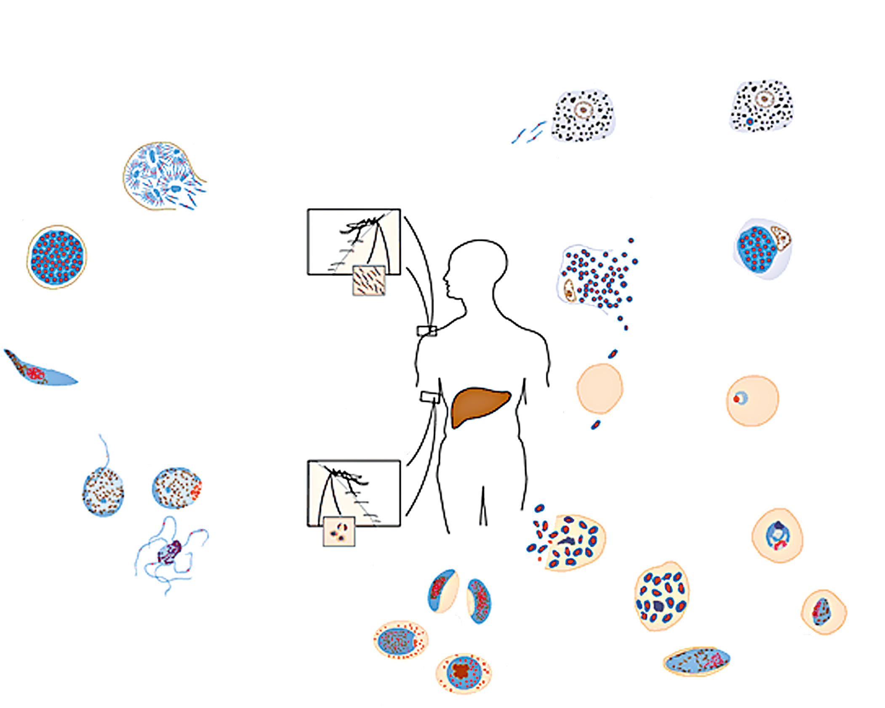
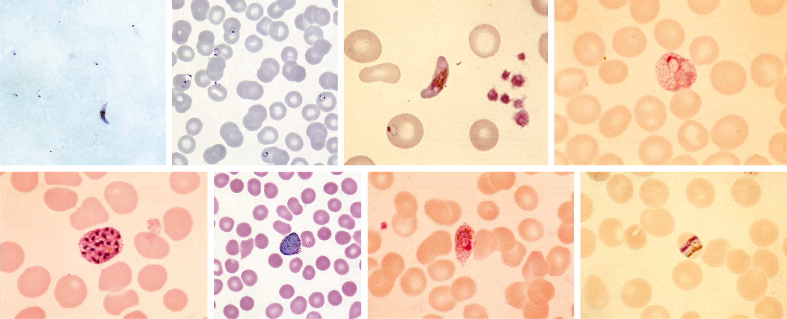

# Chapter 334: Malaria (Plasmodium)
> **Course:** Vikkypaedia Pediatric Basic Course (*Nelson Textbook of Pediatrics, 22nd Edition (2025)*)  
> **Part XV:** Infectious Diseases  
> **Authors:** Chandy C. John and Robert O. Opoka  
> **Metrics:** 15,286 words · 10 tables/boxes · 2 figures · 1 genes · 8 flashcards · 5 MCQs  
> **Quick Navigation:** [🃏 Study 8 Flashcards](../flashcards/334_flashcards.md) · [📝 Take 5-Q MCQ Quiz](../mcqs/334_mcqs.md) · [📚 Part XV Guide](../parts/Part_XV.md) · [🧬 Syndrome & Genetics Atlas](../omim_gene_atlas.md) · [💊 Therapeutics Matrix](../therapies_matrix.md) · [🏠 Course Index](../../index.md)

## Key Genetic & Molecular Targets
`G6PD`

## ⚡ High-Yield Nelson Pediatric Board Pearls
- Infants suspected of con genitally acquired Chagas disease should be properly evaluated and treated immediately upon confirmation of the diagnosis.
- Treatment of congestive heart failure is generally in line with rec ommendations for management of dilated cardiomyopathy from other causes. β-Adrenergic blockers have been validated in the management of these patients.
- PREVENTION Massive coordinated vector control programs under the auspices of WHO and the Pan-American Health Organization and the institu tion of widespread blood donor screening and targeted surveillance of chronically infected mothers and infants at risk have effectively elimi nated or at least drastically reduced transmission in most endemic countries.
- Prophylactic and therapeutic vaccine development is being pursued but is hampered by the ability of the parasite to evade immune mecha nisms and persist in different body compartments.
- Malaria is a vector-borne disease caused by intraerythrocytic proto zoa of the genus Plasmodium and transmitted by an infective female Anopheles mosquito.
- Malaria is an acute illness characterized by parox ysms of fever, chills, sweats, fatigue, anemia, and splenomegaly.
- For more specific within- country malaria transmission information, see the Yellow Fever & Malaria Informa tion, by Country section in in the Centers for Disease Control and Prevention (CDC) link in this caption. (From Tan RK, Arguin PM.

---
## Full Chapter Text, Tables & Figures
# Chapter 334: Malaria (Plasmodium)

*Chandy C. John and Robert O. Opoka*

<!-- p.2777 -->
that have been targeted include ergosterol synthesis using azole com pounds and the hypoxanthine-guanine phosphoribosyltransferase pathway using allopurinol.

Drug treatment for *T. cruzi* infection is currently limited to nifur timox and benznidazole. Both are effective against trypomastigotes and amastigotes and have been used to eradicate parasites in the acute stages of infection. Treatment responses vary according to the phase of Chagas disease, duration of treatment, dose, age of the patient, and geographic origin of the patient. For acute disease, the average cure rate is about 60–80%. Cure of chronic disease is difficult to assess due to the different definitions of cure, whether with a negative serology or quantitative PCR. Other drugs that have been tried include posacon azole, ravuconazole, and fexinidazole but have not been as successful as traditional treatment.

**Benznidazole**, a nitroimidazole derivative, is the most effective treatment for Chagas disease. Benznidazole’s primary mechanism of action involves covalent binding with trypanosomal protein thiols and low molecular weight thiols, resulting in depletion of these molecules and disruption of the parasite metabolism. The recommended treat ment regimen for children 2-12 years old is 5-8 mg/kg/day orally (PO), which can be divided twice daily (bid) for 60 days. For those >12 years old, 5-7 mg/kg/day for 60 days is recommended. The tablets can be administered as a slurry for children who have difficulty swallowing. A recent meta-analysis suggests a 30-day regimen may be noninferior to a 60-day regimen. Cure rates for chronic disease as assessed by PCR is 66–91% at the end of treatment, but this drops to 82% at 1 year, 55% at 2 years, and 47% at 5 years. This drug is associated with significant toxicity, including rash, photosensitivity, peripheral neuritis, granulo cytopenia, and thrombocytopenia.

**Nifurtimox** generates highly toxic oxygen metabolites through the action of nitroreductases, which produce unstable nitroanion radicals, which in turn react with oxygen to produce peroxide and superoxide free radicals. The FDA recently approved nifurtimox for the treatment of Chagas disease in pediatric patients from birth to <18 years of age and weighing at least 2.5 kg. The recommended total daily dose in pediatric patients is 10-20 mg/kg/day orally divided into three doses for 60 days for children <40 kg, and 8-10 mg/kg/day orally divided into three doses for children >40 kg. Nifurtimox has been associated with weakness, anorexia, GI disturbances, toxic hepatitis, tremors, seizures, and hemolysis in patients with glucose-6-phosphate dehydrogenase deficiency.

With the adoption by WHO of control and elimination strategies for Chagas disease, both acute and chronic disease should be treated. Serologic conversion is seen as an appropriate treatment response for chronic disease, although some patients who achieve this still even tually develop symptoms. One study reported cure rates as high as 97% for chronic disease in patients <16 years old and supports early and aggressive case findings and treatment. Infants suspected of con genitally acquired Chagas disease should be properly evaluated and treated immediately upon confirmation of the diagnosis. Women who give birth to infants with congenital Chagas disease should be offered treatment to prevent congenital transmission in subsequent pregnan cies. Continuing efforts for elimination will necessitate development of more accurate diagnostics and more effective drugs, particularly for chronic disease.

Treatment of congestive heart failure is generally in line with rec ommendations for management of dilated cardiomyopathy from other causes. β-Adrenergic blockers have been validated in the management of these patients. Digitalis toxicity occurs frequently in patients with Chagas cardiomyopathy. Pacemakers may be nec essary in cases of severe heart block. Although cardiac transplanta tion has been used successfully in chagasic patients, it is reserved for those with the most severe disease manifestations. Plasmapheresis to remove antibodies with adrenergic activity has been proposed for refractory patients; this approach has worked in patients with dilated cardiomyopathy from other causes, but its application to Chagas dis ease is unproved.

A light, balanced diet is recommended for **megaesophagus**. Surgery or dilation of the lower esophageal sphincter treats megaesophagus; pneumatic dilation is the superior mode of therapy. Nitrates and nife dipine have been used to reduce lower esophageal sphincter pressure in patients with megaesophagus. Treatment of **megacolon** is surgical and symptomatic.

In accidental infection when parasitic penetration is certain, treat ment should be immediately initiated and continued for 10-15 days. Blood is usually collected and serologic samples tested for seroconver sion at 15, 30, and 60 days.

**PREVENTION** Massive coordinated vector control programs under the auspices of WHO and the Pan-American Health Organization and the institu tion of widespread blood donor screening and targeted surveillance of chronically infected mothers and infants at risk have effectively elimi nated or at least drastically reduced transmission in most endemic countries. Chagas disease remains linked to poverty; thus improve ment of living conditions is likewise essential to successful control and eradication. Education of residents in endemic areas, use of bed nets, use of insecticides, and destruction of adobe houses that harbor reduviid bugs are effective methods to control the bug population. Syn thetic pyrethroid insecticides help keep houses free of vectors for up to 2 years and have low toxicity for humans. Paints incorporating insecti cides have also been used.

Because immigrants can carry this disease to nonendemic areas, serologic testing should be performed in blood and organ donors from endemic areas. Potential seropositive donors can be identified by determining whether they have been or have spent extensive time in an endemic area. Questionnaire-based screening of potentially infected blood and organ donors from areas endemic for infection can reduce the risk for transmission. Seropositivity should be considered a con traindication to organ donation, particularly for heart transplantation.

Prophylactic and therapeutic vaccine development is being pursued but is hampered by the ability of the parasite to evade immune mecha nisms and persist in different body compartments. Nucleic acid–based techniques and viral vectors are being explored, along with novel adju vants and strategies for addressing significant genetic variability among the DTUs.

*Visit Elsevier eBooks+ at eBooks.Health.Elsevier.com** for Bibliography.*

*Chandy C. John and Robert O. Opoka*

Malaria is a vector-borne disease caused by intraerythrocytic proto zoa of the genus *Plasmodium* and transmitted by an infective female *Anopheles* mosquito. Malaria is an acute illness characterized by parox ysms of fever, chills, sweats, fatigue, anemia, and splenomegaly. It has played a major role in human history, causing harm to more people than perhaps any other infectious disease. Although substantial prog ress has been made in combating malaria in endemic areas, with a 22% reduction in malaria incidence since 2010, malaria remains one of the leading causes of morbidity and mortality worldwide, with an esti mated 229 million cases and 409,000 deaths in 2019. Malarial deaths in areas of high malaria transmission occur primarily in children <5 years of age, but in areas of low transmission, a large percentage of

<!-- p.2779 -->

**Fig. 334.1** Spatial distribution of malaria in the Eastern and Western hemispheres. In this map, countries with areas endemic for malaria are shaded completely even if transmission occurs only in a small part of the country. For more specific within- country malaria transmission information, see the Yellow Fever & Malaria Informa tion, by Country section in in the Centers for Disease Control and Prevention (CDC) link in this caption. (From Tan RK, Arguin PM. Malaria. In Centers for Disease Con trol and Prevention. CDC Yellow Book 2020: Health Information for International Travel. New York: Oxford University Press; 2017. Maps 4.8 and 9 https://wwwnc.c dc.gov/travel/yellowbook/2020/travel- related-infectious-diseases/malaria#5217)

Endemic country Non-endemic country

deaths may occur in older children and adults. Although malaria is not endemic in the United States, 1,500-2,000 imported cases are seen in the United States each year. Physicians practicing in non-endemic areas should consider the diagnosis of malaria in any febrile child who has returned from a malaria-endemic area within the previous year, because delay in diagnosis and treatment can result in severe illness or death.

**ETIOLOGY** Malaria is caused by intracellular *Plasmodium* protozoa transmitted to humans by female *Anopheles* mosquitoes. Before 2004, only four species of *Plasmodium* were known to cause malaria in humans: *P. falciparum, P. malariae, P. ovale,* and *P. vivax*. In 2004, *P. knowlesi* (a primate malaria species) was also shown to cause human malaria, and cases of *P. knowlesi* infection have been documented in Malay sia, Indonesia, Singapore, and the Philippines. Malaria also can be transmitted through blood transfusion and use of contami nated needles and transplacentally from a pregnant woman to her fetus. The risk for blood transmission is low in the United States, but may occur through transfusion of whole blood, packed red blood cells (RBCs), platelets, and leukocytes and through organ transplantation.

**EPIDEMIOLOGY** Malaria is a major worldwide problem, occurring in 87 countries that comprise approximately half the world’s population (Fig. 334.1). World wide malaria cases decreased from an estimated 238 million cases in 2010 to 229 million cases of in 2019. The principal areas of transmis sion are Africa, Asia, and South America. *P. falciparum* and *P. malariae* are found in most malarious areas*. P. falciparum* is the predominant species in Africa, Haiti, and New Guinea. *P. vivax* predominates in Bangladesh, Central America, India, Pakistan, and Sri Lanka. *P. vivax* and *P. falciparum* predominate in Southeast Asia, South America, and Oceania. *P. ovale* is the least common species and is transmitted pri marily in Africa. Transmission of malaria has been eliminated in most of North America (including the United States), Europe, and most of the Caribbean, as well as Australia, Chile, Israel, Japan, Lebanon, and Taiwan. In 2021, the World Health Organization (WHO) certified that China had eliminated malaria, a landmark achievement for this area of >1 billion people.

*P. falciparum* is the parasite most commonly associated with severe illness and death, typically among young children. *P. falciparum* is the predominant species in Africa, Haiti, and New Guinea. Over 99% of cases in Africa are caused by *P. falciparum*, and 94% of all malaria deaths occur in Africa. Previously malarial deaths were predominantly

in children under 5 years of age but over the years more older children are being affected, with the percentage of total malaria deaths among children age under 5 years dropping from 84% in 2000 to 67% in 2019. *P. vivax,* contributes to about 3.3% of global malaria. *P. vivax* is respon sible for 75% of malaria cases in central America and 50% of cases in Southeast Asia (World Malaria Report 2019).

Most cases of malaria in the United States occur among previously infected visitors to the United States from endemic areas and among U.S. citizens who travel to endemic areas without appropriate che moprophylaxis. Due to the increase in global travel, the number of imported malaria cases has been increasing over the last 40 years, with 2,161 cases reported in 2017. Most cases were acquired in Africa (87%), with Asia (8%), South America (1.9%), and Cen tral America (1.5%) contributing most remaining cases. Among all cases, *P. falciparum* accounted for the majority of infections (1,523; 70.5%), followed by *P. vivax* (216; 10.0%), *P. ovale* (119; 5.5%), and *P. malariae* (55; 2.6%). Among all reported cases of malaria in 2017, a total of 312 (14.4%) were classified as severe malaria, and 6 of these 312 persons (1.9%) died. Cases peak during the summer travel months. Children comprised 18% of all malaria cases in the United States in 2017, and 39% of pediatric cases occurred in U.S. resident children, 70% of whom were visiting friends or relatives. Severe malaria was more slightly common in children (18.4%) than adults (13.6%).

Local transmission of malaria can rarely occur in the United States, as demonstrated in 2003, when eight cases were diagnosed among non-travelers in Palm Beach, Florida, and as demonstrated again in 2023 in Florida, Texas, and Maryland. These cases may result from transmission from untreated and often asymptomatic infected indi viduals from malaria-endemic countries who travel to the United States and infect local mosquitoes or from infected mosquitoes from malaria-endemic areas that are transported to the United States on airplanes. Transfusion-transmitted malaria can also occur in the United States.

**PATHOGENESIS* Plasmodium* species exist in a variety of forms and have a complex life cycle that enables them to survive in different cellular environments in the human host (asexual phase) and the mosquito (sexual phase) (Fig. 334.2). A marked amplification of *Plasmodium,* from approxi mately 102 to as many as 1014 organisms, occurs during a two-step pro cess in humans, with the first phase in hepatic cells (pre-erythrocytic phase) and the second phase in the RBCs (erythrocytic phase). The **pre-erythrocytic phase** begins with inoculation of sporozoites into the bloodstream by a female *Anopheles* mosquito. Within minutes the

<!-- p.2780 -->
sporozoites enter the hepatocytes of the liver, where they develop and multiply asexually as a **schizont.** After 1-2 weeks, the hepatocytes rupture and release thousands of merozoites into the circulation. The tissue schizonts of *P. falciparum, P. malariae,* and apparently *P. knowlesi* rupture once and do not persist in the liver. There are two types of tissue schizonts for *P. ovale* and *P. vivax*. The primary type ruptures in 6-9 days, and the secondary type remains dormant in the liver cell for weeks, months, or as long as 5 years before releasing merozoites and causing relapse of infection. The **erythrocytic phase** of *Plasmodium* asexual development begins when the merozoites from the liver penetrate erythrocytes. Once inside the erythrocyte, the parasite transforms into the **ring form**, which then enlarges to become a **trophozoite.** These latter two forms can be identified with Giemsa stain on blood smear, the primary means of confirming the diagnosis of malaria (Fig. 334.3). The trophozoite multiplies asexu ally to produce a number of small erythrocytic **merozoites** that are released into the bloodstream when the erythrocyte membrane rup tures, which is associated with fever. Over time, some of the mero zoites develop into male and female gametocytes that complete the *Plasmodium* life cycle when they are ingested during a blood meal by the female anopheline mosquito. The male and female gametocytes fuse to form a **zygote** in the stomach cavity of the mosquito. After a series of further transformations, sporozoites enter the salivary gland

of the mosquito and are inoculated into a new host with the next blood meal.

Pathophysiology and pathogenesis in malaria differ according to species. Infection with all species leads to **fever,** caused by the host immune response when erythrocytes rupture and release merozo ites into the circulation, and **anemia,** caused by hemolysis and bone marrow suppression. Severe malaria is more common in *P. falci parum* because of several processes, including higher-density para sitemia, which may lead to excessive production of proinflammatory cytokines; cytoadherence of *P. falciparum*-infected erythrocytes to the vascular endothelium; and polyclonal activation, resulting in both hypergammaglobulinemia and the formation of immune com plexes. **Cytoadherence** of infected erythrocytes to vascular endothe lium can lead to obstruction of blood flow and capillary damage, with resultant vascular leakage of blood, protein, and fluid and tissue anoxia. Parasite anaerobic metabolism may also lead to hypoglyce mia and metabolic acidosis. The cumulative effects of these patho logic processes may lead to cerebral, cardiac, pulmonary, renal, and hepatic failure.

Immunity after *Plasmodium* sp. infection is incomplete, prevent ing severe disease but still allowing future infection. In some cases, parasites circulate in small numbers for a long time but are prevented from rapidly multiplying and causing severe illness. Repeated episodes

P. vivax

P. falciparum

P. ovale P. malariae

Liver cell

**Human Liver Stages**

**Mosquito Stages**

**Human Blood Stages**

Infected liver cell

Schizont

Schizont

Gametocytes

Gametocytes

Immature trophozoite (ring stage)

Mature trophozoite

Ruptured schizont

Ruptured schizont

Mosquito takes

a blood meal (ingests gametocytes)

Mosquito takes

a blood meal (injects sporozoites)

Exflagellated microgametocyte

Microgamete entering

macrogamete

Macrogametocyte

Ookinete

Sporogonic Cycle

Oocyst

Ruptured oocyst

Infective Stage i

i

i

d

12

11

10

9

8

4

2

3

5

6

7

7

C

B

A 1

d

d

d

d

Diagnostic Stage

Release of sporozoites

Exo-erythrocytic Cycle

Erythrocytic Cycle

**Fig. 334.2** Life cycle of Plasmodium spp. (From Centers for Disease Control and Prevention. Laboratory diagnosis of malaria: Plasmodium spp. https://www.cdc.gov/dpdx/malaria/index.html)

<!-- p.2781 -->
of infection occur because the parasite has developed a number of immune-evasive strategies, such as intracellular replication, vascu lar cytoadherence that prevents infected erythrocytes from circulat ing through the spleen, rapid antigenic variation, and alteration of the host immune system resulting in partial immune suppression. The human host response to *Plasmodium* infection includes natural immune mechanisms that prevent infection by other *Plasmodium* spp., such as those of birds or rodents, as well as several alterations in erythrocyte physiology that prevent or modify malarial infection. Erythrocytes containing **hemoglobin S** (sickle erythrocytes) resist malaria parasite growth, erythrocytes lacking Duffy blood group antigen are relatively resistant to *P. vivax,* and erythrocytes contain ing **hemoglobin F** (fetal hemoglobin) and ovalocytes are resistant to *P. falciparum*. In hyperendemic areas, newborns rarely become ill with malaria, in part because of passive maternal antibody and high levels of fetal hemoglobin. Children 3 months to 2-5 years of age have little specific immunity to malaria species and therefore suffer yearly attacks of debilitating and potentially fatal disease. Immunity is sub sequently acquired, and severe cases of malaria become less com mon. Severe disease may occur during pregnancy, particularly first pregnancies or after extended residence outside the endemic region. Both T-cell and antibody responses are important in development of biologic and clinical immunity to *Plasmodium* spp.

**CLINICAL MANIFESTATIONS** Children and adults are asymptomatic during the initial phase of infec tion, the incubation period of malaria infection. The usual incubation periods are 9-14 days for *P. falciparum,* 12-17 days for *P. vivax,* 16-18 days for *P. ovale,* and 18-40 days for *P. malariae*. The incubation period can be as long as 6-12 months for *P. vivax* and can also be prolonged for patients with partial immunity or incomplete chemoprophylaxis. A prodrome lasting 2-3 days is noted in some patients before parasites are detected in the blood. Prodromal symptoms include headache, fatigue, anorexia, myalgia, slight fever, and pain in the chest, abdomen, and joints.

Children with malaria often lack the typical paroxysms seen in adults (high fever, followed by shaking chills and then diaphoresis) and may have nonspecific symptoms, including fever (may be low grade but is often >40°C [104°F]), headache, drowsiness, anorexia, nausea, vomiting, and diarrhea. Although the rupture of schizonts that occurs every 48 hours with *P. vivax* and *P. ovale* and every 72 hours with *P. malariae* can result in a classic pattern of fevers every other day (*P. vivax* and *P. ovale*) or every third day *(P. malariae),* peri odicity is less apparent with *P. falciparum* and mixed infections and may not be apparent early on in infection, when parasite broods have not yet synchronized. Patients with primary infection, such as trav elers from non-endemic regions, also may have irregular symptom atic episodes for 2-3 days before regular paroxysms begin, so most travelers presenting with malaria lack a classic malaria fever pattern. Distinctive physical signs may include fever, pallor as a consequence of anemia, and splenomegaly or hepatomegaly. Typical laboratory findings include anemia, thrombocytopenia, and a normal or raised leukocyte count.

*P. falciparum* is the most severe form of malaria and is associ ated with higher-density parasitemia and a number of complica tions (Fig. 334.4). The most common serious complication is severe **anemia**, which also is associated with other malaria species. Serious complications that appear unique to *P. falciparum* include cerebral malaria, respiratory distress from metabolic acidosis, acute renal failure, hypotension, and bleeding diatheses (Table 334.1) (see “Severe Malaria”).

The diagnosis of *P. falciparum* malaria in a nonimmune individual constitutes a medical emergency. Severe complications and death can occur if appropriate therapy is not instituted promptly. In contrast to malaria caused by *P. ovale, P. vivax,* and *P. malariae,* which usually result in parasitemias of <2%, malaria caused by *P. falciparum* can be associated with parasitemia levels as high as 60%. The differences in parasitemia reflect that *P. falciparum* infects both immature and mature erythrocytes, whereas *P. ovale* and *P. vivax* primarily infect immature erythrocytes and *P. malariae* infects only mature erythrocytes. Like *P.*

A C D B

E G H F

**Fig. 334.3** Giemsa-stained thick (A) and thin (B-H) smears used for the diagnosis of malaria and the speciation of Plasmodium parasites. A, Multi ple signet-ring Plasmodium falciparum trophozoites that are visualized outside erythrocytes. B, A multiply infected erythrocyte containing signet-ring P. falciparum trophozoites, including an accolade form positioned up against the inner surface of the erythrocyte membrane. C, Banana-shaped gametocyte unique to P. falciparum. D, Ameboid trophozoite characteristic of P. vivax. Both P. vivax– and P. ovale–infected erythrocytes exhibit Schüffner dots and tend to be enlarged compared with uninfected erythrocytes. E, P. vivax schizont. Mature P. falciparum parasites, by contrast, are rarely seen on blood smears because they sequester in the systemic microvasculature. F, P. vivax spherical gametocyte. G, P. ovale trophozoite. Note Schüffner dots and ovoid shapes of the infected erythrocyte. H, Characteristic band-form trophozoite of P. malariae, containing intracellular pigment hemozoin. (A, B, and F, from Centers for Disease Control and Prevention. DPDx: Laboratory identification of parasites of public health concern. htt ps://www.cdc.gov/dpdx/malaria/index.html; C, D, E, G, and H, courtesy David Wyler, Newton Centre, MA.)

<!-- p.2782 -->
*falciparum, P. knowlesi* has a 24-hour replication cycle and can also lead to very high density parasitemia.

*P. vivax* malaria has long been considered less severe than *P. falci parum* malaria, but recent reports suggest that in some areas it is as frequent a cause of severe disease and death as *P. falciparum*. Severe disease and death from *P. vivax* are usually caused by severe anemia and sometimes splenic rupture. *P. ovale* malaria is the least common type of malaria. It is similar to *P. vivax* malaria and usually is found in conjunction with *P. falciparum* malaria. Case reports of wors ening *P. ovale* disease with respiratory symptoms and pulmonary infiltrates and/or effusions after antimalarial treatment have been reported, but all resolved with completion of treatment. *P. malariae* is the mildest and most chronic of all malaria infections. **Nephrotic syndrome** is a rare complication of *P. malariae* infection that is not observed with any other human malaria species. Nephrotic syn drome associated with *P. malariae* infection is poorly responsive to corticosteroids. Low-level, undetected *P. malariae* infection may be present for years and is sometimes unmasked by immunosup pression or physiologic stress such as splenectomy or corticoste roid treatment. *P. knowlesi* malaria is most often uncomplicated but can lead to severe malaria and death if high-density parasitemia is present.

The definition of severe *P. vivax* or *P. ovale* malaria is the same as that of severe falciparum malaria except that there are no parasite density thresholds. The definition of severe malaria due to *P. knowlesi* differs from that of severe falciparum malaria; the threshold parasite density is >100,000/μL (alone) or >20,000/μL in patients with jaundice.

**Recrudescence** after a primary attack may occur from the survival of erythrocyte forms in the bloodstream. Long-term relapse is caused by release of merozoites from a pre-erythrocytic source in the liver, which occurs with *P. vivax* and *P. ovale,* or from persistence within the erythrocyte, which occurs with *P. malariae* and rarely with *P. falci parum*. A history of typical symptoms in a person >4 weeks after return from an endemic area is therefore more likely to be *P. vivax, P. ovale,* or *P. malariae* infection than *P. falciparum* infection. In the most recent survey of malaria in the United States (2013) by the CDC, among indi viduals in whom a malaria species was identified, 61% of cases were caused by *P. falciparum,*14% by *P. vivax,* 2% by *P. malariae,* 4% by *P. ovale,* and 2% by mixed-species infection; 94% of *P. falciparum* infec tions were diagnosed within 30 days of arrival in the United States,

Jaundice Acidosis Coma Renal failure

Anemia Convulsions Shock

0 5 10 20 30 40

6%

23%

43% 19%

7% 13% 6%

50 60

Age (years)

**Uremia**

**Acidosis**

**Coma or convulsions**

A

B

100

80

60

40

20

0

Proportion of patients (%)

**Fig. 334.4** Manifestations of severe falciparum malaria by age (A) and mortality in children associated with central nervous system involve ment, acidosis, and uremia (B). Data from 3,228 prospectively studied African children with severe falciparum malaria. Uremia here is defined as a blood urea nitrogen >7.14 mmol/L. Surface areas denote the rela tive prevalence of the different severity signs, which frequently coexist. The percentages denote the observed mortality associated with the presenting signs. (From White NJ, Pukrittayakamee S, Hien TT, et al. Malaria. Lancet. 2014;383:723–735.)

Severe Malaria, 2021

#### **Table 334.1** World Health Organization Criteria for

| Category / Parameter | Clinical Details & Findings |
| --- | --- |
| **DEFINITION** | Impaired; consciousness; Glasgow Coma Scale score <11 in adults or; Blantyre coma score <3 in children; Prostration; Generalized weakness so that a person; is unable to sit, stand, or walk without; assistance; Multiple convulsions; More than two episodes of convulsions; within 24 hr; Acidosis; A base deficit of >8 mEq/L, a plasma; bicarbonate level of <15 mmol/L, or; venous plasma lactate ≥5 mmol/L. Severe; acidosis manifests clinically as respiratory; distress (rapid, deep, labored breathing); Hypoglycemia; Blood or plasma glucose <40 mg/dL (<2.2; mmol/L); Severe malarial; anemia; Hemoglobin concentration ≤5 g/dL or; hematocrit ≤15% in children <12 years; of age (<7 g/dL and <20%, respectively,; in those ≥12 years) with parasite count; >10,000/μL; Renal impairment; (acute kidney injury); Plasma or serum creatinine >3 mg/dL (265; μmol/L) or blood urea >20 mmol/L; Jaundice; Plasma or serum bilirubin >50 μmol/L (3; mg/dL) with a parasite count >100,000/μL; (approximately 2%).; Pulmonary edema; Radiographically confirmed or oxygen; saturation <92% on room air with; respiratory rate >30/min, often with chest; indrawing and crepitation on auscultation; Significant bleeding; Includes recurrent or prolonged bleeding; from the nose, gums, or venipuncture; sites; hematemesis, or melena; Shock; Compensated shock is defined as capillary; refill ≥3 sec or temperature gradient; on leg (mid to proximal limb) but no; hypotension. Decompensated shock is; defined as systolic blood pressure <70 mm; Hg in children or <80 mm Hg in adults,; with evidence of impaired perfusion (cool; peripheries or prolonged capillary refill); Hyperparasitemia; P. falciparum parasitemia >10% (>500,000/μL) |

<!-- p.2783 -->
and 99% within 90 days of arrival. In contrast, 54% of *P. vivax* cases occurred >30 days after arrival in the United States.

**Congenital malaria** is acquired from the mother prenatally or peri natally but is rarely reported in the United States. Congenital malaria usually occurs in the offspring of a nonimmune mother with *P. vivax* or *P. malariae* infection, although it can be observed with any of the human malaria species. The first sign or symptom typically occurs between 10 and 30 days of age (range: 14 hours to several months of age). Signs and symptoms include fever, restlessness, drowsiness, pallor, jaundice, poor feeding, vomiting, diarrhea, cyanosis, and hepatosplenomegaly. **Malaria in pregnancy** is a major health problem in malaria-endemic countries, can be severe, and is associated with adverse outcomes in the fetus or neonate, including intrauterine growth restriction and low birthweight, even in the absence of transmission from mother to child.

**Severe Malaria** WHO has identified 12 complications of *P. falciparum* malaria that define severe malaria (see Table 334.1 and Fig. 334.4). The most com mon complications in children are severe anemia, impaired con sciousness (including cerebral malaria), respiratory distress (a result of metabolic acidosis), acute kidney injury, multiple seizures, prostra tion, and jaundice. A more complete discussion of severe malaria is provided in the treatment section (see “Treatment of Severe Malaria”), where treatment for these complications is also described.

**DIAGNOSIS** Any child who presents with fever or unexplained systemic illness and has traveled or resided in a malaria-endemic area within the previ ous year should be evaluated for malaria. Malaria should be consid ered regardless of the use of chemoprophylaxis. Important criteria that suggest *P. falciparum* malaria include symptoms occurring <1 month after return from an endemic area, >2% parasitemia, ring forms with double-chromatin dots, and erythrocytes infected with greater than one parasite.

The diagnosis of malaria is established by identification of organisms on Giemsa-stained smears of peripheral blood (see Fig. 334.3) or by rapid immunochromatographic assay (rapid diagnostic test). Giemsa stain is superior to Wright stain or Leishman stain. Both thick and thin blood smears should be examined. The concentration of erythrocytes on a **thick smear** is 20-40 times that on a thin smear and is used to quickly scan large numbers of erythrocytes. The **thin smear** allows for positive identification of the malaria species and determination of the percentage of infected erythrocytes and is useful in following the response to therapy. Identification of the species is best made by an experienced microscopist and checked against color plates of the vari ous *Plasmodium* spp. (see Fig. 334.3). Morphologically, it is impossible to distinguish *P. knowlesi* from *P. malariae,* so polymerase chain reac tion (PCR) detection by a reference laboratory or the CDC is required. Although *P. falciparum* is most likely to be identified from blood just after a febrile paroxysm, most children with malaria will have a posi tive blood smear regardless of the time the smear is obtained. Most guidelines recommend at least three negative blood smears to rule out malaria in children in whom malaria is strongly suspected, because low-level parasitemia could potentially go undetected early in the ill ness. However, few data are available on the utility of repeated blood smears for malaria detection, and most case reports and series docu ment a positive initial smear.

The BinaxNOW Malaria test is approved by the U.S. Food and Drug Administration (FDA) for rapid diagnosis of malaria. This immunochromatographic test for *P. falciparum* histidine-rich protein (HRP2) and aldolase is approved for testing for *P. falciparum* and *P. vivax. *Aldolase** is present in all five of the malaria species that infect humans; thus a positive result for *P. vivax* could be because of *P. ovale* or *P. malariae* infection. Sensitivity and specificity for *P. falciparum* (94–99% and 94–99%, respectively) and *P. vivax* (87–93% and 99%, respectively) are good, but sensitivity for *P. ovale* and *P. malariae* is lower. Sensitivity for *P. falciparum* decreases at lower levels of parasit emia, so microscopy is still advised in areas where expert microscopy is available. The test is simple to perform and can be done in the field

or laboratory in 10 minutes. PCR is more sensitive than microscopy but is technically more complex. It is available in some reference laboratories and can be useful for confirmation and for diagnosis of multiple species of malaria. The time delay in availability of results typically precludes its use for acute diagnosis of malaria, but it is useful to send where available, as it can confirm the diagnosis, allow for detection of multiple infections, and detect malaria not detected by standard microscopy because of low levels of parasitemia (par ticularly nonfalciparum malaria). PCR detection may detect asymp tomatic parasitemia in children with very low level parasitemia (e.g., internationally adopted children from malaria-endemic areas), with greater sensitivity than microscopy, and may be the preferred method of detection in these children, who, because they are asymptomatic, do not require immediate treatment.

**Differential Diagnosis** The differential diagnosis of malaria is broad. In a child traveler return ing to or arriving in the United States from an endemic area, diseases that may mimic malaria include viral infections such as influenza and hepatitis, sepsis, pneumonia, meningitis, encephalitis, endocarditis, gastroenteritis, pyelonephritis, babesiosis, brucellosis, leptospirosis, tuberculosis, relapsing fever, typhoid fever, yellow fever, viral hemor rhagic fevers, amebic liver abscess, neoplasm, and collagen vascular disease. There is also considerable clinical overlap between features of malaria (uncomplicated or severe) and other common bacterial and viral infections. Malaria in child travelers returning to or arriving in the United States is typically the sole reason for the clinical symptoms the child presents with, but the relatively nonspecific presentation may require a larger workup and empiric treatment for other conditions while awaiting testing results.

**TREATMENT** Physicians caring for patients with malaria or traveling to endemic areas need to be aware of current information regarding malaria because resistance to antimalarial drugs has complicated therapy and prophylaxis. The CDC website provides excellent guidance on diagno sis and treatment of malaria in individuals in the United States (https: //www.cdc.gov/malaria/diagnosis_treatment/diagnosis.html). Specific pages provide general guidelines (https://www.cdc.gov/malaria/diagn osis_treatment/clinicians1.html), a treatment algorithm (https://www. cdc.gov/malaria/resources/pdf/Malaria_Management_Algorithm.pdf, Fig. 334.5), a treatment table for all forms of uncomplicated and severe malaria (https://www.cdc.gov/malaria/resources/pdf/Malaria_Treatm ent_Table.pdf, Tables 334.2-334.6), and specific guidance on obtaining artesunate, which is now available commercially in the United States as an FDA-approved drug (https://www.cdc.gov/malaria/diagnosis_tr eatment/artesunate.html) and must be ordered emergently by hospi tals that do not have in it stock. Severe malaria care requires infec tious diseases consultation. In cases where treatment is unclear or complex, calling the CDC Malaria Hotline is strongly recommended. CDC expert malaria guidance is available to physicians 24 hours a day (844-856-4713, from 9 am to 5 pm Eastern Time Monday-Friday, and 770-488-7100 at all other times and on holidays; request to speak to the CDC Malaria Branch Expert).

**General Principles** Treatment for malaria should be based on laboratory confirmation of the diagnosis. “Presumptive treatment,” i.e., without laboratory con firmation, may be required in children with severe disease in a setting where prompt laboratory diagnosis is not available. Once the diag nosis of malaria has been made, appropriate antimalarial treatment should be initiated immediately. Treatment is influenced by multiple factors, including infecting *Plasmodium* species; clinical status of the patient; expected drug susceptibility of the infecting parasite as determined by the geographic area where the infection was acquired; and previous use of antimalarials, including those taken for malaria chemoprophylaxis.

Fever without an obvious cause in any patient who has left a *P. fal ciparum*–endemic area within 30 days and is nonimmune should be

<!-- p.2784 -->
Administer follow on treatment

after intravenous artesunate:†

Artemether-lumefantrine

**or** Atovaquone-proguanil

**or** Quinine and doxycycline

(or clindamycin) **or,** if no other options,

mefloquine

If not G6PD deficient by

quantitative testing: Primaquine (any prior regimen

for acute infection) **or**

Tafenoquine (only if chloroquine used for acute

infection; not for children

<16 years old)

Artemether-lumefantrine

(preferred)

**or** Atovaquone-proguanil

**or** Quinine plus tetracycline

or doxycycline or

clindamycin **or,** if no other options,

mefloquine

Artemether-lumefantrine

(preferred)

**or** Atovaquone-proguanil

**or** Quinine plus tetracycline

or doxycycline or

clindamycin

Chloroquine **or** Hydroxychloroquine‡

Fever and history of travel to malaria-endemic

area, or clinical suspicion of malaria

Consider alternate

diagnosis

Perform thick and thin blood smears

and read on the same day**

P. falciparum, P. knowlesi,

or species not yet

identified†

From smear: calculate parasite density

and determine species

Blood smear

positive?

Repeat blood smears every

12–24 hours (total of 3 times)

Evaluate clinical status and

disease severity

Severe malaria and/or patient unable to tolerate oral medication,

regardless of species†

Uncomplicated

malaria

Admit to intensive care unit

Call CDC

Admit to hospital and monitor

for disease progression

P. falciparum or species

not yet identified†

P. knowlesi

P. vivax acquired in area

with chloroquine resistance

P. malariae P. ovale or P. vivax acquired in

area without chloroquine

resistance

Intravenous artesunate If needed, interim treatment:

Artemether-lumefantrine

**or** Atovaquone-proguanil

**or** Quinine **or,** if no other options,

mefloquine

Monitor parasite density

every 12–24 hours

Chloroquine **or** Hydroxychloroquine‡

Blood smear

positive?

Chloroquine **or** Hydroxychloroquine‡

Artemether-lumefantrine

**or** Atovaquone-proguanil

**or** Quinine plus tetracycline

or doxycycline or

clindamycin **or,** if no other options,

mefloquine

**PLUS**

Chloroquine **or** Hydroxychloroquine‡

P. falciparum acquired in area with

no chloroquine

resistance

P. falciparum acquired

in  area with chloroquine resistance

P. falciparum acquired in area with mefloquine resistance

No

No

Yes

Yes

Evaluation

Disposition

Medication

**Fig. 334.5** Algorithm for approach to patient with malaria in the United States. Treatment for special populations (children and pregnant women) can be found in the Centers for Disease Control and Prevention (CDC) Treatment Guidelines and Treatment Table at https://www.cdc.gov/malaria /resources/pdf/Malaria_Treatment_Table.pdf. **If rapid diagnostic test performed, smear should also be performed with results available as soon as possible. †If species later identified as P. vivax or P. ovale, add primaquine if not glucose-6-phosphate (G6PD) deficient by quantitative testing. Tafenoquine can only be used if chloroquine or hydroxychloroquine used for acute infection. ‡Drug options for chloroquine-resistant P. falciparum may be used. (From Centers for Disease Control and Prevention. http://www.cdc.gov/malaria/resources/pdf/algorithm.pdf)

<!-- p.2785 -->
considered a medical emergency. Thick and thin blood smears should be obtained immediately, and all children with symptoms of severe dis ease should be hospitalized. If negative, blood films should be repeated every 12 hours until three smears are documented as negative. If the patient is severely ill, antimalarial therapy should be initiated immedi ately. Outpatient therapy generally is not given to nonimmune children but may be considered in immune or semi-immune children who have low-level parasitemia (<1%), no evidence of complications defined by WHO, no vomiting, and a lack of toxic appearance; who are able to contact the physician or emergency department at any time; and in whom follow-up within 24 hours is ensured.

**TREATMENT OF UNCOMPLICATED MALARIA P. falciparum****or Species Not Identified: Acquired in Areas with Chloroquine Resistance** Treatment regimens for children with uncomplicated malaria in the United States are summarized in Tables 334.2-334.5. For *P. falciparum* infections acquired in areas with chloroquine resistance, four treat ment options are available. These include artemether-lumefantrine (Coartem), which is the preferred option if readily available, and atovaquone-proguanil (Malarone). These are fixed-dose combination therapies that can be used for pediatric patients >5 kg. Quinine sul fate plus doxycycline, tetracycline, or clindamycin is the next treatment option. For the quinine sulfate combination options, quinine sulfate plus either doxycycline or tetracycline is generally preferred to quinine sulfate plus clindamycin because there are more data on the efficacy of quinine plus doxycycline or tetracycline. Quinine should be given for 3 days, except for infections acquired in Southeast Asia where 7 days of treatment is required. The fourth option, mefloquine, is associated with rare but potentially severe neuropsychiatric reactions when used at treatment dose, and it is recommended only if the other options can not be used.

For infections attributed to “species not identified” in areas with chloroquine resistance that are subsequently diagnosed as being due to *P. vivax* or *P. ovale,* additional treatment with primaquine or tafeno quine should be administered, as described in the section on *P. vivax* and *P. ovale* treatment.

**P. falciparum****or Species Not Identified: Acquired in Areas Without Chloroquine Resistance** For *P. falciparum* infections acquired in areas without chloroquineresistant strains, which include Central America west of the Panama Canal, Haiti, and the Dominican Republic, patients can be treated with oral chloroquine. Alternatively, hydroxychloroquine may be used at recommended doses. In addition, any of the regimens listed for the treatment of chloroquine-resistant malaria may be used for the treat ment of chloroquine-sensitive *P. falciparum* malaria. Prompt initiation of an effective regimen is vitally important as delay of initiation of treat ment may increase the risk of progression to severe disease in patients with *P. falciparum* infection. If infections initially attributed to “species not identified” are subsequently diagnosed as being due to *P. vivax* or *P. ovale,* additional treatment with primaquine or tafenoquine should be administered, as outlined in the sections on *P. vivax* and *P. ovale*.

**P. vivax****and P. ovale** Chloroquine (or hydroxychloroquine) remains an effective choice for *P. vivax* and *P. ovale* infections except for *P. vivax* infections acquired in Papua New Guinea or Indonesia, as there is high preva lence of chloroquine-resistant *P. vivax* in these countries. Rare cases of chloroquine-resistant *P. vivax* have also been documented in Burma (Myanmar), India, and Central and South America. Persons acquir ing *P. vivax* infections from regions other than Papua New Guinea or Indonesia should initially be treated with chloroquine. If chloroquine is not available, or if the infection was acquired in an area with a high frequency of chloroquine resistance (Indonesia or Papua New Guinea), artemether-lumefantrine, atovaquone-proguanil, quinine sulfate plus doxycycline or tetracycline or clindamycin, or mefloquine should be used (mefloquine should be used only if the other drugs are not available or contraindicated). If chloroquine is given and the patient

has an inadequate response including persistence or worsening of clinical symptoms or no decrease in parasite density, treatment should be changed to one of the regimens recommended for chloroquineresistant *P. vivax* infections.

In addition to requiring the acute phase treatment of blood-stage parasites, *P. vivax* and *P. ovale* infections can relapse due to hypnozo ites, which are dormant forms that remain in the liver. To eradicate the hypnozoites, patients should be treated with either tafenoquine (Krintafel) or primaquine phosphate. If primaquine phosphate is used, the CDC recommends a dose of 30 mg (base) by mouth daily for 14 days for adults, and a dose of 0.5 mg/kg (base) by mouth, to a maxi mum of 30 mg (base) daily for children.

**P. malariae****and P. knowlesi** There has been no widespread evidence of chloroquine resistance in *P. malariae* and *P. knowlesi* species; therefore chloroquine (or hydroxy chloroquine) may still be used for both of these species. In addition, any of the regimens listed previously for the treatment of chloroquineresistant *P. falciparum* may be used for the treatment of *P. malariae* and *P. knowlesi* infections. Due to the risk of complications among patients with *P. knowlesi,* clinicians should consider hospitalization to monitor clinical response and check parasite density every 12-24 hours until clinical presentation improves and a decrease in parasite density becomes apparent.

**TREATMENT OF SEVERE MALARIA General Principles** Death due to severe malaria can occur within hours of presentation, so prompt assessment and initiation of effective antimalarial therapy is essential. Equally important is the concurrent administration of sup portive therapy to manage life-threatening complications of the dis ease. Supportive measures such as oxygen therapy, blood transfusion, rehydration, control of convulsions, correction of metabolic derange ments like hypoglycemia, and institution of antibiotics in children with features of sepsis should be instituted as indicated by clinical findings. Children with severe malaria should be managed in an intensive care unit (ICU).

The risk of death due to severe malaria is greatest in the first 24 hours after clinical presentation. Independent predictors for fatality among African children with severe malaria include acidosis, impaired con sciousness, elevated blood urea nitrogen, and acute kidney injury. Early diagnosis and prompt initiation of antimalarial medication and appro priate supportive care can reduce mortality.

Drug treatment guidelines in this chapter are based on treatment for children in the United States (Table 334.6). Children in other areas have other drugs and treatments available, and local or WHO guide lines for malaria treatment are available at https://www.who.int/public ations/i/item/guidelines-for-malaria.

**Intravenous Antimalarial Therapy for Severe Malaria** Treatment of severe malaria involves initial treatment with intravenous (IV) artesunate, followed by a full dose of effective artemisinin com bination therapy (ACT). In the United States, the only FDA-approved treatment for severe malaria is IV artesunate. Quinidine, which was previously approved for treatment of severe malaria, ceased to be man ufactured in 2019. Artesunate dosing need not be adjusted for hepatic or renal failure, nor for concomitant or previous therapy with other medications. Artesunate is well tolerated with few side effects. Adverse effects include nausea, vomiting, anorexia, and dizziness, although these may be due to malaria rather than drug toxicity. In nonimmune patients, delayed onset of anemia has been noted in some cases, so patients treated with IV artesunate should be monitored for delayed hemolytic anemia, and repeat hemoglobin testing at 7, 14, and 30 days should be considered.

In the United States, IV artesunate was approved by the FDA through the CDC as part of an expanded-use investigational new drug (IND) protocol in May 2020. As of June 2021, the drug can be obtained through major drug distributors. Healthcare providers treating patients meeting the following criteria and who are unable to obtain

<!-- p.2786 -->
commercially available artesunate within 24 hours should call the CDC Malaria Hotline to obtain IV artesunate.

If artesunate is not immediately available, oral antimalarials can be given while waiting to obtain IV artesunate. Choices include artemether-lumefantrine (preferred), atovaquone-proguanil, quinine sulfate, and mefloquine (Table 334.2).

**FOLLOW-UP ORAL ANTIMALARIAL THERAPY FOR SEVERE MALARIA** Parenteral artesunate should be given for three doses over 24 hours at 0, 12, and 24 hours. If parasite density is <1% at 20 hours and the patient can take oral medication, treatment should be completed with an effec tive oral medication, such as artemether-lumefantrine (preferred),

*P. vivax* or *P. ovale*, See Table 334.3 for Antirelapse Treatment)

#### **Table 334.2** Treatment of Uncomplicated Malaria: Plasmodium falciparum or Unknown Species1–3 (If Later Diagnosed as

| Category / Parameter | Clinical Details & Findings |
| --- | --- |
| **Chloroquine resistant or unknown resistance** | (All malaria-endemic regions except those; in Central America west of Panama Canal,; Haiti, and Dominican Republic); A.	Artemether-lumefantrine (Coartem)5; (1 tab: 20 mg artemether and 120 mg; lumefantrine); Adults: 4 tabs PO per dose; Three-day course:; Day 1: Initial dose and second dose 8 hr later; Days 2 and 3: 1 dose bid; B.	Atovaquone-proguanil (Malarone)6; (Adult tab: 250 mg atovaquone and 100 mg; proguanil); 4 adult tabs PO qd × 3 days; C.	Quinine sulfate7 plus doxycycline,8 |
| **tetracycline,8 or clindamycin9** | Quinine sulfate: 542 mg base (650 mg salt) PO; tid × 3 or 7 days7; Doxycycline: 100 mg PO bid × 7 days; Tetracycline: 250 mg PO qid × 7 days; Clindamycin: 20 mg/kg/day PO divided tid ×; 7 days; D.	Mefloquine10; Dose 1: 684 mg base (750 mg salt) PO; Dose 2 at 6-12 hr: 456 mg base (500 mg salt) |
| **PO** | A.	Artemether-lumefantrine (Coartem)5; (1 tab: 20 mg artemether and 120 mg; lumefantrine); 5 to <15 kg: 1 tab PO per dose; 15 to <25 kg: 2 tabs PO per dose; 25 to <35 kg: 3 tabs PO per dose; ≥35 kg: 4 tabs PO per dose; Three-day course:; Day 1: Initial dose and second dose 8 hr later; Days 2 and 3: 1 dose bid; B.	Atovaquone-proguanil (Malarone)6; (Adult tab: 250 mg atovaquone and 100 mg; proguanil; Peds tab: 62.5 mg atovaquone and; 25 mg proguanil); 5 to <8 kg: 2 peds tabs PO qd × 3 days; 8 to <10 kg: 3 peds tabs PO qd × 3 days; 10 to <20 kg: 1 adult tab PO qd × 3 days; 20 to <30 kg: 2 adult tabs PO qd × 3 days; 30 to <40 kg: 3 adult tabs PO qd × 3 days; ≥40 kg: 4 adult tabs PO qd × 3 days; C.	Quinine sulfate7 plus doxycycline,8 |
| **tetracycline,8 or clindamycin9** | Quinine sulfate: 8.3 mg base/kg (10 mg salt/; kg) PO tid × 3 or 7 days7; Doxycycline: 2.2 mg/kg PO bid × 7 days; Tetracycline: 25 mg/kg/day PO divided qid ×; 7 days; Clindamycin: 20 mg /kg/day PO divided tid ×; 7 days; D.	Mefloquine10; Dose 1: 13.7 mg base/kg (15 mg salt/kg) PO; Dose 2 at 6-12 hr: 9.1 mg base/kg (10 mg salt/; kg) PO |
| **Chloroquine sensitive11** | (Central America west of Panama Canal, Haiti,; and Dominican Republic) |
| **Chloroquine phosphate (Aralen and generics)** | Dose 1: 600 mg base (1,000 mg salt) PO; Doses 2-4 (3 additional doses) at 6, 24, and 48; hr: 300 mg base (500 mg salt) PO per dose |
| **Hydroxychloroquine (Plaquenil and generics)** | Dose 1: 620 mg base (800 mg salt) PO; Doses 2-4 (3 additional doses) at 6, 24, and 48; hr: 310 mg base (400 mg salt) PO per dose |
| **Chloroquine phosphate (Aralen and generics)** | Dose 1: 10 mg base/kg (16.7 mg salt/kg) PO; Doses 2-4 (3 additional doses) at 6, 24, and; 48 hr: 5 mg base/kg (8.3 mg salt/kg) PO per; dose |
| **Hydroxychloroquine (Plaquenil and generics)** | Dose 1: 10 mg base/kg (12.9 mg salt/kg) PO; Doses 2-4 (3 additional doses) at 6, 24, and; 48 hr: 5 mg base/kg (6.5 mg salt/kg) PO per; dose; 1qd, once a day; bid, twice a day; tid, three times a day; qid, four times a day; PO, by mouth; tab(s), tablet(s).; 2If an antimalarial is taken for chemoprophylaxis, a different drug should be used for treatment.; 3Option A preferred, Options B and C adequate alternatives and should be used if more readily available than Option A. Option D should be used only if other options not available.; 4Not to exceed adult dose.; 5Artemether-lumefantrine can be used in second and third trimesters of pregnancy and, if no other options available, in first trimester as well. Not for infants <5 kg or women; breastfeeding infants <5 kg.; 6Atovaquone-proguanil not recommended during pregnancy, in infants <5 kg, or in women breastfeeding infants <5 kg. May be considered if other treatment options not available; or not tolerated, and benefits outweigh risks.; 7Quinine to be given for 3 days, except for infections acquired in Southeast Asia, where 7 days of treatment are required. Quinine available in the United States has 324 mg (salt) per; capsule, therefore two capsules for adult dosing. Pediatric dosing may need compounding pharmacy.; 8Doxycycline or tetracycline combined with quinine preferred due to more efficacy data, but not recommended during pregnancy or in children <8 yr old unless no other options and; benefits outweigh risks.; 9Clindamycin with quinine preferred option for pregnant women and children <8 yr old.; 10Mefloquine not recommended for infections acquired in Southeast Asia due to drug resistance. Not recommended if other options available or in patients with neuropsychiatric; history.; 11Regimens used to treat chloroquine-resistant P. falciparum infections may be used if chloroquine and hydroxychloroquine not available.; From Centers for Disease Control and Prevention. Malaria Treatment Tables. https://www.cdc.gov/malaria/resources/pdf/Malaria_Treatment_Table.pdf |

<!-- p.2787 -->

#### **Table 334.3** Treatment of Uncomplicated Malaria: P. vivax or P. ovale1,2

| Category / Parameter | Clinical Details & Findings |
| --- | --- |
| **Chloroquine sensitive** | (All malaria-endemic regions; except Papua New Guinea and; Indonesia) |
| **Chloroquine phosphate (Aralen and generics)** | Dose 1: 600 mg base (1,000 mg salt) PO; Doses 2-4 (3 additional doses) at 6, 24, and 48 hr:; 300 mg base (500 mg salt) PO per dose |
| **Hydroxychloroquine (Plaquenil and generics)** | Dose 1: 620 mg base (800 mg salt) PO; Doses 2-4 (3 additional doses) at 6, 24, and 48 hr:; 310 mg base (400 mg salt) PO per dose |
| **Antirelapse treatment5:** | Primaquine phosphate6–8; 30 mg base PO qd × 14 days |
| **Tafenoquine (Krintafel)6,7,9** | 300 mg PO × 1 dose |
| **Chloroquine phosphate (Aralen and generics)** | Dose 1: 10 mg base/kg (16.7 mg salt/kg) PO; Doses 2-4 (3 additional doses) at 6, 24, and 48 hr: 5 mg; base/kg (8.3 mg salt/kg) PO per dose |
| **Hydroxychloroquine (Plaquenil and generics)** | Dose 1: 10 mg base/kg (12.9 mg salt/kg) PO; Doses 2-4 (3 additional doses) at 6, 24, and 48 hr: 5 mg; base/kg (6.5 mg salt/kg) PO per dose |
| **Antirelapse treatment5:** | Primaquine phosphate6–8; 0.5 mg base/kg PO qd × 14 days |
| **Tafenoquine (Krintafel)6,7,9** | 300 mg PO × 1 dose, only for patients ≥16 yr old |
| **Chloroquine resistant** | (Papua New Guinea and; Indonesia) |
| **Acute treatment:** | A.	Artemether-lumefantrine (Coartem)10; (1 tab: 20 mg artemether and 120 mg; lumefantrine); Adults: 4 tabs PO per dose; Three-day course:; Day 1: Initial dose and second dose 8 hr later; Days 2 and 3: 1 dose bid; B.	Atovaquone-proguanil (Malarone)11; (Adult tab: 250 mg atovaquone and 100 mg; proguanil); 4 adult tabs PO qd × 3 days; C.	Quinine sulfate12 plus doxycycline,13 |
| **tetracycline,13 or clindamycin14** | Quinine sulfate: 542 mg base (650 mg salt) PO tid; × 3 days; Doxycycline: 100 mg PO bid × 7 days; Tetracycline: 250 mg PO qid × 7 days; Clindamycin: 20 mg/kg/day PO divided tid × 7; days; D.	Mefloquine15; Dose 1: 684 mg base (750 mg salt) PO; Dose 2 at 6-12 hr: 456 mg base (500 mg salt) PO |
| **Primaquine phosphate17,18,19** | 30 mg base PO qd × 14 days |
| **Acute treatment:** | A.	Artemether-lumefantrine (Coartem)10; (1 tab: 20 mg artemether and 120 mg lumefantrine); 5 to <15 kg: 1 tab PO per dose; 15 to <25 kg: 2 tabs PO per dose; 25 to <35 kg: 3 tabs PO per dose; ≥35 kg: 4 tabs PO per dose; Three-day course:; Day 1: Initial dose and second dose 8 hr later; Days 2 and 3: 1 dose bid; B.	Atovaquone-proguanil (Malarone)11; (Adult tab: 250 mg atovaquone and 100 mg proguanil;; peds tab: 62.5 mg atovaquone and 25 mg proguanil); 5 to <8 kg: 2 peds tabs PO qd × 3 days; 8 to <10 kg: 3 peds tabs PO qd × 3 days; 10 to <20 kg: 1 adult tab PO qd × 3 days; 20 to <30 kg: 2 adult tabs PO qd × 3 days; 30 to <40 kg: 3 adult tabs PO qd × 3 days; ≥40 kg: 4 adult tabs PO qd × 3 days; C.	Quinine sulfate12 plus doxycycline,13 tetracycline,13 |
| **or clindamycin14** | Quinine sulfate: 8.3 mg base/kg (10 mg salt/kg) PO tid; × 3 days; Doxycycline: 2.2 mg/kg PO q12h × 7 days; Tetracycline: 25 mg/kg/day PO divided qid × 7 days; Clindamycin: 20 mg/kg/day PO divided tid × 7 days; D.	Mefloquine10; Dose 1: 13.7 mg base/kg (15 mg salt/kg) PO; Dose 2 at 6-12 hr: 9.1 mg base/kg (10 mg salt/kg) PO |
| **Primaquine phosphate17–19** | 0.5 mg base/kg PO qd × 14 days; 1qd, once a day; bid, twice a day; tid, three times a day; qid, four times a day; PO, by mouth; tab(s), tablet(s).; 2If an antimalarial is taken for chemoprophylaxis, a different drug should be used for treatment.; 3Not to exceed adult dose.; 4Regimens used to treat chloroquine-resistant P. vivax infections may be used if chloroquine and hydroxychloroquine not available.; 5Either option for antirelapse treatment recommended if chloroquine or hydroxychloroquine used for acute treatment. If regimens other than either chloroquine or; hydroxychloroquine are used for acute treatment, primaquine is the only option for antirelapse treatment.; 6Primaquine and tafenoquine associated with hemolytic anemia in those with glucose-6-phosphate dehydrogenase (G6PD) deficiency. Before use, quantitative G6PD testing needed; to confirm normal activity. For those with intermediate G6PD deficiency, weekly primaquine may be used (45 mg/wk) for 8 wk with close monitoring for hemolysis. Those with G6PD; deficiency may be given chloroquine 300 mg (base) PO weekly for 1 yr from acute infection to prevent relapses.; 7Primaquine and tafenoquine must not be used during pregnancy; pregnant patients with P. vivax and P. ovale infections should receive chloroquine 300 mg (base) PO weekly; after acute treatment for the remainder of pregnancy. After delivery, patients with normal G6PD activity can be given primaquine or tafenoquine depending on breastfeeding,; or continue with chloroquine prophylaxis for a total of 1 yr from acute infection. Primaquine can be used during breastfeeding if infant found to also have normal G6PD activity;; tafenoquine not recommended during breastfeeding.; 8Dose of primaquine in patients ≥70 kg should be adjusted to a total dose of 6 mg/kg, divided into doses of 30 mg per day.; 9Tafenoquine can only be used if chloroquine or hydroxychloroquine administered for acute treatment due to limited data on efficacy when used in combination with other regimens.; 10Artemether-lumefantrine can be used in second and third trimesters of pregnancy and, if no other options available, in first trimester as well. Not for infants <5 kg or women; breastfeeding infants <5 kg.; 11Atovaquone-proguanil not recommended during pregnancy, in infants <5 kg, or in women breastfeeding infants <5 kg. May be considered if other treatment options not available |

<!-- p.2788 -->

#### **Table 334.4** Treatment of Uncomplicated Malaria: P. malariae or P. knowlesi1,2

| Category / Parameter | Clinical Details & Findings |
| --- | --- |
| **Chloroquine sensitive** | (All malaria-endemic regions, no known; resistance); A.	Chloroquine phosphate (Aralen and generics); Dose 1: 600 mg base (1,000 mg salt) PO; Doses 2-4 (3 additional doses) at 6, 24, and 48 hr:; 300 mg base (500 mg salt) PO per dose |
| **Hydroxychloroquine (Plaquenil and generics)** | Dose 1: 620 mg base (800 mg salt) PO; Doses 2-4 (3 additional doses) at 6, 24, and 48 hr:; 310 mg base (400 mg salt) PO per dose; B.	Artemether-lumefantrine (Coartem)4; (1 tab: 20 mg artemether and 120 mg lumefantrine); Adults: 4 tabs PO per dose; Three-day course:; Day 1: Initial dose and second dose 8 hr later; Days 2 and 3: 1 dose bid; C.	Atovaquone-proguanil (Malarone)5; (Adult tab: 250 mg atovaquone and 100 mg; proguanil); 4 adult tabs PO qd × 3 days; D.	Quinine sulfate6 plus doxycycline,7 |
| **tetracycline,7 or clindamycin8** | Quinine sulfate: 542 mg base (648 mg salt) PO tid; × 3 days; Doxycycline: 100 mg PO bid × 7 days; Tetracycline: 250 mg PO qid × 7 days; Clindamycin: 20 mg/kg/day PO divided tid × 7; days; E.	Mefloquine9; Dose 1: 684 mg base (750 mg salt) PO; Dose 2 at 6-12 hr: 456 mg base (500 mg salt) PO; A.	Chloroquine phosphate (Aralen and generics); Dose 1: 10 mg base/kg (16.7 mg salt/kg) PO; Doses 2-4 (3 additional doses) at 6, 24, and 48 hr:; 5 mg base/kg (8.3 mg salt/kg) PO per dose |
| **Hydroxychloroquine (Plaquenil and generics)** | Dose 1: 10 mg base/kg (12.9 mg salt/kg) PO; Doses 2-4 (3 additional doses) at 6, 24, and 48 hr:; 5 mg base/kg (6.5 mg salt/kg) PO per dose; B.	Artemether-lumefantrine (Coartem)4; (1 tab: 20 mg artemether and 120 mg; lumefantrine); 5 to <15 kg: 1 tab PO per dose; 15 to <25 kg: 2 tabs PO per dose; 25 to <35 kg: 3 tabs PO per dose; ≥35 kg: 4 tabs PO per dose; Three-day course:; Day 1: Initial dose and second dose 8 hr later; Days 2 and 3: 1 dose bid; C.	Atovaquone-proguanil (Malarone)5; (Adult tab: 250 mg atovaquone and 100 mg; proguanil; peds tab: 62.5 mg atovaquone and; 25 mg proguanil); 5 to <8 kg: 2 peds tabs PO qd × 3 days; 8 to <10 kg: 3 peds tabs PO qd × 3 days; 10 to <20 kg: 1 adult tab PO qd × 3 days; 20 to <30 kg: 2 adult tabs PO qd × 3 days; 30 to <40 kg: 3 adult tabs PO qd × 3 days; ≥40 kg: 4 adult tabs PO qd × 3 days; D.	Quinine sulfate6 plus doxycycline,7 |
| **tetracycline,7 or clindamycin8** | Quinine sulfate: 8.3 mg base/kg (10 mg salt/kg); PO tid × 3 days; Doxycycline: 2.2 mg/kg PO bid × 7 days; Tetracycline: 25 mg/kg/day PO divided qid × 7; days; Clindamycin: 20 mg /kg/day PO divided tid × 7; days; E.	Mefloquine9; Dose 1: 13.7 mg base/kg (15 mg salt/kg) PO; Dose 2 at 6-12 hr: 9.1 mg base/kg (10 mg salt/; kg) PO; 1qd, once a day; bid, twice a day; tid, three times a day; qid, four times a day; PO, by mouth; tab(s), tablet(s).; 2If an antimalarial is taken for chemoprophylaxis, a different drug should be used for treatment.; 3Not to exceed adult dose.; 4Artemether-lumefantrine can be used in second and third trimesters of pregnancy and, if no other options available, in first trimester as well. Not for infants <5 kg or women; breastfeeding infants <5 kg.; 5Atovaquone-proguanil not recommended during pregnancy, in infants <5 kg, or in women breastfeeding infants <5 kg. May be considered if other treatment options not available; or not tolerated, and benefits outweigh risks.; 6Quinine available in the United States has 324 mg (salt) per capsule, therefore, two capsules for adult dosing. Pediatric dosing may need compounding pharmacy.; 7Doxycycline or tetracycline combined with quinine preferred due to more efficacy data, but not recommended during pregnancy or in children <8 yr old unless no other options and; benefits outweigh risks.; 8Clindamycin with quinine preferred option for pregnant women and children <8 yr old.; 9Use only if no other options available. Not for use in patients with neuropsychiatric history. |

#### **Table 334.3** Treatment of Uncomplicated Malaria: P. vivax or P. ovale1,2—cont’d

| Category / Parameter | Clinical Details & Findings |
| --- | --- |
| **General** | 13Doxycycline or tetracycline combined with quinine preferred due to more efficacy data, but not recommended during pregnancy or in children <8 yr old unless no other options; and benefits outweigh risks.; 14Clindamycin with quinine preferred option for pregnant women and children <8 yr old.; 15Use only if no other options available. Not for use in patients with neuropsychiatric history.; 16Primaquine is the only option if regimens other than either chloroquine or hydroxychloroquine are used for treatment of acute infection.; 17Primaquine associated with hemolytic anemia in those with glucose-6-phosphate dehydrogenase (G6PD) deficiency. Before use, quantitative G6PD testing needed to confirm; normal activity. For those with intermediate G6PD deficiency, weekly primaquine may be considered (45 mg/wk) for 8 wk with close monitoring for hemolysis. Those with G6PD; deficiency may be given chloroquine 300 mg (base) PO weekly for 1 yr from acute infection to prevent relapses.; 18Primaquine must not be used during pregnancy; pregnant patients with P. vivax and P. ovale infections should receive chloroquine 300 mg (base) PO weekly after acute treatment; for the remainder of pregnancy. After delivery, patients with normal G6PD activity can be given primaquine depending on breastfeeding or continue with chloroquine prophylaxis; for a total of 1 yr from acute infection. Primaquine can be used during breastfeeding if infant found to also have normal G6PD activity.; 19Dose of primaquine in patients ≥70 kg should be adjusted to a total dose of 6 mg/kg, divided into doses of 30 mg/day.; From Centers for Disease Control and Prevention. Malaria Treatment Tables. https://www.cdc.gov/malaria/resources/pdf/Malaria_Treatment_Table.pdf |

<!-- p.2789 -->
atovaquone-proguanil, quinine sulfate, or mefloquine (mefloquine only if the other options are not available) (Table 334.6). If parasite density is >1%, continue IV artesunate daily up to 6 more days until the parasite density is <1%. After this, the oral regimen can be completed (Table 334.6).

**Supportive Care for Severe Malaria** It is the malaria-associated complications that might kill the patient, so intensive nursing care, preferably in an ICU where possible, is required. Clinical observations should be made as frequently as possible and should include monitoring of vital signs, coma score, and urine output. Blood glu cose should be monitored every 4 hours, if possible, particularly in uncon scious patients.

**Severe malarial anemia** (SMA) is defined as the presence of *P. falci parum* parasitemia in an individual with a hemoglobin of <5 g/dL. In endemic areas, WHO includes a parasitemia cutoff of >10,000 parasites per microliter for this definition. SMA is the most common severe compli cation of malaria in children and is the leading cause of anemia leading to hospital admission in African children. The etiology of SMA is complex, involving increased destruction and removal of infected and uninfected RBCs and reduced RBC production due to bone marrow dyserythropoi esis. Timely blood transfusion is critical, and mortality in this condition is low with timely transfusion. However, SMA is not benign; it contributes to significant long-term morbidity, including impaired neurocognitive function, repeated hospitalizations, and postdischarge mortality.

**Cerebral malaria** is defined as the presence of coma in a child with *P. falciparum* parasitemia and an absence of other reasons for coma. Chil dren with altered mental status who are not in a coma fall into the larger category of *impaired consciousness*. Cerebral malaria is most common in children in areas of midlevel transmission and in adolescents or adults in areas of very low transmission. It is less frequently seen in areas of very high transmission. Cerebral malaria often develops after the patient has been ill for several days but may develop precipitously. Cerebral malaria has a fatality rate of 15–40% and is associated with long-term cognitive impairment in children. Repeated seizures are frequent in children with cerebral malaria. Hypoglycemia is common, but children with true cere bral malaria fail to arouse from coma even after receiving a dextrose infu sion that normalizes their glucose level. Physical findings may include high fever, seizures, muscular twitching, rhythmic movement of the head or extremities, contracted or unequal pupils, retinal hemorrhages, hemiple gia, absent or exaggerated deep tendon reflexes, and a positive Babinski sign. Lumbar puncture reveals increased pressure and mildly increased cerebrospinal fluid protein, typically with no cerebrospinal fluid (CSF) pleocytosis. and a normal CSF glucose. Studies suggest that funduscopic findings of **malaria retinopathy** (retinal hemorrhages, peripheral whiten ing, macular whitening, vessel changes) are relatively specific for cerebral malaria, so children with cerebral malaria who do not have malaria reti nopathy should be carefully assessed for other causes of coma. However, they should still be treated for cerebral malaria because a growing body of evidence suggests that even in these children, *P. falciparum* is a contribu tor to their comatose state. Beyond antimalarial medications, treatment of cerebral malaria is largely supportive and includes evaluation and treat ment of seizures and hypoglycemia. A study using MRI to assess children with cerebral malaria documented that cerebral edema with increased intracranial pressure is the leading cause of death in children with cere bral malaria, and treatment with mannitol and corticosteroids has not improved outcomes in these children.

**Respiratory distress syndrome (RDS)** is best characterized by signs of acute respiratory distress and deep acidotic breathing. The acidosis is partly due to impaired tissue perfusion secondary to RBC sequestra tion and reduced oxygen-carrying capacity. RDS is a poor prognostic indicator in severe malaria and in children it appears to be caused by **metabolic acidosis** rather than intrinsic pulmonary disease. The kid ney is important in acid metabolism and excretion and is believed to contribute to the acidosis seen in severe malaria. To date, no success ful interventions for treatment of metabolic acidosis in children with severe malaria have been described, and primary therapy of malaria appears to be the most effective way to address acidosis.

Pregnant Women1,2

#### **Table 334.5** Treatment of Uncomplicated Malaria in

| Category / Parameter | Clinical Details & Findings |
| --- | --- |
| **P. falciparum (All malaria-** | endemic regions except; Central America west of; Panama Canal, Haiti, and; Dominican Republic) |
| **P. vivax or P. ovale** | (Papua New Guinea and; Indonesia); Preferred for second and third; trimesters: |
| **Artemether-lumefantrine (Coartem)4** | (1 tab: 20 mg artemether and 120 mg; lumefantrine); Adults: 4 tabs PO per dose; Three-day course:; Day 1: Initial dose and second dose 8; hr later; Days 2 and 3: 1 dose bid |
| **clindamycin** | Quinine sulfate: 542 mg base (650 mg; salt) PO tid × 3 or 7 days5; Clindamycin: 20 mg/kg/day PO; divided tid × 7 days |
| **Mefloquine** | Dose 1: 684 mg base (750 mg salt) PO; Dose 2 at 6-12 hr: 456 mg base (500; mg salt) PO |
| **Chloroquine 500 mg salt (300 mg** | base) weekly until delivery, then; consider antirelapse treatment (Table; 334.3 for options and dosing); Antirelapse treatment with either; primaquine or tafenoquine; contraindicated during pregnancy |
| **P. falciparum (Central** | America west of Panama; Canal, Haiti, and; Dominican Republic) |
| **P. vivax or P. ovale (All** | malaria-endemic regions; except Papua New; Guinea and Indonesia) |
| **generics)** | Dose 1: 600 mg base (1,000 mg salt) |
| **PO** | Doses 2-4 (3 additional doses) at 6, 24,; and 48 hr: 300 mg base (500 mg salt); PO per dose |
| **generics)** | Dose 1: 620 mg base (800 mg salt) PO; Doses 2-4 (3 additional doses) at 6, 24,; and 48 hr: 310 mg base (400 mg salt); PO per dose |
| **Chloroquine 500 mg salt (300 mg** | base) weekly until delivery, then; consider antirelapse treatment (Table; 334.3 for options and dosing); Antirelapse treatment with either; primaquine or tafenoquine; contraindicated during pregnancy; 1bid, twice a day; tid, three times a day; PO, by mouth; tab(s), tablet(s).; 2If an antimalarial is taken for chemoprophylaxis, a different drug should be used for; treatment.; 3Atovaquone-proguanil not listed due to insufficient data on its safety during; pregnancy but may be considered if other treatment options not available or not; tolerated, and benefits outweigh risks.; 4Artemether-lumefantrine may be considered during first trimester if other treatment; options not available or not tolerated, and benefits outweigh risks.; 5Quinine to be given for 3 days for P. falciparum and P. vivax infections, except for; P. falciparum infections acquired in Southeast Asia where 7 days of treatment is; required.; From Centers for Disease Control and Prevention. Malaria Treatment Tables. https://ww; w.cdc.gov/malaria/resources/pdf/Malaria_Treatment_Table.pdf |

<!-- p.2790 -->
**Seizures** are a common complication of severe malaria, occurring in up to 70% of children with severe malaria; subclinical seizures occur in 15–20% of cases. Most of the seizures are associated with cerebral malaria, but it is important to evaluate for other common causes of seizure such as hypoglycemia and fever and to treat accordingly. Benzodiazepines are firstline therapy for seizures. Diazepam (0.4 mg/kg) can be administered IV or per rectum; lorazepam (0.1 mg/kg) can be administered IV or intraosse ously. These doses can be repeated once if seizures do not cease within 5 minutes of the initial dose. Benzodiazepines should not be combined due to risk of respiratory depression. For persistent seizures, phenobarbital or phenytoin are the standard medications used. Phenobarbitone is given at dose of 15-20 mg/kg, slow IV push) while phenytoin is given at a dose of 18 mg/kg diluted in 100 mL normal saline, infused over 20 minutes. Phe nytoin may be preferred for seizure treatment, particularly in hospitals or clinics where ventilatory support is not available. However, no comparative trials of the two drugs have been performed. Routine seizure prophylaxis should not be given in children with rapid resolution of seizures during their hospital course. There are currently no drugs recommended for sei zure prophylaxis in children with severe malaria. Phenobarbital prophy laxis decreased seizure activity but increased mortality in one major study of children with severe malaria, probably because the respiratory depres sion associated with phenobarbital may have been exacerbated by benzo diazepine therapy.

**Hypoglycemia** is a complication of malaria that is more common in children, pregnant women, and patients receiving quinine therapy. Patients may have a decreased level of consciousness that can be confused with cerebral malaria. Any child with impaired consciousness and malaria should have a glucose level checked, and if glucometers are not immedi ately available, an empirical bolus of dextrose should be given. Hypoglyce mia is associated with increased mortality and neurologic sequelae.

collapse. It is most likely caused by bacterial superinfection, because up to 15% of children in endemic areas with severe malaria may have concurrent bacteremia. Death may occur within hours. Any child with severe malaria and hypotension or hypoperfusion should have a blood culture obtained and should be treated empirically for bacterial sepsis.

**Acute kidney injury (AKI**) is increasingly being recognized as an important complication of severe malaria and an independent predictor of mortality, occurring in >40% of children with severe malaria in one study of Ugandan children. The WHO 2023 definition of renal impair ment in children with severe malaria (creatinine of ≥3.0 mg/dL) uses almost certainly too high a creatinine cutoff value, as severe AKI associ ated with increased mortality has been seen in children with much lower creatinine levels. Ongoing work seeks to use Kidney Disease: Improving Global Outcomes (KDIGO) criteria to establish better creatinine values to define AKI and renal impairment in children with severe malaria. Although data suggest AKI is related to reduced kidney perfusion, addi tional studies are needed to evaluate the spectrum of AKI over hospital ization to define the etiology and pathophysiology of AKI in pediatric severe malaria. In adults, use of acetaminophen has been associated with decreased AKI, and studies are investigating this possibility in children. Other urinary tract complications in children include **blackwater fever (or dark urine syndrome)**, which has reemerged as a clinical problem in some areas of Africa. The syndrome is thought to be associated in part with increased use of artemisinin derivatives and is associated with increased risk of readmission or death.

**Prostration** is defined as the inability to sit, stand, or eat without support, in the absence of impaired consciousness. Prostration has also been associated with increased mortality in some studies, but the pathophysiology of this process is not well understood.

In children, **abnormal bleeding** and **pulmonary edema** are uncom

#### **Table 334.6** Treatment of Severe Malaria1–5

| Category / Parameter | Clinical Details & Findings |
| --- | --- |
| **RECOMMENDED PEDIATRIC REGIMEN** | All species, drug susceptibility not relevant for; acute treatment of severe malaria; If P. vivax or P. ovale infections, in addition; to acute treatment listed here, antirelapse; treatment needed (Table 334.3); IV artesunate: Commercially available. If not in stock or available within 24 hr, contact CDC; Malaria Hotline: (770) 488-7100 or (855) 856-4713 (toll free) Mon–Fri, 9 am–5 pm EST;; (770) 488-7100 after hours, weekends, and holidays.; 1 dose = 2.4 mg/kg; IV doses (3 in total) at 0, 12, and 24 hr |
| **PLUS reassessment and follow-on the following treatment** | If IV artesunate not readily available, give oral antimalarials while obtaining IV artesunate.; When IV artesunate arrives, discontinue oral antimalarial and initiate IV treatment. Interim; treatment options (Table 334.2 for dosing):; • Artemether-lumefantrine (Coartem) (preferred), or; • Atovaquone-proguanil (Malarone), or; • Quinine sulfate, or; • Mefloquine (only if no other options available); If oral therapy not tolerated, consider administration via nasogastric (NG) tube or after an; antiemetic |
| **Reassess parasite density at least 4 hr after the third dose** | Parasite density ≤1% and patient able to tolerate oral medications: Give a complete follow-on; oral regimen. Options include (Table 334.2 for dosing):; • Artemether-lumefantrine (Coartem) (preferred), or; • Atovaquone-proguanil (Malarone), or; • Quinine plus doxycycline or, in children <8 yr old and pregnant women, clindamycin, or; • Mefloquine (only if no other options available); Parasite density >1%: Continue IV artesunate, same dose, qd up to 6 more dys until parasite; density ≤1%. When parasite density ≤1%, give complete follow-on oral regimen as listed; previously (Table 334.2 for dosing); Parasite density ≤1% but patient unable to take oral medication: Continue IV artesunate, same; dose, qd up to 6 more days until patient able to take oral therapy; 1qd, once a day; IV, intravenous.; 2If an antimalarial is taken for chemoprophylaxis, a different drug should be used for treatment.; 3Laboratory-confirmed or suspected malaria cases with ≥1 clinical criteria for severe disease (impaired consciousness/convulsions/coma, severe anemia [hemoglobin <7 mg/dL],; acute kidney injury, acute respiratory distress syndrome, circulatory shock, disseminated intravascular coagulation, acidosis, jaundice [plus at least one other sign]); and/or parasite; density ≥5%. Information on how to estimate parasite density available at www.cdc.gov/dpdx.; 4Parasite density should be repeated every 12-24 hr until negative.; 5Exchange transfusion no longer recommended based on a systematic review of the literature and analysis of US malaria surveillance data showing no added benefit.; From Centers for Disease Control and Prevention. Malaria Treatment Tables. https://www.cdc.gov/malaria/resources/pdf/Malaria_Treatment_Table.pdf |

<!-- p.2791 -->
**Long-Term Complications of Malaria Neurocognitive impairment and behavioral and mental health prob lems** occur in children after episodes of cerebral malaria and severe malarial anemia. **Epilepsy** also occurs in a subset of children after severe malaria. The mechanisms leading to brain injury and subsequent neuro cognitive complications due to severe malaria are still being investigated. Clinical predictors of neurocognitive impairment in children with cere bral malaria include duration of coma, number of seizures, acute kidney injury, and severe malarial anemia. CSF cytokines and metabolites like tumor necrosis factor (TNF)-α and kynurenic acid, as well as plasma and CSF levels of tau, a marker of neuronal injury, are elevated acutely in chil dren with cerebral malaria who subsequently develop cognitive impair ment. Additional studies are needed to delineate the mechanisms leading to neurocognitive complications in severe malaria, particularly in chil dren without overt clinical signs suggestive of brain injury. Interventions to rehabilitate children with cognitive impairment have provided only short-term improvement in specific areas of function, and further stud ies in this area are needed.

**Hyperreactive malarial splenomegaly (HMS)** is a chronic compli cation of *P. falciparum* malaria in which massive splenomegaly persists after treatment of acute infection. Major criteria include splenomegaly (>10 cm), IgM >2 SD above local mean, high levels of antibodies to a blood-stage *P. falciparum* antigen, and a clinical response to an antima larial drug. HMS occurs exclusively in children in endemic areas with repeated exposure to malaria and is thought to be caused by an impaired immune response to *P. falciparum* antigens. Prolonged antimalarial prophylaxis (for at least 1 year, typically with chloroquine, quinine, or mefloquine) is required to treat this syndrome if the child remains in a malaria-endemic area. Spleen size gradually regresses on antimalarial prophylaxis but often increases again if prophylaxis is stopped.

**PREVENTION** Malaria prevention consists of reducing exposure to infected mosqui toes and chemoprophylaxis. The most accurate and current informa tion on areas in the world where malaria risk and drug resistance exist

can be obtained by contacting local and state health departments or the CDC or consulting *Health Information for International Travel,* which is published by the U.S. Public Health Service.

Travelers to endemic areas should remain in well-screened areas from dusk to dawn, when the risk for transmission is highest. They should sleep under permethrin-treated mosquito netting and spray insecticides indoors at sundown. During the day, travelers should wear clothing that covers the arms and legs, with trousers tucked into shoes or boots. Mosquito repellent should be applied to thin clothing and exposed areas of the skin, with applications repeated as noted on the repellent instructions, and at least every 4 hours. A child should not be taken outside from dusk to dawn, but if at risk for exposure, a solu tion with 25–35% *N,N*-diethyltoluamide (DEET) (not >40%) should be applied to exposed areas, except for the eyes, mouth, or hands. Hands are excluded because they are often placed in the mouth. DEET should then be washed off as soon as the child comes back inside. The American Academy of Pediatrics recommends that DEET solutions be avoided in children <2 months old. Adverse reactions to DEET include rashes, toxic encephalopathy, and seizures, but these reactions occur almost exclusively with inappropriate application of high concentra tions of DEET. **Picaridin** is an alternative and sometimes better toler ated repellent. Even with these precautions, a child should be taken to a physician immediately if the child develops illness when traveling to a malarious area.

Chemoprophylaxis is necessary for all visitors to and residents of the tropics who have not lived there since infancy, including children of all ages (Tables 334.7 and 334.8). Healthcare providers should con sult the latest information on resistance patterns before prescribing prophylaxis for their patients. Chloroquine is given in the few remain ing areas of the world free of chloroquine-resistant malaria strains. In areas where chloroquine-resistant *P. falciparum* exists, atovaquoneproguanil, mefloquine, or doxycycline may be given as chemoprophy laxis. **Atovaquone-proguanil** is generally recommended for shorter trips (up to 2 weeks) because it must be taken daily. Pediatric tablets are available and are generally well tolerated, although the taste is

#### **Table 334.7** Drugs Used in the Prophylaxis of Malaria

| Category / Parameter | Clinical Details & Findings |
| --- | --- |
| **proguanil** | Prophylaxis in; all areas; Adult tablets contain; 250 mg atovaquone; and 100 mg proguanil; hydrochloride. 1 adult; tablet orally, daily; Pediatric tablets contain 62.5; mg atovaquone and 25 mg; proguanil hydrochloride.; 5-8 kg: ½ pediatric tablet daily; >8-10 kg: ¾ pediatric tablet; daily; >10-20 kg: 1 pediatric tablet; daily; >20-30 kg: 2 pediatric tablets; daily; >30-40 kg: 3 pediatric tablets; daily; >40 kg: 1 adult tablet daily; Begin 1-2 days before travel to malarious; areas. Take daily at the same time each; day while in the malarious area and; for 7 days after leaving such areas.; Contraindicated in people with severe; renal impairment (creatinine clearance; <30 mL/min). Atovaquone-proguanil; should be taken with food or a milky; drink. Not recommended for prophylaxis; for children weighing <5 kg, pregnant; women, and women breastfeeding; infants weighing <5 kg. Partial tablet; doses may need to be prepared by a; pharmacist and dispensed in individual; capsules |
| **Chloroquine** | Prophylaxis; only in; areas with; chloroquine-; sensitive; malaria; 300 mg base (500 mg; salt) orally, once/wk; 5 mg/kg base (8.3 mg/kg; salt) orally, once/wk, up to; maximum adult dose of 300; mg base; Begin 1-2 wk before travel to malarious; areas. Take weekly on the same day of; the week while in the malarious area and; for 4 wk after leaving such areas. May; exacerbate psoriasis |
| **Doxycycline** | Prophylaxis in; all areas; 100 mg orally, daily; ≥8 yr of age: 2.2 mg/kg up to; adult dose of 100 mg/day; Begin 1-2 days before travel to malarious; areas. Take daily at the same time; each day while in the malarious area; and for 4 wk after leaving such areas.; Contraindicated in children <8 yr of age; and pregnant women; Continued |

<!-- p.2792 -->
≤9 kg: 4.6 mg/kg base (5 mg/kg

#### **Table 334.7** Drugs Used in the Prophylaxis of Malaria—cont’d

| Category / Parameter | Clinical Details & Findings |
| --- | --- |
| **Hydroxychloroquine** | An alternative; to; chloroquine; for; prophylaxis; only in; areas with; chloroquine-; sensitive; malaria; 310 mg base (400 mg; salt) orally, once/wk; 5 mg/kg base (6.5 mg/kg; salt) orally, once/wk, up to a; maximum adult dose of 310; mg base; Begin 1-2 wk before travel to malarious; areas. Take weekly on the same day of; the week while in the malarious area and; for 4 wk after leaving such areas |
| **Mefloquine** | Prophylaxis in; areas with; mefloquine-; sensitive; malaria; 228 mg base (250 mg; salt) orally, once/wk; salt) orally, once/wk; >9-19 kg: ¼ tablet once/wk; >19-30 kg: ½ tablet once/wk; >30-45 kg: ¾ tablet once/wk; >45 kg: 1 tablet once/wk; Begin ≥2 wk before travel to malarious; areas. Take weekly on the same day of; the week while in the malarious area; and for 4 wk after leaving such areas.; Contraindicated in people allergic to; mefloquine or related compounds; (quinine, quinidine) and in people with; active depression, a recent history of; depression, generalized anxiety disorder,; psychosis, schizophrenia, other major; psychiatric disorders, or seizures. Use; with caution in people with psychiatric; disturbances or a previous history; of depression. Not recommended; for people with cardiac conduction; abnormalities |
| **Primaquine1** | Prophylaxis; for short-; duration; travel to; areas with; principally P.; vivax; 30 mg base (52.6 mg; salt) orally, daily; 0.5 mg/kg base (0.8 mg/kg salt); up to adult dose orally, daily; Begin 1-2 days before travel to malarious; areas. Take daily at the same time each; day while in the malarious area and for 7; days after leaving such areas; Presumptive; antirelapse; therapy; (PART or; terminal; prophylaxis); to decrease; the risk for; relapses of P.; vivax and P.; ovale; 30 mg base (52.6 mg; salt) orally, daily; 0.5 mg/kg base (0.8 mg/kg salt); up to adult dose orally, daily; PART indicated for people with prolonged; exposure to P. vivax, P. ovale, or both:; daily for 14 days after departure from the; malarious area; Contraindicated in people with G6PD; deficiency. Also contraindicated during; pregnancy and lactation, unless the; infant being breastfed has a documented; normal G6PD level |
| **Tafenoquine1** | Prophylaxis in; all areas; 200 mg orally; Not indicated in children <16; yr old; Begin taking daily for 3 days before travel; to malarious areas. Then, take weekly; while at the malarious area, and for 1 wk; after leaving the malarious area; Presumptive; antirelapse; therapy; (PART or; terminal; prophylaxis); to decrease; the risk for; relapses of P.; vivax and P.; ovale; 300 mg orally once; 300 mg orally once for children; ≥16 yr old; PART indicated for people who had; prolonged exposure to P. vivax, P. ovale,; or both: Administered as a single dose; Contraindicated in people with G6PD; deficiency. Also contraindicated during; pregnancy and lactation unless the infant; being breastfed has a documented; normal G6PD level; 1All people who take primaquine or tafenoquine should have a documented normal G6PD level before starting the medication.; PART, presumptive antirelapse therapy; G6PD, glucose-6-phosphate dehydrogenase.; From Tan KR, Arguin PM: Malaria. In Centers for Disease Control and Prevention. CDC Yellow Book 2020: Health Information for International Travel. New York: Oxford University; Press; 2017. Table 4.10. https://wwwnc.cdc.gov/travel/yellowbook/2020/travel-related-infectious-diseases/malaria#5217 |

<!-- p.2793 -->

#### **Table 334.8** Considerations When Choosing a Drug for Malaria Prophylaxis

| Category / Parameter | Clinical Details & Findings |
| --- | --- |
| **Atovaquone-proguanil** | • Good for last-minute travelers because the drug; is started 1-2 days before travel; • Some people prefer to take a daily medicine; • Good choice for shorter trips because the traveler; takes the medicine for only 7 days after traveling; rather than 4 wk.; • Well tolerated; side effects uncommon; • Pediatric tablets are available and may be more; convenient; • Cannot be used by women who are pregnant or; breastfeeding a child that weighs <5 kg; • Cannot be taken by people with severe renal impairment; • Tends to be more expensive than some of the other options; (especially for long trips); • Some people (including children) would rather not take a; medicine every day |
| **Chloroquine** | • Some people would rather take medicine weekly; • Good choice for long trips because it is taken; only weekly; • Some people are already taking; hydroxychloroquine chronically for rheumatologic; conditions; in those instances, they may not have; to take an additional medicine; • Can be used in all trimesters of pregnancy; • Cannot be used in areas with chloroquine or mefloquine; resistance; • May exacerbate psoriasis; • Some people would rather not take a weekly medication; • For short trips, some people would rather not take; medication for 4 wk after travel; • Not a good choice for last-minute travelers, because drug; needs to be started 1-2 wk before travel |
| **Doxycycline** | • Some people prefer to take a daily medicine; • Good for last-minute travelers because the drug; is started 1-2 days before travel; • Tends to be the least expensive antimalarial; • People who are already taking doxycycline; chronically to prevent acne do not have to take an; additional medicine; • Doxycycline also can prevent some additional; infections (such as rickettsial infections and; leptospirosis), so it may be preferred by people; planning to hike, camp, and swim in fresh water; • Cannot be used by pregnant women and children age <8 yr; • Some people would rather not take a medicine every day; • For short trips, some people would rather not take; medication for 4 wk after travel; • Women prone to getting vaginal yeast infections when taking; antibiotics may prefer taking a different medicine; • People may want to avoid the increased risk of sun sensitivity; • Some people are concerned about the potential of getting; an upset stomach from doxycycline |
| **Mefloquine** | • Some people would rather take medicine weekly; • Good choice for long trips because it is taken; only weekly; • Can be used in all trimesters of pregnancy; • Cannot be used in areas with mefloquine resistance; • Cannot be used in patients with certain psychiatric conditions; • Cannot be used in patients with a seizure disorder; • Not recommended for people with cardiac conduction; abnormalities; • Not a good choice for last-minute travelers because drug; needs to be started ≥2 wk before travel; • Some people would rather not take a weekly medication; • For short trips, some people would rather not take; medication for 4 wk after travel |
| **Primaquine** | • It is the most effective medicine for preventing P.; vivax, so it is a good choice for travel to places; with >90% P. vivax; • Good choice for shorter trips because you; only have to take the medicine for 7 days after; traveling rather than 4 wk; • Good for last-minute travelers because the drug; is started 1-2 days before travel; • Some people prefer to take a daily medicine; • Cannot be used in patients with G6PD deficiency; • Cannot be used in patients who have not been tested for; G6PD deficiency; • There are costs and delays associated with getting a G6PD; test; however, it only has to be done once. Once a normal; G6PD level is verified and documented, the test does not; have to be repeated the next time primaquine is considered; • Cannot be used by pregnant women; • Cannot be used by women who are breastfeeding, unless the; infant has also been tested for G6PD deficiency; • Some people (including children) would rather not take a; medicine every day; • Some people are concerned about the potential of getting; an upset stomach from primaquine |
| **Tafenoquine** | • One of the most effective drugs for prevention; of P. vivax malaria but also prevents P. falciparum; • Good choice for shorter trips because the traveler; takes the medicine once, 1 wk after traveling; rather than 4 wk; • Good for last-minute travelers because the drug; is started 3 days before travel; • Cannot be used in people with G6PD deficiency; • Cannot be used in patients who have not been tested for; G6PD deficiency; • There are costs and delays associated with getting a G6PD; test; however, it only has to be done once. Once a normal; G6PD level is verified and documented, the test does not; have to be repeated the next time tafenoquine or primaquine; is considered; • Cannot be used by children; • Cannot be used by pregnant women; • Cannot be used by women who are breastfeeding; • Not recommended in those with psychotic disorders; From Tan KR, Arguin PM: Malaria. In Centers for Disease Control and Prevention. CDC Yellow Book 2020: Health Information for International Travel. New York: Oxford University; Press; 2017. Table 4.9. https://wwwnc.cdc.gov/travel/yellowbook/2020/travel-related-infectious-diseases/malaria#5217 |

<!-- p.2795 -->
