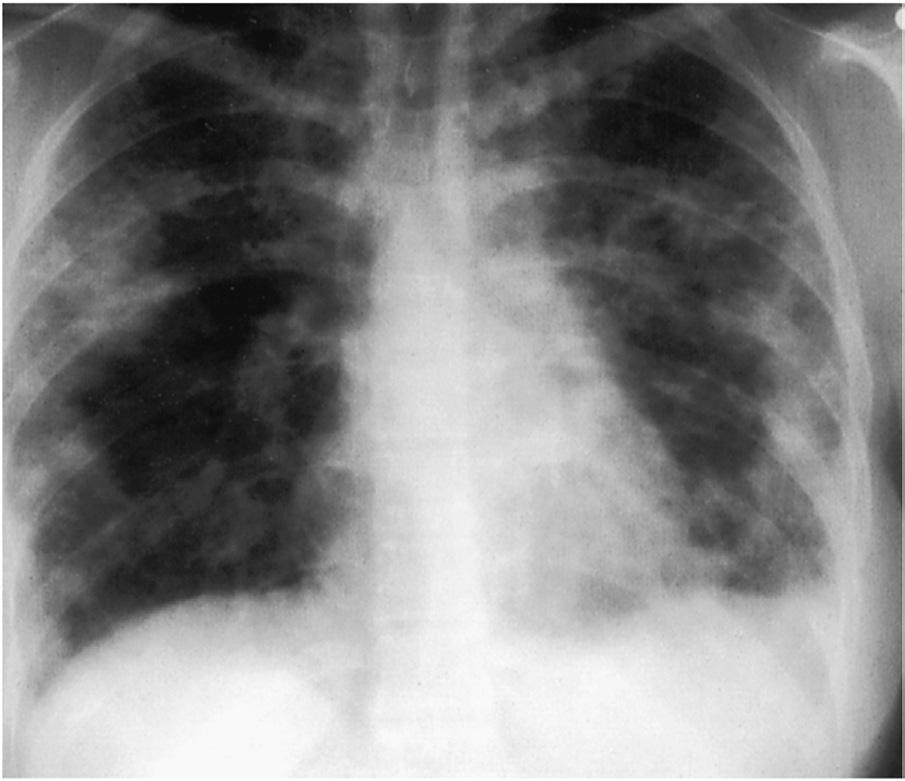

# Chapter 343: Other Tissue Nematodes
> **Course:** Vikkypaedia Pediatric Basic Course (*Nelson Textbook of Pediatrics, 22nd Edition (2025)*)  
> **Part XV:** Infectious Diseases  
> **Authors:** Katherine R. Dobbs and Arlene E. Dent  
> **Metrics:** 2,248 words · 0 tables/boxes · 2 figures · 0 genes · 8 flashcards · 5 MCQs  
> **Quick Navigation:** [🃏 Study 8 Flashcards](../flashcards/343_flashcards.md) · [📝 Take 5-Q MCQ Quiz](../mcqs/343_mcqs.md) · [📚 Part XV Guide](../parts/Part_XV.md) · [🧬 Syndrome & Genetics Atlas](../omim_gene_atlas.md) · [💊 Therapeutics Matrix](../therapies_matrix.md) · [🏠 Course Index](../../index.md)

## ⚡ High-Yield Nelson Pediatric Board Pearls
- The diagnosis can be established by obtaining snips of skin covering the scapulae, iliac crests, buttocks, or calves.
- The diagnosis can also be established by demonstrating microfilariae in the cornea or anterior chamber on slit-lamp examination or finding adult worms on a nodule biopsy spec imen.
- A single dose of ivermectin (150 μg/kg orally) is the drug of choice and clears O. volvulus microfilariae from the skin for several months but has no effect on the adult worm.
- LOIASIS (LOA LOA) Loiasis is caused by infection with the tissue nematode Loa loa.
- In contrast, travelers to endemic regions may have a hyperreactive response to L. loa infection characterized by frequent recurrences of swelling, high level eosino philia, debilitation, and serious complications such as glomerulone phritis and encephalitis.
- Diagnosis is usually established on clinical grounds, often assisted by the infected individual reporting a worm being seen crossing the conjunctivae.
- Diethylcarbamazine is the treatment of choice for loiasis, as there is evidence that it kills both microfilariae and adult worms and results in a sustained decrease in microfilarial intensity after treatment.

---
## Full Chapter Text, Tables & Figures
# Chapter 343: Other Tissue Nematodes

*Katherine R. Dobbs and Arlene E. Dent*

<!-- p.2827 -->
1 mg/kg 3 times daily on day 2, 1-2 mg/kg 3 times daily on day 3, and 2 mg/kg 3 times daily on days 4-14; *adults*: 50 mg orally on day 1, 50 mg 3 times daily on day 2, 100 mg 3 times daily on day 3, and 2 mg/ kg 3 times daily on days 4-14). For patients with no microfilaria in the blood, the full dose (2 mg/kg/day orally divided 3 times daily) can be given beginning on day 1. Repeat doses may be necessary to further reduce the microfilaremia and kill lymph-dwelling adult parasites. *W. bancrofti* is more sensitive than *B. malayi* to diethylcarbamazine.

Global programs to control and ultimately eradicate lymphatic filariasis from endemic populations outside of sub-Saharan Africa currently recommend triple drug treatment with one or two annual doses of **diethylcarbamazine** (6 mg/kg orally once), **albendazole** (400 mg orally once), and **ivermectin** (150 μg/kg orally once) (mass drug administration). In co-endemic areas of filariasis and **onchocerciasis**, mass drug applications with single-dose ivermectin and albendazole are used because of severe adverse reactions with diethylcarbamazine in onchocerciasis-infected individuals.

*Visit Elsevier eBooks+ at eBooks.Health.Elsevier.com** for Bibliography.*

**Fig. 342.1** Chest radiograph of tropical pulmonary eosinophilia. Reticulonodular opacities are scattered throughout both lungs. (From Mandell GL, Bennett JE, Dolin R, eds. Principles and Practice of Infec tious Diseases, 6th ed. Philadelphia: Elsevier, 2006. p. 3274.)

*Katherine R. Dobbs and Arlene E. Dent*

**ONCHOCERCIASIS (****ONCHOCERCA VOLVULUS****)** Infection with *Onchocerca volvulus* leads to onchocerciasis or **river blindness**. Onchocerciasis occurs primarily in West Africa but also in Central and East Africa and is the world’s second leading infectious cause of blindness. There have been scattered foci in South America and Yemen. *O. volvulus* larvae are transmitted to humans by the bite of *Simulium* black flies that breed in fast-flowing streams. The larvae penetrate the skin and migrate through the connective tissue and even tually develop into adult worms that can be found tangled in fibrous tissue. Adult worms can live in the human body for up to 14 years. Female worms produce large numbers of microfilariae that migrate through the skin, connective tissue, and eye. Most infected individuals

are asymptomatic. In heavily infected individuals, clinical manifesta tions are a result of localized host inflammatory reactions to dead or dying microfilariae and subcutaneous adult worms surrounded by a palpable fibrous capsule. Cutaneous and ocular reactions to microfi lariae produce pruritic dermatitis, punctate keratitis, corneal pannus formation, and chorioretinitis. Adult worms in subcutaneous nodules are not painful and tend to occur over bony prominences of the hip. The **diagnosis** can be established by obtaining snips of skin covering the scapulae, iliac crests, buttocks, or calves. The snips are immersed in saline for several hours and examined microscopically for microfilariae that have emerged into the fluid. The diagnosis can also be established by demonstrating microfilariae in the cornea or anterior chamber on slit-lamp examination or finding adult worms on a nodule biopsy spec imen. Ophthalmology consultation should be obtained before treat ment of eye lesions.

A single dose of **ivermectin** (150 μg/kg orally) is the drug of choice and clears *O. volvulus* microfilariae from the skin for several months but has no effect on the adult worm. Treatment with ivermectin should be repeated every 6-12 months until the patient is asymptomatic or has no evidence of eye infection. Adverse effects of ivermectin ther apy include fever, urticaria, and pruritus, which are more frequent in individuals not born in endemic areas who acquired the infection after periods of intense exposure, such as Peace Corps volunteers. Patients with concurrent high-density microfilaremia from loiasis may develop potentially fatal encephalopathy with ivermectin therapy. Treatment with ivermectin should be withheld until *Loa loa* microfilaremia can be reduced. **Moxidectin** is a promising new agent. Personal protec tion includes avoiding areas where biting flies are numerous, wear ing protective clothing, and using insect repellent. Programs of mass treatment with ivermectin have been implemented in Africa and South America in an effort to reduce the prevalence of onchocerciasis.

The World Health Organization (WHO) set goals for onchocerciasis elimination by 2025 using mass drug administration with ivermectin. Elimination can be declared only after 3 years of posttreatment surveil lance without microfilaria detection in skin biopsies.

**Nodding syndrome**, a form of epilepsy in African children living in focal areas of Uganda and South Sudan, was epidemiologically asso ciated with onchocerciasis, but an etiologic link was not established. Recently, researchers identified neurotoxic autoantibodies that crossreact with *O. volvulus* proteins, which were found more frequently in people with nodding syndrome than in those in the same village with out the syndrome. Nodding syndrome may be an autoimmune epilep tic disorder triggered by *O. volvulus* infection.

**LOIASIS (LOA LOA)** Loiasis is caused by infection with the tissue nematode *Loa loa.* The parasite is transmitted to humans by diurnally biting flies *(Chrysops)* that live in the rain forests of West and Central Africa. Migration of adult worms through skin, subcutaneous tissue, and subconjunctival area can lead to transient episodes of pruritus, erythema, and local ized edema known as **Calabar swellings**, which are nonerythematous areas of subcutaneous edema 10-20 cm in diameter typically found around joints such as the wrist or the knee (Fig. 343.1). They resolve over several days to weeks and may recur at the same or different sites. Lifelong residents of *L. loa*–endemic regions may have microfilaremia and eosinophilia but are often asymptomatic. In contrast, travelers to endemic regions may have a hyperreactive response to *L. loa* infection characterized by frequent recurrences of swelling, high level eosino philia, debilitation, and serious complications such as glomerulone phritis and encephalitis. **Diagnosis** is usually established on clinical grounds, often assisted by the infected individual reporting a worm being seen crossing the conjunctivae. Microfilariae may be detected in blood smears collected between 10 am and 2 pm. Adult worms should be surgically excised when possible.

**Diethylcarbamazine** is the treatment of choice for loiasis, as there is evidence that it kills both microfilariae and adult worms and results in a sustained decrease in microfilarial intensity after treatment. Because treatment-associated complications such as pruritus, fever, general ized body pain, hypertension, and even death may occur, especially

<!-- p.2829 -->
with high microfilaria levels, the dose of diethylcarbamazine should be increased gradually in such cases (*children*: 1 mg/kg orally on day 1, 1 mg/kg three times daily on day 2, 1-2 mg/kg three times daily on day 3, 3 mg/kg three times daily on days 4-21; *adults*: 50 mg orally on day 1, 50 mg three times daily on day 2, 100 mg three times daily on day 3, 3 mg/kg three times daily on days 4-21). Full doses can be insti tuted on day 1 in persons without microfilaremia (3 mg/kg orally times daily for 21 days). A 3-week course of **albendazole** can also be used to slowly reduce *L. loa* microfilarial levels as a result of embryotoxic effects on the adult worms. Antihistamines or corticosteroids may be used to limit allergic reactions secondary to killing of microfilariae. Personal protective measures include avoiding areas where biting flies are present, wearing protective clothing, and using insect repellents. Diethylcarbamazine (300 mg orally once weekly) prevents infection in travelers who spend prolonged periods in endemic areas. *L. loa* do not harbor *Wolbachia* endosymbionts, and therefore doxycycline has no effect on infection.

**INFECTION WITH ANIMAL FILARIAE** The most commonly recognized zoonotic filarial infections are caused by members of the genus *Dirofilaria.* The worms are introduced into humans by the bites of mosquitoes containing third-stage larvae. The most com mon filarial zoonosis in the United States is *Dirofilaria tenuis,* a parasite of raccoons. In Europe, Africa, and Southeast Asia, infections are usu ally caused by the dog parasite *Dirofilaria repens.* The **dog heartworm**, *Dirofilaria immitis,* is the second most frequently encountered filarial zoonosis worldwide. Other genera, including *Dipetalonema*-like worms, *Onchocerca,* and *Brugia,* are rare causes of zoonotic filarial infections.

Animal filariae do not undergo normal development in the human host. The clinical manifestations and pathologic findings correspond to the anatomic site of infection and can be categorized into four major groups: subcutaneous, lung, eye, and lymphatic. Pathologic examina tion of affected tissue reveals a localized foreign body reaction around a dead or dying parasite. The lesion consists of granulomas with eosin ophils, neutrophils, and tissue necrosis. *D. tenuis* does not leave the subcutaneous tissues, whereas *Brugia beaveri* eventually localizes to superficial lymph nodes. Infections may be present for up to several months. *D. immitis* larvae migrate for several months in subcutane ous tissues and most frequently result in a well-circumscribed, coinlike lesion in a single lobe of the lung. The chest radiograph typically reveals a solitary pulmonary nodule 1-3 cm in diameter. Definitive **diagnosis** and cure depend on surgical excision and identification of the nema tode within the surrounding granulomatous response. *D. tenuis* and *B. beaveri* infections present as painful, rubbery, 1-5 cm nodules in the skin of the trunk, of the extremities, and around the orbit. Patients often report having been engaged in activities predisposing to exposure

to infected mosquitoes, such as working or hunting in swampy areas. Management is by **surgical excision**.

**ANGIOSTRONGYLUS CANTONENSIS* Angiostrongylus cantonensis,* the **rat lungworm,** is the most common cause of **eosinophilic meningitis** worldwide. Rats are the definitive host. Human infection follows ingestion of third-stage larvae in raw or undercooked intermediate hosts such as snails and slugs, or trans port hosts such as freshwater prawns, frogs, and fish. Most cases are sporadic, but clusters have been reported, including clusters related to consumption of lettuce contaminated with intermediate or transport hosts. Even though most infections have been described in Southeast Asia, the South Pacific, and Taiwan, shipboard travel of infected rats has spread the parasite to Madagascar, Africa, the Caribbean, and most recently Australia and North America. Larvae penetrate the vascula ture of the intestinal tract and migrate to the meninges, where they usually die but induce eosinophilic aseptic meningitis. Patients pres ent 2-35 days after ingestion of larvae with severe headache, neck pain or nuchal rigidity, hyperesthesias and paresthesias (often migrating), fatigue, fever, rash, pruritus, nausea, and vomiting. Neurologic involve ment varies from asymptomatic to paresthesias, severe pain, weakness, and focal neurologic findings such as cranial nerve palsies. Symptoms can last for several weeks to months, especially headache. Coma and death from hydrocephalus occur rarely in heavy infections. Peripheral blood eosinophilia is not always present on initial examination but peaks about 5 weeks after exposure, often when symptoms are improv ing. Cerebrospinal fluid (CSF) analysis reveals pleocytosis with >10% eosinophils in more than half of patients, with mildly elevated protein, a normal glucose level, and an elevated opening pressure. Head CT or MRI is usually unremarkable. The **diagnosis** is established clini cally with supporting travel and diet history. A sensitive and specific enzyme-linked immunosorbent assay (ELISA) is available on a limited basis from the Centers for Disease Control and Prevention (CDC) for testing CSF or serum.

**Treatment** is primarily supportive because the majority of infec tions are mild, and most patients recover within 2 months without neurologic sequelae. Analgesics should be given for headache. Care ful, repeated lumbar punctures should be performed to relieve hydro cephalus. Anthelmintic drugs have not been shown to influence the outcome and may exacerbate neurologic symptoms. The use of cortico steroids may shorten the duration of persistent and severe headaches. There is a higher incidence of permanent neurologic sequelae and mortality among children than among adults. Infection can be avoided by not eating raw or undercooked crabs, prawns, or snails.

**ANGIOSTRONGYLUS COSTARICENSIS* Angiostrongylus costaricensis* is a nematode that infects several spe cies of rodents and causes abdominal **angiostrongyliasis**, which has been described predominantly in Latin America and the Caribbean. The mode of transmission to humans, who are accidental hosts, is unknown. It is speculated that infectious larvae from a molluscan intermediate host, such as the slug *Vaginulus plebeius,* contaminate water or vegetation that is inadvertently consumed (chopped up in sal ads or on vegetation contaminated with the slug’s mucous secretions). Although this slug is not indigenous to the continental United States, it has been found on imported flowers and produce. The incubation period for abdominal angiostrongyliasis is unknown, but limited data suggest that it ranges from 2 weeks to several months after ingestion of larvae. Third-stage larvae migrate from the gastrointestinal tract to the mesenteric arteries, where they mature into adults. These eggs degener ate and elicit an eosinophilic granulomatous reaction. The clinical find ings of abdominal angiostrongyliasis mimic **appendicitis,** although the former is typically more indolent. Children can have fever, right lower quadrant pain, a tumor-like mass, abdominal rigidity, and a painful rectal examination. Most patients have leukocytosis with eosinophilia. Radiologic examination may show bowel wall edema, spasticity, or fill ing defects in the ileocecal region and the ascending colon. Examina tion of stool for ova and parasites is not useful for *A. costaricensis* but is useful for evaluating the presence of other intestinal parasites. An

**Fig. 343.1** Calabar swelling of the right hand. (From Guerrant RL, Walker DH, Weller PF, et al. Tropical Infectious Diseases. Philadelphia: Churchill Livingstone, 2006: p. 1165.)

<!-- p.2831 -->
