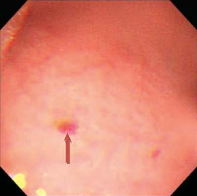
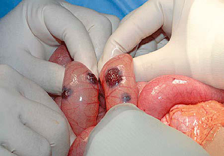

# Chapter 352: Major Symptoms and Signs of Digestive Tract Disorders
> **Course:** Vikkypaedia Pediatric Basic Course (*Nelson Textbook of Pediatrics, 22nd Edition (2025)*)  
> **Part XVI:** The Digestive System  
> **Authors:** Asim Maqbool and Chris A. Liacouras  
> **Metrics:** 8,840 words · 15 tables/boxes · 2 figures · 0 genes · 8 flashcards · 5 MCQs  
> **Quick Navigation:** [🃏 Study 8 Flashcards](../flashcards/352_flashcards.md) · [📝 Take 5-Q MCQ Quiz](../mcqs/352_mcqs.md) · [📚 Part XVI Guide](../parts/Part_XVI.md) · [🧬 Syndrome & Genetics Atlas](../omim_gene_atlas.md) · [💊 Therapeutics Matrix](../therapies_matrix.md) · [🏠 Course Index](../../index.md)

## ⚡ High-Yield Nelson Pediatric Board Pearls
- Jaundice is common in neonates, especially among premature infants, and usually results from the inability of an immature liver to conjugate bilirubin, leading to an elevated indirect component.
- Disorders of organs outside the gastrointestinal (GI) tract can produce symptoms and signs that mimic digestive tract disorders and should be considered in the differential diagnosis.
- In children with normal growth and development, treatment may be initiated without a formal evaluation based on a presumptive diagnosis after taking a history and performing a physical examination.
- Extrinsic obstruction is caused by compression from vas cular rings, mediastinal lesions, or vertebral abnormalities.
- Regurgitation should be differentiated from vomiting, which denotes an active reflex process with an extensive dif ferential diagnosis.
- Nausea is often a clinical diagnosis, and while the differential diag nosis is extensive, negative findings do not equate to the patient not having nausea.
- Vomiting caused by obstruction of the GI tract is probably medi ated by intestinal visceral afferent nerves stimulating the vomit ing center.

---
## Full Chapter Text, Tables & Figures
# Chapter 352: Major Symptoms and Signs of Digestive Tract Disorders

*Asim Maqbool and Chris A. Liacouras*

<!-- p.2853 -->
below the right costal margin. The normal liver is soft in consistency and percusses to normal size for age. A Riedel lobe is a thin projection of the right lobe of the liver that may be palpated low in the right lateral abdomen. A soft spleen tip might also be palpable as a normal finding. In thin young children, the vertebral column is easily palpable, and an overlying structure may be mistaken for a mass. Pulsation of the aorta can be appreciated. Normal stool can often be palpated in the left lower quadrant in the descending or sigmoid colon.

**Blood loss** from the gastrointestinal tract is never normal, but swallowed blood may be misinterpreted as gastrointestinal bleeding. Maternal blood may be ingested at the time of birth or later by a nurs ing infant if there is bleeding near the mother’s nipple. Nasal or oropha ryngeal bleeding is occasionally mistaken for gastrointestinal bleeding (see Chapter 142). Red dyes in foods or drinks can turn the stool red but do not produce a positive test result for occult blood.

**Jaundice** is common in neonates, especially among premature infants, and usually results from the inability of an immature liver to conjugate bilirubin, leading to an elevated indirect component (see Chapter 137). Persistent elevation of indirect bilirubin levels in nurs ing infants may be a result of breast milk jaundice, which is usually a benign entity in full-term infants. An elevated direct bilirubin is not normal and suggests liver disease, although in infants it may be a result of extrahepatic infection (urinary tract infection). The direct bilirubin fraction should account for no more than 15–20% of the total serum bilirubin. Elevations in direct bilirubin levels can follow indirect hyperbilirubinemia as the liver converts excessive indirect to direct bilirubin and the rate-limiting step in bilirubin excretion shifts from the glucuronidation of bilirubin to excretion of direct bilirubin into the bile canaliculus. Indirect hyperbilirubinemia, which occurs commonly in normal newborns, tends to tint the sclerae and skin golden yellow, whereas direct hyperbilirubinemia produces a greenish yellow hue. The degree of jaundice does not always directly correlate with serum bilirubin levels. An elevated total serum bilirubin warrants closer examination, fractionation of bilirubin (direct and indirect), and ongoing surveillance. Atypical elevations of unconjugated bilirubin are associated with risk for kernicterus (see Chapter 140). Elevations in conjugated bilirubin are reviewed in the chapter on cholestasis (see Chapter 404.1).

*Visit Elsevier eBooks+ at eBooks.Health.Elsevier.com** for Bibliography.*

Disorders of organs outside the gastrointestinal (GI) tract can produce symptoms and signs that mimic digestive tract disorders and should be considered in the differential diagnosis (Table 352.1). In children with normal growth and development, treatment may be initiated without a formal evaluation based on a presumptive diagnosis after taking a history and performing a physical examination. Poor weight gain or weight loss is often associated with a significant pathologic process and usually necessitates a more formal evaluation.

*Asim Maqbool and Chris A. Liacouras*

Gastrointestinal Symptoms in Children

#### **Table 352.1** Some Nondigestive Tract Causes of

| Category / Parameter | Clinical Details & Findings |
| --- | --- |
| **ANOREXIA** | Systemic disease: inflammatory, neoplastic; Cardiorespiratory compromise; Iatrogenic: drug therapy, unpalatable therapeutic diets; Depression; Anorexia nervosa |
| **VOMITING** | Inborn errors of metabolism; Medications: erythromycin, chemotherapy, nonsteroidal; antiinflammatory drugs, marijuana; Increased intracranial pressure; Brain tumor; Infection of the urinary tract; Labyrinthitis; Adrenal insufficiency; Pregnancy; Psychogenic; Abdominal migraine; Poisoning/toxins; Renal disease |
| **DIARRHEA** | Infection: otitis media, urinary tract infection; Uremia; Medications: antibiotics, cisapride; Tumors: neuroblastoma; Pericarditis; Adrenal insufficiency |
| **CONSTIPATION** | Hypothyroidism; Spina bifida; Developmental delay; Dehydration: diabetes insipidus, renal tubular lesions; Medications: narcotics; Lead poisoning; Infant botulism |
| **ABDOMINAL PAIN** | Pyelonephritis, hydronephrosis, renal colic; Pneumonia (lower lobe); Pelvic inflammatory disease; Porphyria; Fabry disease; Angioedema; Endocarditis; Abdominal migraine; Familial Mediterranean fever; Sexual or physical abuse; Systemic lupus erythematosus; School phobia; Sickle cell crisis; Vertebral disk inflammation; Psoas abscess; Pelvic osteomyelitis or myositis; Medications; Anterior (abdominal) cutaneous nerve entrapment syndrome (ACNES) |
| **ABDOMINAL DISTENTION OR MASS** | Ascites: nephrotic syndrome, neoplasm, heart failure; Discrete mass: Wilms tumor, hydronephrosis, neuroblastoma,; mesenteric cyst, hepatoblastoma, lymphoma; Pregnancy |
| **JAUNDICE** | Hemolytic disease; Urinary tract infection; Sepsis; Hypothyroidism; Panhypopituitarism |

<!-- p.2855 -->
**DYSPHAGIA** Difficulty in swallowing is termed *dysphagia.* Painful swallowing is termed **odynophagia**. **Globus** is the sensation of something stuck in the throat without a clear etiology. Swallowing is a complex process that starts in the mouth with mastication and lubrication of food that is formed into a bolus. The bolus is pushed into the pharynx by the tongue. The pharyngeal phase of swallowing is rapid and involves pro tective mechanisms to prevent food from entering the airway. The epi glottis is lowered over the larynx while the soft palate is elevated against the nasopharyngeal wall; respiration is temporarily arrested while the upper esophageal sphincter opens to allow the bolus to enter the esoph agus. In the esophagus, peristaltic coordinated muscular contractions push the food bolus toward the stomach. The lower esophageal sphinc ter relaxes shortly after the upper esophageal sphincter, so liquids that rapidly clear the esophagus enter the stomach without resistance.

Dysphagia is classified as oropharyngeal dysphagia and esophageal dysphagia. **Oropharyngeal dysphagia** occurs when the transfer of the food bolus from the mouth to the esophagus is impaired (also termed *transfer dysphagia*). The striated muscles of the mouth, pharynx, and upper esophageal sphincter are affected in oropharyngeal dysphagia. Neurologic and muscular disorders can give rise to oropharyngeal dysphagia (Table 352.2). Chiari malformations, Russell-Silver syn drome, and cri du chat may present with upper esophageal sphincter

dysfunction, manifest by dysphagia with solids. The most serious com plication of oropharyngeal dysphagia is life-threatening aspiration.

A complex sequence of neuromuscular events is involved in the transfer of foods to the upper esophagus. Abnormalities of the muscles involved in the ingestion process and their innervation, strength, or coordination are associated with transfer dysphagia in infants and chil dren. In such cases, an oropharyngeal problem is usually part of a more generalized neurologic or muscular problem (botulism, diphtheria, neuromuscular disease). Painful oral lesions, such as acute viral sto matitis or trauma, occasionally interfere with ingestion. If the nasal air passage is seriously obstructed, the need for respiration causes severe distress when suckling. Although severe structural, dental, and salivary abnormalities would be expected to create difficulties, ingestion pro ceeds relatively well in most affected children if they are hungry.

**Esophageal dysphagia** occurs when there is difficulty in transport ing the food bolus down the esophagus. Esophageal dysphagia can result from neuromuscular disorders or mechanical obstruction (Table 352.3). Primary motility disorders causing impaired peristaltic func tion and dysphagia are rare in children. Eosinophilic esophagitis can present with esophageal dysphagia. Achalasia is an esophageal motility disorder with associated inability of relaxation of the lower esophageal sphincter; it rarely occurs in children. Motility of the distal esophagus is disordered after surgical repair of tracheoesophageal fistula or acha lasia. Abnormal motility can accompany collagen vascular disorders. Mechanical obstruction can be intrinsic or extrinsic. Intrinsic struc tural defects cause a fixed impediment to the passage of food bolus because of a narrowing within the esophagus, as in a stricture, web, or tumor. Extrinsic obstruction is caused by compression from vas cular rings, mediastinal lesions, or vertebral abnormalities. Structural defects typically cause more problems in swallowing solids than liq uids. In infants, esophageal web, tracheobronchial remnant, or vas cular ring can cause dysphagia. An esophageal stricture secondary to esophagitis (chronic gastroesophageal reflux, eosinophilic esophagitis, chronic infections) occasionally has dysphagia as the first manifesta tion. An esophageal foreign body or a stricture secondary to a caustic ingestion also causes dysphagia. A Schatzki ring, a thin ring of mucosal tissue near the lower esophageal sphincter, is another mechanical cause of recurrent dysphagia, and again is rare in children.

When dysphagia is associated with a delay in passage through the esophagus, the patient may be able to point to the level of the chest where the delay occurs, but esophageal symptoms are usually referred

#### **Table 352.2** Causes of Oropharyngeal Dysphagia

| Category / Parameter | Clinical Details & Findings |
| --- | --- |
| **NEUROMUSCULAR DISORDERS** | Cerebral palsy; Brain tumors; Cerebrovascular disease/stroke; Chiari malformation; Polio and postpolio syndromes; Multiple sclerosis; Myositis; Dermatomyositis; Myasthenia gravis; Muscular dystrophies; Acquired or inherited dystonia syndrome; Dysautonomia |
| **METABOLIC AND AUTOIMMUNE DISORDERS** | Hyperthyroidism; Systemic lupus erythematosus; Sarcoidosis; Amyloidosis |
| **INFECTIOUS DISEASE** | Meningitis; Botulism; Diphtheria; Lyme disease; Neurosyphilis; Viral infection: polio, coxsackievirus, herpes, cytomegalovirus |
| **STRUCTURAL LESIONS** | Inflammatory: abscess, pharyngitis; Congenital web; Cricopharyngeal bar; Dental problems; Bullous skin lesions; Plummer-Vinson syndrome; Zenker diverticulum; Extrinsic compression: osteophytes, lymph nodes, thyroid swelling,; aberrant; right subclavian artery (dysphagia lusoria) |
| **OTHER** | Corrosive injury; Side effects of medications; After surgery; After radiation therapy; Adapted from Gasiorowska A, Faas R. Current approach to dysphagia. Gastroenterol; Hepatol. 2009;5(4):269–279. |

#### **Table 352.3** Causes of Esophageal Dysphagia

| Category / Parameter | Clinical Details & Findings |
| --- | --- |
| **NEUROMUSCULAR** | Eosinophilic esophagitis; Achalasia cardia; Diffuse esophageal spasm; Scleroderma |
| **INTRINSIC LESIONS** | Foreign bodies including pills; Esophagitis: GERD, eosinophilic esophagitis, infections; Stricture: corrosive injury, pill induced, peptic; Esophageal webs; Esophageal rings; Esophageal diverticula; Neoplasm; Chagas disease |
| **EXTRINSIC LESIONS** | Vascular compression; Mediastinal lesion; Cervical osteochondritis; Vertebral abnormalities; GERD, Gastroesophageal reflux disease.; Adapted from Gasiorowska A, Faas R. Current approach to dysphagia. Gastroenterol; Hepatol. 2009;5(4):269–279. |

<!-- p.2856 -->
to the suprasternal notch. When a patient points to the suprasternal notch, the impaction can be found anywhere in the esophagus.

**REGURGITATION** Regurgitation is the effortless movement of stomach contents into the esophagus and mouth. It is not associated with distress, and infants with regurgitation are often hungry immediately after an episode. The lower esophageal sphincter prevents reflux of gastric contents into the esophagus. Regurgitation is a result of gastroesophageal reflux through an incompetent or, in infants, immature lower esophageal sphincter. This is often a developmental process, and regurgitation or “spitting” resolves with maturity. Regurgitation should be differentiated from vomiting, which denotes an active reflex process with an extensive dif ferential diagnosis (Table 352.4).

**NAUSEA** Nausea has been described as an unpleasant, subjective sensation of impending/imminent vomiting, often with epigastric sensation that may be painless. Nausea is frequently associated with typical auto nomic signs that accompany vomiting. Not all nausea is a prodrome to vomiting. There are multiple potential triggers to nausea, includ ing environmental exposures (toxins, odors), unpleasant visual stim uli, visceral pain, anxiety, stress, and a variety of additional etiologies (Table 352.5).

The central nervous system (CNS) is frequently implicated for nau sea. Receptors and neural pathways at the chemoreceptor trigger zone

(CTZ) are most often implicated by chemical stimuli with chemother apy a prime example. Visceral stimuli can include ingestions, gastric hyperacidity, physical stress, psychologic stressors, mechanical disten tion of the stomach, and impaired GI motility; vagal and sympathetic nerves are involved in this process. Vestibular pathways are most often implicated in nausea related to motion sickness. Increased intracranial pressure can also present with nausea plus or minus vomiting.

Chronic nausea is more common in adolescents and may be coinci dental with other functional GI disorders, including functional dyspep sia, delayed gastric emptying/gastroparesis, and constipation. There are gender and ethnic differences with respect to chronic nausea in adoles cence, with adolescent White females with anxiety more at risk than other groups; there may be alterations in the brain gut axis coupled with increased visceral hypersensitivity and hyperalgesia at play in the setting (see Chapter 212). Dehydration and autonomic dysfunction may also present with nausea as one facet of GI manifestations.

Nausea is often a clinical diagnosis, and while the differential diag nosis is extensive, negative findings do not equate to the patient not having nausea. Nausea is often distressing, disruptive, and may be disabling with respect to normal function. Table 352.5 reviews com mon medical conditions associated with nausea, as well as treatment strategies. Hydration is important in many of these conditions. Many of the medications used employ antihistamine, serotonergic, dopa minergic, and potentially even opioid pathways (although these are still controversial). These agents are active at both the CNS and GI level, with significant brain-gut axis interplay. Complementary and

#### **Table 352.4** Differential Diagnosis of Emesis During Childhood

| Category / Parameter | Clinical Details & Findings |
| --- | --- |
| **COMMON** | Gastroenteritis; Gastroesophageal reflux; Overfeeding; Anatomic obstruction*; Systemic infection†; Pertussis syndrome; Otitis media; Gastroenteritis; Systemic infection; Gastritis; Toxic ingestion/poisoning; Pertussis syndrome; Medication; Reflux (GERD); Sinusitis; Otitis media; Anatomic obstruction*; Eosinophilic esophagitis; Gastroenteritis |
| **GERD** | Systemic infection; Toxic ingestion/poisoning/marijuana; Gastritis; Sinusitis; Inflammatory bowel disease; Appendicitis; Migraine; Pregnancy; Medications; Ipecac abuse, bulimia; Concussion |
| **RARE** | Adrenogenital syndrome; Inborn errors of metabolism; Brain tumor (increased intracranial pressure); Subdural hemorrhage; Food poisoning; Rumination; Renal tubular acidosis; Ureteropelvic junction obstruction; Pseudoobstruction; Reye syndrome; Hepatitis; Peptic ulcer; Pancreatitis; Brain tumor; Increased intracranial pressure; Middle ear disease/labyrinthitis; Chemotherapy; Achalasia; Cyclic vomiting (migraine); Esophageal stricture; Duodenal hematoma; Inborn error of metabolism; Pseudoobstruction; Gastroparesis; Reye syndrome; Hepatitis; Peptic ulcer; Pancreatitis; Cholecystitis; Brain tumor; Increased intracranial pressure; Concussion; Middle ear disease/labyrinthitis; Chemotherapy; Cyclic vomiting (migraine); Biliary colic; Renal colic; Porphyria; Diabetic ketoacidosis; Adrenal insufficiency; Pseudoobstruction; Intestinal tumor; Gastroparesis; Achalasia; Superior mesentery artery syndrome; Distal intestinal obstruction syndrome; *Includes malrotation, pyloric stenosis, intussusception, Hirschsprung disease, adhesions, and hernias.; †Meningitis, sepsis.; GERD, Gastroesophageal reflux disease. |

<!-- p.2857 -->

#### **Table 352.5** Examples of Causes and Management of Nausea

| Category / Parameter | Clinical Details & Findings |
| --- | --- |
| **TREATMENT APPROACHES** | Gastroesophageal reflux; Diet and lifestyle; acid reduction, refluxate management; Esophagitis (reflux related, eosinophilic, etc.); Acid reduction, identifying and restricting environmental/dietary triggers; Dyspepsia; Dietary and lifestyle modification; acid reduction; cyproheptadine; Gastroparesis; Smaller, more frequent meals; dietary modification; prokinetic agents (D2 antagonists such as; metoclopramide and domperidone*; low-dose erythromycin or azithromycin); Constipation; Adequate hydration, diet and lifestyle modification, stool softeners, stimulant laxatives, additional; adjunct measures if/as indicated; Visceral hyperalgesia; Tricyclic antidepressants (e.g., amitriptyline), cognitive behavioral therapy, hypnotherapy,; biofeedback, physical therapy for desensitization; biofeedback; stress reduction |
| **OTHER GASTROINTESTINAL DISORDERS** | Gastritis (medication/NSAID induced;; Helicobacter pylori); Reduce/remove medications involved; treat the underlying cause; Gastrointestinal dysmotility; Adequate hydration; diet/feeding or eating modification; promotility agents; Biliary dysfunction (cholelithiasis,; cholecystitis, biliary dyskinesia); Treat the underlying cause; Fundoplication; Smaller, more frequent meals; cyproheptadine to improve gastric accommodation |
| **CENTRAL NERVOUS SYSTEM** | Increased intracranial pressure; Treat underlying cause; Migraines, headaches; Migraine prophylactic agents, including cyproheptadine. Abortive medications including triptans.; Motion sickness/vestibular dysfunction; Antihistamines (e.g., diphenhydramine, hydroxyzine) anticholinergics (e.g., scopolamine); Autonomic dysfunction; Adequate hydration, increased salt intake, diet and lifestyle modification; Chemotherapy-induced nausea and vomiting; 5-HT3 receptor antagonists; D2 antagonists; NK-1 antagonists; butyrophenones; benzodiazepines;; dexamethasone; synthetic cannabinoids; Postoperative nausea and vomiting; 5-HT3 receptor antagonists |
| **NON-GI AND NON-CNS ETIOLOGIES OF NAUSEA** | Uremia; Treat the underlying disorder; Endocrine disorders [e.g., hypothyroidism]; Treat the underlying disorder; *D2 receptor antagonists such as metoclopramide and domperidone have a significant side effect profile, and have a U.S. Food and Drug Administration black box warning, and; should be used with caution.; NK-1, Neurokinin 1. |

alternative medicine approaches including using ginger, peppermint, aromatherapy, and biofeedback may be helpful. Behavior psychology and social work may be helpful in decreasing disability and enhancing functionality.

**VOMITING** Vomiting is a highly coordinated reflex process that may be pre ceded by increased salivation and begins with involuntary retching. Violent descent of the diaphragm and constriction of the abdominal muscles with relaxation of the gastric cardia actively force gastric contents back up the esophagus. This process is coordinated in the medullary vomiting center, which is influenced directly by affer ent innervation and indirectly by the CTZ and higher CNS centers. Many acute or chronic processes can cause vomiting (see Tables 352.1 and 352.4). Vomiting caused by obstruction of the GI tract is probably medi ated by intestinal visceral afferent nerves stimulating the vomit ing center (Table 352.6). If obstruction occurs below the second part of the duodenum, vomitus is usually bile stained. Emesis can also become bile stained with repeated vomiting in the absence of obstruction when duodenal contents are refluxed into the stomach. Nonobstructive lesions of the digestive tract can also cause vomit ing; this includes diseases of the upper bowel, pancreas, liver, or biliary tree. CNS or metabolic derangements and cyclic vomiting syndrome (see Chapter 390) can lead to severe, persistent emesis. Marijuana use among teens has also led to cannabis hyperemesis syndrome (see Chapter 157.3)

Potential complications of emesis are noted in Table 352.7. Broad management strategies for vomiting in general and specific causes of emesis are noted in Tables 352.8 and 352.9.

**DIARRHEA** Diarrhea is best defined as excessive loss of fluid and electrolyte in the stool. Acute diarrhea is defined as sudden onset of excessively loose stools of >10 mL/kg/day in infants and >200 g/24 hr in older children, which lasts <14 days. When the episode lasts longer than 14 days, it is called *chronic* or *persistent diarrhea.*

Normally, a young infant has approximately 5 mL/kg/day of stool output; the volume increases to 200 g/24 hr in an adult. The greatest volume of intestinal water is absorbed in the small bowel; the colon concentrates intestinal contents against a high osmotic gradient. The small intestine of an adult can absorb 10-11 L/day of a combination of ingested and secreted fluid, whereas the colon absorbs approximately 0.5 L. Disorders that interfere with absorption in the small bowel tend to produce voluminous diarrhea, whereas disorders compromising colonic absorption produce lower-volume diarrhea. **Dysentery** (smallvolume, frequent bloody stools with mucus, tenesmus, and urgency) is the predominant symptom of colitis.

The basis of all diarrheas is disturbed intestinal solute transport and water absorption. Water movement across intestinal membranes is passive and is determined by both active and passive fluxes of solutes, particularly sodium, chloride, and glucose. The pathogenesis of most episodes of diarrhea can be explained by secretory, osmotic, or motility abnormalities or a combination of these (Table 352.10).

**Secretory diarrhea** occurs when the intestinal epithelial cell sol ute transport system is in an active state of secretion. It is often caused by a secretagogue, such as cholera toxin, binding to a recep tor on the surface epithelium of the bowel and thereby stimulat ing intracellular accumulation of cyclic adenosine monophosphate or cyclic guanosine monophosphate. Some intraluminal fatty acids and bile salts cause the colonic mucosa to secrete through this

<!-- p.2858 -->

#### **Table 352.7** Complications of Vomiting

| Category / Parameter | Clinical Details & Findings |
| --- | --- |
| **AND LABORATORY STUDIES** | Metabolic; Fluid loss in emesis; Dehydration; HCl loss in emesis; Alkalosis; hypochloremia; Na, K loss in emesis; Hyponatremia; hypokalemia; Acidosis; Dehydration; Nutritional; Emesis of calories and nutrients; Anorexia for calories and nutrients; Malnutrition; “failure to thrive”; Mallory-Weiss tear; Retching → tear at lesser curve of gastroesophageal junction; Forceful emesis → hematemesis; Esophagitis; Chronic vomiting → esophageal acid exposure; Heartburn; Hemoccult + stool; Aspiration; Aspiration of vomitus, especially in context of obtundation; Pneumonia; neurologic dysfunction; Shock; Severe fluid loss in emesis or in accompanying diarrhea; Dehydration (accompanying diarrhea; can explain acidosis?); Severe blood loss in hematemesis; Blood volume depletion; Pneumomediastinum, pneumothorax; Increased intrathoracic pressure; Chest x-ray; Petechiae, retinal hemorrhages; Increased intrathoracic pressure; Normal platelet count; From Kliegman RM, Greenbaum LA, Lye PS, eds. Practical Strategies in Pediatric Diagnosis and Therapy, 2nd ed. Philadelphia: Elsevier; 2004: p. 318. |

#### **Table 352.6** Causes of Gastrointestinal Obstruction

| Category / Parameter | Clinical Details & Findings |
| --- | --- |
| **Congenital** | Esophageal atresia; Vascular rings; Schatzki ring; Tracheobronchial remnant |
| **Acquired** | Esophageal stricture; Foreign body; Achalasia; Chagas disease; Collagen vascular disease |
| **Congenital** | Antral webs; Pyloric stenosis |
| **Acquired** | Bezoar, foreign body; Pyloric stricture (ulcer); Chronic granulomatous disease of childhood; Eosinophilic gastroenteritis; Crohn disease; Epidermolysis bullosa |
| **Congenital** | Duodenal atresia; Annular pancreas; Malrotation/volvulus; Malrotation/Ladd bands; Ileal atresia; Meconium ileus; Meckel diverticulum with volvulus or intussusception; Inguinal hernia; Internal hernia; Intestinal duplication; Pseudoobstruction |
| **Acquired** | Postsurgical adhesions; Crohn disease; Intussusception; Distal ileal obstruction syndrome (cystic fibrosis); Duodenal hematoma; Superior mesenteric artery syndrome |
| **Congenital** | Meconium plug; Hirschsprung disease; Colonic atresia, stenosis; Imperforate anus; Rectal stenosis; Pseudoobstruction; Volvulus; Colonic duplication |
| **Acquired** | Ulcerative colitis (toxic megacolon); Chagas disease; Crohn disease; Fibrosing colonopathy (cystic fibrosis) |

<!-- p.2859 -->

#### **Table 352.8** Pharmacologic Therapies for Vomiting Episodes

| Category / Parameter | Clinical Details & Findings |
| --- | --- |
| **REFLUX – ANTACIDS** | Histamine-2 receptor antagonist; Famotidine (Pepcid); <3 months: 0.5 mg/kg/dose PO; daily; ≥ 3 months: 0.5 mg/kg/dose PO; twice daily; Children >40 kg: 20 mg twice; daily, max: 40 mg/dose; • H2RAs are associated with; tachyphylaxis; • Ranitidine was withdrawn in; 2020; • Cimetidine has antiandrogenic; potential, can stimulate; prolactin secretion, and may; be subject to drug interactions; due to enzyme inhibition; Nizatidine (Axid); <12 years: 5 mg/kg/dose PO twice; daily*; ≥12 years: 150 mg PO twice daily,; max 300 mg/day; Cimetidine; <16 years: 30-40 mg/kg/day PO; divided 2-3x daily,* max:; 400 mg/dose; ≥16 years: 400 mg PO 4 times; daily or 800 mg PO twice daily; Proton pump inhibitors; Omeprazole (Prilosec); Lansoprazole (Prevacid); Esomeprazole (Nexium); Pantoprazole (Protonix); 1-2 mg/kg/day PO in 1-2 divided; doses; Maximum dose: omeprazole,; esomeprazole, pantoprazole:; 40 mg/dose; lansoprazole:; 30 mg/dose; • Administer 30 minutes before; first meal of the day for optimal; effect; • Long-term side effects include; increased risk of infections,; bone health abnormalities,; hypomagnesemia, vitamin B12; deficiency; • Consider weaning in patients; on prolonged course; (>6 months) to avoid rebound; symptoms |
| **GASTROPARESIS – PROKINETICS** | Dopamine antagonist; Metoclopramide (Reglan); 0.1-0.2 mg/kg/dose PO/IV every; 6 to 8 hours, max: 10 mg/dose; • Use minimum effective dose; and limit duration due to; increased risk of extrapyramidal; symptoms (EPS) with; cumulative exposure; • Although some clinicians use; diphenhydramine to limit; EPS, anticholinergic effects of; diphenhydramine may negate; prokinetic benefit; Motilin agonist; Erythromycin; 5 mg/kg/dose PO 3-4 times daily,; titrate up to 10 mg/kg/dose,; max: 250 mg/dose; • Prescribe suspension for; optimal pharmacokinetic profile; in patients with hypomotility; • Cycling or drug-holidays may; mitigate tachyphylaxis; • Subject to drug interactions; due to CYP3A4 inhibition; • Associated with QTc prolongation,; consider baseline EKG and/or; periodic monitoring in; patients with risk factors; (underlying cardiac disorder,; concomitant QT prolonging; medications, electrolyte; derangements); • Routine use of other macrolides; (azithromycin, clarithromycin); is not recommended due to; limited data to support use,; unknown optimal dose/; frequency, and concerns for; antibiotic resistance; Continued |

<!-- p.2860 -->
**DISORDER – THERAPEUTIC CLASS DRUG DOSAGE COMMENTS**

Serotonin (5HT-4) agonist Cisapride Consult GI specialist • Withdrawn from the market

in most countries due to QTc prolongation risk • Use restricted to regulated/

limited-access programs with specialist supervision

Prucalopride* (Motegrity) >4 years: 0.04 mg/kg/dose PO

once daily, max: 2 mg/dose Dosing range 0.02-0.06 mg/kg/

dose to accommodate tablets

• Approved for constipation

in adults, but a single-center retrospective study showed improvement in children with refractory upper GI symptoms

Cholinergic agonist Bethanechol* 0.1-0.2 mg/kg/dose PO 3 to 4 times daily, max: 10 mg/dose

• Administer before feeds/meals • Stimulates antral contractions

but does not impact gastric emptying • Caution when using with

anticholinergic agents (e.g., glycopyrrolate) due to potential for reduced efficacy/negating effect

CHEMOTHERAPY-INDUCED NAUSEA/VOMITING (CINV), POSTOPERATIVE, GENERAL Serotonin 5HT3 antagonist Ondansetron (Zofran) 0.1-0.15 mg/kg/dose PO/IV q8h, max: 24 mg/day Single dose regimen: 0.3 mg/kg/

dose PO/IV, max: 16 mg/dose

• Adverse effects: constipation,

headache, QTc prolongation • Dose varies based on

chemotherapy emetogenicity

Granisetron (Kytril) ≥2 years: 0.01 mg/kg/dose PO/IV

q12h, max: 2 mg/dose *Single daily dose: 0.02-0.04 mg/ kg PO/IV

Phenothiazine Prochlorperazine (Compazine) ≥2 years: 0.1 mg/kg/dose PO/IV

q6-8h PRN, max: 10 mg/dose

• Due to safety concerns (EPS,

sedation, respiratory depression), routine use of phenothiazines is not recommended • Consider concomitant

diphenhydramine to decrease risk of dystonic reactions • Promethazine is associated with

extravasation; IV/IM administration is generally avoided

Promethazine (Phenergan) ≥2 years: 0.25 to 0.5 mg/kg/dose

PO/rectal q4-6h PRN, max: 25 mg/dose

Chlorpromazine (Thorazine) ≥6 months: 0.5 to 1 mg/kg/dose

PO/IM/IV q6-8h PRN

Substance P / neurokinin 1

antagonist

Aprepitant (Emend), for CINV ≥6 months and children <30 kg:

3 mg/kg PO on day 1, then 2 mg/kg once daily on days 2 and 3 Children >30 kg: 125 mg PO daily

on day 1, then 80 mg PO daily on days 2 and 3

• Subject to drug interactions

due to enzyme inhibition

Steroids Dexamethasone, for CINV 0.1 mg/kg/dose or 3 mg/m2/dose PO/IV q12h-24h

• Reported regimens vary, dose

depends on chemotherapy emetogenicity • May require dose reduction

with concomitant aprepitant

#### **Table 352.8** Pharmacologic Therapies for Vomiting Episodes—cont’d

<!-- p.2861 -->

#### **Table 352.9** Supportive and Nonpharmacologic Therapies for Vomiting Episodes

| Category / Parameter | Clinical Details & Findings |
| --- | --- |
| **THERAPY** | All; Treat cause; • Obstruction: operate; • Allergy: change diet (±steroids); • Metabolic error: Rx defect; • Acid peptic disease: H2Ras, PPIs, etc. |
| **COMPLICATIONS** | Dehydration; IV fluids, electrolytes; Hematemesis; Transfuse, correct coagulopathy; Esophagitis; H2Ras, PPIs; Malnutrition; NG or NJ drip feeding useful for many chronic conditions; Meconium ileus; Gastrografin enema |
| **DIOS** | Gastrografin enema; balanced colonic lavage solution (e.g., GoLYTELY); Intussusception; Barium enema; air reduction enema; Hematemesis; Endoscopic: injection sclerotherapy or banding of esophageal varices; injection therapy, fibrin sealant application,; or heater probe electrocautery for selected upper GI tract lesions; Sigmoid volvulus; Colonoscopic decompression; Reflux; Positioning; dietary measures (infants: rice cereal, 1 tbs/oz of formula); Psychogenic components; Psychotherapy; tricyclic antidepressants; anxiolytics (e.g., diazepam: 0.1 mg/kg PO tid-qid); DIOS, Distal intestinal obstruction syndrome; GI, gastrointestinal; H2RA, H2-receptor antagonist; NG, nasogastric; NJ, nasojejunal; PPIs, proton pump inhibitors; tbs, tablespoon.; From Kliegman RM, Greenbaum LA, Lye PS, eds. Practical Strategies in Pediatric Diagnosis and Therapy. 2nd ed. Philadelphia: Elsevier; 2004: p. 319. |
| **MOTION SICKNESS, VESTIBULAR DISORDERS** | Antihistamine; Diphenhydramine (Benadryl); 0.5-1 mg/kg/dose PO/IV/IM; q6-8h, max: 50 mg/dose; • Anticholinergic effects may; contribute to decreased; motility; • Dimenhydrinate is available as; 50 mg tablets, prescribe in; 12.5 mg increments; • Do not cut or manipulate; scopolamine transdermal; patches; • Withdrawal (cholinergic; rebound) symptoms reported; with long-term use, limit; duration or consider weaning; with extended use; Dimenhydrinate (Dramamine); >2 years: 1 to 1.5 mg/kg/dose PO; q6-8h, max: 25 mg/dose; Meclizine (Antivert); >2 to <12 years: 6.25 mg to 12.5; mg PO three times daily PRN; >12 years: 25 mg to 50 mg PO; 1 to 4 times daily, max:; 100 mg/day; Scopolamine (Transderm-Scop); >15 kg: 1 transdermal patch; applied behind the ear every; 3 days |
| **Intolerance** | Antihistamine/serotonin; antagonist; Cyproheptadine*; 0.25 mg/kg/day PO in 1-3 divided; doses, usual max: 4 mg/dose; • Consider starting with bedtime; dose and titrating up to prevent; daytime sedation; • Associated with tachyphylaxis; • Benefit reported in patients; with visceral hypersensitivity; • Anticholinergic effects may; decrease motility |
| **Pseudo-obstruction** | Somatostatin analog; Octreotide*; 0.5 to 1 mcg/kg subQ once daily,; max: 100 mcg/dose; • May cause bradycardia,; hypoglycemia |
| **Adrenal Crisis** | Hydrocortisone; 100 mg/m2 IV/IM x1, followed by; 25 mg/m2/dose IV/IM q6h, max:; 100 mg/day; Taper as clinically indicated; • Reported regimens vary, refer; to individual protocols; *Limited data available |

#### **Table 352.8** Pharmacologic Therapies for Vomiting Episodes—cont’d

<!-- p.2862 -->

#### **Table 352.10** Mechanisms of Diarrhea

| Category / Parameter | Clinical Details & Findings |
| --- | --- |
| **COMMENT** | Secretory; Decreased absorption,; increased secretion,; electrolyte transport; Watery, normal; osmolality with ion gap; <100 mOsm/kg; Cholera, toxigenic; Escherichia coli; carcinoid,; VIP, neuroblastoma,; congenital chloride; diarrhea, Clostridium; difficile, cryptosporidiosis |
| **(AIDS)** | Persists during fasting; bile; salt malabsorption can; also increase intestinal; water secretion; no stool; leukocytes; Osmotic; Maldigestion, transport; defects ingestion of; unabsorbable substances; Watery, acidic, and reducing; substances; increased; osmolality with ion gap; >100 mOsm/kg; Lactase deficiency,; glucose-galactose; malabsorption, lactulose,; laxative abuse; Stops with fasting;; increased breath; hydrogen with; carbohydrate; malabsorption; no stool; leukocytes; Increased motility; Decreased transit time; Loose to normal-appearing; stool, stimulated by; gastrocolic reflex; Irritable bowel syndrome,; thyrotoxicosis,; postvagotomy dumping; syndrome; Infection can also contribute; to increased motility; Decreased motility; Defect in neuromuscular; unit(s) stasis (bacterial; overgrowth); Loose to; normal-appearing stool; Pseudoobstruction, blind; loop; Possible bacterial; overgrowth; Decreased surface area; (osmotic, motility); Decreased functional; capacity; Watery; Short bowel syndrome,; celiac disease, rotavirus; enteritis; Might require elemental; diet plus parenteral; alimentation; Mucosal invasion; Inflammation, decreased; colonic reabsorption,; increased motility; Blood and increased; WBCs in stool; Salmonella, Shigella; infection; amebiasis;; Yersinia, Campylobacter; infection; Dysentery evident in; blood, mucus, and WBCs; VIP, Vasoactive intestinal peptide; WBC, white blood cell.; From Kliegman RM, Greenbaum LA, Lye PS. eds. Practical Strategies in Pediatric Diagnosis and Therapy. 2nd ed. Philadelphia: Elsevier; 2004: p 274. |

mechanism. Diarrhea not associated with an exogenous secreta gogue can also have a secretory component (congenital microvillus inclusion disease). Secretory diarrhea is usually of large volume and persists even with fasting. The stool osmolality is predominantly indicated by the electrolytes, and the ion gap is 100 mOsm/kg or less. The ion gap is calculated by subtracting the concentration of electrolytes from total osmolality:

Iongap Stool osmolality [(Stool Na stool K)2]   

**Osmotic diarrhea** occurs after ingestion of a poorly absorbed solute. The solute may be one that is normally not well absorbed (magnesium, phosphate, lactulose, or sorbitol) or one that is not well absorbed because of a disorder of the small bowel (lactose with lactase deficiency or glucose with rotavirus diarrhea). Malabsorbed carbohydrate is fermented in the colon, and short-chain fatty acids are produced. Although short-chain fatty acids can be absorbed in the colon and used as an energy source, the net effect is increase in the osmotic solute load. This form of diarrhea is usually of lesser volume than a secretory diarrhea and stops with fasting. The osmo lality of the stool will not be explained by the electrolyte content, because another osmotic component is present and so the anion gap is >100 mOsm.

Motility disorders can be associated with rapid or delayed transit and are not generally associated with large-volume diarrhea. Slow motility can be associated with bacterial overgrowth leading to diarrhea. The differential diagnosis of common causes of acute and chronic diarrhea is noted in Table 352.11.

**CONSTIPATION** Any definition of constipation is relative and depends on stool consistency, stool frequency, and difficulty in passing the stool. A normal child might have a soft stool only every second or third day without difficulty; this is not constipation. A hard stool passed with

difficulty every third day should be treated as constipation. Consti pation can arise from defects either in filling or emptying the rectum (Table 352.12).

A nursing infant might have very infrequent stools of normal con sistency, which is usually a normal pattern. True constipation in the neonatal period is most likely secondary to Hirschsprung disease, intestinal pseudoobstruction, or hypothyroidism.

Defective rectal filling occurs when colonic peristalsis is inef fective (in cases of hypothyroidism or opiate use and when bowel obstruction is caused either by a structural anomaly or by Hirschsprung disease). The resultant colonic stasis leads to exces sive drying of stool and a failure to initiate reflexes from the rectum that normally trigger evacuation. Emptying the rectum by sponta neous evacuation depends on a defecation reflex initiated by pres sure receptors in the rectal muscle. Therefore stool retention can also result from lesions involving these rectal muscles, the sacral spinal cord afferent and efferent fibers, or the muscles of the abdo men and pelvic floor. Disorders of anal sphincter relaxation can also contribute to fecal retention.

Constipation tends to be self-perpetuating, whatever its cause. Hard, large stools in the rectum become difficult and even pain ful to evacuate; thus more retention occurs and a vicious circle ensues. Distention of the rectum and colon lessens the sensitivity of the defecation reflex and the effectiveness of peristalsis. Fecal impaction is common and leads to other problems. Eventually, watery content from the proximal colon might percolate around hard retained stool and pass per rectum unperceived by the child. This involuntary **encopresis** may be mistaken for diarrhea. Con stipation itself does not have deleterious systemic organic effects, but urinary tract stasis with increased risk of urinary tract infec tions can accompany severe long-standing cases and constipation can generate anxiety, having a marked emotional impact on the patient and family.

<!-- p.2863 -->

#### **Table 352.12** Causes of Constipation

| Category / Parameter | Clinical Details & Findings |
| --- | --- |
| **Anatomic** | Anal stenosis, atresia with fistula; Imperforate anus; Anteriorly displaced anus; Intestinal stricture (postnecrotizing enterocolitis); Anal stricture |
| **Abnormal Musculature** | Prune-belly syndrome; Gastroschisis; Down syndrome; Muscular dystrophy |
| **Intestinal Nerve or Muscle Abnormalities** | Hirschsprung disease; Pseudoobstruction (visceral myopathy or neuropathy); Intestinal neuronal dysplasia; Spinal cord lesions; Tethered cord; Autonomic neuropathy; Spinal cord trauma; Spina bifida; Chagas disease |
| **Drugs** | Anticholinergics; Narcotics; Methylphenidate; Phenytoin; Antidepressants; Chemotherapeutic agents (vincristine); Pancreatic enzymes (fibrosing colonopathy); Lead, arsenic, mercury; Vitamin D intoxication; Calcium channel blocking agents |
| **Metabolic Disorders** | Hypokalemia; Hypercalcemia; Hypothyroidism; Diabetes mellitus, diabetes insipidus; Porphyria |
| **Intestinal Disorders** | Celiac disease; Cow’s milk protein intolerance; Cystic fibrosis (meconium ileus equivalent); Inflammatory bowel disease (stricture); Tumor; Connective tissue disorders; Systemic lupus erythematosus; Scleroderma |
| **Common** | Gastroenteritis (viral > bacterial > protozoal); Systemic infection; Antibiotic associated; Overfeeding; Gastroenteritis (viral > bacterial > protozoal); Food poisoning; Systemic infection; Antibiotic associated; Gastroenteritis (viral > bacterial > protozoal); Food poisoning; Antibiotic associated |
| **Rare** | Primary disaccharidase deficiency; Hirschsprung toxic colitis; Adrenogenital syndrome; Neonatal opiate withdrawal; Toxic ingestion; Hemolytic uremic syndrome; Intussusception; Hyperthyroidism; Appendicitis |
| **Common** | Postinfectious secondary lactase deficiency; Cow’s milk or soy protein intolerance (allergy); Chronic nonspecific diarrhea of infancy; Excessive fruit juice (sorbitol) ingestion; Celiac disease; Cystic fibrosis; AIDS enteropathy; Postinfectious secondary lactase deficiency; Irritable bowel syndrome; Celiac disease; Cystic fibrosis; Lactose intolerance; Excessive fruit juice (sorbitol) ingestion; Giardiasis; Inflammatory bowel disease; AIDS enteropathy; Irritable bowel syndrome; Inflammatory bowel disease; Lactose intolerance; Giardiasis; Laxative abuse (anorexia nervosa); Constipation with encopresis |
| **Rare** | Primary immune defects; Autoimmune enteropathy; IPEX and IPEX-like syndromes; Glucose-galactose malabsorption; Microvillus inclusion disease (microvillus atrophy); Congenital transport defects (chloride, sodium); Primary bile acid malabsorption; Factitious syndrome by proxy; Hirschsprung disease; Shwachman syndrome; Secretory tumors; Acrodermatitis enteropathica; Lymphangiectasia; Abetalipoproteinemia; Eosinophilic gastroenteritis; Short bowel syndrome; Primary and acquired immune defects; Secretory tumors; Pseudoobstruction; Sucrase-isomaltase deficiency; Eosinophilic gastroenteritis; Secretory tumors; Secretory tumor; Primary bowel tumor; Parasitic infections and venereal diseases; Appendiceal abscess; Addison disease; IPEX, Immunodysregulation polyendocrinopathy enteropathy X-linked.; From Kliegman RM, Greenbaum LA, Lye PS, eds. Practical Strategies in Pediatric Diagnosis and Therapy, 2nd ed. Philadelphia: Elsevier; 2004: p. 272. |

<!-- p.2864 -->
**ANOREXIA* Anorexia* means prolonged lack of appetite. Hunger and satiety centers are located in the hypothalamus; it seems likely that afferent nerves from the GI tract to these brain centers are important determinants of the anorexia that characterizes many diseases of the stomach and intestine. Satiety is stimulated by distention of the stomach or upper small bowel, the signal being transmitted by sensory afferents, which are especially dense in the upper gut. Chemoreceptors in the intestine, influenced by the assimilation of nutrients, also affect afferent flow to the appetite centers. Impulses reach the hypothalamus from higher centers, possibly influenced by pain or the emotional disturbance of an intestinal disease. Other regulatory factors include hormones, ghrelin, leptin, and plasma glucose, which, in turn, reflect intestinal function.

**ABDOMINAL PAIN** There is considerable variation among children in their perception and tolerance for abdominal pain. This is one reason the evaluation of chronic abdominal pain is difficult. A child with **functional abdomi nal pain** (also known as centrally mediated abdominal pain syndrome or brain-gut axis dysfunction) may be as uncomfortable as one with an organic cause. It is very important to distinguish between organic and nonorganic (functional) abdominal pain because the approach for the management is based on this (Table 352.13). Normal growth and physical examination (including a rectal examination) and the absence of anemia or hematochezia are reassuring in a child who is suspected of having functional pain.

A specific cause may be difficult to find, but the nature and location of a pain-provoking lesion can usually be determined from the clinical description. Two types of nerve fibers transmit painful stimuli in the abdomen. In skin and muscle, A fibers mediate sharp localized pain; C fibers from viscera, peritoneum, and muscle transmit poorly local ized, dull pain. These afferent fibers have cell bodies in the dorsal root

ganglia, and some axons cross the midline and ascend to the medulla, midbrain, and thalamus. Pain is perceived in the cortex of the post central gyrus, which can receive impulses arising from both sides of the body. In the gut, the usual stimulus provoking pain is tension or stretching. Inflammatory lesions can lower the pain threshold, but the mechanisms producing pain or inflammation are not clear. Tissue metabolites released near nerve endings probably account for the pain caused by ischemia. Perception of these painful stimuli can be modu lated by input from both cerebral and peripheral sources. Psychologic factors are particularly important. Tables 352.14 and 352.15 list features of abdominal pain. Pain that suggests a potentially serious organic eti ology is associated with age younger than 5 years; fever; weight loss; bile- or blood-stained emesis; jaundice; hepatosplenomegaly; back or flank pain or pain in a location other than the umbilicus; awakening from sleep in pain; referred pain to shoulder, groin, or back; elevated erythrocyte sedimentation rate, white blood cell count, or CRP; ane mia; edema; hematochezia; or a strong family history of inflammatory bowel disease or celiac disease (see Table 352.13).

**Visceral pain** tends to be dull and aching and is experienced in the dermatome from which the affected organ receives innervations. So, most often, the pain and tenderness are not felt over the site of the disease process. Painful stimuli originating in the liver, pancreas, biliary tree, stomach, or upper bowel are felt in the epigastrium; pain from the distal small bowel, cecum, appendix, or proximal colon is felt at the umbilicus; and pain from the distal large bowel, urinary tract, or pelvic organs is usually suprapubic. The pain from the cecum, ascending colon, and descending colon sometimes is felt at the site of the lesion because of the short mesocecum and cor responding mesocolon. The pain caused by appendicitis is initially felt in the periumbilical region, and pain from the transverse colon is usually felt in the suprapubic region. The shifting (localization) of pain is a pointer toward diagnosis; for example, periumbilical pain of a few hours localizing to the right lower quadrant suggests appen dicitis. Radiation of pain can be helpful in diagnosis; in biliary colic the radiation of pain is toward the inferior angle of the right scapula, pancreatic pain is radiated to the back, and the renal colic pain is radiated to the inguinal region on the same side.

Differentiating abdominal wall pain from visceral pain is impor tant and can prevent unnecessary testing. Nerve entrapment is one of the more common causes in adults. **Costochondritis** can be dif ferentiated from underlying pain by palpating the rib margins, which should reproduce the pain. Treatment with topical anesthetics and NSAIDs if needed usually resolve pain within a few days. **Slipped rib syndrome** can follow overuse or even minor trauma to the ribs on either side. The name originates from a popping/slipping sensa tion that is often reported. Slipped rib syndrome may be mistaken for hepatobiliary, splenic, pancreatic, esophageal, or gastric etiolo gies, among others. Rib fractures, costochondritis, perichondritis [Tietze syndrome], and pleuritic pain may also present as an etiol ogy. **Anterior (abdominal) cutaneous nerve entrapment syndrome (ACNES)** may produce acute, recurrent, or chronic unilateral local ized abdominal pain. Nerve entrapment is most common at the lat eral border of the rectus muscle.

**Somatic pain** is intense and usually well localized. When the inflamed viscus comes in contact with a somatic organ such as the pari etal peritoneum or the abdominal wall, pain is localized to that site. Peritonitis gives rise to generalized abdominal pain with rigidity, invol untary guarding, rebound tenderness, and cutaneous hyperesthesia on physical examination.

**Referred pain** from extraintestinal locations, from shared central projections with the sensory pathway from the abdominal wall, can give rise to abdominal pain, as in pneumonia when the parietal pleural pain is referred to the abdomen (Fig. 352.1).

**GASTROINTESTINAL HEMORRHAGE** Bleeding can occur anywhere along the GI tract, and identification of the site may be challenging (Table 352.16). Bleeding that originates in the esophagus, stomach, or duodenum can cause **hematemesis.** When exposed to gastric or intestinal juices, blood quickly darkens to

of Abdominal Pain

#### **Table 352.13** Red Flags and Clues to an Organic Cause

| Category / Parameter | Clinical Details & Findings |
| --- | --- |
| **General** | Age <5 yr old; Localized pain in nonperiumbilical site; Referred pain; Sudden onset of excruciating pain; Crescendo nature of pain; Sudden worsening of pain; Fever (high fever >39.4°C suggests pneumonia, pyelonephritis,; dysentery, cholangitis, more than perforation or abscess); Jaundice; Distention*; Dysphagia; Dysuria; Emesis (especially bilious); Anorexia; Weight loss, failure to thrive; Positive family history (metabolic disorders, peptic ulcer disease)†; Change in urine or stool color (blood, acholic) or frequency; Vaginal discharge; Menstrual abnormalities (amenorrhea); Sexual activity; Delayed sexual development (chronic pain); Anemia; Elevated erythrocyte sedimentation rate; Elevated stool calprotectin; Specific physical findings (hepatomegaly, splenomegaly, absent; bowel sounds, adnexal tenderness, palpable mass, involuntary; guarding, focal or diffuse tenderness, positive rectal examination; results, perianal disease, joint swelling, rashes); *Consider 5 Fs: fat, feces, flatus (aerophagia, obstruction), fluid (ascites, hydronephrosis,; cysts), and fetus (pregnancy or fetal-like abnormal growth [e.g., tumors]).; †Family history is also positive for chronic pain syndromes (constipation, irritable bowel,; dysmenorrhea, and lactase or sucrase deficiency).; Modified from Miranda A. Abdominal pain. In: Kliegman RM, Toth H, Bordini BJ, Basel; D, eds. Nelson Pediatric Symptom-Based Diagnosis. 2nd ed. Philadelphia: Elsevier;; 2023: Table 13.8, p. 229. |

<!-- p.2865 -->

#### **Table 352.14** Chronic Abdominal Pain in Children

| Category / Parameter | Clinical Details & Findings |
| --- | --- |
| **NONORGANIC** | Functional abdominal pain; Nonspecific pain, often periumbilical; Hx and PE; tests as indicated; Irritable bowel syndrome; Intermittent cramps, diarrhea, and constipation; Hx and PE; Nonulcer dyspepsia; Peptic ulcer–like symptoms without abnormalities on; evaluation of the upper GI tract; Hx; esophagogastroduodenoscopy |
| **GASTROINTESTINAL TRACT** | Chronic constipation; Hx of stool retention, evidence of constipation on; examination; Hx and PE; plain x-ray of abdomen; Lactose intolerance; Symptoms may be associated with lactose ingestion;; bloating, gas, cramps, and diarrhea; Trial of lactose-free diet; lactose breath; hydrogen test; Parasite infection (especially Giardia); Bloating, gas, cramps, and diarrhea; Stool evaluation for O&P; specific; immunoassays for Giardia; Excess fructose or sorbitol ingestion; Nonspecific abdominal pain, bloating, gas, and; diarrhea; Large intake of apples, fruit juice, or candy; or chewing gum sweetened with sorbitol; Crohn disease; See Chapter 382.2; Peptic ulcer; Burning or gnawing epigastric pain; worse on; awakening or before meals; relieved with antacids; Esophagogastroduodenoscopy, upper GI; contrast x-rays, or MRI enteroscopy; Esophagitis; Epigastric pain with substernal burning; Esophagogastroduodenoscopy; Meckel diverticulum; Periumbilical or lower abdominal pain; may have; blood in stool (usually painless); Meckel scan or enteroclysis; Recurrent intussusception; Paroxysmal severe cramping abdominal pain; blood; may be present in stool with episode; Identify intussusception during episode or; lead point in intestine between episodes; with contrast studies of GI tract; Internal, inguinal, or abdominal wall hernia; Dull abdomen or abdominal wall pain; PE, CT of abdominal wall; Chronic appendicitis or appendiceal; mucocele; Recurrent RLQ pain; often incorrectly diagnosed,; may be rare cause of abdominal pain; Barium enema, CT |
| **GALLBLADDER AND PANCREAS** | Cholelithiasis; RUQ pain, might worsen with meals; Ultrasound of gallbladder; Choledochal cyst; RUQ pain, mass ± elevated bilirubin; Ultrasound or CT of RUQ; Recurrent pancreatitis; Persistent boring pain, might radiate to back,; vomiting; Serum amylase and lipase ± serum; trypsinogen; ultrasound, CT, or MRI-ERCP; of pancreas |
| **GENITOURINARY TRACT** | Urinary tract infection; Dull suprapubic pain, flank pain; Urinalysis and urine culture; renal scan; Hydronephrosis; Unilateral abdominal or flank pain; Ultrasound of kidneys; Urolithiasis; Progressive, severe pain; flank to inguinal region to; testicle; Urinalysis, ultrasound, IVP, CT; Other genitourinary disorders; Suprapubic or lower abdominal pain; genitourinary; symptoms; Ultrasound of kidneys and pelvis;; gynecologic evaluation |
| **MISCELLANEOUS CAUSES** | Abdominal migraine; See text; nausea, family Hx migraine; Hx; Abdominal epilepsy; Might have seizure prodrome; EEG (can require >1 study, including; sleep-deprived EEG); Gilbert syndrome; Mild abdominal pain (causal or coincidental?);; slightly elevated unconjugated bilirubin; Serum bilirubin; Familial Mediterranean fever; Paroxysmal episodes of fever, severe abdominal; pain, and tenderness with other evidence of; polyserositis; Hx and PE during an episode, DNA; diagnosis; Sickle cell crisis; Anemia; Hematologic evaluation; Lead poisoning; Vague abdominal pain ± constipation; Serum lead level; IgA vasculitis (Henoch-Schönlein purpura); Recurrent, severe crampy abdominal pain, occult; blood in stool, characteristic rash, arthritis; Hx, PE, urinalysis; Angioneurotic edema; Swelling of face or airway, crampy pain; Hx, PE, upper GI contrast x-rays, serum C1; esterase inhibitor; Acute intermittent porphyria; Severe pain precipitated by drugs, fasting, or; infections; Spot urine for porphyrins; Anterior cutaneous nerve entrapment; syndrome (ACNES); Exquisite localized (∼2 × 2 cm) tenderness that is; replicable, most often RLQ; Pain relief within 15 min of abdominal wall; injection of local anesthetic; may need; surgery; ERCP, Endoscopic retrograde cholangiopancreatography; EEG, electroencephalogram; GI, gastrointestinal; Hx, history; IVP, intravenous pyelography; O&P, ova and parasites; PE,; physical exam; RLQ, right lower quadrant; RUQ, right upper quadrant. |

<!-- p.2866 -->
resemble coffee grounds; massive bleeding is likely to be red. Red or maroon blood in stools, **hematochezia,** signifies either a distal bleed ing site or massive hemorrhage above the distal ileum. Moderate to mild bleeding from sites above the distal ileum tends to cause black ened stools of tarry consistency **(melena);** major hemorrhages in the duodenum or above can also cause melena.

Erosive damage to the mucosa of the GI tract is the most common cause of bleeding, although variceal bleeding secondary to portal hypertension occurs often enough to require consideration. Prolapse gastropathy producing subepithelial hemorrhage and Mallory-Weiss

lesions secondary to mucosal tears associated with emesis are causes of upper intestinal bleeds. Vascular malformations are a rare cause in children; they are difficult to identify (Figs. 352.2 and 352.3). Upper intestinal bleeding is evaluated with esophagogastroduodenoscopy. Evaluation of the small intestine is facilitated by capsule endoscopy. The capsule-sized imaging device is swallowed in older children or placed endoscopically in younger children. Lower GI bleeding is inves tigated with a colonoscopy. In brisk intestinal bleeding of unknown location, a tagged red blood cell scan is helpful in locating the site of the bleeding, although CT angiography is usually diagnostic. Occult blood

Liver

Biliary colic

Cholecystitis,

pancreatitis, duodenal ulcer

Appendicitis

Colon pain

Ureteral colic

Small intestine pain, appendicitis

Renal colic

Peptic ulcer

GERD

Heart

Pancreatitis

Perforated duodenal ulcer

Penetrating duodenal ulcer

Cholecystitis

Pancreatitis, renal colic

Rectal lesions

#### **Table 352.15** Distinguishing Features of Acute Abdominal Pain in Children

| Category / Parameter | Clinical Details & Findings |
| --- | --- |
| **COMMENTS** | Pancreatitis; Acute; Epigastric, left upper quadrant; Back; Constant, sharp, boring; Nausea, emesis,; tenderness; Intestinal obstruction; Acute or; gradual; Periumbilical-lower abdomen; Back; Alternating cramping; (colic) and painless; periods; Distention, obstipation,; emesis, increased; bowel sounds; Appendicitis; Acute (1-3 days); Periumbilical, then localized; to lower right quadrant;; generalized with peritonitis; Back or pelvis if; retrocecal; Sharp, steady; Anorexia, nausea, emesis,; local tenderness, fever; with peritonitis; Intussusception; Acute; Periumbilical-lower abdomen; None; Cramping, with; painless periods; Hematochezia, knees in; pulled-up position; Urolithiasis; Acute, sudden; Back (unilateral); Groin; Sharp, intermittent,; cramping; Hematuria; Urinary tract infection; Acute; Back; Bladder; Dull to sharp; Fever, costovertebral; angle tenderness,; dysuria, urinary frequency; Pelvic inflammatory; disease; Acute; Pelvis, lower quadrant; Upper thigh; Aching, peritoneal; signs; Vaginal discharge, fever; Small bowel; obstruction; Acute to; subacute; Periumbilical; None; Cramping diffuse; Emesis and obstipation; Ruptured ectopic; pregnancy; Acute sudden; Pelvis, lower quadrant; None; Sharp, intense,; localized; Vaginal bleeding, shock |

**Fig. 352.1** Common sites of referred pain from the abdominal viscera. When a patient gives a history of referred pain from the viscera, the pain’s location may not be directly over the impaired organ. Visceral embryologic development is the mechanism of the referred pain pattern. Pain is referred to the site where the organ was located in fetal development.

<!-- p.2867 -->
in stool is usually detected by using commercially available fecal occult blood testing cards, which are based on a chemical reaction between the chemical guaiac and oxidizing action of a substrate (hemoglobin), giving a blue color. The guaiac test is very sensitive, but random testing can miss chronic blood loss, which can lead to iron-deficiency anemia. GI hemorrhage can produce hypotension and tachycardia but rarely causes GI symptoms; brisk duodenal or gastric bleeding can lead to nausea, vomiting, or diarrhea. The breakdown products of intralu minal blood might tip patients into hepatic coma if liver function is already compromised and can lead to elevation of serum bilirubin.

**ABDOMINAL DISTENTION AND ABDOMINAL MASSES** Enlargement of the abdomen can result from diminished tone of the wall musculature or from increased content: fluid, gas, or solid. Ascites, the accumulation of fluid in the peritoneal cavity, distends the abdo men both in the flanks and anteriorly when it is large in volume. This fluid shifts with movement of the patient and conducts a percussion wave. Ascitic fluid is usually a transudate with a low protein concentra tion resulting from reduced plasma colloid osmotic pressure of hypo albuminemia and/or from raised portal venous pressure. In cases of portal hypertension, the fluid leak probably occurs from lymphatics on the liver surface and from visceral peritoneal capillaries, but ascites does not usually develop until the serum albumin level falls. Sodium excretion in the urine decreases greatly as the ascitic fluid accumu lates, and thus additional dietary sodium goes directly to the peritoneal

**Fig. 352.2** Intestinal angiodysplasia. A 7-year-old boy had tarry stool for days. Panendoscopy showed multiple cherry red flat spots in the gastric mucosa, compatible with the findings of angiodysplasia in CT angiography. (From Chuang F, Lin JS, Yeung C, et al. Intestinal angiod ysplasia: an uncommon cause of gastrointestinal bleeding in children. Pediatr Neonatol. 2011;52:214–218, Fig. 2.)

**Fig. 352.3** Operative features of blue rubber bleb nevus syndrome. These lesions are similar to cutaneous lesions. (From Hasosah MY, Abdul-Wahab AA, Bin-Yahab SA, et  al. Blue rubber bled nevus syn drome: extensive small bowel vascular lesions responsible for gastroin testinal bleeding. J Pediatr Child Health. 2010;46:63–65. Fig. 3.)

#### **Table 352.16** Differential Diagnosis of Gastrointestinal Bleeding in Childhood

| Category / Parameter | Clinical Details & Findings |
| --- | --- |
| **COMMON** | Bacterial enteritis; Milk protein allergy intolerance; Intussusception; Swallowed maternal blood; Anal fissure; Lymphonodular hyperplasia; Bacterial enteritis; Anal fissure; Colonic polyps; Intussusception; Peptic ulcer/gastritis; Swallowed epistaxis; Prolapse (traumatic) gastropathy secondary to emesis; Mallory-Weiss syndrome; Bacterial enteritis; Inflammatory bowel disease; Peptic ulcer/gastritis; Prolapse (traumatic) gastropathy secondary; to emesis; Mallory-Weiss syndrome; Colonic polyps; Anal fissure |
| **RARE** | Volvulus; Necrotizing enterocolitis; Meckel diverticulum; Stress ulcer, gastritis; Coagulation disorder (hemorrhagic; disease of newborn); Esophagitis; Esophageal varices; Esophagitis; Meckel diverticulum; Lymphonodular hyperplasia; IgA vasculitis (Henoch-Schönlein purpura); Foreign body; Hemangioma, arteriovenous malformation; Sexual abuse; Hemolytic-uremic syndrome; Inflammatory bowel disease; Coagulopathy; Duplication cyst; Angiodysplasia; Angiodysplasia with von Willebrand disease; Blue rubber bleb nevus syndrome; Hemorrhoids; Esophageal varices; Esophagitis; Pill ulcer; Telangiectasia-angiodysplasia; Graft versus host disease; Duplication cyst; Angiodysplasia; Angiodysplasia with von Willebrand disease; Blue rubber bleb nevus syndrome |

<!-- p.2868 -->
space, taking with it more water. When ascitic fluid contains a high protein concentration, it is usually an exudate caused by an inflamma tory or neoplastic lesion.

When fluid distends the gut, either obstruction or imbalance between absorption and secretion should be suspected. The factors causing fluid accumulation in the bowel lumen often cause gas to accumulate too. The result may be audible gurgling noises. The source of gas is usually swallowed air, but endogenous flora can increase considerably in mal absorptive states and produce excessive gas when substrate reaches the lower intestine. Gas in the peritoneal cavity (pneumoperitoneum) is usu ally caused by a perforated viscus and can cause abdominal distention depending on the amount of gas leak. A tympanitic percussion note, even over solid organs such as the liver, indicates a large collection of gas in the peritoneum.

An abdominal organ can enlarge diffusely or be affected by a dis crete mass (Fig. 352.4). In the digestive tract, such discrete masses can occur in the lumen, wall, omentum, or mesentery. In a constipated child, mobile, nontender fecal masses are often found. Congenital anomalies, cysts, or inflammatory processes can affect the wall of the gut. Gut wall neoplasms are extremely rare in children. The pathologic enlargement of liver, spleen, bladder, and kidneys can give rise to abdominal distention.

**ACKNOWLEDGMENT** Thanks to Astrela Moore, PharmD, Clinical Pharmacy Specialist at Chil dren’s Hospital of Philadelphia, for reviewing, verifying, and updating the pharmacotherapy table.

*Visit Elsevier eBooks+ at eBooks.Health.Elsevier.com** for Bibliography.*

Benign hepatic tumors Liver abscess

Bezoar

Splenomegaly Splenic cyst

Intestinal duplication

Ovarian cyst/neoplasm, abscess

Hydrometrocolpos

Tuboovarian

abscess

Mesenteric cyst

Appendiceal

abscess

Choledochal cyst

Hepatoblastoma Hepatocellular carcinoma

Metastatic cancer

Intestinal obstruction

Lymphoma

**Fig. 352.4** Location of select intrabdominal tumors and masses. (From Densmore JC, Densmore EM. Abdominal masses. In Kliegman RM, Toth H, Bordini BJ, Basel D, eds. Nelson Pediatric Symptom-Based Diagnosis, 2nd ed. Philadelphia: Elsevier; 2023: Fig. 20.1, p. 354.)

<!-- p.2869 -->
