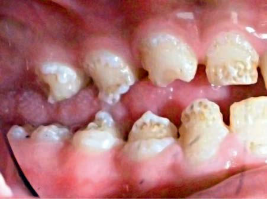
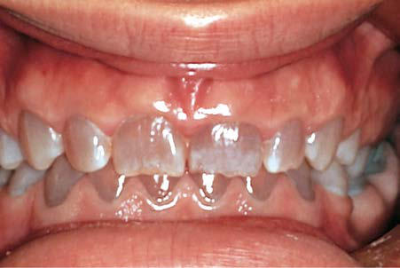

# Chapter 353: Development and Developmental Anomalies of the Teeth
> **Course:** Vikkypaedia Pediatric Basic Course (*Nelson Textbook of Pediatrics, 22nd Edition (2025)*)  
> **Part XVI:** The Digestive System  
> **Authors:** Vineet K. Dhar  
> **Metrics:** 2,599 words · 2 tables/boxes · 2 figures · 2 genes · 8 flashcards · 5 MCQs  
> **Quick Navigation:** [🃏 Study 8 Flashcards](../flashcards/353_flashcards.md) · [📝 Take 5-Q MCQ Quiz](../mcqs/353_mcqs.md) · [📚 Part XVI Guide](../parts/Part_XVI.md) · [🧬 Syndrome & Genetics Atlas](../omim_gene_atlas.md) · [💊 Therapeutics Matrix](../therapies_matrix.md) · [🏠 Course Index](../../index.md)

## Key Genetic & Molecular Targets
`GLI3`, `POLR3A`

## ⚡ High-Yield Nelson Pediatric Board Pearls
- Premature loss of primary teeth is commonly caused by premature eruption of the permanent teeth.
- Develop mentally missing teeth can result from environmental insult, a genetic defect involving only teeth, or the manifestation of a syndrome.
- Anomalies of Shape Dens in dente or dens invaginatus presents as tooth within tooth appearance, which results from invagination of inner enamel epithe lium caused by disruption during morphodifferentiation.
- This autosomal dominant disorder can also occur in patients with osteogenesis imperfecta.
- This high fluo ride consumption can be caused by residing in an area of high fluoride content of the drinking water (>2.0 ppm), swallowing excessive fluori dated toothpaste, or inappropriate fluoride prescriptions.
- The bluish, opalescent sheen on several of these teeth results from genetically defective dentin.

---
## Full Chapter Text, Tables & Figures
# Chapter 353: Development and Developmental Anomalies of the Teeth

*Vineet K. Dhar*

<!-- p.2870 -->
Newborn infants do not have teeth for about first 6 months after birth (predentate period). At this stage, the upper and lower alveolar ridges in the mouth, also known as gum pads, house the primary (deciduous) and some permanent tooth buds. The primary dentition period starts with eruption of the first primary tooth; all 20 primary teeth erupt by 3 years of age. The permanent teeth start erupting around 6 years of age, and the transition to full permanent dentition is completed by 13 years of age. The transition time between primary and permanent dentition, when a mix of primary and permanent teeth are present, is referred to as mixed dentition.

**DEVELOPMENT OF TEETH Initiation** The primary teeth form in dental crypts that arise from a band of epi thelial cells incorporated into each developing jaw. By 12 weeks of fetal life, each of these epithelial bands **(dental laminae)** has five areas of rapid growth on each side of the maxilla and the mandible, seen as rounded, budlike enlargements. Organization of adjacent mesenchyme takes place in each area of epithelial growth, and the two elements together are the beginning of a tooth.

After the formation of these crypts for the 20 primary teeth, another gen eration of tooth buds forms lingually (toward the tongue); these will develop into the succeeding permanent incisors, canines, and premolars that even tually replace the primary teeth. This process takes place from approxi mately 3-4 months of gestation for the central incisors to approximately 24-30 months of age for the second premolars. On the other hand, the per manent first, second, and third molars arise from extension of the dental laminae distal to the second primary molars; buds for these teeth develop approximately at birth, 3 years of age, and 7-10 years of age, respectively.

**Histodifferentiation–Morphodifferentiation** As the epithelial bud proliferates, the deeper surface invaginates and a mass of mesenchyme becomes partially enclosed. The epithelial cells differentiate into the ameloblasts that lay down an organic matrix that forms enamel; the mesenchyme forms the dentin and dental pulp.

**Calcification** After the organic matrix has been laid down, the deposition of the inor ganic mineral crystals takes place from several sites of calcification that later coalesce. The characteristics of the inorganic portions of a tooth can be altered by disturbances in formation of the matrix, decreased availability of minerals, or the incorporation of foreign materials. Such disturbances can affect the color, texture, or thickness of the tooth sur face. Calcification of primary teeth begins at 3-4 months in utero and concludes postnatally at approximately 12 months, with mineralization of the second primary molars (Table 353.1).

**Eruption** At the time of tooth bud formation, each tooth begins a continuous movement toward the oral cavity. Table 353.1 lists the times of eruption

of the primary and permanent teeth. Occasionally the permanent teeth may erupt behind the primary teeth (“shark tooth”); this usually causes no problems.

**Anomalies Associated with Eruption Pattern** Delayed eruption of the 20 primary teeth can be familial or indicate systemic or nutritional disturbances such as hypopituitarism, hypo thyroidism, cleidocranial dysplasia, trisomy 21, and multiple other syndromes. Failure of eruption of single or small groups of teeth can arise from local causes such as malpositioned teeth, supernumerary teeth, cysts, or retained primary teeth. Premature *loss* of primary teeth is commonly caused by premature *eruption* of the permanent teeth. If the entire dentition is advanced for age and gender, precocious puberty or hyperthyroidism should be considered.

**Natal teeth** are observed in approximately 1 in 2,000 newborn infants, usually in the position of the mandibular central incisors. Natal teeth are present at birth, whereas **neonatal teeth** erupt in the first month of life. Attachment of natal and neonatal teeth is gener ally limited to the gingival margin, with little root formation or bony support. They may be a supernumerary or a prematurely erupted pri mary tooth. A radiograph can easily differentiate between the two conditions. Natal teeth are associated with cleft palate, Pierre Robin syndrome, mesoectodermal dysplasia syndrome (Ellis-van Creveld), oculomandibulofacial syndrome (Hallermann-Streiff), pachyonychia

*Vineet K. Dhar*

and Eruption

#### **Table 353.1** Calcification, Crown Completion,

| Category / Parameter | Clinical Details & Findings |
| --- | --- |
| **Maxillary** | Central incisor; 3-4 mo in utero; 4 mo; 7.5 mo; Lateral incisor; 4.5 mo in utero; 5 mo; 8 mo; Canine; 5.5 mo in utero; 9 mo; 16-20 mo; First molar; 5 mo in utero; 6 mo; 12-16 mo; Second molar; 6 mo in utero; 10-12 mo; 20-30 mo |
| **Mandibular** | Central incisor; 4.5 mo in utero; 4 mo; 6.5 mo; Lateral incisor; 4.5 mo in utero; 4½ mo; 7 mo; Canine; 5 mo in utero; 9 mo; 16-20 mo; First molar; 5 mo in utero; 6 mo; 12-16 mo; Second molar; 6 mo in utero; 10-12 mo; 20-30 mo |
| **Maxillary** | Central incisor; 3-4 mo; 4-5 yr; 7-8 yr; Lateral incisor; 10 mo; 4-5 yr; 8-9 yr; Canine; 4-5 mo; 6-7 yr; 11-12 yr; First premolar; 1½ -1¾ yr; 5-6 yr; 10-11 yr; Second premolar; 2-2¼ yr; 6-7 yr; 10-12 yr; First molar; At birth; 2½ -3 yr; 6-7 yr; Second molar; 2½ -3 yr; 7-8 yr; 12-13 yr; Third molar; 7-9 yr; 12-16 yr; 17-21 yr |
| **Mandibular** | Central incisor; 3-4 mo; 4-5 yr; 6-7 yr; Lateral incisor; 3-4 mo; 4-5 yr; 7-8 yr; Canine; 4-5 mo; 6-7 yr; 9-10 yr; First premolar; 1¾-2 yr; 5-6 yr; 10-12 yr; Second premolar; 2¼- 2 ½ yr; 6-7 yr; 11-12 yr; First molar; At birth; 2½ -3 yr; 6-7 yr; Second molar; 2½-3 yr; 7-8 yr; 11-13 yr; Third molar; 8-10 yr; 12-16 yr; 17-21 yr; Modified from Logan WHG, Kronfeld R. Development of the human jaws and; surrounding structures from birth to age 15 years. J Am Dent Assoc. 1993;20:379. |

Section **2 The Oral Cavity**

<!-- p.2871 -->
congenita, and other anomalies (Table 353.2). A family history of natal teeth or premature eruption is present in 15–20% of affected children.

Natal or neonatal teeth occasionally result in pain and refusal to feed and can produce maternal discomfort because of abrasion or biting of the nipple during nursing. If the tooth is mobile, there is a danger of detachment, with aspiration of the tooth. Because the tongue lies between the alveolar processes during birth, it can become lacerated **(Riga-Fede disease)**. Decisions regarding extrac tion of prematurely erupted primary teeth must be made on an indi vidual basis.

**Exfoliation failure** occurs when a primary tooth is not shed before the eruption of its permanent successor. Most often the primary tooth exfoliates eventually, but in some cases the primary tooth needs to be extracted. This occurs most commonly in the mandibular incisor region.

**Anomalies Associated with Tooth Development** Both failures and excesses of tooth initiation are observed. Develop mentally missing teeth can result from environmental insult, a genetic defect involving only teeth, or the manifestation of a syndrome.

**Anomalies of Number Anodontia,** or absence of teeth, occurs when no tooth buds form (ectodermal dysplasia, or familial missing teeth) or when there is a dis turbance of a normal site of initiation (the area of a palatal cleft). The teeth that are most commonly absent are the third molars, the maxil lary lateral incisors, and the mandibular second premolars.

If the dental lamina produces more than the normal number of buds, **supernumerary teeth** occur, most often in the area between the maxillary central incisors. Because they tend to disrupt the posi tion and eruption of the adjacent normal teeth, their identification by radiographic examination is important. Supernumerary teeth also occur with cleidocranial dysplasia (see Chapter 356) and in the area of cleft palates.

**Anomalies of Size Twinning,** in which two teeth are joined together, is most often observed in the mandibular incisors of the primary dentition. It can result from gemination, fusion, or concrescence. **Gemination** is the result of the division of one tooth germ to form a bifid crown on a sin gle root with a common pulp canal; an extra tooth appears to be pres ent in the dental arch. **Fusion** is the joining of incompletely developed teeth that, due to pressure, trauma, or crowding, continue to develop as one tooth. Fused teeth are sometimes joined along their entire length; in other cases, a single wide crown is supported on two roots. **Con crescence** is the attachment of the roots of closely approximated adja cent teeth by an excessive deposit of cementum. This type of twinning, unlike the others, is found most often in the maxillary molar region.

Disturbances during differentiation can result in alterations in dental morphology, such as **macrodonti**a (large teeth) or **microdon tia** (small teeth). The maxillary lateral incisors can assume a slender, tapering shape **(peg-shaped laterals).**

**Anomalies of Shape Dens in dente** or **dens invaginatus** presents as *tooth within tooth* appearance, which results from invagination of inner enamel epithe lium caused by disruption during morphodifferentiation. Dens evagi natus presents as an extra cusp on anterior or posterior teeth, which contains enamel, dentin, and sometimes even pulp tissue. In the ante rior teeth the cusp is talon shaped and presents in the cingulum area.

**Taurodontism** is more common in permanent molars and is char acterized by elongated pulp chamber with short-stunted roots due to failure or late invagination of Hertwig epithelial root sheath. It may be associated with several syndromic conditions such as Down syndrome, tricho-dento-osseous syndrome, ectodermal dysplasia (hypohidrotic), and amelogenesis imperfecta (hypomaturation-hypoplastic type).

**Dilaceration** is an abnormal bend or curve in root possibly due to trauma. It may be subsequent to injury to the primary predecessor tooth.

#### **Table 353.2** Syndromes with Natal Teeth

| Category / Parameter | Clinical Details & Findings |
| --- | --- |
| **PREVALENCE** | Ellis-van Creveld (chondroectodermal; dysplasia); Bilateral postaxial polydactyly of hands, chondrodysplasia; of long bones resulting in dwarfism, ectodermal dysplasia; affecting nails/teeth, congenital heart malformation; Autosomal-recessive |
| **EVC, EVC2** | 7/1 × 106; Hallermann-Streiff; Dyscephaly, hypotrichosis, micro-ophthalmia, cataracts,; beaked nose, micrognathia, proportionate short stature; Sporadic; Not known; >150 cases to date; Pachyonychia congenita; (1: Jadassohn-Lewandowsky); (2: Jackson-Lawler); Dystrophic nails, palmoplantar keratosis, hyperhidrosis,; follicular keratosis, oral leukokeratosis, cutaneous cysts; Autosomal-dominant; Keratin gene variants: type I:; 6a/16, type 2:6b/17; 0.071/1 × 106; 9:5 male to female; Pallister-Hall (hypothalamic; hamartoblastoma); Hypothalamic hamartoblastoma, craniofacial abnormalities,; postaxial polydactyly, cardiac and renal defects; Autosomal-dominant |
| **GLI3** | >13 cases to date; 8:5 male to female; Wiedemann-Rautenstrauch; Endocrine dysfunction, aged facies, frontal and biparietal; bossing, small facial bones, sparse scalp hair, prominent; scalp veins, small beaked nose, low-set ears; Autosomal-recessive |
| **POLR3A** | >30 cases to date; Natal teeth, patent ductus arteriosus,; intestinal pseudoobstruction; Dilatation/hypermobility of small bowel, short or microcolon; without obstruction, incomplete rotation of midgut, patent; ductus arteriosus; X-linked recessive; Not known; 2 cases to date, brothers; Modified from Hebert AA. Mucous membrane disorders. In Schachner LA, Hansen RC, eds. Pediatric Dermatology. 4th ed. Philadelphia: Elsevier; 2011: Table 9.2, p. 654. |

<!-- p.2872 -->
**Anomalies of Structure Amelogenesis imperfecta** represents a group of hereditary conditions that manifest in enamel defects of the primary and permanent teeth without evidence of systemic disorders (Fig. 353.1). There are four subtypes: hypoplastic (type I), hypomaturation (type II), hypocalcified (type III), and hypomaturation-hypoplastic-taurodontism (type IV). Of the multiple subtypes, there are 19 genes inherited predominantly as autosomal dominant or recessive traits. The teeth are covered by only a thin layer of abnormally formed enamel through which the yel low underlying dentin is seen. The primary teeth are generally affected more than the permanent teeth. Susceptibility to caries is low, but the enamel is subject to destruction from abrasion. Complete coverage of the crown may be indicated for dentin protection, to reduce tooth sen sitivity, and for improved appearance.

**Dentinogenesis imperfecta,** or hereditary opalescent dentin, is a condition analogous to amelogenesis imperfecta in which the odon toblasts fail to differentiate normally, resulting in poorly calcified den tin (Fig. 353.2). This autosomal dominant disorder can also occur in patients with **osteogenesis imperfecta.** The enamel-dentin junction is altered, causing enamel to break away. The exposed dentin is then sus ceptible to abrasion, in some cases worn to the gingiva. The teeth are opaque and pearly, and the pulp chambers are generally obliterated by calcification. Both primary and permanent teeth are usually involved. If there is excessive wear of the teeth, selected complete coverage of the teeth may be indicated to prevent further tooth loss and improve appearance.

Localized disturbances of calcification that correlate with periods of illness, malnutrition, premature birth, or birth trauma are common. **Hypocalcification** appears as opaque white patches or horizontal lines on the tooth; **hypoplasia** is more severe and manifests as pitting or areas devoid of enamel. Systemic conditions, such as renal failure and cystic fibrosis, are associated with enamel defects. Local trauma to the primary incisors can also affect calcification of permanent incisors.

**Fluorosis** (mottled enamel) can result from systemic fluoride con sumption >0.05 mg/kg/day during enamel formation. This high fluo ride consumption can be caused by residing in an area of high fluoride content of the drinking water (>2.0 ppm), swallowing excessive fluori dated toothpaste, or inappropriate fluoride prescriptions. Excessive flu oride during enamel formation affects ameloblastic function, resulting in inconspicuous white, lacy patches on the enamel to severe brownish discoloration and hypoplasia. The latter changes are usually seen with fluoride concentrations in the drinking water >5.0 ppm.

**Anomalies of Color** Discolored teeth can result from incorporation of foreign substances into developing enamel. Neonatal hyperbilirubinemia can produce blue to black discoloration of the primary teeth. Porphyria produces a redbrown discoloration. Tetracyclines are extensively incorporated into bones and teeth and, if administered during the period of formation of enamel, can result in brown-yellow discoloration and hypoplasia of the enamel. Such teeth fluoresce under ultraviolet light. The period at risk extends from approximately 4 months of gestation to 7 years of age. Repeated or prolonged therapy with tetracycline carries the highest risk.

**Teething** is associated with primary tooth eruption and may mani fest with benign symptoms such as gingival hyperemia, irritabil ity, sucking fingers, and drooling; some infants have no symptoms or symptoms not identified by their parents. Low-grade fever is an inconsistent finding. The treatment of symptoms of teething is often unnecessary but could include oral analgesics and iced teething rings. Teething remedies containing benzocaine may cause methemoglobin emia and are not recommended. “Natural” (homeopathic) teething remedies may contain toxic additives and should be avoided. In addi tion, teething necklaces and bracelets are a risk for foreign body aspira tion and choking.

*Visit Elsevier eBooks+ at eBooks.Health.Elsevier.com** for Bibliography.*

**Fig. 353.1** Amelogenesis imperfecta, hypoplastic type. The enamel defect results in areas of missing or thin enamel, as well as grooves and pits.

**Fig. 353.2** Dentinogenesis imperfecta. The bluish, opalescent sheen on several of these teeth results from genetically defective dentin. This condition may be associated with osteogenesis imperfecta. (From Nazif MM, Martin BS, McKibben DH, et al. Oral disorders. In Zitelli BJ, Da vis HW, eds. Atlas of Pediatric Physical Diagnosis. 4th ed. Philadelphia: Mosby; 2002: p. 703.)

<!-- p.2873 -->
