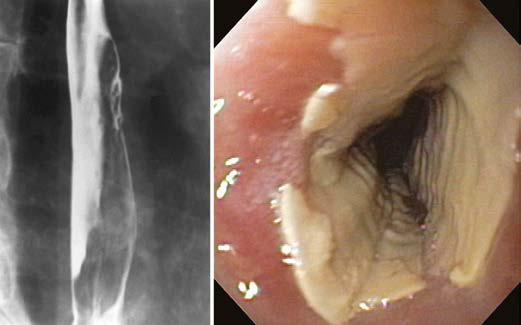

# Chapter 371: Esophageal Perforation
> **Course:** Vikkypaedia Pediatric Basic Course (*Nelson Textbook of Pediatrics, 22nd Edition (2025)*)  
> **Part XVI:** The Digestive System  
> **Authors:** Seema Khan  
> **Metrics:** 651 words · 1 tables/boxes · 2 figures · 0 genes · 8 flashcards · 5 MCQs  
> **Quick Navigation:** [🃏 Study 8 Flashcards](../flashcards/371_flashcards.md) · [📝 Take 5-Q MCQ Quiz](../mcqs/371_mcqs.md) · [📚 Part XVI Guide](../parts/Part_XVI.md) · [🧬 Syndrome & Genetics Atlas](../omim_gene_atlas.md) · [💊 Therapeutics Matrix](../therapies_matrix.md) · [🏠 Course Index](../../index.md)

## ⚡ High-Yield Nelson Pediatric Board Pearls
- Esophageal disorders caused by medications, trauma, and infection.
- PILL ESOPHAGITIS This acute injury is produced by contact with a damaging agent.

---
## Full Chapter Text, Tables & Figures
# Chapter 371: Esophageal Perforation

*Seema Khan*

<!-- p.2920 -->
diagnostic sensitivity and precision. Treatment is with appropriate antimicrobial agents: azole therapy, particularly oral fluconazole for *Candida;* oral acyclovir for HSV; and oral valganciclovir for CMV, or alternatively intravenous ganciclovir in severe CMV disease.

**PILL ESOPHAGITIS** This acute injury is produced by contact with a damaging agent. Medications implicated in pill esophagitis include tetracycline, doxy cycline, potassium chloride, ferrous sulfate, nonsteroidal antiinflam matory medications, cloxacillin, and alendronate (Table 370.1). Most often the offending tablet is ingested at bedtime with inadequate water. This practice often produces acute discomfort followed by pro gressive retrosternal pain, odynophagia, and dysphagia. Endoscopy shows a focal lesion often localized to one of the anatomic narrowed regions of the esophagus or to an unsuspected pathologic narrowing (Fig. 370.5). Treatment is supportive; lacking much evidence, sucral fate, antacids, topical anesthetics, and bland or liquid diets are often used. The offending pill may be restarted after complete resolution of symptoms, if deemed necessary, though with clear emphasis on ingestion with an adequate volume of water, usually at least 4 oz.

*Visit Elsevier eBooks+ at eBooks.Health.Elsevier.com** for Bibliography.*

Esophagitis or Esophageal Injury

#### **Table 370.1** Medications Commonly Associated with

| Category / Parameter | Clinical Details & Findings |
| --- | --- |
| **ANTIBIOTICS** | Clindamycin; Doxycycline; Penicillin; Rifampin; Tetracycline |
| **ANTIVIRAL AGENTS** | Nelfinavir; Zalcitabine; Zidovudine |
| **BISPHOSPHONATES** | Alendronate; Etidronate; Pamidronate |
| **CHEMOTHERAPEUTIC AGENTS** | Bleomycin; Cytarabine; Dactinomycin; Daunorubicin; 5-Fluorouracil; Methotrexate; Vincristine; NSAIDs; Aspirin; Ibuprofen; Naproxen |
| **OTHER MEDICATIONS** | Ascorbic acid; Ferrous sulfate; Lansoprazole; Multivitamins; Potassium chloride; Quinidine; Theophylline; NSAIDs, Nonsteroidal antiinflammatory drugs.; From Katzka DA. Esophageal disorders caused by medications, trauma, and infection.; In Feldman M, Friedman LS, Brandt LJ, eds. Sleisenger and Fordtran’s Gastrointestinal; and Liver Disease. 10th ed. Philadelphia: Elsevier; 2016: Box 46.1. |

B A

**Fig. 370.5** A, Barium esophagogram showing esophageal ulcera tion secondary to tetracycline, with the arrow pointing to an area of ulcerations. B, Endoscopic image of a tetracycline-induced esophageal burn. (From Katzka DA. Esophageal disorders caused by medications, trauma, and infection. In Feldman M, Friedman LS, Brandt LJ, eds. Sleisenger and Fordtran’s Gastrointestinal and Liver Disease. 10th ed. Philadelphia: Elsevier; 2016: Fig. 46.1).

The majority of esophageal perforations in children are from blunt trauma (automobile injury, gunshot wounds, child abuse) or are iat rogenic. Cardiac massage, the Heimlich maneuver, nasogastric tube placement, traumatic laryngoscopy or endotracheal intubation, exces sively vigorous postpartum suctioning of the airway during neonatal resuscitation, difficult upper endoscopy, sclerotherapy of esophageal varices, esophageal compression by a cuffed endotracheal tube, and dilation for therapy of achalasia and strictures have all been implicated. Esophageal rupture has followed forceful vomiting in patients with anorexia and has followed esophageal injury due to caustic ingestion, foreign body ingestion, food impactions, pill esophagitis, or eosino philic esophagitis. Drinking cold, carbonated beverages rapidly is also known to cause esophageal perforation.

Spontaneous esophageal rupture **(Boerhaave syndrome)** is less common and is associated with sudden increases in intraesophageal pressure brought on by situations such as vomiting, coughing, or straining to stool. Children and adults with eosinophilic esophagitis have also been described with Boerhaave syndrome in the setting of forceful emesis in the aftermath of esophageal food impaction. The prevalence of esophageal perforation in a large retrospective analysis was reported to be 0.05%, the majority of whom were low birthweight (<1,000 g) and ≤28 weeks’ gestational age. Importantly, esophageal per foration was not associated with an increased mortality in this pediat ric cohort. In older children, as in adults, the tear occurs on the distal left lateral esophageal wall, because the smooth muscle layer here is weakest; in neonates (neonatal Boerhaave syndrome), spontaneous rupture is on the right.

Symptoms of esophageal perforation include pain, neck tender ness, dysphagia, subcutaneous crepitus, fever, and tachycardia; several patients with cervical-level esophageal perforations have displayed cold water polydipsia in an attempt to soothe pain in the throat.

*Seema Khan*

<!-- p.2923 -->
