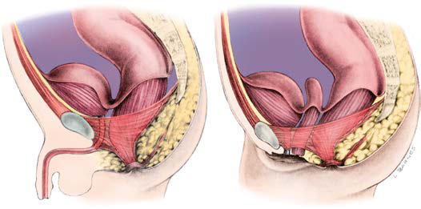
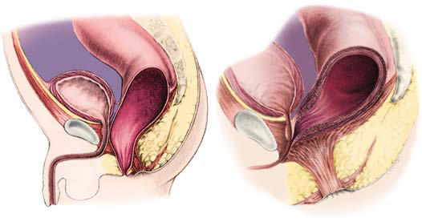

# Chapter 392: Surgical Conditions of the Anus and Rectum
> **Course:** Vikkypaedia Pediatric Basic Course (*Nelson Textbook of Pediatrics, 22nd Edition (2025)*)  
> **Part XVI:** The Digestive System  
> **Authors:** Nelson 22e Contributors  
> **Metrics:** 6,455 words · 3 tables/boxes · 2 figures · 1 genes · 8 flashcards · 5 MCQs  
> **Quick Navigation:** [🃏 Study 8 Flashcards](../flashcards/392_flashcards.md) · [📝 Take 5-Q MCQ Quiz](../mcqs/392_mcqs.md) · [📚 Part XVI Guide](../parts/Part_XVI.md) · [🧬 Syndrome & Genetics Atlas](../omim_gene_atlas.md) · [💊 Therapeutics Matrix](../therapies_matrix.md) · [🏠 Course Index](../../index.md)

## Key Chapter Topics & Subchapters
`392.1 Anorectal Malformations` · `392.2 Anal Fissure` · `392.3 Perianal Abscess and Fistula` · `392.4 Hemorrhoids` · `392.5 Rectal Mucosal Prolapse` · `392.1 Anorectal Malformations Christina M. Shanti` · `392.2 Anal Fissure Christina M. Shanti` · `392.3 Perianal Abscess and Fistula Christina M. Shanti` · `392.4 Hemorrhoids Christina M. Shanti` · `392.5 Rectal Mucosal Prolapse Christina M. Shanti`

## Key Genetic & Molecular Targets
`MNX1`

## ⚡ High-Yield Nelson Pediatric Board Pearls
- Although the trend in cases of PA at presentation is toward ini tial nonoperative management, the data remain uncertain, and there are no convincing data to recommend one approach in all patients.
- INTERVAL APPENDECTOMY In patients with PA initially treated nonoperatively, the decision to pro ceed with IA, typically in 4-6 weeks, is another area of management lacking consensus.
- Traditionally, most surgeons recommended IA to avoid recurrent appendicitis and to confirm the original diagnosis, citing reports that demonstrated an incidence of unexpected pathology in 30% of IA specimens.
- When an appendicolith is noted in the evaluation of a child with abdominal pain and suspected appendicitis, the finding of the appendicolith confirms the diagnosis; surgical consultation and prompt appendectomy are indicated.
- Atlas of Surgical Management of Anorectal Malformations.
- Atlas of Surgical Management of Anorectal Malforma tions.
- The most common lesions are the rectourethral bulbar fistula in males and the rectovestibular fis tula in females; the second most common lesion in both sexes is the perianal fistula.

---
## Full Chapter Text, Tables & Figures
# Chapter 392: Surgical Conditions of the Anus and Rectum

<!-- p.3105 -->
imaging studies, and hospitalizations compared with those managed operatively at the first visit. Controversies remain in the initial nonop erative management of PA.

**RECURRENT APPENDICITIS** Prospective studies of the incidence of early recurrent appendicitis (within 1 year) describe a range between 10% and 30% in patients ini tially managed nonoperatively. The lifetime risk of recurrent appendi citis in children treated nonoperatively is unknown, but the few data that have been published beyond the 1-year follow-up suggest that the risk for recurrent appendicitis continues to increase past the first year. Currently under review is the need for delayed appendectomy (IA) in patients with complicated appendicitis initially managed nonopera tively. Although the trend in cases of PA at presentation is toward ini tial nonoperative management, the data remain uncertain, and there are no convincing data to recommend one approach in all patients.

**INTERVAL APPENDECTOMY** In patients with PA initially treated nonoperatively, the decision to pro ceed with IA, typically in 4-6 weeks, is another area of management lacking consensus. Traditionally, most surgeons recommended IA to avoid recurrent appendicitis and to confirm the original diagnosis, citing reports that demonstrated an incidence of unexpected pathology in 30% of IA specimens. This has been questioned, with nonoperative manage ment of simple appendicitis gaining acceptance and many debating the risk of recurrent appendicitis (5–20%), believing it to be lower. The life time risk of recurrent appendicitis is unknown. Decision-making for IA must be individualized to balance the risks of recurrent appendicitis with the risks of anesthesia and comorbid conditions such as obesity, congeni tal heart disease, chronic respiratory conditions, and others.

**INCIDENTAL APPENDICOLITHS** The question of the incidental appendicolith is an intriguing one for pediatric practitioners. These are patients who do not have appendicitis but are found to have an appendicolith on imaging studies. An appen dicolith is defined as a calcification within the appendiceal lumen. In adults, incidental appendicoliths identified by CT scans vary in inci dence from <1% to as high as 10%. They have a characteristic dense and laminated appearance when compared to other lower abdominal calci fications, including phleboliths (venous calcifications) and, in females, ovarian calcifications, most commonly seen in ovarian tumors. They can be appreciated on plain film, ultrasound, and CT scan. When an appendicolith is noted in the evaluation of a child with abdominal pain and suspected appendicitis, the finding of the appendicolith confirms the diagnosis; surgical consultation and prompt appendectomy are indicated. Appendicoliths may be noted in the evaluation of patients who have no signs of appendicitis, such as imaging obtained after trauma or for nonspecific abdominal complaints in patients with a low likelihood of appendicitis. The concern in this setting is that the appen dicolith may increase the eventual development of acute appendicitis. In addition, there is the concern that should appendicitis develop in association with an appendicolith, there may be a rapidly escalating course and early perforation. Some physicians believe that a persistent appendicolith may be associated with recurrent RLQ/iliac fossa pain.

Incidental appendicoliths may be transient and in most short-term follow-up studies have a low risk of subsequent acute appendicitis. In addition, the lifetime risk for the development of appendicitis in patients with an incidental appendicolith is approximately 5%, which is not different from the normal population. The risk of subsequent appendicitis may be higher in those presenting with abdominal pain or those younger than 19 years of age. Radiographically detected inci dental appendicoliths are usually managed with observation, planned follow-up, and patient education for signs of acute appendicitis. After discussing the risks and benefits with the family and persistence of the appendicolith, an individualized approach is best between the physi cian and the family relative to elective appendectomy.

*Visit Elsevier eBooks+ at eBooks.Health.Elsevier.com** for Bibliography.*

## 392.1  Anorectal Malformations Christina M. Shanti

To fully understand the spectrum of anorectal anomalies, it is neces sary to consider the importance of the sphincter complex, a mass of muscle fibers surrounding the anorectum (Fig. 392.1). This complex is the combination of the puborectalis, levator ani, external and internal sphincters, and the superficial external sphincter muscles, all meeting at the rectum. Anorectal malformations are defined by the relationship of the rectum to this complex and include varying degrees of steno sis to complete atresia. The incidence is 1/3,000 live births. Significant long-term concerns focus on bowel control and urinary and sexual functions.

**EMBRYOLOGY** The hindgut forms early as the part of the primitive gut tube that extends into the tail fold in the second week of gestation. At about day 13, it develops a ventral diverticulum, the allantois, or primitive blad der. The junction of the allantois and hindgut becomes the cloaca, into which the genital, urinary, and intestinal tubes empty. This is covered by a cloacal membrane. The urorectal septum descends to divide this common channel by forming lateral ridges, which grow in and fuse by the middle of the seventh week. Opening of the posterior portion of the membrane (the anal membrane) occurs in the eighth week. Fail ures in any part of these processes can lead to the clinical spectrum of anogenital anomalies.

**Imperforate anus** can be divided into low lesions, where the rec tum has descended through the sphincter complex, and high lesions, where it has not. Most patients with imperforate anus have a fistula. There is a spectrum of malformation in males and females. In males, low lesions usually manifest with meconium staining somewhere on the perineum along the median raphe (Figs. 392.2A and 392.3). Low lesions in females also manifest as a spectrum from an anus that is only slightly anterior on the perineal body to a fourchette fistula that opens on the moist mucosa of the introitus distal to the hymen (Fig. 392.4A). A high imperforate anus in a male has no apparent cutaneous opening or fistula, but it usually has a fistula to the urinary tract, either the urethra or the bladder (Fig. 392.2B). Although there is occasion ally a rectovaginal fistula, in females, high lesions are usually cloacal anomalies in which the rectum, vagina, and urethra all empty into a common channel or cloacal stem of varying length (see Fig. 392.4B).

A B **Fig. 392.1**  Normal anorectal anatomy in relation to pelvic structures. A, Male. B, Female. *(From Peña A. Atlas of Surgical Management of Anorectal Malformations. New York: Springer-Verlag; 1989: 3.)*

<!-- p.3107 -->
Puborectalis

Internal sphincter

External sphincter A B

**Fig. 392.2** Imperforate anus in males. A, Low lesions. B, High lesions. (From Peña A. Atlas of Surgical Management of Anorectal Malforma tions. New York: Springer-Verlag; 1989:7, 26.)

**Fig. 392.3** This male infant has a rectoperineal fistula with a subepi thelial tract filled with either mucus or meconium that extends into the scrotal raphe. (From Rentea RM, Levitt MA. Anorectal atresia and cloa cal malformations. In Holcomb III GW, Murphy JP, St. Peter SD, eds. Holcomb and Ashcraft’s Pediatric Surgery, 7th ed. Philadelphia: Else vier; 2020: Fig. 35.2, p. 578.)

The interesting category of males with imperforate anus and no fistula occurs mainly in children with trisomy 21. The most common lesions are the rectourethral bulbar fistula in males and the rectovestibular fis tula in females; the second most common lesion in both sexes is the perianal fistula (Fig. 392.5).

**ASSOCIATED ANOMALIES** Many anomalies are associated with anorectal malformations (Table 392.1). The most common are anomalies of the kidneys and urinary tract in conjunction with abnormalities of the sacrum. This complex is often referred to as *caudal regression syndrome*. Males with a rec tovesical fistula and patients with a persistent cloaca have a 90% risk of urologic defects. Other common associated anomalies are cardiac anomalies and esophageal atresia with or without tracheoesophageal fistula. These can cluster in any combination in a patient. When com bined, they are often accompanied by abnormalities of the radial aspect of the upper extremity and are termed the *VACTERL* (*v*ertebral, *a*nal, *c*ardiac, *t*racheal, *e*sophageal, *r*enal, *l*imb) *anomalad*.

Anorectal malformations, particularly anal stenosis and rectal atresia, can also present as the Currarino triad, which includes sacral agenesis, a presacral mass, and anorectal stenosis. These patients present with a funnel-appearing anus, have sacral bony defects on plain x-ray, and have a presacral mass (teratoma, meningocele, der moid cyst, enteric cyst) on exam or imaging. It is an autosomal domi nant disorder caused in most patients by a pathogenic variant in the *MNX1* gene.

A good correlation exists between the degree of sacral development and future function. Patients with an absent sacrum usually have per manent fecal and urinary incontinence. Spinal abnormalities and dif ferent degrees of dysraphism are often associated with these defects. Tethered cord occurs in approximately 25% of patients with anorectal malformations. Untethering of the cord can lead to improved urinary and rectal continence in some patients, although it seldom reverses established neurologic defects. The diagnosis of spinal defects can be screened for in the first 3 months of life by spinal ultrasound, although MRI is the imaging method of choice if a lesion is suspected. In older patients, MRI is needed.

**MANIFESTATIONS AND DIAGNOSIS Low Lesions** Examination of a newborn includes the inspection of the perineum. The absence of an anal orifice in the correct position leads to further evaluation. Mild forms of imperforate anus are often called *anal steno sis* or *anterior ectopic anus*. These are typically cases of an imperforate anus with a perineal fistula. The normal position of the anus on the perineum is approximately halfway (0.5 ratio) between the coccyx and the scrotum or introitus. Although symptoms, primarily constipation, have been attributed to anterior ectopic anus (ratio: <0.34 in females, <0.46 in males), many patients have no symptoms.

If no anus or fistula is visible, there may be a low lesion or *covered anus*. In these cases, there are well-formed buttocks and often a thick ened raphe or *bucket handle*. After 24 hours, meconium bulging may be seen, creating a blue or black appearance. In these cases, an immedi ate perineal procedure can often be performed, followed by a dilation program.

In a male, the perineal (cutaneous) fistula can track anteriorly along the median raphe across the scrotum and even down the penile shaft (see Fig. 392.3). This is usually a thin track, with a normal rectum often just a few millimeters from the skin. Extraintestinal anomalies are seen in <10% of these patients.

In a female, a low lesion enters the vestibule or fourchette (the moist mucosa outside the hymen but within the introitus). In this case, the rectum has descended through the sphincter complex. Children with a low lesion can usually be treated initially with perineal manipula tion and dilation. Visualizing these low fistulas is so important in the evaluation and treatment that one should avoid passing a nasogastric tube for the first 24 hours to allow the abdomen and bowel to distend, pushing meconium down into the distal rectum.

A B **Fig. 392.4**  Imperforate anus in females. A, Vestibular fistula. B, Clo aca. *(From Peña A. Atlas of Surgical Management of Anorectal Malfor mations. New York: Springer-Verlag; 1989: 50, 60.)*

<!-- p.3108 -->
**High Lesions** In a male with a high imperforate anus, the perineum appears flat. There may be air or meconium passed via the urethra when the fistula is high, entering the bulbar or prostatic urethra, or even the bladder. In *rectobulbar urethral fistulas* (the most common in males), the sphincter mechanism is satisfactory, the sacrum may be underdeveloped, and an anal dimple is present. In *rectoprostatic urethral fistulas,* the sacrum is poorly developed, the scrotum may be bifid, and the anal dimple is near the scrotum. In *rectovesicular fistulas,* the sphincter mechanism is poorly developed, and the sacrum is hypoplastic or absent. In males with trisomy 21, all the features of a high lesion may be present, but there is no fistula, the sacrum and sphincter mechanisms are usually well developed, and the prognosis is good.

In females with high imperforate anus, there may be the appearance of a rectovaginal fistula. A true rectovaginal fistula is rare. Most are either the fourchette fistulas described earlier or are forms of a cloacal anomaly.

**Persistent Cloaca** In persistent cloaca, the embryologic stage persists in which the rectum, urethra, and vagina communicate in a common orifice, the cloaca. It is important to realize this anomaly, because the repair often requires repo sitioning the urethra and vagina as well as the rectum. Children of both sexes with a high lesion require a colostomy before repair.

**Rectal Atresia** Rectal atresia is a rare defect occurring in only 1% of anorectal anoma lies. It has the same characteristics in both sexes. The unique feature of this defect is that affected patients have a normal anal canal and a normal anus. The defect is often discovered while rectal temperature is being taken. An obstruction is present approximately 2 cm above the skin level. These patients need a protective colostomy. The functional prognosis is excellent because they have a normal sphincteric mecha nism (and normal sensation), which resides in the anal canal.

**APPROACH TO THE PATIENT** Evaluation includes identifying associated anomalies (see Table 392.1). Careful inspection of the perineum is important to determine the presence or absence of a fistula. If the fistula can be seen, it is a low lesion. The invertogram, or upside-down x-ray, is of little value, but a prone cross-table lateral plain x-ray at 24 hours of life (to allow time for bowel distention from swallowed air) with a radiopaque marker on the perineum can demonstrate a low lesion by showing the rectal gas bubble <1 cm from the perineal skin (see Fig. 392.5). A plain x-ray of the entire sacrum, including both iliac wings, is important to iden tify sacral anomalies and the adequacy of the sacrum. An abdominalpelvic ultrasound and voiding cystourethrogram must be performed. The clinician should also pass a nasogastric tube to identify esophageal atresia and should obtain an echocardiogram. In males with a high lesion, the voiding cystourethrogram often identifies the rectourinary fistula. In females with a high lesion, more invasive evaluation, includ ing vaginogram and endoscopy, is often necessary for careful detailing of the cloacal anomaly.

Good clinical evaluation and a urinalysis provide enough data in 80–90% of male patients to determine the need for a colostomy. Vol untary sphincteric muscles surround the most distal part of the bowel in cases of perineal and rectourethral fistulas, and the intraluminal bowel pressure must be sufficiently high to overcome the tone of those muscles before meconium can be seen in the urine or on the perineum. The presence of meconium in the urine and a flat bottom are consid ered indications for the creation of a colostomy. Clinical findings con sistent with the diagnosis of a perineal fistula represent an indication

#### **Table 392.1** Associated Malformations

| Category / Parameter | Clinical Details & Findings |
| --- | --- |
| **GENITOURINARY** | Vesicoureteric reflux; Renal agenesis; Renal dysplasia; Ureteral duplication; Cryptorchidism; Hypospadias; Bicornuate uterus; Vaginal septa |
| **VERTEBRAL** | Spinal dysraphism; Tethered chord; Presacral masses; Meningocele; Lipoma; Dermoid; Teratoma |
| **CARDIOVASCULAR** | Tetralogy of Fallot; Ventricular septal defect; Transposition of the great vessels; Hypoplastic left-heart syndrome |
| **GASTROINTESTINAL** | Tracheoesophageal fistula; Duodenal atresia; Malrotation; Hirschsprung disease |
| **CENTRAL NERVOUS SYSTEM** | Spina bifida; Tethered cord |

A B C D

**Fig. 392.5** Preoperative and postoperative images of anorectal malformations. A, Preoperative rectoperineal fistula. B, Radiograph with cross- table lateral film showing neonate in prone position and gas below the coccyx. C, Postoperative appearance after a posterior sagittal anorectoplasty. D, Postoperative large, patulous, and prolapsed anoplasty. (From Bischoff A, Bealer J, Pená A. Controversies in anorectal malformations. Lancet Child/Adolesc. 2017;1:323–330.)

<!-- p.3109 -->
for an anoplasty without a protective colostomy. Ultrasound is valuable not only for the evaluation of the urinary tract, but it can also be used to investigate spinal anomalies in the newborn and to determine how close to the perineum the rectum has descended.

More than 90% of the time, the diagnosis in females can be estab lished on perineal inspection. The presence of a single perineal orifice is a cloaca. A palpable pelvic mass (hydrocolpos) reinforces this diag nosis. A vestibular fistula is diagnosed by careful separation of the labia, exposing the vestibule. The rectal orifice is located immediately in front of the hymen within the female genitalia and in the vestibule. A peri neal fistula is easy to diagnose. The rectal orifice is located somewhere between the female genitalia and the center of the sphincter and is sur rounded by skin. Less than 10% of these patients fail to pass meconium through the genitalia or perineum after 24 hours of observation. Those patients can require a prone cross-table lateral film.

**OPERATIVE REPAIR** Sometimes a perineal fistula, if it opens in a good position, can be treated by simple dilation. Hegar dilators are employed, starting with a No. 5 or 6 and letting the baby go home when the mother can use a No. 8. Twice-daily dilatations are done at home, increasing the size every few weeks until a No. 14 is achieved. By 1 year of age, the stool is usually well formed and further dilation is not necessary. By the time No. 14 is reached, the examiner can usually insert a little finger. If the anal ring is soft and pliable, dilation can be reduced in frequency or discontinued.

Occasionally, there is no visible fistula, but the rectum can be seen to be filled with meconium bulging on the perineum, or a covered anus is otherwise suspected. If confirmed by plain x-ray or ultrasound of the perineum that the rectum is <1 cm from the skin, the clinician can do a minor perineal procedure to perforate the skin and then proceed with dilation or do a simple perineal anoplasty.

When the fistula orifice is close to the introitus or scrotum, it is often appropriate to move it back surgically. This also requires postoperative dilation to prevent stricture formation. This procedure can be done any time from the newborn period to 1 year. It is preferable to wait until dilatations have been done for several weeks and the child is bigger. The anorectum is a little easier to dissect at this time. The posterior sagittal approach of Peña is used, making an incision around the fistula and then in the midline to the site of the posterior wall of the new location. The dissection is continued in the midline, using a muscle stimulator to be sure there is adequate muscle on both sides. The fistula must be dissected cephalad for several centimeters to allow posterior position ing without tension. If appropriate, some of the distal fistula is resected before the anastomosis to the perineal skin.

In children with a high lesion, a double-barrel colostomy is per formed. This effectively separates the fecal stream from the urinary tract. It also allows the performance of an augmented pressure colostogram before repair to identify the exact position of the distal rectum and the fistula. The definitive repair or posterior sagittal anorectoplasty (PSARP) is performed at about 1 year of age. A midline incision is made, often splitting the coccyx and even the sacrum. Using a muscle stimulator, the surgeon stays strictly in the midline and divides the sphincter complex and identifies the rectum. The rectum is then opened in the midline, and the fistula is identified from within the rectum. This allows a division of the fistula without injury to the urinary tract. The rectum is then dis sected proximally until enough length is gained to suture it to an appro priate perineal position. The muscles of the sphincter complex are then sutured around (and especially behind) the rectum.

Other operative approaches (such as an anterior approach) are used, but the most popular procedure is by laparoscopy. This opera tion allows division of the fistula under direct visualization and iden tification of the sphincter complex by transillumination of perineum. Other imaging techniques in the management of anorectal malfor mations include 3D endorectal ultrasound, intraoperative MRI, and colonoscopy-assisted PSARPs, which may help perform a technically better operation. None of these other procedures or innovations has demonstrated improved outcomes.

A similar procedure can be done for female high anomalies with variations to deal with separating the vagina and rectum from within

the cloacal stem. When the stem is longer than 3 cm, this is an espe cially difficult and complex procedure.

Usually the colostomy can be closed 6 weeks or more after the PSARP. Two weeks after any anal procedure, twice-daily dilatations are performed by the family. By doing frequent dilatations, each one is not so painful and there is less tissue trauma, inflammation, and scarring.

**OUTCOME** The ability to achieve rectal continence depends on both motor and sensory elements. There must be adequate muscle in the sphincter complex and proper positioning of the rectum within the complex. There must also be intact innervation of the complex and of sensory elements, as well as the presence of these sensory elements in the ano rectum. Patients with low lesions are more likely to achieve true conti nence. They are also, however, more prone to constipation, which leads to overflow incontinence. It is very important that all these patients are followed closely and that the constipation and anal dilation are well managed until toilet training is successful. Tables 392.2 and 392.3 out line the results of continence and constipation in relation to the mal formation encountered.

Children with high lesions, especially males with rectoprostatic ure thral fistulas and females with cloacal anomalies, have a poorer chance of being continent, but they can usually achieve a socially acceptable defecation (without a colostomy) pattern with a bowel management

#### **Table 392.2** Types of Anorectal Malformation by Sex

| Category / Parameter | Clinical Details & Findings |
| --- | --- |
| **MALE (PERCENTAGE CHANCE OF BOWEL CONTROL*)** | Rectoperineal fistula (100%); Rectourethral bulbar fistula (85%); Imperforate anus without fistula (90%); Rectourethral prostatic fistula (65%); Rectobladder neck fistula (15%) |
| **FEMALE (PERCENTAGE CHANCE OF BOWEL CONTROL*)** | Rectoperineal fistula (100%); Rectovestibular fistula (95%); Imperforate anus without fistula (90%); Rectovaginal fistula (rare anomaly)†; Cloaca (70%)‡; *Provided patients have a normal sacrum, no tethered cord, and they receive a; technically correct operation without complications.; †Rectovaginal anomalies are extremely unusual; usually their prognosis is like; rectovestibular fistula.; ‡Cloaca represents a spectrum; those with a common channel length <3 cm have the; best functional prognosis.; From Bischoff A, Bealer J, Peña A. Controversies in anorectal malformations. Lancet; Child/Adolesc. 2017;1:323–330. |

Malformation

#### **Table 392.3** Constipation and Type of Anogenital

| Category / Parameter | Clinical Details & Findings |
| --- | --- |
| **PERCENTAGE** | Vestibular fistula; 61; Bulbar urethral fistula; 64; Rectal atresia/stenosis; 50; Imperforate with no fistula; 55; Perineal fistula; 57; Long cloaca; 35; Prostatic fistula; 45; Short cloaca; 40; Bladder neck fistula; 16; Modified from Levitt MA, Peña A. Outcomes from the correction of anorectal; malformations. Curr Opin Pediatr. 2005;17:394–401. |

<!-- p.3110 -->
program. Often, the bowel management program consists of a daily enema to keep the colon empty and the patient clean until the next enema. If this is successful, an *antegrade continence enema* (ACE) pro cedure, sometimes called the *Malone* or *Malone antegrade continence enema* (MACE) procedure, can improve the patient’s quality of life. These procedures provide access to the right colon either by bringing the appendix out the umbilicus in a nonrefluxing fashion or by putting a plastic button in the right lower quadrant to access the cecum. The patient can then sit on the toilet and administer the enema through the ACE, thus flushing out the entire colon. Antegrade regimens can produce successful 24-hour cleanliness rates of up to 95%. Of special interest is the clinical finding that most patients improve their control with growth. Patients who wore diapers or pull-ups to primary school are often in regular underwear by high school. Some groups have taken advantage of this evidence of psychologic influences to initiate behav ior modification early with good results.

*Visit Elsevier eBooks+ at eBooks.Health.Elsevier.com** for Bibliography.*

## 392.2  Anal Fissure Christina M. Shanti

Anal fissure is a laceration of the anal mucocutaneous junction. It is an acquired lesion of unknown etiology. Although likely secondary to the forceful passage of a hard stool, it is mainly seen in infants younger than 1 year of age when the stool is frequently quite soft. Fissures may be the consequence and not the cause of constipation.

**CLINICAL MANIFESTATIONS** A history of constipation is often described, with a recent painful bowel movement corresponding to the fissure formation after passing of hard stool. The patient then voluntarily retains stool to avoid another pain ful bowel movement, exacerbating the constipation, resulting in harder stools. Complaints of pain on defecation and bright red blood on the surface of the stool are often elicited.

The diagnosis is established by inspection of the perineal area. The infant’s hips are held in acute flexion, the buttocks are separated to expand the folds of the perianal skin, and the fissure becomes evident as a minor laceration. Often a small skin appendage is noted periph eral to the lesion. This *skin tag* represents epithelialized granuloma tous tissue formed in response to chronic inflammation. Findings on rectal examination can include hard stool in the ampulla and rectal spasm.

**TREATMENT** The parents must be counseled as to the origin of the laceration and the mechanism of the cycle of constipation. The goal is to ensure that the patient has soft stools to avoid overstretching the anus. The heal ing process can take several weeks or even several months. A single episode of impaction with passing of hard stool can exacerbate the problem. Treatment requires that the primary cause of the constipation be identified (see Chapter 378.3). The use of dietary and behavioral modification and a stool softener is indicated. Parents should titrate the dose of the stool softener based on the patient’s response to treat ment. Stool softening is best done by increasing water intake or using an oral polyethylene glycolate such as MiraLAX or GlycoLax. Surgical intervention, including stretching of the anus, “internal” anal sphinc terotomy, or excision of the fissure, is not indicated or supported by scientific evidence.

*Chronic anal fissures* in older patients are associated with constipa tion, prior rectal surgery, Crohn disease, and chronic diarrhea. They are managed initially like fissures in infants, with stool softeners with the addition of sitz baths. Topical 0.2% glyceryl trinitrate reduces anal spasm and heals fissures, but it is often associated with headaches. Calcium channel blockers, such as 2% diltiazem ointment and 0.5% nifedipine cream, are more effective and cause fewer headaches than glyceryl trinitrate. Injection of botulinum toxin from 12.5 to 25 units

is also effective and probably chemically replicates the action of inter nal sphincterotomy, which is the most effective treatment in adults, although seldom used in children.

*Visit Elsevier eBooks+ at eBooks.Health.Elsevier.com** for Bibliography.*

## 392.3  Perianal Abscess and Fistula Christina M. Shanti

Perianal abscesses usually manifest in *infancy* (∼75% ≤1 year) and are of unknown etiology. Fistula appears to be secondary to the abscess rather than the cause. Links to congenitally abnormal crypts of Mor gagni have been proposed, suggesting that deeper crypts (3-10 mm rather than the normal 1-2 mm) lead to trapped debris and cryptitis (Fig. 392.6).

Conditions associated with the risk of an anal fistula in *older children* include Crohn disease, tuberculosis, pilonidal disease, hidradenitis, HIV, trauma, foreign bodies, dermal cysts, sacrococcygeal teratoma, actinomycosis, lymphogranuloma venereum, and radiotherapy.

The most common organisms isolated from perianal abscesses are mixed aerobic *(Escherichia coli, Klebsiella pneumoniae, Staphylococcus aureus)* and anaerobic (*Bacteroides* spp., *Clostridium, Veillonella*) flora. A total of 10–15% yield pure growth of *E. coli, S. aureus,* or *Bacteroides fragilis.* There is a strong male predominance in those affected who are younger than 2 years of age, whereas the distribution is more equal in older patients, where the etiology shifts to associated conditions such as inflammatory bowel disease, leukemia, or immunocompromised states.

**CLINICAL MANIFESTATIONS** In younger patients, symptoms are usually mild and can consist of low-grade fever, mild rectal pain, and an area of perianal cellulitis (Fig. 392.7). Often these spontaneously drain and resolve without treat ment. In older patients with underlying predisposing conditions, the clinical course may be more serious. A compromised immune system can mask fever and allow rapid progression to toxicity and sepsis. Abscesses in these patients may be deeper in the ischiorectal fossa or even supralevator in contrast to those in younger patients, which are usually adjacent to the involved crypt.

Progression to fistula in patients with perianal abscesses occurs in 20–50% of cases and usually manifests with drainage from the peri neal skin or multiple recurrences. Similar to abscess formation, fistu las have a strong male predominance. Histologic evaluation of fistula tracts typically reveals an epithelial lining of stratified squamous cells associated with chronic inflammation. It might also reveal an alterna tive etiology such as the granulomas of Crohn disease or even evidence of tuberculosis.

Column of Morgagni

Dentate line

Anal canal

Transitional

zone

Anoderm

Anal crypt

Anal gland

**Fig. 392.6** Anatomy of the anal canal. (Adapted from Brunicardi FC, Anderson DK, Billar TR, et al. Schwartz's Principles of Surgery, 8th ed. New York: McGraw-Hill; 2004.)

<!-- p.3111 -->

<!-- p.3112 -->

<!-- p.3113 -->
**TREATMENT** Treatment is rarely indicated in infants with no predisposing disease because the condition is often self-limited. Even in cases of fistuliza tion, conservative management (observation) is advocated because the fistula often disappears spontaneously. In one study, 87% of fistulas (in 97/112 infants) closed after a mean of 5 months of observation and conservative management (sitz baths). Antibiotics are not useful in these patients. When dictated by patient discomfort, abscesses may be incised and drained under local anesthesia. Fistulas requiring surgi cal intervention may be treated by fistulotomy (unroofing or opening), fistulectomy (excision of the tract leaving it open to heal secondarily), or placement of a seton (heavy suture threaded through the fistula, brought out the anus, and tied tightly to itself). In patients with inflam matory bowel disease, topical tacrolimus has been effective.

Older children with predisposing diseases might also do well with minimal intervention. If there is little discomfort and no fever or other sign of systemic illness, local hygiene and antibiotics may be best. The danger of surgical intervention in an immunocompro mised patient is the creation of an even larger, nonhealing wound. There certainly are such patients with serious systemic symptoms who require more aggressive intervention along with treatment of the predisposing condition. Broad-spectrum antibiotic coverage must be administered, and wide excision and drainage are manda tory in cases involving sepsis and expanding cellulitis.

Fistulas in older patients are mainly associated with Crohn disease, a history of pull-through surgery for the treatment of Hirschsprung disease, or, in rare cases, tuberculosis. Those fistulas are often resistant to therapy and require treatment of the predisposing condition.

Complications of treatment include recurrence and, rarely, incontinence.

*Visit Elsevier eBooks+ at eBooks.Health.Elsevier.com** for Bibliography.*

## 392.4  Hemorrhoids Christina M. Shanti

Hemorrhoidal disease occurs in both children and adolescents, often related to a diet deficient in fiber and poor hydration. In younger

children, the presence of hemorrhoids should also raise the suspicion of portal hypertension. A third of patients with hemorrhoids require treatment.

**CLINICAL MANIFESTATIONS** Presentation depends on the location of the hemorrhoids. External hemorrhoids occur below the dentate line (Fig. 392.8; see Fig. 392.6) and are associated with extreme pain and itching, often because of acute thrombosis. Internal hemorrhoids are located above the dentate line and manifest primarily with bleeding, prolapse, and occasional incarceration.

**TREATMENT** In most cases, conservative management with dietary modifica tion, decreased straining, and avoidance of prolonged time spent sitting on the toilet results in resolution of the condition. Discom fort may be treated with topical analgesics or antiinflammatories such as Anusol (pramoxine) and Anusol-HC (hydrocortisone) and sitz baths. The natural course of thrombosed hemorrhoid involves increasing pain, which peaks at 48-72 hours, with gradual remission as the thrombus organizes and involutes over the next 1-2 weeks. In cases where the patient with external hemorrhoids presents with excruciating pain soon after the onset of symptoms, thrombectomy may be indicated. This is best accomplished with local infiltration of bupivacaine 0.25% with epinephrine 1:200,000, followed by inci sion of the vein or skin tag and extraction of the clot. This pro vides immediate relief; recurrence is rare, and further follow-up is unnecessary.

Internal hemorrhoids can become painful when prolapse leads to incarceration and necrosis. Pain usually resolves with reduction of hemorrhoidal tissue. Surgical treatment is reserved for patients failing conservative management. Techniques described in adults include excision, rubber banding, stapling, and excision using the LigaSure device. Complications are rare (<5%) and include recurrence, bleeding, infection, nonhealing wounds, and fistula formation.

*Visit Elsevier eBooks+ at eBooks.Health.Elsevier.com** for Bibliography.*

**Fig. 392.7** Perianal abscesses are often seen in male infants. The abscess typically presents as a fluctuant, tender mass in the perianal region. Incision and drainage is the initial management of these ab scesses if conservative measures have failed. (From Sullins VF, Jarboe M, Calkins CM. Acquired anorectal disorders. In: Holcomb III GW, Mur phy JP, St. Peter SD, eds. Holcomb and Ashcraft’s Pediatric Surgery, 7th ed. Philadelphia: Elsevier; 2020: Fig. 37.1, p. 613.)

Internal hemorrhoid

External hemorrhoid

**Fig. 392.8** Formation of hemorrhoids.

<!-- p.3114 -->

<!-- p.3115 -->

<!-- p.3116 -->

## 392.5  Rectal Mucosal Prolapse Christina M. Shanti

Rectal mucosal prolapse is the exteriorization of the rectal mucosa through the anus. In the unusual occurrence when all the layers of the rectal wall are included, it is called *procidentia* or *rectocele*. Most cases of rectal tissue protruding through the anus are prolapse and not pol yps, hemorrhoids, intussusception, or other tissue.

Most cases of prolapse are idiopathic. The onset is often between 1 and 5 years of age. It usually occurs when the child begins standing and then resolves by approximately 3-5 years of age when the sacrum has taken its more adult shape and the anal lumen is oriented posteriorly. Thus the entire weight of the abdominal viscera is not pushing down on the rectum, as it is earlier in development.

Other predisposing factors include intestinal parasites (particu larly in endemic areas), malnutrition, diarrhea, ulcerative colitis, pertussis, Ehlers-Danlos syndrome, meningocele (more often asso ciated with procidentia owing to the lack of perineal muscle sup port), cystic fibrosis, and chronic constipation. Patients treated surgically for imperforate anus can also have varying degrees of rectal mucosal prolapse. This is particularly common in patients with poor sphincteric development. Rectal prolapse is also seen with higher incidence in patients with mental issues and behavior problems. These patients are particularly difficult to manage and are more likely to fail medical treatment.

**CLINICAL MANIFESTATIONS** Rectal mucosal prolapse usually occurs during defecation, especially during toilet training. Reduction of the prolapse may be spontaneous or accomplished manually by the patient or parent. In severe cases, the prolapsed mucosa becomes congested and edematous, making it more difficult to reduce (Fig. 392.9). Rectal prolapse is usually pain less or produces mild discomfort. If the rectum remains prolapsed after defecation, it can be traumatized by friction with undergarments, with resultant bleeding, wetness, and potentially ulceration. The appearance of the prolapse varies from bright red to dark red and resembles a bee hive. It can be as long as 10-12 cm. See Chapter 393 for a distinction from a prolapsed polyp.

**TREATMENT** Initial evaluation should include tests to rule out any predisposing conditions, especially cystic fibrosis and sacral root lesions. Reduc tion of protrusion is aided by pressure with warm compresses. An easy method of reduction is to cover the finger with a piece of toilet paper, introduce it into the lumen of the mass, and gently push it into the patient’s rectum. The finger is then immediately withdrawn. The toilet paper adheres to the mucous membrane, permitting release of the finger. The paper, when softened, is later expelled.

Conservative treatment consists of careful manual reduction of the prolapse after defecation, attempts to avoid excessive pushing during bowel movements (with the patient’s feet off the floor), use of laxatives and stool softeners to prevent constipation, avoidance of inflammatory conditions of the rectum, and treatment of intestinal parasitosis when present. If all this fails, surgical treatment may be indicated. Existing surgical options are associated with some morbidity, and therefore medical treatment should always be attempted first.

Sclerosing injections have been associated with complications such as neurogenic bladder. We have found linear cauterization effective and with few complications other than recurrence. In the operating room, the prolapse is re-created by traction on the mucosa. Linear burns are made through nearly the full thickness of the mucosa using electrocau tery. One can usually make eight linear burns on the outside and four on the inside of the prolapsed mucosa. In the immediate postopera tive period, prolapse can still occur, but in the next several weeks, the burned areas contract and keep the mucosa within the anal canal. The Delorme mucosal sleeve resection addresses mucosal prolapse via a transanal approach by incising, prolapsing, and amputating the redun dant mucosa. The resulting mucosal defect is then approximated with absorbable suture.

For patients with procidentia or full-thickness prolapse or intussusception of the rectosigmoid (usually from myelodysplasia or other sacral root lesions), other, more invasive options exist. Those most commonly in use by pediatric surgeons today include a modification of the Thiersch procedure, which involves placing a subcutaneous suture to narrow the anal opening. Complications include obstruction, fecal impaction, and fistula formation. Laparo scopic rectopexy is effective and can be performed as an outpatient. The Altemeier perineal rectosigmoidectomy is a transanal, fullthickness resection of redundant bowel with a primary anastomosis to the anus.

*Visit Elsevier eBooks+ at eBooks.Health.Elsevier.com** for Bibliography.*

**Fig. 392.9** This 2-year-old child developed persistent rectal prolapse. The prolapse occurred several times daily and was not responsive to medical management. The child underwent submucosal sclerotherapy with 5% morrhuate sodium and the prolapse resolved. (From Sullins VF, Jarboe M, Calkins CM. Acquired anorectal disorders. In Holcomb III GW, Murphy JP, St. Peter SD, eds. Holcomb and Ashcraft’s Pediatric Surgery, 7th ed. Philadelphia: Elsevier; 2020: Fig. 37.8, p. 616.)

<!-- p.3117 -->
