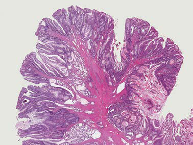

# Chapter 393: Tumors of the Digestive Tract
> **Course:** Vikkypaedia Pediatric Basic Course (*Nelson Textbook of Pediatrics, 22nd Edition (2025)*)  
> **Part XVI:** The Digestive System  
> **Authors:** Stacey G. Zahler, Mohammad Nasser Kabbany, and Karen F. Murray  
> **Metrics:** 3,868 words · 0 tables/boxes · 2 figures · 8 genes · 8 flashcards · 5 MCQs  
> **Quick Navigation:** [🃏 Study 8 Flashcards](../flashcards/393_flashcards.md) · [📝 Take 5-Q MCQ Quiz](../mcqs/393_mcqs.md) · [📚 Part XVI Guide](../parts/Part_XVI.md) · [🧬 Syndrome & Genetics Atlas](../omim_gene_atlas.md) · [💊 Therapeutics Matrix](../therapies_matrix.md) · [🏠 Course Index](../../index.md)

## Key Genetic & Molecular Targets
`APC`, `BMPR1A`, `MEN1`, `NF1`, `PTEN`, `SMAD4`, `STK11`, `VHL`

## ⚡ High-Yield Nelson Pediatric Board Pearls
- Juvenile, reten tion, or inflammatory polyps are hamartomatous polyps, which rep resent the most common intestinal tumors of childhood, occurring in 1–2% of children.
- Patients presenting with rectal bleeding require a thorough workup; differential diagnosis includes anal fissure, other intestinal polyposis syndromes, Meckel’s diverticulum, inflammatory bowel disease, intes tinal infections, IgA vasculitis (Henoch-Schönlein purpura), angiodys plasia, or coagulopathy.
- Diagnosis and therapy are best accomplished via endoscopy.
- Retrieved polyps should be sent for histologic evaluation for definitive diagnosis.
- There is often a family history (20–50%) with an autosomal dominant pattern of variable penetrance.
- A clinical diagnosis of JPS is established by the presence of one of the following: a lifetime total of five or more juvenile polyps in the colon, juvenile polyps outside the colon, or any number of juvenile polyps in a patient with a family history of JPS.
- Juvenile polyposis of infancy is characterized by early polyp forma tion (in patients younger than 2 years of age) and may be associated with protein-losing enteropathy, hypoproteinemia, anemia, failure to thrive, and intussusception.

---
## Full Chapter Text, Tables & Figures
# Chapter 393: Tumors of the Digestive Tract

*Stacey G. Zahler, Mohammad Nasser Kabbany, and Karen F. Murray*

<!-- p.3118 -->
Tumors of the digestive tract in children are also commonly syndromic tumors and tumors with known genetic association (Table 393.1). They usually manifest as painless rectal bleeding, but when large they can cause obstruction or serve as lead points for intussusception. Most intestinal polyps in children can be generally classified into two groups: hamartomatous (as seen in juvenile polyps and Peutz-Jeghers syndrome) or adenomatous (as seen in familial adenomatous polyposis syndrome).

**HAMARTOMATOUS TUMORS** Hamartomas are benign tumors composed of tissues that are normally found in an organ but that are not organized normally. Juvenile, reten tion, or inflammatory polyps are hamartomatous polyps, which rep resent the most common intestinal tumors of childhood, occurring in 1–2% of children. Patients generally present in the first decade, most often at ages 2-5 years, and rarely at younger than 1 year. Polyps may be found anywhere in the gastrointestinal (GI) tract, most commonly in the rectosigmoid colon, with one third located proximal to splenic flexure; they are often solitary but may be multiple.

Histologically, juvenile polyps are composed of hamartomatous col lections of mucus-filled glandular and stromal elements with inflam matory infiltrate, covered with a thin layer of epithelium (Fig. 393.1A). These polyps are often bulky, vascular, and prone to bleed as their growth exceeds their blood supply with resultant mucosal ulceration, or autoamputation with bleeding from a residual central artery.

Patients often present with painless rectal bleeding after defecation. Bleeding is generally scant and intermittent; rarely presenting find ings can include iron-deficiency anemia and/or hypoalbuminemia. Extensive bleeding can occur but is generally self-limited, requiring supportive care until the bleeding stops spontaneously after autoampu tation. Occasionally endoscopic polypectomy is required for control of bleeding. Abdominal pain or cramps are uncommon unless associated with intussusception. Patients can present with prolapse, with a dark, edematous, pedunculated mass protruding from the rectum. Mucus discharge and pruritus are associated with prolapse.

Patients presenting with rectal bleeding require a thorough workup; differential diagnosis includes anal fissure, other intestinal polyposis syndromes, Meckel’s diverticulum, inflammatory bowel disease, intes tinal infections, IgA vasculitis (Henoch-Schönlein purpura), angiodys plasia, or coagulopathy.

Diagnosis and therapy are best accomplished via **endoscopy**. Polyps may be visualized via ultrasound or cross-sectional imaging, but this provides no therapeutic advantage. Colonoscopy affords opportunity for biopsy, **polypectomy** by snare cautery, and visualization of synchronous lesions; up to 50% of children have one or more additional polyps, and approximately 20% may have more than five polyps. Retrieved polyps should be sent for histologic evaluation for definitive diagnosis.

**Juvenile Polyposis Syndrome** Patients with juvenile polyposis syndrome (JPS) present with multiple juvenile polyps—usually five or more—but typically 50-200 are pres ent within the GI tract. The incidence of JPS is between 1:10,000 and 1:160,000. Polyps are most likely isolated to the colon (98%) but may be distributed throughout the GI tract. There is often a family history (20–50%) with an autosomal dominant pattern of variable penetrance. Alterations in transforming growth factor-β pathways have been

identified in some JPS patients and families; pathogenic variants in *SMAD4* or *BMPR1A* are found in 50–60% of patients with JPS. Genetic testing is available for both of these variants. Patients with the *SMAD4* pathogenic variant may have hereditary hemorrhagic telangiectasia and should be evaluated for brain and lung vascular malformations. A clinical diagnosis of JPS is established by the presence of one of the following: a lifetime total of five or more juvenile polyps in the colon, juvenile polyps outside the colon, or any number of juvenile polyps in a patient with a family history of JPS.

Histologically, these polyps are identical to solitary juvenile polyps; however, the risk of malignant transformation is greatly increased (10– 50%). Malignancy occurs most commonly in the colorectal region, although gastric, upper GI, and pancreatic tumors have been described. The risk of malignancy is greater in patients with increased polyp burden and a positive family history. These patients should therefore undergo routine esophagogastroduodenoscopy and colonoscopy start ing at 12-15 years of age. Age at which surveillance of the upper GI tract should begin varies between guidelines. It is not required during teenage years per current published pediatric guidelines unless symp tomatic. Serial polypectomy or polyp biopsy should be undertaken if possible. If dysplasia or malignant degeneration is found, a total colec tomy is indicated.

Juvenile polyposis of infancy is characterized by early polyp forma tion (in patients younger than 2 years of age) and may be associated with protein-losing enteropathy, hypoproteinemia, anemia, failure to thrive, and intussusception. Early **endoscopic or surgical interven tion** may be needed.

**Peutz-Jeghers Syndrome** Peutz-Jeghers syndrome (PJS) is a rare autosomal dominant disorder (incidence: ∼1:120,000 total population) characterized by mucocuta neous pigmentation and extensive GI hamartomatous polyposis. Mac ular pigmented lesions may be dark brown to dark blue and are found primarily around the lips and oral mucosa, although these lesions may also be found on the hands, feet, or perineum (Fig. 393.2). Lesions can fade by puberty or adulthood, though buccal pigmentation can persist.

Polyps are primarily found in the small intestine (in order of preva lence: jejunum, ileum, duodenum) but may also infiltrate gastric or colonic regions. Histologically, polyps are defined by normal epithe lium surrounding bundles of smooth muscle arranged in a branching or frondlike pattern called *arborization* (see Fig 393.1B). They may show “pseudo-invasion,” which may be mistaken for malignancy. Symptoms arising from GI polyps in PJS are similar to those of other polyposis syndromes—namely bleeding and abdominal cramping from obstruc tion or recurrent intussusception. Patients have a 68% risk of intussus ception during childhood and may require repeated laparotomies and intestinal resections.

The diagnosis of PJS is made clinically in patients with at least two histologically proven PJS polyps or any number of PJS polyps in patients with a known family history. Diagnosis also can be made in individuals with a family history of PJS with characteristic mucocuta neous hyperpigmentation. Genetic testing can reveal pathogenic vari ants in *LKB1/STK11* (19p13.3), a serine-threonine kinase that acts as a tumor suppressor gene. Up to 94% of patients with clinical characteris tics of PJS have a pathogenic variant at this locus. Only 50% of patients with PJS have an affected family member, suggesting a high rate of de novo mutations

Patients with PJS have increased risk of GI and extraintestinal malig nancies. Lifetime cancer risk has been reported to be in the range of 47–93%. Colorectal, breast, and reproductive tumors are most com mon. Even though risk of GI malignancy in childhood is quite low, GI surveillance for polyps should begin in childhood (by age 8 years of age or when symptoms occur) with upper and lower endoscopy. The small bowel may be evaluated radiographically, with magnetic reso nance enterography, endoscopically with balloon or push enteroscopy, or with video capsule endoscopy. Polyps larger than 1.5 cm should be removed, although resection does not lower the cancer risk and is mainly to avoid complications. Patients with PJS should be monitored for signs of precocious puberty given their risk of having sex cord/

*Stacey G. Zahler, Mohammad Nasser 
 Kabbany, and Karen F. Murray*

<!-- p.3119 -->
A B C

**Fig. 393.1** Representative histologic sections of commonly found polyps in pediatric patients. A, Juvenile polyp. Cystically dilated and irregular colonic crypts within an inflamed, expanded stroma. B, Peutz-Jeghers polyp. Small bowel with large arborizing bundles of smooth muscle and oth erwise normal epithelial component. C, Adenomatous polyp. Enlarged, hyperchromatic, and stratified nuclei confined to a tubular configuration.

**SYNDROME**

**POLYP 
 DISTRIBUTION**

**AGE OF 
**

**ONSET**

**RISK OF 
 COLON CANCER**

**GENETIC 
**

**LESION**

**CLINICAL 
 MANIFESTATIONS**

**ASSOCIATED**

**LESIONS**

HAMARTOMATOUS POLYPS Juvenile polyposis Large and small

intestine, gastric polyps

First decade ∼10–50% *SMAD4, BMPR1A* Autosomal

dominant

Possible

rectal bleeding, abdominal pain, intussusception

Congenital

abnormalities in 20% of the nonfamilial type, clubbing, AV malformations

Peutz-Jeghers

syndrome

Small and large

intestine

First decade Increased *LKB1/STK11* Autosomal

dominant

Possible

rectal bleeding, abdominal pain, intussusception

Orocutaneous

melanin pigment spots

Cowden syndrome Colon Second decade 13–18% *PTEN* gene Macrocephaly,

breast/thyroid/ endometrial cancers, developmental delay

Bannayan-

Riley-Ruvalcaba syndrome

Colon Second decade Increased *PTEN* gene Macrocephaly,

speckled penis, thyroid/breast cancers, hemangiomas, lipomas

ADENOMATOUS POLYPS Familial adeno

matous polyposis (FAP)

Large intestine,

often >100

16 yr (range: 8-34 yr) 100% 5q (*APC* gene), autosomal dominant

Rectal bleeding,

abdominal pain, bowel obstruction

Desmoids, CHRPE,

upper GI polyps, osteoma, hepatoblastoma, thyroid cancer

Attenuated

familial adeno matous polyposis (AFAP)

Colon (fewer in

number)

>18 yr Increased *APC* gene Same as FAP Fewer associated

lesions

MYH-associated

polyposis

Colon >20 yr High risk *MYH* autosomal

recessive

Same as FAP May be confused

with sporadic FAP or AFAP; few extraintestinal findings

Gardner syndrome Large and small

intestine

16 yr (range: 8-34 yr) 100% 5q (*APC* gene) Rectal bleeding,

abdominal pain, bowel obstruction

Desmoid tumors,

multiple osteomas, fibromas, epidermoid cysts

Hereditary

nonpolyposis colon cancer (Lynch syndrome)

Large intestine 40 yr 30% DNA mismatch repair

genes *(MMR)* Autosomal dominant

Rectal bleeding,

abdominal pain, bowel obstruction

Other tumors

(e.g., ovary, ureter, pancreas, stomach)

APC, adenomatous polyposis coli; AV, arteriovenous; CHRPE, congenital hypertrophy of the retinal pigment epithelium; GI, gastrointestinal; PTEN, phosphatase and tensin homolog.

<!-- p.3120 -->
stromal tumors, particularly large-cell calcifying Sertoli cell tumors. Screening for breast, gynecologic, and testicular cancers should be routine after age 18 years.

**Phosphatase and Tensin Homolog Hamartoma Tumor Syndromes** Pathogenic variants in the tumor suppressor gene *PTEN* are associated with several rare autosomal dominant syndromes, including Cowden syndrome, Bannayan-Riley-Ruvalcaba syndrome, and Proteus and Proteus-like syndrome. These patients present with multiple hamar tomas in the skin (99%), brain, breast, thyroid, endometrium, and GI tract (60%). Other extraintestinal manifestations include macroceph aly, developmental delay, lipomas, and genital pigmentation. Patients have 9–18% lifetime risk of colorectal cancer. However, this risk is low in childhood. They also have increased risk of thyroid, breast, uterine, renal, and skin malignancies.

**ADENOMATOUS TUMORS Adenomatous Polyposis Coli-Associated Polyposis Syndromes** Familial adenomatous polyposis (FAP) is the most common genetic polyposis syndrome (incidence 1:5,000-1:17,000 persons) and is char acterized by numerous adenomatous polyps throughout the colon and extraintestinal manifestations. FAP and related syndromes (attenuated FAP; Gardner and Turcot syndromes) are linked to pathogenic variants in the *APC* gene, a tumor suppressor mapped to 5q21, which is part of the WNT signaling pathway. *APC* regulates degradation of β-catenin, a protein with roles in regulation of the cytoskeleton, tissue architecture organization, cell migration and adherence, and numerous other func tions. Intracellular accumulation of β-catenin may be responsible for colonic epithelial cell proliferation and adenoma formation. More than 400 pathogenic variants in the *APC* gene have been described, and up to 30% of patients present with no family history (sporadic variants). There is an association between disease phenotype and the location of the *APC* gene alteration. For example, a more severe colonic phenotype is associated with pathogenic variants between codons 1250 and 1464, specifically variants that include codon 1309.

Polyps generally develop late in the first or second decades of life (mean age of presentation is 16 years). At the time of diagnosis, five or more adenomatous polyps are present in the colon and rectum. By young adulthood, the number of polyps typically increases to hundreds or even thousands. Adenomatous polyps (or adenomas) are precancer ous lesions within the surface epithelium of the intestine, displaying various degrees of dysplasia (see Fig. 393.1C). Without intervention,

the risk of developing colon cancer is 100% by the fifth decade of life (average age of cancer diagnosis is 40 years). Other GI adenomas can develop, particularly in the stomach and duodenum (50–90%). The risk of periampullary or duodenal carcinoma is significantly elevated (4–12% lifetime risk) and represents, along with desmoid tumors, the most common cause of death after colorectal cancer. Extraintestinal malignancies occur at an increased rate in FAP, including hepatoblas toma in young patients (1.6% before age 5 years) and follicular or papil lary thyroid cancer in adolescents.

*Extraintestinal* manifestations of FAP may be present from birth or develop in early childhood. Lesions include congenital hypertrophy of retinal pigment epithelium, desmoid tumors, epidermoid cysts, osteo mas, fibromas, lipomas, and supernumerary, impacted, or missing teeth. Many of these nonmalignant soft tissue tumors appear before intestinal polyps develop. Expression of extraintestinal findings can depend on the location of the *APC* gene alteration.

Other syndromes associated with *APC* pathogenic variants include *Gardner syndrome,* classically characterized by multiple colorectal polyps, desmoid tumors, and soft tissue tumors, including fibromas, osteomas (typically mandibular), epidermoid cysts, and lipomas. Once thought to be a distinct clinical entity, Gardner syndrome shares many characteristics with FAP. Up to 20% of FAP patients present with the classic extraintestinal manifestations once associated with Gardner syndrome. Some (but not all) cases of *Turcot syndrome* are also related to *APC.* These patients present with colorectal polyposis and primary brain tumors (medulloblastoma). Attenuated FAP is characterized by a significantly increased risk of colorectal cancer but fewer polyps than classic FAP (average: 30 polyps). The average age of cancer diagnosis in this form of FAP is 50-55 years. Upper GI tumors and extraintestinal manifestations may be present but are less common.

The clinical presentation of FAP is variable. Polyps are generally ses sile, of variable size, and initially asymptomatic. If symptoms develop, they can include rectal bleeding (possibly with secondary anemia), cramping, and diarrhea. The presence of symptoms at presentation does not correlate with malignant changes. Diagnosis should be suspected from family history, and ensuing colonoscopy is confirmatory. Histo logic examination of biopsied polyps reveals adenomatous architecture (as opposed to inflammatory or hamartomatous polyps found in other polyposis syndromes) with varying degrees of dysplasia. Genetic test ing for *APC* variants is clinically available, and index patients should be tested. If a pathogenic variant is identified, affected family members should be screened and appropriate genetic counseling should be pro vided. If the index patient does not demonstrate a defined variant, fam ily members may undergo genetic testing, which might identify novel *APC* alterations. Children with identified *APC* mutations must undergo careful surveillance, with colonoscopy every 1-2 years starting early in the second decade of life or earlier if symptomatic. Once polyps are identified, colonoscopy should be performed annually. Patients should also have upper endoscopy in the third decade of life to monitor for gas tric and especially duodenal lesions, earlier if symptomatic or if there is family history of aggressive duodenal adenoma burden or cancer.

Treatment of FAP requires **prophylactic proctocolectomy** to pre vent inevitable colon cancer. Prophylactic colectomy should be planned in the late teens or early twenties, earlier if significant polyposis bur den or malignancy is suspected. Ileoanal pull-through procedures restore bowel continuity, with acceptable functional outcomes. Surgi cal approaches include ileal pouch anal anastomosis (with J-pouch) versus ileorectal anastomosis; the type of surgery depends on rectal and colonic polyp burden and surgeon preference. It is very impor tant to note that ongoing surveillance of the ileal pouch or rectal cuff is warranted after surgery. **Nonsteroidal antiinflammatory agents**, such as sulindac, and cyclooxygenase-2 inhibitors, such as celecoxib, might inhibit polyp progression. No guidelines have been established, however, and their efficacy in preventing malignant transformation of existing polyps is unknown.

**Carcinoma** Primary carcinomas of the esophagus, stomach, or colon are extremely rare in children. Development of adenocarcinoma in adolescence or

**Fig. 393.2** Peutz-Jeghers syndrome. Characteristic bluish brown to black spots were first noted in early childhood on the lips of this boy who later developed hamartomatous gastrointestinal polyps. (From Paller AS, Mancini AJ, eds. Hurwitz Clinical Pediatric Dermatology, 6th ed. Philadelphia: Elsevier; 2022: Fig. 11.46, p. 312.)

<!-- p.3121 -->
early adulthood may be associated with a genetic predisposition or syndrome such as FAP, hereditary nonpolyposis colon carcinoma, PJS, radiation exposure, or inflammatory bowel disorders such as Crohn disease or ulcerative colitis.

Colorectal carcinoma (CRC), though rare (reported incidence of 1 case per 1,000,000 persons younger than 19 years of age), is the most common primary GI carcinoma in children. Patients with longstanding ulcerative colitis are at increased risk. Many cases are sponta neous (i.e., not associated with a genetic predisposition or syndrome); associated genetic syndromes occur in 3–5% of all CRC cases (see Table 393.1). Histologically, tumors tend to be poorly differentiated and pathologically aggressive. Patients may be asymptomatic, or they present with nonspecific signs and symptoms such as abdominal pain, constipation, and vomiting. Delay in diagnosis is common. Adolescents and young adults present with advanced-stage disease more often than in older patients; microscopic or gross metastases are often present at the time of diagnosis. **Surgical resection** is the primary treatment modality, although with delayed presentation and advanced-stage dis ease, complete resection may not be possible. Complete resection is necessary for cure, however. **Chemotherapy** is standard treatment for patients with more advanced, surgically unresectable disease, though its efficacy is variable. Targeted immunotherapy agents such as mono clonal antibodies against epidermal growth factor receptor or vascular endothelial growth factor receptor are gaining traction as useful sys temic therapies. **Radiation therapy** has a limited role in patients with metastatic disease.

**OTHER GASTROINTESTINAL TUMORS Lymphoma** Lymphoma is the most common GI malignancy in the pediatric popu lation. Approximately 30% of children with non-Hodgkin lymphoma present with abdominal tumors. Immunocompromised patients have an increased incidence of lymphoma. Predisposing conditions include HIV/AIDS, agammaglobulinemia, long-standing celiac disease, and bone marrow or solid-organ transplantation. Examples of non- Hodgkin lymphoma subtypes that commonly occur in the GI tract are Burkitt lymphoma and posttransplant lymphoproliferative disorder (PTLD). Lymphoma can occur anywhere in the GI tract, but it most commonly occurs in the distal small bowel and ileocecal region; for instance, Burkitt lymphoma is classically located at the terminal ileum. Presenting symptoms include crampy abdominal pain, vomiting, obstruction, bleeding, or palpable mass. Lymphoma should be consid ered in patients older than 3 years of age who present with intussuscep tion. Treatment consists of a combination of **surgical resection** and **chemotherapy**, and the intensity of chemotherapy regimens depends on the extent of the tumor burden.

**Nodular Lymphoid Hyperplasia** Lymphoid follicles in the lamina propria and submucosa of the gut nor mally aggregate in Peyer patches, most prominently in the distal ileum. These follicles can become hyperplastic, forming nodules that protrude into the lumen of the bowel during times of developmental lymphoid proliferation such as early childhood and adolescence. Some suggested etiologies are infectious (classically *Giardia*), allergic, or immunologic. Nodular lymphoid hyperplasia has been described in infants with enterocolitis secondary to dietary protein sensitivity. This phenomenon has also been described in patients with inflammatory bowel disease and Castleman disease. Patients may be asymptomatic or, especially in cases of immunodeficiency, may present with abdominal pain, rectal bleed ing, diarrhea, or intussusception. Nodular lymphoid hyperplasia usu ally resolves spontaneously. The use of antiinflammatory medications or elimination diets is unlikely to change the clinical course, although in cases with severe pain or bleeding, **corticosteroids** may be effective.

**Gastroenteric Neuroendocrine Tumors** Gastroenteric neuroendocrine tumors (NETs) arise from neuroen docrine cells found in the intestines (and in the pancreas; however, pancreatic NETs will not be discussed here). These tumors can be low, intermediate, or high-grade tumors, depending on the Ki-67

proliferative index on histopathology (i.e., how rapidly the cells prolif erate). The World Health Organization (WHO) classification separates NETs from “neuroendocrine carcinomas.” NETs can be functional or nonfunctional; some NETs overproduce and secrete hormones such as gastrin, serotonin, or ectopic hormones such as adrenocorticotropic hormone (ACTH). Several heritable tumor syndromes are associ ated with gastroenteric NETs, including multiple endocrine neoplasia type 1 (MEN1), von Hippel-Lindau (VHL) disease, tuberous sclerosis (TSC), or neurofibromatosis type 1 (NF1). Two of the most common NETs of the GI tract in children and adolescents are carcinoid tumors and gastrinomas.

**Carcinoid Tumor** Carcinoid tumors are neuroendocrine tumors of enterochromaffin cells, which can occur throughout the GI tract, but in children they are typically found in the appendix. This is often an incidental diagnosis at the time of appendectomy. **Complete surgical resection** of small tumors (<1 cm) with clear surgical margins is curative. Appendiceal tumors >1.5 cm are at increased risk for nodal metastasis and thus mandate further bowel resection, typically a right hemicolectomy.

Carcinoid tumors outside the appendix (small intestine, rectum, stomach) are more likely to metastasize. Serum tumor markers may be helpful in monitoring for development of metastatic disease—chromo granin A is the most sensitive tumor marker for intestinal NETs. Car cinoid tumors of the midgut can metastasize to the liver and give rise to a constellation of symptoms called **carcinoid syndrome**. Serotonin, 5-hydroxytryptophan, or histamine may be secreted by the tumor, and elevated serum levels cause cramps, diarrhea, vasomotor disturbances (flushing), bronchoconstriction, and right heart failure. The diagnosis is confirmed by elevated urinary 5-hydroxyindoleacetic acid (5-HIAA). Symptomatic relief of carcinoid syndrome may be achieved with admin istration of **somatostatin analogs** (i.e., octreotide). Treatment of meta static NETs is again **surgical resection**, and the extent of resection may be curative or palliative, depending on the goals of care and risk of sur gical morbidity. Because NETs tend to be slow-growing, some patients may be closely monitored for periods without surgical intervention. **Chemotherapy** has been used, including medications such as temozolo mide, 5-fluorouracil, and cisplatin. Clinical trials studying various tar geted systemic therapies are ongoing. A mammalian target of rapamycin (mTOR) inhibitor, called **everolimus**, is FDA-approved for the treatment of nonfunctional NETs based on the results of several clinical trials.

**Gastrinoma** A malignant NET that arises in the duodenum or the pancreas is called *gastrinoma,* and these tumors secrete gastrin, which causes gastric acid hypersecretion and Zollinger-Ellison syndrome. Clinical symptoms of gastrinoma include diarrhea (because of large amounts of acid secre tion into the duodenum), abdominal pain, peptic ulcer disease, and bleeding. Strictures and perforation may develop with more severe dis ease. Unfortunately, about 75–80% of patients with gastrinoma present with metastases to the liver or lymph nodes at diagnosis, and approxi mately 12% can have bone metastases at diagnosis as well. Treatment of gastrinoma includes **proton pump inhibitors** and **surgical resection**.

**Leiomyoma** Leiomyomas are rare benign tumors that can arise anywhere in the GI tract, although most often in the stomach, jejunum, or distal ileum. Age of presentation is variable, from the newborn period through ado lescence. Patients may be asymptomatic or can present with an abdom inal mass, obstruction, intussusception, volvulus, or pain and bleeding from central necrosis of the tumor. **Surgical resection** is the treatment of choice. Pathologically, these tumors may be difficult to distinguish from malignant leiomyosarcomas. Smooth muscle tumors occur with increased incidence in children with HIV or those requiring immuno suppression after transplantation.

**Gastrointestinal Stromal Cell Tumors** Gastrointestinal stromal cell tumors (GISTs) are intestinal mesenchy mal tumors that probably arise from interstitial cells of Cajal or their

<!-- p.3123 -->
