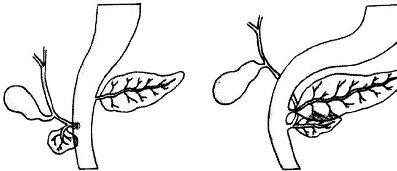
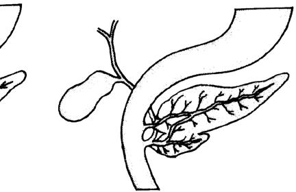

# Chapter 395: Embryology, Anatomy, and Physiology of the Pancreas
> **Course:** Vikkypaedia Pediatric Basic Course (*Nelson Textbook of Pediatrics, 22nd Edition (2025)*)  
> **Part XVI:** The Digestive System  
> **Authors:** Steven L. Werlin and Michael Wilschanski  
> **Metrics:** 1,715 words · 0 tables/boxes · 2 figures · 4 genes · 8 flashcards · 5 MCQs  
> **Quick Navigation:** [🃏 Study 8 Flashcards](../flashcards/395_flashcards.md) · [📝 Take 5-Q MCQ Quiz](../mcqs/395_mcqs.md) · [📚 Part XVI Guide](../parts/Part_XVI.md) · [🧬 Syndrome & Genetics Atlas](../omim_gene_atlas.md) · [💊 Therapeutics Matrix](../therapies_matrix.md) · [🏠 Course Index](../../index.md)

## Key Chapter Topics & Subchapters
`395.1 Pancreatic Anatomic Abnormalities` · `395.2 Pancreatic Physiology` · `395.1 Pancreatic Anatomic Abnormalities Steven L. Werlin and Michael Wilschanski`

## Key Genetic & Molecular Targets
`CFTR`, `PDX1`, `SMAD2`, `UBR1`

## ⚡ High-Yield Nelson Pediatric Board Pearls
- This complication is usually related to disrup tion of the testicular attachment in the scrotum at the time of hernia repair or failure to recognize an undescended testis during the original procedure, allowing the testes to retract, typically to the region of the external ring.
- The testicular insult can be caused by compression of the gonadal ves sels by the incarcerated hernia mass or as a result of damage incurred during operative repair.
- These problems underscore the need for prompt reduction of incarcerated hernias and early repair once the diagnosis is known to avoid repeat episodes of incarceration.
- Although the vulnerabil ity of the vas deferens has been documented in many studies, no good data exist as to the actual incidence of this complication.
- An annular pancreas results from incomplete rotation of the left (ventral) pancreatic anlage, which may be a result of recessive patho genic variants in the IHH or SHH genes.
- Pancreas divisum, which occurs in 5–15% of the population, is the most common pancreatic developmental anomaly.
- Diagnosis is made by endoscopic retrograde cholangiopancreatography or by magnetic resonance cholangiopancreatography.

---
## Full Chapter Text, Tables & Figures
# Chapter 395: Embryology, Anatomy, and Physiology of the Pancreas

*Steven L. Werlin and Michael Wilschanski*

<!-- p.3129 -->
conditions that cause *increased intraabdominal pressure* (ventriculo peritoneal shunts, ascites, chronic lung disease, peritoneal dialysis) are at increased risk for recurrence.

**Iatrogenic Cryptorchidism (Trapped Testicle)** Iatrogenic cryptorchidism describes malposition of the testis after inguinal hernia repair. This complication is usually related to disrup tion of the testicular attachment in the scrotum at the time of hernia repair or failure to recognize an undescended testis during the original procedure, allowing the testes to retract, typically to the region of the external ring. At the completion of inguinal hernia repair, the testis should be placed in a dependent intrascrotal position. If the testis will not remain in this position, proper fixation in the scrotum should be performed at the time of the hernia repair.

**Incarceration** Incarceration of an inguinal hernia can result in injury to the intestines, the fallopian tube and ovary, or the ipsilateral testis. The incidence of incarceration of a congenital indirect inguinal hernia is reported as 6–18% throughout childhood and as high as 30% for infants younger than 6 months of age. Intestinal injury requiring bowel resection is uncommon, occurring in only 1–2% of incarcerated hernias. In cases of incarceration in which the hernia is reduced nonoperatively, the likelihood of intestinal injury is low; however, these patients should be observed closely for 6-12 hours after reduction of the hernia for signs and symptoms of intestinal obstruction, such as fever, vomit ing, abdominal distention, or bloody stools. Laparoscopy affords the opportunity to inspect the reduced viscera for injury or necrosis in select cases.

The reported incidence of testicular infarction and subsequent testic ular atrophy with incarceration is 4–12%, with higher rates among the irreducible cases requiring emergency operative reduction and repair. The testicular insult can be caused by compression of the gonadal ves sels by the incarcerated hernia mass or as a result of damage incurred during operative repair. Young infants are at highest risk, with testicu lar infarction rates reported as high as 30% in infants younger than 2-3 months of age. These problems underscore the need for prompt reduction of incarcerated hernias and early repair once the diagnosis is known to avoid repeat episodes of incarceration.

**Injury to the Vas Deferens and Male Fertility** Similar to the gonadal vessels, the vas deferens can be injured as a consequence of compression from an incarcerated hernia or dur ing operative repair. This injury is almost certainly underreported because it is unlikely to be recognized until adulthood and, even then, possibly only if the injury is bilateral. Although the vulnerabil ity of the vas deferens has been documented in many studies, no good data exist as to the actual incidence of this complication. One review reported an incidence of injury to the vas deferens of 1.6% based on pathology demonstrating segments of the vas deferens in the hernia sac specimen; this may be overstated, because others have shown that small glandular inclusions found in the hernia sac can represent mül lerian duct remnants and are of no clinical importance. The relation ship between male fertility and previous inguinal hernia repair is also unknown. There appears to be an association between infertile males with testicular atrophy and abnormal sperm count and a previous hernia repair. A relationship has also been reported between infer tile males with spermatic autoagglutinating antibodies and previous inguinal hernia repair. The proposed etiology is that operative injury to the vas deferens during inguinal hernia repair might result in obstruction of the vas with diversion of spermatozoa to the testicular lymphatics, and this breach of the blood-testis barrier produces an antigenic challenge, resulting in formation of spermatic autoaggluti nating antibodies.

*Visit Elsevier eBooks+ at eBooks.Health.Elsevier.com** for Bibliography.*

Section **5 Exocrine Pancreas**

*Steven L. Werlin and Michael Wilschanski*

**INTRODUCTION** The human pancreas develops from the ventral and dorsal domains of the primitive duodenal endoderm beginning at about the fifth week of gestation (Fig. 395.1). The larger dorsal anlage, which devel ops into the tail, body, and part of the head of the pancreas, grows directly from the duodenum. The smaller ventral anlage develops as one or two buds from the primitive liver and eventually forms the major portion of the head of the pancreas. At about the 17th week of gestation, the dorsal and ventral anlagen fuse as the buds develop and the gut rotates. The ventral duct forms the proximal portion of the major pancreatic duct of Wirsung, which opens into the ampulla of Vater. The dorsal duct forms the distal portion of the duct of Wirsung and the accessory duct of Santorini, which empties independently in approximately 5% of people. Variations in fusion might account for pancreatic developmental anomalies. Pancreatic agenesis has been associated with a base pair deletion in the insu lin promoter factor 1-*HOX* gene, *PDX1 (PAGEN1)*, *PTF1A (PAGEN 2*), and *GATA 6 haploinsufficiency* genes. Other genes involved in pancreatic organogenesis include the *IHH*, *SHH* or sonic hedgehog gene, *SMAD2*, and *TGF-1**β* genes.

The pancreas lies transversely in the upper abdomen between the duodenum and the spleen in the retroperitoneum (Fig. 395.2). The head, which rests on the vena cava and renal vein, is adherent to the C loop of the duodenum and surrounds the distal common bile duct. The tail of the pancreas reaches to the left splenic hilum and passes above the left kidney. The lesser sac separates the tail of the pancreas from the stomach.

By the 13th week of gestation, exocrine and endocrine cells can be identified. Primitive acini containing immature zymogen gran ules are found by the 16th week. Mature zymogen granules contain ing amylase, trypsinogen, chymotrypsinogen, and lipase are present at the 20th week. Centroacinar and duct cells, which are responsible for water, electrolyte, and bicarbonate secretion, are also found by the 20th week. The final three-dimensional structure of the pan creas consists of a complex series of branching ducts surrounded by grapelike clusters of epithelial cells. Cells containing glucagon are present at the 8th week. Islets of Langerhans appear between the 12th and 16th weeks.

*Visit Elsevier eBooks+ at eBooks.Health.Elsevier.com** for Bibliography.*

<!-- p.3131 -->
Gall bladder

Ventral pancreas A C B

Accessory pancreatic duct (Santorini)

Major pancreatic duct (Wirsung) Ventral pancreas

Dorsal pancreas

Dorsal pancreas Minor papilla

Major papilla

Stomach

**Fig. 395.1** Development of the exocrine pancreas. A, Gestational age 6 wk. B, Gestational age 7-8 wk. The ventral pancreas has rotated but has not yet fused with the dorsal pancreas. C, The ventral and dorsal pancreatic ductal systems have fused. (From Werlin SL. The exocrine pancreas. In: Kelly VC, ed. Practice of Pediatrics, vol 3. Hagerstown, MD: Harper and Row, 1980: Fig. 16.1.)

Aorta

Duodenum

**Pancreas**

Body Tail

Left kidney

Spleen

Head

Jejunum Uncinate

process **Fig. 395.2**  Anterior view of the pancreas and relationship to neigh boring structures. *(From Werlin SL. The exocrine pancreas. In: Kelly VC, ed. Practice of Pediatrics, vol 3. Hagerstown, MD: Harper and Row, 1980: Fig. 16.2.)*

## 395.1  Pancreatic Anatomic Abnormalities Steven L. Werlin and Michael Wilschanski

Complete or partial **pancreatic agenesis** is a rare condition. Complete agenesis is associated with severe neonatal diabetes and usually death at an early age (see Chapter 629). Partial or dorsal pancreatic agenesis is often asymptomatic but may be associated with diabetes, congenital heart disease, polysplenia, and recurrent pancreatitis. Pancreatic agen esis is also associated with malabsorption.

An **annular pancreas** results from incomplete rotation of the left (ventral) pancreatic anlage, which may be a result of recessive patho genic variants in the *IHH* or *SHH* genes. Patients usually present in infancy with symptoms of complete or partial bowel obstruction or in the fourth or fifth decade. There is often a history of maternal

polyhydramnios. Other congenital anomalies, such as Down syn drome, tracheoesophageal fistula, intestinal atresia, imperforate anus, malrotation and cardiorenal abnormalities, and pancreatitis, may be associated with annular pancreas. Some children present with chronic vomiting, pancreatitis, or biliary colic. The treatment of choice is duo denojejunostomy. Division of the pancreatic ring is not attempted because a duodenal diaphragm or duodenal stenosis often accompa nies annular pancreas.

**Ectopic pancreatic rests** in the stomach or small intestine occur in approximately 3% of the population. Most cases (70%) are found in the upper intestinal tract. Recognized on barium contrast studies by their typical umbilicated appearance, they are rarely of clinical importance. On endoscopy, they are irregular, yellow nodules 2-4 mm in diameter. A pancreatic rest may rarely be the lead point of an intussusception, produce hemorrhage, or cause bowel obstruction.

**Pancreas divisum***,* which occurs in 5–15% of the population, is the most common pancreatic developmental anomaly. Because of the failure of the dorsal and ventral pancreatic anlagen to fuse, the tail, body, and part of the head of the pancreas drain through the small accessory duct of Santorini rather than the main duct of Wir sung. Some researchers believe that this anomaly may be associated with recurrent pancreatitis when there is relative obstruction of the outflow of the ventral pancreas. Diagnosis is made by endoscopic retrograde cholangiopancreatography or by magnetic resonance cholangiopancreatography. Pancreatitis in patients with pancreas divisum may be associated with pathogenic *CFTR* variants. Sphinc terotomy is not recommended unless other anomalies are present or the patient has classic pancreatobiliary-type pain, recurrent pancre atitis, or chronic pancreatitis, and no other etiology is found.

**Choledochal cysts** are dilations of the biliary tract and usually cause biliary tract symptoms, such as jaundice, pain, and fever. On occasion, the presentation may be pancreatitis. The diagnosis is usu ally made with ultrasonography, CT or biliary scanning, or magnetic resonance cholangiopancreatography. Similarly, a choledochocele—an intraduodenal choledochal cyst—may manifest with pancreatitis. The diagnosis can be difficult and require magnetic resonance cholangio pancreatography, endoscopic retrograde cholangiopancreatography, or endoscopic ultrasound.

A number of rare conditions, such as Ivemark (pathogenic variant in *GDF* gene) and Johanson-Blizzard (pathogenic variant in *UBR1* gene) syndromes, include pancreatic dysgenesis or dysfunction among their features. Many of these syndromes include renal and hepatic dysgen esis along with the pancreatic anomalies.

*Visit Elsevier eBooks+ at eBooks.Health.Elsevier.com** for Bibliography.*

<!-- p.3132 -->

<!-- p.3133 -->
