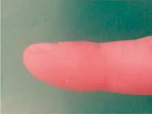
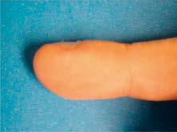

# Chapter 421: Diagnostic Approach to Respiratory Disease
> **Course:** Vikkypaedia Pediatric Basic Course (*Nelson Textbook of Pediatrics, 22nd Edition (2025)*)  
> **Part XVII:** The Respiratory System  
> **Authors:** Daniel J. Lesser, Julie Ryu, Kelan G. Tantisira, and Gabriel G. Haddad  
> **Metrics:** 12,718 words · 3 tables/boxes · 2 figures · 6 genes · 8 flashcards · 5 MCQs  
> **Quick Navigation:** [🃏 Study 8 Flashcards](../flashcards/421_flashcards.md) · [📝 Take 5-Q MCQ Quiz](../mcqs/421_mcqs.md) · [📚 Part XVII Guide](../parts/Part_XVII.md) · [🧬 Syndrome & Genetics Atlas](../omim_gene_atlas.md) · [💊 Therapeutics Matrix](../therapies_matrix.md) · [🏠 Course Index](../../index.md)

## Key Genetic & Molecular Targets
`ABCA3`, `FOXF1`, `NKX2-1`, `PHOX2B`, `SFTPB`, `SFTPC`

## ⚡ High-Yield Nelson Pediatric Board Pearls
- Hypoxemia is a hallmark of such conditions occurring early in the disease process.
- Ventilation-perfusion mismatch is the most common mechanism of arterial hypoxemia in lung disease.
- Imaging studies are not necessary to confirm the diagnosis of sinusitis in children younger than age 6 years.
- CT scans are indicated if surgery is required, in cases of complications caused by sinus infection, in immunodeficient patients, in those with cystic fibro sis, and for recurrent infections unresponsive to medical management.
- Magnetic Resonance Imaging Although CT is often considered the gold standard for chest imaging, advances in MRI techniques have broadened the indications for pedi atric chest MRI.
- Furthermore, MRI can be applied to imaging congenital large airway disorders such as airway malacia and external airway com pression caused by vascular rings and slings.
- Pulmonary function testing, although rarely resulting in a diagno sis, is helpful in defining the type of process (obstruction, restriction) and the degree of functional impairment, in following the course and treatment of disease, and in estimating the prognosis.

---
## Full Chapter Text, Tables & Figures
# Chapter 421: Diagnostic Approach to Respiratory Disease

*Daniel J. Lesser, Julie Ryu, Kelan G. Tantisira, and Gabriel G. Haddad*

<!-- p.3149 -->
Section **1 Development and Function**

**HISTORY** The history of the illness begins with a narrative provided by the parent/ caretaker with input from the patient when possible. It should include questions about respiratory symptoms (dyspnea, cough, pain, wheez ing, snoring, apnea, cyanosis, exercise intolerance), as well as their chronicity, timing during day or night, and associations with environ mental exposures and activities including exercise or food intake. The respiratory system interacts with a number of other systems, and ques tions related to cardiac, gastrointestinal, central nervous, hematologic, and immune systems may be relevant. Questions related to gastrointes tinal reflux, congenital abnormalities (airway anomalies, ciliary dyski nesia), or immune status may be important in a patient with repeated pneumonia. The family history is essential and should include inqui ries about siblings and other close relatives with similar symptoms or any chronic disease with respiratory components.

**PHYSICAL EXAMINATION** Respiratory dysfunction usually produces detectable alterations in the pattern of breathing. Values for normal respiratory rates are presented in Table 79.1 and depend on many factors—most importantly, age. Repeated respiratory rate measurements are necessary because respira tory rates, especially in the young, are exquisitely sensitive to extrane ous stimuli. Sleeping respiratory rates are more reproducible in infants than those obtained during feeding or activity. These rates vary among infants but average 40-50 breaths/min in the first few weeks of life and usually <60 breaths/min in the first few days of life.

Respiratory control abnormalities can cause the child to breathe at a low rate or periodically. Mechanical abnormalities produce compensa tory changes that are generally directed at altering minute ventilation to maintain alveolar ventilation. Decreases in lung compliance require increases in muscular force and breathing rate, leading to variable increases in chest wall retractions and nasal flaring. The respiratory excursions of children with restrictive disease are shallow. An expi ratory grunt is common as the child attempts to raise the **functional residual capacity (FRC)** by closing the glottis at the end of expira tion. The FRC is the amount of air left in the lungs after tidal expi ration. Children with obstructive disease might take slower, deeper breaths. When the obstruction is **extrathoracic** (from the nose to the mid-trachea), inspiration is more prolonged than expiration, and an inspiratory stridor (a predominant inspiratory monophonic noise) can

usually be heard (Fig. 421.1). When the obstruction is **intrathoracic**, expiration is more prolonged than inspiration, and the patient often has to make use of accessory expiratory muscles. Intrathoracic obstruc tion results in air trapping and therefore a larger residual volume along with a possible increase in FRC (Fig. 421.2).

*Lung percussion* has limited value in small infants because it can not discriminate between noises originating from tissues that are close to each other. In adolescents and adults, percussion is usually dull in restrictive lung disease (pleural effusion, pneumonia, atelectasis), but it is tympanitic in obstructive disease (asthma, pneumothorax).

*Auscultation* confirms the presence of inspiratory or expiratory pro longation and provides information about the symmetry and quality of air movement. In addition, it often detects abnormal or adventitious sounds such as **stridor**; **crackles** or **rales**, high-pitched, interrupted sounds found during inspiration and, more rarely, during early expira tion, which denote opening of previously closed air spaces; or **wheezes**, musical, continuous sounds usually caused by the development of tur bulent flow in narrow airways (Table 421.1). **Digital clubbing** is a sign of chronic hypoxia and chronic lung disease (Fig. 421.3) but may be a result of nonpulmonary etiologies (Table 421.2).

**BLOOD GAS ANALYSIS** The main function of the respiratory system is to remove carbon diox ide from and add oxygen to the systemic venous blood brought to the lung. The composition of the inspired gas, ventilation, perfusion, diffu sion, and tissue metabolism has a significant influence on the arterial blood gases.

The total pressure of the atmosphere at sea level is 760 torr. With increasing altitude, the atmospheric pressure decreases. The total atmospheric pressure is equal to the sum of partial pressures exerted by each of its component gases. Alveolar air is 100% humidified, so in alveolar gas calculations, the inspired gas is also presumed to be 100% humidified. At a temperature of 37°C (98.6°F) and 100% humidity, water vapor exerts a pressure of 47 torr, regardless of altitude. In a natu ral setting, the atmosphere consists of 20.93% oxygen. **Partial pressure of oxygen in inspired gas (Pio****2****)** at sea level is therefore (760 − 47) × 20.93% = 149 torr. When breathing 40% oxygen at sea level, Pio2 is (760 − 47) × 40% = 285 torr. At higher altitudes, breathing different concentrations of oxygen, Pio2 is less than at sea level, depending on the prevalent atmospheric pressures. In Denver (altitude of 5,000 feet and barometric pressure of 632 torr), Pio2 in room air is (632 − 47) × 20.93% = 122 torr, and in 40% oxygen, it is (632 − 47) × 40% = 234 torr. **Minute volume** is a product of VT and respiratory rate. Part of the VT occupies the conducting airways (anatomic dead space), which does not contribute to gas exchange in the alveoli. **Alveolar ventilation** is the volume of atmospheric air entering the alveoli and is calculated as (VT − dead space) × respiratory rate. Alveolar ventilation is inversely proportional to arterial Pco2 (Paco2). When alveolar ventilation is halved, Paco2 is doubled. Conversely, doubling of alveolar ventila tion decreases Paco2 by 50%. **Alveolar P**o**2 (Pa**o**2****)** is calculated by the **alveolar air equation** as follows, where R is the respiratory quotient. For practical purposes, PAco2 is substituted by **arterial P**co**2** (Paco2), and R is assumed to be 0.8. According to the alveolar air equation, for a given Pio2, a rise in Paco2 of 10 torr results in a decrease in PAo2 by 10 ÷ 0.8, or 10 × 1.25, or 12.5 torr. Thus proportionately inverse changes in PAo2 occur to the extent of 1.25 times the changes in PAco2 (or Paco2).

After the alveolar gas composition is determined by the inspired gas conditions and the process of ventilation, gas exchange occurs by the process of diffusion and equilibration of alveolar gas with pulmo nary capillary blood. Diffusion depends on the alveolar capillary bar rier and the amount of available time for equilibration. In health, the

*Daniel J. Lesser, Julie Ryu, 
 Kelan G. Tantisira, and Gabriel G. Haddad*

<!-- p.3150 -->

**Fig. 421.1** A, In extrathoracic air way obstruction, the increased nega tive pressure during inspiration is transmitted up to the site of obstruc tion. This results in collapse of the extrathoracic airway below the site of obstruction, making the obstruction worse during inspiration. Note that the pressures are compared with the atmospheric pressure, which is tradi tionally represented as 0 cm. Termi nal airway pressure is calculated as intrapleural pressure plus lung recoil pressure. Lung recoil pressure is ar bitrarily chosen as 5 cm for the sake of simplicity. B, During expiration, the positive pressure below the site of obstruction results in distention of the extrathoracic airway and ame lioration of symptoms. (Courtesy Dr. Ashok Sarnaik.)

+**40** +**5** +**45**

+**40**

+**40**

+**40**

+**5**

+**40 0 0** Airway distention

+**40** +**40**

+**40**

+**40**

−**40** +**5** −**35**

−**40**

−**40**

−**40**

−**5**

−**30 0 0** Airway collapse

A B

−**40**

−**40**

−**40**

**Fig. 421.2** A and B, In intrapul monary airway obstruction, an even wider segment of intrathoracic air way is subjected to pressure changes compared with those observed in intrathoracic-extrapulmonary airway obstruction. Such lesions are associ ated with marked increase in airway obstruction during expiration. (Cour tesy Dr. Ashok Sarnaik.)

−**40** +**5** −**35**

−**40**

−**40**

−**40**

−**3**

−**5**

**0 0** Airway distention

−**40**

−**40**

−**40**

+**40** +**5** +**45**

+**40**

+**40**

+**40**

+**3**

+**5**

**0 0** Airway collapse

+**40**

+**40**

+**40**

A B

#### **Table 421.1** Respiratory Sounds

| Category / Parameter | Clinical Details & Findings |
| --- | --- |
| **RELEVANCE** | Lung; Turbulent flow, vortices,; other; Central (expiration),; lobar to segmental; airways (inspiration); Low-pass filtered noise (<100 to >1,000 Hz); Regional ventilation,; airway caliber; Tracheal; Turbulent flow, flow; impinging on airway; walls; Pharynx, larynx, trachea,; large airways; Noise with resonances (<100 to >3,000 Hz); Upper airway; configuration |
| **ADVENTITIOUS SOUNDS** | Wheezes; Airway wall flutter, vortex; shedding, other; Central and lower; airways; Sinusoidal (<100 to >1,000 Hz, duration; typically >80 msec); Airway obstruction,; flow limitation; Rhonchi; Rupture of fluid films,; airway wall vibration; Larger airways; Series of rapidly dampened sinusoids; (typically <300 Hz and duration <100 msec); Secretions, abnormal; airway collapsibility; Crackles; Airway wall stress-; relaxation; Central and lower; airways; Rapidly dampened wave deflections; (duration typically <20 msec); Distal airway and; alveolar closure,; secretions; Modified from Pasterkamp H, Kraman SS, Wodicka GR. Respiratory sounds. Advances beyond the stethoscope. Am J Respir Crit Care Med. 1997;156(3):974–987. |

<!-- p.3151 -->
equilibration of alveolar gas and pulmonary capillary blood is com plete for both oxygen and carbon dioxide. In diseases in which the alveolar capillary barrier is abnormally increased (alveolar interstitial diseases) and/or when the time available for equilibration is decreased (increased blood flow velocity), diffusion is incomplete. Because of its greater solubility in liquid medium, carbon dioxide is 20 times more diffusible than oxygen. Therefore diseases with diffusion defects are characterized by marked **alveolar-arterial oxygen (A-aO****2****)** gradients and hypoxemia. Significant elevation of CO2 does not occur as a result of a diffusion defect unless there is coexistent hypoventilation.

Venous blood brought to the lungs is “arterialized” after diffusion is complete. After complete arterialization, the pulmonary capillary blood should have the same Po2 and Pco2 as in the alveoli. The arte rial blood gas composition is different from that in the alveoli, even in normal conditions, because there is a certain amount of dead space ventilation and venous admixture in a normal lung. Dead space ven tilation results in a higher Paco2 than PAco2, whereas venous admix ture or right-to-left shunting results in a lower Pao2 compared with the alveolar gas composition (Fig. 421.4). Pao2 is a reflection of the amount of oxygen dissolved in blood, which is a relatively minor com ponent of total blood oxygen content. For every 100 torr Po2, there is 0.3 mL of dissolved O2 in 100 mL of blood. The total blood oxygen content is composed of the dissolved oxygen and the oxygen bound to hemoglobin (Hb). Each gram of Hb carries 1.34 mL of O2 when

100% saturated with oxygen. Thus 15 g of Hb carry 20.1 mL of oxygen. **Arterial oxygen content (Ca**o**2****)**, expressed as mL O2/dL blood, can be calculated as (Pao2 × 0.003) + (Hb × 1.34 × So2), where Hb is grams of Hb per deciliter of blood and So2 is the percentage of oxyhemoglobin saturation. The relationship of Po2 and the amount of oxygen carried by the Hb is the basis of the O2-Hb dissociation curve (Fig. 421.5). The Po2 at which Hb is 50% saturated is referred to as P50. At a normal pH, Hb is 94% saturated at Po2 of 70, and little further gain in saturation is accomplished at a higher Po2. At Po2 <50, there is a steep decline in saturation and therefore the oxygen content.

Oxygen delivery to tissues is a product of oxygen content and car diac output. When Hb is near 100% saturated, blood contains approxi mately 20 mL of oxygen per 100 mL or 200 mL/L. In a healthy adult, cardiac output is approximately 5 L/min, oxygen delivery 1,000 mL/ min, and oxygen consumption 250 mL/min. Mixed venous blood returning to the heart has a Po2 of 40 torr and is 75% saturated with oxygen. Blood oxygen content, cardiac output, and oxygen consump tion are important determinants of mixed venous oxygen saturation. Given a steady-state blood oxygen content and oxygen consumption, the mixed venous saturation is an important indicator of cardiac out put. A declining mixed venous saturation in such a state indicates decreasing cardiac output.

Clinical observations and interpretation of blood gas values are critical in localizing the site of the lesion and estimating its severity (Table 421.3). In airway obstruction above the carina (subglottic steno sis, vascular ring), blood gases reflect overall alveolar hypoventilation. This is manifested by an elevated PAco2 and a proportionate decrease in Pao2 as determined by the alveolar air equation. A rise in Paco2 of 20 torr decreases Pao2 by 20 × 1.25 or 25 torr. In the absence of

A

B

C

D

a

IPD

**Fig. 421.3** A, Normal and clubbed finger viewed in profile. B, The normal finger demonstrates a distal phalangeal finger depth (DPD)/ interphalangeal finger depth (IPD) ratio <1. The clubbed finger dem onstrates a DPD/IPD ratio >1. C, The normal finger on the left demon strates a normal profile (abc) with an angle less than 180 degrees. The clubbed finger demonstrates a profile angle >180 degrees. D, Scham roth sign is demonstrated in the clubbed finger with the loss of the diamond-shaped window in between finger beds (arrow) that is dem onstrated in the normal finger. (From Wilmott RW, Deterding RR, Li A, et al, eds. Kendig’s Disorders of the Respiratory Tract in Children, 9th ed. Philadelphia: Elsevier; 2019: Fig. 1.14, p. 20.)

Clubbing

#### **Table 421.2** Nonpulmonary Diseases Associated with

| Category / Parameter | Clinical Details & Findings |
| --- | --- |
| **CARDIAC** | Cyanotic congenital heart disease; Bacterial endocarditis; Chronic heart failure |
| **HEMATOLOGIC** | Thalassemia; Congenital methemoglobinemia (rare) |
| **GASTROINTESTINAL** | Crohn disease; Ulcerative colitis; Celiac disease; Chronic dysentery, sprue; Polyposis coli; Severe gastrointestinal hemorrhage; Small bowel lymphoma; Liver cirrhosis (including α1-antitrypsin deficiency); Chronic active hepatitis |
| **OTHER** | Thyroid deficiency (thyroid acropachy); Thyrotoxicosis; Chronic pyelonephritis (rare); Toxic (e.g., arsenic, mercury, beryllium); Lymphomatoid granulomatosis; Fabry disease; Raynaud disease, scleroderma; Hodgkin disease; Familial |
| **UNILATERAL CLUBBING** | Vascular disorders (e.g., subclavian arterial aneurysm, brachial; arteriovenous fistula); Subluxation of shoulder; Median nerve injury; Local trauma; From Pasterkamp H. The history and physical examination. In: Wilmott RW, Boat TF,; Bush A, et al., eds. Kendig and Chernick’s Disorders of the Respiratory Tract in Children,; 8th ed. Philadelphia: Elsevier; 2012. |

<!-- p.3152 -->
significant parenchymal disease and intrapulmonary shunting, such lesions respond very well to supplemental oxygen in reversing hypox emia. Similar blood gas values, demonstrating alveolar hypoventilation and response to supplemental oxygen, are observed in patients with a depressed respiratory center and ineffective neuromuscular function, resulting in respiratory insufficiency. Such patients can be easily distin guished from those with airway obstruction by their poor respiratory effort.

In intrapulmonary airway obstruction (asthma, bronchiolitis), blood gases reflect ventilation-perfusion imbalance and venous admixture. In these diseases, the obstruction is not uniform throughout the lungs, resulting in areas that are hyperventilated and others that are hypoven tilated. Pulmonary capillary blood coming from hyperventilated areas

has a higher Po2 and lower Pco2, whereas that coming from hypoven tilated regions has a lower Po2 and higher Pco2. A lower blood Pco2 can compensate for the higher Pco2 because the Hb-CO2 dissociation curve is relatively linear. In mild disease, the hyperventilated areas predominate, resulting in hypocarbia. An elevated Pao2 in hyperven tilated areas cannot compensate for the decreased Pao2 in hypoventi lated areas because of the shape of the O2-Hb dissociation curve. This results in venous admixture, arterial desaturation, and decreased Pao2 (see Fig. 421.4). With increasing disease severity, more areas become hypoventilated, resulting in normalization of Paco2 with a further decrease in Pao2. A normal or slightly elevated Paco2 in asthma should be viewed with concern as a potential indicator of impending respira tory failure. In severe intrapulmonary airway obstruction, hypoventi lated areas predominate, leading to hypercarbia, respiratory acidosis, and hypoxemia. The degree to which supplemental oxygenation raises Pao2 depends on the severity of the illness and the degree of venous admixture.

In alveolar and interstitial diseases, blood gas values reflect both intra pulmonary right-to-left shunting and a diffusion barrier. Hypoxemia is a hallmark of such conditions occurring early in the disease process. Paco2 is either normal or decreased. An increase in Paco2 is observed only later in the course, as muscle fatigue and exhaustion result in hypoventilation. Response to supplemental oxygen is relatively poor with shunting and diffusion disorders compared with other lesions.

A

100

60

40

75%

75%

75% 75% 99% 88% 90%

B

C

**Fig. 421.4** Diagram demonstrating the effects of decreased ventilation-perfusion ratios on arterial oxygenation in the lungs. Three alveolar-capillary units are illustrated. Unit A has normal ventilation and an alveolar Po2 of 100 mm Hg (shown by the number in the middle of the space). The blood that circulates through this unit raises its oxygen saturation from 75% (the saturation of mixed venous blood) to 99%. Unit B has a lower ventilation-perfusion ratio and a lower alveolar Po2 of 60 mm Hg. The blood that circulates through this unit reaches a saturation of only 90%. Finally, unit C is not ventilated at all. Its alveolar Po2 is equivalent to that of the venous blood, which travels through the unit unaltered. The oxygen saturation of the arterial blood reflects the weighted contributions of these three units. If it is assumed that each unit has the same blood flow, the arterial blood would have a satura tion of only 88%. Ventilation-perfusion mismatch is the most common mechanism of arterial hypoxemia in lung disease. Supplemental oxy gen increases the arterial Po2 by raising the alveolar Po2 in lung units that, like B, have a ventilation-perfusion ratio >0.

0 20

Normal mixed venous blood

P50

PO2 (torr)

Percent oxygen-hemoglobin saturation

100 10 30 50 40 70 80 60 90 0

20

40

60

80

100

10

30

50

70

90

**Fig. 421.5** Oxygen-hemoglobin dissociation curve. P50 of adult blood is around 27 torr. Under basal conditions, mixed venous blood has a Po2 of 40 torr and oxygen-hemoglobin saturation of 75%. In arterial blood, these values are 100 torr and 97.5%, respectively. Note that there is a steep decline in oxygen-hemoglobin saturation at Pao2 <50 torr, but relatively little increase in saturation is gained at Po2 >70 torr. (Courtesy Dr. Ashok Sarnaik.)

#### **Table 421.3** Interpretation of Arterial Blood Gas Values

| Category / Parameter | Clinical Details & Findings |
| --- | --- |
| **TYPICAL ABG** | Central (above the carina) airway obstruction; or; Depressed respiratory center; or; Ineffective neuromuscular function; Uniform alveolar; hypoventilation; Early increase in Pco2.; Proportionate decrease in Po2 depending on alveolar air equation; Response to supplemental oxygen: excellent; Intrapulmonary airway obstruction; Venous admixture; mismatch; Mild: ↓ Pco2, ↓ Po2; Moderate: “normal” Pco2, ↓↓ Po2; Severe: ↑↑ Pco2, ↓↓↓ Po2; Response to supplemental oxygen: good; Alveolar-interstitial pathology; Diffusion defect R → L; shunt; Early decrease in Po2 depending on severity; Normal or low Pco2, ↑ Pco2 if fatigue develops; Response to supplemental oxygen: fair to poor; ABG, Arterial blood gas. |

<!-- p.3153 -->
Most clinical entities present with mixed lesions. A child with a vas cular ring might also have an area of atelectasis; the arterial blood gas reflects both processes. The blood gas values reflect the more dominant lesion.

*An arterial blood gas analysis is probably the single most useful rapid test of pulmonary function.* Although this analysis does not specify the cause of the condition or the specific nature of the disease process, it can give an overall assessment of the functional state of the respiratory system and clues about the pathogenesis of the disease. Because the detection of cyanosis is influenced by skin color, perfusion, and blood Hb concentration, the clinical detection by inspection is an unreliable sign of hypoxemia. Arterial hypertension, tachycardia, and diaphoresis are late, and not exclusive, signs of hypoventilation.

Blood gas exchange is evaluated most accurately by the direct mea surement of arterial pressure of oxygen (Po2), pressure of carbon diox ide (Pco2), and pH. The blood specimen is best collected anaerobically in a heparinized syringe containing only enough heparin solution to displace the air from the syringe. The syringe should be sealed, placed in ice, and analyzed immediately. Although these measurements have no substitute in many conditions, they require arterial puncture and have been replaced to a great extent by less invasive monitoring, such as capillary samples and/or oxygen saturation.

The age and clinical condition of the patient need to be taken into account when interpreting blood gas tensions. With the exception of neonates, values of arterial Po2 <85 mm Hg are usually abnormal for a child breathing room air at sea level. Calculation of the alveolar-arterial oxygen gradient is useful in the analysis of arterial oxygenation, par ticularly when the patient is not breathing room air or in the presence of hypercarbia. Values of arterial Pco2 >45 mm Hg usually indicate hypoventilation or a severe ventilation-perfusion mismatch, unless they reflect respiratory compensation for metabolic alkalosis (see Chapter 73).

In general practice **pulse oximetry** is used to monitor a patient’s peripheral arterial saturation (SpO2). This noninvasive method uses spectrophotometry to assess oxygenated and deoxygenated hemoglo bin ratios to determine the SpO2. Values are most accurate with arterial saturations above 90%; with saturations <90%, the accuracy is reduced. *Pulse oximetry often produces falsely high SpO**2** values in Black and dark- skinned patients, creating a risk for missed (occult) hypoxia, which may lead to underuse of oxygen therapy for Black patients*.

**TRANSILLUMINATION OF THE CHEST** In infants up to at least 6 months of age, a pneumothorax (see Chapter 132) can often be diagnosed by transilluminating the chest wall using a fiberoptic light probe. Free air in the pleural space often results in an unusually large halo of light in the skin surrounding the probe. Comparison with the contralateral chest is often helpful in interpret ing findings. This test is unreliable in older patients and in those with subcutaneous emphysema or atelectasis.

**RADIOGRAPHIC TECHNIQUES Chest X-Rays** A posteroanterior and a lateral view (upright and in full inspiration) should be obtained, except in situations in which the child is medically unstable (Fig. 421.6). Portable images, although useful in the latter sit uation, can give a somewhat distorted image. Expiratory images can be misinterpreted, although a comparison of expiratory and inspiratory images may be useful in evaluating a child with a suspected foreign body (localized failure of the lung to empty reflects bronchial obstruc tion: see Chapter 435). Although images taken in a recumbent position are difficult to interpret when there is fluid within the pleural space or a cavity, if pleural fluid is suspected (see Chapter 451), decubitus images are indicated.

**Upper Airway Film** A lateral view of the neck can yield invaluable information about upper airway obstruction (see Chapter 433) and particularly about the condi tion of the retropharyngeal, supraglottic, and subglottic spaces (which should also be viewed in an anteroposterior projection) (Fig. 421.7).

Knowing the phase of respiration during which the film was taken is often essential for accurate interpretation. Magnified airway images are often helpful in delineating the upper airways. Patients with suggested obstruction should not be unattended in the radiology department.

**Sinus and Nasal Images** The general utility of radiologic examination of the sinuses is uncertain because a large number of images have positive findings (low sensitiv ity and specificity). Imaging studies are not necessary to confirm the diagnosis of sinusitis in children younger than age 6 years. CT scans are indicated if surgery is required, in cases of complications caused by sinus infection, in immunodeficient patients, in those with cystic fibro sis, and for recurrent infections unresponsive to medical management.

**Chest Ultrasound** Chest ultrasound, which has no radiation and is more available in lowresource settings, has been shown to have more sensitivity and similar specificity in diagnosing community-acquired pneumonia compared to chest x-ray. Chest ultrasound can also detect pleural effusions and differentiate atelectasis from pneumonia.

**Chest Computed Tomography** Chest CT often provides images of higher quality and sensitivity com pared with radiography. Chest CT identifies early abnormalities such as air trapping, mucus plugging, or bronchiectasis in young children with cystic fibrosis before pathologic changes are detectable by either plain chest radiographs or pulmonary function testing. However, sev eral caveats must be noted. Conventional chest CT involves higher radiation doses than plain images (see Chapter 758). The time required to perform chest CT examinations and the complications of respiratory and body motion mandate the use of sedation for this procedure in many infants and young children. However, improvements in imaging protocols and techniques have drastically reduced required radiation doses and imaging time. Chest CT is particularly useful in evaluat ing pulmonary nodules, pleural lesions, solid or cystic parenchymal lesions, pulmonary embolism, bronchiectasis, interstitial lung disease, and air trapping. The use of intravenous contrast material during CT

Ao

R L *

A

Ao

B

**Fig. 421.6** Normal appearance of the trachea and lungs on chest ra diography. A, On the frontal view, there is normal shouldering of the subglottic trachea (arrow). The trachea courses inferiorly with a fairly uniform diameter to the level of the carina apart from a mild, smooth indentation at the level of the aortic arch (Ao). The lungs are symmetri cally inflated, with normal arborization of the vasculature. The hemidi aphragms are domed, not flattened. The normal heart size is less than 50% of the transverse dimension of the chest. B, On the lateral view, the trachea is of uniform diameter to the level of the aortic arch, with the exception of a mild, smooth impression from the aortic arch anteriorly (Ao). The hemidiaphragms are domed. The heart occupies less than 50% of the anteroposterior dimension of the chest and should not fill the retrosternal clear space (asterisk). The bronchus intermedius (arrow) courses posterior to the right pulmonary artery (R), and the arch of the left pulmonary artery (L) projects posterior to the carina. (From Walters MM, Robertson RL, eds. Pediatric Radiology: The Requisites, 4th ed. Philadelphia: Elsevier; 2017: Fig. 2.11.)

<!-- p.3154 -->
imaging enhances vascular structures, distinguishing vessels from other soft tissue densities.

**Magnetic Resonance Imaging** Although CT is often considered the gold standard for chest imaging, advances in MRI techniques have broadened the indications for pedi atric chest MRI. Pediatric chest MRI has shown utility in imaging sev eral disease processes. In cases of pneumonia, chest MRI can be used to demonstrate pulmonary consolidation in addition to complications such as abscess, necrosis, and effusions with or without loculation. Con genital malformations can also be visualized using chest MRI. Broncho genic cysts, congenital pulmonary airway malformation, sequestration, and pulmonary aplasia or agenesis can be well characterized using MR techniques. Furthermore, MRI can be applied to imaging congenital large airway disorders such as airway malacia and external airway com pression caused by vascular rings and slings. Last, dynamic techniques using cine MR imaging provide four-dimensional imaging as airway structure changes throughout the breathing cycle. Cine MRI assesses both lower airway caliber in children with trachea or bronchomalacia and upper airway anatomy to diagnose a site of obstruction in children with obstructive sleep apnea. Aside from imaging time, MR may in some cases be inferior to CT for imaging of bronchiectasis without airway wall thickening, focal air trapping, signs of interstitial lung disease, and small pulmonary nodules. MR protocols currently vary across centers, and collaboration with radiologists experienced in specialized chest imaging will result in high-quality imaging with minimization of ionizing radia tion while weighing the need for sedation.

**Fluoroscopy** Fluoroscopy can be used to assess diaphragm function in cases of sus pected paralysis and to differentiate from eventration. Occasionally, the modality is used to evaluate airway dynamics with the benefit of visualization during awake and spontaneous breathing. The use of ion izing radiation with this modality should be taken into consideration, especially if repeated studies in the same patient are undertaken. Pro cedures such as needle aspiration or biopsy of a peripheral lesion may be accomplished with the aid of fluoroscopy, CT, or ultrasonography.

**Barium Swallow** A barium swallow study, performed with fluoroscopy and spot images, is indicated in the evaluation of patients with recurrent pneumonia, persistent cough of undetermined cause, stridor, or persistent wheez ing. The technique can be modified by using barium of different tex tures and thicknesses, ranging from thin liquid to solids, to evaluate swallowing mechanics and test for laryngeal penetration or pulmonary aspiration. Imaging of the esophageal phase is important and can be

used to detect the presence of esophageal dysfunction, vascular rings (see Chapter 434), and tracheoesophageal fistulas (see Chapter 365). A contrast esophagram has been used in evaluating newborns with suggested esophageal atresia, but this procedure entails a high risk of pulmonary aspiration and is not usually recommended for this indica tion. Barium swallows have lower utility in evaluating gastroesopha geal reflux (see Chapter 369).

**Pulmonary Arteriography and Aortograms** Pulmonary arteriography has been used to allow detailed evaluation of the pulmonary vasculature. This imaging technique has also been help ful in assessing pulmonary blood flow and in diagnosing congenital anomalies, such as lobar agenesis, unilateral hyperlucent lung, vascular rings, and arteriovenous malformations. Thoracic aortograms demon strate the aortic arch, its major vessels, and the systemic (bronchial) pulmonary circulation. They are useful in evaluating vascular rings and suspected pulmonary sequestration.

**Ventilation-Perfusion Relation and Radionuclide Lung Scans** Gravitational force pulls the lung away from the nondependent part of the parietal pleura. Consequently, alveoli and airways in the non dependent parts (the upper lobes in upright position) of the lung are subjected to greater negative intrapleural pressure during tidal respira tion and are kept relatively more inflated compared with the depen dent alveoli and airways (the lower lobes in upright position). The nondependent alveoli are less compliant because they are already more inflated. Ventilation therefore occurs preferentially in the dependent portions of the lung that are more amenable to expansion during tidal inspiration. Although perfusion is also greater in the dependent por tions of the lung because of greater pulmonary arterial hydrostatic pressure from gravity, the increase in perfusion is greater than the increase in ventilation in the dependent portions of the lung. Thus the ratios favor ventilation in the nondependent portions and perfusion in the dependent portions. Because the airways in the dependent por tion of the lung are narrower, they close earlier during expiration. The lung volume at which the dependent airways start to close is referred to as the **closing capacity**. In normal children, the FRC is greater than the closing capacity. During tidal respiration, airways remain patent both in the dependent and the nondependent portions of the lung. In newborns, the closing capacity is greater than the FRC, resulting in perfusion of poorly ventilated alveoli during tidal respiration. There fore normal neonates have a lower Pao2 compared with older children.

The relationship is adversely affected in a variety of pathophysiologic states. Air movement in areas that are poorly perfused is referred to as **dead space ventilation**. Examples of dead space ventilation include

B

C

A

Oropharynx

Hypopharynx

Base of tongue

Vallecula

Laryngeal ventricle

Subglottic trachea

Nasopharynx

Uvula

Epiglottis

Aryepiglottic folds

Pyriform sinus

**Fig. 421.7** A, Diagram depicting the normal anatomy of the upper airway. B, Corresponding lateral radiograph of the neck soft tissues. C, Sagittal T1-weighted magnetic resonance image. The hyoid bone “points to” the epiglottis on the radiograph (arrow). (From Walters MM, Robertson RL, eds. Pediatric Radiology: The Requisites, 4th ed. Philadelphia: Elsevier; 2017: Fig. 2.5.)

<!-- p.3155 -->
pulmonary thromboembolism and hypovolemia. Perfusion of poorly ventilated alveoli is referred to as **intrapulmonary right-to-left shunt ing** or **venous admixture**. Examples include pneumonia, asthma, and hyaline membrane disease. In intrapulmonary airway obstruction, the closing capacity is abnormally increased and can exceed the FRC. In such situations, perfusion of poorly ventilated alveoli during tidal res piration results in venous admixture.

The usual scan uses intravenous injection of material (macroaggre gated human serum albumin labeled with 99mTc) that will be trapped in the pulmonary capillary bed. The distribution of radioactivity, propor tional to pulmonary capillary blood flow, is useful in evaluating pul monary embolism, as well as congenital cardiovascular and pulmonary defects. Acute changes in the distribution of pulmonary perfusion can reflect alterations of pulmonary ventilation.

The distribution of pulmonary ventilation can also be determined by scanning after the patient inhales a radioactive gas such as xenon- 133. After the intravenous injection of xenon-133 dissolved in saline, pulmonary perfusion and ventilation can be evaluated by continuous recording of the rate of appearance and disappearance of the xenon over the lung. Appearance of xenon early after injection is a measure of perfusion, and the rate of washout during breathing is a measure of ventilation in the pediatric population. The most important indication for this test is the demonstration of defects in the pulmonary arterial distribution that can occur with congenital malformations or pul monary embolism. **Spiral reconstruction CT** with contrast medium enhancement is helpful in evaluating pulmonary thrombi and emboli. Abnormalities in regional ventilation are also easily demonstrable in congenital lobar emphysema, cystic fibrosis, and asthma.

**PULMONARY FUNCTION TESTING** Traditionally, lung volumes are measured with a spirogram (Fig. 421.8). **Tidal volume (V****T****)** is the amount of air moved in and out of the lungs during each breath; at rest, VT is normally 6-7 mL/kg body weight. **Inspiratory capacity** is the amount of air inspired by maximum inspi ratory effort after tidal expiration. **Expiratory reserve volume** is the amount of air exhaled by maximum expiratory effort after tidal expira tion. The volume of gas remaining in the lungs after maximum expira tion is **residual volume**. **Vital capacity (VC)** is defined as the amount of air moved in and out of the lungs through maximum inspiration and expiration. VC, inspiratory capacity, and expiratory reserve volume are decreased in lung pathology but are also effort dependent. **Total lung capacity (TLC)** is the volume of gas occupying the lungs after maxi mum inhalation.

The **flow-volume relationship** offers a valuable means at the bed side or in an office setting to detect abnormal pulmonary mechanics and response to therapy with relatively inexpensive and easy-to-use devices. After maximum inhalation, the patient forcefully exhales

through a mouthpiece into the device until residual volume is reached, followed by maximum inhalation (Fig. 421.9). Flow is plotted against volume. **Maximum forced expiratory flow (FEF****max****)** is generated in the early part of exhalation, and it is a commonly used indicator of airway obstruction in asthma and other obstructive lesions. Pro vided maximum pressure is generated consistently during exhala tion, a decrease in flow is a reflection of increased airway resistance

Total

lung capacity

Vital capacity

Inspiratory

capacity

Normal Restrictive

Disease

Obstructive

Disease (Intrathoracic)

FEV1

Functional

residual capacity

Expiratory

reserve volume

Residual

volume

Tidal volume

1 sec

**Fig. 421.8** Spirogram showing lung volumes and capacities. Forced expiratory volume 1 (FEV1) is the maximum volume exhaled in 1 second after maximum inspiration. Restrictive diseases are usually associated with decreased lung volumes and capacities. Intrathoracic airway obstruction is associated with air trapping and abnormally high functional residual capacity and residual volume. FEV1 and vital capacity are decreased in both restrictive and obstructive diseases. The ratio of FEV1 to vital capacity is normal in restrictive disease but decreased in obstructive disease.

Expiration

25% 50% 75%

Normal flow volume loop with forced expiration and inspiration

Inspiration

**Volume**

**Flow**

FEFmax

FEF25%

FEF25%-75%

FEF75%

FEV1

**Fig. 421.9** Flow-volume loop in a normal person performed after maximal inspiration followed by forced complete expiration and forced complete inhalation. Maximum forced expiratory flow (FEFmax) repre sents maximum flow during expiration. This is attained soon after initia tion of the expiration. Fall in expiratory flow is gradual until it reaches zero after exhalation is complete. FEF25–75% represents mean flow from 25% (FEF25%) to 75% (FEF75%) of exhaled forced expiratory volume (FEV), also termed forced vital capacity (FVC). FEV1 is the amount of volume after 1 second of forced exhalation. Normally FEV1 is around 80% of FVC. (Courtesy Dr. Ashok Sarnaik.)

<!-- p.3156 -->
(RAW). The total volume exhaled during this maneuver is **forced vital capacity (FVC)**. **Volume exhaled in 1 second** is referred to as **forced expiratory volume 1 (FEV****1****)**. FEV1/FVC is expressed as a percentage of FVC. FEF25–75% is the mean flow between 25% and 75% of FVC, and is considered relatively effort independent. Individual values and shapes of flow-volume curves show characteristic changes in obstruc tive and restrictive respiratory disorders (Fig. 421.10). In intrapulmo nary airway obstruction such as asthma or cystic fibrosis, there is a reduction of FEFmax, FEF25–75%, FVC, and FEV1/FVC. Also, there is a characteristic concavity in the middle part of the expiratory curve. In restrictive lung disease such as interstitial pneumonia (see Chapter 448.5) and kyphoscoliosis (see Chapter 467.5), FVC is decreased with relative preservation of airflow and FEV1/FVC. The flow-volume curve assumes a vertically oblong shape compared with normal. Changes in shape of the flow-volume loop and individual values depend on the type of disease and the extent of severity. Serial determinations pro vide valuable information regarding disease evolution and response to therapy.

FRC has important pathophysiologic implications. Chest wall com pliance is a major determinant of FRC. Because the chest wall and the

lungs recoil in opposite directions at rest, FRC is reached at the point where the outward elastic recoil of the thoracic cage counterbalances the inward lung recoil. This balance is attained at a lower lung volume in a young infant’s ribs because they are oriented much more hori zontally and the diaphragm is flatter and less domed. Consequently, the infant is unable to duplicate the efficiency of upward and outward movement of obliquely oriented ribs or the downward displacement of a domed diaphragm in an adult to expand the thoracic capacity. This creates an extremely high thoracic compliance compared with older children and adults (Fig. 421.11). The measured FRC in infants is higher than expected because infant respiratory muscles maintain the thoracic cage in an inspiratory position at all times. In addition, young infants experience some amount of air trapping during expiration.

Alveolar gas composition changes during inspiration and expiration. **Alveolar P**o**2 (PA**o**2****)** increases and **alveolar P**co**2 (PA**co**2****)** decreases during inspiration as fresh atmospheric gas enters the lungs. During exhalation, PAo2 decreases and PAco2 increases as pulmonary capil lary blood continues to remove oxygen from and add CO2 into the alveoli (Fig. 421.12). FRC acts as a buffer, minimizing the changes in PAo2 and PAco2 during inspiration and expiration. FRC represents the

**Fig. 421.10** Flow-volume loops in intrapulmonary airway obstruction and restrictive disorders. Note that in in trapulmonary airway obstruction, there is a decrease in maximum forced expira tory flow (FEFmax), FEF25–75%, and forced expiratory volume 1/forced vital capac ity (FEV1/FVC%). The middle part of the expiratory loop appears concave. In re strictive disorders, the flow-volume loop assumes a more vertically oblong shape with reduction in FVC but not the FEV1/ FVC%. Expiratory and inspiratory flow rates are relatively unaffected. (Courtesy Dr. Ashok Sarnaik.)

Expiration

Intrapulmonary Airway Obstruction

Inspiration

**Volume**

**Flow**

FEFmax

FEF25%

FEF25%-75%

FEF75%

FEV1

Expiration

Restrictive Disorder

Inspiration

**Volume**

**Flow**

FEFmax

FEF25%

FEF25%-75%

FEF75%

FEV1

**Fig. 421.11** Schematic of interac tion between chest wall and lung re coil in infants compared with adults. The elastic recoil of a relatively more compliant chest wall is balanced by the lung recoil at a lower-volume functional residual capacity (FRC) in infants com pared with adults. (Courtesy Dr. Ashok Sarnaik.) Pressure (cm H2O)

Volume (percent of total

lung capacity)

FRC

Chest wall Lung 100

80

60

40

20

+20 +10 −10 −20 −30 −40 0

Pressure (cm H2O)

FRC

Chest wall

**Infant Adult**

Lung 100

80

60

40

20

+30 +20 0 −10 −20 −30 −40 +10

<!-- p.3157 -->
environment available for pulmonary capillary blood for gas exchange at all times.

A decrease in FRC is often encountered in alveolar interstitial dis eases and thoracic deformities. The major pathophysiologic conse quence of decreased FRC is **hypoxemia**. Reduced FRC results in a sharp decline in PAo2 during exhalation because a limited volume is available for gas exchange. Po2 of pulmonary capillary blood therefore falls excessively during exhalation, leading to a decline in **arterial P**o**2 (PA**o**2****)**. Any increase in PAo2 (and therefore Pao2) during inspira tion cannot compensate for the decreased Pao2 during expiration. The explanation for this lies in the shape of the O2-Hb dissociation curve, which is sigmoid shaped (see Fig. 421.5). Because most of the oxygen in blood is combined with Hb, it is the percentage of **oxyhemoglobin (S**o**2****)** that gets averaged rather than the Po2. Although an increase in arterial Po2 cannot increase O2-Hb saturation >100%, there is a steep desaturation of Hb below a Po2 of 50 torr; thus decreased So2 dur ing exhalation as a result of low FRC leads to overall arterial desatu ration and hypoxemia. The adverse pathophysiologic consequences of decreased FRC are ameliorated by applying **positive end-expiratory pressure (PEEP)** and increasing the inspiratory time during mechani cal ventilation.

The lung pressure-volume relationship is markedly influenced by FRC (Fig. 421.13). Pulmonary compliance is decreased at abnormally low or high FRC.

FRC is abnormally increased in intrathoracic airway obstruction, which results in incomplete exhalation, and is abnormally decreased in alveolar-interstitial diseases. At excessively low or high FRC, tidal respiration requires higher inflation pressures compared to normal FRC. Abnormalities of FRC result in increased work of breathing with spontaneous respiration and increased barotrauma in mechanical ventilation.

The measurement of respiratory function in infants and young chil dren can be difficult because of the lack of cooperation. Attempts have been made to overcome this limitation by creating standard tests that do not require the patient’s active participation. Respiratory function tests still provide only a partial insight into the mechanisms of respira tory disease at early ages.

Whether restrictive or obstructive, most forms of respiratory disease cause alterations in lung volume and its subdivisions. Restrictive dis eases typically decrease **TLC**. TLC includes residual volume, which is

not accessible to direct determinations. It must therefore be measured indirectly by gas dilution methods or, preferably, by **plethysmography**. Restrictive disease also decreases **VC**. Obstructive diseases produce gas trapping and thus increase residual volume and FRC, particularly when these measurements are considered with respect to TLC.

**Lung Clearance Index (LCI)** is a test that uses multiple-breath washouts to demonstrate airway physiology. The test involves the gradual replacement of a tracer gas such as nitrogen, which is nor mally in the lungs or within biologically inert gas, with 100% oxygen. This gradual washout of the tracer gas requires no complex respiratory maneuvers but has some technical challenges. The variability of LCI in healthy children and adolescents is low, and LCI has been shown to discriminate against healthy individuals and patients with chronic conditions such as cystic fibrosis or asthma. LCI reports gas mixing efficiency, which is an index of lung function, with the diseased lung taking a longer time to wash out the tracer gas than a healthy lung. LCI has been shown to be able to detect lung disease before FEV1 and therefore may be a tool for early detection of lung pathology.

Airway obstruction is most commonly evaluated from determina tions of gas flow in the course of a forced expiratory maneuver. The **peak expiratory flow** is reduced in advanced obstructive disease. The wide availability of simple devices that perform this measurement at the bedside makes it useful for assessing children who have airway obstruction. Evaluation of peak flows requires a voluntary effort, and peak flows may not be altered when the obstruction is moderate or mild. Other gas flow measurements require that the child inhale to TLC and then exhale as far and as fast as possible for several seconds. Cooperation and good muscle strength are therefore necessary for the measurements to be reproducible. FEV1 correlates well with the sever ity of obstructive diseases. The **maximal midexpiratory flow rate**, the average flow during the middle 50% of the forced VC, is a more reli able indicator of mild airway obstruction. Its sensitivity to changes in residual volume and VC, however, limits its use in children with more severe disease. The construction of flow-volume relationships dur ing the forced VC maneuvers overcomes some of these limitations by expressing the expiratory flows as a function of lung volume.

A **spirometer** is used to measure VC and its subdivisions and expi ratory (or inspiratory) flow rates (see Fig. 421.8). A simple manometer can measure the maximal inspiratory and expiratory force a subject generates, normally at least 30 cm H2O. This is useful in evaluating the neuromuscular component of ventilation. Expected normal values for VC, FRC, TLC, and residual volume are obtained from prediction equations based on body height.

Flow rates measured by spirometry usually include the FEV1 and the **maximal midexpiratory flow rate**. More information results from a maximal expiratory flow-volume curve, in which expiratory flow rate

102

101

100

99

98

PAO2 (torr)

41

40

39

38

37

PACO2 (torr)

**Inspiration Expiration**

**Time (seconds)**

mean

mean

**Fig. 421.12** Alveolar Po2 rises and Pco2 falls during inspiration as fresh atmospheric gas is brought into the lungs. During expiration, the opposite changes occur as pulmonary capillary blood continues to re move O2 and add CO2 from the alveoli without atmospheric enrich ment. Note that during the early part of inspiration, alveolar Po2 con tinues to fall and Pco2 continues to rise because of inspiration of the dead space that is occupied by the previously exhaled gas. (Courtesy Dr. Ashok Sarnaik; modified from Comroe JH. Physiology of Respira tion, 2nd ed. Chicago: Year Book Medical Publishers; 1974:12.)

**Volume**

**Distending Pressure**

**a**

**b**

**c**

**Fig. 421.13** Lung compliance is significantly influenced by the func tional residual capacity (FRC). The same change in pressure is associ ated with less change in volume when FRC is abnormally decreased (a) or abnormally increased (c) compared with the normal state (b). (Cour tesy Dr. Ashok Sarnaik.)

<!-- p.3158 -->
is plotted against expired lung volume (expressed in terms of either VC or TLC). Flow rates at lung volumes less than approximately 75% VC are relatively independent of effort. Expiratory flow rates at low lung volumes (<50% VC) are influenced much more by small airways than flow rates at high lung volumes (FEV1). The flow rate at 25% VC is a useful index of small airway function. Low flow rates at high lung vol umes associated with normal flow at low lung volumes suggest upper airway obstruction.

**Airway resistance** (RAW) is measured in a plethysmograph, or alter natively, the reciprocal of RAW, **airway conductance**, may be used. Because RAW measurements vary with the lung volume at which they are taken, it is convenient to use **specific airway resistance**, SRAW (SRAW = RAW/lung volume), which is nearly constant in subjects older than age 6 years (normally <7 sec/cm H2O).

**Impulse oscillometry (IOS)** is a tool that can be used in minimally cooperative patients such as young children. This technology uses properties of sound waves at different frequencies during normal tidal breathing to estimate resistance in airflow. This tool can differentiate small from large airway obstruction and measures bronchodilatory response. Although the tool is fairly easy to use, normative values are few, which limits the use across patients, but it may be a good tool to track airway resistance across time in conditions such as asthma.

The **diffusing capacity for carbon monoxide** is related to oxygen dif fusion and is measured by rebreathing from a container with a known initial concentration of carbon monoxide or by using a single-breath technique. Decreases in diffusing capacity for carbon monoxide reflect decreases in effective alveolar capillary surface area or decreases in dif fusibility of the gas across the alveolar-capillary membrane. Primary diffusion abnormalities are unusual in children; therefore this test is most commonly employed in children with rheumatologic or autoim mune diseases and in children exposed to toxic drugs to the lungs (e.g., oncology patients) or chest wall radiation. Regional gas exchange can be conveniently estimated with the perfusion-ventilation xenon scan. Determining arterial blood gas levels also discloses the effectiveness of alveolar gas exchange.

Pulmonary function testing, although rarely resulting in a diagno sis, is helpful in defining the type of process (obstruction, restriction) and the degree of functional impairment, in following the course and treatment of disease, and in estimating the prognosis. It is also useful in preoperative evaluation and in confirming functional impairment in patients with subjective complaints but a normal physical examination. In most patients with obstructive disease, a repeat test after administer ing a bronchodilator is warranted.

Most tests require some cooperation and understanding by the patient. Interpretation is greatly facilitated if the test conditions and the patient’s behavior during the test are known. Infants and young children who cannot or will not cooperate with test procedures can be studied in a limited number of ways, which often require sedation. Flow rates and pressures during tidal breathing, with or without tran sient interruption of the flow, may be useful to assess some aspects of RAW or obstruction and to measure compliance of the lungs and tho rax. Expiratory flow rates can be studied in sedated infants with passive compression of the chest and abdomen using a rapidly inflatable jacket. Gas dilution or plethysmographic methods can also be used in sedated infants to measure FRC and RAW.

The measurement of **fractional exhaled nitric oxide** (FENO) is used as a surrogate measure for eosinophilic inflammation of the lower airways. It can be used as a part of a diagnostic evaluation for asthma, a tool for predicting or assessing an individual’s response to antiinflam matory therapy, and in monitoring adherence to treatment. A num ber of commercially available devices are available for measurement of FENO. Some degree of cooperation is required, but FENO has been measured in preschool-age children. Normal cutoff values vary by age and device. FENO has been used to distinguish asthma (particularly allergic asthma) from other wheezing phenotypes. FENO achieves moderate diagnostic performance for the detection of asthma in chil dren, with sensitivity, specificity, and diagnostic odds ratios of 0.79, 0.81, and 16.52, respectively. Children managed using FENO may have fewer asthma exacerbations. A decrease of FENO by 20% is considered

indicative of a positive response to antiinflammatory therapy. Some studies using FENO have contradictory results, and it is likely that FENO may be more useful in some asthma phenotypes than in others.

The measurement of **nasal nitric oxide** (nNO) is accomplished by collecting exhaled gas from a nostril during glottic closure and cor relates to nasal mucosal inflammation. There is great interest in the use of nNO to diagnose **primary ciliary dyskinesia** (PCD, see Chapter 425), because of challenges diagnosing PCD with currently available techniques. A cutoff value of less than or equal to 77 nL/min showed excellent sensitivity and specificity using a standardized technique at multiple centers. Equipment for measurement of nNO is not yet FDAapproved in the United States.

**MICROBIOLOGY: EXAMINATION OF LUNG SECRETIONS** The specific diagnosis of infection in the lower respiratory tract depends on the proper handling of an adequate specimen obtained in an appropriate fashion. Nasopharyngeal or throat cultures are often used but might not correlate with cultures obtained by more direct techniques from the lower airways. Sputum specimens are preferred and are often obtained from patients who do not expectorate by deep throat swab immediately after coughing or by saline nebulization. Specimens can also be obtained directly from the tracheobronchial tree by nasotracheal aspiration (usually heavily contaminated), by transtra cheal aspiration through the cricothyroid membrane (useful in adults and adolescents but hazardous in children), and in infants and children by a sterile catheter inserted into the trachea either during direct laryn goscopy or through a freshly inserted endotracheal tube. A specimen can also be obtained at bronchoscopy.

A specimen obtained by direct expectoration is usually assumed to be of tracheobronchial origin, but often, especially in children, it is not from this source. The presence of alveolar macrophages (large mono nuclear cells) is the hallmark of tracheobronchial secretions. Nasopha ryngeal and tracheobronchial secretions can contain ciliated epithelial cells, which are more commonly found in sputum. Nasopharyngeal and oral secretions often contain large numbers of squamous epithelial cells. Sputum can contain both ciliated and squamous epithelial cells.

During sleep, mucociliary transport continually brings tracheo bronchial secretions to the pharynx, where they are swallowed. An early-morning fasting gastric aspirate often contains material from the tracheobronchial tract that is suitable for culture for acid-fast bacilli.

The absence of polymorphonuclear leukocytes in a Wright-stained smear of sputum or **bronchoalveolar lavage** (BAL) fluid contain ing adequate numbers of macrophages may be significant evidence against a bacterial infectious process in the lower respiratory tract, assuming that the patient has normal neutrophil counts and function. Eosinophils suggest allergic disease. Iron stains can reveal hemosiderin granules within macrophages, suggesting pulmonary hemosiderosis. Specimens should also be examined by Gram stain. Bacteria within or near macrophages and neutrophils can be significant. Viral pneumonia may be accompanied by intranuclear or cytoplasmic inclusion bodies visible on Wright-stained smears, and fungal forms may be identifiable on Gram or silver stains.

With advances in the area of genomics and the speed with which it is possible to identify microbes, microbiologic analysis has been expanded. Specific bacteria in the lungs of children with cystic fibro sis (see Chapter 454) are linked to morbidity and mortality. There is a correlation between patient age and morbidity and mortality (as expected), but important microbes also are correlated either negatively or positively with early or late pathogenic processes. *Haemophilus influenzae* (see Chapter 240) is negatively correlated, and *Pseudomo nas aeruginosa* and *Stenotrophomonas maltophilia* (see Chapter 251.3) have a strong positive correlation with patient age in cystic fibrosis. The microbiota diversity is much broader in those who are healthier individuals or those who are younger patients with cystic fibrosis than the older and sicker population.

In addition, the microbiomes in the respiratory tract of smokers and nonsmokers differ substantially. In all patients, most of the bacteria found in the lungs are also present in the oral cavity, but some bacteria,

<!-- p.3159 -->
such as *Haemophilus* and enterobacteria, are much more represented in the lungs than in the mouth. Principal differences in microbiome com position between smokers and nonsmokers are found in the mouth. For example, *Neisseria* levels are much lower in smokers as compared with nonsmokers. Overall, the microbiome diversity in smokers was also reduced compared with nonsmokers.

**THE MICROBIOME** Whereas some studies have looked at the microbiome in the lungs and others in the gut, there is evidence to believe that there is a gut-lung axis regarding the microbiome. For example, the airway epithelium regulates local immunity (IgA antibodies, defensins) and can stimulate a Th2 airway response. Other cytokines are also involved such as trans forming growth factor beta (TGFB). Bacteriophages are also impor tant in the airways because these may protect the airways from certain bacteria. Importantly, the gut microbiome, influenced by many factors such as diet, environment, mode of childbirth, socioeconomic status, and antibiotic use, affects in a major way the development of immu nity in the growing infant and child. Similarly, the lungs are not sterile, and bacteria exist in the lungs of children. It is possible therefore that the microbiome in one site affects the response to the microbiome in another through either immunity or predisposition to inflammation.

The Amish and Hutterite populations are genetically identical, but they have very different asthma prevalence, with the Hutterite having 4-6 times more asthma than the Amish population. One study showed that the Amish household had ∼7 times more dust endotoxin. Extracts from the Amish dust inhibited airway hyper-responsiveness, but this did not happen from the Hutterite samples. Although this does not separate between the lung and gut, it suggests that the hygiene hypoth esis is important and that microbes and immunity are tied together in the genesis of asthma, especially in children, and in the formative stages of immunity and allergic diseases.

**Ciliary Structure and Function** Cilia are cellular organelles that project from respiratory epithelial surfaces into the lumen. They are microscopic hairlike structures, are motile, and beat in a coordinated fashion from distal to proximal air ways to clear mucus, fluid, and inhaled particles. They generally beat at a fast pace, on the order of 10-20 Hz.

Their structure is typical, consisting of nine peripheral doublet microtubules arranged in a circular fashion, with two single microtu bules centrally located. As such, this structure is called an *axoneme*. Each microtubule has an inner and an outer dynein arm, with radial spokes connecting each peripheral pair with the central microtubules.

Each epithelial cell lining the respiratory tract has around 200 such cilia. The cilia on the surface beat synchronously not only over the sur face of one such cell but across many cells. How cells communicate to induce the rhythmic beating function of cilia across a sheet of cells is not well understood.

Hundreds of proteins make up each cilium in the respiratory tract, and many pathogenic variants have been described. Such variants ren der these cilia dysfunctional, leading to a respiratory disease, PCD. Often the structure is also abnormal, but cilia can be dysfunctional without an apparent EM abnormal structure (Fig. 421.14).

**Cardiopulmonary Exercise Testing** Exercise testing (see Chapter 472.5) is a direct approach for measuring respiratory gas exchange and assessing causes of exercise limitations. Measurements of heart and respiratory rate, minute ventilation, oxy gen consumption, carbon dioxide production, and arterial blood gases during incremental exercise loads often provide invaluable informa tion about the physiologic source of the symptom. Exercise is a strong provocateur of bronchospasm in susceptible patients, so exercise test ing can be useful in the diagnosis of asthma as the cause of difficulty breathing with exertion. Several diseases or physiologic states distinct from asthma may mimic symptoms of exercise-induced bronchocon striction. In addition to cardiac disease and decreased fitness, exerciseinduced laryngeal obstruction (EILO) leads to significant limitations. In selected cases, performance of laryngoscopy during cardiopulmonary

exercise testing lends essential diagnostic information. Application of cardiopulmonary testing for assessment of aerobic fitness and disease limitations provides invaluable diagnostic information to aid clinicians investigating exercise intolerance.

**Sleep Studies** See Chapter 31.

**AIRWAY VISUALIZATION AND LUNG SPECIMEN– BASED DIAGNOSTIC TESTS Laryngoscopy** The evaluation of stridor, problems with vocalization, and other upper airway abnormalities usually requires direct inspection. Although indi rect (mirror) laryngoscopy may be reasonable in older children and adults, it is rarely feasible in infants and small children. Direct laryn goscopy may be performed with either a rigid or a flexible instrument. The safe use of the rigid scope for examining the upper airway requires topical anesthesia and either sedation or general anesthesia, whereas the flexible laryngoscope can often be used in the office setting with or without sedation. Further advantages to the flexible scope include the ability to assess the airway without the distortion that may be intro duced by the use of the rigid scope and the ability to assess airway dynamics more accurately. Because there is a relatively high incidence of concomitant lesions in the upper and lower airways, it is often pru dent to examine the airways above and below the glottis, even when the primary indication is in the upper airway (stridor).

A

B

100 nm

100 nm

**Fig. 421.14** A, Cross-section of a normal EM cilium structure. Note the typical axoneme structure, consisting of the nine peripheral doublet microtubules arranged in a circular fashion, with two single microtu bules centrally located. Each microtubule has an inner and an outer dynein arm. B, Abnormal axoneme, as there are a number of doublets missing the dynein arms, which are clear in A, with normal cilium. Note also the disorganized location of the nine peripheral microtubules in some of the cilia. (Courtesy Dr. Denise Malicki, UCSD/Rady Children’s Hospital.)

<!-- p.3160 -->
**Bronchoscopy and Bronchoalveolar Lavage** Bronchoscopy is the inspection of the airways. Flexible bronchoscopy is commonly used in pediatrics to visualize the airways. There are sev eral sizes of scopes that enable visualization of the proximal and distal airways. Many fiberoptic bronchoscopes also have a channel that allows for the collection of fluids, or in larger scopes allows for the insertion of tools such as forceps, baskets, or brushes. The smallest scope is a 2.2-mm-outer-diameter bronchoscope that does not have a channel; therefore only visualization of the airways is possible. The smallest bronchoscope with a channel is a 2.8-mm-outer-diameter scope, which has a 1.2-mm working channel. This scope is commonly used in pedi atrics and is predominately used to visualize the airways and to collect a lavage sample. In larger “adult” scopes (4.9-5.5 mm outer diameter and 2.0 mm working channel), small instruments such as forceps can be inserted. Therapeutic bronchoscopes require an even larger chan nel (2.8 mm working channel, which requires a larger outer diameter of 6.0-6.3 mm), so they are not used often in the pediatric popula tion. A smaller scope (4.1 mm outer diameter) with a larger working channel (2.0 mm) has become available and may make interventional pediatric bronchoscopy more common in the future. For urgent or emergent therapeutic interventions, such as foreign body aspiration or large volume hemoptysis, surgical rigid bronchoscopy remains the pre ferred approach, as it provides the largest working channel and permits simultaneous ventilation during the procedure.

Visualization of the airway has improved through advances in optics and insertable tools. **Narrow-band imaging** and **autofluorescence** imaging bronchoscopes are two types of bronchoscopes that can aid in the detection of airway lesions. These scopes appear no different than the conventional bronchoscope but use different bandwidths of lights to highlight mucosal and submucosal vasculature. These bron choscopes allow the operator to see airway mucosal lesions that would be difficult to see or not be seen under normal white light. The auto fluorescence imaging bronchoscope uses the fluorophores, such as tryptophan, collagen, elastin, and porphyrins, within the airway tissue to emit fluorescence when irradiated with a light source. Changes in concentrations of the fluorophores in bronchial mucosa would appear as an irregular lesion when viewed with an autofluorescence imag ing bronchoscope. The narrow-band imaging bronchoscope also uses light absorption characteristics of Hb to enhance images of blood ves sels. This bronchoscope uses blue wavelengths in the range of 390-445 nm to visualize the mucosal layer capillaries and green wavelengths at 530 and 550 nm to detect deeper submucosal thick blood vessels. Both types of bronchoscopes allow the operator to detect findings that would not be seen under normal white light. These scopes are being used more often in adults, where lesions are biopsied to detect prema lignant and malignant lesions, although use has been described to bet ter delineate characteristics of a subglottic cyst in a 3-month-old infant. These scopes are noninvasive and would be well tolerated in children, but are currently only available in larger “adult” sizes.

The most common diagnostic tool used in conjunction with fiberop tic bronchoscopy is **bronchoalveolar lavage (BAL)**. BAL is a method used to obtain a representative specimen of fluid and secretions from the lower respiratory tract, which is useful for the cytologic and micro biologic diagnosis of lung diseases, especially in those who are unable to expectorate sputum. BAL is performed after the general inspec tion of the airways and before tissue sampling with a brush or biopsy forceps. It is accomplished by gently wedging the scope into a lobar, segmental, or subsegmental bronchus and sequentially instilling and withdrawing sterile nonbacteriostatic saline in a volume sufficient to ensure that some of the aspirated fluid contains material that originated from the alveolar space. Nonbronchoscopic BAL can be performed in intubated patients by instilling and withdrawing saline through a cath eter passed though the artificial airway and blindly wedged into a distal airway, although nonbronchoscopic BAL is less accurate and therefore has less reliable results. In either case, the presence of alveolar macro phages documents that an alveolar sample has been obtained. Because the methods used to perform BAL involve passage of the equipment through the upper airway, there is a risk of contamination of the speci men by upper airway secretions. Careful cytologic examination and

quantitative microbiologic cultures are important for correct interpre tation of the data. BAL can often obviate the need for more invasive procedures such as open lung biopsy, especially in immunocompro mised patients.

Indications for diagnostic bronchoscopy and BAL include recurrent or persistent pneumonia or atelectasis, unexplained or localized and persistent wheeze, the suspected presence of a foreign body, hemop tysis, suspected congenital anomalies, mass lesions, interstitial disease, and pneumonia in the immunocompromised host. Indications for therapeutic bronchoscopy and BAL include bronchial obstruction by mass lesions, foreign bodies or mucus plugs, and general bronchial toi let and bronchopulmonary lavage. The patient undergoing bronchos copy ventilates around the flexible scope, whereas with the rigid scope, ventilation is accomplished through the scope. Rigid bronchoscopy is preferentially indicated for extracting foreign bodies and removing tis sue masses. It is also indicated in patients with massive hemoptysis. In other cases, the flexible scope has multiple advantages: it can be passed through endotracheal or tracheostomy tubes, can be introduced into bronchi that come off the airway at acute angles, and can be safely and effectively inserted with topical anesthesia and conscious sedation.

**Transbronchial and endobronchial biopsies.** Transbronchial biop sies are performed by passing forceps (1.2 mm pediatric or 2.0 mm adult) through the distal visualized airways to sample small airways and alveolar tissues. Transbronchial biopsy (TBB) in children is standard practice to monitor the lung allograft after transplantation, either as a surveillance or clinically indicated procedure. For the nontransplant patient, transbronchial biopsies can be used to facilitate the diagnosis of diffuse lung disease (such as interstitial pneumonitis, bronchiolitis obliterans, lymphoma, eosinophilic pneumonia, sarcoidosis, or hyper sensitivity pneumonia) or large focal processes (such as infections or unresolving pneumonia). Transbronchial biopsies do produce smaller samples than video-assisted thoracoscopic surgery (VATS) or open lung biopsies, but with a lower attendant risk; the risk of pneumotho rax has been estimated to be 2–8%. Endobronchial biopsies can be per formed in children, but there are relatively few clinical situations where they are broadly applied.

The **endobronchial ultrasound (EBUS)**, is a scope that allows ultra sound images to be captured from the tip of the scope and also con tains a working channel to collect a needle biopsy. This technology is particularly useful in the evaluation of mediastinal lymph nodes. This scope may be useful in the diagnosis of other conditions such as sar coidosis, tuberculosis, and the staging of lung cancers. EBUS has been investigated in older pediatric patients as an alternative to CT-guided transthoracic fine needle aspiration for the evaluation of mediastinal lymph nodes and can be safely performed in children age 9+ years. A meta-analysis of 153 pediatric patients revealed a pooled sampling ade quacy and combined diagnostic yield of EBUS of 98% (95% confidence interval [CI], 92–100%) and 61% (95% CI, 43–77%), respectively, and was generally safely tolerated.

**Bronchial thermoplasty** (BT) is a technology that can be used to treat patients with severe asthma. This technique uses the work ing channel of a fiberoptic bronchoscope to deliver targeted thermal energy to the airways to ablate the airway smooth muscle (ASM). The ablation of ASM may reduce the ability to bronchoconstrict. It may also affect the ASM’s role in immunomodulation, ultimately altering the pathophysiology of asthma. BT requires a minimum of a 2.0-mm working channel, which limits this technology to bronchoscopes of at least an outer diameter of 4.1 mm. BT is performed over three bron choscopy sessions to ablate different sections of the lung: right lower lobe, left lower lobe, and bilateral upper lobes. The right middle lobe is usually not ablated because of the potential risk of stenosis. The treat ments are divided into three separate procedures to allow for shorter procedure times (30-60 minutes per session) and decrease the risk of widespread irritation. Patients are also given oral steroids for 3 days before the procedure to decrease airway inflammation associated with the ablation procedure. Although BT is gaining momentum in the treatment of severe asthma in the adult population, the long-term ram ifications of ASM ablation in a child are still unknown. In adult stud ies that investigated BT as a therapeutic tool for asthma, small studies

<!-- p.3161 -->
demonstrated an improvement in clinical symptoms, and in a smaller cohort of patients (12 patients), no significant structural abnormalities were seen on chest radiographs 5 years after the procedure.

**Complications:** Regardless of the instrument used, the procedure performed, or the resulting indications, the most common complica tions are related to sedation. The relatively more common complica tions related to the bronchoscopy itself include transient hypoxemia, laryngospasm, bronchospasm, and cardiac arrhythmias. Iatrogenic infection, bleeding, pneumothorax, and pneumomediastinum are rare but reported complications of bronchoscopy or BAL, with increased complications when concomitant biopsies are taken. Bronchoscopy in the setting of possible pulmonary abscess or hemoptysis must be under taken with advance preparations for definitive airway control, mindful of the possibility that pus or blood might flood the airway. Subglottic edema is a more common complication of rigid bronchoscopy than of flexible procedures, in which the scopes are smaller and less likely to traumatize the mucosa. Post-bronchoscopy croup is treated with oxy gen, mist, vasoconstrictor aerosols, and corticosteroids as necessary.

**Thoracoscopy** The pleural cavity can be examined through a thoracoscope, which is similar to a rigid bronchoscope. The thoracoscope is inserted through an intercostal space and the lung is partially deflated, allowing the operator to view the surface of the lung, the pleural surface of the medi astinum and the diaphragm, and the parietal pleura. Multiple thoraco scopic instruments can be inserted, allowing endoscopic biopsy of the lung or pleura, resection of blebs, abrasion of the pleura, and ligation of vascular rings.

**Thoracentesis** For diagnostic or therapeutic purposes, fluid can be removed from the pleural space by needle. In general, as much fluid as possible should be withdrawn, and an upright chest roentgenogram should be obtained after the procedure. Complications of thoracentesis include infection, pneumothorax, and bleeding. Thoracentesis on the right may be com plicated by puncture or laceration of the capsule of the liver and, on the left, by puncture or laceration of the capsule of the spleen. Specimens obtained should always be cultured, examined microscopically for evi dence of bacterial infection, and evaluated for total protein and total differential cell counts. Lactic acid dehydrogenase, glucose, cholesterol, triglyceride (chylous), and amylase determinations may also be useful. If malignancy is suspected, cytologic examination is imperative.

Transudates result from mechanical factors influencing the rate of formation or reabsorption of pleural fluid and generally require no fur ther diagnostic evaluation. Exudates result from inflammation or other disease of the pleural surface and underlying lung, so they require a more complete diagnostic evaluation. In general, transudates have a total protein of <3 g/dL or a ratio of pleural protein to serum protein <0.5, a total leukocyte count of less than 2,000/mm3 with a predomi nance of mononuclear cells, and low lactate dehydrogenase levels. Exudates have high protein levels and a predominance of polymorpho nuclear cells (although malignant or tuberculous effusions can have a higher percentage of mononuclear cells). Complicated exudates often require continuous chest tube drainage and have a pH <7.2. Tubercu lous effusions can have low glucose and high cholesterol content.

**Lung Biopsy** Lung biopsy may be the only way to establish a diagnosis, especially in protracted, noninfectious disease. In infants and small children, thoracoscopic or open surgical biopsies are the procedures of choice, and in expert hands there is low morbidity. Biopsy through the 3.5-mm-diameter pediatric bronchoscopes limits the sample size and diagnostic abilities. In addition to ensuring that an adequate specimen is obtained, the surgeon can inspect the lung surface and choose the site of biopsy. In older children, transbronchial biopsies can be performed using flexible forceps through a bronchoscope, an endotracheal tube, a rigid bronchoscope, or an endotracheal tube, usually with fluoroscopic

guidance. This technique is most appropriately used when the disease is diffuse, as in the case of *Pneumocystis* pneumonia, or after rejection of a transplanted lung. The diagnostic limitations related to the small size of the biopsy specimens can be mitigated by the ability to obtain several samples. The risk of pneumothorax related to bronchoscopy is increased when transbronchial biopsies are part of the procedure; how ever, the ability to obtain biopsy specimens in a procedure performed with topical anesthesia and conscious sedation is advantageous.

**Genetic Testing** Genetic testing enables precise diagnosis of an expanding array of respiratory diseases. In addition to diagnosis, genetic testing can con tribute to discussions of disease severity and prognosis, aids counseling surrounding family planning, and serves as a cornerstone for develop ment and application of novel therapeutics. Applications range from identification of known diseases in a child with nonspecific symptoms to early identification in an otherwise asymptomatic individual. Whole genome sequencing can be applied to rapidly diagnose children pre senting with rare diseases or new phenotypes of known disorders.

Acute respiratory distress in the neonatal period rarely occurs sec ondary to several known genetic disorders. Genetic testing can be considered for *full-term* infants with unexplained severe respiratory disease or premature infants with lung disease *out of proportion* to what would be expected for gestational age. Genetic pulmonary disorders causing neonatal respiratory distress include surfactant dysfunction from pathogenic variants in *ABCA3, SFTPB,* or *SFTPC* genes; brainlung-thyroid syndrome due to variants in *NKX2-1;* pulmonary alveolar proteinosis associated with abnormalities in the granulocyte macro phage colony-stimulating factor (GM-CSF) receptor; and primary dis orders of lung development, such as alveolar capillary dysplasia, caused by pathogenic variants in *FOXF1*.

Although disorders associated with obstructive lung disease, abnor mal mucus clearance, and bronchiectasis may present at any age, new born screening for cystic fibrosis can often facilitate genetic diagnosis in infancy with subsequent early interventions to prevent or slow the onset of lung disease. Although cystic fibrosis is a monogenic disor der, pathogenic variants in many different genes cause PCD. Presently, the spectrum of genetic variants leading to PCD has not yet been fully identified, and the disease should still be suspected even if a genetic panel is negative. As clinical genetic panels and understanding of vari ants of unknown significance expand, it is expected that diagnosis of PCD will streamline.

Several systemic diseases associated with diffuse lung disease can be diagnosed genetically, including Birt-Hogg-Dube, Ehlers-Danlos, Mar fan, hereditary hemorrhagic telangiectasia, and Hermansky-Pudlak syndrome. Children presenting with unexplained alveolar hypoven tilation suspected of congenital central hypoventilation syndrome should undergo *PHOX2B* pathogenic variant specific testing, the gold standard for diagnosis. The previous disorders are only a partial list of the many known childhood diseases associated with a genetic and respiratory component. When there is high suspicion for a genetic con dition but gene panels or single-gene analysis are normal, practitioners can pursue whole exome/genome sequencing. Whole exome/genome sequencing can also be applied as first-line genetic testing in critically ill patients in need of rapid diagnosis. Genetic counseling is paramount when pursuing genetic testing, especially in the pediatric population. The spectrum of diseases able to be diagnosed using genetic testing will continue to grow and is expected to not only encompass the rare disor ders discussed earlier but also the more common respiratory disorders seen in childhood.

**ACKNOWLEDGMENT** The editors are grateful to Dr. Ashok Sarnaik, much of whose work on the “Blood Gas Analysis” and “Pulmonary Function Testing” sections from previous editions of this chapter is retained here.

*Visit Elsevier eBooks+ at eBooks.Health.Elsevier.com** for Bibliography.*

<!-- p.3162 -->
