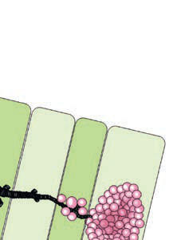

# Chapter 444: Congenital Disorders of the Lung
> **Course:** Vikkypaedia Pediatric Basic Course (*Nelson Textbook of Pediatrics, 22nd Edition (2025)*)  
> **Part XVII:** The Respiratory System  
> **Authors:** Nelson 22e Contributors  
> **Metrics:** 4,148 words · 0 tables/boxes · 2 figures · 1 genes · 8 flashcards · 5 MCQs  
> **Quick Navigation:** [🃏 Study 8 Flashcards](../flashcards/444_flashcards.md) · [📝 Take 5-Q MCQ Quiz](../mcqs/444_mcqs.md) · [📚 Part XVII Guide](../parts/Part_XVII.md) · [🧬 Syndrome & Genetics Atlas](../omim_gene_atlas.md) · [💊 Therapeutics Matrix](../therapies_matrix.md) · [🏠 Course Index](../../index.md)

## Key Chapter Topics & Subchapters
`444.1 Pulmonary Agenesis and Aplasia` · `444.2 Pulmonary Hypoplasia` · `444.3 Congenital Pulmonary Airway Malformation (Congenital Cystic Adenomatoid Malformation)` · `444.4 Pulmonary Sequestration` · `444.5 Bronchogenic Cysts` · `444.6 Congenital Pulmonary Lymphangiectasia` · `444.7 Lung Hernia` · `444.8 Other Congenital Malformations of the Lung ` · `444.1 Pulmonary Agenesis and Aplasia` · `444.2 Pulmonary Hypoplasia Joshua A. Blatter and Jonathan D. Finder` · `444.4 Pulmonary Sequestration Joshua A. Blatter and Jonathan D. Finder` · `444.5 Bronchogenic Cysts Joshua A. Blatter and Jonathan D. Finder`

## Key Genetic & Molecular Targets
`DICER1`

## ⚡ High-Yield Nelson Pediatric Board Pearls
- Pulmonary agenesis is thought to be an autosomal recessive trait, with an estimated incidence of 1 in 10,000-15,000 births.
- CLINICAL MANIFESTATIONS AND PROGNOSIS Unilateral agenesis or hypoplasia can have few symptoms and nonspe cific findings, resulting in only 33% of the cases being diagnosed while the patient is living.
- DIAGNOSIS AND TREATMENT Chest radiographic findings of unilateral lung or lobar collapse with a shift of mediastinal structures toward the affected side can prompt referral for suspected foreign body aspiration, mucus plug occlusion, or other bronchial mass lesions.
- The diagnosis requires a high index of suspicion to avoid the unnecessary risks of bronchoscopy, includ ing potential perforation of the rudimentary bronchus.
- CT of the chest is diagnostic, although the diagnosis may be suggested by chronic changes in the contralateral aspect of the chest wall and lung expansion on chest radiographs.
- Referral for management of scoliosis may be necessary.
- DIAGNOSIS AND TREATMENT A variety of imaging techniques, including MRI and ultrasound, with estimation of oligohydramnios, can be helpful to identify hypoplasia but not to predict pulmonary function.

---
## Full Chapter Text, Tables & Figures
# Chapter 444: Congenital Disorders of the Lung

<!-- p.3279 -->

## 444.1  Pulmonary Agenesis and Aplasia

*Joshua A. Blatter and Jonathan D. Finder*

Pulmonary agenesis differs from hypoplasia in that agenesis entails the complete absence of a lung. Agenesis differs from aplasia by the absence of a bronchial stump or carina that is seen in aplasia. Bilateral pulmo nary agenesis is incompatible with life, manifesting as severe respiratory distress and failure. Pulmonary agenesis is thought to be an autosomal recessive trait, with an estimated incidence of 1 in 10,000-15,000 births.

**CLINICAL MANIFESTATIONS AND PROGNOSIS** Unilateral agenesis or hypoplasia can have few symptoms and nonspe cific findings, resulting in only 33% of the cases being diagnosed while the patient is living. Symptoms tend to be associated with central air way complications of compression, stenosis, and/or tracheobroncho malacia. In patients in whom the right lung is absent, the aorta can compress the trachea and lead to symptoms of central airway compres sion. Right lung agenesis has a higher morbidity and mortality than left lung agenesis. Pulmonary agenesis is often seen in association with other congenital anomalies such as the **VACTERL sequence** (*v*ertebral anomalies, *a*nal atresia, *c*ongenital heart disease, *t*racheoesophageal fis tula, *r*enal anomalies, and *l*imb anomalies), ipsilateral facial and skeletal malformations, and central nervous system and cardiac malforma tions. Compensatory growth of the remaining lung allows improved gas exchange, but the mediastinal shift can lead to scoliosis and airway compression. Scoliosis can result from unequal thoracic growth.

**DIAGNOSIS AND TREATMENT** Chest radiographic findings of unilateral lung or lobar collapse with a shift of mediastinal structures toward the affected side can prompt referral for suspected foreign body aspiration, mucus plug occlusion, or other bronchial mass lesions. The diagnosis requires a high index of suspicion to avoid the unnecessary risks of bronchoscopy, includ ing potential perforation of the rudimentary bronchus. CT of the chest is diagnostic, although the diagnosis may be suggested by chronic changes in the contralateral aspect of the chest wall and lung expansion on chest radiographs. Because pulmonary agenesis can be associated with a wide variety of congenital lesions, whole body MRI can be useful to determine whether other systems (e.g., cardiac, gastrointestinal) are affected. Conservative treatment is usually recommended, although surgery has offered benefit in selected cases. Referral for management of scoliosis may be necessary.

*Visit Elsevier eBooks+ at eBooks.Health.Elsevier.com** for Bibliography.*

## 444.2  Pulmonary Hypoplasia Joshua A. Blatter and Jonathan D. Finder

Pulmonary hypoplasia involves a decrease in both the number of alveoli and the number of airway generations. The hypoplasia may be bilateral in the setting of bilateral lung constraint, as in oligohydram nios or thoracic dystrophy. Pulmonary hypoplasia is usually secondary to other intrauterine disorders that produce an impairment of normal lung development (see Chapter 124). Conditions such as deformities of the thoracic spine and rib cage (thoracic dystrophy), pleural effu sions with fetal hydrops, congenital pulmonary airway malformation,

and congenital diaphragmatic hernia physically constrain the develop ing lung. Any condition that produces oligohydramnios (fetal renal insufficiency or prolonged premature rupture of membranes) can also lead to diminished lung growth. In these conditions, airway and arterial branching are inhibited, thereby limiting the capillary surface area. Large unilateral lesions, such as congenital diaphragmatic her nia or pulmonary airway malformation, can displace the mediastinum and thereby produce a contralateral hypoplasia, although usually not as severe as that seen on the ipsilateral side. **Fetal akinesia deforma tion syndrome** is also associated with pulmonary hypoplasia, in part because of decreased fetal breathing movements.

**CLINICAL MANIFESTATIONS** Pulmonary hypoplasia is usually recognized in the newborn period, owing to either the respiratory insufficiency or the presentation of per sistent pulmonary hypertension (see Chapter 130). Later presentation (tachypnea) with stress or respiratory viral infection can be seen in infants with mild pulmonary hypoplasia.

**DIAGNOSIS AND TREATMENT** A variety of imaging techniques, including MRI and ultrasound, with estimation of oligohydramnios, can be helpful to identify hypoplasia but not to predict pulmonary function. Mechanical ventilation and oxygen may be required to support gas exchange. Specific therapy to control associated pulmonary hypertension, such as inhaled nitric oxide, may be useful. In cases of severe hypoplasia, the limited capac ity of the lung for gas exchange may be inadequate to sustain life. Extracorporeal membrane oxygenation can provide gas exchange for a critical period of time and permit survival. Rib-expanding devices (vertically expansible prosthetic titanium ribs and magnetic expansion control rods) can improve the survival of patients with thoracic dystro phies (see Chapter 741).

*Visit Elsevier eBooks+ at eBooks.Health.Elsevier.com** for Bibliography.*

## 444.3  Congenital Pulmonary Airway Malformation (Congenital Cystic Adenomatoid Malformation) Joshua A. Blatter and Jonathan D. Finder

Congenital pulmonary airway malformation **(CPAM)**, formerly known as *cystic adenomatoid malformation,* consists of hamartoma tous or dysplastic lung tissue mixed with more normal lung, usually confined to one lobe. This congenital pulmonary disorder occurs in approximately 1-4 in 100,000 births. Prenatal ultrasonographic find ings are classified as **macrocystic** (single or multiple cysts >5 mm) or **microcystic** (echogenic cysts <5 mm). Five histologic and location patterns have been described (Fig. 444.1). **Type 0** (acinar dysplasia) is least common (<2%) and consists of microcystic disease through out the lungs. The prognosis is poorest for this type, and infants die at birth. **Type 1** (60–70%) is macrocystic and consists of a single or sev eral large (>2 cm in diameter) cysts lined with ciliated pseudostratified epithelium; the lesion is localized involving only a part of one lobe. One third of cases have mucus-secreting cells. Presentation is in utero or in the newborn period. Cartilage is rarely seen in the wall of the cyst. This type has a good prognosis for survival. **Type 2** (15–20%) is microcystic and consists of multiple small cysts with histology similar to that of the type 1 lesion. Type 2 is associated with other serious congenital anomalies (renal, cardiac, diaphragmatic hernia, esophageal atresia, skeletal) and carries a poor prognosis. **Type 3** (5–10%) is seen mostly in males; the lesion is a mixture of microcysts and solid tissue with bronchiole-like structures lined with cuboidal ciliated epithelium and separated by areas of nonciliated cuboidal epithelium. The prognosis for this type, like type 0, is poor. **Type 4** (∼10%) is commonly macro cystic and lacks mucus cells. It is associated with malignancy (type 1

<!-- p.3280 -->

<!-- p.3281 -->

<!-- p.3282 -->
pleuropulmonary blastoma) and can present either in childhood or in asymptomatic adults.

**ETIOLOGY** The lesion probably results from an embryologic injury before the 35th day of gestation, with maldevelopment of terminal bronchiolar struc tures. Histologic examination reveals little normal lung and many glan dular elements. Cysts are common; cartilage is rare. The presence of cartilage might indicate a somewhat later embryologic insult, perhaps extending into the 10th to 24th week. Although growth factor interac tions and signaling mechanisms have been implicated in altered lungbranching morphogenesis, the exact roles in the maldevelopment seen here remain obscure.

**DIAGNOSIS** Cystic airway malformations can be diagnosed in utero by ultraso nography (Fig. 444.2). To better define and differentiate the lesion from other congenital lung malformations, fetal MRI is indicated (Fig. 444.3). Fetal cystic lung abnormalities can include CPAM (40%), pulmonary sequestration (14%) (see Chapter 444.4), or both (26%); the median age at diagnosis is usually 21 weeks of gestation. In one series, only 7% had severe signs of fetal distress, including hydrops, pleural effusion, polyhydramnios, ascites, or severe facial edema; 96% of the fetuses were born alive, two of whom died in the neonatal period. CPAM volume ratio (CVR)—CPAM volume divided by head circumference—can be used to predict the risk of fetal hydrops. A CVR >1.6 is a high-risk factor for developing hydrops. Lesions caus ing fetal hydrops have a poor prognosis. Large lesions, by compressing

adjacent lung, can produce pulmonary hypoplasia in nonaffected lobes (see Chapter 444.2). Even lesions that appear large in early gestation can regress considerably or decrease in relative size and be associated with good pulmonary function in childhood. MRI allows accurate diagnosis and sizing of the lesion and is indicated even in asymptomatic neonates.

**CLINICAL MANIFESTATIONS** Patients can present in the newborn period or early infancy with respi ratory distress, recurrent respiratory infection, and pneumothorax. The lesion may be confused with a diaphragmatic hernia (see Chap ter 131). Neonatal presentations include respiratory distress, cyanosis, tachypnea, or a pneumothorax; hydrops is the most severe presenta tion. Patients with smaller lesions are usually asymptomatic until mid-childhood, when episodes of recurrent or persistent pulmonary infection or chest pain occur. Breath sounds may be diminished, with mediastinal shift away from the lesion on physical examination. Chest radiographs reveal a cystic mass, sometimes with mediastinal shift (Fig. 444.4). Occasionally, an air-fluid level suggests a lung abscess (see Chapter 453).

**TREATMENT** Antenatal intervention in severely affected infants is controversial but can include excision of the affected lobe for microcystic lesions, aspira tion of macrocystic lesions, and, rarely, open fetal surgery. Maternal therapy with intravenous betamethasone may inhibit CPAM growth and reverse hydrops. If hydrops persists, a thoracoamniotic shunt may

****

****

****

** **

**Fig. 444.1** Types of congenital pulmonary airway malformations. Type 0, tracheobronchial; type 1, bronchial; type 2, bronchiolar; type 3, alveolar duct; type 4, distal acinar. (Adapted from Stocker JT. Cystic lung disease in infants and children. Fetal Pediatr Pathol. 2009;28:155–184.)

D

M

B

M

A

C

M

**Fig. 444.2** Congenital pulmonary airway malformation (CPAM). A, Massive right CPAM mass (M) with pronounced mediastinal shift is seen. Note the small size of the compressed left lung (L). B, Hydrops fetalis was present; ascites can be seen. C, A shunt was placed in the largest cavity. D, Resolution of the hydrops was seen within 1 week. Cross section through the thorax shows expansion of the ipsilateral and contralateral lungs, re positioning of the heart, and reduction of the mass. (From Obican SG, Odibo A. Invasive fetal therapy. In: Lockwood CJ, Copel JA, Dugoff L, et al., eds. Creasy & Resnik’s Maternal-Fetal Medicine, 9th ed. Philadelphia: Elsevier; 2023: Fig 34-11, p. 633.)

A B

**Fig. 444.3** These two fetal MRIs depict a practical prenatal classifi cation for congenital pulmonary airway malformations. A, Microcystic lesion presenting as a solid hyperintense mass (star). B, Macrocystic le sion containing a large cyst >5.0 mm in diameter (star). (From Laje P, Flake AW. Congenital bronchopulmonary malformations. In: Holcomb III GW, Murphy JP, St. Peter SD, eds. Holcomb and Ashcraft’s Pediatric Surgery, 7th ed. Philadelphia: Elsevier; 2020: Fig. 22.3, p. 350.)

<!-- p.3283 -->
be indicated. In the postnatal period, surgery is indicated for symp tomatic patients. Although surgery may be delayed for asymptomatic infants because postnatal resolution has been reported, true resolution appears to be quite rare in that abnormalities usually remain detect able on CT or MRI. Sarcomatous and carcinomatous degeneration have been described in patients with CPAM, so surgical resection by 1 year of age is typically recommended to limit malignant potential. If surgery is not performed, the child should have imaging at least yearly to track progression of the lesion. The mortality rate is <10%. Another indication for surgery is to rule out **pleuropulmonary blastoma (PPB)**, a malignancy that can appear radiographically similar to type 1 CPAM or appear concurrently in a type 4 CPAM (mixed lesion). PPB is associated with germline or somatic pathogenic variants in *DICER1*. PPB usually has a systemic feeding vessel and is not connected to the bronchial tree. However, it is often difficult to distinguish a PPB from a CPAM without surgery. In addition to the risk of malignancy, “asymptomatic” patients may have chronic inflammation with subtle systemic manifestations, which parents report resolves after the lesion is resected.

*Visit Elsevier eBooks+ at eBooks.Health.Elsevier.com** for Bibliography.*

## 444.4  Pulmonary Sequestration Joshua A. Blatter and Jonathan D. Finder

Pulmonary sequestration is a congenital anomaly of lung develop ment that can be intrapulmonary or extrapulmonary, according to the

location within the visceral pleura. The majority of sequestrations are intrapulmonary.

**PATHOPHYSIOLOGY** The lung tissue in a sequestration does not connect to a bronchus and receives its arterial supply from the systemic arteries (commonly off the aorta) and returns its venous blood to the right side of the heart through the inferior vena cava **(extralobar)** or pulmonary veins **(intra lobar)**. The sequestration functions as a space-occupying lesion within the chest; it does not participate in gas exchange and does not lead to a left-to-right shunt or alveolar dead space. Communication with the air way can occur as the result of rupture of infected material into an adja cent airway. Collateral ventilation within intrapulmonary lesions via pores of Kohn can occur. Pulmonary sequestrations can arise through the same pathoembryologic mechanism as a remnant of a diverticu lar outgrowth of the esophagus. Some propose that intrapulmonary sequestration is an acquired lesion primarily caused by infection and inflammation; inflammation leads to cystic changes and hypertrophy of a feeding systemic artery. This is consistent with the rarity of this lesion in an autopsy series of newborns. Gastric or pancreatic tissue may be found within the sequestration. Cysts also may be present. Other associated congenital anomalies, including CPAM (see Chapter 444.3), diaphragmatic hernia (see Chapter 131), and esophageal cysts, are not uncommon. Some believe that intrapulmonary sequestration is often a manifestation of CPAM and have questioned the existence of intrapulmonary sequestration as a separate entity.

**CLINICAL MANIFESTATIONS AND DIAGNOSIS** Recurrent pneumonia in the same lung location is suggestive of a sequestration. Physical findings in patients with sequestration include an area of dullness to percussion and decreased breath sounds over the lesion. During infection, crackles may also be present. A continuous or purely systolic murmur may be heard over the back. If findings on rou tine chest radiographs are consistent with the diagnosis, further delin eation is indicated before surgical intervention (Fig. 444.5). CT with contrast can demonstrate both the extent of the lesion and its vascular supply. MR angiography is also useful. Ultrasonography can help to rule out a diaphragmatic hernia and demonstrate the systemic artery. Surgical removal is recommended. Identifying the blood supply before surgery avoids inadvertently severing its systemic artery. Coil emboli zation (transumbilical in neonates; arterial in older patients) has been successful in treating patients with sequestration.

**Intrapulmonary sequestration** is generally found in a lower lobe and does not have its own pleura. Patients usually present with infec tion. In older patients, hemoptysis is common. A chest radiograph dur ing a period when there is no active infection reveals a mass lesion; an air-fluid level may be present. During infection, the margins of the lesion may be blurred. There is no difference in the incidence of this lesion in each lung.

**Fig. 444.4** CT scans of CPAM in the left lower lobe of the lung. (From Wong KKY, Flake AW, Tibboel D, et al. Congenital pulmonary airway malformation: advances and controversies. Lancet Child Adolesc. 2018;2:290–296, Fig. 1.)

A B

**Fig. 444.5** A, Plain chest x-ray showing changes in the region of the right lower/middle lobe of the lung. B, CT showing parenchymal chang es in the right lower lobe of the lung in keeping with a sequestration. (From Corbett HJ, Humphrey GME. Pulmonary sequestration. Paediatr Respir Rev. 2004;5:59–68.)

<!-- p.3284 -->

<!-- p.3285 -->
**Extrapulmonary sequestration** is much more common in boys and almost always involves the left lung. This lesion is enveloped by a pleural covering and is associated with diaphragmatic hernia and other abnormalities such as colonic duplication, vertebral abnormalities, and pulmonary hypoplasia. Many of these patients are asymptomatic when the mass is discovered by routine chest radiography. Other patients present with respiratory symptoms or heart failure. Subdiaphragmatic extrapulmonary sequestration can manifest as an abdominal mass on prenatal ultrasonography. The advent of prenatal ultrasonography has also enabled evidence that fetal pulmonary sequestrations can sponta neously regress.

**TREATMENT** Treatment of intrapulmonary sequestration is surgical removal of the lesion, a procedure that usually requires excision of the entire involved lobe. Segmental resection occasionally suffices. Surgical resection of the involved area is often recommended for extrapulmonary sequestration as well, but observation can be considered for asymptomatic patients with small lesions. Coil embolization of the feeding artery has also been successful.

*Visit Elsevier eBooks+ at eBooks.Health.Elsevier.com** for Bibliography.*

## 444.5  Bronchogenic Cysts Joshua A. Blatter and Jonathan D. Finder

**ETIOLOGY AND PATHOLOGY** Bronchogenic cysts arise from abnormal budding of the tracheal diverticu lum of the foregut before the 16th week of gestation and are originally lined with ciliated epithelium. They are more commonly found on the right and near a midline structure (trachea, esophagus, carina), but peripheral lower lobe and perihilar intrapulmonary cysts are not infrequent. Diagnosis may be precipitated by enlargement of the cyst, which causes symptoms by pressure on an adjacent airway. When the diagnosis is delayed until an infection occurs, the ciliated epithelium may be lost, and accurate patho logic diagnosis is then impossible. Cysts are rarely demonstrable at birth. Later, some cysts become symptomatic by becoming infected or by enlarg ing and compromising the function of an adjacent airway.

**CLINICAL MANIFESTATIONS AND TREATMENT** Fever, chest pain, and productive cough are the most common present ing symptoms. Dysphagia may be present; some bronchogenic cysts are asymptomatic. A chest radiograph reveals the cyst, which can con tain an air-fluid level (Fig. 444.6). CT scan or MRI is obtained in most cases to better demonstrate the anatomy and extent of the lesion before surgical resection. Treatment of symptomatic cysts is surgical excision after appropriate antibiotic management. Asymptomatic cysts are gen erally excised in view of the high rate of infection.

*Visit Elsevier eBooks+ at eBooks.Health.Elsevier.com** for Bibliography.*

## 444.6  Congenital Pulmonary Lymphangiectasia Joshua A. Blatter and Jonathan D. Finder

Congenital pulmonary lymphangiectasia is characterized by greatly dilated lymphatic ducts throughout the lung. It can occur in three pathologic circumstances: **pulmonary venous obstruction** that pro duces an elevated transvascular pressure and engorges the pulmo nary lymphatics and **generalized lymphangiectasia**, as a generalized disease of several organ systems, including lymphedema, lungs, and the intestines either associated with other syndromes (Noonan, Hen nekam, yellow nail, trisomy 21) or nonsyndromic. Gorham-Stout dis ease (vanishing bone disease) presents with pulmonary and abdominal chylous effusions, destructive bone cysts, and multiple lymphangiomas;

**primary lymphangiectasia** limited to the lung is the third type, which is a manifestation of an abnormality in lymphatic development.

**CLINICAL MANIFESTATIONS AND TREATMENT** Children with pulmonary venous obstruction or severe pulmonary lymphangiectasia present with dyspnea and cyanosis in the newborn period. Hydrops fetalis may be diagnosed antenatally. Chest radio graphs reveal diffuse, dense, reticular densities with prominence of Kerley B lines. Pleural effusions are common; thoracentesis will reveal **chylothorax** in this setting. If the lung is not completely involved, the spared areas appear hyperlucent. Respiration is compromised because of impaired diffusion and decreased pulmonary compliance. The diag nosis can be suggested by CT scan and/or cardiac catheterization; definitive diagnosis requires lymphangiography, lymphoscintigraphy, or lung biopsy (either thoracoscopic or open) (Fig. 444.7).

Treatment is supportive and includes administration of oxygen, mechanical ventilation, nutritional support (including gastrostomy placement and use of feedings containing medium-chain triglycerides), and careful fluid management with diuretics. Octreotide, the soma tostatin analog, can reduce chylous effusion in some patients. Primary pulmonary lymphangiectasia in the neonate can produce severe pul monary dysfunction that can require long-term mechanical ventilation; long-term survival and resolution of respiratory insufficiency are pos sible even in severe cases, especially if the chylous effusions can be man aged. Occasionally, the pulmonary venous obstruction is secondary to left-sided cardiac lesions; relief of the latter can produce improvement in pulmonary dysfunction. Sildenafil may reduce pulmonary venous resis tance and decrease lymphatic congestion. Sirolimus, which suppresses lymphangiogenesis, may also be beneficial. Lymphangiographic-directed lymphatic injection with ethiodized oil may be another therapeutic option. Generalized lymphangiectasia produces milder pulmonary dys function, and survival to mid-childhood and beyond is not unusual.

*Visit Elsevier eBooks+ at eBooks.Health.Elsevier.com** for Bibliography.*

**Fig. 444.6** Chest x-ray showing an ovoid, well-defined soft tissue density causing splaying of the carina because of a bronchogenic cyst. (From Williams HJ, Johnson KJ. Imaging of congenital cystic lung le sions. Paediatr Respir Rev. 2002;3:120–127.)

<!-- p.3286 -->

<!-- p.3287 -->

<!-- p.3288 -->

<!-- p.3289 -->

## 444.7  Lung Hernia Joshua A. Blatter and Jonathan D. Finder

A lung hernia is a protrusion of the lung beyond its normal thoracic boundaries. Approximately 20% are congenital, with the remainder being noted after chest trauma or thoracic surgery or in patients with pulmonary diseases such as cystic fibrosis (see Chapter 454) or asthma (see Chapter 185), which cause frequent cough and generate high intrathoracic pressure. A congenital weakness of the suprapleural membrane (Sibson fascia) or musculature of the neck can play a role in the appearance of a lung hernia. More than half of congenital lung hernias and almost all acquired hernias are cervical. Congenital cervical hernias usually occur anteriorly through a gap between the scalenus anterior and sternocleidomastoid muscles. Cer vical herniation is usually prevented by the trapezius muscle (posteriorly, at the thoracic inlet) and by the three scalene muscles (laterally).

**CLINICAL MANIFESTATIONS AND TREATMENT** The presenting sign of a cervical hernia (Sibson hernia) is usually a neck mass noticed while straining or coughing. Some lesions are asymptom atic and detected only when a chest film is taken for another reason. Findings on physical examination are normal except during Valsalva maneuver, when a soft bulge may be noticed in the neck. In most cases, no treatment is necessary, although these hernias can cause problems

during attempts to place a central venous catheter through the jugular or subclavian veins. They can resolve spontaneously.

Paravertebral or parasternal hernias are usually associated with rib anomalies. Intercostal hernias usually occur parasternally, where the external intercostal muscle is absent. Posteriorly, despite the seemingly inadequate internal intercostal muscle, the paraspinal muscles usually prevent herniation. Straining, coughing, or playing a musical instru ment can have a role in causing intercostal hernias, but in most cases, there is probably a preexisting defect in the thoracic wall.

Surgical treatment for lung hernia is occasionally justified for cos metic reasons. In patients with severe chronic pulmonary disease and chronic cough and for whom cough suppression is contraindicated, permanent correction might not be achieved.

*Visit Elsevier eBooks+ at eBooks.Health.Elsevier.com** for Bibliography.*

## 444.8  Other Congenital Malformations of the Lung Joshua A. Blatter and Jonathan D. Finder

**CONGENITAL LOBAR EMPHYSEMA AND PULMONARY CYSTS** See Chapter 441.

**PULMONARY ARTERIOVENOUS MALFORMATION** See Chapters 481 and 493.

**BRONCHOBILIARY FISTULA** A bronchobiliary fistula consists of a fistulous connection between the right middle lobe bronchus and the left hepatic ductal system (Fig. 444.8). Although diagnosis can be delayed until adulthood, this rare anomaly typically manifests with life-threatening bronchopulmonary infections in early infancy. Females are more commonly affected. Definitive diagnosis requires endoscopy or exploratory surgery. Treat ment includes surgical excision of the entire intrathoracic portion of the fistula. If the hepatic portion of the fistula does not communicate with the biliary system or duodenum, the involved segment might also have to be resected. Bronchobiliary communications also occur as acquired lesions resulting from hepatic disease complicated by infection.

*Visit Elsevier eBooks+ at eBooks.Health.Elsevier.com** for Bibliography.*

A B

**Fig. 444.7** A, Dynamic contrast MR lymphangiogram (DCMRL) in a pa tient with pulmonary lymphangiectasia demonstrating dilated thoracic duct (TD) (arrow) and abnormal pulmonary lymphatic perfusion in the lung hilum (arrowheads). B, Corresponding fluoroscopy image of the TD of the same patient after injection of contrast material through the microcatheter po sitioned in the proximal part of the TD, which confirms the dilation of the TD (arrow) and retrograde flow of the contrast in the mediastinal lymphatic ducts (arrowhead). (From Itkin M, McCormack FX. Nonmalignant adult tho racic lymphatic disorders. Clin Chest Med. 2016;37:409–420, Fig. 7.)

A B C D

**Fig. 444.8** Bronchobiliary fistula. A, Unusually bright yellow, serous sputum was observed. The sputum differed in appearance from the yellow sputum containing leukocytes associated with infections. B, CT scan revealed an abnormal bronchial bifurcation originating in the right main bron chus and extending downward (arrow). C (Top), Bronchoscopic images of the right second carina revealed an anomalous orifice (yellow arrow) in the medial side of the right intermediate bronchus (blue arrow). (Bottom), Close-up photo of the abnormal orifice with yellow, serous secretion. D, Fis tulography with a balloon catheter revealed contrast material slowly proceeding through the intraabdominal region (red arrows) to the intrahepatic region (yellow arrows) below the diaphragm (blue arrow). (From Shimizu A, Otani Y, Ishitate M. Congenital bronchobiliary fistula with bright yellow

<!-- p.3290 -->

<!-- p.3291 -->
