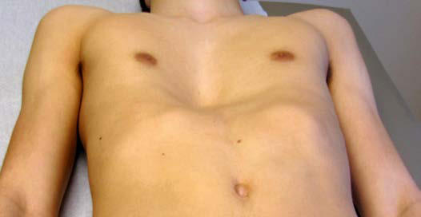
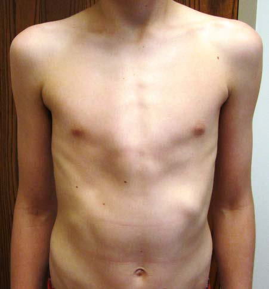

# Chapter 467: Skeletal Diseases Influencing Pulmonary Function
> **Course:** Vikkypaedia Pediatric Basic Course (*Nelson Textbook of Pediatrics, 22nd Edition (2025)*)  
> **Part XVII:** The Respiratory System  
> **Authors:** Steven R. Boas and Catherine Kier  
> **Metrics:** 2,634 words · 0 tables/boxes · 2 figures · 0 genes · 8 flashcards · 5 MCQs  
> **Quick Navigation:** [🃏 Study 8 Flashcards](../flashcards/467_flashcards.md) · [📝 Take 5-Q MCQ Quiz](../mcqs/467_mcqs.md) · [📚 Part XVII Guide](../parts/Part_XVII.md) · [🧬 Syndrome & Genetics Atlas](../omim_gene_atlas.md) · [💊 Therapeutics Matrix](../therapies_matrix.md) · [🏠 Course Index](../../index.md)

## Key Chapter Topics & Subchapters
`467.1 Pectus Excavatum (Funnel Chest)` · `467.2 Pectus Carinatum and Sternal Clefts` · `467.3 Asphyxiating Thoracic Dystrophy (Thoracic-Pelvic-Phalangeal Dystrophy)` · `467.4 Achondroplasia` · `467.5 Kyphoscoliosis: Adolescent Idiopathic Scoliosis and Congenital Scoliosis` · `467.6 Congenital Rib Anomalies` · `467.1 Pectus Excavatum (Funnel Chest) Steven R. Boas and Catherine Kier` · `467.2 Pectus Carinatum and Sternal Clefts Steven R. Boas and Catherine Kier` · `467.3 Asphyxiating Thoracic Dystrophy (Thoracic-Pelvic-Phalangeal Dystrophy) Steven R. Boas and Catherine Kier` · `467.4 Achondroplasia Steven R. Boas and Catherine Kier` · `467.6 Congenital Rib Anomalies Steven R. Boas and Catherine Kier`

## ⚡ High-Yield Nelson Pediatric Board Pearls
- Decreased exercise toler ance is one of the most common symptoms.
- Anterior displacements of the mid and lower sternum and adjacent costal cartilages are the most common types.
- Many surgeons prefer to use bracing techniques as a first-line treatment, especially for younger patients.
- A multisystem autosomal recessive disorder, asphyxiating thoracic dystrophy results in a constricted and narrow rib cage.
- DIAGNOSIS Physical examination reveals a narrowed thorax that, at birth, is much smaller than the head circumference.
- PROGNOSIS For some children with asphyxiating thoracic dystrophy, improvement in the bony abnormalities occurs with age.
- Achondroplasia is the most common condition characterized by dis proportionate short stature.

---
## Full Chapter Text, Tables & Figures
# Chapter 467: Skeletal Diseases Influencing Pulmonary Function

*Steven R. Boas and Catherine Kier*

<!-- p.3435 -->
Pulmonary function is influenced by the structure of the chest wall (see Chapter 421). Chest wall abnormalities can lead to restrictive or obstructive pulmonary disease, impaired respiratory muscle strength, and decreased ventilatory performance in response to physical stress. The congenital chest wall deformities include *pectus excavatum, pectus carinatum, sternal clefts, Poland syndrome*, and skeletal and *cartilage dysplasias*. Vertebral anomalies such as kyphoscoliosis can alter pulmo nary function in children and adolescents.

## 467.1  Pectus Excavatum (Funnel Chest) Steven R. Boas and Catherine Kier

**ETIOLOGY** Pectus excavatum—midline narrowing of the thoracic cavity—is usu ally an isolated skeletal abnormality. The cause is unknown. Pectus excavatum can occur in isolation, or it may be associated with a con nective tissue disorder—Marfan (see Chapter 743) or Ehlers-Danlos syndrome (see Chapter 700). It may be acquired secondarily to chronic lung disease, neuromuscular disease, or trauma.

**EPIDEMIOLOGY** Pectus excavatum occurs in 1 in 400 births with a 9:1 male preponder ance and accounts for >90% of congenital chest wall anomalies. There is a positive family history in ∼30% of cases.

**CLINICAL MANIFESTATIONS** The deformity is present at or shortly after birth in one third of cases but is usually not associated with any symptoms at that time. In time, fatigue, chest pain, palpitations, recurrent respiratory infections, wheezing, stridor, and cough may be present. Decreased exercise toler ance is one of the most common symptoms. Because of the cosmetic nature of this deformity, children may experience significant psycho logic stress. Physical examination may reveal sternal depression, pro tracted shoulders, kyphoscoliosis, dorsal lordosis, inferior rib flares, rib cage rigidity, forward head tilt, scapular winging, and loss of vertebral contours (Fig. 467.1). Patients may exhibit paroxysmal sternal motion and a shift of point of maximal impulse to the left. Innocent systolic murmurs may be heard.

**LABORATORY FINDINGS** Lateral chest radiograms demonstrate sternal depression. The Haller index on chest CT (maximal internal transverse diameter of the chest divided by the minimal anteroposterior diameter at the same level) in comparison with age- and gender-appropriate normative values have been used historically to help determine the extent of the anatomic abnormality. However, the correlation of the Haller index with the physiologic compromise or associated systems appears suboptimal. The use of 3D chest optical imaging or “surface scan” is gaining popu larity in the evaluation. An electrocardiogram may show a right-axis deviation or Wolff-Parkinson-White syndrome (see Chapter 485); an echocardiogram may demonstrate mitral valve prolapse (see Chap ter 477.3) and ventricular compression. Results of static pulmonary

function tests may be normal but commonly show an obstructive defect in the lower airways and, less commonly, a restrictive defect as the result of abnormal chest wall mechanics. Exercise testing may demonstrate either normal tolerance or limitations from underlying cardiopulmonary dysfunction that are associated with the severity of the defect. Pulmonary limitations, such as ventilatory limitations and associated flow volume loop abnormalities, are commonly seen in younger children and adolescents, whereas additional cardiac limita tions secondary to stroke volume impairments are more commonly seen in older adolescents and young adults.

**TREATMENT** Treatment is based on the severity of the deformity and the extent of physiologic compromise as defined by physical examination and physiologic assessment of cardiopulmonary function (lung function and exercise tolerance assessment). Therapeutic options include care ful observation, the use of physical therapy to address musculoskeletal compromise, corrective surgery, cosmetic surgery, and noninvasive thorascopic techniques. For patients with significant physiologic com promise, surgical correction may improve the cosmetic deformity and may help minimize progression or even improve the cardiopulmonary compromise. The two main surgical interventions are the Ravitch and Nuss procedures. The Nuss procedure is a minimally invasive thoraco scopic repair that has been associated with good cosmetic and func tional outcomes.

The extent of the anatomic defect, including the degree of asymme try, may help determine the appropriate surgical approach. Although surgical repair may result in improved exercise tolerance for some individuals, usually observed at submaximal exercise intensities, many patients do not show improvement in either respiratory or car diac function. Normalization of lung perfusion scans and maximal voluntary ventilation have also been observed after surgery. Use of a magnetic brace with gradual remodeling (Magnetic Mini Mover proce dure) of the pectus deformity is under clinical investigation, with some promising results seen for prepubertal children. Surgically placed sili cone implants for cosmetic appearance have also been used with high patient satisfaction. For selected patients, the use of a more noninvasive approach (i.e., cup suction) has been gaining popularity. Regardless of the treatment approach, addressing secondary musculoskeletal find ings is commonly employed before and after any intervention.

*Visit Elsevier eBooks+ at eBooks.Health.Elsevier.com** for Bibliography.*

## 467.2  Pectus Carinatum and Sternal Clefts Steven R. Boas and Catherine Kier

**PECTUS CARINATUM** Pectus carinatum is a sternal deformity accounting for 5–15% of con genital chest wall anomalies. Anterior displacements of the mid and lower sternum and adjacent costal cartilages are the most common types. They are most commonly associated with protrusion of the upper sternum; depression of the lower sternum occurs in only 15% of patients. Asymmetry of the sternum is common, and localized depres sion of the lower anterolateral chest is also often observed. Males are affected four times more often than females. There is a high familial occurrence and a common association of mild to moderate scoliosis. Mitral valve disease and coarctation of the aorta are associated with this anomaly. Three types of anatomic deformity occur (upper, lower, and lateral pectus carinatum), with corresponding physiologic changes and treatment algorithms.

**CLINICAL MANIFESTATIONS** In early childhood, symptoms appear minimal. School-age children and adolescents commonly complain of dyspnea with mild exertion, decreased endurance with exercise, and exercise-induced wheezing. The incidence of increased respiratory infections and use of asthma

*Steven R. Boas and Catherine Kier*

<!-- p.3436 -->

<!-- p.3437 -->
medication is higher than in nonaffected individuals. On physical examination, a marked increase in the anteroposterior chest diameter is seen, with a resultant reduction in chest excursion and expansion (Fig. 467.2). Spirometry has demonstrated both restrictive and obstruc tive patterns, although the majority of individuals have normal values. Increases in residual volume are often present and result in tachypnea and diaphragmatic respirations. Exercise testing shows variable results. Chest radiographs show an increased anteroposterior diameter of the chest wall, emphysematous-appearing lungs, and a narrow cardiac shadow. The pectus severity score (width of chest divided by distance between sternum and spine; analogous to the Haller index) is reduced.

**TREATMENT** For symptomatic patients with pectus carinatum, minimally invasive surgical correction procedures may result in an improvement of the clinical symptoms. Many surgeons prefer to use **bracing techniques** as a first-line treatment, especially for younger patients. Although surgery is performed for some individuals who are symptomatic, it is often per formed for cosmetic and psychologic reasons.

**STERNAL CLEFTS** Sternal clefts are rare congenital malformations that result from the failure of the fusion of the sternum during the eighth week of gestation. No familial predisposition has been described. Sternal clefts occur in less than 1% of all chest wall deformities. Sternal clefts are classified as partial or complete. Partial sternal clefts are more common and may involve the superior sternum in association with other lesions, such as vascular dysplasias and supraumbilical raphe, or the inferior sternal clefts, which are often associated with other midline defects (pental ogy of Cantrell). Complete sternal clefts with complete failure of ster nal fusion are rare. These disorders may also occur in isolation. The paradoxic movement of thoracic organs with respiration may alter pul monary mechanics. Rarely, respiratory infections and even significant compromise result. Surgery is required early in life before fixation and immobility occur.

*Visit Elsevier eBooks+ at eBooks.Health.Elsevier.com** for Bibliography.*

## 467.3  Asphyxiating Thoracic Dystrophy (Thoracic-Pelvic-Phalangeal Dystrophy) Steven R. Boas and Catherine Kier

A multisystem autosomal recessive disorder, asphyxiating thoracic dystrophy results in a constricted and narrow rib cage. Also known as *Jeune syndrome*, the disorder is associated with characteristic skeletal abnormalities as well as variable involvement of other systems, includ ing renal, hepatic, neurologic, pancreatic, and retinal abnormalities (see Chapter 741).

**CLINICAL MANIFESTATIONS** Most patients with this disorder die shortly after birth from respira tory failure, although less-aggressive forms have been reported in older children. For those who survive the neonatal period, progressive respi ratory failure often ensues, owing to impaired lung growth, recurrent pneumonia, and atelectasis originating from the rigid chest wall.

**DIAGNOSIS** Physical examination reveals a narrowed thorax that, at birth, is much smaller than the head circumference. The ribs are horizontal, and the child has short extremities. Chest radiographs demonstrate a bellshaped chest cage with short, horizontal, flaring ribs, and high clavicles.

**TREATMENT** No specific treatment exists, although thoracoplasty to enlarge the chest wall and long-term mechanical ventilation have been tried. Ribexpanding (vertical expandable prosthetic titanium rib [VEPTR]) pro cedures have resulted in improved survival (Fig. 467.3).

**PROGNOSIS** For some children with asphyxiating thoracic dystrophy, improvement in the bony abnormalities occurs with age. However, children younger than age 1 year often succumb to respiratory infection and failure. Pro gressive renal disease often occurs in older children. Use of vaccines for influenza and other respiratory pathogens is warranted, as is the aggressive use of antibiotics for respiratory infections.

*Visit Elsevier eBooks+ at eBooks.Health.Elsevier.com** for Bibliography.*

## 467.4  Achondroplasia Steven R. Boas and Catherine Kier

Achondroplasia is the most common condition characterized by dis proportionate short stature (see Chapter 737). This condition is inher ited as an autosomal dominant disorder that results in disordered growth. Much has been learned about this disorder, including its genetic origins (95% of cases are caused by pathogenic variants in the gene coding for fibroblast growth factor receptor type 3) and how to minimize its serious complications.

**Fig. 467.1** Pectus excavatum in a 15-yr-old male. Note the presence of protracted shoulders, inferior rib flares, and sternal depression.

**Fig. 467.2** Pectus carinatum in a 13-yr-old male. Note the central sternal prominence.

<!-- p.3438 -->

<!-- p.3439 -->

<!-- p.3440 -->
**CLINICAL MANIFESTATIONS** Restrictive pulmonary disease, affecting <5% of children with achon droplasia who are younger than 3 years, is more likely at high elevation. Recurrent infections, cor pulmonale, and dyspnea are commonly asso ciated. There is an increased risk of obstructive sleep apnea or hypop neas. Hypoxemia during sleep is a common feature. Risk of airway malacia is greater than the general population. Onset of restrictive lung disease can begin at a very young age. On examination, the breathing pattern is rapid and shallow, with associated abdominal breathing. The anteroposterior diameter of the thorax is reduced. Special growth curves for chest circumference of patients with achondroplasia from birth to 7 years are available. Three distinct phenotypes exist: phenotypic group 1 patients possess relative adenotonsillar hypertrophy, group 2 patients have muscular upper airway obstruction and progressive hydrocepha lus, and group 3 patients have upper airway obstruction without hydro cephalus. Kyphoscoliosis may develop during infancy.

**DIAGNOSIS** Pulmonary function tests reveal a reduced vital capacity that is more pronounced in males. The lungs are small but functionally normal. Sleep studies are recommended because of the high prevalence of sleepdisordered breathing. Chest radiographs demonstrate the decreased anteroposterior diameter along with anterior cupping of the ribs. The degree of foramen magnum involvement correlates with the extent of respiratory dysfunction.

**TREATMENT** Treatment of sleep apnea, if present, is supportive (see Chapter 31). Physiotherapy and bracing may minimize the complications of both kyphosis and severe lordosis. Aggressive treatment of respiratory infec tions and scoliosis is warranted.

**PROGNOSIS** The life span is normal for most children with this condition, except for the phenotypic groups with hydrocephalus or with severe cervical or lumbar spinal compression.

*Visit Elsevier eBooks+ at eBooks.Health.Elsevier.com** for Bibliography.*

## 467.5  Kyphoscoliosis: Adolescent Idiopathic Scoliosis and Congenital Scoliosis Steven R. Boas and Catherine Kier

Adolescent idiopathic scoliosis (AIS) is characterized by lateral bend ing of the spine (see Chapter 720). It commonly affects children during

their teen years and during periods of rapid growth. The cause is unknown. Congenital scoliosis is uncommon, affecting females more than males, and is apparent in the first year of life (see Chapter 720.2).

**CLINICAL MANIFESTATIONS** The pulmonary manifestations of scoliosis may include chest wall restriction, leading to a reduction in total lung capacity, abnormal gas exchange, airway obstruction, and hypoinflation with associated atel ectasis. The angle of scoliosis deformity has been correlated with the degree of lung impairment only for patients with thoracic curves. Vital capacity, forced expiratory volume in 1 sec (FEV1), work capacity, oxy gen consumption, diffusion capacity, chest wall compliance, and partial pressure of arterial oxygen decrease as the severity of thoracic curve increases. These findings can be seen in even mild to moderate AIS (Cobb angle <30 degrees) but generally do not occur in other, non thoracic curves. Respiratory compromise is often more severe in chil dren younger than 5 years of age with large scoliotic curves. Reduction in peripheral muscle function is associated with AIS through either intrinsic mechanisms or deconditioning. Severe impairment can lead to cor pulmonale or respiratory failure and can occur before 20 years old. Children with severe scoliosis (Cobb’s angle >70 degrees), espe cially males, may have abnormalities of breathing during sleep, and the resultant periods of hypoxemia may contribute to the eventual devel opment of pulmonary hypertension.

**DIAGNOSIS** Physical examination and an upright, posteroanterior radiograph with subsequent measurement of the angle of curvature (Cobb technique) remain the gold standard for the assessment of scoliosis. Curves >10 degrees define the presence of scoliosis. Lung volume, respiratory mus cle strength, and exercise capacity determination are essential in assess ing the degree of respiratory compromise associated with scoliosis.

**TREATMENT** Depending on the extent of the curve and the degree of skeletal matu ration, treatment options include reassurance, observation, physical therapy, bracing, and surgery (spinal fusion). Influenza vaccine should be administered, given the extent of pulmonary compromise that may coexist. Because vital capacity is a strong predictor for the development of respiratory failure in untreated AIS, surgical goals are to diminish the scoliotic curve, maintain the correction, and prevent deterioration in pulmonary function. Abnormalities of vital capacity and total lung capacity, exercise intolerance, and the rate of change of these variables over time should be taken into consideration for the timing of surgi cal correction. Preoperative assessment of lung function (i.e., lung vol umes, oxygen consumption, muscle strength, ventilation/perfusion) may assist in predicting postsurgical pulmonary difficulties. Many patients undergoing surgical correction may be managed postopera tively without mechanical ventilation. Even patients with mild scoliosis may have pulmonary compromise immediately after spinal fusion, sec ondary to pain, and a body cast that may restrict breathing and inter fere with coughing. Children with a preoperative FEV1 <40% predicted are at risk for requiring prolonged postoperative mechanical ventila tion. Rib-expanding procedures have been successful in severe cases of congenital scoliosis. Choice of surgical approach may also impact lung function postoperatively.

*Visit Elsevier eBooks+ at eBooks.Health.Elsevier.com** for Bibliography.*

## 467.6  Congenital Rib Anomalies Steven R. Boas and Catherine Kier

Isolated defects of the highest and lowest ribs have minimal clinical pulmonary consequences. Missing midthoracic ribs are associated with the absence of the pectoralis muscle (Poland syndrome), and lung function can become compromised. Associated kyphoscoliosis and hemivertebrae may accompany this defect. If the rib defect is small,

A B

**Fig. 467.3** A, Seven-mo-old with Jeune syndrome preoperatively. B, 18 mo after VEPTR insertion. (From Mayer OH. Chest wall hypoplasia— principles and treatment. Pediatr Respir Rev. 2015;16:30–34, Fig. 3.)

<!-- p.3441 -->

<!-- p.3442 -->

<!-- p.3444 -->
