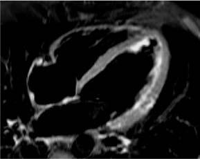
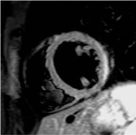

# Chapter 489: Diseases of the Pericardium
> **Course:** Vikkypaedia Pediatric Basic Course (*Nelson Textbook of Pediatrics, 22nd Edition (2025)*)  
> **Part XVIII:** The Cardiovascular System  
> **Authors:** John J. Parent and Stephanie M. Ware  
> **Metrics:** 2,857 words · 2 tables/boxes · 2 figures · 1 genes · 8 flashcards · 5 MCQs  
> **Quick Navigation:** [🃏 Study 8 Flashcards](../flashcards/489_flashcards.md) · [📝 Take 5-Q MCQ Quiz](../mcqs/489_mcqs.md) · [📚 Part XVIII Guide](../parts/Part_XVIII.md) · [🧬 Syndrome & Genetics Atlas](../omim_gene_atlas.md) · [💊 Therapeutics Matrix](../therapies_matrix.md) · [🏠 Course Index](../../index.md)

## Key Chapter Topics & Subchapters
`489.1 Acute Pericarditis` · `489.2 Constrictive Pericarditis` · `489.1 Acute Pericarditis John J. Parent and Stephanie M. Ware` · `489.2 Constrictive Pericarditis John J. Parent and Stephanie M. Ware`

## Key Genetic & Molecular Targets
`SMAD4`

## ⚡ High-Yield Nelson Pediatric Board Pearls
- DIAGNOSIS Electrocardiographic changes are nonspecific and may include sinus tachycardia, atrial or ventricular arrhythmias, heart block, diminished QRS voltages, and nonspecific ST and T-wave changes, often sugges tive of acute ischemia.
- Cardiac MRI is a standard imaging modality for the diagnosis of myocarditis; information on the presence and extent of edema, gadolinium-enhanced hyperemic capillary leak, myocyte necrosis, LV dysfunction, and evidence of an associated pericardial effusion assist in the cardiac MRI diagnosis of myocarditis.
- DIFFERENTIAL DIAGNOSIS The predominant diseases mimicking acute myocarditis include carni tine deficiency, other metabolic disorders of energy generation, heredi tary mitochondrial defects, idiopathic DCM, pericarditis, EFE, and anomalies of the coronary arteries.
- Diuretics, β blockers, ACE inhibitors, and ARBs are of use in patients with compensated congestive heart failure in the out patient setting but may be contraindicated in those presenting with fulmi nant heart failure and cardiovascular collapse.
- PROGNOSIS The prognosis of symptomatic acute enteroviral myocarditis in newborns is poor, with a 75% mortality.
- The prognosis is better for children and ado lescents, although patients who have persistent evidence of DCM often progress to the need for cardiac transplantation; recovery of ventricular function, however, has been reported in 10–50% of patients.
- The prognosis for COVID-19 immunization–associated myocarditis is excellent with full recovery noted by 90 days.

---
## Full Chapter Text, Tables & Figures
# Chapter 489: Diseases of the Pericardium

*John J. Parent and Stephanie M. Ware*

<!-- p.3669 -->
**CLINICAL MANIFESTATIONS** Manifestations of myocarditis range from asymptomatic or nonspecific generalized illness to acute cardiogenic shock and sudden death. Infants and young children more often have a fulminant presentation with fever, respiratory distress, tachycardia, hypotension, gallop rhythm, and cardiac murmur. Associated findings may include a rash or evidence of end-organ involvement such as hepatitis or aseptic meningitis.

Patients with acute or chronic myocarditis may present with chest dis comfort, fever, palpitations, easy fatigability, or syncope/near-syncope. Cardiac findings include overactive precordial impulse, gallop rhythm, and apical systolic murmur of mitral insufficiency. In patients with asso ciated pericardial disease, a rub may be noted. Hepatic enlargement, peripheral edema, and pulmonary findings such as wheezes or rales may be present in patients with decompensated heart failure.

**DIAGNOSIS** Electrocardiographic changes are nonspecific and may include sinus tachycardia, atrial or ventricular arrhythmias, heart block, diminished QRS voltages, and nonspecific ST and T-wave changes, often sugges tive of acute ischemia. Chest radiographs in severe, symptomatic cases reveal cardiomegaly, pulmonary vascular prominence, overt pulmonary edema, or pleural effusions. Echocardiography often shows diminished ventricular systolic function, cardiac chamber enlargement, mitral insuf ficiency, and occasionally, evidence of pericardial infusion.

Cardiac MRI is a standard imaging modality for the diagnosis of myocarditis; information on the presence and extent of edema, gadolinium-enhanced hyperemic capillary leak, myocyte necrosis, LV dysfunction, and evidence of an associated pericardial effusion assist in the cardiac MRI diagnosis of myocarditis (Table 488.8 and Fig. 488.9).

Endomyocardial biopsy may be useful in identifying inflammatory cell infiltrates or myocyte damage and performing molecular viral analysis using polymerase chain reaction techniques. Catheterization and biopsy, although not without risk (perforation and arrhythmias), should be per formed by experienced personnel in patients suspected to have myocardi tis or if unusual forms of cardiomyopathy are strongly suspected, such as storage diseases or mitochondrial defects. Nonspecific tests include eryth rocyte sedimentation rate, CPK isoenzymes, cardiac troponin I, and BNP levels. A novel microRNA derived from type 17 helper (Th17) cells may be another useful specific test for viral myocarditis.

**DIFFERENTIAL DIAGNOSIS** The predominant diseases mimicking acute myocarditis include carni tine deficiency, other metabolic disorders of energy generation, heredi tary mitochondrial defects, idiopathic DCM, pericarditis, EFE, and anomalies of the coronary arteries (see Table 488.2).

**TREATMENT** Primary therapy for acute myocarditis is supportive. Acutely, the use of ino tropic agents, preferably milrinone, should be considered but used with cau tion because of their proarrhythmic potential. Diuretics are often required as well. If in extremis, mechanical ventilatory support and mechanical circulatory support with VAD implantation or ECMO may be needed to stabilize the patient’s hemodynamic status and serve as a bridge to recovery or cardiac transplantation. Diuretics, β blockers, ACE inhibitors, and ARBs are of use in patients with compensated congestive heart failure in the out patient setting but may be contraindicated in those presenting with fulmi nant heart failure and cardiovascular collapse. In patients manifesting with significant atrial or ventricular arrhythmias, specific antiarrhythmic agents (e.g., amiodarone) should be administered and ICD placement considered if persistent after a period of recovery is observed.

Immunomodulation of patients with myocarditis is controversial. Intravenous immunoglobulin (IVIG) may have a role in the treat ment of acute or fulminant myocarditis, and corticosteroids have been reported to improve cardiac function, but this remains controversial in children. Relapse has been noted in patients receiving immunosup pression who were weaned from therapy. There are no studies to rec ommend specific antiviral therapies for myocarditis.

If there is an identifiable and treatable condition, its specific therapy should be employed. If a medication is the etiology, it should be with drawn and an alternative drug added if needed.

**PROGNOSIS** The prognosis of symptomatic acute enteroviral myocarditis in newborns is poor, with a 75% mortality. The prognosis is better for children and ado lescents, although patients who have persistent evidence of DCM often progress to the need for cardiac transplantation; recovery of ventricular function, however, has been reported in 10–50% of patients.

The prognosis for COVID-19 immunization–associated myocarditis is excellent with full recovery noted by 90 days. Patients with COVID-19 requiring intensive care unit (ICU) admission and those with MIS-C must be followed by a pediatric cardiologist (including follow-up echocardiog raphy) and refrain from exercise for 3-6 months. Return to full activity requires clearance from a cardiologist.

*Visit Elsevier eBooks+ at eBooks.Health.Elsevier.com** for Bibliography.*

#### **Table 488.8** MRI Findings Suggestive of Myocarditis

| Category / Parameter | Clinical Details & Findings |
| --- | --- |
| **General** | • T2-weighted edema (global or regional); • Regional hyperemia/capillary leak by early gadolinium; enhancement ratio (EGEr); • Myocardial fibrosis or necrosis on late gadolinium enhancement (LGE); • Features often present in a midmyocardial, subepicardial, and; nonvascular distribution; • Repeat MRI if no early MRI evidence present but clinical |

A

C D

B

**Fig. 488.9** MRI findings in patients with myocarditis. Cardiac MR images of a young patient presenting with acute chest pain syndrome caused by acute myocarditis. (A) Long-axis and (B) short-axis T2-weighted images demonstrating focal myocardial edema in subepicardium of left midven tricular lateral wall (red arrows). Corresponding (C) long-axis and (D) short- axis T1-weighted images demonstrate the presence of typical late gado linium enhancement in subepicardium of left midventricular lateral wall and basal septum (red arrows). (From Kindermann I, Barth C, Mahfoud F, et al. Update on myocarditis. J Am Coll Cardiol. 2012;59:779–792, Fig. 3, p. 783.)

*John J. Parent and Stephanie M. Ware*

The heart is enveloped in a bilayer membrane, the *pericardium,* which nor mally contains a small amount of serous fluid. The pericardium is not vital to normal function of the heart, and primary diseases of the pericardium

<!-- p.3670 -->

<!-- p.3671 -->

**Fig. 489.1** “Water bottle” silhouette. This chest radiograph shows marked cardiomegaly, also known as a water bottle silhouette, which is seen in the presence of large pericardial effusions. Also note the as sociated pulmonary edema from associated high left atrial and left ven tricular filling pressures. (Courtesy Dr. Steven M. Selbst, Wilmington, DE; from Durani Y, Giordani K, Goudie BW. Myocarditis and pericarditis

conditions, often as a manifestation of a systemic illness, and can result in serious, even life-threatening, cardiac compromise (Table 489.1).

## 489.1  Acute Pericarditis John J. Parent and Stephanie M. Ware

Inflammation of the pericardium may have only minor pathophysiologic consequences in the absence of significant fluid accumulation in the peri cardial space. When the amount of fluid in the nondistensible pericardial space becomes excessive, pressure within the pericardium increases and is transmitted to the heart, resulting in impaired filling by compressing the chambers (atria or ventricles). Although small to moderate amounts of **pericardial effusion** can be well tolerated and clinically silent, once the noncompliant pericardium has been distended maximally, any further fluid accumulation causes abrupt impairment of cardiac filling, and this can impair cardiac output and is termed **cardiac tamponade**. When untreated, tamponade can lead to shock and death. Pericardial effusions may be serous/ transudative, exudative/purulent, fibrinous, or hemorrhagic.

Pericarditis may present without an obvious pericardial effusion on echocardiography. In addition, pericarditis may be associated with myocarditis (**myopericarditis**), in which case either pericarditis or myocarditis may be the dominant finding.

**CLINICAL MANIFESTATIONS** The most common symptom of acute pericarditis is chest pain, typically described as sharp/stabbing, positional, radiating, worse with inspiration, and relieved by sitting upright, leaning forward, or prone. Cough, fever, dyspnea, abdominal pain, and vomiting are nonspecific symptoms associ ated with pericarditis. Additionally, signs and symptoms of organ system involvement may occur in the presence of generalized systemic disease.

Muffled or distant heart sounds, tachycardia, narrow pulse pressure, jugular venous distention, and a pericardial friction rub provide clues to the diagnosis of acute pericarditis. Cardiac tamponade is recognized by the excessive fall of systolic blood pressure (>10 mm Hg) with inspira tion. This pulsus paradoxus can be assessed by careful auscultatory blood

pressure determination (automated blood pressure cuffs are inadequate), arterial pressure line waveform, or pulse oximeter tracing inspection. Doppler assessment during echocardiography can also indirectly suggest pulsus paradoxus is present. Conditions other than cardiac tamponade that may result in pulsus paradoxus include severe dyspnea, obesity, and positive pressure ventilator support.

**DIAGNOSIS** The electrocardiogram is often abnormal in acute pericarditis, although the findings are nonspecific. Low-voltage QRS amplitude may be seen as a result of pericardial fluid accumulation. Tachycardia and abnormalities of the ST segments (diffuse ST segment elevation), PR segments, and T waves (inversion or flattening) may be present as well. Elevated troponin levels may be present in myopericarditis.

Although the chest x-ray findings in a patient with pericarditis with out effusion are usually normal in the presence of a significant effu sion, cardiac enlargement will be seen and the cardiac contour may be unusual (Erlenmeyer flask or water bottle appearance) (Fig. 489.1). Echocardiography is the most sensitive technique for identifying the size and location of a pericardial effusion. Compression and collapse of the right atrium and/or right ventricle are present with cardiac tam ponade (Fig. 489.2). Abnormal diastolic filling parameters have also been described in cases of tamponade. Advanced imaging modalities like computed tomography or cardiac magnetic resonance imaging are useful for diagnosis in unclear cases (Fig. 489.3).

**DIFFERENTIAL DIAGNOSIS** Chest pain similar to that present in pericarditis can occur with lung diseases, especially pleuritis, and with gastroesophageal reflux or costo chondritis, with the latter being reproducible on palpation. Pain related to myocardial ischemia is usually more severe and prolonged and occurs with exercise, allowing distinction from pericarditis-induced pain. The presence of pericardial effusion on echocardiography is highly suggestive of pericarditis but does not determine the etiology.

**Infectious Pericarditis** A number of viral agents are known to cause pericarditis, and the clini cal course of the majority of these infections is mild and spontaneously resolving. The term *acute benign pericarditis* is synonymous for viral pericarditis. Agents identified as causing pericarditis include the entero viruses, influenza, adenovirus, respiratory syncytial virus, and parvo virus. Because the course of this illness is usually benign, symptomatic treatment with nonsteroidal antiinflammatory drugs (NSAIDs) is often sufficient. Persistent or early recurrence episodes may need courses of colchicine or, rarely, corticosteroids. Anakinra and the interleukin-1

#### **Table 489.1** Etiology of Pericardial Disease

| Category / Parameter | Clinical Details & Findings |
| --- | --- |
| **CONGENITAL** | Absence (partial, complete); Cysts; Mulibrey nanism (TRIM 37 gene variant); Camptodactyly-arthropathy–coxa vara–pericarditis syndrome (PRG4; gene variant); Myhre syndrome (SMAD4 gene variant) |
| **Viral: coxsackievirus B, Epstein-Barr virus, influenza, adenovirus,** | parvovirus, HIV, mumps, COVID-19, and mRNA COVID-19 and; HPV vaccines |
| **Bacterial: Haemophilus influenzae, streptococcus, pneumococcus,** | staphylococcus, meningococcus, mycoplasma, tularemia, Listeria,; leptospirosis, tuberculosis, Q fever, salmonella |
| **Systemic inflammatory diseases: acute rheumatic fever, juvenile** | idiopathic arthritis, systemic lupus erythematosus, mixed; connective tissue disorders, systemic sclerosis, Kawasaki disease,; eosinophilic granulomatosis with polyangiitis, Behçet syndrome,; sarcoidosis, familial Mediterranean fever and other recurrent fever; syndromes, pancreatitis, granulomatosis with polyangiitis |
| **Metabolic: uremia, hypothyroidism, Gaucher disease, very-long-** | chain acyl-CoA dehydrogenase deficiency |
| **Traumatic: surgical, catheter perforation, blunt trauma** | Postpericardiotomy syndrome |

<!-- p.3672 -->
A

B

C

RV

IVC

C

PE

PE

PE

LA

IVS

**Fig. 489.2** Echocardiographic images of large pericardial effusion with features of tamponade. A, Apical four-chamber view of LV, LA, and RV that shows large PE with diastolic right atrial collapse (arrow). B, M-mode image with cursor placed through RV, IVS, and LV in parasternal long axis. The view shows circumferential PE with diastolic collapse of RV free wall (arrow) during expiration. C, M-mode image from subcostal window in the same patient that shows IVC plethora without inspiratory collapse. IVC, Inferior vena cava; IVS, interventricular septum; LA, left atrium; LV, left ventricle; PE, pericardial effusion; RV, right ventricle. (From Troughton RW, Asher CR, Klein AL. Pericarditis. Lancet. 2004;363:717–727.)

A B

**Fig. 489.3** Cardiac magnetic resonance T2 STIR (A) and delayed gado linium (B) sequences showing enhancement of the pericardium signifying acute or active inflammation (arrow). (Modified from Chetrit M, Xu B, Kwon DH, et al: Imaging-guided therapies for pericardial diseases. JACC: Cardio vascular Imaging. 2019;13(6):1422–1437; Fig. 1E and 1F, p. 1424.)

**Noninfectious Pericarditis** Systemic inflammatory diseases such as autoimmune, rheumatologic, and connective tissue disorders may involve the pericardium and result in serous pericardial effusions. Pericardial inflammation may be a component of the type II hypersensitivity reaction seen in patients with acute rheumatic fever. It is often associated with rheumatic valvulitis and responds quickly to antiinflammatory agents, including cortico steroids. Tamponade is quite uncommon (see Chapters 229.1 and 487).

Juvenile idiopathic arthritis, usually systemic-onset disease, can manifest with pericarditis. Differentiating rheumatoid pericardial inflammation from that seen with systemic lupus erythematosus is difficult and requires careful rheumatologic evaluation. Aspirin and corticosteroids can result in rapid resolution of a pericardial effusion but may be needed on a chronic basis to prevent relapse. Many of the autoinflammatory recurrent fever syndromes present with pericarditis, usually with other manifestations of those disorders (see Chapter 204).

Patients with chronic renal failure or hypothyroidism may have pericardial effusions. Clinical suspicion warrants careful screening with physical examination and, if indicated, imaging studies during the course of their illness.

Especially common in referral centers with hematology/oncology units is the presence of pericardial effusion related to neoplastic disease. Conditions resulting in effusion include Hodgkin disease, lymphomas, and leukemia. Radiation therapy directed to the mediastinum of patients with malignancy can result in pericarditis and, later, constrictive pericardial disease.

The **postpericardiotomy syndrome** occurs in patients who have under gone cardiac surgery and is characterized by fever, lethargy, anorexia, irritability, and chest/abdominal discomfort beginning 1-4 weeks postop eratively (see Table 483.2 in Chapter 483). There can be associated pleural effusions. Postpericardiotomy syndrome is effectively treated with aspirin, NSAIDs, colchicine, and in severe cases, corticosteroids. Pericardial drain age is necessary in those patients with cardiac tamponade.

In many patients the etiology of pericarditis is not known. Approximately 30% of these patients have multiple occurrences and are treated with colchi cine to reduce the risk of recurrent pericarditis. Other less frequently used treatments have included NSAIDs and corticosteroids. Refractory idiopathic recurrent pericarditis may require pericardiectomy; anakinra and rilonacept have demonstrated promise for difficult-to-treat patients.

## 489.2  Constrictive Pericarditis John J. Parent and Stephanie M. Ware

Rarely, chronic pericardial inflammation can result in fibrosis, calcifica tion, and thickening of the pericardium. Pericardial scarring may lead to impaired cardiac distensibility and filling and is termed *constrictive peri carditis.* Constrictive pericarditis can result from recurrent or chronic pericarditis, cardiac surgery, or radiation to the mediastinum as a treat ment for malignancies, most often Hodgkin disease or lymphoma.

Clinical manifestations of systemic venous hypertension predominate in cases of restrictive pericarditis. Jugular venous distention, peripheral edema, hepatomegaly, and ascites may precede signs of more signifi cant cardiac compromise, such as tachycardia, hypotension, and pulsus paradoxus. A pericardial knock, rub, and distant heart sounds might be present on auscultation. Abnormalities of liver function tests, hypoalbu minemia, hypoproteinemia, and lymphopenia may be present. On occa sion, chest radiographs demonstrate calcifications of the pericardium.

Constrictive pericarditis may be difficult to distinguish clinically from restrictive cardiomyopathy because both conditions result in impaired myo cardial filling (see Chapter 488.3). Echocardiography may be helpful in dis tinguishing constrictive pericardial disease from restrictive cardiomyopathy, but cardiac MRI and CT are more sensitive in detecting abnormalities of the pericardium. In rare cases, exploratory thoracotomy with direct examina tion of the pericardium may be required to confirm the diagnosis.

Although acute pericardial constriction is reported to respond to antiinflammatory agents, the more typical chronic constrictive peri carditis will respond only to pericardiectomy with extensive resection of the pericardium.

cytokine trap agent rilonacept have been effective in colchicinenonresponsive acute or recurrent pericarditis. Patients with large effu sions and tamponade may require pericardiocentesis. Presumed viral but often idiopathic pericarditis may have an autoimmune component. Up to 30% of patients may have recurrences of pericarditis. Treatment *and* prevention of recurrences with colchicine improve symptoms and avoid recurrences in most of these patients. If the condition becomes chronic or relapsing, surgical pericardiectomy or creation of a pericardial win dow may be necessary.

Echocardiography is useful in differentiating pericarditis from *myocarditis,* which will show evidence of diminished myocardial contractility or valvular dysfunction (see Chapter 488.5). Pericarditis and myocarditis may occur together in some cases of viral infection.

**Purulent pericarditis**, often caused by bacterial infections, has become much less common with the advent of new immunizations for *Haemophi lus influenzae* and pneumococcal disease. Historically, purulent pericardi tis was seen in association with severe pneumonias, epiglottitis, meningitis, or osteomyelitis. Patients with purulent pericarditis are acutely ill. Unless the infection is recognized and treated expeditiously, the course can be fulminant, leading to tamponade and death. **Tuberculous pericarditis** is rare in developed countries but can be a relatively common complication of HIV infection in regions where tuberculosis is endemic and access to antiretroviral therapy is limited. **Immune complex–mediated pericardi tis** is a rare complication that may result in a nonpurulent (sterile) effusion

<!-- p.3673 -->
