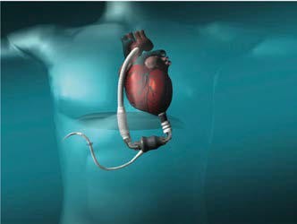
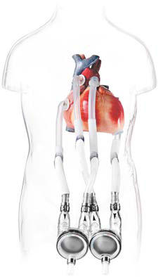

# Chapter 492: Pediatric Heart and Heart-Lung Transplantation
> **Course:** Vikkypaedia Pediatric Basic Course (*Nelson Textbook of Pediatrics, 22nd Edition (2025)*)  
> **Part XVIII:** The Cardiovascular System  
> **Authors:** Nelson 22e Contributors  
> **Metrics:** 4,184 words · 0 tables/boxes · 2 figures · 0 genes · 8 flashcards · 5 MCQs  
> **Quick Navigation:** [🃏 Study 8 Flashcards](../flashcards/492_flashcards.md) · [📝 Take 5-Q MCQ Quiz](../mcqs/492_mcqs.md) · [📚 Part XVIII Guide](../parts/Part_XVIII.md) · [🧬 Syndrome & Genetics Atlas](../omim_gene_atlas.md) · [💊 Therapeutics Matrix](../therapies_matrix.md) · [🏠 Course Index](../../index.md)

## Key Chapter Topics & Subchapters
`492.1 Pediatric Heart Transplantation` · `492.2 Heart-Lung and Lung Transplantation` · `492.1 Pediatric Heart Transplantation` · `492.2 Heart-Lung and Lung Transplantation Samuel B. Goldfarb, Danielle S. Burstein, and Joseph W. Rossano`

## ⚡ High-Yield Nelson Pediatric Board Pearls
- PERIOPERATIVE MANAGEMENT Heart transplantation in children can be performed either with a biatrial or bicaval anastomosis.
- DIAGNOSIS AND MANAGEMENT OF ACUTE GRAFT REJECTION Posttransplantation management consists of adjusting medications to maintain a balance between the risk of rejection and the side effects of over-immunosuppression.
- Viral infections are most common and account for as many as 25% of infectious episodes.
- Bacterial infections occur next in frequency after viral, with the lung the most common site of infection, followed by blood, urinary tract, and less often, the sternotomy site.
- Hypertension Hypertension is common in patients treated with CNIs, caused by a com bination of plasma volume expansion and defective renal sodium excre tion.
- PRES presents with hypertension, headaches, and seizures, requires MRI for diagnosis, and is usually managed by changing CNI or, in rare cases, eliminating CNIs totally in favor of other immunosuppressive agents (e.g., sirolimus, MMF).
- The most common is posttransplant lymphoproliferative disease (PTLD), a condition associated with Epstein-Barr virus (EBV) infection.

---
## Full Chapter Text, Tables & Figures
# Chapter 492: Pediatric Heart and Heart-Lung Transplantation

<!-- p.3685 -->
A

B

C

**Fig. 491.5** Commonly used ventricular assist devices in children. A, Paracorporeal pneumatic pulsatile Berlin Heart EXCOR. B and C, Con tinuous flow devices: (B) HeartMate3; (C) HeartWare HVAD. (A courtesy Berlin Heart, LLC; B from St. Jude Medical; C courtesy Medtronic, Inc.)

## 492.1  Pediatric Heart Transplantation

*Danielle S. Burstein and Joseph W. Rossano*

Pediatric heart transplantation is considered the standard ther apy that offers long-term survival for end-stage heart disease in children. In adults, ventricular assist devices (VADs) are usually employed as a long-term therapy for patients not eligible for heart transplantation, but in children the vast majority of VADs are used as a *bridge* to transplantation as opposed to an alternative to trans plantation. According to the International Society for Heart and Lung Transplantation, as of January 2019, over 14,000 heart trans plants had been performed on children in the world, with about 400 transplants annually—a quarter of these in children <1 year of age. Survival rates have improved significantly over time, with most of the improvement occurring in the early period after transplant. This period continues to the associated with the greatest risk of death, and many patients who survive the first year after transplant are alive 20 years later (Fig. 492.1). Indeed, a growing number of patients receiving a heart transplant in childhood are approaching their 15-, 20-, and 30-year posttransplant anniversaries. Current (2011-2023) 1-year survival is ~90% and 5-year survival ~80%.

**INDICATIONS** Heart transplantation is performed (1) in infants and children with end-stage cardiomyopathy who have become refractory to medical therapy, (2) in patients with previously repaired or palliated con genital heart disease (CHD) who have developed ventricular dys function or other nonoperable late-term complications, and (3) less frequently in patients with complex CHD—pulmonary atresia with intact septum and coronary arterial stenoses and some forms of hypoplastic left heart syndrome (HLHS)—for whom standard surgical procedures are extremely high risk. Additionally, **retrans plantation** accounts for approximately 5% of transplants annually.

**Cardiomyopathies** account for >50% of heart transplants in pedi atric patients older than 1 year, with the percentage of patients with previously repaired complex CHD at approximately 30%. In infants younger than 1 year, CHD previously represented >80% of trans plants; this has decreased to 60% as standard surgical results for complex CHD (e.g., HLHS) have improved.

**RECIPIENT AND DONOR SELECTION** Potential heart transplant recipients must be free of serious noncar diac medical problems such as neurologic disease, active systemic infection, severe hepatic or renal disease, and severe malnutri tion. Many children with ventricular dysfunction are at risk for the development of **pulmonary vascular disease**, which, if severe enough, would also preclude heart transplantation. Therefore pul monary vascular resistance (PVR) is measured at cardiac catheter ization in heart transplant candidates, both at rest and, if elevated, in response to vasodilators. Patients with fixed elevated PVR above 6 index Wood units are at higher risk for heart transplantation and may be considered candidates for heart-lung transplantation (see Chapter 492.2). However, with advances in postoperative man agement of pulmonary hypertension (e.g., inhaled nitric oxide), many patients with moderate elevation in PVR can undergo heart transplant alone. A comprehensive social services evaluation is an important component of the recipient evaluation. Because of the complex posttransplantation medical regimen, the family must have a history of compliance. Detailed informed consent must be obtained, indicating that the family (and, if old enough, the patient) understand the lifelong commitment to immunosuppressive medi cation and careful monitoring.

100 1982-1989 (N = 908) 1990-2003 (N = 5,637)

A

75

2004-2008 (N = 2,442) 2009-6/2014 (N = 3,104)

50

Survival (%)

25

Median survival (years): 1982-1989 = 9.8; 1990-2003 = 14.5; 2004-2008 = NA; 2009-6/2014 = NA

0 2 4 0 6 8 10 12 14 16 18 20 22 24 Years

100 Median survival (years): <1 = NA; 1-5 = 21.5; 6-10 = 16.5; 11-17 = 15.7

B

75

50

Survival (%)

All pair-wise comparisons were significant at p < 0.05.

25 <1 Year (N = 2,159) 1-5 Years (N = 2,128)

6-10 Years (N = 1,430) 11-17 Years (N = 3,826)

0 0 2 4 6 8 10 12 14 16 18 20 22 24 Years

p-values significant at p < 0.05

Overall (N = 9,543)

**Fig. 492.1** A, Survival after pediatric heart transplantation comparing current and past eras. B, Long-term survival among patients that lived to 1-yr post-transplant. NA, Not applicable. (From Rossano JW, Dip chand AI, Edwards LB, et al. The Registry of the International Society for Heart and Lung Transplantation: Nineteenth Pediatric Heart Trans plantation Report—2016. Focus theme: primary diagnostic indications for transplant. J Heart Lung Transplant. 2016;35[10]:1185–1195, Figs. 6 and 7.)

<!-- p.3687 -->
**Donor shortage** is a serious problem for both adults and chil dren. At the national registry of transplant recipients in the United States, the **United Network for Organ Sharing (UNOS)**, allografts are matched by ABO blood group and body weight. However, ABO matching may not be required for young infants less than 2 years of age because of the immaturity of the immune system. Patients, espe cially with a history of CHD, who have undergone prior operations may have antibodies against human leukocyte antigens (HLAs). Patients with elevated anti-HLA antibodies are at risk for a positive cross match and early graft dysfunction. These antibodies can also contribute to late graft dysfunction through antibody-mediated rejection and development of cardiac allograft vasculopathy. For patients with these elevated antibodies, there are strategies to avoid a positive cross match through a prospective cross match or a vir tual cross match, although this may prolong the waiting list time. There are also desensitization therapies that may reduce circulating HLA antibody production, although they do not affect historical antibodies, and current data remain unclear how effective desensi tization therapy is for reducing posttransplant rejection risk. Con traindications to organ donation include prolonged cardiac arrest with persistent moderate to severe cardiac dysfunction, ongoing systemic illness or infection, and preexisting severe cardiac disease. Physicians caring for a patient who may be a potential donor should always contact the organ donor coordinator at their institution, who can best judge the appropriateness of organ donation and has experience in interacting with potential donor families. A history of resuscitation alone or reparable CHD is not an automatic exclusion for donation.

The decision of when to place a patient on the transplant waiting list is based on many factors, including degree of ventricular func tion, markedly decreased exercise tolerance as determined by car diopulmonary exercise testing (see Chapter 472.5), poor response to medical heart failure therapy, multiple hospitalizations for heart failure, arrhythmia, progressive deterioration in renal or hepatic function, early stages of pulmonary vascular disease, and poor nutritional status. Patients with severe ventricular dysfunction are often started on a regimen of anticoagulation to reduce the risk of mural thrombosis and thromboembolism. Patients with progressive heart failure resulting in decreases in end-organ (renal or hepatic) function unresponsive to standard pharmacologic treatment may be candidates for a VAD. The use of these devices has increased dra matically over the past decade, and currently over half of patients with dilated cardiomyopathy are on VAD support before transplant. VADs can improve hemodynamics and end-organ function, allow for rehabilitation, and allow some patients to be discharged home on VAD support (see Chapter 491).

**PERIOPERATIVE MANAGEMENT** Heart transplantation in children can be performed either with a *biatrial* or *bicaval* anastomosis. In the *biatrial* anastomosis*,* both donor and recipient hearts are excised so that the posterior portions of the atria containing the venae cavae and pulmonary veins are left intact. The aorta and pulmonary artery are divided above the level of the semilunar valves. The anterior portions of the donor’s atria are then connected to the remaining posterior portions of the recipient’s atria, thereby avoiding the need for delicate suturing of the venae cavae or pulmonary veins. Previously, the  donor and recipient great vessels were connected via end-to-end anastomoses. This has been supplanted in many centers by the *bicaval* anastomo sis, with the donor right atrium (and sinus node) left intact and the suture lines at the superior and inferior vena cavae; the left atrial connection is still performed as in the *biatrial* anastomosis.

In the immediate postoperative period, **immunosuppression** is achieved with induction therapy that includes an antilymphocyte therapy for the first 5-7 days; common agents include antithymo cyte globulin (ATG) and the humanized anti–interleukin-2 receptor antibodies (basiliximab). Steroids are also commonly used within the first 5-7 days and then are often weaned off or discontinued. Antiproliferative agents (mycophenolate mofetil [MMF]) are also

started immediately after transplant and are transitioned to an oral compound once enteral medications are tolerated. The most com mon combinations of chronic immunosuppression are a *calcineurin inhibitor* (CNI; tacrolimus or cyclosporine) plus an *antiprolifera tive agent* (MMF or azathioprine). Mammalian target of rapamy cin (mTOR) inhibitors (sirolimus or everolimus) may be added to decrease the dose of CNI if renal insufficiency occurs. Many cen ters do not use steroids as part of maintenance immunosuppression but do use them as bolus treatment for acute rejection episodes. Immunosuppression levels are usually reduced after the first year posttransplant if there are no significant concerns for rejection. An ongoing U.S. multicenter pediatric trial called the TEAMMATE trial is comparing conventional immunosuppression therapy (tacrolimus and mycophenolate) with low-dose tacrolimus with everolimus and mycophenolate to determine which combination of immunosuppression is better at improving long-term pediatric post–heart transplant outcomes.

Many pediatric heart transplant recipients can be extubated from endotracheal intubation and mechanical ventilation support within the first 48 hours after transplantation and are out of bed in several days. In patients with preexisting high-risk factors, postoperative recovery may be considerably prolonged. For those with preopera tive pulmonary hypertension, the use of nitric oxide in the postop erative period can allow the donor right ventricle to hypertrophy in response to elevated pulmonary artery pressures. Occasionally, these patients will require extracorporeal membrane oxygenation (ECMO) for primary graft dysfunction.

**DIAGNOSIS AND MANAGEMENT OF ACUTE GRAFT REJECTION** Posttransplantation management consists of adjusting medications to maintain a balance between the risk of rejection and the side effects of over-immunosuppression. **Acute graft rejection** is a leading cause of death in pediatric heart transplant recipients. The incidence of acute rejection is greatest in the first 3 months after transplantation and decreases considerably thereafter. Many pediatric patients expe rience at least one episode of acute rejection in the first 2 years after transplantation, although modern immunosuppressive regimens have decreased the frequency of severe rejection episodes. Because the symptoms of rejection can mimic many routine pediatric illnesses (e.g., pneumonia, gastroenteritis), the transplant center should be notified whenever a heart transplant recipient is seen in the pediatri cian’s office or emergency department for acute illnesses.

Clinical manifestations of acute rejection may include fatigue, fluid retention, fever, diaphoresis, abdominal symptoms, and a gallop rhythm. The electrocardiogram (ECG) may show reduced voltage, atrial or ventricular arrhythmias, or heart block but is usually nondiagnostic. X-ray examination may show an enlarged heart, effusions, or pulmonary edema but typically only in the more advanced stages of rejection. Natriuretic peptide levels are usually increased during episodes of acute rejection. Most rejection epi sodes occur without any detectable clinical symptoms. On echo cardiography, indices of systolic left ventricular function may be decreased; however, these usually do not deteriorate until rejection is at least moderately severe. Techniques to evaluate wall thickening and left ventricular diastolic function have not fulfilled their prom ise as predictors of early rejection. Most transplant centers do not rely on echocardiography alone for rejection surveillance.

**Myocardial biopsy** is the most reliable method of monitoring patients for rejection. Biopsy specimens are taken from the right ventricular side of the interventricular septum and can be harvested relatively safely, even in small infants. In infants, surveillance biop sies are usually performed less often and may be as infrequent as once or twice per year. Children may have clinically unsuspected rejection episodes even 5-10 years after transplantation; most pedi atric transplant centers continue routine surveillance biopsies, although at less frequent intervals. Cardiac MRI evaluation has been an effective noninvasive method to perform rejection surveil lance and to diagnose actual rejection.

<!-- p.3688 -->
Gene expression profiling of peripheral blood mononuclear cells has been validated in adults as a highly sensitive, moderately selective method of rejection surveillance. These results have not been confirmed in children. Other promising current techniques include the profiling of donor cell–free DNA released in the serum of patients during episodes of graft injury. Progress has also been made in genetic profiling as a means to determine which patients are most at risk for rejection. Children who have single nucleotide polymorphisms (SNPs) leading to greater activity of inflamma tory cytokines or decreased activity of regulatory cytokines are at increased risk of rejection.

Cardiac rejection can be classified as cellular, antibody-mediated, or mixed. Criteria for grading cellular rejection are based on a sys tem developed by the **International Society for Heart and Lung Transplantation (ISHLT)** that considers the degree of cellular infil tration and whether myocyte necrosis is present. ISHLT rejection grade 1R is usually mild enough that it is often not treated with bolus steroids, and many of these episodes resolve spontaneously. For patients with ISHLT grade 2R rejection, treatment is insti tuted with either intravenous (IV) methylprednisolone or a “bump and taper” of oral prednisone. Asymptomatic patients further out from transplant with normal echocardiograms may be treated as outpatients. Patients with grade 3R, or anyone with hemodynamic instability, are admitted to the hospital for IV corticosteroid and potentially more aggressive antirejection therapy. For rejection epi sodes resistant to steroid therapy, additional therapeutic regimens include antilymphocyte preparation (antithymocyte globulin), methotrexate, or total lymphoid irradiation. Refractory rejection is often considered a contraindication for retransplantation because of the relatively poor outcomes compared with other indications for retransplantation.

Criteria for grading antibody-mediated rejection are based on a system developed by the ISHLT that considers histologic and immunopathologic findings. In contrast to cellular rejection, antibody-mediated rejection is mediated by circulating donorspecific antibodies (DSAs) and can be detected by immunostain ing of the biopsy specimen for the complement component C4d, for macrophages expressing CD68, and for evidence of histologic

damage. Antibody-mediated rejection is less responsive to standard therapies for acute cellular rejection (e.g., bolus corticosteroids) and has been treated with plasmapheresis, intravenous immunoglobu lin (IVIG), the anti–CD20 monoclonal antibody rituximab, and the proteasome inhibitor bortezomib, all with mixed results. The long-term outcome of patients with persistent DSAs or antibodymediated rejection is poor, with many having early graft failure and premature development of graft vasculopathy.

**COMPLICATIONS OF IMMUNOSUPPRESSION Infection** Infection is also a leading cause of death in pediatric transplant patients (Fig. 492.2). The incidence of infection is greatest in the first 3 months after transplantation, when immunosuppressive doses are highest. **Viral** infections are most common and account for as many as 25% of infectious episodes. **Cytomegalovirus (CMV)** infection was once a leading cause of morbidity and mortality and may occur as a primary infection in patients without previous expo sure to the virus or as a reactivation. Severe CMV infection can be disseminated or associated with pneumonitis or gastroenteritis and may provoke an episode of acute graft rejection or graft coronary disease. Most centers use IV ganciclovir or CMV immune globu lin (Cytogam), or both, as prophylaxis in any patient receiving a heart from a donor who is positive for CMV or in any recipient who has serologic evidence of previous CMV disease. Oral preparations of ganciclovir with improved absorption profiles are available for chronic therapy, usually for 3-6 months after transplant, and have largely replaced IV preparations for prophylaxis. These regimens have significantly reduced the burden of CMV disease in heart transplant patients. Polymerase chain reaction (PCR) enhances the ability to diagnose CMV infection and monitor the efficacy of therapy serially.

Most normal childhood viral illnesses are well tolerated and do not usually require special treatment. Otitis media and routine upper respiratory tract infections can be treated in the outpatient setting, although fever or symptoms that last beyond the usual course require further investigation. **Gastroenteritis**, especially with vomiting, can result in greatly reduced absorption of immu nosuppressive medications and provoke a rejection episode. In this setting, drug levels should be closely monitored and use of IV medi cations considered. Gastroenteritis can also be a sign of rejection, so a high index of suspicion must always be maintained. Varicella is another childhood illness of concern for immunosuppressed patients. If a heart transplant recipient acquires clinical varicella infection, treatment with IV acyclovir usually attenuates the illness.

Bacterial infections occur next in frequency after viral, with the lung the most common site of infection, followed by blood, urinary tract, and less often, the sternotomy site. Other sources of posttransplantation infection include fungi and protozoa. Many centers use trimethoprimsulfamethoxazole for prophylaxis during the first several months after transplant to prevent *Pneumocystis jiroveci* infection.

**Growth Stunting** Patients requiring chronic corticosteroid therapy usually have decreased linear growth. Thus many pediatric transplant programs aim for steroid-free immunosuppression within the first year after transplant. In patients who experience rejection when steroids are withdrawn, alternate-day corticosteroid regimens may result in improved linear growth. **Total lymphoid irradiation** has also shown promise as a steroid-sparing protocol. Despite these con cerns, the majority of long-term survivors of pediatric heart trans plantation have normal growth.

**Hypertension** Hypertension is common in patients treated with CNIs, caused by a com bination of plasma volume expansion and defective renal sodium excre tion. Corticosteroids usually potentiate calcineurin-induced hypertension.

50

40

30

20 20

Percentage of deaths

10

0 >10 Years

(N = 408) 0-30 Days (N = 256)

31 Days - 1 Year (N  = 297)

>1 Year -

3 Years (N = 236)

>3 Years -

5 Years (N = 204)

>5 Years -

10 Years (N = 366)

CAV Acute rejection Infection (non-CMV) Graft failure

**Fig. 492.2** Major causes of death after pediatric heart transplanta tion by time since transplant. CAV, Cardiac allograft vasculopathy; CMV, cytomegalovirus. (From Rossano JW, Dipchand AI, Edwards LB, et al. The Registry of the International Society for Heart and Lung Transplan tation: Nineteenth Pediatric Heart Transplantation Report—2016. Fo cus theme: primary diagnostic indications for transplant. J Heart Lung Transplant. 2016;35[10]:1185–1195, Fig. 10.)

<!-- p.3689 -->
**Renal Function** Chronic administration of cyclosporine or tacrolimus can lead to a tubulointerstitial nephropathy in adults, but severe renal dysfunc tion is less common in children. Most pediatric patients gradually have an increase in serum creatinine in the first year after trans plantation; if renal dysfunction occurs, it usually responds to a decrease in CNI dosage. The addition of sirolimus, an mTOR inhib itor, allows a reduction in CNI dose in patients with renal dysfunc tion, although it is unclear whether this strategy leads to long-term improved renal function. Infection with BK virus, a growing prob lem in renal transplant patients, has been described as a source of renal dysfunction in heart transplant patients. Fortunately, pediat ric heart transplant patients infrequently require dialysis or renal transplantation.

**Neurologic Complications** Neurologic side effects of cyclosporine and tacrolimus include tremor, myalgias, paresthesias, and, rarely, seizures. These complications can be treated with reduced doses of medication and occasionally with oral magnesium supplementation. A rare form of encephalopathy known as **posterior reversible encephalopathy syndrome** (PRES) can occur in patients taking CNIs (cyclosporine or tacrolimus). PRES presents with hypertension, headaches, and seizures, requires MRI for diagnosis, and is usually managed by changing CNI or, in rare cases, eliminating CNIs totally in favor of other immunosuppressive agents (e.g., sirolimus, MMF).

**Tumors** One of the serious complications limiting long-term survival in pediatric heart transplant patients is the risk of neoplastic disease. The most common is **posttransplant lymphoproliferative disease** (PTLD), a condition associated with Epstein-Barr virus (EBV) infection. Patients who are EBV seronegative at transplant (usu ally infants and young children) are at increased risk of developing PTLD if they subsequently seroconvert, acquiring the virus either from the donor organ or from primary infection. Unlike true can cer, many cases of PTLD respond to a reduction in immunosup pression. A monoclonal antibody directed against the CD20 antigen on activated lymphocytes (rituximab), in conjunction with steroids and cyclophosphamide therapy, has been effective against some forms of PTLD. However, PTLD can behave more aggressively, and many patients eventually require chemotherapy. An increased risk of skin cancer requires that children use appropriate precautions when exposed to sunlight.

**Cardiac Allograft Vasculopathy** Cardiac allograft vasculopathy (CAV) is a disease of the coronary arteries that occurs in approximately 20% of children 5 years after transplant. The cause is still unclear, although it is thought to be a form of immunologically mediated vessel injury. Multiple factors, including rejection episodes, infections, hypercholesterolemia, and hyperglycemia, are thought to increase the risk of CAV. Unlike native coronary atherosclerosis, CAV is a diffuse process with a high degree of distal vessel involvement. Because the transplanted heart has been denervated, patients may not experience symptoms such as angina pectoris during ischemic episodes, and the initial mani festation may be cardiovascular collapse or sudden death. Most cen ters perform coronary angiography annually to screen for coronary abnormalities; some also perform coronary intravascular ultrasound in larger children and adolescents. Standard coronary artery bypass procedures are usually not helpful because of the diffuse nature of the process, although transcatheter stenting can sometimes be effec tive for isolated lesions. For patients with severe CAV, repeat heart transplantation has been the only effective treatment. Thus preven tion has been the focus of most current research. The cell-cycle

inhibitors sirolimus and everolimus have been shown to decrease coronary arterial intimal thickening in adult transplant patients. Cholesterol-lowering HMG-CoA (3-hydroxy-3-methyl-coenzyme A) reductase inhibitors (e.g., pravastatin, atorvastatin) have been associated with a lower risk of CAV.

**Other Complications** Corticosteroids usually result in cushingoid facies, steroid acne, and striae. Cyclosporine can cause a subtle change in facial features, such as hypertrichosis and gingival hyperplasia. These cosmetic features can be particularly disturbing to adolescents and may be the motiva tion for noncompliance, one of the leading risks for late morbidity and mortality. Most of these cosmetic complications are dose related and improve as immunosuppressive medications are weaned. Tacrolimus does not have the cosmetic side effects of cyclosporine. Osteoporosis and aseptic necrosis are additional reasons for reducing the steroid dosage as soon as possible. Diabetes and pancreatitis are rare but seri ous complications.

**Rehabilitation** Despite the potential risks of immunosuppression, the prospect for rehabilitation in pediatric heart transplant recipients is excel lent; most have no functional limitations in their daily lives. They can attend daycare or school and participate in competitive sports and other age-appropriate activities. Standardized measurements of ventricular function are close to normal. Because the transplanted heart is denervated, the increase in heart rate and cardiac output during exercise is slower in transplant recipients, and maximal heart rate and cardiac output responses are mildly attenuated. These subtle abnormalities are rarely noticeable by the patient.

Growth of the transplanted heart is excellent, although a mild degree of ventricular hypertrophy is often seen, even years after transplantation. The sites of atrial and great vessel anastomoses usually grow without the development of obstruction. In neonates who undergo transplantation for HLHS, however, juxtaductal aortic coarctation may recur.

A serious problem with noncompliance may occur once patients reach adolescence, and life-threatening rejection may result. Early intervention by social workers, counselors, and psychologists may be able to reduce this risk.

*Visit Elsevier eBooks+ at eBooks.Health.Elsevier.com** for Bibliography.*

## 492.2  Heart-Lung and Lung Transplantation Samuel B. Goldfarb, Danielle S. Burstein, and Joseph W. Rossano

More than 700 heart-lung and 2,500 lung (single or double) pedi atric transplants have been performed and reported to ISHLT, with >100 procedures performed annually. The majority of these are lung transplantation, with only three heart-lung transplants reported in 2017. Only 16 heart-lung transplants have been performed in the United States in the past 5 years compared to over 140 lung trans plants during this same time frame. Primary indications for lung transplantation include cystic fibrosis, pulmonary hypertension, interstitial lung disease, surfactant deficiencies, and retransplant. Indications for heart-lung transplant include complex CHD along with either pulmonary parenchymal or vascular disease. Patients with normal hearts are candidates for lung transplantation even in the setting of right ventricular dysfunction. This had led to the marked decline in heart-lung transplant procedures in the current era. In some patients with CHD, double-lung transplantation can be performed in combination with repair of intracardiac defects. Patients with cystic fibrosis are *not* candidates for single-lung grafts

<!-- p.3691 -->
