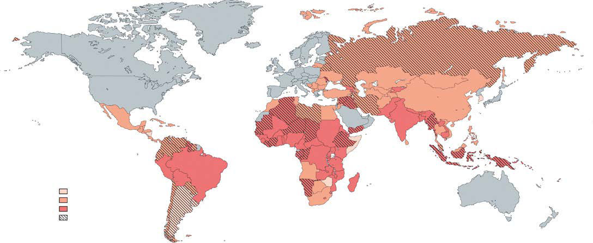
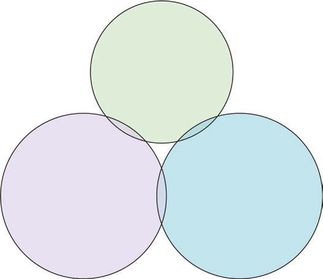

# Chapter 496: Anemias
> **Course:** Vikkypaedia Pediatric Basic Course (*Nelson Textbook of Pediatrics, 22nd Edition (2025)*)  
> **Part XIX:** Diseases of the Blood  
> **Authors:** Courtney D. Thornburg  
> **Metrics:** 2,488 words · 5 tables/boxes · 2 figures · 1 genes · 8 flashcards · 5 MCQs  
> **Quick Navigation:** [🃏 Study 8 Flashcards](../flashcards/496_flashcards.md) · [📝 Take 5-Q MCQ Quiz](../mcqs/496_mcqs.md) · [📚 Part XIX Guide](../parts/Part_XIX.md) · [🧬 Syndrome & Genetics Atlas](../omim_gene_atlas.md) · [💊 Therapeutics Matrix](../therapies_matrix.md) · [🏠 Course Index](../../index.md)

## Key Genetic & Molecular Targets
`G6PD`

## ⚡ High-Yield Nelson Pediatric Board Pearls
- Ultimately, weakness, tachypnea, shortness of breath on exertion, tachycardia, car diac dilation, and high-output heart failure results from increasingly severe anemia, regardless of its cause.
- DIFFERENTIAL DIAGNOSIS Anemia can result from many underlying pathologic processes.
- Thalassemia trait con stitutes the primary differential diagnosis when iron deficiency is suspected.
- In children with normocytic anemia and an appropriate (high) reticulocyte response, the anemia is usually caused by bleeding, hypersplenism, or ongoing hemolysis.

---
## Full Chapter Text, Tables & Figures
# Chapter 496: Anemias

*Courtney D. Thornburg*

<!-- p.3717 -->
Anemia is defined as a reduction of the hemoglobin concentration or red blood cell (RBC) volume below the range of values occurring in healthy persons. Normal ranges for hemoglobin and hematocrit (packed red cell volume) vary substantially with age and between males and females (Table 496.1) and by race and ethnicity (Table  496.2). Anemia is a significant global health problem affecting children and reproductive-age females (Figs. 496.1 and 496.2).

Physiologic responses to anemia include increased cardiac output, augmented oxygen extraction (increased arteriovenous oxygen dif ference), and shunting of blood flow toward vital organs and tissues. In addition, the concentration of 2,3-diphosphoglycerate increases within the RBC. The resultant “rightward shift” of the oxygen dissocia tion curve reduces the affinity of hemoglobin for oxygen and results in

more complete transfer of oxygen to the tissues. This same shift in the oxygen dissociation curve can also occur at high altitude. Higher levels of erythropoietin (EPO) and consequent increased RBC production by the bone marrow further help the body to adapt.

**HISTORY AND PHYSICAL EXAMINATION** A detailed history and thorough physical exam are essential when eval uating an anemic child. Important historical facts include demograph ics, diet, medications, chronic diseases, infections, travel, and exposures. A family history of anemia and associated difficulties (e.g., splenomeg aly, jaundice, early-age onset of gallstones) is also important. Often, few physical symptoms or signs result solely from a low hemoglobin, par ticularly when the anemia develops slowly. Clinical findings generally do not become apparent until the hemoglobin level falls to <7-8 g/dL. Clinical features can include pallor, sleepiness, irritability, and decreased exercise tolerance. Pallor can involve the tongue, nail beds, conjunctiva, palms, or palmar creases. A flow murmur is often present. Ultimately, weakness, tachypnea, shortness of breath on exertion, tachycardia, car diac dilation, and high-output heart failure results from increasingly severe anemia, regardless of its cause. Unusual physical findings linked to specific underlying disease etiologies are discussed in detail in sec tions describing the associated disorders and in Table 496.3.

*Courtney D. Thornburg*

#### **Table 496.1** Normal Mean and Lower Limits of Normal for Hemoglobin, Hematocrit, and Mean Corpuscular Volume

| Category / Parameter | Clinical Details & Findings |
| --- | --- |
| **LOWER LIMIT** | 0.5-1.9; 12.5; 11.0; 37; 33; 77; 70; 2-4; 12.5; 11.0; 38; 34; 79; 73; 5-7; 13.0; 11.5; 39; 35; 81; 75; 8-11; 13.5; 12.0; 40; 36; 83; 76; 12-14 female; 13.5; 12.0; 41; 36; 85; 78; 12-14 male; 14.0; 12.5; 43; 37; 84; 77; 15-17 female; 14.0; 12.0; 41; 36; 87; 79; 15-17 male; 15.0; 13.0; 46; 38; 86; 78; 18-49 female; 14.0; 12.0; 42; 37; 90; 80; 18-49 male; 16.0; 14.0; 47; 40; 90; 80; From Brugnara C, Oski FJ, Nathan DG, eds. Nathan and Oski's Hematology of Infancy and Childhood, 7th ed. Philadelphia: Saunders, 2009: p. 456. |

#### **Table 496.2** NHANES-III Hemoglobin Values for Non-Hispanic Whites and Blacks Ages 2-18 Yr*

| Category / Parameter | Clinical Details & Findings |
| --- | --- |
| **−2 SD** | 2-5; 12.21; 10.8; 11.95; 10.37; 6-10; 12.87; 11.31; 12.40; 10.74; 11-15 male; 13.76; 11.76; 13.06; 10.88; 11-15 female; 13.32; 11.5; 12.61; 10.85; 16-18 male; 15.00; 13.24; 14.18; 12.42; 16-18 female; 13.39; 11.61; 12.37; 10.37; *Sample size is 5,142 (White, 2,264; Black, 2,878).; NHANES-III, Third National Health and Nutrition Examination Survey; SD, standard deviation.; Adapted from Robbins EB, Blum S. Hematologic reference values for African American children and adolescents. Am J Hematol 2007;82:611–614. |

<!-- p.3718 -->
**LABORATORY STUDIES** Initial laboratory testing should include hemoglobin, hematocrit, RBC indices, white blood cell (WBC) count and differential, platelet count, reticulocyte count, and examination of the peripheral blood smear. The need for additional laboratory studies is dictated by the history, physi cal exam, and initial testing.

**DIFFERENTIAL DIAGNOSIS** Anemia can result from many underlying pathologic processes. To narrow the diagnostic possibilities, anemias may be classified based on their morphology and physiology (Fig. 496.3).

Anemias may be morphologically categorized by red cell size (mean corpuscular volume [MCV]) and microscopic appearance. Anemias can be classified as *microcytic, normocytic,* or *macrocytic* based on whether the MCV is low, normal, or high, respectively (Table 496.4). RBC size also changes with age, and normal devel opmental changes in MCV should be accommodated before a des ignation is made (see Table 496.1). Examination of a peripheral blood smear often reveals changes in RBC appearance that will help to further narrow the diagnostic categories (Fig. 496.4 and Table 496.5). Details regarding morphologic changes associated with spe cific disorders are described in subsequent sections.

Anemias may also be further divided based on underlying patho physiology. The two major categories are **decreased production** and **increased destruction** (or **loss**). These two groups are not always mutually exclusive. Decreased RBC production may be a consequence of either ineffective erythropoiesis or complete failure of erythropoiesis. Increased destruction or loss may be secondary to hemolysis, sequestration, or bleeding. The peripheral blood reticu locyte percentage or absolute number helps to distinguish between the two physiologic categories. The normal reticulocyte percent age of total RBCs during most of childhood is approximately 1%, with an absolute reticulocyte count of 25,000-75,000/mm3. In the presence of anemia, EPO production and the absolute number of reticulocytes should rise. Low or normal numbers of reticulocytes generally represent an inadequate response to anemia that is associ ated with relative bone marrow failure or ineffective erythropoiesis. Increased numbers of reticulocytes represent a normal bone mar row response to ongoing RBC destruction (hemolysis), sequestra tion, or loss (bleeding).

**Fig. 496.3** presents a useful approach to assessing the common causes of anemia in the pediatric age group. Children with microcytic anemia and low or normal reticulocyte counts most often have defects in erythroid maturation or ineffective erythropoiesis. Iron deficiency is the most common cause (see Chapter 504). Thalassemia trait con stitutes the primary differential diagnosis when iron deficiency is suspected (see Chapter 511). Distinctions between these entities are presented in Table 504.2. Chronic disease or inflammation (more often normocytic), lead poisoning, and sideroblastic anemias should also be considered and are discussed in other chapters. Microcytosis and elevated reticulocyte counts are associated with thalassemias and

**Anaemia prevalence**

Mild (5.0–19.9%) Moderate (20.0–39.9%) Severe (≥40.0%) Regression-based estimate

**Fig. 496.1** Global prevalence of anemia in children of preschool age (0-5 yr). (Adapted from Worldwide prevalence of anaemia 1993–2005. In WHO Global Database on Anaemia. Geneva: World Health Organization, 2008.)

**Genetic hemoglobin**

**disorders** Thalassemias Hemoglobin variants Glucose-6-phosphate dehydrogenase deficiency

Ovalocytosis

**Nutrition** Iron deficiency Folic acid deficiency Vitamin B12 deficiency

Vitamin A deficiency Protein energy malnutrition

**Infectious disease** Soil-transmitted helminths

Malaria Schistosomiasis

Tuberculosis

AIDS Leishmaniasis Tropical sprue Malabsorption and disorders

of the small intestine

**Fig. 496.2** Causes of anemia in countries with low- or middle- income populations. (From Balarajan Y, Ramakrishnan U, Özaltin E, et  al. Anaemia in low-income and middle-income countries. Lancet 2011;378:2123–2134; Fig 3.)

<!-- p.3719 -->

#### **Table 496.3** Physical Findings in the Evaluation of Anemia

| Category / Parameter | Clinical Details & Findings |
| --- | --- |
| **SIGNIFICANCE** | Skin; Hyperpigmentation; Fanconi anemia, dyskeratosis congenita; Café-au-lait spots; Fanconi anemia; Vitiligo; Vitamin B12 deficiency; Partial oculocutaneous albinism; Chédiak-Higashi syndrome; Jaundice; Hemolysis, hepatitis; Petechiae, purpura; Bone marrow infiltration, autoimmune hemolysis with autoimmune; thrombocytopenia (Evans syndrome), hemolytic-uremic syndrome; Erythematous rash; Parvovirus, Epstein-Barr virus; Butterfly rash; Systemic lupus erythematosus; Head; Frontal bossing; Thalassemia major, severe iron deficiency, chronic subdural hematoma; Microcephaly; Fanconi anemia; Diamond-Blackfan anemia; Eyes; Microphthalmia; Fanconi anemia; Retinopathy; Sickle cell disease, types SS and SC; Optic atrophy, blindness; Osteopetrosis; Blocked lacrimal gland; Dyskeratosis congenita; Kayser-Fleischer ring; Wilson disease; Blue sclera; Iron deficiency; Ears; Deafness; Osteopetrosis; Mouth; Glossitis; Vitamin B12 deficiency, iron deficiency; Angular stomatitis; Iron deficiency; Cleft lip, palate; Diamond-Blackfan anemia; Pigmentation; Peutz-Jeghers syndrome (intestinal blood loss); Telangiectasia; Osler-Weber-Rendu syndrome (blood loss); Leukoplakia; Dyskeratosis congenital; Chest; Shield chest or widespread nipples; Diamond-Blackfan anemia; Murmur; Endocarditis; prosthetic valve hemolysis; Abdomen; Hepatomegaly; Hemolysis, infiltrative tumor, chronic disease, hemangioma, cholecystitis; Splenomegaly; Acquired hemolytic anemia, inherited hemolytic anemia (hereditary; spherocytosis, pyruvate kinase deficiency, sickle cell disease [age of presentation; varies based on phenotype]), thalassemia, malaria, leukemia/lymphoma,; Epstein-Barr virus, portal hypertension, hemophagocytic syndromes; Nephromegaly; Fanconi anemia; Absent kidney; Fanconi anemia; Extremities; Absent thumbs; Fanconi anemia; Thenar eminence hypoplasia:; triphalangeal thumb; Diamond-Blackfan anemia; Spoon nails; Iron deficiency; Beau line (nails); Heavy metal intoxication, severe illness; Mees line (nails); Heavy metals, severe illness, sickle cell disease; Dystrophic nails; Dyskeratosis congenita; Edema; Milk-induced protein-losing enteropathy with iron deficiency, renal failure; Rectal; Hemorrhoids; Portal hypertension; Heme-positive stool; Intestinal hemorrhage; Nerves; Irritable, apathy; Iron deficiency; Peripheral neuropathy; Deficiency of vitamins B1 and B12, lead poisoning; Dementia; Deficiency of vitamins B12 and E; Ataxia, posterior column signs; Deficiency of vitamins B12 and E; Stroke; Sickle cell disease, paroxysmal nocturnal hemoglobinuria; Adapted from Scott JP. Hematology. In: Behrman RE, Kliegman RM, eds. Nelson Essentials of Pediatrics, 2nd ed. Philadelphia: Saunders, 1994: p. 520. |

<!-- p.3720 -->
**Microcytic Normocytic Macrocytic**

**Reticulocyte count**

**Low/Inadequate**

• • •

• • • •

Iron deficiency Thalassemia trait Chronic disease/ inflammation Lead poisoning Sideroblastic anemias Copper deficiency Iron refractory iron deficiency anemia

•

•

• • • • • •

•

Chronic disease/ inflammation RBC aplasia (TEC, infection, drugs) Malignancy Endocrinopathies Renal failure Acute bleeding Hypersplenism Dyserythropoietic Anemia II Hemophagocytic syndrome

•

• •

•

•

•

Antibody mediated hemolysis Hypersplenism Microangiopathy (HUS, TTP, DIC, Kasabach-Merritt) Membranopathies (spherocytosis, elliptocytosis, ovalocytosis) Enzymopathies (G6PD, PK deficiencies) Hemoglobinopathies (HBSS, SC)

• • • •

• • • •

Folate deficiency Vitamin B12 deficiency Acquired aplastic anemia Congenital aplastic anemia (Diamond-Blackfan, Fanconi anemia, Pearson syndrome) Drug induced Trisomy 21 Hypothyroidism Orotic aciduria

•

•

Dyserythropoietic anemia I, III Active hemolysis with very elevated reticulocyte count

• •

•

Thalassemia syndromes Hemoglobin C and E disorders Pyropoikilocytosis

**High Low/Inadequate High Low/Inadequate High**

**Reticulocyte count Reticulocyte count**

•  Liver disease •  Thiamine responsive anemia •  Myelodysplasias •  Drugs **Fig. 496.3**  Use of the mean corpuscular volume (MCV) and reticulocyte count in the diagnosis of anemia. *(Adapted from Brunetti M, Cohen J. The Harriet Lane Handbook, 17th ed. Philadelphia: Mosby, 2005. p. 338.)*

hemoglobin C and E (see Chapter 511). Notably, thalassemias and hemoglobinopathies are most often seen in patients of Mediterranean, Middle Eastern, African, or Asian descent.

**Normocytic anemia** and low reticulocyte count characterize many anemias. The **anemia of chronic disease/inflammation** is usually normocytic (see Chapter 504). The anemia associated with renal failure, primarily a result of reduced EPO production,

will invariably be associated with clinical and laboratory evidence of significant kidney disease. Decreased or absent RBC produc tion secondary to transient erythroblastopenia of childhood (see Chapter 499), infection, medications, or endocrinopathy usually results in a normocytic anemia, as does bone marrow infiltration by malignancy. Normocytic anemia in combination with leukopenia (or significant leukocytosis with blasts) and/or thrombocytopenia should raise suspicion for malignancy. See Chapters 517 and 518 to review pancytopenias. Acute bleeding, hypersplenism, and con genital dyserythropoietic anemia type II are also normocytic (see Chapter 501).

In children with normocytic anemia and an appropriate (high) reticulocyte response, the anemia is usually caused by bleeding, hypersplenism, or ongoing hemolysis. In hemolytic conditions, reticulocytosis, indirect hyperbilirubinemia, and increased serum lactate dehydrogenase are indicators of accelerated erythrocyte destruction. Many causes of hemolysis result from conditions that are extrinsic (usually acquired) or intrinsic (usually congenital) to the erythrocyte. Abnormal RBC morphology (e.g., spherocytes, dacryocytes or sickle forms, and schistocytes) identified on the peripheral smear is often helpful in ascertaining the cause.

The anemia seen in children with macrocytic blood cells is sometimes megaloblastic, resulting from impaired DNA synthesis and nuclear development (see Chapter 503). The peripheral blood smear in **megaloblastic anemias** contains large macroovalocytes, and the neutrophils often show nuclear hypersegmentation. The major causes of megaloblastic anemia include folate deficiency, vitamin B12 deficiency, and rare inborn errors of metabolism. Other **macrocytic anemias** with low or normal reticulocyte counts include acquired and congenital (Diamond-Blackfan anemia and Fanconi anemia) aplastic anemias and hypothyroidism. Patients with trisomy 21 have macrocytic cells, although an accompanying anemia is generally not present. High MCV and reticulocytosis is seen in congenital dyserythropoietic anemias I and III and in situ ations where hemolysis results in such a large outpouring of young red cells that the MCV is abnormally high.

*Visit Elsevier eBooks+ at eBooks.Health.Elsevier.com** for Bibliography.*

Volume

#### **Table 496.4** Causes of High or Low Mean Corpuscular

| Category / Parameter | Clinical Details & Findings |
| --- | --- |
| **LOW MEAN CORPUSCULAR VOLUME** | Iron deficiency; Thalassemias; Lead toxicity; Anemia of chronic disease; Copper deficiency; Sideroblastic anemia; Hemoglobin E; Hereditary pyropoikilocytosis |
| **HIGH MEAN CORPUSCULAR VOLUME** | Normal newborn; Elevated reticulocyte count; Vitamin B12 or folate deficiency; Diamond-Blackfan anemia (congenital hypoplastic anemia); Fanconi anemia; Aplastic anemia; Down syndrome; Hypothyroidism (occasionally); Orotic aciduria; Lesch-Nyhan syndrome; Drugs (zidovudine, chemotherapy); Chronic liver disease; Paroxysmal nocturnal hemoglobinuria; Thiamine-responsive megaloblastic anemia; Myelodysplasias; Dyserythropoietic anemias; From Kliegman RM, Toth H, Bordini BJ, Basel D, eds. Nelson Pediatric Symptom-Based; Diagnosis: Common Diseases and Their Mimics. 2nd ed. Philadelphia: Elsevier, 2023:; Table 49.5, p. 910. |

<!-- p.3721 -->
A B C

E D

**Fig. 496.4** Morphologic abnormalities of the red blood cell. A, Normal. B, Macrocytes (folic acid or vitamin B12 deficiency). C, Hypochromic micro cytes (iron deficiency). D, Target cells (HbCC disease). E, Schistocyte (hemolytic-uremic syndrome). (Courtesy Dr. Elias Schwartz, Children's Hospital of Philadelphia.)

#### **Table 496.5** Peripheral Blood Morphologic Findings in Various Anemias

| Category / Parameter | Clinical Details & Findings |
| --- | --- |
| **MICROCYTES** | Iron deficiency; Thalassemias; Lead toxicity; Anemia of chronic disease |
| **MACROCYTES** | Newborns; Vitamin B12 or folate deficiency; Diamond-Blackfan anemia; Fanconi anemia; Aplastic anemia; Liver disease; Down syndrome; Hypothyroidism |
| **SPHEROCYTES** | Hereditary spherocytosis; Immune hemolytic anemia (newborn or acquired); Hypersplenism |
| **SICKLED CELLS** | Sickle cell anemias (SS disease, SC disease, Sβ+ thalassemia, Sβ0; thalassemia) |
| **ELLIPTOCYTES** | Hereditary elliptocytosis; Iron deficiency; Megaloblastic anemia |
| **TARGET CELLS** | Hemoglobinopathies (especially hemoglobin C and SC and thalas; semia); Liver disease; Xerocytosis |
| **BASOPHIL STIPPLING** | Thalassemia; Lead intoxication; Myelodysplasia |
| **RED BLOOD CELL FRAGMENTS, HELMET CELLS, BURR CELLS** | Disseminated intravascular coagulation; Hemolytic uremic syndrome; Thrombotic thrombocytopenic purpura; Kasabach-Merritt syndrome; Waring blender syndrome (artificial heart valve); Uremia; Liver disease |
| **HYPERSEGMENTED NEUTROPHILS** | Vitamin B12 or folate deficiency |
| **BLASTS** | Leukemia (ALL or AML); Severe infection (rarely) |
| **LEUKOPENIA/THROMBOCYTOPENIA** | Fanconi anemia; Aplastic anemia; Leukemia; Hemophagocytic histiocytosis |
| **HOWELL-JOLLY BODIES** | Asplenia, hyposplenia; Severe iron deficiency |
| **DACROCYTES (TEARDROP CELLS)** | Myelodysplasia; Leukemia; Neuroblastoma; ALL, Acute lymphocytic leukemia; AML, acute myeloid leukemia; SC, sickle cell C disease; SS, sickle cell S disease.; From Kliegman RM, Toth H, Bordini BJ, Basel D, eds. Nelson Pediatric Symptom-Based Diagnosis: Common Diseases and Their Mimics. 2nd ed. Philadelphia: Elsevier, 2023: Table; 49.7, p. 910. |

<!-- p.3722 -->
