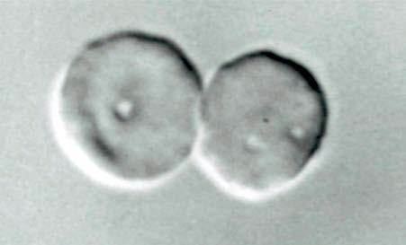

# Chapter 536: Hyposplenism, Splenic Trauma, and Splenectomy
> **Course:** Vikkypaedia Pediatric Basic Course (*Nelson Textbook of Pediatrics, 22nd Edition (2025)*)  
> **Part XIX:** Diseases of the Blood  
> **Authors:** Allison S. Remiker and Amanda M. Brandow  
> **Metrics:** 1,952 words · 2 tables/boxes · 1 figures · 1 genes · 8 flashcards · 5 MCQs  
> **Quick Navigation:** [🃏 Study 8 Flashcards](../flashcards/536_flashcards.md) · [📝 Take 5-Q MCQ Quiz](../mcqs/536_mcqs.md) · [📚 Part XIX Guide](../parts/Part_XIX.md) · [🧬 Syndrome & Genetics Atlas](../omim_gene_atlas.md) · [💊 Therapeutics Matrix](../therapies_matrix.md) · [🏠 Course Index](../../index.md)

## Key Genetic & Molecular Targets
`GDF1`

## ⚡ High-Yield Nelson Pediatric Board Pearls
- Splenic hypofunction is characterized by red blood cell (RBC) inclusions in peripheral blood smears (Howell-Jolly or Heinz bodies), “pits” on interference microscopy, and poor uptake of technetium or other spleen scans.
- Nonoperative management is typically possible in >90% of patients.
- Serious infections may occur after an animal bite or lick (particularly dogs) and is caused by Capnocytophaga canimorsus or C. cynodegmi.
- Prophylactic antibiotics should be given after a bite poten tially to prevent sepsis caused by these organisms.
- Preoperative, intraoperative, and postoperative management may decrease the risk of postsplenectomy infection.
- The 7-valent (PCV7) was replaced by the 13-valent pneumococcal polysaccharide-protein conju gate vaccine (PCV13).
- Thus, depending on what primary pneumococcal vaccine was given, a single dose of PCV13 may be recommended.

---
## Full Chapter Text, Tables & Figures
# Chapter 536: Hyposplenism, Splenic Trauma, and Splenectomy

*Allison S. Remiker and Amanda M. Brandow*

<!-- p.3921 -->
**HYPOSPLENISM** Congenital absence (asplenia) or underdevelopment (hyposplenia) of the spleen is associated with complex cyanotic heart defects, dex trocardia, bilateral trilobed lungs, and heterotopic abdominal organs (**Ivemark syndrome**; see Chapter 480.11). Patients with isolated con genital asplenia have pathogenic variants in *RPSA* in ∼40% of cases. Right atrial isomerism (Ivemark syndrome), a form of heterotaxy, may have asplenia associated with pathogenic variants of *GDF1*. Splenic function is usually normal in children with congenital polysplenia. **Functional hyposplenism** may occur in normal neonates, especially premature infants. Children with sickle cell hemoglobinopathies (see Chapter 511.1) may have splenic hypofunction as early as 6 months of age. In this setting, the spleen eventually autoinfarcts and becomes fibrotic and permanently nonfunctional. Functional hyposplenism may also occur in malaria (see Chapter 334), after irradiation to the left upper quadrant, and when the reticuloendothelial function of the spleen is overwhelmed (as in severe hemolytic anemia or metabolic storage disease). Thrombosis of the splenic/celiac arteries or splenic vein is associated with functional hyposplenism. Splenic hypofunction has been reported occasionally in patients with autoimmune diseases (i.e., juvenile idiopathic arthritis, lupus, sarcoidosis), nephritis, inflam matory bowel disease, celiac disease, chronic hepatitis, Pearson syn drome, Fanconi anemia, those with use of high-dose corticosteroids, and graft-versus-host disease (Table 536.1).

Splenic hypofunction is characterized by **red blood cell (RBC) inclusions** in peripheral blood smears (Howell-Jolly or Heinz bodies), “pits” on interference microscopy, and poor uptake of technetium or other spleen scans (Table 536.2 and Fig. 536.1). Reduced immuno globulin M memory B cells may also be detected and is a risk factor for overwhelming **sepsis**. Patients with functional hyposplenism or asplenia are at increased risk for sepsis from **encapsulated bacteria** and benefit from antibiotic prophylaxis and urgent evaluation when febrile.

**SPLENIC TRAUMA** Injury to the spleen may occur with abdominal trauma. Small splenic capsular tears may cause abdominal or referred left shoulder pain as a result of diaphragmatic irritation by blood. Larger tears result in more severe blood loss, with similar pain and signs of **hypovolemic shock**. Previously enlarged spleens (as in patients with infectious mononucle osis) are more likely to rupture with minor trauma. *Patients with sple nomegaly should avoid contact sports and other activities that increase the risk of splenic trauma.* CT scan with intravenous contrast is the best imaging modality to assess splenic trauma in a hemodynamically stable patient. In emergent situations extended focused assessment with sonography in trauma (E-FAST) should be considered as an ini tial evaluation, although the sensitivity and specificity in children is variable.

Treatment of a small capsular injury should include careful obser vation with attention to changes in vital signs or abdominal findings, serial hemoglobin determinations, and the availability of prompt surgi cal intervention if a patient's condition deteriorates (see Chapter 80). RBC transfusion requirements should be minimal (<25 mL/kg/48 hr). These patients are usually hospitalized for 10-14 days and have their activities restricted for months. Laparotomy, with or without splenec tomy, is indicated for more marked abdominal bleeding, in patients who have clinical instability or deterioration, or when other organ

damage is suspected. Partial splenectomy and splenic repair should be substituted for total splenectomy when feasible to maintain some splenic immune function. Nonoperative management is typically possible in >90% of patients. Delayed splenic rupture is quite rare in children.

**SPLENECTOMY** Splenectomy should be limited to specific indications where medical therapy is (or has been) ineffective. These include traumatic splenic rupture, anatomic defects, splenic malignancy (i.e., splenic marginal zone lymphoma [SMZL]), severe transfusion-dependent hemolytic anemia, refractory and severe immune-mediated cytopenias, meta bolic storage diseases, and secondary hypersplenism. There are certain conditions where splenectomy should be avoided because of increased risk of complications and/or better alternative treatments. These include autoimmune lymphoproliferative syndrome (ALPS), heredi tary stomatocytosis (HSt), hereditary xerocytosis (HX), cold agglutinin disease (CAD), paroxysmal cold hemoglobinuria (PCH), Gaucher dis ease, and thrombocytopenia in hepatic cirrhosis. *The major long-term risk of splenectomy is sudden, overwhelming postsplenectomy infections (sepsis or meningitis).* This risk is especially high in children <5 years old at surgery. The risk of sepsis is less when splenectomy is performed for trauma, RBC membrane defects, and immune thrombocytopenia (2–4%) than when there is sickle cell anemia, thalassemia, or a preexist ing immune deficiency (Wiskott-Aldrich syndrome, Hodgkin disease) or reticuloendothelial blockade (storage disease, severe hemolytic ane mia) (8–30%). The overall risk is 2-5 per 1,000 asplenic patient-years,

*Allison S. Remiker and Amanda M. Brandow*

Splenic Atrophy

#### **Table 536.1** Diseases Associated with Hyposplenism or

| Category / Parameter | Clinical Details & Findings |
| --- | --- |
| **CONGENITAL FORMS** | Normal and premature neonates; Isolated congenital hypoplasia; Ivemark syndrome; Autoimmune polyendocrinopa; thy–candidiasis–ectodermal; dystrophy (APECED) syndrome; Hypoparathyroidism syndrome; Stormorken syndrome; Heterotaxia syndromes |
| **DISORDERS** | Celiac disease; Inflammatory bowel disease; Whipple disease; Dermatitis herpetiformis; Intestinal lymphangiectasia; Idiopathic chronic ulcerative; enteritis |
| **HEPATIC DISORDERS** | Active chronic hepatitis; Primary biliary cirrhosis; Hepatic cirrhosis and portal; hypertension; Alcoholism and alcoholic; hepatopathy |
| **ONCOLOGIC DISORDERS** | Sickle cell disease (all genotypes); Bone marrow transplantation; Chronic graft-versus-host disease; Acute leukemia; Chronic myeloproliferative; disorders; Fanconi syndrome; Splenic tumors; Mastocytosis |
| **AUTOIMMUNE DISORDERS** | Systemic lupus erythematosus; Juvenile idiopathic arthritis; Glomerulonephritis; Granulomatosis with polyangiitis; Goodpasture syndrome; Sjögren syndrome; Polyarteritis nodosa; Thyroiditis; Sarcoidosis |
| **INFECTIOUS DISEASES** | Pneumococcal meningitis |
| **HIV/AIDS** | Malaria |
| **IATROGENIC FORMS** | Exposure to methyldopa; High-dose steroids; Total parenteral nutrition; Splenic irradiation |
| **CIRCULATION** | Thrombosis of splenic artery; Thrombosis of splenic vein; Thrombosis of celiac artery |
| **MISCELLANEOUS** | Amyloidosis; From Di Sabatino A, Carsetti R, Corazza GR. Post-splenectomy and hyposplenic states.; Lancet 2011;378:86–97. |

<!-- p.3922 -->
with a lifelong risk of overwhelming postsplenectomy infections of 5%; more than half occur within 2 years after splenectomy, although the risk remains lifelong. The use of laparoscopic splenectomy has decreased surgical morbidity and hospitalization time.

Encapsulated bacteria, such as *Streptococcus pneumoniae* (>60% of cases), *Haemophilus influenzae,* and *Neisseria meningitidis,* account for >80% of cases of postsplenectomy sepsis. Because the spleen is respon sible for filtering the blood and for early antibody responses, sepsis (with or without meningitis) can progress rapidly, leading to death within 12-24 hours of onset. Febrile splenectomized patients should be evaluated and treated promptly with antibiotics to cover the organisms previously mentioned. This treatment should be initiated at home if access to definitive medical care will be delayed. Common empiric anti biotics include amoxicillin-clavulanate or cefdinir. A broad-spectrum cephalosporin (cefotaxime or ceftriaxone) is recommended until spe cific antibiotic susceptibility and presence, or absence of meningitis is known. Vancomycin (to cover penicillin-resistant pneumococci) should be initiated, depending on the illness severity and susceptibili ties of pneumococci at the institution. Splenectomized patients are also at increased risk for contracting protozoal infections, such as malaria and babesiosis. Serious infections may occur after an animal bite or lick (particularly dogs) and is caused by *Capnocytophaga canimorsus* or *C. cynodegmi*. Prophylactic antibiotics should be given after a bite poten tially to prevent sepsis caused by these organisms (see Chapter 765).

Preoperative, intraoperative, and postoperative management may decrease the risk of postsplenectomy infection. It is important to be

certain of the need for splenectomy and, if possible, to postpone the operation until the patient is ≥5 years of age. *Pneumococcal, meningo coccal, and H. influenzae conjugate vaccines given at least 14 days before splenectomy may reduce postsplenectomy sepsis.* The 7-valent (PCV7) was replaced by the 13-valent pneumococcal polysaccharide-protein conju gate vaccine (PCV13). Thus, depending on what primary pneumococcal vaccine was given, a single dose of PCV13 may be recommended. In addition, the 23-valent pneumococcal polysaccharide vaccine (Pneu movax) should be given at age ≥2 years and a second dose 5 years later. Yearly influenza vaccine should also be given because influenza infection is a risk factor for secondary pneumococcal infections. Prophylaxis with oral penicillin VK (125 mg twice daily for children <5 years old; 250 mg twice daily for children ≥5 years) should be given until at least 5 years of age and for at least 2 years after splenectomy. Although the greatest risk is in the immediate postoperative period, reports of deaths occurring years after splenectomy suggest that the risk (and the need for prophy laxis) may be lifelong. Lifelong prophylaxis should be strongly consid ered in patients who have had an invasive pneumococcal infection or who have an underlying immune deficiency. In children with sickle cell disease, penicillin prophylaxis should be started as soon as the diagnosis is made. Prophylaxis may be continued into adulthood for higher-risk patients, including those with a history of pneumococcal sepsis, but effectiveness in this older group has not been well documented.

In patients with traumatic injury, splenic repair or partial splenec tomy should be considered in an attempt to preserve splenic function. Partial splenectomy or partial *splenic embolization* may be sufficient to ameliorate some forms of hemolytic anemia. Up to 50% of children whose spleen is removed because of trauma have spontaneous spleno sis; *surgical splenosis* (distributing small pieces of spleen throughout the abdomen) may decrease the risk of sepsis in patients whose sple nectomy is necessitated by trauma. However, in both these settings, the splenic tissue that regrows frequently has poor function.

In addition to postsplenectomy sepsis, splenectomized patients may be at risk for **thromboembolic complications**, including arterial and venous thrombosis and pulmonary hypertension. These findings have been reported regardless of the underlying reason for splenectomy and the postsplenectomy platelet count. Proposed mechanisms include loss of filtering function of the spleen, allowing abnormal RBCs to remain in the circulation and activate the coagulation cascade. Portal vein throm bosis has been reported as a complication of laparoscopic splenectomy. The etiology of pulmonary hypertension is not well understood. It has been described in chronic hemolytic conditions including thalassemia, sickle cell disease, and hereditary spherocytosis, indicating there may be a relation to ongoing chronic hemolysis postsplenectomy.

*Visit Elsevier eBooks+ at eBooks.Health.Elsevier.com** for Bibliography.*

#### **Table 536.2** Diagnostic Techniques for and Features of Spleen Dysfunction

| Category / Parameter | Clinical Details & Findings |
| --- | --- |
| **COMMENTS** | Immunoglobulin M memory B cells; Cells dependent on spleen for survival.; Produced in marginal zone.; Special tests required.; Technetium-99m–labeled sulfur; colloidal scintiscan; Quantitation of splenic uptake of colloidal; sulfur particles enables a fairly accurate; static assessment of spleen function.; Hypertrophy of the left hepatic lobe might be a limiting; factor (this technique does not clearly show whether the; mass originated in the liver or the spleen in the pres; ence of an overlapping hypertrophic left hepatic lobe).; Technetium-99m–labeled or rubidium-; 81–labeled heat-damaged; autologous erythrocyte clearance; Measurement of clearance time allows a; dynamic evaluation of spleen function.; Preexisting erythrocyte defects, difficult erythrocyte incor; poration of the radioisotope, and false-positive or false-; negative results in relation to excessive or insufficient heat; damage make the test not suitable for clinical practice.; Detection of Howell-Jolly bodies by; staining; Erythrocytes with nuclear remnants; Flow cytometry; No need for special equipment; inaccurate in the quanti; tation of splenic hypofunction.; Detection of pitted erythrocytes by; phase-interference microscopy; Erythrocytes with membrane indentations; (4% upper limit of the normal range); Need for phase-interference microscopy; counts enable a; wide range of measurements and correlate with radio; isotopic methods.; From Di Sabatino A, Carsetti R, Corazza GR. Post-splenectomy and hyposplenic states. Lancet 2011;378:86–97. Table 1. |

**Fig. 536.1** Characteristic pitted erythrocytes in hyposplenism. A pit ted erythrocyte is recognizable on phase-interference microscopy by the characteristic “pit” on the cell membrane (arrows). (From Di Sa batino A, Carsetti R, Corazza GR. Post-splenectomy and hyposplenic states. Lancet. 2011;378:86–97. Fig 2.)

<!-- p.3923 -->
