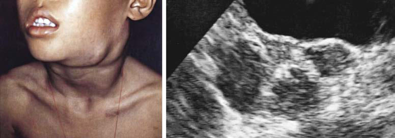
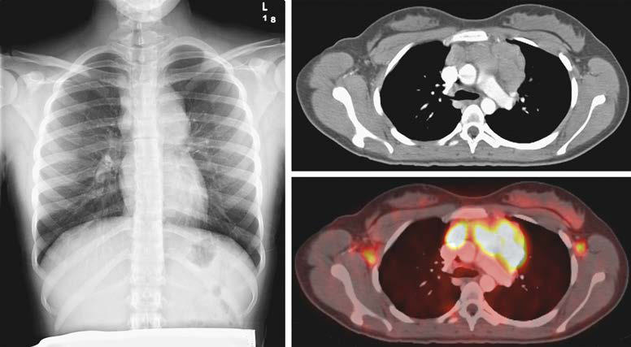

# Chapter 542: Principles of Cancer Diagnosis
> **Course:** Vikkypaedia Pediatric Basic Course (*Nelson Textbook of Pediatrics, 22nd Edition (2025)*)  
> **Part XX:** Cancer and Benign Tumors  
> **Authors:** Julia C. Meade, Erika D. Friehling, and A. Kim Ritchey  
> **Metrics:** 3,215 words · 2 tables/boxes · 2 figures · 3 genes · 8 flashcards · 5 MCQs  
> **Quick Navigation:** [🃏 Study 8 Flashcards](../flashcards/542_flashcards.md) · [📝 Take 5-Q MCQ Quiz](../mcqs/542_mcqs.md) · [📚 Part XX Guide](../parts/Part_XX.md) · [🧬 Syndrome & Genetics Atlas](../omim_gene_atlas.md) · [💊 Therapeutics Matrix](../therapies_matrix.md) · [🏠 Course Index](../../index.md)

## Key Genetic & Molecular Targets
`IGF2`, `TERT`, `TP53`

## ⚡ High-Yield Nelson Pediatric Board Pearls
- Almost all cervical carcinomas are caused by human papillomaviruses (HPVs).
- Beckwith-Wiedemann syndrome (BWS), the most commonly identified imprinting disorder, is an overgrowth syndrome characterized by macrosomia, macroglossia, hemihypertrophy, omphalocele, and renal anomalies that is also associated with an increased risk of Wilms tumor, hepatoblastoma, rhabdomyosar coma, neuroblastoma, and adrenocortical carcinoma.
- With DNA replication there is a progressive shorten ing of telomere length, which is a hallmark of cellular aging and acts as a replicative senescence signal.
- The challenge for the pediatrician is to be alert to the clues suggesting a diagnosis of cancer.
- In children, dissemination of disease at diagnosis is common, and presenting symptoms or signs are often caused by systemic involve ment.
- Delays in diagnosis are particu larly problematic during late adolescence and are the result of a vari ety of factors prominent in this age-group, including historic lack and complexity of health insurance coverage.
- Although there is no clearly established set of warning signs of can cer in young people, the most common cancers in children suggest some guidelines that may be helpful in early recognition of signs and symptoms of cancer.

---
## Full Chapter Text, Tables & Figures
# Chapter 542: Principles of Cancer Diagnosis

*Julia C. Meade, Erika D. Friehling, and A. Kim Ritchey*

<!-- p.3947 -->
transplantation. **Human herpesvirus 8 (HHV-8)** is associated with the development of Kaposi sarcoma.

Children who are chronically infected with **hepatitis B virus** (hepati tis B surface antigen positive) have a 100-fold increased risk of develop ing **hepatocellular carcinoma**. In adults the latency period between viral infection and development of hepatocellular carcinoma approaches 20 years. However, in children who acquire the viral infection through peri natal transmission, the latency period can be as short as 6-7 years. The additional factors that are required for the malignant transformation of virally infected hepatocytes are not clear. **Hepatitis C virus** infection is another risk factor for hepatocellular carcinoma and is also associated with a subset of B-cell non-Hodgkin lymphomas such as splenic lymphoma.

Almost all cervical carcinomas are caused by **human papillomaviruses (HPVs)**. High-risk HPVs include types 16 and 18 but also types 31, 33, 34, 45, 52, and 58, which together cause >90% of cervical cancers. Vaccines against the major oncogenic subtypes are now available and are likely to save hundreds of millions of lives worldwide. The low-risk HPVs, includ ing 6 and 11, which are commonly found in genital warts, are almost never associated with malignancies. Like other virus-associated cancers, the presence of HPV alone is not sufficient to cause malignant transformation. The mechanism by which the HPV-associated **oncoproteins HPV E6** and **E7** induce malignant transformation is thought to involve both the TP53 and the RB tumor-suppressor proteins, as well as other pathways that are critical in cell cycle progression, maintenance of telomerase and genomic stability, and apoptosis.

**Radiation** Children who are exposed to ionizing radiation, either via environ mental factors or from medical diagnostics or treatment, are also at an increased of developing cancer over their lifetime, especially leuke mias, brain, breast, skin, or thyroid malignancies. This increased pedi atric cancer risk is likely due both to the enhanced radiosensitivity of the developing organs of children and their longer postexposure life expectancy. Diagnostic imaging (e.g., CT scans) and therapeutic radia tion for children with cancer are a major source of childhood radiation exposure. However, CT scan dose-reduction strategies, the increased use of MRI in pediatric medical centers, and the shift in therapeutic practice in oncology to proton radiotherapy all have been integral in lowering the exposure of children to ionizing radiation.

**Genomic Imprinting** The development of cancer has also been linked to *genomic imprinting,* which is the selective inactivation of one of two alleles of certain genes depending on parental origin. **Beckwith-Wiedemann syndrome (BWS)** (see Chapter 113), the most commonly identified imprinting disorder, is an overgrowth syndrome characterized by macrosomia, macroglossia, hemihypertrophy, omphalocele, and renal anomalies that is also associated with an increased risk of Wilms tumor, hepatoblastoma, rhabdomyosar coma, neuroblastoma, and adrenocortical carcinoma. This increased risk in developing cancer is directly associated with changes in the promoter methylation patterns (or loss of heterozygosity) of imprinted genes on chromosome 11p15.5. Normally, the maternally derived *IGF2* (insulinlike growth factor receptor 2) allele at this genomic locus is inactivated, thus suppressing *IGF2* expression. However, children with BWS show a gain of methylation in this promoter region, which allows for expression from both maternal and paternal *IGF2* alleles, leading to growth factor overexpression. Concurrently, the neighboring maternal *H19* gene (which encodes ncRNA and miRNA critical in growth suppression) is silenced by this hypermethylation, ultimately resulting in a progrowth phenotype and predisposition to tumor development.

**Telomerase* Telomeres* are a series of tens to thousands of TTAGGG DNA sequence repeats at the ends of chromosomes that are important for stabilizing the chromosomal ends and limiting breakage, translocation, and loss of DNA material. With DNA replication there is a progressive shorten ing of telomere length, which is a hallmark of cellular aging and acts as a replicative senescence signal. In a majority of cancers, **telomerase** (encoded by the *TERT* gene), an enzyme that adds telomeres to the

ends of chromosomes, becomes activated, usually through pathologic variants in the *TERT* promoter. The telomerase-driven maintenance of telomere length in tumors enables unrestrained cellular proliferation by relieving a main checkpoint to cellular life span.

*Visit Elsevier eBooks+ at eBooks.Health.Elsevier.com** for Bibliography.*

Childhood cancer is uncommon and can manifest with symptoms seen with nonmalignant illnesses. The challenge for the pediatrician is to be alert to the clues suggesting a diagnosis of cancer. In addition to the classic manifestations, any persistent, unexplained symptom or sign should be evaluated as potentially emanating from a cancerous or precancerous condition.

**SIGNS AND SYMPTOMS** The symptoms and signs of cancer are variable and nonspecific in pedi atric patients. The types of cancer that occur during the first 20 years of life vary dramatically as a function of age—more so than at any other comparable age range (see Chapter 540). Unlike cancers in adults, childhood cancers usually originate from the deeper, visceral struc tures and from the parenchyma of organs rather than from the epi thelial layers that line the ducts and glands of organs and compose the skin. In children, dissemination of disease at diagnosis is common, and presenting symptoms or signs are often caused by systemic involve ment. **Pain was one of the initial presenting symptoms in >50% of children with cancer in one study.** Infants and young children cannot express or localize their symptoms well.

Solid tumors may produce **mass effects** that are nonspecific, such as compression of the thoracic airways or superior vena cava (lymphoma), the optic chiasm and hypothalamic-pituitary region (craniopharyn gioma), and the fourth ventricle (cerebellar astrocytoma). Another fac tor is the variability in the physiology and biology of the host related to growth and development during infancy, childhood, and adolescence.

The signs of cancer in children are often attributed to other causes before the malignancy is recognized. Delays in diagnosis are particu larly problematic during late adolescence and are the result of a vari ety of factors prominent in this age-group, including historic lack and complexity of health insurance coverage.

Although there is no clearly established set of warning signs of can cer in young people, the most common cancers in children suggest some guidelines that may be helpful in early recognition of signs and symptoms of cancer (Table 542.1). Most of the symptoms and signs are not specific and might represent other possibilities in a differential diagnosis. Nonetheless, these clues encompass the common cancers of childhood and have been very useful in early detection.

**PHYSICAL EXAMINATION** Physical examination findings in a child with malignancy are depen dent on whether the cancer is systemic or localized. The cancers most common in children involve the lymphoid and hematopoietic system. When the bone marrow is compromised by malignancy (e.g., leu kemia, disseminated neuroblastoma), typical findings include pallor from anemia; bleeding, petechiae, or purpura from thrombocytopenia or coagulopathy; cellulitis or other localized infection from leukope nia; and skin nodules (especially in infants) and hepatosplenomegaly

*Julia C. Meade, Erika D. Friehling, and 
 A. Kim Ritchey*

<!-- p.3949 -->
from malignant leukocytosis. Abnormalities found in lymphatic malignancies include peripheral **adenopathy** (Fig. 542.1) and signs of superior vena cava syndrome from an anterior **mediastinal mass** (Fig. 542.2), including respiratory distress, and facial and neck pleth ora and edema. Enlargement of cervical lymph nodes is common in children, but when persistent, progressive, and painless, it often sug gests **lymphoma**. Supraclavicular adenopathy suggests underlying malignancy.

**Abnormalities of the central nervous system** (CNS) that can indicate cancer include headaches, vomiting, cranial nerve palsies, ataxia, afebrile seizures, ptosis, decreased visual activity, neuroen docrine deficits, and increased intracranial pressure, which may be diagnosed by the presence of papilledema (Fig. 542.3). Any focal neurologic deficit in the motor or sensory system, especially a

decrease in cranial nerve function, should prompt further investi gation for malignancy.

Ophthalmologic presentation of malignancy includes a **white pupillary reflex** (Fig. 542.4) rather than the usual red reflection from incident light. A white pupillary reflex is essentially pathog nomonic for retinoblastoma, although some benign conditions can mimic this finding. **Proptosis** can be produced by rhabdomyosar coma, neuroblastoma, lymphoma, and Langerhans cell histiocy tosis. In the few first years of life, Horner syndrome, periorbital ecchymosis, iris heterochromia, and opsoclonus-myoclonus all sug gest a diagnosis of neuroblastoma.

**Abdominal masses** can be divided into upper and lower locations. Malignancies in the upper abdomen include Wilms tumor, neuro blastoma, and hepatoblastoma. Enlargement of the liver or spleen

#### **Table 542.1** Common Manifestations of Childhood Malignancies

| Category / Parameter | Clinical Details & Findings |
| --- | --- |
| **POTENTIAL ETIOLOGY AND POSSIBLE DIAGNOSIS** | Constitutional/; systemic; Fever, persistent or recurrent infection, neutropenia; Bone marrow infiltration from leukemia, neuroblastoma; Fever of unknown origin, weight loss, night sweats; Hodgkin and non-Hodgkin lymphoma; Painless, persistent lymphadenopathy; Leukemia, Hodgkin lymphoma, non-Hodgkin lymphoma, Burkitt; lymphoma, thyroid carcinoma; Hypertension; Renal or adrenal tumor such as neuroblastoma, pheochromocytoma,; or Wilms tumor; Soft tissue mass; Ewing sarcoma, osteosarcoma, neuroblastoma, thyroid carcinoma,; rhabdomyosarcoma, Langerhans cell histiocytosis; Pain; Bone marrow involvement (ALL) or metastatic disease; (neuroblastoma), primary bone tumors, Langerhans cell histiocytosis; Neurologic/; ophthalmologic; Headache with emesis, visual disturbances, ataxia,; papilledema, cranial nerve palsies; Increased intracranial pressure from primary brain tumor or; metastasis; Leukocoria (white pupil); Retinoblastoma; Periorbital ecchymosis; Neuroblastoma; Miosis, ptosis, heterochromia; Horner syndrome: compression of cervical sympathetic nerves from; neuroblastoma; Opsoclonus myoclonus, ataxia; Paraneoplastic syndrome from neuroblastoma; Exophthalmos, proptosis; Mass effect from rhabdomyosarcoma, lymphoma, or Langerhans; cell histiocytosis; Respiratory/; thoracic; Cough, stridor, pneumonia, tracheal-bronchial; compression; superior vena cava syndrome; Anterior mediastinal mass due to germ cell tumor, non-Hodgkin; lymphoma, or Hodgkin lymphoma; Vertebral or nerve root compression; dysphagia; Posterior mediastinal mass from neuroblastoma or Ewing sarcoma; Gastrointestinal; Abdominal mass; Neuroblastoma, Wilms tumor, lymphoma; Diarrhea; Vasoactive intestinal peptide secretion from neuroblastoma,; ganglioneuroma; Hematologic; Pallor, anemia; Bone marrow infiltration from leukemia, neuroblastoma; Petechiae, thrombocytopenia; Bone marrow infiltration from leukemia, neuroblastoma; Musculoskeletal; Bone pain, limp, arthralgia; Osteosarcoma, Ewing sarcoma, leukemia, metastatic neuroblastoma; Endocrine; Diabetes insipidus; Pituitary tumor, Langerhans cell histiocytosis; Poor growth; Diencephalic syndrome from hypothalamic tumor; Galactorrhea; Pituitary tumor/prolactinoma; Precocious puberty; Germ cell tumor (cranial or extracranial), adrenocortical carcinoma,; hepatoblastoma; ALL, Acute lymphoblastic leukemia; Adapted from Marcdante KJ, Kliegman RM, Jenson HB, et al., eds. Nelson Essentials of Pediatrics. 6th ed. Philadelphia: Saunders; 2011. p. 588. |

<!-- p.3950 -->
from leukemia can be mistaken for an upper abdominal mass. Lower abdominal masses non-Hodgkin lymphoma, neuroblastoma, germ cell tumors (ovarian), and sarcomas.

**Rhabdomyosarcoma** can occur as an extremity mass, particularly in adolescents, but also as a mass in the head and neck region (e.g., orbit, nasopharynx, and others). These tumors can be deceptively benign in

**Fig. 542.1** Cervical lymphadenopa thy. Manifestations on physical exami nation (A), and ultrasound examination (B). N, Abnormally enlarged lymph nodes. (From Sinniah D, D’Angio GJ, Chatten J, et al. Atlas of Pediatric On cology. London: Arnold; 1996.)

A B

N

N

N N

**Fig. 542.2** Anterior upper mediasti nal mass from non-Hodgkin lympho ma. A, Plain chest radiograph. B, CT scan. C, PET scan.

A

B

C

**Fig. 542.3** Papilledema on fundoscopic examination. (From Sinniah D, D’Angio GJ, Chatten J, et al. Atlas of Pediatric Oncology. London: Arnold; 1996.)

**Fig 542.4**  White pupillary reflex in the left eye. *(From Sinniah D, D’Angio GJ, Chatten J, et al. Atlas of Pediatric Oncology. London: Ar nold; 1996.)*

<!-- p.3951 -->
appearance, but as with all unexplained masses, require immediate attention. Sacrococcygeal masses in neonates are usually **teratomas**, which are usually benign but can undergo malignant transformation if not removed promptly. **Neuroblastoma** can present as “blueberry muffin” spots on the skin of neonates or as periorbital ecchymosis in older children.

**AGE-RELATED MANIFESTATIONS** Because various types of cancer in children occur at specific ages, the physician should tailor the history and physical examination based on the age of the child. The **embryonal tumors**, including neuroblastoma, retinoblastoma, and hepatoblastoma usually occur during the first 2 years of life (see Fig. 540.4). The peak age for pre sentation of **Wilms tumor** is 3-4 years. Two thirds of patients with **rhabdomyosarcoma** present before age 6 with another smaller peak in adolescence. From 1-4 years of age, **acute lymphoblastic leu kemia** peaks in incidence. **Brain tumors** have a peak incidence in the first decade of life. **Non-Hodgkin lymphomas** are uncommon earlier than 5 years of age but steadily increase thereafter. During adolescence, bone tumors, Hodgkin lymphoma, and gonadal and soft tissue sarcomas predominate. Hence, for infants and toddlers, special attention should be paid to the possibility of embryonal and intraabdominal tumors. Preschool-age and early school-age children showing compatible signs and symptoms should be spe cifically evaluated for **leukemia**. School-age children might present with lymphoma or with brain tumors. Adolescents require assess ment for bone and soft tissue sarcomas and gonadal malignancies, as well as for Hodgkin lymphoma.

**EARLY DETECTION** The prognosis of malignancy in children depends primarily on tumor type, extent of disease at diagnosis, and rapidity of response to treatment. Early diagnosis helps to ensure that appropriate ther apy is given in a timely manner and thus optimizes the chances of cure. Because most physicians in general practice rarely encounter children with undiagnosed cancer, they should remember to inves tigate the possibility of malignancy, especially when they encounter an atypical course of a common childhood condition, unusual man ifestations that do not fit common conditions, and any persistent symptom that defies diagnosis. It is also good practice to obtain a three-generation family pedigree with specific attention to a family history of cancer. A strong family history of cancer would suggest a referral for a cancer predisposition evaluation.

Delays in diagnosis are particularly likely in certain clinical situa tions. The cardinal symptom of both **osteosarcoma** and **Ewing sar coma** is localized and usually persistent pain. Because these tumors occur during the second decade of life, a time of increased physical activity, patients often assume the pain results from trauma. Prompt radiologic evaluation can help confirm the diagnosis. **Lymphoma**, especially during adolescence, often manifests as an anterior mediastinal mass. Symptoms such as chronic cough, unexplained shortness of breath, or “new-onset asthma” are typical with this pre sentation and are often overlooked. Tumors of the nasopharynx or middle ear can mimic infection. Prolonged, unexplained ear pain, nasal discharge, retropharyngeal swelling, and trismus should be investigated as possible signs of malignancy.

Early symptoms of **leukemia** may be limited to prolonged or unexplained low-grade fever. Bone and joint pain may present with refusal to walk. Blood counts with abnormalities in two or more cell lines might indicate the need for bone marrow examination,

even when leukemic blast cells are not seen in the blood smear (see Table 542.1).

Mass screening for children with malignancy is not feasible. A screening program to detect early-stage neuroblastoma was suc cessful in documenting more cases of the disease but had no impact on overall outcome. However, certain children are at increased risk for cancer and require an individualized plan to ensure early detec tion of malignancy. Select examples include children with certain chromosome abnormalities, such as Down syndrome, Klinefelter syndrome, and WAGR syndrome (Wilms tumor, *a*niridia, *g*eni tal abnormalities, mental *r*etardation); children with overgrowth syndromes, such as Beckwith-Wiedemann syndrome or hemihy pertrophy; and children with certain inherited single-gene disor ders, including hereditary retinoblastoma, Li-Fraumeni syndrome, familial adenomatous polyposis, and neurofibromatosis (see Table 541.2).

**ENSURING THE DIAGNOSIS** When a malignant neoplasm is suspected, the immediate goal is to confirm the diagnosis. A tentative diagnosis can often be estab lished based on the patient’s age, symptoms, and location of masses. Selected imaging techniques and tumor markers can facilitate the diagnostic approach (Table 542.2 and Fig. 542.5). Especially when a solid tumor is present, the pediatric oncologist, surgeon, and pathologist should work as a team to determine the site of biopsy, amount of tissue required, and whether percutaneous image-guided biopsy, incisional biopsy, or excisional biopsy and tumor resection are indicated. For select situations, at the time of the initial diag nostic procedure, plans for bone marrow aspiration and biopsy and placement of central venous access may be appropriate.

Pathologic evaluation of pediatric malignancies requires appro priate handling of tissue so that multiple different techniques can be used to obtain a diagnosis. It is important that some fresh tis sue not be placed in formalin. Along with routine light microscopy, pathologic evaluation may include immunochemistry, flow cytom etry, cytogenetics, molecular genetic studies (e.g., fluorescence in situ hybridization, tumor whole exome sequencing, and evaluation of circulating tumor genes with cell-free DNA detection in blood). Additional technologies include DNA microarray analysis and can cer genome sequencing that can identify specific gene expression patterns and sequences in tumors, which can facilitate more accu rate classification and treatment.

**STAGING** Once a specific diagnosis is confirmed, studies to define the extent of the malignancy are necessary to determine prognosis and treat ment. Table 542.2 outlines the minimum evaluation required for common pediatric malignancies. In addition, for many tumors (e.g., Wilms tumor, neuroblastoma, rhabdomyosarcoma), a surgical staging system is used. Surgical stage can be determined at the time of the initial diagnostic procedure or subsequently. For example, a patient who has abdominal surgery for possible Wilms tumor should have careful evaluation and biopsy of all adjacent lymph nodes. A child with rhabdomyosarcoma can require a subsequent biopsy of sentinel lymph nodes as determined by scintigraphy or dye injection adjacent to the primary tumor. The pathologist facili tates staging by examining margins of the specimen to determine residual tumor.

*Visit Elsevier eBooks+ at eBooks.Health.Elsevier.com** for Bibliography.*

<!-- p.3952 -->
CT MRI PET-CT PET-MRI

**Fig. 542.5** Neuroblastoma PET/CT sagittal fused image demonstrated partial mis-registration of avid disease, occult on the low-dose noncontrast CT. PET/MRI sagittal fused image demonstrated correct image co-registration with corresponding T2-weighted hyperintensity in L3 vertebra,

#### **Table 542.2** Workup of Common Pediatric Malignancies to Assess Primary Tumor and Potential Metastases

| Category / Parameter | Clinical Details & Findings |
| --- | --- |
| **TESTS** | Leukemia; Yes (includes; flow cytometry,; cytogenetics,; molecular; studies); Yes; —; —; —; —; Yes; —; —; Non-Hodgkin; lymphoma; Yes (includes; flow cytometry,; cytogenetics,; molecular; studies); Yes; Yes; —; Yes; Yes; (selected; cases); Yes; —; —; Hodgkin; lymphoma; Yes (in advanced; stage); Yes; Yes; —; Yes; —; —; —; —; CNS tumors; —; —; —; Yes; —; —; Yes (selected; cases); Yes; (selected; cases); —; Neuroblastoma; Yes (includes; cytogenetics,; molecular; studies); —; Yes; Yes; —; —; —; Urine VMA, |
| **HVA** | MIBG or PET; scan; bone; x-rays; Wilms tumor; —; Yes; Yes; —; —; —; —; —; —; Rhabdomyo; sarcoma; Yes; Yes; Yes; Yes (select; sites); —; Yes; (selected; cases); Yes (for; paramenin; geal tumors; only); —; —; Osteosarcoma; —; Yes; Yes (of; chest); Yes (for; primary; tumors); —; Yes; (selected; cases); —; —; —; Ewing; sarcoma; Yes (selected; cases); Yes; Yes (of; chest); Yes (for; primary; tumors); Yes; Yes; (selected; cases); —; —; —; Germ cell; tumors; —; Yes; Yes; Consider; MRI of; brain; —; —; — |
| **AFP, HCG** | —; Liver tumors; —; Yes; Yes; —; —; —; — |
| **AFP, HCG** | —; Retinoblastoma; Selected cases; —; Yes; Yes (includes; brain); —; Yes; (selected; cases); Selected; cases; —; —; AFP, α-Fetoprotein; CNS, central nervous system; CSF, cerebrospinal fluid; HCG, human chorionic gonadotropin; HVA, homovanillic acid; MIBG, metaiodobenzylguanidine; VMA,; vanillylmandelic acid.; Modified from Marcdante KJ, Kliegman RM, Jenson HB, et al., eds. Nelson Essentials of Pediatrics. 6th ed. Philadelphia: Saunders; 2011. p. 589. |

<!-- p.3953 -->
