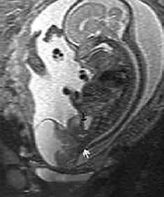

# Chapter 552: Gonadal and Germ Cell Neoplasms
> **Course:** Vikkypaedia Pediatric Basic Course (*Nelson Textbook of Pediatrics, 22nd Edition (2025)*)  
> **Part XX:** Cancer and Benign Tumors  
> **Authors:** Cynthia E. Herzog and Winston W. Huh  
> **Metrics:** 2,242 words · 3 tables/boxes · 1 figures · 2 genes · 8 flashcards · 5 MCQs  
> **Quick Navigation:** [🃏 Study 8 Flashcards](../flashcards/552_flashcards.md) · [📝 Take 5-Q MCQ Quiz](../mcqs/552_mcqs.md) · [📚 Part XX Guide](../parts/Part_XX.md) · [🧬 Syndrome & Genetics Atlas](../omim_gene_atlas.md) · [💊 Therapeutics Matrix](../therapies_matrix.md) · [🏠 Course Index](../../index.md)

## Key Genetic & Molecular Targets
`DICER1`, `RB1`

## ⚡ High-Yield Nelson Pediatric Board Pearls
- Metastatic disease is rarely pres ent at diagnosis; evaluation of the cerebrospinal fluid and bone marrow for tumor metastasis and radionuclide bone scan are required only if indicated by other clinical, laboratory, or imaging findings.
- The differential diagnosis of retinoblastoma includes other causes of leukocoria, including persistent hyperplastic primary vitreous, Coats disease, vitreous hemorrhage, cataract, endophthalmitis from Toxocara canis, choroidal coloboma, retinopathy of prematurity, and familial exudative vitreoretinopathy.
- PROGNOSIS Approximately 95% of U.S. children with retinoblastoma are cured with modern treatment.
- The prognosis for children with retinoblastoma that has spread outside the eye is poor.
- Because GCTs may contain benign and mixed malignant ele ments in different areas of the tumor, extensive sectioning is essential to confirm the correct diagnosis.
- CLINICAL MANIFESTATIONS AND DIAGNOSIS The clinical presentation of germ cell neoplasms depends on location.
- If elevated, these markers provide important confirma tion of the diagnosis and provide a means for risk stratification and to monitor the patient for tumor response and recurrence.

---
## Full Chapter Text, Tables & Figures
# Chapter 552: Gonadal and Germ Cell Neoplasms

*Cynthia E. Herzog and Winston W. Huh*

<!-- p.4035 -->
under general anesthesia by an experienced ophthalmologist to obtain complete visualization of both eyes, which also facilitates photograph ing and mapping of the tumors. Retinal detachment or vitreous hemor rhage can complicate the evaluation.

Orbital ultrasonography, CT, or MRI is used to evaluate the extent of intraocular disease and extraocular spread (Fig. 551.2). In approxi mately 5% of cases, a pineal area (primitive neuroectodermal) tumor is detected in a child with hereditary and bilateral retinoblastoma, a phe nomenon known as **trilateral retinoblastoma**. MRI allows for better evaluation of optic nerve involvement. Metastatic disease is rarely pres ent at diagnosis; evaluation of the cerebrospinal fluid and bone marrow for tumor metastasis and radionuclide bone scan are required only if indicated by other clinical, laboratory, or imaging findings.

The **differential diagnosis** of retinoblastoma includes other causes of leukocoria, including persistent hyperplastic primary vitreous, Coats disease, vitreous hemorrhage, cataract, endophthalmitis from *Toxocara canis*, choroidal coloboma, retinopathy of prematurity, and familial exudative vitreoretinopathy.

**TREATMENT** Treatment is determined by the size and location of the tumors, if the disease is localized to the eye or has spread either to the brain or to the rest of the body, and whether the child has hereditary or sporadic dis ease. The primary goal of treatment is always cure; the secondary goals include preserving vision and the eye itself and decreasing the risk of late side effects, mainly secondary malignancies. With current modali ties for local control of intraocular tumors and more effective systemic chemotherapy, primary enucleation is being performed less often.

Most unilateral disease presents with a solitary, large tumor. **Enucle ation** is performed if useful vision cannot be salvaged. With bilateral disease, chemoreduction in combination with **focal therapy** (laser pho tocoagulation or cryotherapy) has replaced the traditional approach of enucleation of the more severely affected eye and irradiation of the remaining eye. If feasible, small tumors can be treated with focal therapy with careful follow-up for recurrence or new tumor growth. Larger tumors often respond to multiagent **chemotherapy**, including carboplatin, vincristine, and etoposide given intravenously. However, systemic therapy is generally reserved for patients with unilateral dis ease when high-risk features are noted after enucleation, or in very young patients with bilateral disease that are at higher risk of complica tions with intraarterial chemotherapy. The delivery of chemotherapy via the ophthalmic artery is becoming more common, as is delivery of intravitreal chemotherapy. If these approaches fail, **external-beam irradiation** should be considered, although this approach may result in significant orbital deformity and increased incidence of second malignancies in patients with germline *RB1* pathologic genetic vari ants. **Brachytherapy**, or *episcleral plaque radiotherapy,* is an alternative with less morbidity. Enucleation may be required for unresponsive or recurrent tumors. Intense multiagent chemotherapy with autologous stem cell rescue may be used for patients with metastatic disease.

**Fig. 551.2** Axial contrast-enhanced CT scan shows calcified retino blastoma of the left eye. (From Haaga JR, Boll DT, eds. CT and MRI of the Whole Body. 6th ed. Philadelphia: Elsevier; 2017. Fig. 20-32.)

**PROGNOSIS** Approximately 95% of U.S. children with retinoblastoma are cured with modern treatment. Current efforts using chemotherapy in com bination with focal therapy are intended to preserve useful vision and avoid external-beam radiation or enucleation. Unfortunately, the diag nosis of retinoblastoma in many children from resource-poor coun tries is delayed, resulting in spread of the tumor outside the orbit. The prognosis for children with retinoblastoma that has spread outside the eye is poor. Trilateral retinoblastoma, disease involving both eyes and the pineal region, is almost universally fatal.

Children with germline *RB1* pathologic genetic variants are at sig nificant risk for development of *second malignancies*, especially osteo sarcoma, as well as soft tissue sarcomas and malignant melanoma. The risk of second malignancies is further increased by the use of radiation therapy. Other radiation-related late adverse effects include cataracts, orbital growth deformities, lacrimal dysfunction, and late retinal vas cular injury.

*Visit Elsevier eBooks+ at eBooks.Health.Elsevier.com** for Bibliography.*

**EPIDEMIOLOGY** Malignant **germ cell tumors (GCTs)** and gonadal tumors are rare, with an incidence of 12 cases per 1 million persons younger than 20 years. Most malignant tumors of the gonads in children are GCTs. The inci dence varies according to age and sex, although the incidence of GCTs in adolescent males has increased over time. **Sacrococcygeal** tumors occur predominantly in infant females. **Testicular** GCTs occur pre dominantly before age 4 years and after puberty. Klinefelter syndrome is associated with an increased risk of **mediastinal** GCTs. Trisomy 21, undescended testes, infertility, testicular atrophy, testicular microlithi asis, testicular dysgenesis syndrome, and inguinal hernias are associ ated with an increased risk of **testicular cancer**. The risk of testicular cancer in patients with cryptorchidism is reduced but not eliminated if orchiopexy is performed before 13 years of age. The risk of testicular GCT is increased in first-degree relatives and is highest among mono zygotic twins.

**PATHOGENESIS** The GCTs and non-GCTs arise from primordial germ cells and coe lomic epithelium, respectively. Testicular and sacrococcygeal GCTs arising during early childhood characteristically have deletions at chro mosome arms 1p and 6q and gains at 1q, and they lack the isochro mosome 12p that is highly characteristic of malignant GCTs of adults. Testicular GCTs also may demonstrate loss of imprinting. Ovarian GCTs from older females characteristically have deletions at 1p and gains at 1q and 21. Dysregulation of microRNAs have been linked to GCTs. Because GCTs may contain benign and mixed malignant ele ments in different areas of the tumor, extensive sectioning is essential to confirm the correct diagnosis. The many histologically distinct sub types of GCTs include **teratoma** (mature and immature), endodermal sinus tumor, and embryonal carcinoma (Fig. 552.1). Non-GCTs of the

*Cynthia E. Herzog and Winston W. Huh*

<!-- p.4037 -->

**Fig. 552.1** A, Normal germ cell de velopment. B, Model for the origin and histogenesis of different subtypes of testicular germ cell tumors. IGCNU, In tratubular germ cell neoplasia unclassi fied; PGCs, primary germ cells; TGCT, testicular germ cell tumor.

Inner cell mass

Blastocyst A

B

Migration

IGCNU

Seminiferous

tubule

Embryonal carcinomas

(Extra-embryonic)

Choriocarcinomas

(Embryonic)

Seminomas

Teratomas

Combined

tumors

Nonseminomas

Yolk sac

tumors

TGCT development

Sertoli cells

Normal germ cell development

Migration of PGCs to genital ridge then gonads PGCs

Seminiferous tubules

Spermatogenesis

Invasion

?

ovary include epithelial (serous and mucinous) and sex cord–stromal tumors; non-GCTs of the testicle include sex cord–stromal (e.g., Leydig cell, Sertoli cell) tumors. *DICER1* pathogenic variants have been observed in nonepithelial ovarian cancers, especially in Sertoli-Leydig tumors. Table 552.1 provides a histologic classification of testicular GCTs.

**CLINICAL MANIFESTATIONS AND DIAGNOSIS** The clinical presentation of germ cell neoplasms depends on location (Table 552.2). Ovarian tumors often are quite large by the time they are diagnosed (Fig. 552.2). Extragonadal GCTs occur in the midline, including the suprasellar region, pineal region, neck, mediastinum, and retroperitoneal and sacrococcygeal areas (Fig. 552.3). Symptoms

relate to mass effect, but the intracranial GCTs often present with ante rior and posterior pituitary deficits (see Chapter 546).

The serum α-fetoprotein **(AFP)** level is elevated with endodermal sinus tumors and may be minimally elevated with teratomas (Table 552.3). Infants normally have higher levels of AFP, which usually falls to normal adult levels by about age 8 months; consequently, high AFP levels must be interpreted with caution in this age-group. Elevation of the β subunit of human chorionic gonadotropin (β**-hCG**), which is secreted by syncytiotrophoblasts, is seen with choriocarcinoma and germinomas. Lactate dehydrogenase, although nonspecific, may be a useful marker. If elevated, these markers provide important confirma tion of the diagnosis and provide a means for risk stratification and to monitor the patient for tumor response and recurrence. Both serum and cerebrospinal fluid (CSF) should be assayed for these markers in patients with intracranial lesions. MicroRNA-371 is a superior tumor marker in GCT, but its use is still limited.

Diagnosis begins with physical examination and imaging studies, including plain radiographs of the chest and ultrasonography of the abdomen. CT or MRI can further delineate the primary tumor. If germ cell malignancy is strongly suggested, preoperative staging with CT of the chest and bone scan is appropriate. Primary surgical resection is indicated for tumors deemed resectable. For older patients with tes ticular tumors, ipsilateral retroperitoneal lymph node sampling may be required to determine extent of the disease and aid in treatment plan ning. Ovarian tumors also require detailed surgical evaluation, includ ing lymph node removal and pelvic washings for cytologic analysis for peritoneal spread. Diagnosis of intracranial lesions can be established with imaging and AFP or β-hCG determinations of serum and CSF.

**Gonadoblastomas** often occur in patients with gonadal dysgenesis and all or parts of a Y chromosome. **Gonadal dysgenesis** is character ized by failure to fully masculinize the external genitalia. If this syn drome is diagnosed, imaging of the gonad with ultrasonography or CT is performed, and surgical resection of the tumor usually is curative. Prophylactic resection of dysgenetic gonads at the time of diagnosis is recommended, because gonadoblastomas, some of which contain malignant GCT elements, often develop. Gonadoblastomas may pro duce abnormal amounts of estrogen.

Tumors*

#### **Table 552.1** Main Histologic Types of Testicular Germ Cell

| Category / Parameter | Clinical Details & Findings |
| --- | --- |
| **NONINVASIVE GERM CELL NEOPLASIA** | Germ cell neoplasia in situ (GCNIS; previous synonyms: carcinoma in; situ testis, intratubular germ cell neoplasia unclassified); Gonadoblastoma (in patients with disorders of sex development;; tumor also contains sex cord–stromal elements) |
| **GERM CELL TUMORS DERIVED FROM GCNIS** | Seminoma; Nonseminoma (nonseminomatous germ cell tumors); Embryonal carcinoma; Teratoma (postpubertal type); Yolk sac tumor (postpubertal type); Choriocarcinoma and other trophoblastic tumors |
| **GERM CELL TUMORS UNRELATED TO GCNIS** | Childhood tumors; Teratoma (prepubertal type); Yolk sac tumor (prepubertal type); Spermatocytic tumor (median age at diagnosis: approximately 50 yr); *Based on updated WHO classification of tumors of the testis and paratesticular tissue.; Adapted from Raypert-De Meyts E, McGlynn KA, Okamoto, et al. Testicular germ cell; tumours, Lancet 2016;387:1762–1770. |

<!-- p.4038 -->
**Teratomas** occur in many locations, presenting as masses. They are not associated with elevated markers unless malignancy is pres ent. The sacrococcygeal region is the most common site for teratomas. Sacrococcygeal teratomas occur most commonly in infants and may be diagnosed in utero or at birth, with most found in girls. The rate of malignancy in this location varies, ranging from <10% in children younger than 2 months to >50% in children older than 4 months.

**Germinomas** occur intracranially, in the mediastinum, and in the gonads. In the ovary, they are called **dysgerminomas,** and in the testis, they are called **seminomas.** They usually are tumor-marker–negative masses despite being malignant. Endodermal sinus or yolk sac tumor and choriocarcinoma appear highly malignant by histologic criteria. Both occur at gonadal and extragonadal sites. Embryonal carcinoma most often occurs in the testes. Choriocarcinoma and embryonal car cinoma rarely occur in the pure form and are usually found as part of a mixed malignant GCT.

**Non–germ cell gonadal tumors** are very uncommon in pediatrics and occur predominantly in the ovary. Epithelial carcinomas (usu ally an adult tumor), Sertoli-Leydig cell tumors, and granulosa cell

A B External

Internal

Sacrococcygeal teratoma

**Fig. 552.3** A, Prenatal MR image showing sacrococcygeal teratoma with a small internal and large external component. B, Postnatal large, bleeding sacrococcygeal teratoma. (From Lakhoo K. Neonatal terato mas. Early Hum Dev. 2010;86:643–647.)

GCTs

#### **Table 552.3** Serum Tumor Marker Levels for Pediatric

| Category / Parameter | Clinical Details & Findings |
| --- | --- |
| **AFP** | β-hCG |
| **+/–** | Seminoma/dysgerminoma |
| **+** | Yolk sac tumor |
| **-** | Choriocarcinoma |
| **-** | Embryonal carcinoma |
| **+/–** | +, Usually elevated; +/–, may be elevated; -, usually not elevated.; GCT, Germ cell tumor; AFP, α-fetoprotein; hCG, human chorionic gonadotropin; LDH,; lactate dehydrogenase; MT, mature teratoma; IT, immature teratoma.; From Weil BR, Billmire DF. Management of germ cell tumors in pediatric patients. Surg; Oncol Clin N Am. 2021;30:325–338. Table 1. |

#### **Table 552.2** Clinical Features of Germ Cell Tumors

| Category / Parameter | Clinical Details & Findings |
| --- | --- |
| **MALE** | Mature/immature teratoma; Abdominal pain, abdominal mass; 10% bilateral; Gliomatosis peritonei does not affect prognosis; Nontender scrotal mass; Excellent survival with surgery alone in prepubertal; males; Dysgerminoma/seminoma; Rapidly developed intraabdominal mass; 20% bilateral; 14–25% mixed with other germ cell elements; Virtually not seen in children, most common testicular; tumor in adult males. Most patients present in their; 30s |
| **YST** | Most common malignant histology; 75% stage I; Most common malignant histology, most pediatric; tumors are pure YST; 85% stage I; Embryonal carcinoma; Associated with precocious puberty, amenorrhea, and; hirsutism; Higher incidence of metastatic disease at presentation,; patients can present with retroperitoneal mass; Choriocarcinoma; Rare in children, when present in infants related to; maternal metastatic disease; Frequent pulmonary metastatic disease at presentation,; patients can present with hemoptysis due to; hemorrhage of metastases; Gonadoblastoma; Associated with gonadal dysgenesis; Presents mostly in phenotypical females with a; Y chromosome; Very rare; YST, Yolk sac tumor.; Modified from Fonseca A, Olson TA. Extracranial germ cell tumors. In: Fish JD, Liptin JM, Lanzkowsky P, eds. Lanzkowsky’s Manual of Pediatric Hematology and Oncology. 7th ed.; London: Elsevier; 2022: Table 28.2, p. 600. |

A B

Teratoma

**Fig. 552.2** A, Postnatal MR image showing a left ovarian teratoma with bony calcification. B, Massive ovarian teratoma. (From Lakhoo K. Neonatal teratomas. Early Hum Dev. 2010;86:643–647.)

<!-- p.4040 -->
