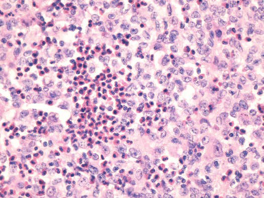
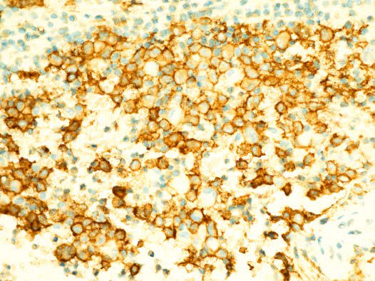

# Chapter 556: Histiocytosis Syndromes of Childhood
> **Course:** Vikkypaedia Pediatric Basic Course (*Nelson Textbook of Pediatrics, 22nd Edition (2025)*)  
> **Part XX:** Cancer and Benign Tumors  
> **Authors:** Stephan Ladisch  
> **Metrics:** 7,420 words · 6 tables/boxes · 2 figures · 30 genes · 8 flashcards · 5 MCQs  
> **Quick Navigation:** [🃏 Study 8 Flashcards](../flashcards/556_flashcards.md) · [📝 Take 5-Q MCQ Quiz](../mcqs/556_mcqs.md) · [📚 Part XX Guide](../parts/Part_XX.md) · [🧬 Syndrome & Genetics Atlas](../omim_gene_atlas.md) · [💊 Therapeutics Matrix](../therapies_matrix.md) · [🏠 Course Index](../../index.md)

## Key Chapter Topics & Subchapters
`556.1 Langerhans Cell Histiocytosis` · `556.2 Hemophagocytic Lymphohistiocytosis` · `556.3 Other Histiocytoses` · `555.5 Desmoplastic Small Round Cell Tumor Cynthia E. Herzog` · `556.1 Langerhans Cell Histiocytosis Stephan Ladisch` · `556.2 Hemophagocytic Lymphohistiocytosis Stephan Ladisch` · `556.3 Other Histiocytoses Stephan Ladisch`

## Key Genetic & Molecular Targets
`ALK`, `AP3B1`, `APC`, `AR`, `BRAF`, `BRAFV600E`, `CD27`, `CD70`, `CDC42`, `COG6`, `CTPS1`, `FHL1`, `FHL2`, `HRAS`, `KRAS`, `LYST`

## ⚡ High-Yield Nelson Pediatric Board Pearls
- The initial treatment of ACT and PHEO/PGL is resection by a sur geon experienced in the management of these tumors.
- Children with suspected or confirmed PHEO/PGL require preoperative medical management with α-adrenergic blockade (and sometimes β-blockade) to mitigate risk of hypertensive crisis.
- Although these disorders sometimes are difficult to distinguish clini cally, accurate diagnosis is essential for facilitating progress in treat ment.
- A current systematic classification of histiocytoses is based on histopathologic, clinical, and genetic findings A thorough, comprehensive evaluation of a biopsy specimen obtained at diagnosis is critical.
- The hallmark of LCH in all forms is the presence of a clonal proliferation of cells of the monocyte–dendritic cell lin eage containing the characteristic electron microscopic findings of a Langerhans cell, the Birbeck granule.
- The definitive diagnosis of LCH is established by demonstrating CD1a positivity of lesional cells, which can be done using fixed tissue.
- The peripheral lesions usually leading to the diagnosis of LCH (e.g., skin, lymph node, bone) contain various proportions of Birbeck granule–containing CD1a-positive cells, lymphocytes, granulocytes, monocytes, and eosinophils.

---
## Full Chapter Text, Tables & Figures
# Chapter 556: Histiocytosis Syndromes of Childhood

*Stephan Ladisch*

<!-- p.4060 -->
**INTRODUCTION** Childhood histiocytoses constitute a diverse group of disorders that are frequently severe in their clinical expression. These disorders are individually rare and are grouped together because they have in common a prominent proliferation or accumulation of cells of the

*Stephan Ladisch*

The initial treatment of ACT and PHEO/PGL is *resection by a sur geon experienced in the management of these tumors.* Children with suspected or confirmed PHEO/PGL require preoperative medical management with α-adrenergic blockade (and sometimes β-blockade) to mitigate risk of hypertensive crisis.

Medical therapy for metastatic ACT includes mitotane and che motherapy with cisplatin, etoposide, and doxorubicin. Endocrine therapy targeting hormonal overproduction may also be needed to palliate symptoms and improve quality of life. Metastatic PHEO/ PGL has historically been poorly responsive to cytotoxic chemo therapy. Kinase inhibitor therapy and peptide-receptor radiother apy (such as 177Lu-DOTATATE) have demonstrated promise in some studies.

Long-term follow-up is warranted for both ACTs and PHEOs to monitor for recurrence, particularly in the context of hereditary tumor predisposition syndromes.

*Visit Elsevier eBooks+ at eBooks.Health.Elsevier.com** for Bibliography.*

## 555.5  Desmoplastic Small Round Cell Tumor Cynthia E. Herzog

Desmoplastic small round cell tumor **(DSRCT)** is a very rare and aggressive mesenchymal tumor that occurs predominantly in adolescent and young adult males. It is associated with a diag nostic chromosomal translocation between the Ewing tumor gene and the Wilms tumor gene, t(11;22) (p13;q12), creating a chime ric gene *(EWS-WT1)* that encodes a chimeric protein with onco genic properties. Patients typically present at advanced stage with a bulky abdominal mass, multiple peritoneal and omental implants, and symptoms of abdominal sarcomatosis, including pain, ascites, intestinal obstruction, hydronephrosis, and weight loss. DSRCT mainly involves the abdominal cavity but can spread to the lymph nodes, liver, lungs, and bones, and in ∼10% of cases, arise outside of the abdomen. There is no standard treatment approach. Aggres sive treatment with combination chemotherapy, debulking surgery, and whole abdominopelvic irradiation results almost universally in a poor outcome. Median survival ranges between 17 and 25 months, and the 5-year overall survival remains <20%. Hyperthermic intra peritoneal chemotherapy may be of benefit but requires further study. Novel targeted agents and radioimmunotherapy with mono clonal antibodies targeting different surface antigens on tumor cells are being studied.

*Visit Elsevier eBooks+ at eBooks.Health.Elsevier.com** for Bibliography.*

monocyte-macrophage system of bone marrow (myeloid) origin. Although these disorders sometimes are difficult to distinguish clini cally, accurate diagnosis is essential for facilitating progress in treat ment. A current systematic classification of histiocytoses is based on histopathologic, clinical, and genetic findings (Tables 556.1-556.3) A thorough, comprehensive evaluation of a biopsy specimen obtained at diagnosis is critical. This evaluation includes studies such as immunos taining, molecular genetic analyses, and electron microscopy that may require special sample processing.

**CLASSIFICATION AND PATHOLOGY** Three classes of childhood histiocytosis are defined, based on his topathologic findings. The first and best known is **Langerhans cell histiocytosis (LCH)**, previously called *histiocytosis X.* LCH includes the clinical entities of bone or skin limited disease (**eosinophilic granuloma)**, **Hand-Schüller-Christian disease,** and **Letterer-Siwe disease.** The normal Langerhans cell is an antigen-presenting cell (APC) of the skin. The hallmark of LCH in all forms is the presence of a clonal proliferation of cells of the monocyte–dendritic cell lin eage containing the characteristic electron microscopic findings of a Langerhans cell, the **Birbeck granule**. This tennis racket–shaped bil amellar granule, when seen in the cytoplasm of lesional cells in LCH, is diagnostic of the disease. The Birbeck granule expresses a newly characterized antigen, *langerin* (CD207), which itself is involved in antigen presentation to T lymphocytes. CD207 expression has been established to be uniformly present in LCH lesions and thus becomes an additional reliable diagnostic marker. However, it is now clear that the LCH cell is not actually a (differentiated) Langerhans cell but rather an immature cell of myeloid origin, possibly in an arrested state of development. The definitive diagnosis of LCH is established by demonstrating CD1a positivity of lesional cells, which can be done using fixed tissue (Fig. 556.1). Lesional cells must be distinguished from normal Langerhans cells of the skin, which are also CD1a posi tive but are only sparsely distributed and are not diagnostic of LCH. The peripheral lesions usually leading to the diagnosis of LCH (e.g., skin, lymph node, bone) contain various proportions of Birbeck granule–containing CD1a-positive cells, lymphocytes, granulocytes, monocytes, and eosinophils.

Clonality of individual lesions exists in some cases of LCH. Importantly, an activating *somatic* pathogenic variant of the *BRAF* gene *(V600E)* (part of the mitogen-activated protein kinase [MAPK] cell signaling pathway: Fig. 556.2) has been identified in many patients with LCH. Studies in patients negative for *BRAFV600E* have revealed pathogenic variants in other genes of the MAPK pathway, including *MAP2K1* and *ARAF.* With the majority of LCH patients having one or another of these activating variants in the MAPK pathway (see Fig. 556.2), it has been suggested that LCH is driven by a disorder in MAPK signaling affecting cell migration and resulting in an accumulation of LCH cells in the lesions.

In contrast to the prominence of an APC in LCH, the other common form of histiocytosis is characterized by accumula tion of activated macrophages and lymphocytes and is known as **hemophagocytic lymphohistiocytosis (HLH)**. This diagnosis is the result of uncontrolled hemophagocytosis and uncontrolled activation (upregulation) of inflammatory cytokines driven by an abnormality of T cells. It has some similarities to the **macrophage activation syndrome**. Tissue infiltration by activated CD8 T lym phocytes, activated macrophages, and hypercytokinemia are classic features (Fig. 556.3). With the characteristic morphology of nor mal macrophages by light microscopy, these phagocytic cells (see Fig. 556.1) are CD163 positive but negative for the markers that are characteristic of LCH cells (Birbeck granules, CD1a, CD207).

The two major forms of HLH, primary and secondary, have indis tinguishable pathologic findings but are important to differentiate because of implications for treatment and prognosis. **Primary HLH**, originally named *familial erythrophagocytic lymphohistiocytosis,* is now known as **familial hemophagocytic lymphohistiocytosis (FHLH)**. This disease is an autosomal recessive disorder and rep resents approximately 25% of patients with HLH (see Table 556.3).

<!-- p.4062 -->

<!-- p.4063 -->

#### **Table 556.1** Main Types of Histiocytosis Disease

| Category / Parameter | Clinical Details & Findings |
| --- | --- |
| **LANGERHANS CELL HISTIOCYTOSIS** | Single system; Pulmonary; Multisystem with no risk organ; involvement; Multisystem with risk organ involvement |
| **ERDHEIM-CHESTER DISEASE** | Mixed H; Indeterminate H; Extracutaneous/disseminated JXG; with MAPK pathogenic variant; (including LALK + H. and other; genetic alterations) |
| **DISEASE** | Familial; Sporadic classical with or without IgG4; infiltration; Sporadic extranodal with or without; IgG4 infiltration |
| **MALIGNANCY HISTIOCYTOSES** | Primary, phenotypic subtypes; Secondary, phenotypic subtypes |
| **M** | Histiocytoses with cutaneous or; mucosal involvement |
| **LYMPHOHISTIOCYTOSES** | Primary; Sporadic; Unknown |
| **M** | L, Langerhans; R, Rosai-Dorfman-Destombes; M, Malignant, C, cutaneous; H, he; mophagocytic; JXG, juvenile xanthogranuloma; MAPK: mitogen-activated kinase.; From Emile JF, Cohen-Aubart F, Collin M, et al. Histiocytosis. Lancet. 2021;398:157–168.; Supplementary Appendix, Table 1. |

Genes are known for four of five familial HLH syndromes and other hereditary causes of HLH; these pathogenic variants affect the abil ity of T lymphocytes and natural killer (NK) cells to synthesize and release perforin and granzymes, thus reducing cytotoxic granule formation (Fig. 556.4). **Secondary HLH** includes other forms of the syndrome triggered by a separate pathologic process, such as infection *(infection-associated hemophagocytic syndrome),* tumor *(malignancy-associated HLH),* or primary immunodeficiency diseases and metabolic disorders (Tables 556.4 and 556.5). Both primary and secondary HLH affect multiple organs and are char acterized by massive infiltrates of hyperactivated lymphocytes and activated phagocytic macrophages in the involved organs, with the lymphocytes serving as the driver of the resulting disease process.

In primary HLH, genetic pathogenic variants in multiple dif ferent steps in granule formation and release by cytotoxic T cells have been identified (Fig. 556.5, *bottom*). Pathogenic variants in the *PRF1* perforin gene or the *MUNC13-4* gene are the most common causes of defective function of the cytotoxic lymphocytes whose activity is inhibited in primary HLH. In an analogous way, a trigger can result in secondary HLH (see Fig. 556.5, *top*). A myriad of both infectious and noninfectious processes can trigger secondary HLH (Fig. 556.6; see Table 556.4 and Fig. 556.11). Examples of noninfec tious triggers include drugs (e.g., phenytoin, Lamictal, highly active antiretroviral therapy), hematopoietic stem cell transplantation, chemotherapy, autoimmune diseases, inflammatory bowel disease, cancer, and immunodeficiency states (e.g., DiGeorge syndrome, Bruton agammaglobulinemia, severe combined immunodeficiency

syndrome, chronic granulomatous disease). A complicating factor in diagnosis is the realization that there are also both mixed genetic variants causing primary HLH and heterozygotic variants (there fore not strictly primary HLH) also causing disease, particularly triggered by infection.

In addition to these two most common forms of childhood his tiocytosis (LCH and HLH), rarer diseases are included under this rubric (see Table 556.2). **Juvenile xanthogranuloma (JXG)** is char acterized by vacuolated histiocytes with foamy cytoplasm in lesions that evolve into mixed granulomas also containing eosinophils, lymphocytes, and other cells. **Erdheim-Chester disease (ECD)** predominantly affects adults. Surface markers suggest a link among LCH, JXG, and ECD; all three are dendritic cell diseases, and rep resent a spectrum, or continuum, of differentiation stages of the abnormal dendritic cell precursors, frequently with *BRAFV600E* pathogenic variants in the affected cells. Another rare form of his tiocytosis is **Rosai-Dorfman disease**, also known as **sinus histio cytosis** with massive lymphadenopathy. Rosai-Dorfman disease is characterized by packing of sinusoids of the lymph nodes with hemophagocytic histiocytes, although extranodal involvement may also be present. Last, there is a group of unequivocal **malignancies** of cells of monocyte–macrophage lineage. By this definition, acute monocytic leukemia and true malignant histiocytosis are included among the class III histiocytoses (see Chapter 544). True neoplasms of Langerhans cells have been reported but are extremely rare.

## 556.1  Langerhans Cell Histiocytosis Stephan Ladisch

**CLINICAL MANIFESTATIONS** LCH has an extremely variable presentation. The skeleton is involved in 80% of patients and may be the only affected site, espe cially in children >5 years old. **Bone lesions (eosinophilic gran uloma)** may be single or multiple and are seen most often in the skull (Fig. 556.7). Other sites include the pelvis, femur, vertebra, maxilla, and mandible. Lesions may be asymptomatic or associated with pain and local swelling. Involvement of the spine may result in collapse of the vertebral body, which can be seen radiographically and may cause secondary compression of the spinal cord. In flat and long bones, osteolytic lesions with sharp borders occur, and no evidence exists of reactive new bone formation until the lesions begin to heal. Lesions that involve weight-bearing long bones may result in pathologic fractures. Chronically draining, infected ears are usually associated with destruction in the mastoid area. Bone destruction in the mandible and maxilla may result in teeth that appear to be free floating on radiographs. With response to therapy, healing of bone lesions is usually complete.

Approximately 50% of patients experience **skin involvement** (isolated or part of multisystem disease) at some time during the course of disease. This is a frequently difficult-to-treat scaly, papu lar, seborrheic dermatitis of the scalp, diaper, axillary, or posterior auricular regions (see Fig. 556.7; Figs. 556.8 and 556.9). The lesions may spread to involve the back, palms, and soles. The exanthem may be petechial or hemorrhagic, even in the absence of thrombo cytopenia. Localized or disseminated **lymphadenopathy** is present in approximately 33% of patients. **Hepatosplenomegaly** occurs in approximately 20% of patients. Various degrees of hepatic malfunc tion may occur, including jaundice and ascites.

**Gastrointestinal involvement,** more common than previously appreciated**,** can present as vomiting, abdominal pain, bloody diarrhea, and/or failure to thrive.

**Exophthalmos**, when present, may be bilateral and is caused by retroor bital accumulation of granulomatous tissue. Gingival mucous membranes may be involved with infiltrative lesions that appear superficially like can didiasis. Otitis media is present in 30–40% of patients; deafness may follow

<!-- p.4064 -->
destructive lesions of the middle ear. In 10–15% of patients, **pulmonary infiltrates** are found on radiography. The lesions may range from diffuse fibrosis and disseminated nodular infiltrates to diffuse cystic changes (Fig. 556.10). Rarely, pneumothorax is a complication. If the lungs are severely involved, tachypnea and progressive respiratory failure may result.

**Pituitary dysfunction** or hypothalamic involvement in patients often presents as diabetes insipidus and may also cause growth retarda tion. Patients suspected of having LCH should demonstrate the ability

to concentrate their urine before going to the operating room for a biopsy. Rarely, panhypopituitarism may occur, as may primary hypo thyroidism as a result of thyroid gland infiltration.

Patients with multisystem disease who are affected more severely are those who have systemic manifestations, including fever, weight loss, mal aise, irritability, and failure to thrive. These systemic manifestations will dis tinguish patients at high risk of mortality (i.e., risk organ–positive, or RO+, patients) from patients at low risk of mortality (i.e., without systemic

Rosai-Dorfman-Destombes Disease

#### **Table 556.2** Clinical Features, Investigations, and Treatment of Langerhans Cell Histiocytosis, Erdheim-Chester Disease, and

| Category / Parameter | Clinical Details & Findings |
| --- | --- |
| **THERAPIES** | Childhood; Langerhans cell; histiocytosis; Bone pain or fracture;; vertebra plana†; skin; papules; lymph-; adenomegaly; palpable; tumor; diabetes; insipidus†; exophthalmos†;; deafness or chronic; otorrhea; systemic; symptoms with fever,; hepatosplenomegaly,; or hematologic; cytopenia (risk organs);; pneumothorax; For all patients: blood tests; (full blood count, erythrocyte; sedimentation rate or CRP,; albumin, renal function; tests, liver function tests,; coagulation tests); chest and; skeletal radiographs; According to initial; investigations: CT scan or MRI; focused on involved area;; brain MRI when diabetes; insipidus or any sign of CNS; involvement or visual or; hearing dysfunction; chest; high-resolution CT scan when; signs of lung involvement; Vinblastine combined with; corticosteroids; Should be decided; according to initial; extension and risk-organ; involvement status, as; assessed by a trained team; With risk organ; involvement: BRAF or; MEK inhibitors‡; Without risk organ; involvement:; monotherapy; or combined; chemotherapies with; cladribine, and, in less; documented approaches,; cytarabine or clofarabine; Adult Langerhans; cell histiocytosis; Bone pain or fracture;; skin papules; lymphad; enopathy; palpable tumor;; diabetes insipidus†;; exophthalmos†; repeated; dental loss; pneumothorax;; dyspnea, dry cough; 18F-FDG-PET (full body); chest,; abdomen, and pelvis CT scan;; brain MRI; blood tests (full; blood count, CRP, albumin,; renal function tests, liver; function tests); Cytarabine, alone; or combined with; methotrexate;; vinblastine combined; with corticosteroids;; cladribine; BRAF or MEK inhibitors; Erdheim-Chester; disease; Lower limb pain; general; symptoms (fatigue, weight; loss, fever); xanthelasma;; diabetes insipidus†;; exophthalmos†; dyspnea,; dry cough; signs of; cardiac involvement (e.g.,; tamponade); signs of CNS; involvement (degenerative; or tumoral); 18F-FDG-PET (full body); chest,; abdomen, and pelvis CT scan;; brain MRI; cardiac MRI; blood; tests (full blood count, CRP,; albumin, renal function tests,; liver function tests); Interferon alfa-2a or; pegylated interferon; alfa-2a; other potential; options are anakinra,; infliximab, or sirolimus; plus corticosteroids;; BRAF or MEK inhibi; tors for life-threatening; cases (e.g., CNS or heart; involvement); BRAF or MEK inhibitors; Rosai-Dorfman-; Destombes; disease; Lymphadenopathy; skin; nodules; nasal obstruction,; epistaxis, nasal dorsum; deformity; dyspnea, dry; cough; signs of CNS or; nerve root involvement;; testicular enlargement; Children: chest x-ray with neck; and abdominal ultrasound; scans; Adults: neck, chest, abdomen,; and pelvis CT scan; 18F-FDG-; PET is recommended by some; experts; All patients: brain MRI when; signs of orbital or CNS; involvement; blood tests (full; blood count, CRP, albumin,; renal function tests, liver; function tests); Corticosteroids; sirolimus;; methotrexate; azathio; prine; Several drugs or combined; chemotherapies or MEK; inhibitors reported to be; active in case reports or; small case series; 18F-FDG-PET, 18F-fluorodeoxyglucose PET; CNS, central nervous system..; *Aimed to determine the extent of the disease; thus each clinical feature drives specific investigation of the potentially involved organ(s), including for any signs of endocrine dysfunc; tion or autoimmunity.; †Features that are suggestive of the disease.; ‡BRAF inhibitors: vemurafenib, dabrafenib, encorafenib. MEK inhibitors: cobimetinib, trametinib, binimetinib, selumetinib.; From Emile JF, Cohen-Aubart F, Collin M, et al. Histiocytosis. Lancet. 2021;398:157–168. Fig. 1, p. 158. |

<!-- p.4065 -->
manifestations; risk organ–negative patients). The **risk organs** are liver, spleen, and the hematopoietic (bone marrow) system. The lung is not con sidered a risk organ. The distinction of risk-organ involvement is important for deciding the intensity of the treatment approach and has been addressed in standard treatment approaches for LCH, as delineated in the Histio cyte Society protocols. Bone marrow involvement may cause anemia and

thrombocytopenia. Two uncommon but serious manifestations of LCH are hepatic involvement (leading to fibrosis and cirrhosis) and a pecu liar central nervous system (CNS) involvement characterized by ataxia, dysarthria, and other neurologic symptoms. **Hepatic involvement** is asso ciated with multisystem disease that is often already present at diagnosis. In contrast, neurodegenerative **CNS involvement**, which is progressive and

β1

↓ cytotoxicity of T cells

#### **Table 556.3** Hemophagocytic Lymphohistiocytosis

| Category / Parameter | Clinical Details & Findings |
| --- | --- |
| **FHLH-1** | Unknown; Rare; Cytotoxicity |
| **PRF1** | Perforin; ∼20–37, 50delT mainly; in African American/; African descent; Cytotoxicity; forms; pores in APCs |
| **UNC13D** | Munc13–4; 20–33; Cytotoxicity; vesicle; priming; Increased incidence; of CNS HLH |
| **STX11** | Syntaxin; <5; Cytotoxicity; vesicle; fusion; Mild recurrent HLH,; colitis |
| **STXBP2** | Syntaxin-binding; protein 2; 5–20; Cytotoxicity; vesicle; fusion; Colitis, hypogamma; globulinemia |
| **SYNDROMES WITH PARTIAL OCULOCUTANEOUS ALBINISM** | Griscelli syndrome |
| **RAB27A** | Rab27A; ∼5; Cytotoxicity; vesicle; docking; Partial albinism,; silver-gray hair; Chédiak-Higashi; syndrome |
| **LYST** | Lyst; ∼2; Cytotoxicity; hetero; geneous defects in; NK cells; Partial albinism,; bleeding tendency,; recurrent infections; Hermansky-Pudlak; syndrome type II |
| **AP3B1** | AP-3 complex subunit; Rare; Cytotoxicity; vesicle; trafficking; Partial albinism,; bleeding tendency |
| **SAP** | ∼7; Signaling in cytotoxic; NK and T cells; Hypogammaglobu; linemia, lymphoma |
| **XIAP** | ∼2; NK T-cell survival and; NF-κB signaling; Mild recurrent HLH,; colitis; ITK deficiency |
| **ITK** | Rare; IL-2 signaling in T; cells; Hypogammaglobu; linemia, autoim; munity, Hodgkin; lymphoma; CD27 deficiency |
| **CD27** | Rare; Signal transduction in; lymphocytes; Combined; immunodeficiency,; lymphoma; XMEN syndrome |
| **MAGT1** | Rare; Magnesium trans; porter, induced by; TCR stimulation; Lymphoma, recurrent; infections, CD4 T-; cell lymphopenia |
| **GOF** | NLRC4 Somatic or; germline variants; NLRC4 inflammasome; Rare |
| **↑ IL-18** | Responds to recombi; nant IL-18BP |
| **CDC42** | Rare; ↑ IL-18, variants inter; fere with binding; and localization of |
| **CDC42** | Neonatal cytopenias,; hepatosplenomeg; aly, fevers, urticaria-; like rashes, facial; dysmorphisms |
| **CD70** | CD70 interaction with |
| **CD27** | Rare; ↓ expression and; EBV susceptibility to |
| **CTPS1** | Cytidine nucleotide; triphosphate; synthesis; Rare; Impaired proliferation; of NKT cells; EBV susceptibility |
| **RASGRP1** | Rare; Activates RAS; defects; in T-cell activation,; migration, prolifera; tion; ↓ cytotoxicity; ↓ NKT cells; EBV susceptibility to |
| **HLH** | APCs, Antigen-presenting cells; CNS, central nervous system; EBV, Epstein-Barr virus; FHLH, familial hemophagocytic lymphohistiocytosis; GOF, gain of function; HLH, hemophago; cytic lymphohistiocytosis; ITK, interleukin (IL)-2–inducible T-cell kinase; NF-κB, nuclear factor–kappa B; NK, natural killer; TCR, T-cell receptor; XLP-1, 2-X-linked lymphoproliferative; diseases.; Adapted from Erker C, Harker-Murray, Talano JA. Usual and unusual manifestations of familial hemophagocytic lymphohistiocytosis and Langerhans cell histiocytosis. Pediatr Clin; North Am. 2017;64:91–109. Table 1. |

<!-- p.4066 -->
A

B

**Fig. 556.1** A, Histopathology of Langerhans cell histiocytosis (LCH) shows eosinophilic granuloma of a lytic bone lesion of the femoral head. Multiple LCH cells with characteristic grooved nuclei, as well as numerous eosinophils, are visible in this mixed infiltrate. B, CD1a stain ing, characteristic and diagnostic of lesions with LCH cells.

BRAF inhibitors: vemurafenib dabrafenib

MEK inhibitors: cobimetinib trametinib

ALK CSF1R

NTRK1

RET PTPN11

CBL

KRAS NRAS HRAS PIK3CA PIK3CD

BRAF ARAF

MEK1 MEK2 mTOR

TKR inhibitors:

crizotinib alectinib selpercatinib

mTOR inhibitor: sirolimus

Proliferation survival

BRAF ARAF

**Fig. 556.2** Proteins of the MAP kinase cell-signaling pathway involved by activating pathogenic variants, and inhibitors already reported to

**Fig. 556.3** Bone marrow aspirate of a child with familial (genetically confirmed) hemophagocytic lymphohistiocytosis. Numerous character istic hemophagocytic cells (which are CD163-positive macrophages) are seen ingesting various blood elements.

FHL, no mutations

identified

15; 8%

UNC13D (FHL3)

62; 33%

PRF1 (FHL2)

69; 37%

XIAP (XLP2)

4; 2% SH2D1A (XLP1)

13; 7%

RAB27A (GS2)

10; 5%

STX11 (FHL4)

1; 0%

STXBP2

(FHL5)

9; 5%

**N = 186**

LYST (CHS)

3; 2%

**Fig. 556.4** Different genetic subtypes in 171 patients with familial hemophagocytic lymphohistiocytosis (FHL) or FHL-related disease. For each subtype, the name of the gene, the abbreviation of the dis ease subtype, the absolute number, and the percentage are shown. Furthermore, we include as FHL one subgroup of 15 patients with ei ther familial recurrence or refractory/recurrent disease despite specific therapy and/or repeatedly documented severe functional defect in de granulation or cytotoxicity assays. (From Cetica V, Sieni E, Pende D, et al. Genetic predisposition to hemophagocytic lymphohistiocytosis: Report on 500 patients from the Italian registry. J Allergy Clin Immunol. 2016;137:188–196. Fig. 2, p. 191.)

histopathologically characterized by gliosis and has no definitive treatment, may be observed only many years after the initial diagnosis of LCH. These manifestations are not known to be associated with LCH cells, Birbeck gran ules, CD1a positivity, or any other indication of LCH cell infiltration, rais ing questions about their pathogenesis and the suggestion that they may be cytokine-mediated.

After tissue biopsy, which is diagnostic of LCH and is easiest to per form on skin or bone lesions, a comprehensive clinical and laboratory evaluation is essential and should be undertaken. This should include a series of studies in all patients: CBC, liver function tests, coagulation studies, skeletal survey, chest radiograph, and measurement of urine osmolality. In addition, detailed evaluation of any organ system shown to be involved by physical examination or by these studies should be per formed to establish the extent of disease before initiation of treatment.

**TREATMENT AND PROGNOSIS** The clinical course of **single-system disease** (usually bone, lymph node, or skin) generally is benign, with a high chance of spontaneous remission. Therefore treatment should be minimal and should be directed at arrest ing the progression of a bone lesion that could result in permanent dam age before it resolves spontaneously. Curettage or, less often but especially

<!-- p.4067 -->
Syndrome

#### **Table 556.4** Infections Associated with Hemophagocytic

| Category / Parameter | Clinical Details & Findings |
| --- | --- |
| **VIRAL** | Adenovirus; Cytomegalovirus (CMV); Dengue virus; Epstein-Barr virus (EBV); Enteroviruses; Herpes simplex viruses (HSV1, HSV2); Human herpesviruses (HHV6, HHV8) |
| **HIV** | Influenza viruses; Parvovirus B19; Varicella-zoster virus (VZV); Hepatitis viruses; Measles; Parechovirus |
| **BACTERIAL** | Babesia microti; Brucella abortus; Enteric gram-negative rods; Haemophilus influenzae; Mycoplasma pneumoniae; Staphylococcus aureus; Streptococcus pneumoniae; Ehrlichia chaffeensis |
| **FUNGAL** | Candida albicans; Cryptococcus neoformans; Histoplasma capsulatum; Fusarium |
| **MYCOBACTERIAL** | Mycobacterium tuberculosis |
| **RICKETTSIAL** | Coxiella burnetii; Other rickettsial diseases |
| **PARASITIC** | Leishmania donovani; Plasmodium; From Nathan DG, Orkin SH, Ginsburg D, et al., eds. Nathan and Oski’s Hematology of; Infancy and Childhood. 6th ed. Philadelphia: Saunders; 2003, p. 1381. |

when a weight-bearing bone is involved, corticosteroid injection or lowdose local radiation therapy (5-6 Gy) may accomplish this goal.

In contrast, **multisystem disease** requires treatment with systemic mul tiagent chemotherapy. Several different regimens have been proposed, but central elements are the inclusion of vinblastine and corticosteroids, both of which have been found to be very effective in treating LCH. Eto poside has been excluded from the standard treatment of multisystem LCH, which is treated with multiple agents, designed to reduce mortality, reactivation of disease, and long-term consequences. The response rate to therapy is quite high, and mortality in severe LCH has been substantially reduced by multiagent chemotherapy, especially if the diagnosis is made accurately and expeditiously. The most recent treatment results associated with lengthened continuation therapy (HS LCH-III) show a greater than 85% survival rate in severe (RO+) multisystem disease and a reduced rate of reactivation.

Experimental therapies are suggested only for unresponsive disease (often in very young children with multisystem disease and organ dysfunc tion who have not responded to multiagent initial treatment) and reactiva tion of RO+ disease in risk organs but not in reactivation of mild disease (any risk organ–negative reactivations) (see Fig. 556.2). The approaches

include immunosuppressive therapy with cyclosporine/antithymocyte globulin and possibly imatinib, 2-chlorodeoxyadenosine, and clofarabine. With the discovery of the *BRAFV600E* pathogenic variant causing hyper activation of the MAPK pathway in LCH cells, pharmacologic inhibition of BRAF and pharmacologic inhibition of MEK are currently the subject of clinical trials as therapeutic approaches for resistant disease.

Late (fibrotic) complications, whether hepatic or pulmonary, are irre versible and require organ transplantation to be definitively treated. Cur rent treatment approaches and experimental protocols for both LCH and HLH can be obtained at the Histiocyte Society website (http://www.his tiocytesociety.org). An unresolved problem is treatment of the (usually late-onset) severe, progressive, and intractable LCH-associated **neuro degenerative** syndrome. This is also under investigation for response to experimental therapies, including the pharmacologic inhibitors of the MAPK pathway. Regarding current treatment recommendations for LCH as well as HLH, the continuing rapid advances in understanding of their pathogeneses is likely to result in further rapid development and validation of new therapeutic approaches.

*Visit Elsevier eBooks+ at eBooks.Health.Elsevier.com** for Bibliography.*

Inherited Metabolic Diseases That May Be Complicated (Rarely) by Hemophagocytic Lymphohistiocytosis

#### **Table 556.5** Other Primary Immunodeficiency and

| Category / Parameter | Clinical Details & Findings |
| --- | --- |
| **SCID** | CIDs; DiGeorge syndrome; Wiskott-Aldrich syndrome; Ataxia telangiectasia; Dyskeratosis congenita; ORAI-1 deficiency; Chronic granulomatous disease; Other PIDs; X-linked agammaglobulinemia; Autoimmune lymphoproliferative syndrome; STAT1 gain of function |
| **INBORN ERRORS OF METABOLISM** | Lysinuric protein intolerance; Multiple sulfatase deficiency; Biotinidase deficiency; Lysosomal acid lipase deficiency/Wolman disease; Methylmalonic acidemia; Galactosemia; Gaucher disease; Pearson syndrome; Galactosialidosis; Propionic acidemia; Cobalamin C disease; Niemann-Pick disease; LCHAD deficiency |
| **COG6** | From Canna SW, March RA. Pediatric hemophagocytic lymphohistiocytosis. Blood.; 2020;135(16):1332–1343. Table 5. |

<!-- p.4068 -->

<!-- p.4069 -->

**Fig. 556.5** Inborn errors in the cytotoxic activity of lymphocytes. Top, Immune mechanisms leading to the occurrence of a hemophagocytic syn drome. Following a viral infection, antigen-specific CD8+ T lymphocytes undergo massive expansion and activation and secrete high levels of inter feron (IFN)-γ. The overwhelming activated effector cells induce excessive macrophage activation and proinflammatory cytokine production, includ ing tumor necrosis factor (TNF)-α and interleukin-6 (IL-6). Macrophages spontaneously phagocytose blood elements (platelets, red blood cells, and a polymorphonuclear cell shown here). Activated lymphocytes and macrophages infiltrate various organs, resulting in massive tissue necrosis and organ failure. Bottom, Genetic variants causing hemophagocytic lymphohistiocytic syndrome (HLH) affect a precise step of the cytotoxic machinery: granule content, docking, priming, or fusion. Only the defects causing Griscelli syndrome and familial hemophagocytic lymphohistiocytosis (FHL) are shown. MHC-Ag, Major histocompatibility complex antigen; TCR, T-cell receptor. (From Pachlopnik Schmid J, Cote M, Menager MM, et al. Inherited defects in cytotoxic lymphocyte activity. Immunol Rev. 2010;235:10–23.)

Viral infection

Activation

TCR

MHC-Ag

Cytoxic granule

Perforin/FHL2

Rab27a/Griscelli Syndrome

Munc13-4/FHL3

Munc18-2/FHL5 Syntaxin 11/FHL4 Docking Priming Fusion Cytotoxic T Lymphocyte

Target cell

T lymphocytes

CD8+

TCD8+ activated

**+++++**

**+++**

**+++++**

IFNγ

Macrophages

activation

TNFα++

IL6 ++

Hemophagocytosis

Tissues infiltration,

destruction

**Fig. 556.6** Hemophagocytic lymphohistiocytosis (HLH) comprises a heterogeneous spectrum of disorders that all present with severe cytokine storm and life-threatening immunopathology. HLH can be caused by pathogenic variants in genes involved in granule-mediated cytotoxicity but can also be acquired on a multitude of underlying autoimmune/autoinflammatory diseases or malignancies, with possible facilitation by immunomodu lating therapies. Clinical manifestations of HLH are generally precipitated by an infection. IL, Interleukin; NSAID, nonsteroidal antiinflammatory drugs. (From Brisse E, Wouters CH, Matthys P. Hemophagocytic lymphohistiocytosis (HLH): a heterogeneous spectrum of cytokine-driven immune disorders. Cytokine Growth Factor Rev. 2015;26:263–280. Fig. 2, p. 267.)

**Pathogenic variant** -   Perforin -   Munc13-4 -   Syntaxin 11 -   Rab27a -   Lyst -   Others

**Malignancy** -   Lymphoma -   Leukemia -   Others

**CYTOKINE STORM**

**HLH**

**Acquired immune dysregulation** -   Immune-modulating drugs (methotrexate, gold salts, sulfasalazine, NSAID, ...) -   Cytokine-antagonists (ani-THF-α, anti-IL-1, anti-IL-6, ...) -   Others

**Autoimmune/autoinflammatory**

**disorders** -   Systemic juvenile idiopathic arthritis -   Systemic lupus erythematosus -   Kawasaki disease -   Inflammatory bowel disease -   Others

**Infection** -   Viral *(Herpesviridae, ...)* -   Bacterial *(Mycobacterium, ...)* -   Fungal *(Candida, ...)* -   Parasitic *(Histoplasma, ...)*

TRIGGER

<!-- p.4070 -->
A B

C

D E F

G

H

**Fig. 556.7** Langerhans cell histiocytosis. A, Young child with disseminated Langerhans cell histiocytosis (LCH) skin lesions. B, Chest CT scan show ing multiple cysts. C, X-rays showing LCH involvement of the skull. D, X-rays showing LCH involvement of the mandible, as revealed by so-called floating teeth. E, MRI showing a femoral lesion revealed by a fracture. F, CT scan showing the spinal column. G and H, MRI showing degenerative neuro-LCH on axial T2 spin echo-weighted images, which reveal symmetrical hyperintensities within the cerebellar corpus medullare (arrows). (From Emile JF, Cohen-Aubart F, Collin M, et al. Histiocytosis. Lancet. 2021;398:157–168. Fig. 2.)

A B

C D E

**Fig. 556.8** Variable appearance of Langerhans cell histiocytosis of skin. A, Eczematous dermatitis. B, Hypopigmented, eroded papules. C, Hypo pigmented macules. D and E, Crusted papulonodules. Presentation does not reflect presence or absence of multisystem disease. Despite similar appearance, the patient in D had a single lesion, whereas the patient in E had organ involvement. (From Simko SJ, Garmezy B, Abhyankar H, et al. Differentiating skin-limited and multisystem Langerhans cell histiocytosis. J Pediatr. 2014;165:990–996. Fig. 3.)

<!-- p.4071 -->
A B

**Fig. 556.9** Langerhans cell histiocytosis presenting as “blueberry muffin” rash in neonate. Multiple firm, nonblanching, purple papules affecting the head and neck (A) and the body (B). (From Schmitt AR, Wetter DA, Camilleri MJ, et al. Langerhans cell histiocytosis presenting as a blueberry muffin rash. Lancet. 2017;390:155.)

## 556.2  Hemophagocytic Lymphohistiocytosis Stephan Ladisch

See the previous section on “Classification and Pathology,” Table 556.3, and Chapter 174.

**CLINICAL MANIFESTATIONS** Primary FHLH and secondary HLH have a remarkably similar, clinically indistinguishable presentation (Fig. 556.11). It consists of a generalized disease process, most often with fever (90–100%), maculopapular and/or petechial rash (10–60%), weight loss, and irritability. The initial clinical pre sentation can vary but is usually severe. In the case of secondary HLH, onset may be camouflaged by a primary disease process. Acute presentations of HLH include a hyperferritinemic septic shock–like picture, acute respiratory distress, seizures, ataxia, focal lesions, or coma (because of CNS infiltration). Other features that are frequently present result from bone marrow involve ment and pancytopenia or hepatic dysfunction.

Children with primary HLH are generally <1-2 years old, and chil dren with secondary HLH typically present at an older age, but both forms may present at any age. **Physical examination** often reveals hep atosplenomegaly (70–100%), lymphadenopathy (20–50%), respiratory distress (40–90%), jaundice, and symptoms of CNS involvement (50%) that are not unlike those of aseptic meningitis, CNS vasculitis, or acute demyelinating encephalomyelitis. MRI may demonstrate systemic T2 weighted/fluid-attenuated inversion recovery (FLAIR) hyperintensi ties in gray and white matter and in supratentorial and infratento rial regions (Fig. 556.12). The cerebrospinal fluid (CSF) pleocytosis (50–90%) associated with CNS involvement in primary HLH is char acterized by cells that are the same phagocytic macrophages found in the peripheral blood or bone marrow. HLH may initially or only manifest CNS symptoms. Isolated neuroinflammation may be pres ent in the absence of cytopenias, splenomegaly, or other systemic fea tures. Approximately 35% will eventually develop diagnostic features of HLH (Table 556.6). The interval from neurologic onset to eventual diagnosis often exceeds 2 years. In CNS isolated disease, the diag nosis of familial HLH is often made by whole exome sequencing for other diseases.

The **diagnosis** of HLH is arrived at in two stages. The first stage is based on a set of eight clinical and laboratory findings, with the pres ence of five of the eight being diagnostic of HLH. The eight findings, formulated by the Histiocyte Society, are fever, splenomegaly, cytope nia of two cell lines (in 90–100%), hypertriglyceridemia (80–100%) or hypofibrinogenemia (65–85%), hyperferritinemia (≥500 but often >10,000), extremely elevated soluble CD25 (interleukin-2 recep tor), reduced or absent NK cell activity, and bone marrow, CSF, or lymph node evidence of hemophagocytosis (see Table 556.6). The second stage involves genetic analysis and is undertaken as quickly as possible but generally requires ∼2 weeks to complete and should not interfere with initiation of treatment (Fig. 556.13). The genetic findings and family history will determine whether the diagnosis is (autosomal

**Fig. 556.10** High-resolution coronal CT image (lung window) reveals diffuse lung cysts with parenchymal destruction in bilateral lung fields. (From Chauhan L, Aggarwal N. Honey-comb Langerhans cell histiocy tosis. J Pediatr. 2016;168:248. Fig. 2.)

**The HLH syndrome (All conditions that meet syndrome definition)**

Other

HLH (HLH-NOS)

latrogenic

HLH (Rx-HLH)

Forme fruste HLH (incompletely meeting

HLH definition)

HLH disease

HLH Disease

mimics

Malignancy

associated

HLH (M-HLH)

HLH with

immune compromise

(IC-HLH)

Rheumatologic HLH

(R-HLH/MAS)

Familial HLH

(F-HLH)

**Fig. 556.11** Spectrum of the hemophagocytic lymphohistiocytosis (HLH) syndrome. The HLH syndrome includes all conditions meeting consensus diagnostic criteria. This syndrome includes conditions that would benefit from HLH-directed immunosuppressive therapies, which are termed “HLH disease,” and those conditions that would not benefit from such therapy or require entirely different treatments, termed “HLH disease mimics.” HLH disease includes recognizable subgroups: familial HLH with clear genetic etiology, HLH associated with malignancy, HLH as sociated with rheumatologic conditions (also called MAS), HLH observed after immune-activating therapies (iatrogenic HLH, also called cytokine release syndrome), HLH associated with immune compromise (either pri mary immune deficiency or treatment-related immune suppression), and HLH not associated with other specific conditions. Recognition of these subcategories is valuable as this may alter treatment. (From Jordan MB, Allen CE, Greenberg J, et al. Challenges in the diagnosis of hemophago cytic lymphohistiocytosis: Recommendations from the North American Consortium (NACHO). Pediatr Blood Cancer. 2019;66:e27929.)

<!-- p.4072 -->
Cognitive impairment / regression

0

Psychiatric symptoms / mood disorder / personality change

Tremors / movement disorder

Sensory impairment

Abnormal tone Altered mental status

Vomiting Speech abnormalities

Visual abnormalities Limb weakness / motor impairment

Headache

Seizures Gait disturbance

20 40 **%**

60 80

n=38

**Frequency of the neurologic manifestations in isolated CNS-HLH**

0 20 40 **%**

60 80 100

n=38

**Neuroradiologic findings on MRI Imaging**

Hemorrhagic lesions Leptomeningeal enhancement

Grey matter involvement

Spinal cord involvement

Volume loss / atrophy

Edema / swelling Brainstem involvement Periventricular changes

Cerebellar involvement Diffuse/multifocal white matter lesions

0 5 10 **n**

15 20

**CNS biopsy results**

Microinfarcts

Hemorrhage

Granulomas Necrosis / destructive inflammation

Lymphohistiocytic infiltrations

**A B**

**Fig. 556.12** A, Frequencies of neurologic manifestations, neuroradiologic findings, and histopathologic central nervous system (CNS) biopsy results in 38 patients with isolated CNS hemophagocytic lymphohistiocytosis (HLH). B, Examples of CNS MRI imaging in patients with isolated CNS- HLH. Upper panels, T2 images in one patient from 2016 (left) and 2017 (right) demonstrate cerebral atrophy with diffuse white matter involvement. Neuroradiologic findings on MRI show imaging abnormalities. Lower panels, T2 images from another patient reveal multiple nodular lesions in the pons, cerebellum, and white matter. (From Blincoe A, Heeg M, Campbell PK, et al. Neuroinflammatory disease as an isolated manifestation of he mophagocytic lymphohistiocytosis. J Clin Immunol. 2020;40:901–916. Fig. 1.)

recessive) primary HLH, secondary HLH, or a genetic hybrid form of HLH.

*Hemophagocytosis is not specific* for HLH and should be considered only in the context of the diagnostic criteria. No absolute clinical or laboratory distinction can be made between primary HLH and second ary HLH. In some subgroups of HLH, perforin assays may be normal. Similarly, some patients with primary FHLH have no known identi fiable pathogenic variant, while new genetic variants associated with HLH continue to be discovered.

In the absence of either (1) a documented genetic defect coupled with defective NK cell cytotoxicity or (2) frank hemophagocytosis, care should be taken in making the diagnosis of secondary HLH, given the implica tion to use cytotoxic chemotherapy. The nonspecific criteria (indicative of inflammation) used to diagnose HLH can also be seen in diseases that are not always associated with hemophagocytosis (e.g., overwhelm ing acute viral infection with appropriate T-cell activation), in which the cytotoxic and immunosuppressive therapy used in treating HLH might be contraindicated.

**Macrophage activation syndrome**, particularly in the context of systemic-onset juvenile idiopathic arthritis (JIA) or infection, has many similarities to HLH (see Chapter 196). Indeed, whole exome sequenc ing of patients with systemic-onset JIA or those with fatal influenza has revealed a higher than expected incidence of HLH genes.

**TREATMENT AND PROGNOSIS** Therapy for **primary HLH** (autosomal recessive genetic disease or familial occurrence) consists of a combination of etoposide, dexa methasone, cyclosporine, and intrathecal methotrexate. It should be stressed that pancytopenia and the presence of an infection are *not* contraindications to cytotoxic or immunosuppressive therapy (etopo side and steroid, cyclosporine or antithymocyte globulin for mainte nance therapy). Paradoxically they ameliorate the HLH. Emapalumab, a monoclonal antibody against interferon-γ, is approved for recurrent, refractory, or progressive familial HLH or for patients who cannot tolerate chemotherapy. The goal for all therapies is to reach the point of initiating **stem cell transplantation,** to date the only known poten tially curative treatment for primary HLH, effective in achieving cure in >60% of patients. Chemotherapy is inadequate for sustained cure of primary HLH, which is ultimately fatal without transplantation.

In **secondary HLH**, it is critical that the underlying disease (e.g., infec tion, malignancy) be identified and successfully treated. The diagnostic distinction between primary HLH and secondary HLH sometimes can be based on the acute onset of secondary HLH in the presence of an already documented infection or cancer, including leukemia, and certain auto immune or immunodeficiency disorders. In this case, treatment of the underlying infection is coupled with supportive care. If the diagnosis is made in the setting of iatrogenic immunodeficiency, immunosuppressive

<!-- p.4073 -->

**Fig. 556.13** Algorithm for identification of genetic causes of hemophagocytic lymphohistiocytosis (HLH). The HLH algorithm is based on flow cytometry assays: all the patients fitting into HLH criteria, irrespective of age and clinical presentations, should be screened for perforin expression and granule release assay. All male patients should be screened for signaling lymphocyte activation molecule–associated protein (SAP) and X-linked inhibitor of apoptosis protein (XIAP) expression. For patients clinically presenting with albinism, microscopic analysis of hair and blood smear is es sential for differential diagnosis of Chédiak-Higashi syndrome, Griscelli syndrome, and Hermansky-Pudlak syndrome. Based on the defect in expres sion of a particular protein identified, molecular characterization for the respective gene should be performed for confirmation of diagnosis. EBV, Epstein-Barr virus; FHL, familial hemophagocytic lymphohistiocytosis; IL, interleukin; NK, natural killer. (Adapted from Madkaikar M, Shabrish S, De sai M. Current updates on classification, diagnosis and treatment of hemophagocytic lymphohistiocytosis (HLH). Indian J Pediatr. 2016;83:434–443.)

Male Suspected HLH Albinism

Flow cytometric assays Microscopic analysis of

hair and blood smear

**Chediak-Higashi syndrome:** Giant lysosomes in leukocytes. Evenly distributed, regular melanin granules larger than those in normal hair. Primary neurologic disease.

**Griscelli syndrome type 2:** Hair with bigger and irregular melanin granules mainly near medulla. Under polarized light microscopy, hair appears monotonously white.

**Hermansky-Pudlak syndrome type 2:** Characteristic eye findings. Increased bleeding. Neutropenia.

SAP/XIAP Perforin Granule release assay on resting

NK cells

Defective

**FHL2**

PRF1 gene mutation

studies

Defective Defective

**XLP1:** SAP deficiency Lymphoma EBV infection

**XLP2:** XIAP deficiency Splenomegaly Colitis

Defective

Granule release

assay on IL-2activated NK cells

Restoration

Western blotting for Munc13-4 protein/UNC13D gene variant studies

Western blotting for Syntaxin11 protein/STX11 or STXBP2 gene variant studies

**FHL3 FHL4**

No variants

**FHL1** likely

**FHL5:** Colitis

and hypogamma-

globulinemia

#### **Table 556.6** Diagnostic Criteria for the HLH-2004 Trial and Their Relevance for Clinical Diagnosis

| Category / Parameter | Clinical Details & Findings |
| --- | --- |
| **A. Molecular diagnosis consistent with HLH: Pathogenic variants** | of PRF1, UNC13D, STXBP2, Rab27a, STX11, SH2D1A, or XIAP or; In a patient with known variants, treatment before full development of HLH; may be appropriate, but genetic studies usually just help to define HLH; recurrence risk, not the presence of an active disease state. |
| **B. Five of the eight criteria listed below are fulfilled** | 1.	 Fever ≥38.3°C; Nearly universal in untreated HLH.; 2.	 Splenomegaly; Although splenomegaly and hepatomegaly are very common in HLH,; adenopathy is not.; 3.	 Cytopenias (affecting at least two of three lineages in the; peripheral blood): Hemoglobin <9 g/dL (in infants <4 wk:; hemoglobin <10 g/dL), platelets <100 × 103/mL, neutrophils < 1; × 103/mL; Cytopenias are ubiquitous in HLH. Lack of cytopenias should make one; doubt a diagnosis of HLH, except in the special case of isolated, CNS-only; disease.; 4.	 Hypertriglyceridemia (>265 mg/dL) and/or hypofibrinogenemia; (<150 mg/dL); Low fibrinogen in the context of inflammation is paradoxical and one of the; more distinctive features of HLH.; 5.	 Hemophagocytosis in bone marrow or spleen or lymph nodes; or liver; Not specific to HLH, or essential for the diagnosis, but helpful as a disease; marker. Of note, it is often not evident early after disease onset.; 6.	 Low or absent NK-cell activity; More modern and robust assays measuring perforin levels and its degranu; lation should replace this assay for reliable diagnosis of HLH. This assay is; not specific for primary HLH.; 7.	 Ferritin >500 ng/mL; Most patients have much higher levels than this threshold suggests.; 8.	 Elevated soluble CD25 (soluble IL-2 receptor α); As HLH is a T-cell driven disease, this assay is extremely informative for; diagnosis and response to therapy.; HLH, Hemophagocytic lymphohistiocytosis; NK, natural killer; IL, interleukin; CNS, central nervous system.; From Jordan MB, Allen CE, Greenberg J, et al. Challenges in the diagnosis of hemophagocytic lymphohistiocytosis: Recommendations from the North American Consortium (NA; CHO). Pediatr Blood Cancer. 2019;66(11):e27929. Table 1. |

<!-- p.4074 -->
treatment should be withdrawn and supportive care instituted along with specific therapy for the underlying infection. In many patients the prognosis is excellent without additional specific treatment other than treating the triggering infection. However, when a treatable infection or other cause cannot be documented, and when the clinical presentation is severe, the prognosis for secondary HLH is as poor as for primary HLH. These patients should receive the identical initial 8-week chemotherapeu tic approach, including etoposide, even in the face of cytopenias. In both primary and secondary HLH, the cytotoxic effect of etoposide on macro phages interrupts cytokine production and the consequent cytokine storm, the hemophagocytic process, and the accumulation of macrophages, all of which may contribute to the pathogenesis of **infection-associated hemo phagocytic syndrome**. A broad spectrum of infectious agents, including viruses (e.g., cytomegalovirus, Epstein-Barr virus, human herpesvirus 6), fungi, protozoa, and bacteria, may trigger secondary HLH, often in the setting of immunodeficiency (see Table 556.3). A thorough evaluation for infection should be undertaken in immunodeficient patients with hemo phagocytosis. The same syndrome may be identified in conjunction with a rheumatologic disorder (e.g., systemic lupus erythematosus, Kawasaki dis ease) or a neoplasm (e.g., leukemia). In these patients, effective treatment of the underlying disease (e.g., infection, cancer) is critical and may itself lead to ultimate resolution of the hemophagocytosis. In addition anakinra or ruxolitinib (JAK inhibitors) has been used in patients with secondary HLH.

*Visit Elsevier eBooks+ at eBooks.Health.Elsevier.com** for Bibliography.*

## 556.3  Other Histiocytoses Stephan Ladisch

Other rare histiocytoses that have been named for their clinical presen tation include xanthogranuloma in JXG, ECD, and striking lymphade nopathy in Rosai-Dorfman disease (sinus histiocytosis with massive lymphadenopathy). JXG and ECD may require systemic treatment with cytotoxic chemotherapy or potentially MAPK pathway inhibitors, reflect ing the presence of a *BRAF* pathogenic variant. Rosai-Dorfman disease usually is not treated, although the massive lymphadenopathy may require intervention because of its tendency to cause physical obstruction.

Rare histiocytic malignancies include acute monocytic leukemia, true malignant histiocytosis, and histiocytic sarcoma. Also included is the more recently identified histiocytic malignancy, ALK+ histiocytosis, which is a systemic histiocytic proliferation presenting as disseminated disease in infants. The cells bear histiocytic markers (CD68, CD163) but not those of LCH (CD1a, BRAF V600E). Whereas all these rare histiocytic malignan cies are referred to as histiocytoses because of their monocyte-macrophage lineage, they are better considered under the rubric of true proliferative malignancies of the monocyte–macrophage lineage.

*Visit Elsevier eBooks+ at eBooks.Health.Elsevier.com** for Bibliography.*

<!-- p.4075 -->

<!-- p.4076 -->
