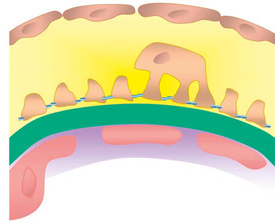
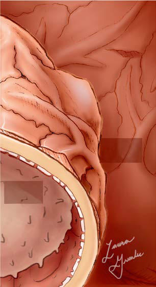

# Chapter 567: Nephrotic Syndrome
> **Course:** Vikkypaedia Pediatric Basic Course (*Nelson Textbook of Pediatrics, 22nd Edition (2025)*)  
> **Part XXI:** Nephrology  
> **Authors:** Elif Erkan  
> **Metrics:** 7,671 words · 7 tables/boxes · 2 figures · 10 genes · 8 flashcards · 5 MCQs  
> **Quick Navigation:** [🃏 Study 8 Flashcards](../flashcards/567_flashcards.md) · [📝 Take 5-Q MCQ Quiz](../mcqs/567_mcqs.md) · [📚 Part XXI Guide](../parts/Part_XXI.md) · [🧬 Syndrome & Genetics Atlas](../omim_gene_atlas.md) · [💊 Therapeutics Matrix](../therapies_matrix.md) · [🏠 Course Index](../../index.md)

## Key Chapter Topics & Subchapters
`567.1 Idiopathic Nephrotic Syndrome` · `567.2 Secondary Nephrotic Syndrome` · `567.3 Congenital Nephrotic Syndrome` · `567.1 Idiopathic Nephrotic Syndrome Elif Erkan` · `567.2 Secondary Nephrotic Syndrome Elif Erkan` · `567.3 Congenital Nephrotic Syndrome Elif Erkan`

## Key Genetic & Molecular Targets
`ACTN4`, `AR`, `COQ2`, `INF2`, `ITGB4`, `LAMB2`, `NPHS1`, `NPHS2`, `TRPC6`, `WT1`

## ⚡ High-Yield Nelson Pediatric Board Pearls
- Tubular proteinuria is a consistent finding among patients with the X-linked tubular syn drome, Dent disease, caused by pathogenic variants of the renal chlo ride channel.
- Nephrotic syndrome is the clinical manifestation of glomerular dis eases associated with heavy (nephrotic range) proteinuria.
- Glomerular lesions associated with idiopathic nephrotic syndrome include minimal change disease (most common), focal segmental glomeruloscle rosis (FSGS), membranoproliferative glomerulonephritis, C3 glo merulopathy, and membranous nephropathy.
- A num ber of hereditary proteinuria syndromes are caused by pathogenic variants in genes that encode critical protein components of the glo merular filtration apparatus.
- Genetic screening of 1,655 patients with steroid-resistant nephrotic syndrome and congenital nephrotic syndrome in the European PodoNet Registry Cohort has shown that pathogenic variants in NPHS1, WT1, and NPHS2 were the most common.
- CLINICAL CONSEQUENCES OF NEPHROTIC SYNDROME Edema Edema is the most common presenting symptom of children with nephrotic syndrome.
- This hypothesis does not fit the clinical picture of some patients with edema caused by nephrotic syndrome who have clinical signs of intravascular volume overload, not volume depletion.

---
## Full Chapter Text, Tables & Figures
# Chapter 567: Nephrotic Syndrome

*Elif Erkan*

<!-- p.4153 -->
Parietal epithelial cell

Podocyte

cell body Subpodocyte

space

**GBM**

**Glycocalyx**

**Urinary Space**

**Glomerular Capillary Lumen**

Filtration slit

(40 nm) Slit diaphragm

Podocyte foot processes

Fenestrae

Endothelial

cell

**Fig. 566.2** Glomerular capillary wall. The three layers of the capil lary wall (glomerular endothelial cell, glomerular basement membrane [GBM], and podocyte) act as the glomerular filtration barrier (GFB), pre venting proteins and large molecules from passing from the capillary lumen into the urinary space. The podocyte cell body lies within the uri nary space, and the cell is attached to the GBM through foot processes. Adjacent foot processes are separated by the filtration slit, bridged by the slit diaphragm. Disruption of the GFB leads the passage of protein across the capillary wall, leading to proteinuria. (From Jefferson JA, Nel son PJ, Najafian B, et al. Podocyte disorders: core curriculum 2011. Am J Kidney Dis. 2011;58:666–677. Fig. 1.)

#### **Table 566.1** Causes of Proteinuria

| Category / Parameter | Clinical Details & Findings |
| --- | --- |
| **TRANSIENT PROTEINURIA** | Fever; Exercise; Dehydration; Cold exposure; Congestive heart failure; Seizure; Stress; Recent use of epinephrine |
| **PROTEINURIA** | Idiopathic (minimal change) nephrotic syndrome; Focal segmental glomerulosclerosis; Secondary causes of nephrotic syndrome (see Chapter 567); Mesangial proliferative glomerulonephritis; Membranous nephropathy; Membranoproliferative glomerulonephritis; Amyloidosis; Diabetic nephropathy; Sickle cell nephropathy |
| **FEATURE** | Acute postinfectious glomerulonephritis (streptococcal, endocarditis,; hepatitis B or C virus, HIV); Immunoglobulin A nephropathy; IgA vasculitis nephritis; Lupus nephritis; Serum sickness; Alport syndrome; Vasculitic disorders; Reflux nephropathy |
| **TUBULAR DISEASES** | Cystinosis; Fanconi syndrome; Wilson disease; Lowe syndrome; Dent disease (X-linked recessive nephrolithiasis); Galactosemia; Tubulointerstitial nephritis; Acute tubular necrosis; Renal dysplasia; Polycystic kidney disease; Reflux nephropathy; Renal transplant rejection; Drugs (aminoglycosides, cisplatin, penicillamine, lithium,; nonsteroidal antiinflammatory drugs, cyclosporine); Heavy metals (lead, gold, mercury) |

Tubular proteinuria (see Table 566.1) may be seen in acquired and inherited disorders and may be associated with other defects of proxi mal tubular function, such as Fanconi syndrome (glycosuria, phospha turia, bicarbonate wasting, and aminoaciduria). Tubular proteinuria is a consistent finding among patients with the X-linked tubular syn drome, Dent disease, caused by pathogenic variants of the renal chlo ride channel.

Asymptomatic patients having persistent proteinuria generally have glomerular rather than tubular proteinuria. In occult cases, glomerular and tubular proteinuria can be distinguished by protein electrophoresis of the urine. In tubular proteinuria, little or no albumin is detected, whereas in glomerular proteinuria, the major protein is albumin.

*Visit Elsevier eBooks+ at eBooks.Health.Elsevier.com** for Bibliography.*

Nephrotic syndrome is the clinical manifestation of glomerular dis eases associated with heavy (nephrotic range) proteinuria. Nephroticrange proteinuria is defined as proteinuria >3.5 g/24 hr or a urine

protein:creatinine ratio >2. The triad of clinical findings associated with nephrotic syndrome arising from the large urinary losses of pro tein are hypoalbuminemia (≤2.5 g/dL), edema, and hyperlipidemia (cholesterol >200 mg/dL).

Nephrotic syndrome affects 1-3 per 100,000 children <16 years of age. Without treatment, nephrotic syndrome in children is asso ciated with a high risk of death, most commonly from infections. Fortunately, 80% of children with nephrotic syndrome respond to corticosteroid therapy. Although glucocorticoid therapy is stan dard therapy for nephrotic syndrome, neither the target cell nor the mechanism of action of steroids has been determined. Early referral to a pediatric nephrologist is recommended for initial management

*Elif Erkan*

<!-- p.4155 -->
of nephrotic syndrome. However, continued care of these children is always a collaborative effort between the nephrologist and the primary care physician.

**ETIOLOGY** Most children with nephrotic syndrome have a form of **primary** or idiopathic nephrotic syndrome (Table 567.1). Glomerular lesions associated with idiopathic nephrotic syndrome include minimal change disease (most common), focal segmental glomeruloscle rosis (FSGS), membranoproliferative glomerulonephritis, C3 glo merulopathy, and membranous nephropathy (Table 567.2). These etiologies have different age distributions (Fig. 567.1). Nephrotic syndrome may also be **secondary** to systemic diseases such as systemic lupus erythematosus, IgA vasculitis (formerly Henoch- Schönlein purpura), malignancy (lymphoma and leukemia), and infections (hepatitis, HIV, and malaria) (see Table 567.1). A num ber of **hereditary** proteinuria syndromes are caused by pathogenic variants in genes that encode critical protein components of the glo merular filtration apparatus (Table 567.3).

**PATHOGENESIS Role of the Podocyte** The underlying abnormality in nephrotic syndrome is an increased permeability of the glomerular capillary wall, which leads to mas sive proteinuria and hypoalbuminemia. The podocyte plays a cru cial role in the development of proteinuria and the progression of glomerulosclerosis (Fig. 567.2). The podocyte is a highly differenti ated epithelial cell located on the outside of the glomerular capillary loop. Foot processes are extensions of the podocyte that terminate on the glomerular basement membrane. The foot processes of a podocyte interdigitate with those from adjacent podocytes and are connected by a slit called the slit diaphragm. The podocyte func tions as structural support of the capillary loop, is a major compo nent of the glomerular filtration barrier to proteins, and is involved in synthesis and repair of the glomerular basement membrane. The slit diaphragm is one of the major impediments to protein perme ability across the glomerular capillary wall. Slit diaphragms are not simple passive filters; they consist of numerous proteins that con tribute to complex signaling pathways and play an important role in podocyte function. Important component proteins of the slit dia phragm include nephrin, podocin, CD2AP, and α-actinin 4. Podo cyte injury or pathogenic variants of genes producing podocyte proteins may cause nephrotic-range proteinuria (see Table 567.3). Genetic screening of 1,655 patients with steroid-resistant nephrotic syndrome and congenital nephrotic syndrome in the European PodoNet Registry Cohort has shown that pathogenic variants in *NPHS1, WT1,* and *NPHS2* were the most common. The proportion of patients with pathogenic variants of podocyte genes decreased by age; it was 66% in patients with congenital nephrotic syndrome and 15–16% in school-age patients and adolescents. In idiopathic, hereditary, and secondary forms of nephrotic syn drome, there are immune and nonimmune insults to the podocyte that lead to foot process effacement of the podocyte, a decrease in number of functional podocytes, and altered slit diaphragm integrity. The end result is increased protein leakiness across the glomerular capillary wall into the urinary space.

**Role of the Immune System Minimal change nephrotic syndrome (MCNS)** may occur after viral infections and allergen challenges. MCNS has also been found to occur in children with Hodgkin lymphoma and T-cell lymphoma. That immunosuppression occurs with drugs such as corticosteroids and cyclosporine and provides indirect additional evidence that the immune system contributes to the overall pathogenesis of the nephrotic syndrome.

Considering the recurrence rate of 30% after kidney transplan tation, a permeability factor was implicated in pathophysiology of FSGS. Rat glomeruli exposed to patient sera with FSGS has dem onstrated increased permeability to albumin. A subset of adult and pediatric patients was found to have circulating nephrin autoanti bodies, suggesting the role of circulating antibodies in the patho genesis of MCNS.

**CLINICAL CONSEQUENCES OF NEPHROTIC SYNDROME Edema** Edema is the most common presenting symptom of children with nephrotic syndrome. Despite its almost universal presence, there is uncertainty as to the exact mechanism of edema formation. There are two opposing theories, the *underfill hypothesis* and the *overfill hypothesis,* that have been proposed as mechanisms causing nephrotic edema.

The *underfill hypothesis* is based on nephrotic-range proteinuria that leads to a fall in the plasma protein level with a corresponding decrease in intravascular oncotic pressure. This leads to leakage of plasma water into the interstitium, generating edema. As a result of reduced intravascular volume, there is increased secretion of vaso pressin and atrial natriuretic factor, which, along with aldosterone, results in increased sodium and water retention by the tubules. Sodium and water retention therefore occur as a consequence of intravascular volume depletion.

This hypothesis does not fit the clinical picture of some patients with edema caused by nephrotic syndrome who have clinical signs of intravascular volume overload, not volume depletion. Treating these patients with albumin alone may not be sufficient to induce a diuresis without the concomitant use of diuretics. Also, reducing the renin-aldosterone axis with mineralocorticoid receptor antago nists does not result in a marked increase in sodium excretion. With the onset of remission of MCNS, many children will have increased urine output before their urinary protein excretion is measurably reduced.

The *overfill hypothesis* postulates that nephrotic syndrome is asso ciated with primary sodium retention, with subsequent volume expansion and leakage of excess fluid into the interstitium. There is accumulating evidence that the epithelial sodium channel in the distal tubule may play a key role in sodium reabsorption in nephrotic syn drome. The clinical weaknesses of this hypothesis are evidenced by the numerous nephrotic patients who present with an obvious clinical picture of intravascular volume depletion: low blood pressure, tachy cardia, and elevated hemoconcentration. Furthermore, amiloride, an epithelial sodium channel blocker, used alone is not sufficient to induce adequate diuresis.

*The goal of therapy should be a gradual reduction of edema with judi cious use of diuretics, sodium restriction, and cautious use of IV albumin infusions, if indicated.*

**Hyperlipidemia** There are several alterations in the lipid profile in children with nephrotic syndrome, including an increase in cholesterol, triglyc erides, low-density lipoproteins, and very low-density lipoproteins. The high-density lipoprotein level remains unchanged or is low. In adults, this results in an increase in the adverse cardiovascular risk ratio, although the implications for children are not as seri ous, especially those with steroid-responsive nephrotic syndrome. Hyperlipidemia is thought to be the result of increased synthesis as well as decreased catabolism of lipids. Although commonplace in adults, the use of lipid-lowering agents in children is uncommon.

**Increased Susceptibility to Infections** Children with nephrotic syndrome are especially susceptible to infections such as cellulitis, spontaneous bacterial peritonitis, and

<!-- p.4156 -->

#### **Table 567.1** Causes of Childhood Nephrotic Syndrome

| Category / Parameter | Clinical Details & Findings |
| --- | --- |
| **IDIOPATHIC NEPHROTIC SYNDROME** | Minimal change disease; Focal segmental glomerulosclerosis; Membranous nephropathy; Glomerulonephritis associated with nephrotic syndrome–; membranoproliferative glomerulonephritis, crescentic; glomerulonephritis, immunoglobulin A nephropathy |
| **Nephrotic Syndrome (Typical)** | Finnish-type congenital nephrotic syndrome (absence of nephrin); Focal segmental glomerulosclerosis (pathogenic variants in nephrin,; podocin, MYO1E, α-actinin 4, TRPC6); Diffuse mesangial sclerosis (pathogenic variants in laminin β2 chain); Denys-Drash syndrome (pathogenic variants in WT1 transcription; factor); Congenital nephrotic syndrome with lung and skin involvement; (integrin α-3 pathogenic variant); Mitochondrial disorders |
| **Proteinuria With or Without Nephrotic Syndrome** | Nail–patella syndrome (pathogenic variant in LMX1B transcription; factor); Alport syndrome (pathogenic variant in collagen biosynthesis genes) |
| **Multisystem Syndromes With or Without Nephrotic Syndrome** | Galloway-Mowat syndrome; Charcot-Marie-Tooth disease; Jeune syndrome; Cockayne syndrome; Laurence-Moon-Biedl-Bardet syndrome |
| **Metabolic Disorders With or Without Nephrotic Syndrome** | Alagille syndrome; α1-Antitrypsin deficiency; Fabry disease; Glutaric acidemia; Glycogen storage disease; Hurler syndrome; Partial lipodystrophy; Mitochondrial cytopathies; Sickle cell disease |
| **Infections** | Endocarditis; Post-streptococcal; Hepatitides B, C |
| **HIV-1** | Infectious mononucleosis; Cytomegalovirus; Malaria; Syphilis (congenital and secondary); Toxoplasmosis; Tuberculosis; Schistosomiasis; Filariasis |
| **Drugs** | Captopril; Penicillamine; Gold; Nonsteroidal antiinflammatory drugs; Pamidronate, other bisphosphonates; Interferon; Mercury; Heroin; Lithium; Rifampicin; Sulfasalazine |
| **Immunologic or Allergic Disorders** | Vasculitis syndromes; Castleman disease; Kimura disease; Bee sting; Snake venom; Food allergens; Serum sickness; Poison ivy, poison oak |
| **Wilms Tumor** | Lymphoma; Pheochromocytoma; Leukemia; Thymoma; Solid tumors |
| **Glomerular Hyperfiltration** | Oligomeganephronia; Morbid obesity; Adaptation to nephron reduction; Adapted from Eddy AA, Symons JM. Nephrotic syndrome in childhood. Lancet. 2003;362:629–638. |

#### **Table 567.2** Summary of Primary Renal Diseases That Manifest as Idiopathic Nephrotic Syndrome

| Category / Parameter | Clinical Details & Findings |
| --- | --- |
| **DEMOGRAPHICS** | Age (years); 2-6, some adults; 2-10, some adults; 40-50; 5-15; 5-15; Sex (male:female); 2:1; 1.3:1; 2:1; 1:1; 1:1 |
| **CLINICAL MANIFESTATIONS** | Nephrotic syndrome; 100%; 90%; 80%; 60%*; 60%*; Asymptomatic; proteinuria; 0; 10%; 20%; 40%; 40%; Hematuria (microscopic; or gross); 10–20%; 60–80%; 60%; 80%; 80%; Hypertension; 10%; 20% early; Infrequent; 35%; 35% |

<!-- p.4157 -->
bacteremia. This occurs as a result of many factors, particularly hypo globulinemia, as a result of the urinary losses of immunoglobulin (Ig) G. In addition, defects in the complement cascade from urinary loss

of complement factors (predominantly C3 and C5), as well as alter native pathway factors B and D, lead to impaired opsonization of microorganisms. Children with nephrotic syndrome are at signifi cantly increased risk for infection with encapsulated bacteria and, in particular, pneumococcal disease. **Spontaneous bacterial peritonitis** presents with fever, abdominal pain, and peritoneal signs. Although pneumococcus is the most frequent cause of peritonitis, gram-negative bacteria also are associated with a significant number of cases. Chil dren with nephrotic syndrome and fever or other signs of infection must be evaluated aggressively, with appropriate cultures drawn, and should be treated promptly and empirically with antibiotics. Peritoneal leukocyte counts >250 cells/μL are highly suggestive of spontaneous bacterial peritonitis.

**Hypercoagulability** Nephrotic syndrome is a hypercoagulable state resulting from multi ple factors: vascular stasis from hemoconcentration and intravascular volume depletion, increased platelet number and aggregability, and changes in coagulation factor levels. There is an increase in hepatic production of fibrinogen along with urinary losses of antithrombotic factors such as antithrombin III and protein S. Deep venous throm bosis may occur in any venous bed, including the cerebral venous sinus, renal vein, and pulmonary veins. The clinical risk is low in chil dren (2–5%) compared with adults but has the potential for serious consequences.

*Visit Elsevier eBooks+ at eBooks.Health.Elsevier.com** for Bibliography.*

**FEATURES**

**MINIMAL CHANGE NEPHROTIC 
 SYNDROME**

**FOCAL SEGMENTAL 
 GLOMERULOSCLEROSIS**

**MEMBRANOUS 
 NEPHROPATHY**

MEMBRANOPROLIFERATIVE

GLOMERULONEPHRITIS

**TYPE I TYPE II**

Rate of progression to

renal failure

Does not progress 10 years 50% in 10-20 years 10-20 years 5-15 years

Associated conditions Usually none HIV, heroin use, sickle cell

disease, reflux nephropathy

Renal vein thrombosis;

medications; SLE; hepatitides B, C; lymphoma; tumors

None Partial

lipodystrophy

GENETICS

None except

in congenital nephrotic syndrome (see Table 567.3)

Podocin, α-actinin 4, TRPC6

channel, INF-2, MYH-9

None None None

LABORATORY FINDINGS

Manifestations

of nephrotic syndrome ↑ BUN in 15–30% Normal complement

levels

Manifestations of nephrotic

syndrome ↑ BUN in 20–40% Normal complement levels

Manifestations of

nephrotic syndrome Normal complement

levels

Low complement

levels: C1, C4, C3-C9

Normal

complement levels: C1, C4, low C3-C9

RENAL PATHOLOGY Light microscopy Normal Focal sclerotic lesions Thickened GBM, spikes Thickened GBM,

proliferation

Lobulation

Immunofluorescence Negative IgM, C3 in lesions Fine granular IgG, C3 Granular IgG, C3 C3 only

Electron microscopy Foot process fusion Foot process fusion Subepithelial deposits Mesangial and

subendothelial deposits

Dense deposits

REMISSION ACHIEVED AFTER 8 WK OF ORAL CORTICOSTEROID THERAPY

90% 15–20% Resistant Not established/

resistant

Not

established/ resistant

*Approximate frequency as a cause of idiopathic nephrotic syndrome. Approximately 10% of cases of adult nephrotic syndrome are a result of various diseases that usually manifest as acute glomerulonephritis. ↑, Elevated; C, complement; GBM, glomerular basement membrane; Ig, immunoglobulin; SLE, systemic lupus erythematosus. Modified from Couser WG. Glomerular disorders. In: Wyngaarden JB, Smith LH, Bennett JC, eds. Cecil Textbook of Medicine, 19th ed. Philadelphia: WB Saunders; 1992. p. 560.

100

80

60

40

20

0 >15 10–15 5–10 Age at biopsy (yr) 22 *n* 25 61

FSGS C1Q Membranous MCNS MPGN Lupus membranous

115

1–5

Percent

#### **Table 567.2** Summary of Primary Renal Diseases That Manifest as Idiopathic Nephrotic Syndrome—cont’d

**Fig. 567.1** Kidney biopsy results from 223 children with proteinuria referred for diagnostic kidney biopsy (Glomerular Disease Collabora tive Network, J. Charles Jennette, MD, Hyunsook Chin, MS, and D.S. Gipson, 2007). C1Q, Nephropathy; FSGS, focal segmental glomerulo sclerosis; MCNS, minimal change nephrotic syndrome; MPGN, mem branoproliferative glomerulonephritis; n, number of patients. (From Gipson DS, Massengill SF, Yao L, et al. Management of childhood onset nephrotic syndrome. Pediatrics. 2009;124:747–757.)

<!-- p.4158 -->

<!-- p.4159 -->

## 567.1  Idiopathic Nephrotic Syndrome Elif Erkan

Approximately 90% of children with nephrotic syndrome have idio pathic nephrotic syndrome. Idiopathic nephrotic syndrome is associ ated with primary glomerular disease without an identifiable causative disease or drug. Idiopathic nephrotic syndrome includes multiple his tologic types: minimal change disease, mesangial proliferation, focal

segmental glomerulosclerosis, membranous nephropathy, and mem branoproliferative glomerulonephritis.

**PATHOLOGY** In **minimal change nephrotic syndrome (MCNS)** (approximately 85% of total cases of nephrotic syndrome in children), the glomeruli appear normal or show a minimal increase in mesangial cells and matrix. Findings on immunofluorescence microscopy are typically negative, and electron microscopy simply reveals effacement of the

#### **Table 567.3** Causative Genes and Histologic Patterns of Nephrotic Syndrome by Time of Disease Onset

| Category / Parameter | Clinical Details & Findings |
| --- | --- |
| **CONGENITAL ONSET (0-3 MO)** | Isolated; Congenital nephrotic syndrome of the; Finnish type (CNF) |
| **AR** | NPHS1/nephrin; Radial dilation of; proximal tubule; Recessive SRNS, type 2 |
| **AR** | NPHS2/podocin |
| **FSGS/MGC** | Recessive SRNS, type 3 |
| **DMS** | Isolated DMS |
| **DMS** | Recessive SRNS |
| **COQ2** | FSGS, collapsing; Recessive SRNS + deafness |
| **FSGS** | Dominant SRNS + deafness; AD/11q24; Unknown |
| **FSGS** | DMS + neurologic findings |
| **AR** | ARHGDIA/Rho GDP dissociation inhibitor; (GDI) alpha |
| **DMS** | NS + lung and skin disease |
| **AR** | ITGA3/integrin alpha 3 |
| **DMS** | Steroid-sensitive nephrotic syndrome; AR/2p12-13.2; Unknown |
| **MGC/FSGS** | Syndromic; Denys-Drash syndrome |
| **DMS** | Pierson syndrome |
| **AR** | LAMB2/laminin-β2 |
| **FSGS** | Nail–patella syndrome |
| **AD** | LMX1B/LIM homeobox transcription; factor-1β; Frasier syndrome |
| **FSGS** | Schimke immunoosseous dysplasia |
| **FSGS** | Epidermolysis bullosa + FSGS |
| **AR** | ITGB4/integrin-β4 |
| **FSGS** | Galloway-Mowat syndrome |
| **AR** | Unknown; MGC to FSGS |
| **INFANCY-CHILDHOOD ONSET** | Genetic; Recessive SSNS |
| **AR** | EMP2/epithelial membrane protein 2; Recessive SRNS |
| **AR** | NPHS2/podocin |
| **FSGS/MGC** | Recessive SRNS |
| **AR** | NPHS1/nephrin |
| **FSGS/MGC** | Recessive SRNS |
| **DMS** | Isolated DMS |
| **DMS** | Recessive SRNS + deafness or; intellectual disability |
| **AR** | MYOE1/nonmuscle class I myosin E |
| **AR** | PTPRO/GLEPP1 protein tyrosine; phosphatase receptor type O/glomerular; epithelial protein-1 |
| **JUVENILE-ADULT ONSET** | Genetic |
| **SRNS** | AR or sporadic; NPHS2 (p.R229Q) |
| **FSGS** | Familial SRNS |
| **AD** | INF2/formin family of actin-regulating; proteins |
| **FSGS** | FSGS, type 1; AD/19q13; ACTN4/α-actinin-4 |
| **FSGS** | FSGS, type 2; AD/11q21-22; TRPC6/transient receptor potential cation; channel, subfamily C, member 6 |
| **FSGS** | FSGS, type 3; AR-AD/6p12; CD2AP/CD2-associated protein |
| **AR** | PTPRO/GLEPP1 protein tyrosine; phosphatase receptor type O/glomerular; epithelial protein-1 |
| **AR** | ADCK4/aarF domain-containing kinase 4 |
| **FSGS** | SRNS (no extrarenal symptoms); AD or sporadic; LMX1B encodes homeodomain-containing; transcription factor |
| **FSGS** | AD, Autosomal dominant; AR, autosomal recessive; DMS, diffuse mesangial sclerosis; FSGS, focal segmental glomerulosclerosis; MGC, minimal glomerular changes; NS, nephrotic; syndrome; SRNS, steroid-resistant nephrotic syndrome.; From Bakkaloglu SA, Schaefer F. Diseases of the kidney and urinary tract in children. In: Skorecki K, Chertow GM, Marsden PA, et al., eds. Brenner & Rector’s The Kidney, 10th ed.; Philadelphia: Elsevier; 2016: Table 74-2. |

<!-- p.4160 -->
Glomerular filtrate

Efferent capillary

1

2

6

3

4

5

**Glomerular filtration barrier in nephrotic syndrome**

**Kidney Nephron Glomerulus**

**Nephrotic syndrome**

**Pathogenesis** (a) Immune-mediated (b) Systemic circulating factors (eg, suPAR) (c) Podocyte related factors (eg, ANGPTL4) (d) Genetic variants

Mutant proteins play roles in:

**Normal**

1

2

3

Nucleus

Mitochondria

Lysosomes

4

5

6

Actin

Slit diaphragm

Basement membrane

Afferent capillary

**White blood cell Red blood cell Basement membrane**

**Slit diaphragm**

**Urinary space**

**Podocyte cell body**

**Fenestrated endothelial cells**

**Podocyte effacement**

**Fig. 567.2** The glomerular filtration barrier and pathogenesis of idiopathic nephrotic syndrome. Within the kidney is the glomerulus, a capillary tuft that filters the blood. The podocyte, glomerular basement membrane, and fenestrated glomerular endothelium form the glomerular filtration barri er, allowing the ultrafiltrate to enter the urinary space. The podocyte has extensive cellular extensions that interdigitate, and these foot processes are connected by the slit diaphragm. In nephrotic syndrome, there is extensive effacement of the podocytes and loss of this barrier to protein, allowing excessive serum albumin to leak into the urine. The pathogenesis of idiopathic nephrotic syndrome is hypothesized to be either immune mediated, due to a systemic podocyte-derived circulating factor, or, in rarer or familial forms, a genetic variant. Numerous pathogenic variants are associated with steroid-resistant nephrotic syndrome that affect various parts of the podocyte itself or the other constituents of the glomerular basement mem brane. These include pathogenic variants affecting the podocyte nucleus, mitochondria or lysosomes, the slit diaphragm or actin cytoskeleton, and the glomerular basement membrane. Nephrin, podocin, and CD2AP, for example, are essential components of a zipper-like structure spanning the interdigitating foot processes of the podocyte and the slit diaphragm and link directly with the podocyte actin cytoskeleton. The actin cytoskeleton is further supported by microfilaments that maintain structural stability and facilitate the dynamic nature of the podocyte structure and function. The importance of these microfilaments is evident because pathogenic variants in both α-actinin 4 and INF2, which are involved in actin regulation and polymerization, lead to FSGS. (From Noone DG, Iijima K, Parekh R. Idiopathic nephrotic syndrome in children. Lancet. 2018;392:61–72. Fig. 2.)

<!-- p.4161 -->
epithelial cell foot processes. More than 95% of children with minimal change disease respond to corticosteroid therapy.

**Mesangial proliferation** is characterized by a diffuse increase in mesangial cells and matrix on light microscopy. Immunofluorescence microscopy might reveal trace to 1+ mesangial IgM and/or IgA stain ing. Electron microscopy reveals increased numbers of mesangial cells and matrix as well as effacement of the epithelial cell foot processes. Approximately 50% of patients with this histologic lesion respond to corticosteroid therapy.

In **focal segmental glomerulosclerosis (FSGS),** glomeruli show lesions that are both focal (present only in a proportion of glom eruli) and segmental (localized to ≥1 intraglomerular tufts). The lesions consist of mesangial cell proliferation and segmental scar ring on light microscopy (Fig. 567.3; see Table 567.2). Immunofluo rescence microscopy is positive for IgM and C3 staining in the areas of segmental sclerosis. Electron microscopy demonstrates segmen tal scarring of the glomerular tuft with obliteration of the glomeru lar capillary lumen. The tip variant of FSGS is more common in Caucasians and is associated with better renal survival; by contrast, the collapsing variant of FSGS has a faster progression rate to endstage kidney disease and is more common in Black patients.

Lesions consistent with FSGS may be seen secondary to HIV infection, vesicoureteral reflux, and IV use of heroin and other drugs of abuse. Only 20% of patients with FSGS respond to predni sone. The disease is often progressive, ultimately involving all glom eruli with end-stage kidney disease in most patients.

**MINIMAL CHANGE NEPHROTIC SYNDROME Clinical Manifestations** Idiopathic nephrotic syndrome is more common in males than in females (2:1) and most commonly appears between the ages of 2 and 6 years (see Fig. 567.1). However, it has been reported as early as 6 months of age and throughout adulthood. MCNS is present in 85–90% of patients <6 years of age. In contrast, only 20–30% of adolescents who present for the first time with nephrotic syndrome have MCNS. The more common cause of idiopathic nephrotic syn drome in this older age group is FSGS. The incidence of FSGS is increasing; it may be more common in Black, Hispanic, and Asian patients. FSGS is the most common cause of end-stage kidney dis ease in adolescents.

The initial episode of idiopathic nephrotic syndrome, as well as sub sequent relapses, usually follows minor infections and, uncommonly, reactions to insect bites, bee stings, or poison ivy.

Children usually present with mild edema, which is initially noted around the eyes and in the lower extremities. Nephrotic syn drome can initially be misdiagnosed as an allergic disorder because of the periorbital swelling that decreases throughout the day. With time, the edema becomes generalized, with the development of ascites, pleural effusions, and genital edema. Anorexia, irritability, abdominal pain, and diarrhea are common. Important features of MCNS are the absence of hypertension and gross hematuria (the so-called nephritic features).

The differential diagnosis of the child with marked edema includes protein-losing enteropathy, hepatic failure, heart failure, acute or chronic glomerulonephritis, and protein malnutrition. A diagnosis other than MCNS should be considered in children <1 year of age, with a positive family history of nephrotic syndrome, and/or the pres ence of extrarenal findings (e.g., arthritis, rash, anemia), hypertension or pulmonary edema, acute or chronic renal insufficiency, and gross hematuria.

**Diagnosis Recommendations for the Initial Evaluation of Children with Nephrotic Syndrome Confirming the Diagnosis of Nephrotic Syndrome.**  The initial workup for a child with nephrotic syndrome is shown in Table 567.4. Labs should be obtained including urinalysis with the first morning urine protein:creatinine ratio, CBC, serum electrolytes, BUN, creati nine, glomerular filtration rate, albumin, complement C3 and C4 lev els, antinuclear and anti-streptococcal antibodies, and antineutrophil cytoplastic antibodies.

The urinalysis reveals 3+ or 4+ proteinuria, and microscopic hema turia is present in 20% of children. A spot urine protein:creatinine ratio should be >2.0. The serum creatinine value is usually normal, but it may be abnormally elevated if there is diminished renal per fusion from contraction of the intravascular volume. The serum albumin level is <2.5 g/dL, and serum cholesterol and triglyceride levels are elevated. Serum complement levels are normal. Kidney ultrasound may be considered to exclude renal malformations and venous thrombosis but is not mandatory. A renal biopsy is not rou tinely performed if the patient fits the standard clinical picture of MCNS.

**Treatment** Children with their first episode of nephrotic syndrome and mild to moderate edema may be managed as outpatients. Such outpa tient management is not practiced in all major centers, because the time required for successful education of the family regarding all aspects of the condition can require a short period of hospitaliza tion. The child’s parents must be able to recognize the signs and symptoms of the complications of the disease and may be taught how to use a dipstick and interpret the results to monitor for the degree of proteinuria. Tuberculosis must be ruled out before start ing immunosuppressive therapy with corticosteroids by placing a purified protein derivative skin test or obtaining an interferongamma release assay and confirming a negative result.

Children with onset of uncomplicated nephrotic syndrome between 1 and 12 years of age are likely to have steroid-responsive MCNS, and steroid therapy may be initiated without a diagnostic renal biopsy. Children with features that make MCNS less likely (gross hematuria, sustained hypertension, acute kidney injury, low C3 levels, arthritis and/or rash to suggest glomerulonephritis, or age <1 year or >12 years) should be considered for renal biopsy before treatment.

**Use of Corticosteroids to Treat Minimal Change Nephrotic Syndrome** Corticosteroids are the mainstay of therapy for MCNS. The treatment guidelines for corticosteroid use presented in the following sections are adapted from and based on the 2021 Kidney Disease: Improving

**Fig. 567.3** Steroid-resistant nephrotic syndrome (SRNS). Kidney bi opsy image of patient with SRNS shows focal segmental glomeruloscle rosis. Segmental sclerosis is noted in a perihilar location with hyalinosis. Evidence of tubular atrophy and interstitial fibrosis is also present. H&E magnification 20×. (From Tullus K, Webb H, Bagga A. Management of steroid-resistant nephrotic syndrome in children and adolescents. Lan cet Child Adolesc Health. 2018;2:880–888. Fig. 1B, p. 881.)

<!-- p.4162 -->
Global Outcomes (KDIGO) clinical practice guidelines on glomerulo nephritis (Fig. 567.4).

**Treatment of the Initial Episode of Nephrotic Syndrome** In children with presumed MCNS, prednisone or prednisolone should be administered as a single daily dose of 60 mg/m2/day or 2 mg/kg/ day to a maximum of 60 mg daily for 4-6 weeks followed by alternateday prednisone (starting at 40 mg/m2 every other day or 1.5 mg/kg every other day) for a period ranging from 4-6 weeks. The issue of the duration of steroid treatment has been controversial, but current evi dence suggests that prolonged (>12 weeks) glucocorticoid treatment increases the risk of adverse effects without further improving clini cal outcomes. Approximately 80–90% of children respond to steroid therapy.

**Response** is defined as the attainment of remission within the ini tial 4 weeks of corticosteroid therapy. **Remission** consists of a urine protein:creatinine ratio of <0.2 or <1+ protein on urine dipstick test ing for 3 consecutive days. Most children who respond to prednisone therapy do so within the first 5 weeks of treatment.

**Managing the Clinical Sequelae of Nephrotic Syndrome Edema.**  Children with severe symptomatic edema, including large pleural effusions, ascites, or severe genital edema, should be hospital ized. In addition to sodium restriction (<1,500 mg daily), water/fluid restriction may be necessary if the child is hyponatremic. A swollen scrotum may be elevated with pillows to enhance fluid removal by gravity. Diuresis may be augmented by the administration of loop diuretics (furosemide), orally or intravenously, *although extreme*

*caution should be exercised.* Aggressive diuresis can lead to intravascu lar volume depletion and an increased risk for acute renal failure and intravascular thrombosis.

When a patient has severe generalized edema with evidence of intra vascular volume depletion (e.g., hemoconcentration, hypotension, tachycardia), IV administration of 25% albumin (0.5-1.0 g albumin/ kg) as a slow infusion followed by furosemide (1-2 mg/kg/dose IV) is sometimes necessary. Such therapy should be used only in collabo ration with a pediatric nephrologist and mandates close monitoring of volume status, blood pressure, serum electrolyte balance, and renal function. Symptomatic volume overload, with hypertension, heart failure, and pulmonary edema, is a potential complication of paren teral albumin therapy, particularly when it is administered as a rapid infusion.

**Dyslipidemia.**  Dyslipidemia should be managed with a low-fat diet. Dietary fat intake should be limited to <30% of calories with a saturated fat intake of <10% calories. Dietary cholesterol intake should be <300 mg/day. There are insufficient data to recommend the use of 3-hydroxy-3-methylgluataryl coenzyme A (HMG-CoA) reductase inhibitors routinely in children with dyslipidemia.

**Infections.**  Families of children with nephrotic syndrome should be counseled regarding the signs and symptoms of infections such as cellulitis, peritonitis, and bacteremia. If there is a suspicion of infec tion, a blood culture should be drawn before starting empiric antibi otic therapy. In the case of spontaneous bacterial peritonitis, peritoneal fluid should be collected if there is sufficient fluid to perform a para centesis and sent for cell count, Gram stain, and culture. The antibiotic provided must be of broad enough coverage to include pneumococ cus and gram-negative bacteria. A third-generation cephalosporin is a common choice of IV antibiotic.

**Thromboembolism.**  Children who present with the clinical signs of thromboembolism should be evaluated with appropriate imaging studies to confirm the presence of a clot. Studies to delineate a specific underlying hypercoagulable state are recommended. In children with thrombotic events, anticoagulation therapy including heparin, low molecular weight heparin, and warfarin are therapeutic options that appear to be effective.

**Obesity and Growth.**  Glucocorticoids may increase the body mass index in children who are overweight when steroid therapy is ini tiated, and these children are more likely to remain overweight. Antici patory dietary counseling is recommended. Growth may be affected in children who require long-term corticosteroid therapy. Steroid-sparing strategies may improve linear growth in children who require pro longed courses of steroids.

**Relapse of Nephrotic Syndrome.**  Relapse of nephrotic syndrome is defined as a urine protein:creatinine ratio of >2 or ≥3+ protein on urine dipstick testing for 3 consecutive days. Relapses are common, especially in younger children, and are often triggered by upper respiratory or gastrointestinal infections. Relapses are usually treated similar to the initial episode, except that daily prednisone courses are shortened. Daily high-dose prednisone is given until the child has achieved remission, and the regimen is then switched to alternate-day therapy. The duration of alternate-day therapy varies depending on the frequency of relapses of the individual child. Children are classified as infrequent relapsers or frequent relapsers, and as being steroid depen dent, based on the number of relapses in a 12-month period or their inability to remain in remission following discontinuation of steroid therapy.

**Steroid Resistance.**  Steroid resistance is defined as the failure to achieve remission after 4 weeks of corticosteroid therapy. Children with steroid-resistant nephrotic syndrome require further evaluation, including a diagnostic kidney biopsy and genetic testing. Steroidresistant nephrotic syndrome is usually caused by FSGS (80%), MCNS, or membranoproliferative glomerulonephritis.

**Implications of Steroid-Resistant Nephrotic Syndrome.** Steroid-resistant nephrotic syndrome, and specifically FSGS, is associated with a 50% risk for end-stage kidney disease within 5 years of diagnosis if patients do not achieve a partial or complete remission. Persistent nephrotic syndrome is associated with a poor

Syndrome (NS)

#### **Table 567.4** Investigations in a Child with Nephrotic

| Category / Parameter | Clinical Details & Findings |
| --- | --- |
| **BASELINE INVESTIGATIONS** | 1.	 Urinalysis and urine microscopy; 2.	 Urine albumin or protein:creatinine ratio; 3.	 24-hr timed collection of urine for protein quantification; 4.	 Serum electrolytes, albumin, total protein, renal function, and; cholesterol |
| **GLOMERULONEPHRITIS** | 1.	 Serum complement C3 and C4 concentrations; 2.	 Serum immunoglobulins; 3.	 Antistreptolysin titers; 4.	 Anti-DNase B antibodies; 5.	 Antinuclear antigen antibodies; 6.	 Anti–double-stranded DNA antibodies; 7.	 Anti-neutrophil cytoplasmic antibodies |
| **INFECTIOUS WORKUP DEPENDING ON CLINICAL CONTEXT** | 1.	 Hepatitis B and C, HIV, syphilis, or tuberculosis can also be; considered depending on the clinical context |
| **CONSIDERATION OF GENETIC TESTING** | 1.	 A positive family history of NS; 2.	 Congenital NS; 3.	 Failure to respond to steroid therapy; 4.	 Persistent kidney dysfunction; 5.	 Features suggestive of a known syndrome (appendix) |
| **RENAL BIOPSY CONSIDERED IN THE FOLLOWING SITUATIONS** | 1.	 Age <1 or >12 years; 2.	 Persistent or sustained elevation in creatinine; 3.	 Significant hematuria or gross hematuria; 4.	 Hypocomplementemia; 5.	 Findings indicative of another autoimmune disease; 6.	 Infection with hepatitis B or C, HIV, or tuberculosis; 7.	 Hypertension; 8.	 Glucocorticoid resistance; From Noone DG, Iijima K, Parekh R. Idiopathic nephrotic syndrome in children. Lancet.; 2018;392:61–72. Panel 3. |

<!-- p.4163 -->
patient-reported quality of life, hypertension, serious infections, and thromboembolic events. Children reaching end-stage kidney disease have a greatly reduced life expectancy compared with their peers.

**Alternative Therapies to Corticosteroids in the Treatment of Nephrotic Syndrome.**  Steroid-dependent patients, frequent relapsers, and steroid-resistant patients are candidates for alterna tive therapies, particularly if they have severe corticosteroid toxic ity (cushingoid appearance, hypertension, cataracts, and/or growth failure). **Cyclophosphamide** prolongs the duration of remission and reduces the number of relapses in children with **frequently relapsing** and **steroid-dependent** nephrotic syndrome. The poten tial side effects of the drug (neutropenia, disseminated varicella, hemorrhagic cystitis, alopecia, sterility, increased risk of future malignancy) should be carefully reviewed with the family before initiating treatment. Cyclophosphamide (2 mg/kg) is given as a single oral dose for a total duration of 8-12 weeks. Alternate-day prednisone therapy is often continued during cyclophosphamide administration. During cyclophosphamide therapy, the white blood cell count must be monitored weekly, and the drug should be with held if the count falls below 5,000/mm3. The cumulative threshold dose above which oligospermia or azoospermia occurs in males is >250 mg/kg.

**Calcineurin inhibitors** (cyclosporine or tacrolimus) are rec ommended as initial therapy for children with **steroid-resistant** nephrotic syndrome. Children must be monitored for side effects, including hypertension, nephrotoxicity, hirsutism, and gingival hyperplasia. **Mycophenolate** can maintain remission in children with steroid-dependent or frequently relapsing nephrotic syn drome. **Levamisole**, an anthelmintic agent with immunomodulat ing effects that has been shown to reduce the risk of relapse when compared with prednisone, is not available in the United States.

**Rituximab**, the chimeric monoclonal antibody against CD20targeting B cells, was found to be effective in children by maintaining remission and decreasing the number of relapses in steroid-dependent and/or steroid-resistant nephrotic syndrome. Randomized trials with rituximab have shown promising results of an up to 80% drug-free remission rate at 1 year in patients with steroid-dependent nephrotic syndrome. However, rituximab is less effective in patients treated with calcineurin inhibitors and steroids and with multidrug-resistant nephrotic syndrome.

Most children who respond to cyclosporine, tacrolimus, or myco phenolate therapy tend to relapse when the medication is discontinued. Angiotensin-converting enzyme inhibitors and angiotensin II receptor blockers may be helpful as adjunct therapy to reduce proteinuria in steroid-resistant patients.

**Fig. 567.4** Treatment algorithm for new-onset nephrotic syndrome (NS). Therapeutic approach to NS in chil dren from onset. *Glucocorticoids include PO prednisone or predni solone. NS, Nephrotic syndrome. (From Kidney Disease: Improving Global Outcomes (KDIGO) Glomeru lar Diseases Work Group. KDIGO 2021 Clinical Practice Guideline for the Management of Glomerular Dis eases. Kidney Int. 2021;100[4S]:S1– S276. Fig. 40.)

Glucocorticoids*

**Glucocorticoids***

Infrequent relapser Frequent relapser Steroid-dependent

<12 years of age No syndromic features

or family history

12 years of age Syndromic features

or family history

**New onset nephrotic syndrome**

**Biopsy and/or genetic testing**

**+ referral to specialty center**

No response ×

4 or 6 weeks

**• Genetic testing • Kidney biopsy • Calcineurin inhibitor • Renin-angiotensin- aldosterone system**

**blockade**

**• Cyclophosphamide • Levamisole • Mycophenolate mofetil • Rituximab • Calcineurin inhibitor**

**• Mycophenolate mofetil • Rituximab • Calcineurin inhibitor • Cyclophosphamide**

Glucocorticoids*

× 8–12 weeks

Complete responder

<!-- p.4164 -->
**Immunizations in Children with Nephrotic Syndrome.**  To reduce the risk of serious infections in children with nephrotic syndrome, give the full pneumococcal vaccination (with the 13-valent conjugant vaccine and 23-valent polysaccharide vaccine) and influenza vaccination annually to the child and their house hold contacts; defer vaccination with live vaccines until the pred nisone dose is below either 1 mg/kg daily or 2 mg/kg on alternate days. Live virus vaccines are contraindicated in children receiv ing corticosteroid-sparing agents such as cyclophosphamide or cyclosporine. Following close contact with varicella infection, give immunocompromised children taking immunosuppressive agents varicella-zoster immune globulin if available; immunize healthy household contacts with live vaccines to minimize the risk of trans fer of infection to the immunosuppressed child, but avoid direct exposure of the child to gastrointestinal or respiratory secretions of vaccinated contacts for 3-6 weeks after vaccination.

#### **Table 567.5** provides monitoring recommendations for children with nephrotic syndrome.

**Prognosis** Most children with steroid-responsive nephrotic syndrome have repeated relapses, which generally decrease in frequency as the child grows older. Although there is no proven way to predict an individual child’s course, children who respond rapidly to steroids and those who have no relapses during the first 6 months after diagnosis are likely to follow an infrequently relapsing course. It is important to indicate to the family that the child with steroidresponsive nephrotic syndrome is unlikely to develop chronic kidney disease, that the disease is rarely hereditary, and that the child (in the absence of prolonged cyclophosphamide therapy) will remain fertile. To minimize the psychologic effects of the condi tion and its therapy, children with idiopathic nephrotic syndrome should not be considered chronically ill and should participate in all age-appropriate childhood activities and maintain an unre stricted diet when in remission.

Children with steroid-resistant nephrotic syndrome, most often caused by FSGS, generally have a much poorer prognosis. These children develop progressive renal insufficiency, ultimately leading to end-stage kidney disease requiring dialysis or kidney transplanta tion. Recurrent nephrotic syndrome develops in 30–50% of transplant recipients with FSGS.

*Visit Elsevier eBooks+ at eBooks.Health.Elsevier.com** for Bibliography.*

## 567.2  Secondary Nephrotic Syndrome Elif Erkan

Nephrotic syndrome can occur as a secondary feature of many forms of glomerular disease. Membranous nephropathy, membranopro liferative glomerulonephritis, postinfectious glomerulonephritis, lupus nephritis, and IgA vasculitis nephritis (formerly Henoch- Schönlein purpura nephritis) can all have a nephrotic component (see Tables 567.1 and 567.3). Secondary nephrotic syndrome should be suspected in patients >12 years and those with sustained hyper tension, hematuria, renal dysfunction, extrarenal symptoms (e.g., rash, arthralgias, fever), or depressed serum complement levels. In certain areas of the world, malaria and schistosomiasis are the lead ing causes of nephrotic syndrome. Other infectious agents associ ated with nephrotic syndrome include hepatitis B virus, hepatitis C virus, filaria, leprosy, and HIV.

Nephrotic syndrome has been associated with malignancy, par ticularly in the adult population. In patients with solid tumors, such as carcinomas of the lung and gastrointestinal tract, the renal pathology often resembles membranous glomerulopathy. Immune complexes composed of tumor antigens and tumor-specific anti bodies presumably mediate the renal involvement. In patients with lymphomas, particularly Hodgkin lymphoma, the renal pathol ogy most often resembles MCNS. The proposed mechanism of

#### **Table 567.5** Monitoring Recommendations for Children with Nephrotic Syndrome

| Category / Parameter | Clinical Details & Findings |
| --- | --- |
| **DISEASE TYPE** | Mild (steroid; responsive); •; •; •; •; Moderate (frequent; relapsing, steroid; dependent); •; •; •; •; •; •; Severe (steroid; resistant); •; •; •; •; •; • |
| **THERAPY** | Corticosteroids; •; •; •; •; Cyclophosphamide; •; •; •; Mycophenolate; mofetil; •; •; Calcineurin; inhibitors; •; •; •; •; •; •; ACEIs/ARBs; •; •; •; •; HMG-CoA; reductase; inhibitors; •; •; •; ACEI, Angiotensin-converting enzyme inhibitor; ARB, angiotensin II receptor blocker; BMI, body mass index; BP, blood pressure; CPK, creatine phosphokinase; Cr, creatinine; HMG-; CoA, 3-hydroxy-3-methylglutaryl coenzyme A; LFTs, liver function tests; UA, urinalysis.; From Gipson DS, Massengill SF, Yao L, et al. Management of childhood onset nephrotic syndrome. Pediatrics. 2009;124:747–757. |

<!-- p.4165 -->

<!-- p.4166 -->
the nephrotic syndrome is that the lymphoma produces a lympho kine that increases permeability of the glomerular capillary wall. Nephrotic syndrome can develop before or after the malignancy is detected, resolve as the tumor regresses, and return if the tumor recurs.

Nephrotic syndrome has also developed during therapy with numerous drugs and chemicals. The histologic picture can resemble membranous glomerulopathy (penicillamine, captopril, gold, nonsteroidal antiinflam matory drugs, mercury compounds), MCNS (probenecid, ethosuximide, methimazole, lithium), or proliferative glomerulonephritis (procain amide, chlorpropamide, phenytoin, trimethadione, paramethadione).

*Visit Elsevier eBooks+ at eBooks.Health.Elsevier.com** for Bibliography.*

## 567.3  Congenital Nephrotic Syndrome Elif Erkan

Nephrotic syndrome (massive proteinuria, hypoalbuminemia, edema, and hypercholesterolemia) has a poorer prognosis when it occurs in the first year of life, when compared with nephrotic syn drome manifesting in childhood. **Congenital nephrotic syndrome** is defined as nephrotic syndrome manifesting at birth or within the *first 3 months of life.* Congenital nephrotic syndrome may be clas sified as primary or as secondary to a number of etiologies such as in utero infections (cytomegalovirus, toxoplasmosis, syphilis, hepa titides B and C, HIV), infantile systemic lupus erythematosus, or mercury exposure.

Primary congenital nephrotic syndrome is due to a variety of syndromes inherited as autosomal recessive disorders (see Table 567.3). A number of structural and functional abnormalities of the glomerular filtration barrier causing congenital nephrotic syn drome have been elucidated. In a large European cohort of chil dren with congenital nephrotic syndrome, 85% carried pathogenic variants in four genes *(NPHS1, NPHS2, WT1,* and *LAMB2),* the first three of which encode components of the glomerular filtra tion barrier. The Finnish type of congenital nephrotic syndrome is caused by pathogenic variants in the *NPHS1* or *NPHS2* gene, which encodes nephrin and podocin, critical components of the slit dia phragm. Affected infants most commonly present at birth with edema caused by massive proteinuria, and they are typically deliv ered with an enlarged placenta (>25% of the infant’s weight). Severe hypoalbuminemia, hyperlipidemia, and hypogammaglobulinemia result from loss of filtering selectivity at the glomerular filtration barrier. Prenatal diagnosis can be made by the presence of elevated maternal and amniotic α-fetoprotein levels.

**Denys-Drash syndrome** is caused by pathogenic variants in the *WT1* gene, which results in abnormal podocyte function. Patients present with early-onset nephrotic syndrome, progressive renal insuf ficiency, ambiguous genitalia, and Wilms tumor.

Pathogenic variants in the *LAMB2* gene, seen in **Pierson syndrome,** lead to abnormalities of β2-laminin, a critical component of the glo merular and ocular basement membranes. In addition to congenital nephrotic syndrome, affected infants display bilateral microcoria (fixed narrowing of the pupil).

**Galloway-Mowat syndrome** is characterized by microcephaly with hiatal hernia and congenital nephrotic syndrome. Patients have distinctive kidney biopsy findings with loss of or poor base ment membrane formation or permeation of their basement mem branes with fibrils.

Regardless of the etiology of congenital nephrotic syndrome, the diagnosis is made clinically in newborns or infants who demon strate severe generalized edema, poor growth and nutrition with

hypoalbuminemia, increased susceptibility to infections, hypothy roidism (from urinary loss of thyroxin-binding globulin), and an increased risk of thrombotic events (urinary loss of antithrombin). Most infants have progressive renal insufficiency.

Albumin and diuretic infusions, providing high amounts of protein (3-4 g/kg), lipids, and a high caloric intake to maintain nutrition, along with vitamin and thyroid hormone replacement, have been the main stream therapy for congenital nephrotic syndrome. Treatment of the congenital syndrome also consists of unilateral nephrectomy and use of angiotensin-converting enzyme inhibitors and/or indomethacin to decrease the proteinuria and glomerular filtration rate. Some centers prefer more aggressive therapy, including bilateral nephrectomy at 1-2 years of age, weight >7 kg, and initiation of peritoneal dialysis with subsequent kidney transplantation.

**Secondary congenital nephrotic syndrome** can resolve with treatment of the underlying cause, such as syphilis (Table 567.6). The management of primary congenital nephrotic syndrome includes intensive supportive care with IV albumin and diuretics, regular administration of IV γ-globulin, and aggressive nutritional support (often parenteral), while attempting to pharmacologically decrease urinary protein loss with angiotensin-converting enzyme inhibitors, angiotensin II receptor inhibitors, and prostaglandin synthesis inhibitors, or even unilateral nephrectomy. If conservative management fails and patients suffer from persistent anasarca or repeated severe infections, bilateral nephrectomies are performed, and chronic dialysis is initiated. Renal transplantation is the defini tive treatment of congenital nephrotic syndrome, though recur rence of the nephrotic syndrome has been reported to occur after transplantation.

*Visit Elsevier eBooks+ at eBooks.Health.Elsevier.com** for Bibliography.*

Younger Than 1 Year of Age

#### **Table 567.6** Causes of Nephrotic Syndrome in Infants

| Category / Parameter | Clinical Details & Findings |
| --- | --- |
| **Infections** | Syphilis; Cytomegalovirus; Toxoplasmosis; Rubella; Hepatitis B or C |
| **HIV** | Malaria |
| **Drug Reactions** | Toxins; Mercury |
| **Syndromes with Associated Renal Disease** | Nail–patella syndrome; Lowe syndrome; Nephropathy associated with congenital brain malformation; Denys-Drash syndrome: Wilms tumor; Hemolytic uremic syndrome; Systemic lupus erythematosus |
| **PRIMARY CAUSES (SEE TABLE 567.3)** | Congenital nephrotic syndrome; Diffuse mesangial sclerosis; Minimal change disease; Focal segmental sclerosis; Membranous nephropathy; From Kliegman RM, Greenbaum LA, Lye PS, eds. Practical Strategies in Pediatric; Diagnosis and Therapy, 2nd ed. Philadelphia: Elsevier; 2004: p. 418. |

<!-- p.4167 -->

<!-- p.4168 -->
