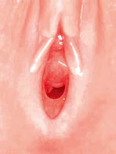
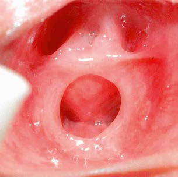

# Chapter 585: Gynecologic History and Physical Examination
> **Course:** Vikkypaedia Pediatric Basic Course (*Nelson Textbook of Pediatrics, 22nd Edition (2025)*)  
> **Part XXIII:** Gynecologic Problems of Childhood  
> **Authors:** Kathryn C. Stambough and Alla Vash-Margita  
> **Metrics:** 2,881 words · 2 tables/boxes · 2 figures · 0 genes · 7 flashcards · 5 MCQs  
> **Quick Navigation:** [🃏 Study 7 Flashcards](../flashcards/585_flashcards.md) · [📝 Take 5-Q MCQ Quiz](../mcqs/585_mcqs.md) · [📚 Part XXIII Guide](../parts/Part_XXIII.md) · [🧬 Syndrome & Genetics Atlas](../omim_gene_atlas.md) · [💊 Therapeutics Matrix](../therapies_matrix.md) · [🏠 Course Index](../../index.md)

## ⚡ High-Yield Nelson Pediatric Board Pearls
- Congenital adrenal hyperplasia is the most common cause of ambiguous genitalia (accounting for >90% of cases), and the salt-wasting forms can lead to rapid dehydration with subsequent fluid and electrolyte imbalance.
- Delay in the diagnosis and treatment of congenital adrenal hyperplasia may be life-threatening.
- Cyst aspiration can provide temporary relief but is not recommended if cys tectomy can safely be performed because the aspirated fluid may not be reliable for diagnosis and may reaccumulate.
- If a cystectomy is done for appropriate clinical indications, the cyst wall should be surgically excised to prevent reaccumulation of fluid and to provide a pathologic diagnosis, the remaining ovarian tissue should be left in situ, and the contralateral ovary should be inspected.

---
## Full Chapter Text, Tables & Figures
# Chapter 585: Gynecologic History and Physical Examination

*Kathryn C. Stambough and Alla Vash-Margita*

<!-- p.4272 -->
**HISTORY** For the young patient, developmentally appropriate social questions directed to the patient can put them at ease and help to develop coopera tion and rapport that will facilitate a subsequent examination. Specific patient, caregiver, or provider concerns about vaginal discharge or bleed ing, pruritus, external genital lesions, or abnormalities should direct a problem-focused history. In a patient presenting with vaginal bleeding, questions should focus on recent growth and development, signs of pubertal progression, trauma, vaginal discharge, medication exposure, and any history of foreign objects in the vagina. For complaints of vul vovaginal irritation, pruritus, or discharge, questions should concentrate on perineal hygiene, the onset and duration of symptoms, the presence and quality of discharge, exposure to skin irritants, recent antibiotic use, travel, presence of medical comorbidities or infections in the patient and their family members, and other systemic symptoms of illness or skin conditions. Throughout the history, the patient should be encour aged to ask their own questions. Occasionally, the child is brought to the clinician because they or their parents have concerns about anatomic findings, developmental changes, or congenital anomalies. It helps to understand the family’s concerns and if a specific reason, event, or family history raised the need for a gynecologic consultation.

**GYNECOLOGIC EXAMINATION** The physical examination of the patient should be tailored to the child’s age, complaint, and any other concerns elicited in the history. The date of onset of the last menstrual period should be included with an assess ment of other vital signs as age appropriate.

**Neonates** At the time of delivery, a brief examination of the external genitalia of female infants to visually confirm the patency of the vagina and assess the presence of any obvious genital anomalies should be performed. The new born examination should note any abnormal findings, such as ambiguous genitalia, imperforate hymen, urogenital abnormalities, abdominal mass, or inguinal hernia, that might herald a gynecologic problem.

Placing the infant in the supine position with thighs flexed against the abdomen allows visualization of the neonate’s external genitalia. Estro genic effects commonly notable in neonates include prominence of the labia majora and a white vaginal discharge. The labia minora and hymen may protrude slightly from the vestibule. A small amount of neonatal vaginal bleeding from endometrial sloughing after maternal hormone withdrawal might occur. Bleeding that is excessive or persistent beyond the first month of life requires further evaluation. Breast buds may be palpable at the time of the neonatal examination but should regress in the first 3 months of life; occasionally, nipple discharge occurs.

The vaginal orifice may be difficult to see. Gentle lateral traction on the labia majora usually allows complete visualization of the hymen and vag inal orifice. The hymen should be evaluated for patency. Most hymenal variations—imperforate, microperforate, septate—do not require

treatment during the neonatal period (Fig. 585.1). Variations should be noted and readdressed in subsequent visits. The hymen originates from the urogenital sinus. The uterus and upper vagina originate from the Müllerian ducts. The concomitant renal malformations seen with Mül lerian anomalies are not associated with hymenal anomalies because of different embryologic origin of the two structures. Similarly, uterine anomalies are typically not observed with hymenal anomalies (see Chap ter 591). Hymenal polyps seen in newborns typically regress in size as the maternal estrogen effects subside. Cervicovaginal mucus secretions can accumulate behind the blocked outflow tract of an imperforate hymen and manifest as a mucocolpos. *In this instance and if urinary obstruction occurs, correction of the imperforate hymen in the neonatal period is indi cated*. In the absence of any concern for urinary obstruction, the imper forate hymen and associated mucocolpos can be observed for resolution, and the imperforate hymen is ideally repaired surgically after onset of puberty, specifically thelarche. This allows for improved healing of tissue in the presence of endogenous estrogen production.

The clitoris may appear large in proportion to the other geni tal structures, especially in premature infants. If the clitoris appears enlarged, the clitoral width and length should be measured; width val ues >6 mm or length values >6.5 mm in a newborn indicate a need for further evaluation. *If clitoromegaly and ambiguous genitalia are pres ent, the provider should immediately obtain expert (endocrine) consulta tion for evaluation of the infant and to counsel the parents.* Congenital adrenal hyperplasia is the most common cause of ambiguous genitalia (accounting for >90% of cases), and the salt-wasting forms can lead to rapid dehydration with subsequent fluid and electrolyte imbalance (see Chapter 616). Delay in the diagnosis and treatment of congenital adrenal hyperplasia may be life-threatening.

In the neonate, the ovaries are <1 cm in diameter and average 1 cm3 in volume. Antenatal or postnatal abdominopelvic ultrasound might reveal small simple ovarian cysts, which represent normal follicles. Because of the abdominal location of ovaries in the neonate, ovarian enlargement can manifest as a palpable abdominal mass. Large cysts (>4-5 cm) or those of a complex nature pose the risk of ovarian torsion, hemorrhage into the cyst, or, uncommonly, an ovarian tumor. A nonresolving or enlarging neonatal ovarian cyst warrants pediatric surgery or pediat ric gynecology consultation. Percutaneous decompression has been described in cases where benign nature can be reliably ascertained. Cyst aspiration can provide temporary relief but is not recommended if cys tectomy can safely be performed because the aspirated fluid may not be reliable for diagnosis and may reaccumulate. If a cystectomy is done for appropriate clinical indications, the cyst wall should be surgically excised to prevent reaccumulation of fluid and to provide a pathologic diagnosis, the remaining ovarian tissue should be left in situ, and the contralateral ovary should be inspected. Preservation of normal ovarian tissue is rec ommended for all benign lesions, and salpingo-oophorectomy should not be performed unless clinically indicated.

**Infants and Prepubertal Girls** When the maternal estrogen effect subsides, the genitalia of the female infant change in appearance. The labia begin to flatten. The hymenal membrane loses its redundancy and becomes translucent. The hypoestro genic prepubertal vaginal epithelium appears thin, red, and sensitive to the touch. The vaginal mucosa of young children can have longitudinal ridges running along the axis of the vagina at 3 o’clock, 6 o’clock, and 9 o’clock, which can cause small protrusions on the hymen at these locations. The cervix usually appears flat and flush with the vaginal vault. During infancy, the uterus regresses in size and does not return to its birth size until the child is 5-6 years old. The prepubertal cervix:fundus ratio is 2:1.

When puberty approaches, the child experiences increasing endocrine activity of the hypothalamus, pituitary gland, adrenal

*Kathryn C. Stambough and 
 Alla Vash-Margita*

<!-- p.4273 -->
gland, and ovaries (see Chapter 599). The labia majora begin to fill out, and the labia minora thicken and elongate as a result of increased estrogen levels. The hymen thickens and becomes more redundant. Clear or white physiologic secretions may be present. Breast buds begin to appear, either bilateral or initially unilateral with subsequent development of the contralateral breast. Pubic hair begins to appear.

**Indications for Genital Examination** Genitourinary complaints or suspected genitourinary pathology war rants assessment of the external and internal genitalia of pediatric patients, specifically in cases of vaginal bleeding, vaginal discharge, vulvar trauma, presence of a foreign body, perineal or pelvic masses, vulvovaginal ulcerative or inflammatory lesions, congenital anomalies, or suspected sexual abuse.

**Preparation** An examination of the external genitalia in prepubertal females requires a gentle, patient approach to maximize cooperation and minimize fear and embarrassment. A clear, simple explanation of

what the examination involves can facilitate the child’s comfort and cooperation. The presence of a parent or caregiver during the entire examination provides reassurance for most children. For the older prepubertal patient, the physician may discuss whether the patient wishes to have a family member present during the examination. Even in the presence of the caregiver, the examiner should speak directly to the child. Before initiating any part of the examination, the provider should explicitly verify with both the patient and their caregiver that the caregiver has given permission for the examina tion. This provides an opportunity to explain to the child the pri vacy of body parts and who may examine or touch those areas. It is useful to educate the patient and caregiver about the basic anatomy and hygiene of the external genital area. Before each step of the examination, the physician should explain what will occur. Allow ing an older child the option of watching their examination with a handheld mirror may contribute to their comfort and understand ing. Forcible restraint is never indicated; if optimal evaluation is not possible, the clinician must assess the acuity of the complaint and pathology and determine the potential need for multiple visits to complete the examination or an examination under anesthesia.

D C B A

E F G

Urethra

Membranous cover opening

**Fig. 585.1** Types of hymens. A, Crescentic. B, Annular. C, Redundant. D, Microperforate. E, Septated. F, Imperforate. G, Hymeneal tags. (A–F from Perlman SE, Nakajima ST, Hertweck SP, eds: Clinical Protocols in Pediatric Adolescent Gynecology. Parthenon Publishing Group, 2004; G, from McCann JJ, Kerns DL [eds]: The Child Abuse Atlas. St Louis: Evidentia Learning, 2021, www.childabuseatlas.com.)

A B

C

D

**Fig. 585.2** Different exam positions for performing a gynecologic exam on a child. A, Frog-leg position. B, Knee-chest position. C, Prone position. D, Sitting on caregiver’s lap. (A from McCann JJ, Kerns DL, eds : The Child Abuse Atlas. St Louis: Evidentia Learning, 2021, www.childabuseatlas .com; B–D from Finkel MA, Giardino AP [eds]: Medical Examination of Child Sexual Abuse: A Practical Guide. Elk Grove Village, Illinois: American Academy of Pediatrics Publications, 2009;46–64.)

<!-- p.4274 -->
**Positioning** A variety of techniques and positions can facilitate the genital examina tion in prepubertal patients. Children younger than 4 years of age can be placed on the parent or caregiver’s lap with the child’s legs strad dling the caregiver’s thighs (Fig. 585.2). If the child permits, they may be positioned on the table in the supine position with the hips fully abducted and the feet together in the frog-leg (diamond or butterfly) position. Older children may prefer to use the stirrups. The head of the examination table should be raised so that eye contact can be main tained with the patient throughout the examination. When the child is supine, grasping the labia majora along the inferior portion between the thumb and index finger and gently pulling outward and posteriorly (labial traction) allows visualization of the vaginal introitus. Alterna tively, the child may be placed in the knee-chest position with eleva tion of the buttocks and hips (see Fig. 585.2). This position provides exposure of the inferior portion of the hymen, the lower vagina, and possibly the upper vagina and cervix but has the disadvantage of hav ing the child face away from the examiner.

Some extremely cooperative children tolerate a vaginoscopic exami nation in an outpatient office setting for better intravaginal assessment. The endoscope (either a cystoscope or a hysteroscope) is placed in the vagina, and the labia are gently opposed, allowing the vagina to distend with water. This technique permits visualization of the vagina and cer vix, allowing for the evaluation of an injury, lesion, and anatomic vari ant or for the presence of a foreign body. Application of 2% lidocaine gel at the introitus makes the insertion easier and less irritating for the patient. If a more complete examination is indicated or if the child is too young, frightened, or unable to cooperate, an examination under anesthesia is recommended.

**Documentation** Clinicians should thoroughly and accurately document the genital exami nation findings in the medical record, reserving conclusions and diagnos tic terms for the impression and plan portion of the documentation rather than in the description of exam findings. Each structure visualized should be noted (e.g., clitoris, labia majora, labia minora, urethra, vestibule, and rectum) with attention to describing normal appearance and any anatomic variations (e.g., the configuration of the hymen as annular, crescentic, and so forth). Describing any findings or lesions using a clock-face method provides a consistent reference point; a sketch or magnified photograph may also be helpful. Future examiners will rely on this documentation as a record with which they compare their findings and note any variances. Changes should be noted in any follow-up examinations.

**Adolescents** Some teens prefer to initially meet and discuss the reason for their visit with the provider without their parent or guardian present, and this request should be honored (see Chapter 151). Obtaining a his tory from an adolescent usually begins with meeting the patient and parent or caregiver together to review their history and the reason for the visit and to explain the concepts of confidentiality and pri vacy. Care should be taken to ask the patient their preferred name and pronouns when addressing them. Familiarity with local laws governing limitations to confidential services should guide the pro tection of the adolescent and their parents’ rights to information access and privacy. The Guttmacher Institute provides an up-todate listing of state and federal laws in the United States affecting access to medical care (https://www.guttmacher.org/geography/ united-states). Brief discussions of normal pubertal development and menstruation can reassure both patients and their parents or guard ians and provide valuable education on appropriate menstrual flow, menstrual hygiene, and the duration and frequency of bleeding. Intro ducing the menstrual diary as an invaluable tool for the teen can help patients, parents, and clinicians identify abnormal bleeding patterns that might require further evaluation. Many applications are available for tracking menstrual periods on a smart phone or computer.

After the initial interview with the teen and their parent or caregiver, the confidential and sensitive portion of the history, particularly sexual

history and alcohol, tobacco, and drug use, is taken with the teen alone. Such a request could be phrased as follows: “I would like to give your child an opportunity to ask any questions they might have privately, so would you mind stepping out of the room for a moment?” After obtaining the teen’s assent for the confidential interview, questions regarding gender identity, sexual orientation, mental health, safety, and use of illicit substances should be asked. Any concerns regarding par ent or caregiver access to personal electronic health records should be addressed. Concerns for the presence of vaginal discharge, the poten tial for sexually transmitted infections, pregnancy, or menstrual aber ration should be explored. Teens and their parents should be informed of the proper use and accessibility of condoms, all contraceptive meth ods, and emergency contraception.

Resources for educating adolescents regarding their first pelvic examination and in-depth sexual history and psychosocial screen ing tools are available. These include the North American Society for Pediatric and Adolescent Gynecology (http://www.naspag.org), the American Academy of Pediatrics (http://www.aap.org), the Society for Adolescent Health and Medicine (http://www.adolescenthealth.org), and the American College of Obstetricians and Gynecologists (http:// acog.org/Patients).

**Individuals with Special Needs** Special care should be taken in the approach to individuals with both physical and cognitive disabilities (see Chapter 592). The assistance of Child Life services can be beneficial in decreasing patient anxiety.

**Pelvic Examination** Table 585.1 presents the indications for the first pelvic examina tion in adolescents. If an adolescent does not meet one of the cri teria listed in Table 585.1, the American College of Obstetricians and Gynecologists (ACOG) recommends that the first gynecologic encounter occur between the ages of 13-15 years (Table 585.2), with attention toward anticipatory guidance focusing on normal puber tal development and menstruation. All sexually active patients age

in Adolescents

#### **Table 585.1** Suggested Indications for Pelvic Examination

| Category / Parameter | Clinical Details & Findings |
| --- | --- |
| **General** | Age 21 yr of age for initial Papanicolaou test (Pap smear); Unexplained menstrual irregularities, including pubertal aberrations; (especially delayed puberty); Severe dysmenorrhea; Unexplained abdominal or pelvic pain; Unexplained dysuria; Abnormal vaginal discharge; Concern for  pelvic inflammatory disease; Placement of intrauterine device; Removal of foreign body; Inability to place tampons; Data from American College of Obstetricians and Gynecologists’ Committee on Ado; lescent Health Care. The initial reproductive health visit: ACOG Committee Opinion,; Number 811. Obstet Gynecol. 2020;136: e70–e80. |

Evaluation

#### **Table 585.2** Recommendations for First Gynecologic

| Category / Parameter | Clinical Details & Findings |
| --- | --- |
| **General** | Occurs between 13 and 15 yr of age; Focuses on patient education; Increases comfort with issues regarding adolescent sexuality; Ensures opportunity for adolescent to speak 1-on-1 with the provider; Makes the adolescent aware of limitations of confidentiality (includ; ing issues related to mandatory reporting, insurance billing, elec; tronic health record notifications, and legal requirements); Pelvic examination with Papanicolaou test (Pap smear) is generally; not indicated until 21 yr of age, unless otherwise indicated by; Table 585.1; Data from American College of Obstetricians and Gynecologists’ Committee on Ado; lescent Health Care. The initial reproductive health visit: ACOG Committee Opinion,; Number 811. Obstet Gynecol. 2020;136: e70–e80. |

<!-- p.4276 -->
