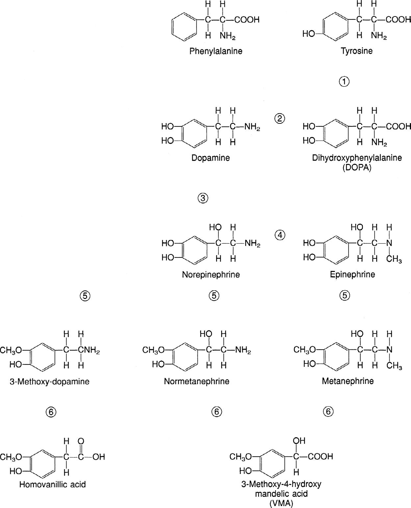

# Chapter 614: Physiology of the Adrenal Gland
> **Course:** Vikkypaedia Pediatric Basic Course (*Nelson Textbook of Pediatrics, 22nd Edition (2025)*)  
> **Part XXIV:** The Endocrine System  
> **Authors:** Nelson 22e Contributors  
> **Metrics:** 5,777 words · 0 tables/boxes · 1 figures · 12 genes · 8 flashcards · 5 MCQs  
> **Quick Navigation:** [🃏 Study 8 Flashcards](../flashcards/614_flashcards.md) · [📝 Take 5-Q MCQ Quiz](../mcqs/614_mcqs.md) · [📚 Part XXIV Guide](../parts/Part_XXIV.md) · [🧬 Syndrome & Genetics Atlas](../omim_gene_atlas.md) · [💊 Therapeutics Matrix](../therapies_matrix.md) · [🏠 Course Index](../../index.md)

## Key Chapter Topics & Subchapters
`614.1 Histology and Embryology` · `614.2 Adrenal Steroid Biosynthesis` · `614.3 Regulation of the Adrenal Cortex` · `614.4 Adrenal Steroid Hormone Actions` · `614.5 Adrenal Medulla` · `614.1 Histology and Embryology Perrin C. White` · `614.2 Adrenal Steroid Biosynthesis Perrin C. White` · `614.3 Regulation of the Adrenal Cortex Perrin C. White` · `614.4 Adrenal Steroid Hormone Actions Perrin C. White` · `614.5 Adrenal Medulla Perrin C. White`

## Key Genetic & Molecular Targets
`CYP11B1`, `CYP17A1`, `CYP21A2`, `DAX1`, `GLI3`, `HSD3B2`, `MCR2`, `NR0B1`, `NR5A1`, `SRD5A2`, `WNT4`, `WT1`

## ⚡ High-Yield Nelson Pediatric Board Pearls
- The normal diurnal rhythm of cortisol secretion is caused by the varying amplitudes of ACTH pulses.
- This hypocalcemic effect probably results from a decrease in the intestinal absorption of calcium and a decrease in the renal reabsorption of calcium and phosphorus.
- This discrepancy results from the action of HSD11B2, which converts cortisol to cortisone.
- Pharmacologic inhibition (as occurs with excessive consumption of licorice) or genetic deficiency of this enzyme allows cortisol to occupy renal mineralocorticoid receptors and produce sodium retention and hypertension; the genetic condition is termed apparent mineralocorticoid excess syndrome.

---
## Full Chapter Text, Tables & Figures
# Chapter 614: Physiology of the Adrenal Gland

<!-- p.4411 -->

## 614.1  Histology and Embryology Perrin C. White

The adrenal gland is composed of two endocrine tissues: the medulla and the cortex. The chromaffin cells of the adrenal medulla are derived from neuroectoderm, whereas the cells of the adrenal cortex are derived from mesoderm. Mesodermal cells also contribute to the development of the gonads. The adrenal glands and gonads have certain common enzymes involved in steroid synthesis; an inborn error in steroidogenesis in one tissue can also be present in the other.

The adrenal cortex of the older child or adult consists of three zones: the **zona glomerulosa**, the outermost zone located immediately beneath the capsule; the **zona fasciculata**, the middle zone; and the **zona retic- ularis**, the innermost zone, lying next to the adrenal medulla. The zona fasciculata is the largest zone, constituting approximately 75% of the cortex; the zona glomerulosa constitutes approximately 15%; and the zona reticularis approximately 10%. Glomerulosa cells are small, with a lower cytoplasmic:nuclear ratio, an intermediate number of lipid inclusions, and smaller nuclei containing more condensed chromatin than the cells of the other two zones. The cells of the zona fasciculata are large, with a high cytoplasmic:nuclear ratio and many lipid inclusions that give the cytoplasm a foamy, vacuolated appearance. The cells are arranged in radial cords. The cells of the zona reticularis are arranged in irregular anastomosing cords. The cytoplasmic:nuclear ratio is intermediate, and the compact cytoplasm has relatively little lipid content.

The zona glomerulosa synthesizes **aldosterone**, the most potent natural **mineralocorticoid** in humans. The zona fasciculata produces **cortisol**, the most potent natural **glucocorticoid** in humans, and the zona fasciculata and zona reticularis synthesize the adrenal androgens.

The adrenal medulla consists mainly of neuroendocrine (chromaffin) cells and glial (sustentacular) cells with some connective tissue and vascular cells. Neuroendocrine cells are polyhedral, with abundant cytoplasm and small, pale-staining nuclei. Under the electron microscope, the cytoplasm contains many large secretory granules that contain catecholamines. Glial cells have less cytoplasm and more basophilic nuclei.

The adrenogonadal primordium differentiates from the coelomic mesothelium at 4 weeks of gestation at the urogenital ridge, just cephalad to the developing mesonephros. At 5-6 weeks, it develops into the steroidogenic cells of the gonads and adrenal cortex; the adrenal and gonadal cells separate, the adrenal cells migrate retroperitoneally, and the gonadal cells migrate caudad. At 6-8 weeks of gestation, the gland rapidly enlarges, the cells of the inner cortex differentiate to form the fetal zone, and the outer subcapsular rim remains as the definitive zone. The primordium of the adrenal cortex is invaded at this time by sympathetic neural elements of ectodermal origin that differentiate into the chromaffin cells capable of synthesizing and storing catecholamines. Catechol *O*-methyltransferase, which converts norepinephrine to epinephrine, is expressed later in gestation. By the end of the eighth

week of gestation, the encapsulated adrenal gland is associated with the upper pole of the kidney. By 8-10 weeks of gestation, the cells of the fetal zone are capable of active steroidogenesis.

In the full-term infant, the combined weight of both adrenal glands is 7-9 g. At birth, the inner fetal zone of the cortex makes up approximately 80% of the gland and the outer definitive zone 20%. Within a few days the fetal cortex begins to involute, undergoing a 50% reduction by 1 month of age. Conversely, the adrenal medulla is relatively small at birth and undergoes a proportionate increase in size over the first 6 months after birth. By 1 year, the adrenal glands each weigh <1 g. Adrenal growth thereafter results in adult adrenal glands reaching a combined weight of 8 g. The zonae fasciculata and glomerulosa are fully differentiated by about 3 years of age. The zona reticularis is not fully developed until puberty.

**Adrenocorticotropic hormone (ACTH)** is essential for fetal adrenal growth and maturation; feedback regulation of ACTH by cortisol is apparently established by 8-10 weeks of gestation. Additional factors important in fetal growth and steroidogenesis include placental chorionic gonadotropins and a number of peptide growth factors produced by the placenta and fetus.

Many transcription factors are critical for the development of the adrenal glands. At least four, EMX2, LHX1 (also termed LIM1), WT1, and WNT4, are required for development of the adrenogonadal primordium. WT1 upregulates expression of steroidogenic factor-1 (SF-1, encoded by the *NR5A1* gene). NR5A1 is one of at least three transcription factors associated with **adrenal hypoplasia** in humans; the others are *NR0B1* (dosage-sensitive sex reversal, adrenal hypoplasia congenita, X chromosome; *DAX1*), and the *GLI3* oncogene. Disruption of *NR5A1,* encoded on chromosome 9q33, results in gonadal and often adrenal agenesis, absence of pituitary gonadotropes, and an underdeveloped ventral medial hypothalamus. In-frame deletions and frameshift and missense pathogenic variants of this gene are associated with **46,XX ovarian insufficiency** and **46,XY gonadal dysgenesis**. Pathogenic variants in the *NR0B1* gene, encoded on Xp21, result in **adrenal hypoplasia congenita** and **hypogonadotropic hypogonad- ism** (see Chapter 615.1). Pathogenic variants in *GLI3* on chromosome 7p13 cause **Pallister-Hall syndrome**, other features of which include hypothalamic hamartoblastoma, hypopituitarism, imperforate anus, and postaxial polydactyly.

The postnatal adrenal cortex is not static but is continually regenerated from a population of stem or progenitor cells under the adrenal capsule. These cells move radially inward (i.e., centripetally) and can differentiate into zona glomerulosa or fasciculata cells as needed in response to the appropriate trophic stimuli (see Chapter 614.3). Several signaling pathways, including sonic hedgehog (SHH) and WNT, regulate this process. SHH expression is restricted to the peripheral cortical cells that do not express high levels of steroidogenic genes but give rise to the underlying differentiated cells of the cortex. Wnt/βcatenin signaling maintains the undifferentiated state and adrenal fate of adrenocortical stem/progenitor cells, in part through induction of its target genes *DAX1* and inhibin-α, respectively. Adrenal tumors can result from constitutive activation of the WNT signaling pathway (see Chapter 617).

*Visit Elsevier eBooks+ at eBooks.Health.Elsevier.com** for Bibliography.*

## 614.2  Adrenal Steroid Biosynthesis Perrin C. White

Cholesterol is the starting substrate for all steroid biosynthesis (Fig. 614.1). Although adrenal cortex cells can synthesize cholesterol de novo from acetate, circulating plasma lipoproteins provide most of the cholesterol for adrenal cortex hormone formation. Receptors for both low-density lipoprotein and high-density lipoprotein cholesterol are expressed on the surface of adrenocortical cells; the receptor for high-density lipoprotein is termed *scavenger receptor class B, type I* (SR-BI). Patients with **homozygous familial hypercholesterolemia**

Section **4 Disorders of the Adrenal Gland**

<!-- p.4412 -->
who lack low-density lipoprotein receptors have only mildly impaired adrenal steroidogenesis, suggesting that high-density lipoprotein is the more important source of cholesterol. Cholesterol is stored as cholesteryl esters in vesicles and subsequently hydrolyzed by cholesteryl ester hydrolases to liberate free cholesterol for steroid hormone synthesis.

The rate-limiting step of adrenal steroidogenesis is importation of cholesterol across the mitochondrial outer and inner membrane. This requires several proteins, particularly the steroidogenic acute regulatory (StAR) protein. The StAR protein has a very short half-life, and its synthesis is rapidly induced by trophic factors (corticotropin); it is the main short-term (minutes to hours) regulator of steroid hormone biosynthesis.

At the mitochondrial inner membrane, the side chain of cholesterol is cleaved to yield pregnenolone. This is catalyzed by the cholesterol side-chain cleavage enzyme (cholesterol desmolase, side-chain cleavage enzyme, P450scc, CYP11A1—the last term is the current systematic nomenclature), a cytochrome P450 (CYP) enzyme. Like other CYP enzymes, this is a membrane-bound hemoprotein with a molecular mass of approximately 50 kDa. It accepts electrons from a reduced nicotinamide adenine dinucleotide phosphate–dependent mitochondrial electron transport system consisting of two accessory proteins: adrenodoxin reductase (also called *ferredoxin reductase,* a flavoprotein) and adrenodoxin (or ferredoxin; a small protein containing nonheme

iron). CYP enzymes use electrons and O2 to hydroxylate the substrate and form H2O. In the case of cholesterol side-chain cleavage, three successive oxidative reactions are performed to cleave the C20,22 carbon bond. Pregnenolone then diffuses out of mitochondria and enters the endoplasmic reticulum. The subsequent reactions that occur depend on the zone of the adrenal cortex.

**ZONA GLOMERULOSA** In the zona glomerulosa, pregnenolone is converted to progesterone by 3β-hydroxysteroid dehydrogenase type 2, an oxidized nicotinamide adenine dinucleotide–dependent enzyme of the short-chain dehydrogenase type. Progesterone is converted to 11-deoxycorticosterone by steroid 21-hydroxylase (CYP21A2, P450c21), which is another CYP enzyme. Like other such enzymes in the endoplasmic reticulum, it uses an electron transport system with only one accessory protein: P450 oxidoreductase.

Deoxycorticosterone then reenters mitochondria and is converted to aldosterone by aldosterone synthase (CYP11B2, P450aldo), a CYP enzyme structurally related to cholesterol side-chain cleavage enzyme. Aldosterone synthase also carries out three successive oxidations: 11β-hydroxylation, 18-hydroxylation, and further oxidation of the 18-methyl carbon to an aldehyde.

StAR+ CYP11A1

**CHOLESTEROL**

**PREGNENOLONE**

**17-OH PREGNENOLONE**

**DEHYDROEPI- ANDROSTERONE**

**DEHYDROEPI- ANDROSTERONE SULFATE**

**PROGESTERONE** HSD3B2

CYP17A1

**17-OH PROGESTERONE**

**5**α**-PREGNAN-17**α**-OL-3,20-DIONE PROGESTERONE ANDROSTERONE**

**ANDROSTANEDIOL**

HSD3B2

SRD5A1

**ANDROSTENEDIONE** HSD3B2

HSD17B1

**TESTOSTERONE** HSD17B5

**DIHYDRO- TESTOSTERONE**

SRD5A2

HSD17B5

HSD17B6

**17-OH ALLOPREGNANOLONE** AKR1C2/4

**16**α**-OH DEHYDROEPI- ANDROSTERONE**

**16**α**-OH-ANDROSTENEDIONE**

ARSC1

HSD3B1

**16**α**-OH-ESTRONE** CYP19A1

**ESTRIOL** HSD17B1

**DEHYDROEPI- ANDROSTERONE**

**ANDROSTENEDIONE**

ARSC1

HSD3B1

**ESTRONE ESTRONE**

CYP19A1

CYP19A1

**ESTRADIOL**

CYP19A1

**CORTISONE**

HSD11B2

**ESTRADIOL** HSD17B1

CYP17A1

SULT2A1

**11-DEOXYCORTISOL** CYP21A2

**CORTISOL** CYP11B1

**DEOXYCORTICOSTERONE** CYP21A2

**ALDOSTERONE** CYP11B2

*FETAL ADRENAL*

*GENITAL SKIN*

*PLACENTA*

**16**α**-OH DEHYDROEPI- ANDROSTERONE SULFATE**

CYP3A7

*FETAL LIVER*

**Fig. 614.1** Steroid biosynthesis and metabolism during gestation. Conversions within the fetal adrenal cortex, fetal liver (brown rectangle), male (i.e., testosterone-exposed) genital skin (purple rectangle), and placenta (green rectangle) are denoted by arrows; the enzyme mediating each conversion is also shown. Enzymatic conversions in the adrenal cortex are the same postnatally as prenatally, but cortisol and aldosterone bio- synthesis (denoted by yellow and turquoise boxes, respectively) are more prominent, and normally little testosterone is synthesized (pink rec- tangle). A “backdoor pathway” (lavender rectangle) to convert 17-hydroxyprogesterone to dihydrotestosterone is active in the fetal adrenal and may assume particular importance in congenital adrenal hyperplasia (see Chapter 616). Many of the involved enzymes are cytochromes P450 (CYPs). The first step in all steroid biosynthesis is importation of cholesterol into mitochondria (white rectangle) mediated by the steroidogenic acute regulatory (StAR) protein. Adrenal enzymes include CYP11A1, cholesterol side-chain cleavage enzyme (P450scc in older terminology); HS- D3B2, 3β-hydroxysteroid dehydrogenase/Δ5,Δ4 isomerase type 2; CYP17A1, 17β-hydroxylase/17,20-lyase (P450c17); CYP21A2, 21-hydroxylase (P450c21); CYP11B1, 11β-hydroxylase (P450c11); CYP11B2, aldosterone synthase (P450aldo; this enzyme mediates successive 11β-hydroxylase, 18-hydroxylase, and 18-oxidase reactions in the zona glomerulosa for the conversion of deoxycorticosterone to aldosterone); and AKR1C2/4, aldo-ketoreductases 1C2 and 1C4. Other enzymes important in the fetoplacental unit include ARSC1, arylsulfatase; CYP19, aromatase (P450arom); HSD3B1, 3β-hydroxysteroid dehydrogenase/Δ5,Δ4 isomerase type 1; HSD11B2, 11β-hydroxysteroid dehydrogenase type 2; HSD17B1, HSD17B5, and HSD17B6 are three different 17-hydroxysteroid dehydrogenase enzymes; SRD5A1 and SRD5A2, steroid 5α-reductase types 1 and 2, respec- tively; and SULT2A1, steroid sulfotransferase.

<!-- p.4413 -->
**ZONA FASCICULATA** In the endoplasmic reticulum of the zona fasciculata, pregnenolone and progesterone are converted by 17α-hydroxylase (CYP17A1, P450c17) to 17-hydroxypregenolone and 17-hydroxyprogesterone, respectively. This enzyme is not expressed in the zona glomerulosa, which consequently cannot synthesize 17-hydroxylated steroids. 17-Hydroxypregnenolone is converted to 17-hydroxyprogesterone and 11-deoxycortisol by the same 3β-hydroxysteroid and 21-hydroxylase enzymes, respectively, as are active in the zona glomerulosa. Thus inherited disorders in these enzymes affect both aldosterone and cortisol synthesis (see Chapter 616). Finally, 11-deoxycortisol reenters mitochondria and is converted to cortisol by steroid 11β-hydroxylase CYP11B1 (P450c11). This enzyme is closely related to aldosterone synthase but has low 18-hydroxylase and nonexistent 18-oxidase activity. Thus under normal circumstances the zona fasciculata cannot synthesize aldosterone.

**ZONA RETICULARIS** In the zona reticularis and to some extent in the zona fasciculata, the 17-hydroxylase (CYP17A1) enzyme has an additional activity: cleavage of the 17,20 carbon-carbon bond. This converts 17-hydroxypregnenolone to dehydroepiandrosterone (DHEA). DHEA is converted to androstenedione by HSD3B2. This may be further converted in other tissues to testosterone and estrogens.

**The Alternative or “Backdoor” Pathway to Dihydrotestosterone** In addition to the classic pathway via DHEA, androstenedione, and testosterone, the most potent endogenous androgen, 5-dihydrotestosterone (DHT), can also be synthesized via an alternative or “backdoor” pathway, which is physiologically active during the major period of human sexual differentiation in the 6th to 10th week of human fetal development and into the second trimester. To enter the alternative pathway, progesterone or 17-hydroxyprogesterone is 5α-reduced by steroid 5α-reductase type 1 (SRD5A1) to yield 5α-dihydroprogesterone and 17α-hydroxydihydroprogesterone. These three ketosteroids are subsequently 3α-reduced to allopregnanolone and 17α-hydroxyallopregnanolone by isoforms of the AKR1C enzyme family. CYP17A1 converts allopregnanolone to 17αhydroxyallopregnanolone and then to androsterone by its 17,20-lyase activity. Androsterone can then be activated to DHT by sequential 17βreduction and 3α-oxidase reactions.

**FETOPLACENTAL UNIT** Steroid synthesis in the fetal adrenal varies during gestation (see Figs. 614.1 and 614.2). Shortly after the fetal adrenal gland forms (weeks 8-10), it efficiently secretes cortisol, which is able to negatively feed back on the fetal pituitary and hypothalamus to suppress ACTH secretion. This is a critical time for differentiation of the external genitalia in both sexes (see Chapter 616.1); to prevent virilization, the female fetus must not be exposed to high levels of androgens of adrenal origin, and placental aromatase activity must remain low during this time to minimize conversion of testosterone to estradiol in male fetuses, which would interfere with masculinization. After week 12, HSD3B activity in the fetal adrenal gland decreases and steroid sulfokinase activity increases. Major steroid products of the midgestation fetal adrenal gland are DHEA and DHEA sulfate (DHEAS) and, by 16αhydroxylation in the liver, 16α-hydroxy DHEAS. Aromatase activity increases in the placenta at the same time, and steroid sulfatase activity is high as well. The placenta uses DHEA and DHEAS as substrates for estrone and estradiol synthesis and 16α-OH DHEAS as a substrate for estriol synthesis. Cortisol activity is low during the second trimester, which might serve to prevent premature secretion of surfactant by the developing fetal lungs; surfactant levels can affect the timing of parturition. As term approaches, fetal cortisol concentration increases because of increased cortisol secretion and decreased conversion of cortisol to cortisone by 11β-hydroxysteroid dehydrogenase type 2 (HSD11B2). Low levels of aldosterone are produced in midgestation, but aldosterone secretory capacity increases near term.

*Visit Elsevier eBooks+ at eBooks.Health.Elsevier.com** for Bibliography.*

## 614.3  Regulation of the Adrenal Cortex Perrin C. White

**REGULATION OF CORTISOL SECRETION** Glucocorticoid secretion is regulated mainly by ACTH (corticotropin), a 39–amino acid peptide that is produced in the anterior pituitary (see Fig. 594.2). It is synthesized as part of a largermolecular-weight precursor peptide known as *pro-opiomelanocor- tin*. This precursor peptide is also the source of β-lipotropin. ACTH and β-lipotropin are cleaved further to yield α- and β-melanocyte– stimulating hormone, corticotropin-like intermediate lobe peptide, γ-lipotropin, β- and γ-endorphin, and enkephalin (see Chapter 594). ACTH is released in secretory bursts of varying amplitude throughout the day and night. The normal diurnal rhythm of cortisol secretion is caused by the varying amplitudes of ACTH pulses. Pulses of ACTH and cortisol occur every 30-120 minutes, are highest at about the time of waking, are low in late afternoon and evening, and reach their lowest point 1 or 2 hours after sleep begins.

Corticotropin-releasing hormone (CRH), synthesized by neurons of the parvicellular division of the hypothalamic paraventricular nucleus, is the most important stimulator of ACTH secretion. Arginine vasopressin (AVP) augments CRH action. Neural stimuli from the brain cause the release of CRH and AVP (see Chapter 594). AVP and CRH are secreted in the hypophyseal-portal circulation in a pulsatile manner. This pulsatile secretion appears to be responsible for the pulsatile (ultradian) release of ACTH. The circadian rhythm of ACTH release is probably induced by the corresponding circadian rhythm of hypothalamic CRH secretion, regulated by the suprachiasmatic nucleus with input from other areas of the brain. Cortisol exerts a negative feedback effect on the synthesis and secretion of ACTH, CRH, and AVP. ACTH inhibits its own secretion, a feedback effect mediated at the level of the hypothalamus. Finally, the adrenal cortex has intrinsic rhythmicity in its responses to the ACTH. Thus the secretion of cortisol is a result of the interaction of the hypothalamus, pituitary, and adrenal glands and other neural stimuli.

ACTH acts through a specific G protein–coupled receptor (also termed *melanocortin receptor-2,* encoded by the *MCR2* gene) to activate adenylate cyclase and increase levels of cyclic adenosine monophosphate. Cyclic adenosine monophosphate has short-term (minutes to hours) effects on cholesterol transport into mitochondria by increasing expression of StAR protein. The long-term effects (hours to days) of ACTH stimulation are to increase the uptake of cholesterol and the expression of genes encoding the enzymes required to synthesize cortisol. These transcriptional effects occur at least in part through increased activity of protein kinase A, which phosphorylates several transcriptional regulatory factors. MC2R trafficking and signaling are dependent on the MC2R accessory protein (MRAP). Pathogenic variants in either MC2R or MRAP can cause **familial glucocorticoid defi- ciency** (see Chapter 615).

Genital differentiation

Wk of gestation

10 10 20 20 Birth Age (yr)

Secretion

nm o 1/1

10,000 1,000 100

Surfactant production Puberty

DHEAS

Cortisol

**Fig. 614.2** Relative levels of cortisol and dehydroepiandrosterone sul- fate (DHEAS) secretion by the fetal adrenal cortex during gestation and postnatally. Approximate times of several events are shown. Vertical axis is logarithmic, but values are approximate. Horizontal axis is not to scale.

<!-- p.4414 -->
**REGULATION OF ALDOSTERONE SECRETION** The rate of aldosterone synthesis, which is normally 100- to 1,000-fold less than that of cortisol synthesis, is regulated mainly by the reninangiotensin system and by potassium levels, with ACTH having only a short-term effect. In response to decreased intravascular volume, renin is secreted by the juxtaglomerular apparatus of the kidney. Renin is a proteolytic enzyme that cleaves angiotensinogen (renin substrate), an α2-globulin produced by the liver, to yield the inactive decapeptide angiotensin I. Angiotensin-converting enzyme in the lungs and other tissues rapidly cleaves angiotensin I to the biologically active octapeptide angiotensin II. Cleavage of angiotensin II produces the heptapeptide angiotensin III. Angiotensins II and III are potent stimulators of aldosterone secretion; angiotensin II is a more potent vasopressor agent. Angiotensins II and III occupy a G protein–coupled receptor activating phospholipase C. This protein hydrolyzes phosphatidylinositol bisphosphate to produce inositol triphosphate and diacylglycerol, which raise intracellular calcium levels and activate protein kinase C and calmodulin-activated kinases. Similarly, increased levels of extracellular potassium depolarize the cell membrane and increase calcium influx through voltage-gated L-type calcium channels. Phosphorylation of transcriptional regulatory factors by calmodulin-activated kinases increases transcription of the aldosterone synthase (CYP11B2) enzyme required for aldosterone synthesis.

**REGULATION OF ADRENAL ANDROGEN SECRETION** The mechanisms by which the adrenal androgens DHEA and androstenedione are regulated are not completely understood. **Adrenarche** is a maturational process in the adrenal gland that results in increased adrenal androgen secretion between the ages of 5 and 20 years. The process begins before the earliest signs of puberty and continues throughout the years when puberty is occurring. Histologically, it is associated with the appearance of the zona reticularis. Whereas ACTH stimulates adrenal androgen production acutely and clearly is the primary stimulus for cortisol release, additional factors have been implicated in the stimulation of the adrenal androgens. These include a relative decrease in expression of HSD3B2 in the zona reticularis and possibly increases in 17,20-lyase activity owing to phosphorylation of CYP17 or increased cytochrome b5 expression.

*Visit Elsevier eBooks+ at eBooks.Health.Elsevier.com** for Bibliography.*

## 614.4  Adrenal Steroid Hormone Actions Perrin C. White

Steroid hormones act through several distinct receptors corresponding to the known biologic activities of the steroid hormones: glucocorticoid, mineralocorticoid, progestin, estrogen, and androgen. These receptors belong to a larger superfamily of nuclear transcription factors that include, among others, thyroid hormone and retinoic acid receptors. They have a common structure that includes a carboxyterminal ligand-binding domain and a midregion DNA-binding domain. The latter domain contains two zinc fingers, each of which consists of a loop of amino acids stabilized by four cysteine residues chelating a zinc ion.

Unliganded glucocorticoid and mineralocorticoid receptors are found mainly in the cytosol in complexes with other proteins. Hormone molecules diffuse through the cell membrane and bind receptors, changing their conformation and causing them to release their cytosolic binding proteins and translocate to the nucleus, where they bind DNA at specific hormone-response elements. Bound receptors can recruit other transcriptional coregulatory factors to DNA.

Whereas different steroids can share bioactivities because of their ability to bind to the same receptor, a given steroid can exert diverse biologic effects in different tissues. The diversity of hormonal responses is determined by the different genes that are regulated by each hormone in different tissues. Additionally, different combinations of coregulators

are expressed in different tissues, allowing each steroid hormone to have many different effects. Moreover, enzymes can increase or decrease the affinity of steroids for their receptors and thus modulate their activity. 11β-Hydroxysteroid dehydrogenase type 1 (HSD11B1) converts cortisone, which is not a ligand for the glucocorticoid receptor, to cortisol, which is an active glucocorticoid. This increases local glucocorticoid concentrations in several tissues, especially the liver, where glucocorticoids maintain hepatic glucose output (see Chapter 615.4). Overexpression of this enzyme in adipose tissue can predispose to the development of obesity. Conversely, HSD11B2 oxidizes cortisol to cortisone, particularly in the kidney, preventing mineralocorticoid receptors from being occupied by high levels of cortisol (see Chapter 615.4). Although corticosteroid receptors mainly act in the nucleus, some responses to both glucocorticoids and mineralocorticoids begin within minutes, an interval too short to be accounted for by increased gene transcription and protein synthesis. Such nongenomic effects can in some cases be mediated by cell membrane–associated isoforms of the classic glucocorticoid and mineralocorticoid receptors, which can couple to a variety of rapid intracellular signaling pathways such as G proteins. Direct interactions with other proteins, such as ion channels, have been documented as well, particularly in the nervous system.

**ACTIONS OF GLUCOCORTICOIDS** Glucocorticoids are essential for survival. The term *glucocorticoid* refers to the glucose-regulating properties of these hormones. However, glucocorticoids have multiple effects on carbohydrate, lipid, and protein metabolism. They also regulate immune, circulatory, and renal function. They influence growth, development, bone metabolism, and central nervous system activity.

In stress situations, glucocorticoid secretion can increase up to 10fold. This increase is believed to enhance survival through increased cardiac contractility, cardiac output, sensitivity to the pressor effects of catecholamines and other pressor hormones, work capacity of the skeletal muscles, and capacity to mobilize energy stores.

**METABOLIC EFFECTS** The primary action of the glucocorticoids on carbohydrate metabolism is to increase glucose production by increasing hepatic gluconeogenesis. Glucocorticoids also increase cellular resistance to insulin, thereby decreasing entry of glucose into the cell. This inhibition of glucose uptake occurs in adipocytes, muscle cells, and fibroblasts. In addition to opposing insulin action, glucocorticoids can work in parallel with insulin to protect against long-term starvation by stimulating glycogen deposition and production in the liver. Both hormones stimulate glycogen synthetase activity and decrease glycogen breakdown. Glucocorticoid excess can cause hyperglycemia, and glucocorticoid deficiency can cause hypoglycemia.

Glucocorticoids increase free fatty acid levels by enhancing lipolysis, decreasing cellular glucose uptake, and decreasing glycerol production, which is necessary for reesterification of fatty acids. This increase in lipolysis is also stimulated through the permissive enhancement of lipolytic action of other factors such as epinephrine. This action affects adipocytes differently according to their anatomic locations. In the patient with glucocorticoid excess, fat is lost in the extremities, but it is increased in the trunk (centripetal obesity), neck, and face (moon facies). This may involve effects on adipocyte differentiation.

Glucocorticoids generally exert a catabolic or antianabolic effect on protein metabolism. Proteolysis in fat, skeletal muscle, bone, lymphoid, and connective tissue increases amino acid substrates that can be used in gluconeogenesis. Cardiac muscle and the diaphragm are almost entirely spared from this catabolic effect.

**Circulatory and Renal Effects** Glucocorticoids have a positive inotropic influence on the heart, increasing the left ventricular work index. They have a permissive effect on the actions of epinephrine and norepinephrine on both the heart and the blood vessels. In the absence of glucocorticoids, decreased cardiac output and shock can develop; in states of glucocorticoid excess,

<!-- p.4415 -->
hypertension is often observed. This may be a result of activation of the mineralocorticoid receptor (see Chapter 615.4), which occurs when renal HSD11B2 is saturated by excessive levels of glucocorticoids.

**Growth** In excess, glucocorticoids inhibit linear growth and skeletal maturation in children, apparently through direct effects on the epiphyses. However, glucocorticoids are also necessary for normal growth and development. In the fetus and neonate, they accelerate the differentiation and development of various tissues, including the hepatic and gastrointestinal systems, along with the production of surfactant in the fetal lung. Glucocorticoids are often given to pregnant women at risk for delivery of premature infants to accelerate these maturational processes.

**Immunologic Effects** Glucocorticoids play a major role in immune regulation. They inhibit synthesis of glycolipids and prostaglandin precursors and the actions of bradykinin. They also block secretion and actions of histamine and proinflammatory cytokines (tumor necrosis factor-α, interleukin-1, and interleukin-6), thus diminishing inflammation. High doses of glucocorticoids deplete monocytes, eosinophils, and lymphocytes, especially T cells. They do so at least in part by inducing cell-cycle arrest in the G1 phase and by activating apoptosis through glucocorticoid receptor–mediated effects. The effects on lymphocytes are primarily exerted on T-helper 1 cells and hence on cellular immunity, whereas the T-helper 2 cells are spared, leading to a predominantly humoral immune response. Pharmacologic doses of glucocorticoids can also decrease the size of immunologic tissues (spleen, thymus, and lymph nodes).

Glucocorticoids increase circulating polymorphonuclear cell counts, mostly by preventing their egress from the circulation. Glucocorticoids decrease diapedesis, chemotaxis, and phagocytosis of polymorphonuclear cells. Thus the mobility of these cells is altered such that they do not arrive at the site of inflammation to mount an appropriate immune response. High levels of glucocorticoids decrease inflammatory and cellular immune responses and increase susceptibility to certain bacterial, viral, fungal, and parasitic infections.

**Effects on Skin, Bone, and Calcium** Glucocorticoids inhibit fibroblasts, leading to increased bruising and poor wound healing through cutaneous atrophy. This effect explains the thinning of the skin and striae that are seen in patients with Cushing syndrome.

Glucocorticoids have the overall effect of decreasing serum calcium and have been used in emergency therapy for certain types of hypercalcemia. This hypocalcemic effect probably results from a decrease in the intestinal absorption of calcium and a decrease in the renal reabsorption of calcium and phosphorus. Serum calcium levels, however, generally do not fall below normal because of a secondary increase in parathyroid hormone secretion.

The most significant effect of long-term glucocorticoid excess on calcium and bone metabolism is osteoporosis. Glucocorticoids inhibit osteoblastic activity by decreasing the number and activity of osteoblasts. Glucocorticoids also decrease osteoclastic activity but to a lesser extent, leading to low bone turnover with an overall negative balance. The tendency of glucocorticoids to lower serum calcium and phosphate levels causes secondary hyperparathyroidism. These actions decrease bone accretion and cause a net loss of bone mineral.

**Central Nervous System Effects** Glucocorticoids readily penetrate the blood-brain barrier and have direct effects on brain metabolism. They decrease certain types of central nervous system edema and are often used to treat increased intracranial pressure. In large doses, they stimulate appetite and cause insomnia with a reduction in rapid eye movement sleep. There is an increase in irritability and emotional lability, with an impairment of memory and ability to concentrate. Mild to moderate glucocorticoid excess for a limited period often causes a feeling of euphoria or

well-being, but glucocorticoid excess and deficiency can both be associated with clinical depression. *Glucocorticoid excess produces psychosis in some patients.*

Glucocorticoid effects in the brain are mediated largely through interactions with both the mineralocorticoid and glucocorticoid receptors (sometimes referred to in this context as *type I* and *type II corticosteroid receptors,* respectively). Activation of type II receptors increases sensitivity of hippocampal neurons to the neurotransmitter serotonin, which might help explain the euphoria associated with high doses of glucocorticoids. Glucocorticoids suppress release of CRH in the anterior hypothalamus, but they stimulate it in the central nucleus of the amygdala and lateral bed nucleus of the stria terminalis, where it can mediate fear and anxiety states. Glucocorticoids and other steroids might have nongenomic effects by modulating activities of both γ-aminobutyric acid and *N*-methyl-d-aspartate receptors.

**ACTIONS OF MINERALOCORTICOIDS** The most important mineralocorticoids are aldosterone and, to a lesser degree, 11-deoxycorticosterone; corticosterone and cortisol are normally not important as mineralocorticoids unless secreted in excess. Mineralocorticoids have more limited actions than glucocorticoids. Their major function is to maintain intravascular volume by conserving sodium and eliminating potassium and hydrogen ions. They exert these actions in the kidney, gut, and salivary and sweat glands. Aldosterone can have distinct effects in other tissues. Mineralocorticoid receptors are found in the heart and vascular endothelium, and aldosterone increases myocardial fibrosis in heart failure.

Mineralocorticoids have their most important actions in the distal convoluted tubules and cortical collecting ducts of the kidney, where they induce reabsorption of sodium and secretion of potassium. In the medullary collecting duct, they act in a permissive fashion to allow vasopressin to increase osmotic water flux. Thus patients with mineralocorticoid deficiency can develop weight loss, hypotension, hyponatremia, and hyperkalemia, whereas patients with mineralocorticoid excess can develop hypertension, hypokalemia, and metabolic alkalosis (see Chapters 615, 616, and 620).

The mechanisms by which aldosterone affects sodium excretion are incompletely understood. Most effects of aldosterone are presumably the result of changes in gene expression mediated by the mineralocorticoid receptor, and indeed levels of subunits of both the Na+, K+adenosine triphosphatase and the epithelial sodium channel increase in response to aldosterone. Additionally, aldosterone increases expression of the serum- and glucocorticoid-regulated kinase, which indirectly reduces turnover of epithelial sodium channel subunits and thus increases the number of open sodium channels.

The mineralocorticoid receptor has similar affinities in  vitro for cortisol and aldosterone, yet cortisol is a weak mineralocorticoid in vivo. This discrepancy results from the action of HSD11B2, which converts cortisol to cortisone. Cortisone is not a ligand for the receptor, whereas aldosterone is not a substrate for the enzyme. Pharmacologic inhibition (as occurs with excessive consumption of licorice) or genetic deficiency of this enzyme allows cortisol to occupy renal mineralocorticoid receptors and produce sodium retention and hypertension; the genetic condition is termed **apparent mineralocorticoid excess syndrome**.

**ACTIONS OF THE ADRENAL ANDROGENS** Many actions of adrenal androgens are exerted through their conversion to active androgens or estrogens such as testosterone, dihydrotestosterone, estrone, and estradiol. In males, <2% of the biologically important androgens are derived from adrenal production, whereas in females approximately 50% of androgens are of adrenal origin. The adrenal contribution to circulating estrogen levels is mainly important in pathologic conditions such as feminizing adrenal tumors. Adrenal androgens contribute to the physiologic development of pubic and axillary hair during normal puberty. They also play an important role in the pathophysiology of **congenital adrenal hyperplasia**, **premature**

<!-- p.4416 -->
**adrenarche**, **adrenal tumors,** and **Cushing syndrome** (see Chapters 616-619). In humans, circulating levels of DHEA and DHEAS, the chief adrenal androgen precursors, reach a peak in early adulthood and then decline. This has led to speculation that some age-related physiologic changes might be reversed by DHEA administration, and beneficial effects have been suggested (but not proved) on insulin sensitivity, bone mineral density, muscle mass, cardiovascular risk, obesity, cancer risk, autoimmunity, and the central nervous system.

**Synthetic Corticosteroids** Many synthetic analogs of cortisone and hydrocortisone are available. Prednisone and prednisolone are derivatives with an additional double bond in ring A. Similar to cortisone, prednisone is not an active steroid, but it is converted to prednisolone by HSD11B1 in the liver. Prednisone and prednisolone are 4-5 times as potent in antiinflammatory and carbohydrate activity but have slightly less effect on retention of water and sodium than cortisol. Halogenated derivatives have different effects. Betamethasone and dexamethasone have 25-40 times the glucocorticoid potency of cortisol but have little mineralocorticoid effect. These analogs are usually used in pharmacologic doses for their antiinflammatory or immunosuppressive properties. The antiinflammatory activity of fludrocortisone is about 15 times that of hydrocortisone, but fludrocortisone is more than 125 times as active a mineralocorticoid; it is used to treat aldosterone deficiency.

*Visit Elsevier eBooks+ at eBooks.Health.Elsevier.com** for Bibliography.*

## 614.5  Adrenal Medulla Perrin C. White

The principal hormones of the adrenal medulla are the physiologically active catecholamines: dopamine, norepinephrine, and epinephrine (Fig. 614.3). Catecholamine synthesis also occurs in the brain, in sympathetic nerve endings, and in chromaffin tissue outside the adrenal medulla. Metabolites of catecholamines are excreted in the urine, principally 3-methoxy-4-hydroxymandelic acid, metanephrine, and normetanephrine. Urinary metanephrines and catecholamines are measured to detect pheochromocytomas of the adrenal medulla and sympathetic nervous system (see Chapter 621).

The proportions of epinephrine and norepinephrine in the adrenal gland vary with age. In early fetal stages, there is practically no epinephrine; at birth, norepinephrine remains predominant. However, in adults, norepinephrine accounts for only 10–30% of the pressor amines in the medulla.

The effects of catecholamines are mediated through a series of G protein–coupled adrenergic receptors. Both epinephrine and norepinephrine raise the mean arterial blood pressure, but only epinephrine increases cardiac output. By increasing peripheral vascular resistance, norepinephrine increases systolic and diastolic blood pressures with only a slight reduction in the pulse rate. Epinephrine increases the pulse rate and, by decreasing the peripheral vascular resistance, decreases the diastolic pressure. The hyperglycemic and calorigenic effects of norepinephrine are much less pronounced than are those of epinephrine.

*Visit Elsevier eBooks+ at eBooks.Health.Elsevier.com** for Bibliography.*

**Fig. 614.3** Biosynthesis (above dashed line) and me- tabolism (below dashed line) of the catecholamines norepinephrine and epinephrine. Enzymes: 1, tyrosine hydroxylase; 2, dopa decarboxylase; 3, dopamine β- oxidase; 4, phenylethanolamine-N-methyltransferase; 5, catechol O-methyltransferase; 6, monoamine oxi-
