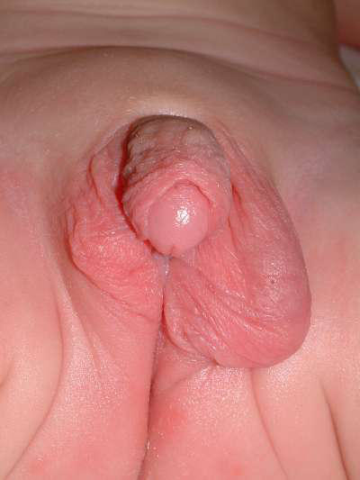

# Chapter 626: Hypofunction of the Ovaries
> **Course:** Vikkypaedia Pediatric Basic Course (*Nelson Textbook of Pediatrics, 22nd Edition (2025)*)  
> **Part XXIV:** The Endocrine System  
> **Authors:** Alvina R. Kansra and Patricia A. Donohoue  
> **Metrics:** 6,579 words · 1 tables/boxes · 1 figures · 10 genes · 8 flashcards · 5 MCQs  
> **Quick Navigation:** [🃏 Study 8 Flashcards](../flashcards/626_flashcards.md) · [📝 Take 5-Q MCQ Quiz](../mcqs/626_mcqs.md) · [📚 Part XXIV Guide](../parts/Part_XXIV.md) · [🧬 Syndrome & Genetics Atlas](../omim_gene_atlas.md) · [💊 Therapeutics Matrix](../therapies_matrix.md) · [🏠 Course Index](../../index.md)

## Key Chapter Topics & Subchapters
`626.1 Hypergonadotropic Hypogonadism in the Female (Primary Hypogonadism)` · `626.2 Hypogonadotropic Hypogonadism in the Female (Secondary Hypogonadism)`

## Key Genetic & Molecular Targets
`CHD7`, `FGFR1`, `GNAS`, `KAL1`, `PROKR2`, `PROP1`, `SHOX`, `SRY`, `WNT4`, `WT1`

## ⚡ High-Yield Nelson Pediatric Board Pearls
- It may be caused by congenital failure of development, postnatal injury (primary or hypergonadotropic hypogonadism), or lack of central stimulation by the pituitary and/or hypothalamus (secondary or tertiary hypogonadotropic hypogonadism).
- Primary ovarian insuf- ficiency (hypergonadotropic hypogonadism), also termed premature ovarian failure (POF), is characterized by the arrest of normal ovarian function before 40 years of age.
- A diagnosis of hypergonadotropic hypogonadism before puberty is difficult.
- The genes involved in the Turner phenotype are X-linked genes that escape inactivation.
- The diagnosis is often first suspected at puberty when breast development fails to occur.
- Regardless of age, all patients with Turner syndrome need comprehensive cardiovascular evaluation by a cardiologist specializing in congenital heart disease at the time of diagnosis.
- In one study, 38% of patients with 45,X chromosomes had cardiovascular malformations compared with 11% of those with mosaic monosomy X; the most common were aortic valve abnormalities and aortic coarctation.

---
## Full Chapter Text, Tables & Figures
# Chapter 626: Hypofunction of the Ovaries

*Alvina R. Kansra and Patricia A. Donohoue*

<!-- p.4463 -->
inducing some degree of hypogonadism. A karyotype should be checked in all cases where history, examination, or laboratory tests suggest the possibility of Klinefelter syndrome. Gonadotropin levels can be a useful screen for Klinefelter syndrome and will be elevated in pubertal males with this condition. If they are elevated, a karyotype should be performed.

**TREATMENT** Treatment in cases of benign pubertal gynecomastia usually consists of reassuring the boy and his family of the physiologic and transient nature of the phenomenon. When the enlargement is striking and persistent and causes serious emotional disturbance to the patient, specific treatment may be justified. Unfortunately, medical treatment is generally ineffective in long-standing cases. Early cases respond better to medical treatment, but it is then harder to justify, as most cases will resolve spontaneously. Agents that have been used for medical treatment include androgens, aromatase inhibitors, and estrogen antagonists. The effectiveness of synthetic androgens is variable and side effects are a concern, so these are rarely used in pediatrics. Aromatase inhibitors have a physiologic rationale, but placebocontrolled trials have been disappointing. Estrogen antagonists like tamoxifen and raloxifene are more effective, with raloxifene being the superior agent in at least one well-designed trial. If medical treatment is attempted, it should be in early cases (<12 months standing) using raloxifene (in a dose of 60 mg/day) or tamoxifen (10-20 mg/day) for 3-9 months, with the understanding that success rates are generally low in severe cases and that mild cases will likely resolve on their own without treatment.

In those cases where breast development is excessive (Tanner stages 3-5), causes significant psychologic distress, or fails to regress in 18-24 months, surgical removal of the enlarged breast tissue may be indicated, particularly in males who have completed or nearly completed pubertal development. Careful examination and laboratory testing to exclude nonphysiologic causes are advisable before proceeding to surgery.

*Visit Elsevier eBooks+ at eBooks.Health.Elsevier.com** for Bibliography.*

Hypofunction of the ovaries can be either primary or central in etiology. It may be caused by congenital failure of development, postnatal injury (primary or hypergonadotropic hypogonadism), or lack of central stimulation by the pituitary and/or hypothalamus (secondary or tertiary hypogonadotropic hypogonadism). **Primary ovarian insuf- ficiency** (hypergonadotropic hypogonadism), also termed *premature ovarian failure* (POF), is characterized by the arrest of normal ovarian function before 40 years of age. Certain genetic pathogenic variants have been identified that can result in primary ovarian insufficiency. Hypofunction of the ovaries because of a lack of central stimulation (hypogonadotropic hypogonadism) can be associated with other processes, such as multiple pituitary hormone deficiencies and some chronic diseases. Table 626.1 details the etiologic classification of ovarian hypofunction (see also Fig. 600.7).

*Alvina R. Kansra and Patricia A. Donohoue*

## 626.1  Hypergonadotropic Hypogonadism in the Female (Primary Hypogonadism) Alvina R. Kansra and Patricia A. Donohoue

A diagnosis of hypergonadotropic hypogonadism before puberty is difficult. Except in the case of Turner syndrome, most affected patients have no prepubertal clinical manifestations.

**TURNER SYNDROME** The term *Ullrich-Turner syndrome* is frequently used in Europe but is infrequently used in the United States, where the condition is called just *Turner syndrome* (see Chapter 99.4). The syndrome is defined as the combination of the characteristic phenotypic features accompanied by a complete or partial absence of the second X chromosome with or without mosaicism.

**Pathogenesis** Half the patients with Turner syndrome have a 45,X chromosomal complement. Approximately 15% of patients are mosaics for 45,X and a normal cell line (45,X/46,XX). Other mosaics with isochromosomes, 45,X/46,X,i(Xq); with rings, 45,X/46,X,r(X); or with fragments, 45,X/46fra, occur less often. Mosaicism is commonly detected when more than one tissue is examined. The single X chromosome is of maternal origin in nearly 80% of 45,X patients. The mechanism of chromosome loss is unknown, and the risk for the syndrome does not increase with maternal age. The genes involved in the Turner phenotype are X-linked genes that escape inactivation. A major locus involved in the control of linear growth has been mapped within the pseudoautosomal region of the X chromosome (PAR1). *SHOX,* a homeobox-containing gene of 170 kb of DNA within the PAR1, is thought to be important for controlling growth in children with Turner syndrome, with Leri-Weill syndrome, and, rarely, patients with idiopathic short stature. Genes for the control of normal ovarian function are postulated to be on Xp and perhaps two supergenes on Xq.

Turner syndrome occurs in approximately 1 in 1,500-2,500 liveborn females. The frequency of the 45,X karyotype at *conception* is approximately 3%. However, 99% of these are spontaneously aborted, accounting for 5–10% of all abortuses. Mosaicism (45,X/46,XX) occurs in a proportion higher than that seen with any other aneuploid state, but the mosaic Turner constitution is rare among the abortuses; these findings indicate preferential survival for mosaic forms.

The normal fetal ovary contains approximately 7 million oocytes, but these begin to disappear rapidly after the fifth month of gestation. At birth, there are only 2 million (1 million active follicles); by menarche, there are 400,000-500,000; and at menopause, 10,000 remain. In the absence of one X chromosome, this process is accelerated, and nearly all oocytes are gone by 2 years of age. In aborted 45,X fetuses, the number of primordial germ cells in the gonadal ridge appears to be normal, suggesting that the normal process of oocyte loss is accelerated in patients with Turner syndrome. Eventually, the ovaries are described as streaks and consist only of connective tissue, with very few germ cells present.

**Clinical Manifestations** Many patients with Turner syndrome are recognizable at birth because of a characteristic edema of the dorsa of the hands and feet and loose skinfolds at the nape of the neck. Low birthweight and decreased birth length are common (see Chapter 99.4). Clinical manifestations in childhood include webbing of the neck, a low posterior hairline, small mandible, prominent ears, epicanthal folds, high arched palate, a broad chest presenting the illusion of widely spaced nipples, cubitus valgus, and hyperconvex fingernails. The diagnosis is often first suspected at puberty when breast development fails to occur.

**Short stature**, the cardinal finding in virtually all females with Turner syndrome, may be present with few other clinical manifestations. The linear growth deceleration begins in infancy and early childhood, gets progressively more pronounced in later childhood and adolescence,

<!-- p.4464 -->
Hypofunction

#### **Table 626.1** Etiologic Classification of Ovarian

| Category / Parameter | Clinical Details & Findings |
| --- | --- |
| **Genetic defects** | • Kallmann syndrome: KAL1, FGFR1, FGF8, PROK2, PROKR2, |
| **CHD7, WDR11, NELF, SEMA3A** | • Other gene defects: leptin, leptin receptor, KISS-1 (deficiency; of kisspeptin), DAX-1, TAC3 (deficiency of neurokinin B), |
| **TACR3, SEMA7A** | • Inherited syndromes: Prader-Willi, Bardet-Biedl, and others; • Marked constitutional growth delay |
| **Acquired defects (reversible)** | • Anorexia nervosa; • Drug use; • Malnutrition; • Chronic illness, especially Crohn disease; • Hyperprolactinemia |
| **Genetic defects** | • Isolated gonadotropin deficiency (GnRH receptor, FSH, and LH; β-subunit); • Septo-optic dysplasia (HESX-1 defect in some cases); • Disorders of pituitary organogenesis (PROP1, LHX3, LHX4, SOX-3) |
| **Acquired defects** | • Hyperprolactinemia; • Pituitary tumors; • Pituitary infarction; • Infiltrative disorders (histiocytosis, sarcoidosis); • Hemosiderosis and hemochromatosis; • Radiation |
| **Genetic** | • Follicle-stimulating hormone and luteinizing hormone; resistance; • Pathogenic variants in steroidogenic pathways; • 46,XX gonadal dysgenesis; • Turner syndrome and its variants; • Noonan syndrome (RASopathy genes); • SF-1 pathogenic variants; • Galactosemia; • Fragile X–associated disorders; • Bloom syndrome; • Werner syndrome; • Ataxia-telangiectasia; • Fanconi anemia |
| **Acquired** | • Chemotherapy; • Radiation; • Autoimmune ovarian failure from autoimmune polyendocrine; syndromes 1 and 2 |

and results in significant adult short stature. Sexual maturation (breast development) fails to occur at the expected age; however, signs of adrenarche (pubic hair) are normally present. Among untreated patients with Turner syndrome, the mean adult height is 143-144 cm in the United States and most of Northern Europe, but 140 cm in Argentina and 147 cm in Scandinavia (Fig. 626.1). The height is well correlated with the midparental height (average of the parents’ heights adjusted for child’s sex). Specific growth curves for height have been developed for females with Turner syndrome.

Associated **cardiac defects** are common. In females with Turner syndrome, life-threatening consequences of X chromosome haploinsufficiency involve the cardiovascular system. There is a four- to fivefold increase in the rate of premature mortality secondary to congenital heart disease and premature coronary heart disease in adults with Turner syndrome. Clinically silent cardiac defects, mainly bicuspid aortic valve, are

present in patients with Turner syndrome. Regardless of age, all patients with Turner syndrome need comprehensive cardiovascular evaluation by a cardiologist specializing in congenital heart disease at the time of diagnosis. Complete cardiologic evaluation, including echocardiography, reveals isolated nonstenotic bicuspid aortic valves in one third to half of the patients. In later life, bicuspid aortic valve disease can progress to dilation of the aortic root or aortic dissection. Less frequent defects include aortic coarctation (20%), aortic stenosis, mitral valve prolapse, and anomalous pulmonary venous drainage. In one study, 38% of patients with 45,X chromosomes had cardiovascular malformations compared with 11% of those with mosaic monosomy X; the most common were aortic valve abnormalities and aortic coarctation. Webbed neck in patients with or without recognized chromosome syndromes is associated with both flow-related and non–flow-related heart defects. Among patients with Turner syndrome, those with webbed necks have a much greater chance of having coarctation of the aorta than do those without webbed necks. Transthoracic echocardiogram in young females is adequate if cardiac anatomy is clearly seen; otherwise, magnetic resonance angiographic screening studies should be considered in asymptomatic individuals with Turner syndrome. During adolescence, and certainly before pregnancy (when possible) is contemplated, repeat cardiac evaluation should be considered even in those without prior findings of cardiac abnormalities. Blood pressure should be routinely monitored even in the absence of cardiac or renal lesions, especially in those with suggestions of aortic root dilation. Cardiac MRI is a valuable tool to detect and monitor aortic root dilation.

Renal ultrasound should be performed in all females with Turner syndrome at diagnosis. One fourth to one third of patients have **renal malformations** on ultrasonographic examination (50% of those with 45,X karyotypes). The more serious defects include pelvic kidney, horseshoe kidney, double collecting system, the complete absence of one kidney, and ureteropelvic junction obstruction. Some of the malformations may increase the risk of hypertension and urinary tract

**Fig. 626.1** Turner syndrome in a 15-yr-old female exhibiting failure of sexual maturation, short stature, cubitus valgus, and a goiter. There is no webbing of the neck. Karyotyping revealed 45,X/46,XX chromo- some complement.

<!-- p.4465 -->
infection. Idiopathic hypertension is also common. Females with Turner syndrome who had normal baseline renal ultrasound findings did not develop the renal disease during a follow-up period averaging 6 years. When the ovaries are examined by ultrasonography, there are no age-related differences in detecting ovarian tissue; 27–46% of patients have detectable ovaries at various ages; 76% of those with X mosaicism and 26% of those with 45,X karyotypes have detectable ovaries.

Sexual maturation usually fails to occur, but 10–20% of females have spontaneous breast development, and a small percentage may have menstrual periods. Primary gonadal failure is associated with early onset of adrenarche (elevation in dehydroepiandrosterone sulfate) but delayed pubarche (pubic hair development). Spontaneous pregnancies have been reported in menstruating patients with Turner syndrome. Premature menopause, increased risk of miscarriage, and offspring with increased risk of trisomy 21 have been reported. A woman with a 45,X/46,X,r(X) karyotype treated with hormone replacement therapy had three pregnancies, resulting in a normal 46,XY male infant, a spontaneous abortion, and a healthy term female with Turner syndrome 45,X/46,Xr(X).

Antithyroid antibodies (thyroid peroxidase and/or thyroglobulin antibodies) occur in 30–50% of patients. The prevalence increases with advancing age. **Autoimmune thyroid disease**, with or without a goiter, occurs in 10–30% of patients. Age-dependent abnormalities in carbohydrate metabolism characterized by abnormal glucose tolerance and insulin resistance and, only rarely, frank type 2 diabetes occur in older patients with Turner syndrome. Impaired insulin secretion has been described in 45,X women. Cholesterol levels are elevated in adolescence, regardless of body mass index or karyotype.

**Inflammatory bowel disease** (both Crohn disease and ulcerative colitis), gastrointestinal bleeding because of abnormal mesenteric vasculature, and delayed gastric emptying time have all been reported. Screening for celiac disease is recommended because the risk of celiac disease is increased in Turner syndrome, with 4–6% of individuals affected. Although autoimmune diseases have been associated with Turner syndrome, the prevalence of type 1 diabetes with Turner syndrome is not very high.

**Chronic liver disease** may develop in adults with Turner syndrome. Its pathogenesis is poorly defined.

**Sternal malformations** can be detected by lateral chest radiography. An increased carrying angle at the elbow is usually not clinically significant. Scoliosis occurs in approximately 10% of adolescent females. Congenital hip dysplasia occurs more commonly than in the general population. Reported eye findings include anterior segment dysgenesis and keratoconus. Pigmented nevi become more prominent with age; melanocytic nevi are common. Essential hyperhidrosis, torus mandibularis, and alopecia areata occur rarely.

**Recurrent bilateral otitis media** develops in approximately 75% of patients. Sensorineural hearing deficits are common, and the frequency increases with age. Problems with gross and fine motor sensory integration, failure to walk before 15 months of age, and early language dysfunction often raise questions about developmental delay, but intelligence is normal in most patients. However, cognitive impairment does occur in patients with 45,X/46,X,r(X); the ring chromosome is unable to undergo inactivation and leads to two functional X chromosomes.

Special attention should be given to psychosocial development in females with Turner syndrome. In general, behavior is normal in females with Turner syndrome, but they are at an increased risk for social isolation, immaturity, and anxiety. Other conditions, such as dyslexia, nonverbal learning disability, and attention-deficit disorder, have been reported in females with Turner syndrome. In adults, deficits in perceptual spatial skills are more common than they are in the general population. Some unconfirmed data suggest the existence of an imprinted X-linked locus that affects cognitive function such as verbal and higher-order executive function skills. These functions are apparently better when the X is paternal in origin.

The prevalence of mosaicism depends in large part on the techniques used for studying chromosomal patterns. The use of fluorescent in situ hybridization and reverse transcription–polymerase chain reaction (PCR) has increased the reported prevalence of mosaic patterns to as high as 60–74%.

Mosaicism involving the Y chromosome occurs in 5%. A population study using PCR with five different primer sets found Y chromosome material in 12.2%. **Gonadoblastoma** among Y-positive patients occurred in 7–10%. Therefore the recommendation is that prophylactic gonadectomy be performed even in the absence of MRI or CT evidence of tumors. The recommended timing of this procedure is at the time of diagnosis, but this may need to be reevaluated in the future. The gonadoblastoma locus on the Y chromosome (GBY) maps close to the Y centromere. The presence of only the SRY (sex-determining region on the Y chromosome) locus is not sufficient to confer increased susceptibility for the development of gonadoblastoma. Routine PCR for Y chromosome detection for the purpose of assigning gonadoblastoma risk is not indicated. High-throughput quantitative genotyping may provide an effective and inexpensive method for the identification of X chromosome abnormalities and Y chromosome material identification.

In patients with 45,X/46,XX mosaicism, the clinical abnormalities are attenuated and fewer; short stature is as frequent as it is in the 45,X patient and may be the only manifestation of the condition other than ovarian failure (see Fig. 626.1).

**Laboratory Findings** Chromosomal analysis must be considered routinely in females who have unexpected short stature based on parental heights. Turner syndrome is detected in ∼5% of females referred to an endocrinology service because of short stature. Patients with a marker chromosome in some or all cells should be tested for DNA sequences at or near the centromere of the Y chromosome for GBY.

Ultrasonography of the heart, kidneys, and ovaries is indicated after the diagnosis is established. The most common skeletal abnormalities are shortening of the fourth metatarsal and metacarpal bones, epiphyseal dysgenesis in the joints of the knees and elbows, Madelung deformity, scoliosis, and, in older patients, inadequate osseous mineralization.

Plasma levels of gonadotropins, particularly follicle-stimulating hormone (FSH), are markedly elevated to greater than those of agematched controls during infancy; at 2-3 years of age, a progressive decrease in levels occurs until they reach a nadir at 6-8 years of age, and by 10-11 years of age, they rise to adult agonadal levels.

Thyroid peroxidase antibodies should be checked to detect autoimmune thyroiditis if the thyroid-stimulating hormone (TSH) level is abnormal. Annual or biannual TSH levels are recommended. Females with Turner syndrome should be screened for celiac disease by measuring tissue transglutaminase immunoglobulin A antibodies. Initial testing should be done around age 4 years and repeated every 2-5 years. Extensive studies have failed to establish that growth hormone deficiency plays a primary role in the pathogenesis of the growth disorder. Defects in normal secretory patterns of growth hormone are seen in adolescents because of a lack of gonadal steroids, but not in younger females with Turner syndrome.

**Treatment** Treatment with recombinant human growth hormone increases height velocity and ultimate stature in most, but not all, children with Turner syndrome. Many females achieve heights of greater than 150 cm with early initiation of treatment. In one clinical trial, 99 patients with Turner syndrome who started receiving growth hormone at a mean age of 10.9 years at doses between 0.27 and 0.36 mg/kg/wk achieved a mean height of 149 cm, with nearly one third reaching heights greater than 152.4 cm (60 in). In the Netherlands, higher doses of growth hormone (up to 0.63 mg/kg/wk in the third year of treatment) resulted in 85% of the subjects reaching adult heights in the normal range for the Dutch reference population. Growth hormone treatment should be initiated in early childhood and/or when there is evidence of height velocity attenuation on specific Turner syndrome growth curves. Growth hormone therapy does not significantly aggravate carbohydrate tolerance and does not result in marked adverse events in patients with Turner syndrome. Serum levels of insulin-like growth factor 1 should be monitored if the patient is receiving high doses of growth hormone. If the insulin-like growth

<!-- p.4466 -->
factor 1 levels are significantly elevated, the dose of growth hormone may need to be reduced. Treatment with growth hormone can cause excessive growth of the hands and feet in some females with Turner syndrome.

Oxandrolone has also been used to treat the short stature associated with Turner syndrome, either alone or in combination with growth hormone. This nonaromatizable synthetic anabolic steroid has weak androgenic effects, and patients should be monitored for signs of pubarche and hepatotoxicity. The latter is rare.

Replacement therapy with estrogens is indicated, but there is variation among pediatric endocrinologists about the optimal age at which to initiate treatment. The psychologic preparedness of the patient to accept therapy must be considered. The improved growth achieved by females treated with growth hormone in childhood permits initiation of estrogen replacement at 12-13 years. Delaying estrogen therapy to optimize height potential until 15 years of age, as previously recommended, seems unwarranted. This change to starting earlier estrogen therapy was considered because of the psychologic importance of ageappropriate pubertal maturation. In addition, delaying estrogen therapy could be deleterious for bone health and potentially other aspects of the child’s health. Low-dose estrogen replacement at 12 years of age permits a normal pace of puberty without interfering with the positive effect of growth hormone on the final adult height. Estrogen therapy improves verbal and nonverbal memory in females with Turner syndrome. In young women with age-appropriate pubertal development who achieve normal height, health-related quality-of-life questionnaires have yielded normal results.

Many forms of estrogen are available. Oral estrogens had been mostly used in the past. Transdermal patches are increasing in popularity. This is because transdermal patches bypass the first-pass hepatic metabolism, requiring only a small amount of estrogen to attain adequate function. Many treatment protocols have been developed, and several are as follows. For oral preparations, a conjugated estrogen (Premarin), 0.15-0.625 mg daily, or micronized estradiol (Estrace), 0.5 mg given daily for 3-6 months, is usually effective in inducing puberty. The recommendations for transdermal patch therapy are 6.25 μg daily, gradually increased over 2 years to the adult dose of 100-200 μg daily. The estrogen may be cycled (taken on days 1-23) or not. A progestin (Provera) is added (taken on days 10-23) in a dose of 5-10 mg daily. In the week after the progestin, withdrawal bleeding usually occurs. Combination oral contraceptive pills may also be used for hormone replacement therapy.

Prenatal chromosome analysis for advanced maternal age has revealed a frequency of 45,X/46,XX that is 10 times higher than when diagnosed postnatally. Most of these patients have no clinical manifestations of Turner syndrome, and levels of gonadotropins are normal. Awareness of this mild phenotype is important in counseling patients.

Psychosocial support for these females is an integral component of treatment. A comprehensive psychologic education evaluation is recommended either at the time of Turner syndrome diagnosis, depending on the patient’s age, when any of the components of behavior or cognition become obvious, or immediately preceding school entry. In addition to the healthcare team, the Turner Syndrome Society, which has local chapters in the United States and similar groups in Canada and other countries, provides a valuable support system for these patients and their families.

Successful pregnancies have been carried to term using ovum donation and in vitro fertilization. Adolescents with few signs of spontaneous puberty may have ovaries with follicles. There remains a future possibility of using cryopreserved ovarian tissue with immature oocytes before the regression of the ovaries for future pregnancies. In adult women with Turner syndrome, there seems to be a high prevalence of undiagnosed bone mineral density, lipid, and thyroid abnormalities. Glucose intolerance diminished firstphase insulin response, elevated blood pressure, and lowered fatfree mass are common. Glucose tolerance worsens, but fat-free mass and blood pressure and general physical fitness improve with sex hormone replacement. The neurocognitive profile of adult women is unaffected by estrogen status.

**XX GONADAL DYSGENESIS** Some phenotypically and genetically normal females have gonadal lesions identical to those in 45,X patients but without somatic features of Turner syndrome; their condition is termed **pure gonadal dysgen- esis** or pure **ovarian dysgenesis**.

The disorder is rarely recognized in prepubertal children because the external genitals are normal, no other abnormalities are visible, and growth is normal. At pubertal age, sexual maturation fails to take place. Plasma gonadotropin levels are elevated. Delay of epiphyseal fusion may result in a *eunuchoid* habitus. Pelvic ultrasonography reveals streak ovaries.

Affected siblings, parental consanguinity, and failure to uncover mosaicism suggest female-limited autosomal recessive inheritance. The disorder appears to be especially frequent in Finland (1 in 8,300 liveborn females). In this population, several pathogenic variants in the FSH receptor gene (on chromosome 2p) are demonstrated as the cause of the condition. In contrast, FSH receptor gene variants are not detected in Mexican women with 46,XX gonadal dysgenesis. In some patients, XX gonadal dysgenesis has been associated with sensorineural deafness (**Perrault syndrome)**. A patient with this condition and concomitant growth hormone deficiency and virilization has also been reported. There may be distinct genetic forms of this disorder. **Mül- lerian agenesis**, or **Mayer-Rokitansky-Küster-Hauser** syndrome, which is second to gonadal dysgenesis as the most common cause of primary amenorrhea, occurring in 1 in 4,000-5,000 females, has been reported in association with 46,XX gonadal dysgenesis in a 17-year-old adolescent with primary amenorrhea and lack of breast development. One case of dysgerminoma with syncytiotrophoblastic giant cells was reported. An 18-year-old woman with primary amenorrhea and an absence of müllerian-derived structures, unilateral renal agenesis, and clinical signs of androgen excess—a phenotype resembling Mayer- Rokitansky-Küster-Hauser syndrome—was found to have a loss-offunction variant in *WNT4*. Treatment consists of estrogen replacement therapy.

**45,X/46,XY GONADAL DYSGENESIS** 45,X/46,XY gonadal dysgenesis, also called **mixed gonadal dysgenesis**, has extreme postnatal phenotypic variability that may extend from a Turner-like syndrome to a male phenotype with a penile urethra; it is possible to delineate three major clinical phenotypes. Short stature is a major finding in all affected children. Ninety percent of prenatally diagnosed cases have a normal male phenotype.

Some patients have no evidence of virilization; they have a female phenotype and often have the somatic signs of Turner syndrome. The condition is discovered prepubertally when chromosomal studies are made in short females or later when chromosomal studies are made because of failure of sexual maturation. Fallopian tubes and uterus are present. The gonads consist of intraabdominal undifferentiated streaks; chromosomal study of the streak often reveals an XY cell line. The streak gonad differs somewhat from that in females with Turner syndrome; in addition to wavy connective tissue, there are often tubular or cordlike structures, occasional clumps of granulosa cells, and, frequently, mesonephric or hilar cells.

Some children have mild virilization manifested only by prepubertal clitoromegaly. Normal müllerian structures are present, but at puberty virilization occurs. These patients usually have an intraabdominal testis, a contralateral streak gonad, and bilateral fallopian tubes.

Many 45,X/46,XY children present with frank ambiguity of the genitals in infancy (Fig. 626.2). A testis and vas deferens are found on one side in the labioscrotal fold, and a streak gonad is identified on the contralateral side. Despite the presence of a testis, fallopian tubes are often present bilaterally. An infantile or rudimentary uterus is often present.

Other genotypes and phenotypes have been described in mixed gonadal dysgenesis. Approximately 25% of 200 analyzed patients have a dicentric Y chromosome (45,X/46,X,dic Y). In some patients the Y chromosome may be represented by only a fragment (45,X/45,X +fra); application of Y-specific probes can establish the origin of the fragment. It is unclear why the same genotype (45,X/46,XY) can result in

<!-- p.4467 -->
diverse phenotypes. Pathogenic variants in *SRY* have been described in some patients.

Children with a female phenotype present no problem in gender of rearing. Patients who are only slightly virilized are usually assigned a female gender of rearing before a diagnosis is established. Patients with ambiguity of the genitals are often clinically indistinguishable from patients with various types of 46,XY disorders of sex development (46,XY DSD). In some instances, there may need to be careful consideration regarding gender of rearing. Factors that may influence this decision include short stature, the need for surgical genital reconstruction, the presence of müllerian structures, and the need for gonadectomy because of predisposition of the gonad to the development of malignancy. In some patients followed to adulthood, the putative normal testis proves to be dysgenetic with eventual loss of Leydig and Sertoli cell function (see Chapter 623). In an analysis of 22 patients with mixed gonadal dysgenesis, no significant associations or correlations were found between internal and external phenotypes or endocrine function and gonadal morphologic features. The appearance of the external genitalia determined the gender of rearing. In 11 patients, basal and human chorionic gonadotropin–stimulated testosterone levels were lower than in control subjects.

Gonadal tumors, usually **gonadoblastomas**, occur in approximately 25% of these children. A gonadoblastoma locus has been localized to a region near the centromere of the Y chromosome (GBY). These germ cell tumors are preceded by the changes of carcinoma in situ. Accordingly, both gonads should be removed in all patients reared as females, and the undifferentiated gonad should be removed in the patients reared as males.

There is no correlation among the proportion of 45,X/46,XY cell lines in either blood or fibroblasts with the phenotype. In the past, all patients came to clinical attention because of their abnormal

phenotypes. However, 45,X/46,XY mosaicism is found in approximately 7% of fetuses, with true chromosome mosaicism encountered prenatally. Of 76 infants with 45,X/46,XY mosaicism diagnosed prenatally, 72 had a normal male phenotype, 1 had a female phenotype, and only 3 males had hypospadias. Of 12 males whose gonads were examined, only 3 were abnormal. These data must be considered when counseling a family in which a 45,X/46,XY infant is discovered prenatally.

**XXX, XXXX, AND XXXXX FEMALES XXX Females** The 47,XXX (trisomy) chromosomal constitution is the most frequent extra X chromosome abnormality in females, occurring in almost 1 in 1,000 liveborn females. In 68%, this condition is caused by maternal meiotic nondisjunction, but paternal sex chromosome errors cause most 45,X and half of 47,XXY constitutions. The phenotype is that of a normal female; affected infants and children are not recognized based on the genital appearance.

Sexual development and menarche are normal. Most pregnancies have resulted in normal infants. By 2 years of age, delays in speech and language become evident, and some see a lack of coordination, poor academic performance, and immature behavior. These females tend to be tall, manifest behavior disorders, and often require special education classes. Using high-resolution MRI, 47,XXX subjects have lower amygdala volumes than euploid controls; 47,XXY subjects had even lower amygdala volumes. In a review of 155 females, 62% were physically normal. There is marked variability within the syndrome, and a small proportion of affected females are well coordinated, socially outgoing, and academically superior.

**XXXX and XXXXX Females** The great majority of females with these rare karyotypes have intellectual disabilities. Commonly associated defects are epicanthal folds, hypertelorism, clinodactyly, transverse palmar creases, radioulnar synostosis, and congenital heart disease. Sexual maturation is often incomplete and may not occur at all. Nevertheless, three women with tetra-X syndrome gave birth, but no pregnancies were reported in 49,XXXXX women. Most 48,XXXX women tend to be tall, with an average height of 169 cm, whereas short stature is a common feature of the 49,XXXXX phenotype.

**NOONAN SYNDROME** Females with Noonan syndrome show certain anomalies also seen in females with 45,X Turner syndrome, but they have normal 46,XX chromosomes (see Chapter 101.1). The most common abnormalities are the same as those described for males with Noonan syndrome (see Chapter 623). Short stature is one of the cardinal signs of this syndrome. The phenotype differs from Turner syndrome in several respects. Cognitive impairment is often present, the cardiac defect is most often pulmonary valvular stenosis or an atrial septal defect rather than an aortic defect, normal sexual maturation usually occurs but is delayed by 2 years on average, and POF has been reported. The FDA approves growth hormone therapy for use in Noonan syndrome patients with short stature.

**OTHER OVARIAN DEFECTS** Some young women with no chromosomal abnormalities are found to have streak gonads that may contain only occasional or no germ cells. Gonadotropins are increased. Cytotoxic drugs, especially alkylating agents such as cyclophosphamide and busulfan, procarbazine, etoposide, and exposure of the ovaries to irradiation for the treatment of malignancy are frequent causes of ovarian failure. Young women with Hodgkin disease demonstrate that combination chemotherapy and pelvic irradiation may be more deleterious than either therapy alone. Teenagers are more likely than older women to retain or recover ovarian function after irradiation or combined chemotherapy; normal pregnancies have occurred after such treatment. Treatment regimens may result in some ovarian damage in most females treated for cancer. The median lethal dose for the human oocyte is estimated to be approximately 4 Gy; doses as low as 6 Gy have produced primary amenorrhea. Ovarian transposition before abdominal and pelvic irradiation

**Fig. 626.2** A 45,X/46XY neonate with sex chromosome disorder of sex development was noted at birth to have male-appearing exter- nal genitalia with a phallus measured at 2.5 × 1.2 cm and penoscrotal hypospadias. The left gonad was palpable in an incompletely fused scrotum, whereas the right gonad was not palpable. Gonadal biopsy revealed a testis on the left side and streak gonad on the right. The diagnosis was mixed gonadal dysgenesis. (From Remeithi SA, Wherret DK. Disorders of sexual development. In: Martin RJ, Fanaroff AA, Walsh MC, eds. Fanaroff and Martin’s Neonatal-Perinatal Medicine, 10th ed. Philadelphia: Elsevier; 2015: Fig. 98–13)

<!-- p.4468 -->
in childhood can preserve ovarian function by decreasing the ovarian exposure to less than 4-7 Gy.

**Autoimmune ovarian failure** occurs in 60% of children older than 13 years of age with type I autoimmune polyendocrinopathy (Addison disease, hypoparathyroidism, mucocutaneous candidiasis). This condition, also known as *polyglandular autoimmune disease type 1,* is rare worldwide but not in Finland, where, as a result of a founder gene effect, it occurs in 1 in 25,000 people. Affected females may not develop sexually; secondary amenorrhea may occur in young women. The ovaries may have lymphocytic infiltration or appear simply as streaks. Most affected patients have circulating steroid cell antibodies and autoantibodies to 21-hydroxylase. Among patients with polyglandular autoimmune syndromes, 5% have hypogonadism.

The condition also occurs in young women as an isolated event or in association with other autoimmune disorders, leading to secondary amenorrhea (POF). It occurs in 0.2–0.9% of women younger than 40 years of age. POF is a heterogeneous disorder with many causes: chromosomal, genetic, enzymatic, infectious, and iatrogenic. When associated with autoimmune adrenal disease, steroid cell autoantibodies are usually present. These antibodies react with P450scc, 17α-OH, or 21-OH enzymes. Steroid cell autoantibodies are rarely found when associated with an entire host of endocrine and nonendocrine autoimmune diseases and not adrenal autoimmunity. A second autoimmune disorder, often subclinical, is found in 10–39% of adult patients with POF, including autoimmune thyroid disease, type 1 diabetes, systemic lupus erythematosus (SLE), inflammatory bowel disease, immune thrombocytopenia or hemolytic anemia, celiac disease, myasthenia gravis, and rheumatoid arthritis. One 17-year-old with idiopathic thrombocytopenic purpura and 47,XXX chromosomes had autoimmune POF. Patients with POF do not have the neurocognitive defects found in Turner syndrome patients.

**Galactosemia**, particularly the classical form of the disease, usually results in ovarian damage, beginning during intrauterine life. Levels of FSH and luteinizing hormone (LH) are elevated early in life. Ovarian damage may be caused by deficient uridine diphosphate-galactose (see Chapter 107.2). **Denys-Drash syndrome** caused by a *WT1* pathogenic variant can result in ovarian dysgenesis.

**Ataxia-telangiectasia** may be associated with ovarian hypoplasia and elevated gonadotropins; the cause is unknown. Gonadoblastomas and dysgerminomas have occurred in a few females.

**Hypergonadotropic hypogonadism** occurs as a result of resistance of the ovary to both endogenous and exogenous gonadotropins **(Savage syndrome)**. This condition also occurs in women with POF. Antiovarian antibodies or FSH receptor abnormalities may cause this condition. The FSH receptor gene variants have been reported as an autosomal recessive condition (see Chapter 622). A few females with 46,XX chromosomes presenting in primary amenorrhea with elevated gonadotropin levels were found to have inactivating variants of the LH receptor gene. This suggests that LH action is needed for normal follicular development and ovulation. Other genetic defects associated with ovarian failure include pathogenic variants in *SF-1, FOXL2, GNAS, CYP17,* and *CYP19.*

*Visit Elsevier eBooks+ at eBooks.Health.Elsevier.com** for Bibliography.*

## 626.2  Hypogonadotropic Hypogonadism in the Female (Secondary Hypogonadism) Alvina R. Kansra and Patricia A. Donohoue

Hypofunction of the ovaries can result from failure to secrete normal pulses of the gonadotropins LH and FSH. Hypogonadotropic hypogonadism (HH) may occur if the hypothalamic-pituitary-gonadal axis is interrupted either at the hypothalamic or pituitary level. The mechanisms that result in HH include failure of the hypothalamic LH–releasing hormone (also known as *gonadotropin-releasing hormone*) pulse

generator or inability of the pituitary to respond with secretion of LH and FSH. It is often difficult to distinguish between marked constitutional delay and HH.

**HYPOPITUITARISM** Hypogonadotropic hypogonadism is most commonly seen with multiple pituitary hormone deficiencies resulting from malformations (e.g., septo-optic dysplasia, other midline defects), pituitary transcription factor defects such as in PROP-1, or lesions of the pituitary that are acquired postnatally. Familial isolated gonadotropin deficiency associated with anosmia (Kallmann syndrome) may occur in females. Many other genetic causes for HH have been identified. A gene important in LH-releasing hormone secretion is named *KISS* (encoding the protein kisspeptin), which is suggested to play a significant role in the development of the LH-releasing hormone–secreting cells. Another set of genes implicated in HH are the genes for neurokinin B *(TAC3)* and its receptor *(TAC3R)*.

In children with idiopathic hypopituitarism, the defect is usually found in the hypothalamus. In these patients, administration of gonadotropin-releasing hormone results in increased plasma levels of FSH and LH, establishing the integrity of the pituitary gland.

Hypogonadotropic hypogonadism is less common than hypergonadotropic hypogonadism. Ovarian function may be abnormal when associated with LH excess, a condition known as *polycystic ovarian syn- drome* (polycystic ovary syndrome; see Chapter 589).

**Isolated Deficiency of Gonadotropins** This heterogeneous group of disorders is evaluated more fully with the use of the gonadotropin-releasing hormone analog stimulation test rather than a single measurement of gonadotropin levels. In most children the pituitary gland is normal, and the defect causing gonadotropin deficiency resides in the hypothalamus. Patients with **hyper- prolactinemia**, most often caused by a pituitary prolactin-secreting adenoma, often have suppression of gonadotropin secretion. If breast development has occurred, then galactorrhea and amenorrhea are frequently seen.

Several sporadic instances of anosmia with hypogonadotropic hypogonadism have been reported. **Anosmic** hypogonadal females have also been reported in kindreds with Kallmann syndrome, but hypogonadism more frequently affects the males in these families. Pathogenic variants in the gene for the β-subunit of FSH and LH have been reported.

Some autosomal recessive disorders, such as Laurence-Moon- Biedl, multiple lentigines, and Carpenter syndromes, appear in some instances to include gonadotropic hormone deficiency. Patients with Prader-Willi syndrome usually have some degree of HH. Females with severe thalassemia may have gonadotropin deficiency from pituitary damage caused by chronic iron overload secondary to multiple transfusions. Anorexia nervosa frequently results in HH. The rare patients described with leptin deficiency or leptin receptor defects have failure of pubertal maturation because of gonadotropin deficiency.

**DIAGNOSIS** The diagnosis may be apparent in patients with other deficiencies of pituitary tropic hormones, but, as in males, it is difficult to differentiate isolated hypogonadotropic hypogonadism from physiologic delay of puberty. Repeated measurements of FSH and LH, particularly during sleep, may reveal the rising levels that herald the onset of puberty. Stimulation testing with gonadotropin-releasing hormone analog may help to establish the diagnosis. Morbidity for both men and women with hypogonadism includes infertility and an increased risk of osteoporosis.

*Visit Elsevier eBooks+ at eBooks.Health.Elsevier.com** for Bibliography.*
