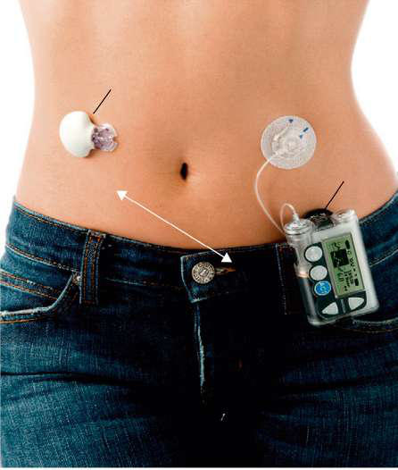

# Chapter 629: Diabetes Mellitus
> **Course:** Vikkypaedia Pediatric Basic Course (*Nelson Textbook of Pediatrics, 22nd Edition (2025)*)  
> **Part XXIV:** The Endocrine System  
> **Authors:** Nelson 22e Contributors  
> **Metrics:** 34,056 words · 19 tables/boxes · 2 figures · 27 genes · 8 flashcards · 5 MCQs  
> **Quick Navigation:** [🃏 Study 8 Flashcards](../flashcards/629_flashcards.md) · [📝 Take 5-Q MCQ Quiz](../mcqs/629_mcqs.md) · [📚 Part XXIV Guide](../parts/Part_XXIV.md) · [🧬 Syndrome & Genetics Atlas](../omim_gene_atlas.md) · [💊 Therapeutics Matrix](../therapies_matrix.md) · [🏠 Course Index](../../index.md)

## Key Chapter Topics & Subchapters
`629.1 Classification of Diabetes Mellitus` · `629.2 Type 1 Diabetes Mellitus (Immune Mediated)` · `629.3 Type 2 Diabetes Mellitus` · `629.4 Other Specific Types of Diabetes` · `629.1 Classification of Diabetes Mellitus David R. Weber` · `629.2 Type 1 Diabetes Mellitus (Immune Mediated) David R. Weber` · `629.3 Type 2 Diabetes Mellitus David R. Weber` · `629.4 Other Specific Types of Diabetes David R. Weber`

## Key Genetic & Molecular Targets
`ABCC8`, `ADA`, `AGPAT2`, `AIRE`, `APC`, `AR`, `CD4`, `CD8`, `CFTR`, `CISD2`, `ERBB3`, `FOXP3`, `FXN`, `GATA4`, `GCK`, `HNF1A`

## ⚡ High-Yield Nelson Pediatric Board Pearls
- Diabetes mellitus (DM) is a common chronic metabolic disease characterized by hyperglycemia as a cardinal biochemical feature.
- T1DM is the most common endocrine metabolic disorder of childhood and adolescence, with important consequences for physical and emotional development.
- TYPE 1 DIABETES MELLITUS Formerly called insulin-dependent diabetes mellitus (IDDM) or juvenile diabetes, T1DM is characterized by low or absent levels of endogenously produced insulin and by dependence on exogenous insulin to prevent development of ketoacidosis, an acute life-threatening complication of T1DM.
- In contrast to patients with T1DM, who are usually ill at the time of diagnosis and whose presentation rarely spans more than a few weeks, children with T2DM often seek medical care because of excessive weight gain and fatigue as a result of insulin resistance and/or the incidental finding of glycosuria during routine physical examination.
- Acanthosis nigricans (dark pigmentation of skin creases in the nape of the neck especially), a sign of insulin resistance, is present in the majority of patients with T2DM and is accompanied by a relative hyperinsulinemia at the time of the diagnosis.
- Insulin therapy is required for patients who present with severe hyperglycemia and for those patients in whom hyperglycemia worsens in spite of lifestyle modification and noninsulin pharmacologic management.
- Worldwide estimates of in- cidence, prevalence and mortality of type 1 diabetes in children and adolescents: results from the International Diabetes Federation Diabe- tes Atlas, 9th edition.

---
## Full Chapter Text, Tables & Figures
# Chapter 629: Diabetes Mellitus

<!-- p.4482 -->

## 629.1  Classification of Diabetes Mellitus David R. Weber

Diabetes mellitus (DM) is a common chronic metabolic disease characterized by hyperglycemia as a cardinal biochemical feature. The major forms of diabetes are differentiated by insulin deficiency versus insulin resistance: **type 1 diabetes mellitus (T1DM**) results from deficiency of insulin secretion because of pancreatic β-cell damage; **type 2 diabetes mellitus (T2DM)** is a consequence of insulin resistance occurring at the level of skeletal muscle, liver, and adipose tissue, with various degrees of β-cell impairment. T1DM is the most common endocrine metabolic disorder of childhood and adolescence, with important consequences for physical and emotional development. Individuals with T1DM confront serious lifestyle alterations, including an absolute daily requirement for exogenous insulin, the need to monitor their own glucose level, and the need to pay attention to dietary intake. Morbidity and mortality stem from a constant potential for acute metabolic derangements and from long-term complications. Potential acute complications include the development of hypoglycemia related to insulin excess or hyperglycemic ketoacidosis from insulin deficiency. Long-term complications typically manifest in adulthood and are related to the adverse effects of chronic hyperglycemia and associated metabolic abnormalities on tissues and organ systems. This can result in microvascular diseases such as retinopathy, nephropathy, and neuropathy and macrovascular complications such as ischemic heart disease and arterial obstruction with gangrene of the extremities.

DM is not a single entity, but rather a heterogeneous group of disorders in which there are distinct genetic patterns and other etiologic and pathophysiologic mechanisms that lead to impairment of glucose tolerance through deficient insulin production or action. The American Diabetes Association (ADA) has proposed a diabetes classification system that includes four categories: type 1 diabetes, type 2 diabetes, other specific types, and gestational diabetes. An expanded list of diabetes etiologies is provided in Table 629.1. The current criteria for the diagnosis of diabetes are provided in Table 629.2. A thorough clinical history and physical exam are often sufficient to determine the etiology; however, in some cases additional testing may be required.

**TYPE 1 DIABETES MELLITUS** Formerly called *insulin-dependent diabetes mellitus* (IDDM) or *juvenile diabetes,* T1DM is characterized by low or absent levels of endogenously produced insulin and by dependence on exogenous insulin to prevent development of ketoacidosis, an acute life-threatening complication of T1DM. The natural history includes four distinct stages: (1) preclinical βcell autoimmunity with progressive defect of insulin secretion, (2) onset of clinical diabetes, (3) transient remission honeymoon period, and (4) established diabetes during which there may occur acute and/or chronic complications and decreased life expectancy. The onset occurs predominantly in childhood, with a median age of 7-15 years, but it may present at any age. The incidence of T1DM varies markedly across the world but has increased in nearly all parts of the world over recent decades (Fig. 629.1). Both genetic susceptibility and environmental factors contribute to the pathogenesis. Susceptibility to T1DM is genetically controlled by alleles of the major histocompatibility complex (MHC) class II genes

expressing human leukocyte antigens (HLAs). Autoantibodies to βcell antigens, including islet cell cytoplasm (ICA), insulin autoantibody (IAA), glutamic acid decarboxylase (GAD), islet antigen 2 (IA-2A, formerly ICA512), and zinc transporter 8 (ZnT8A), are detected in serum from affected subjects. These can be detected months to years before the clinical onset of T1DM. In some children and adolescents with apparent T1DM, the β-cell destruction is not immune mediated. This subtype of diabetes occurs in patients of African or Asian origin and is distinct from known causes of β-cell destruction such as drugs or chemicals, viruses, mitochondrial gene defects, pancreatectomy, and ionizing radiation. These individuals may have ketoacidosis, but they have extensive periods of remission with variable insulin deficiency, similar to patients with T2DM. Patients with T1DM require lifelong treatment with insulin.

**TYPE 2 DIABETES MELLITUS** Formerly known as *adult-onset diabetes mellitus* or *non–insulin- dependent diabetes mellitus,* T2DM develops because of insulin resistance and progressive non-autoimmune β-cell failure. There is a strong heritable component to T2DM, although the genetic basis remains poorly understood. Population-based studies have linked T2DM risk with polymorphisms in a large number of genes related to insulin secretion, insulin action, energy expenditure, and birthweight; however, the collective contribution of these variants to overall T2DM risk remains low at <20%. Although T2DM has long been the most prevalent form of diabetes in adults, the rise in childhood obesity over the past few decades has led to a markedly increased incidence of this disease in children and adolescents. Pediatric T2DM accounts for most of the new cases of diabetes in highrisk populations such as obese adolescents of Black or Hispanic population ancestry (see Chapter 65). *Childhood-onset T2DM differs from adult disease in that it is associated with a more rapid decline in β**-cell function and the earlier development of T2DM-related complications.*

The presentation of T2DM is typically more insidious than that with T1DM. In contrast to patients with T1DM, who are usually ill at the time of diagnosis and whose presentation rarely spans more than a few weeks, children with T2DM often seek medical care because of excessive weight gain and fatigue as a result of insulin resistance and/or the incidental finding of glycosuria during routine physical examination. A history of polyuria and polydipsia is not always a cardinal clinical feature in these patients. **Acanthosis nigricans** (dark pigmentation of skin creases in the nape of the neck especially), a sign of insulin resistance, is present in the majority of patients with T2DM and is accompanied by a relative hyperinsulinemia at the time of the diagnosis. However, as the disease progresses, β-cell function becomes increasingly impaired such that children with advanced T2DM often present in diabetic ketoacidosis (DKA).

Healthy lifestyle interventions and treatment with metformin remain the cornerstones of T2DM treatment in children and adolescents. Liraglutide (a glucagon-like peptide-1 receptor agonist) is approved in children ≥10 years and may have an additional benefit of slowing weight gain. Insulin therapy is required for patients who present with severe hyperglycemia and for those patients in whom hyperglycemia worsens in spite of lifestyle modification and noninsulin pharmacologic management.

**OTHER SPECIFIC TYPES OF DIABETES Monogenic Diabetes** The term *monogenic diabetes* is used to refer to a heterogeneous group of single-gene disorders resulting in impaired insulin secretion. This category encompasses **maturity-onset diabetes of the young (MODY)** and **transient and permanent neonatal diabetes (TND or PND**). Characteristics of monogenic diabetes can include age of onset before 6 months (for TND or PND), development of hyperglycemia before 25 years of age, and strong family history of diabetes. Monogenic etiologies are estimated to comprise anywhere from 1% to 10% of all diabetes cases, with the uncertainty related to the clinical difficulty in differentiating these cases from T1DM and T2DM. Monogenic forms of diabetes may present with hyperglycemia, and consequent polyuria and polydipsia, or may be diagnosed simply by routine screening. Extrapancreatic manifestations vary by genetic defect (see Table 629.1 and Chapter 629.4) and can include hepatic, renal, and central nervous system (CNS) manifestations. Treatment is guided by genetic diagnosis and clinical course, with

Section **6 Diabetes Mellitus in Children**

<!-- p.4483 -->
some forms being responsive to oral sulfonylureas and others requiring insulin replacement. *Children diagnosed with diabetes before 6 months of age should have genetic testing for TND/PND, and older individuals with diabetes not characteristic of T1DM or T2DM in the setting of a family history of diabetes should have genetic testing for monogenic forms of dia- betes.* A comparison of the four types of diabetes is noted in Table 629.3.

**OTHER ETIOLOGIES OF DIABETES** Examples include diabetes secondary to exocrine pancreatic diseases (cystic fibrosis), other endocrine diseases (Cushing syndrome), infec-

In organ transplantation survivors, there is a linkage between cyclosporine and tacrolimus and post-transplantation DM, ascribed to a number of mechanisms. Certain genetic syndromes, including those with abnormalities of the insulin receptor or the immune system, are also included in this category.

**PREDIABETES** The term *prediabetes* is used to identify individuals with abnormalities in blood glucose homeostasis who are at increased risk for the development of diabetes (see Table 629.2). Prediabetes is defined by **impaired fasting glucose** (IFG, fasting glucose 100-125 mg/dL

Modified from Sperling MA, Tamborlane WV, Battelino T, et al. Diabetes mellitus. In: Sperling MA. Pediatric Endocrinology, 4th ed. Philadelphia: Elsevier; 2014: Box 19-1.

#### **Table 629.1** Etiologic Classifications of Diabetes Mellitus

| Category / Parameter | Clinical Details & Findings |
| --- | --- |
| **A.  Genetic Defects Of β-Cell Function (Monogenic Diabetes)** | 1.	 Neonatal diabetes; a.	Pathogenic variants leading to transient neonatal diabetes; (KCNJ11, ABCC8, 6q24 overexpression, INS, ZFP57,; SLC2A2 HNF1β); b.	Pathogenic variants leading to permanent neonatal; diabetes (KCNJ11, ABCC8, INS, GATA6, EIF2AK3, GCK, |
| **NEUROD1, NEUROG3, NKX2-2, RFX5, IER3IP1, MNX1)** | 2.	 MODY (maturity-onset diabetes of the young) syndromes; a.	MODY 1 chromosome 20, HNF4α; b.	MODY 2 chromosome 7, GCK; c.	MODY 3 chromosome 12q24.2, HNF1α, TCF-1; d.	MODY 4 chromosome 13q12.1, IPF-1 (PDX1); e.	MODY 5 chromosome 17, HNF1β, TCF-2; f.	MODY 6 chromosome 2q32, NEUROD1; g.	MODY 7 chromosome 2p25, KLF11; h.	MODY 8 chromosome 9q34, CEL; i.	MODY 9 chromosome 7q32, PAX4; j.	MODY 10 chromosome 11p15.5, INS; k.	MODY 11 chromosome 8p23, BLK; l.	MODY 12 chromosome 11p15, ABCC8; m.	MODY 13 chromosome 11p15, KCNJ11; n.	MODY 14 chromosome 3p14, APPL1; 3.	 Mitochondrial DNA pathogenic variants (includes one form; of Wolfram syndrome, Pearson syndrome, Kearns-Sayre, and; maternally inherited diabetes and deafness); 4. Wolfram syndrome—DIDMOAD (diabetes insipidus, diabetes; mellitus, optic atrophy, deafness):; a. WFS1-Wolframin—chromosome 4p; b. Wolfram locus 2—chromosome 4q22-24; c. Wolfram mitochondrial; 5.	 Thiamine-responsive megaloblastic anemia and diabetes |
| **B.  Genetic Defects of Insulin Action** | 1.	 Type A insulin resistance; 2.	 Donohue syndrome; 3.	 Rabson-Mendenhall syndrome; 4.	 Lipoatrophic diabetes syndromes |
| **Resistance Or Deficiency)** | 1.	 Down syndrome; 2.	 Turner syndrome; 3.	 Klinefelter syndrome; 4. Prader-Willi syndrome; 5.	 Bardet-Biedl syndrome; 6.	 Alström syndrome; 7. Werner syndrome; 8.	 Friedreich ataxia |
| **D.  Other Autoimmune Syndromes Associated With Diabetes** | 1.	 IPEX (immunodysfunction, polyendocrinopathy, enteropathy,; X-linked); 2.	 Autoimmune polyendocrinopathy syndromes (APS); a.	APS-1 (APCED); b.	APS-2; 3.	 Stiff person syndrome; 4.	 Anti-insulin receptor antibodies |
| **E.  Drug Or Chemical Induced** | 1.	 Antirejection—cyclosporine, sirolimus; 2.	 Glucocorticoids (with impaired insulin secretion; e.g., cystic; fibrosis); 3.	 l-Asparaginase; 4.	 β-Adrenergic blockers; 5.	 Vacor (rodenticide); 6.	 Phenytoin (Dilantin); 7.	 α-Interferon; 8.	 Diazoxide; 9.	 Nicotinic acid; 10.	 Pentamidine; 11.	 Immune checkpoint inhibitors (immune mediated) |
| **F.  Diseases of Exocrine Pancreas** | 1.	 Cystic fibrosis; 2.	 Trauma/pancreatectomy; 3.	 Pancreatitis/ionizing radiation; 4.	 Hemochromatosis; 5.	 Fibrocalculous pancreatopathy |
| **G.  Infections** | 1.	 Congenital rubella; 2.	 Cytomegalovirus; 3.	 Hemolytic-uremic syndrome |
| **H. Endocrinopathies Associated With Diabetes** | 1.	 Cushing (hypercortisolism); 2.	 Acromegaly (growth hormone excess); 3.	 Pheochromocytoma; 4.	 Glucagonoma; 5.	 Somatostatinoma; 6.	 Aldosteronoma |

<!-- p.4484 -->
[5.6-6.9 mmol/L]), **impaired glucose tolerance** (IGT, 2 hours postprandial glucose 140-199 mg/dL [7.8-11 mmol/L]), or hemoglobin A1c (HbA1c) values of 5.7–6.4% (39-47 mmol/mol). A fasting glucose concentration of 99 mg/dL (5.5 mmol/L) is the upper limit of normal. This choice is near the level above which acute-phase insulin secretion is lost in response to intravenous administration of glucose and is associated with a progressively greater risk of the development of microvascular and macrovascular complications. Many individuals with IFG are euglycemic in their daily lives and may have normal or nearly normal HbA1c levels. Individuals with IFG often manifest hyperglycemia only when challenged with the oral glucose load used in the standardized oral glucose tolerance test (OGTT).

Prediabetes is not a clinical entity, but rather a risk factor for future diabetes and cardiovascular disease. This may be observed as an intermediate stage in any of the disease processes listed in Table 629.1. Prediabetes is often associated with **insulin resistance syndrome** (also known as **metabolic syndrome**), which consists of insulin resistance, compensatory hyperinsulinemia to maintain glucose homeostasis, obesity (especially abdominal or visceral obesity), dyslipidemia of the high-triglyceride or low- or high-density lipoprotein type, or both in addition to hypertension. Insulin resistance is directly involved in the pathogenesis of T2DM.

## 629.2  Type 1 Diabetes Mellitus (Immune Mediated) David R. Weber

**EPIDEMIOLOGY** T1DM accounts for approximately 10% of all cases of diabetes in all ages, affecting up to 2 million people in the United States and more than 15 million people in the world; approximately 15,000 youths are diagnosed with T1DM each year. Although T1DM accounts for most cases of diabetes in childhood, it is not limited to this age-group; new cases continue to present in adult life, and up to 50% of individuals with T1DM present as adults. The incidence of T1DM is highly variable among different racial and ethnic groups (see Fig. 629.1). The overall age-adjusted incidence of T1DM varies from <5 in 100,000 per year in parts of Asia, Africa, and South America to more than 30 in 100,000 per year in Northern Europe. The incidence of T1DM is increasing in most (but not all) populations, and this increase appears to be most marked in populations where the incidence of autoimmune diseases was historically low. Data from Western European diabetes centers suggest that the annual rate of increase in T1DM incidence is 2–5%, whereas some Central and Eastern European countries demonstrate an even more rapid increase—up to 9%. Data from the United States have shown that the incidence of T1DM in children increased by 1.9% per year from 2002 to 2015 from 19.5/100,000 to 22.3/100,000. Steeper increases in annual incidence were seen in people of Asian/ Pacific Islander (4.4%), Hispanic (4%), and Black (2.7%) versus those of White (0.7%) racial/ethnic background.

Females and males are almost equally affected, with a modest male preponderance in some populations (Western European/United States and a female preponderance in others (Japanese); there is no apparent correlation with socioeconomic status. Peaks of presentation occur in two age-groups: at 5-7 years of age and at the time of puberty. The first peak may correspond to the time of increased exposure to infectious agents coincident with the beginning of school; the second peak may correspond to the pubertal growth spurt induced by gonadal steroids and the increased pubertal growth hormone secretion (which antagonizes insulin). The understanding of the cause of diabetes or of its increased incidence remains elusive. A growing number of cases are presenting between 1 and 2 years of age, especially in high-risk groups; the average age of presentation is older in low-risk populations. Low-risk groups that migrate to a high-risk country seem to acquire the increased risk of that country. There can be marked differences in incidence rates in various ethnic groups within the same country; incidence rates (per 100,000) in the 10- to 14-year-old age-group in the United States range from a low of 7.1 in Native Americans to 17.6 in Hispanics, 19.2 in Black Americans, and 32.9 in Whites.

**GENETICS** There is a clear familial clustering of T1DM, with prevalence in siblings approaching 8%, whereas the prevalence in the general population in the United States is only 0.4%. Risk of T1DM is also increased when a parent has T1DM, and this risk differs between the two parents; the risk is 3–4% if the mother is affected but 5–6% when the father is affected. In monozygotic twins, the concordance rate ranges from 30% to 65%, whereas dizygotic twins have a concordance rate of 6–10%.

Diabetes Mellitus

<5 per 100,000

5 to <10 per 100,00

10 to <20 per 100,000

20 to <30 per 100,000

≥30 per 100,000

No data available **Fig. 629.1**  Map of age-sex standardized incidence rates (per 100,000) from publications of type 1 diabetes in children age under 15 yr. *(From Patterson CC, Karuranga S, Salpea P, et al. Worldwide estimates of in- cidence, prevalence and mortality of type 1 diabetes in children and adolescents: results from the International Diabetes Federation Diabe- tes Atlas, 9th edition. Diabetes Res Clin Pract. 2019;157:107842. Fig 1.)*

#### **Table 629.2** Diagnostic Criteria for Dysglycemia and

| Category / Parameter | Clinical Details & Findings |
| --- | --- |
| **IMPAIRED FASTING GLUCOSE** | Fasting (at least 8 hr) plasma; glucose 100-125 mg/dL (5.6-; 7.0 mmol/L); Fasting (at least 8 hr) plasma; glucose ≥126 mg/dL; (7.0 mmol/L) |
| **IMPAIRED GLUCOSE TOLERANCE** | 2-hr plasma glucose during; OGTT ≥140 mg/dL; (7.8 mmol/L), but <200 mg/dL; (11.1 mmol/L); 2-hr plasma glucose during; OGTT ≥200 mg/dL; (11.1 mmol/L) |
| **PREDIABETES** | Hemoglobin A1c 5.7–6.4% (39-; 47 mmol/mol); Hemoglobin A1c ≥6.5% (48 mmol/; mol) |
| **Or** | Symptoms* of diabetes mellitus; plus random or casual; plasma glucose ≥200 mg/dL; (11.1 mmol/L)†; *Symptoms include polyuria, polydipsia, and unexplained weight loss with glucosuria; and ketonuria.; †Results should be confirmed by repeat testing if in absence of unequivocal; hyperglycemia.; OGTT, Oral glucose tolerance test.; Adapted from the Report of the Expert Committee on the Diagnosis and Classification; of Diabetes Mellitus. Diabetes Care. 1999;20(Suppl 1):S5; with data from American; Diabetes Association. Standards in Medical Care of Diabetes – 2017. Diabetes Care.; 2017;40(Suppl 1):S11–S24. |

<!-- p.4485 -->
Because the concordance rate of dizygotic twins is higher than the sibling risk, factors other than the shared genotypes (e.g., the shared intrauterine environment) may play a role in increasing the risk in dizygotic twins. Furthermore, the genetic susceptibility for T1DM in the parents of an affected child is estimated at 3%. It should be kept in mind that although there is a large genetic component in T1DM, 85% of newly diagnosed patients with T1DM do not have an affected family member.

**Monogenic Type 1 Diabetes Mellitus** Classic single-gene defects are an extremely rare cause of autoimmunemediated T1DM. **IPEX (immune dysfunction, polyendocrinopathy, enteropathy, X-linked) syndrome** is caused by pathogenic variants in *FOXP3* and other genes. The *FOXP3* is a gene involved in immune system responses. A member of the FOX protein family, *FOXP3* appears to function as the master regulator in the development and function of regulatory T cells. These variants lead to the lack of a major population of regulatory T lymphocytes, with resulting overwhelming autoimmunity and development of diabetes (as early as 2 days of age) in approximately 80% of the children with this disorder.

**Wolfram syndrome** (DIDMOD: diabetes insipidus, diabetes mellitus, optic atrophy, deafness) is an autosomal recessive disease caused predominantly by pathogenic variants in *WFS1* and is a progressive neurodegenerative disease. Case definition requires the presence of T1DM and optic atrophy. This syndrome may be present in ∼5% of patients with T1DM.

**Autoimmune polyendocrinopathy syndrome type 1 (APS-1**) is caused by pathogenic variants in *AIRE* leading to abnormalities in expression of peripheral antigens within the thymus and/or abnormalities of negative selection in the thymus. This results in widespread autoimmunity. Approximately 18% of children with this syndrome develop T1DM.

**Genes Altering the Risk of Autoimmune Type 1 Diabetes Mellitus** The risk of developing T1DM is modified by the influence of several risk loci. The genomic region with by far the greatest contribution to the risk of T1DM is the MHC on chromosome 6p21. Outside of the MHC, genome-wide association studies have identified T1DM to be associated with at least 100 different single-nucleotide polymorphisms, from which about 50 genes have emerged as potentially causal. Notable high-risk loci include *INS*, *PTPN22*, *IL2RA, CTLA4*, *IFIH1, ERBB3,* and *BAD.* The contribution of each non-MHC locus to T1DM risk is small, making individual variants less useful for predicting the genetic

risk of T1DM in a patient. The known functions of these genes suggest the primary etiologic pathways of diabetes, namely, HLA class II and class I molecules binding, T- and β-cell activation, innate pathogen viral responses, chemokine and cytokine signaling, and T-regulatory and antigen-presenting cell functions.

**Major Histocompatibility Complex/Human Leukocyte Antigen–Encoded Susceptibility to Type 1 Diabetes Mellitus** The MHC is a large genomic region that contains a number of genes related to immune system function in humans. These genes are further divided into HLA classes I, II, III, and IV. Class II genes are the ones most strongly associated with risk of T1DM, but some of the risk associated with various HLA types is a result of variation in genes in HLA classes other than class II. Overall, genetic variation in the HLA region can explain 40–50% of the genetic risk of T1DM.

Some of the known associations include the HLA DR3/4-DQ2/8 genotype; compared to a population prevalence of T1DM of approximately 1 in 300, DR3/4-DQ2/8 newborns from the general population have a 1 in 20 genetic risk. This risk of development of T1DM is even higher when the high-risk HLA haplotypes are shared with a sibling or parent with T1DM. If one sibling has T1DM and shares the same highrisk DR3/4-DQ2/8 haplotype with another sibling, the risk of autoimmunity in the other sibling is 50%. Moreover, this risk approaches 80% when siblings share both HLA haplotypes identical by descent. This is known as the *relative paradox* and points to the existence of other shared genetic risk factors (most likely in the extended HLA haplotype).

With advances in genotyping, further discrimination is possible and we can identify more specific risk ratios for specific haplotypes. For example, the DRB1*0401-DQA1*0301g-DQB1*0302 haplotype has an odds ratio (OR) of 8.39, whereas the DRB1*0401-DQA1*0301g- DQB1*0301 haplotype has an OR of 0.35, implicating the DQB1*0302 allele as a critical susceptibility allele. There are some dramatically protective DR-DQ haplotypes (e.g., DRB1*1501-DQA1*0102-DQB1*0602 [OR = 0.03], DRB1*1401-DQA1*0101-DQB1*0503 [OR = 0.02], and DRB1*0701-DQA1*0201-DQB1*0303 [OR = 0.02]). The DR2 haplotype (DRB1*1501-DQA1*0102-DQB1*0602) is dominantly protective and is present in 20% of the general population but is seen in only 1% of patients with T1DM.

**Role of Aspartate at Position 57 in DQB1** DQB1*0302 (high risk for diabetes) differs from DQB1*0301 (protective against diabetes) only at position 57, where it lacks an aspartic acid

#### **Table 629.3** Key Features of Diabetes in Pediatric Patients

| Category / Parameter | Clinical Details & Findings |
| --- | --- |
| **DIABETES IN THE YOUNG) NEONATAL DIABETES** | Age at diagnosis; 6 mo-18 yr; Puberty; rarely younger; than 10 yr; Younger than 25 yr; Younger than 6 mo; Causes and genetic factors; Autoimmune; genetic; predisposition (HLA and; other genes); Obesity; genetic and; ethnic predisposition; Autosomal dominant; |
| **HNF1A, HNF4A, GCK,** | HNF1B (see Table 629.1); KCNJ11, ABCC8, INS (see |

#### **Table 629.1** )

| Category / Parameter | Clinical Details & Findings |
| --- | --- |
| **General** | Associated features; Lean or mildly overweight; at diagnosis, often with; weight loss; thyroid; autoimmunity; celiac; disease; Obesity; acanthosis; nigricans; polycystic; ovarian syndrome;; hypertension;; hyperlipidemia; fatty liver; disease; family history; Lean or weight loss at; diagnosis; GCK variants; are asymptomatic; Failure to thrive; Diabetic ketoacidosis at; presentation; Yes; about 25%; Yes; 5–20%; No; Yes; frequency not; described; Treatment; Insulin; Lifestyle modification;; metformin; liraglutide;; insulin; bariatric surgery; Sulfonylurea; no treatment; for GCK variants; Sulfonylurea for KCJN11; and ABCC8 variants;; insulin for other variants; Adapted from Cameron FJ, Wherrett DK. Care of diabetes in children and adolescents: controversies, changes, and consensus. Lancet. 2015;385:2096–2104. Table 1. |

<!-- p.4486 -->
residue. The DQB1*0201 allele (increased risk for diabetes) also lacks aspartic acid at position 57, and it has been proposed that the presence of aspartate at this position alters the protein-recognition and protein-binding characteristics of this molecule. Although the absence of aspartate at this position appears to be important in most studies on White individuals, it does not have the same role in Korean and Japanese populations. Moreover, certain low-risk DQB1 genotypes also lack aspartic acid at position 57, including DQB1*0302/DQB1*0201 (DR7) and DQB1*0201 (DR3)/DQB1*0201 (DR7). Thus the presence of aspartate at this position is usually, but not always, protective in White populations but not necessarily in other populations.

**Role of Human Leukocyte Antigen Class I** Although the alleles of class II HLA genes appear to have the strongest associations with diabetes, recent genotyping studies and analyses of pooled data have identified associations with other elements in the HLA complex, especially HLA-A and HLA-B. The most significant association is with HLA-B39, which confers high risk for T1DM in three different populations, makes up the majority of the signal from HLA-B, and is associated with a lower age of onset of the disease.

**Non-MHC/HLA Genes Associated with T1DM Risk** The second locus found to be associated with risk of T1DM was localized to a region upstream of the *INS.* Susceptibility in this region has been primarily mapped to a variable number of tandem repeats approximately 500 base pairs (bp) upstream of the insulin gene. This highly polymorphic region consists of anywhere from 30 to several hundred repeats of a 14- to 15-bp unit sequence (ACAGGGGTCTGGGG). The high-risk allele has been found to be associated with lower insulin and messenger RNA (mRNA) production in the thymus, suggesting a possible mechanism for decreased immune tolerance to insulin. A number of candidate genes linked to T1DM susceptibility have also been associated with increased risk of *other* autoimmune disease. These include the genes *PTPN22, IL2RA, CTLA4,* and *IFIH1,* which are involved in immune system regulation. Others, such as *ERBB3* and *BAD,* are thought to be associated with cell apoptosis.

**ENVIRONMENTAL FACTORS** That ∼45–70% of monozygotic twins are discordant for T1DM, the variation seen in urban and rural areas populated by the same ethnic group, the change in incidence that occurs with migration, the increase in incidence that has been seen in almost all populations in the last few decades, and the occurrence of seasonality all provide evidence that environmental factors also play a significant role in the causation of T1DM.

**Viral Infections** It is possible that various viruses play a role in the pathogenesis of T1DM, but no single virus, and no single pathogenic mechanism, stands out in the environmental etiology of T1DM. Instead, a variety of viruses and mechanisms may contribute to the development of diabetes in genetically susceptible hosts. Invoked mechanisms involve direct infection of β cells by viruses resulting in lysis and release of self-antigens, direct viral infection of antigen-presenting cells causing increased expression of cytokines, and molecular mimicry, which is the notion that viral antigens exhibit homology to self-epitopes.

The clearest evidence of a role for viral infection in human T1DM is seen in congenital rubella syndrome. Prenatal infection with rubella is associated with β-cell autoimmunity in up to 70%, with development of T1DM in up to 40% of infected children. The time lag between infection and development of diabetes may be as large as 20 years. T1DM after congenital rubella is more likely in patients who carry the higherrisk genotypes. Interestingly, there appears to be no increase in risk of diabetes when rubella infection develops after birth or when live-virus rubella immunization is used.

Studies have shown an increase in evidence of enteroviral infection in patients with T1DM and an increased prevalence of enteroviral RNA in prenatal blood samples from children who subsequently develop T1DM. It has been reported that mumps infection leads to

the development of β-cell autoimmunity with high frequency and to T1DM in some cases. Although mumps may play a role in some cases, the fact that T1DM incidence has increased steadily in several countries after universal mumps vaccination was introduced and that the incidence is extremely low in several populations where mumps is still prevalent indicates that mumps alone is not a major causal factor in diabetes.

**The Hygiene Hypothesis: Possible Protective Role of Infections** Although some viral infections may increase the risk of T1DM, infectious agents may also play a protective role against diabetes. The hygiene hypothesis states that T1DM risk is increased in industrialized countries, where the observation that there are fewer infections implies that the immune system is less well trained for its main task, namely host defense. Some call this theory the *microbial deprivation hypothesis*. The hygiene hypothesis states that lack of exposure to childhood infections may increase an individual’s chances of developing autoimmune diseases, including T1DM. Rates of T1DM and other autoimmune disorders are generally lower in underdeveloped nations with a high prevalence of childhood infections and tend to increase as these countries become more developed. The incidence of T1DM differs almost sixfold between Russian Karelia and Finland, even though both are populated by genetically related populations and are adjacent to each other and at the same latitude. The incidence of autoimmunity in the two populations varies inversely with immunoglobulin (Ig) E antibody levels, and IgE is involved in the response to parasitic infestation. All these observations suggest that decreased exposure to certain parasites and other microbes in early childhood may lead to an increased risk of autoimmunity in later life, including autoimmune diabetes. Nonetheless, retrospective case-control studies have been equivocal at best, and direct evidence of protection by childhood infections is still lacking.

**Gastrointestinal Microbiome** There is emerging evidence that the intestinal microbiome is altered in T1DM; however, a cause-and-effect relationship has yet to be established. Human studies have found that the intestinal microbiome in T1DM has decreased diversity of microbial species and contains fewer butyrate-producing organisms compared to healthy controls. Butyrate is a short-chain fatty acid that is thought to be antiinflammatory and may have a role in protecting the intestinal epithelium, either directly or indirectly, through an effect to increase mucin production. Theoretically, a disruption in epithelial integrity (the so-called *leaky gut*) could trigger inflammation and an enhanced autoimmune response because of increased entry of pathogenic or dietary antigens into the bloodstream. Early, small-scale prospective studies in infants and children at high risk for T1DM have shown an imbalance favoring species including *Bacteroides dorei* and *Bacteroides vulgatus* among individuals who went on to develop T1DM autoantibodies or disease compared with those who did not. A larger study across six different study sites in The Environmental Determinants of Diabetes in the Young (TEDDY) study identified significant geographic differences in fecal microbiome composition, highlighting the challenges in this field of study.

**Diet** Dietary exposure may modify T1DM risk; a definitive link between any single dietary exposure and T1DM development has not been found. The majority of interventional studies have not shown an effect of delayed gluten exposure or the use of hydrolyzed formula to reduce the risk for development of T1DM autoantibodies of disease. A metaanalysis of both interventional and observational studies concluded that there was no association between early exposure of gluten or milk protein and risk of T1DM. Some, but not all, studies have suggested that breastfeeding lowers the risk of T1DM. The potential mechanism for a protective effect of breast milk is not well understood but could be related to a beneficial effect of breast milk on the infant immune system or an indirect effect such as reduced exposure to other dietary antigens early in life. Timing of solid food introduction may modify T1DM risk, as seen in a report from the Diabetes Autoimmunity Study in the

<!-- p.4487 -->

**Fig. 629.2** The natural history of T1DM—a 25-yr-old concept revisited. A re-creation of the model of T1DM, originally proposed in 1986, is shown in black. Additions and conjectures based on recent knowledge gains are shown in green boxes. (From Atkinson MA, Eisenbarth GS, Michels AW. Type 1 diabetes. Lancet. 2014;383:69–78. Fig. 4.)

**(Precipitating event)**

**Genetic predisposition**

β-cell mass

Age (yr)

**No C-peptide C-peptide present**

**Glucose normal**

**Normal insulin release**

**Overt immunologic abnormalities**

**Progressive loss of   insulin     release**

**Overt diabetes**

1. Precipitating events might occur in utero

4. Although overall loss of β cells is potentially linear, it could show a relapsing or remitting pattern

2. Genetic predisposition probably the key driver or linkage to immune abnormalities

3. Beyond precipitating, environment might influence entire natural history

5. Presence of two or more islet autoantibodies might represent asymptomatic type 1 diabetes

6. Increasing glucose excursions as individual approaches symptomatic onset

7. Some patients produce low concentrations of C-peptide long after onset

8. β-cell mass not always zero in long-standing disease

Young (DAISY), which found that both early (before 4 months of age) and late (after 6 months of age) introduction of solid foods predicted development of T1DM.

Other dietary factors that have been suggested at various times as playing a role in T1DM risk include omega-3 fatty acids, vitamin D, ascorbic acid, zinc, and vitamin E. Vitamin D is biologically plausible (it has a role in immune regulation), and deficiency is more common in northern countries like Finland where T1DM incidence is highest; however, most observational studies have failed to find associations between vitamin D level or supplementation and T1DM risk. Interventional studies to assess the effect of vitamin D supplementation on T1DM risk are lacking.

**PATHOGENESIS AND NATURAL HISTORY OF TYPE 1 DIABETES MELLITUS** In T1DM, a genetically susceptible host develops autoimmunity against the host’s own β cells. What triggers this autoimmune response is complex and multifactorial. In some (but not all) patients, this immunemediated process results in progressive destruction of β cells until a critical mass of β cells is lost and insulin deficiency develops. Insulin deficiency, in turn, leads to the onset of clinical signs and symptoms of T1DM. At the time of diagnosis, if viable β cells are still present and produce some insulin, there may be a partial remission of the disease (**honeymoon period**), but over time, more β-cell mass is destroyed, despite any regeneration and/or persistence of β cells, and the patient becomes totally dependent on exogenous insulin for survival (Fig. 629.2). Over time, some of these patients develop secondary complications of diabetes that appear, in part, to be related to how wellcontrolled the diabetes has been. The natural history of T1DM involves some or all of the following stages, with two distinct identifiable stages before onset of symptoms: 1.	Persistence of one or more islet autoantibodies with normoglycemia

and presymptomatic; can last years to decades (onset of autoimmune islet disease AID]) 2.	β-cell autoimmunity with dysglycemia and presymptomatic; shorter 3.	Onset of symptomatic disease; usually quite brief, weeks, rarely

months 4.	Transient remission, usually within weeks of onset, may last 6-12

months (“honeymoon”)

5.	Established disease, lifelong 6.	Development of complications, quite variable

**Initiation of Autoimmunity** Genetic susceptibility to T1DM is determined by several genes, with the largest contribution coming from variants in the HLA system. Nonetheless even with the highest-risk haplotypes, most carriers will not develop T1DM. In monozygotic twins, the concordance of the development of T1DM is reported to be 30–65%. The observed rise in incidence of T1DM, and particularly so in younger children with an essentially genetically stable patient population, implies that something has accordingly changed in the environment. A number of factors, including maternal and intrauterine environmental influences, route of neonatal delivery, foods and diet in infancy, viral infections, lack of exposure to certain infections and antibiotic use, host microbiome, and even psychologic stress, are implicated in the pathogenesis of T1DM, but their exact role and the mechanism by which they trigger or aggravate autoimmunity remain uncertain. What is clear is that markers of autoimmunity are much more prevalent than clinical T1DM, indicating that initiation of autoimmunity is a necessary, but not a sufficient, condition for T1DM. Although no conclusive triggering factor has been identified, it seems that in most cases of T1DM that are diagnosed in childhood, the onset of autoimmunity occurs very early in life. In most children diagnosed before age 10 years, the first signs of autoimmunity appear before age 2 years. Development of autoimmunity is associated with the appearance of several autoantibodies. IAAs are usually the first to appear in young children, followed by GAD, and later by IA-2 and ZnT8 antibodies. The earliest antibodies are predominantly of the IgG1 subclass. Not only is there spreading of autoimmunity to more antigens (IAA, GAD, IA-2A, ZnT8) but there is also epitope spreading within one antigen. Initial GAD antibodies tend to be against the middle region or the carboxyl-terminal region, whereas amino terminal antibodies usually appear later and are less common in children.

**Preclinical Autoimmunity with Progressive Loss of β****-Cell Function** In nearly all patients, the appearance of autoimmunity is followed by progressive or eventual destruction of β cells (Figs. 629.3 and 629.4).

<!-- p.4488 -->
Antibodies are a marker for the presence of autoimmunity, but the actual damage to the β cells is primarily T-cell mediated (see Fig. 629.4). Histologic analysis of the pancreas from patients with recent-onset T1DM reveals insulitis, with an infiltration of the islets of Langerhans by mononuclear cells, including T and B lymphocytes, monocytes/ macrophages, and natural killer cells. The process in human T1DM is not necessarily linear, and there may be an undulating downhill course, with remissions and relapses, in the development of T1DM.

**Role of Autoantibodies** Even though T1DM does not occur as a direct consequence of autoantibody formation, the risk of developing clinical disease increases dramatically with an increase in the number of antibodies; only 15% of children with one antibody will progress to diabetes in 10 years, but this risk increases to 70% when two antibodies are present and 90% when three are present. The risk of progression also varies with the intensity of the antibody response, and those with higher antibody titers are more likely to progress to clinical disease. Another factor that appears to influence progression of β-cell damage is the age at which autoimmunity develops; children in whom IAAs appeared within the first 2 years of life rapidly developed anti–islet cell antibodies and progressed to diabetes more frequently than children in whom the first antibodies appeared between ages 5 and 8 years.

**Role of Genetics in Disease Progression** In a large study of *healthy* children, the appearance of single antibodies is relatively common and usually transient and does not correlate with the presence of high-risk HLA alleles; those carrying high-risk HLA alleles are more likely to develop multiple antibodies and progress to disease. Similarly, the appearance of antibodies is more likely to predict diabetes in those with a family history of diabetes versus those with no family history of T1DM. Environmental factors may induce transient autoimmunity in many children, but those with genetic susceptibility are more likely to see progression of autoimmunity and eventual development of diabetes.

**Role of Environmental Factors** Environmental factors may also act as accelerators of T1DM after the initial appearance of autoimmunity. This is evident from the fact that the incidence of T1DM can vary several-fold between populations that have the same prevalence of autoimmunity. The incidence of T1DM in Finland is almost fourfold higher than in Lithuania, but the incidence of autoimmunity is similar in both countries.

The fact that all children with evidence of autoimmunity and of autoreactive T cells do not progress to diabetes indicates that there are checkpoints at which the autoimmune process can be halted or reversed before it progresses to full-blown diabetes.

Genetic risk

Immune activation

Immune response

Stage 1

The stages to type 1 diabetes

Stage 3 Stage 4 Stage 2

**Starting point** 15 x increased risk of T1D in those with relatives with disease

**Immune activation** Beta cells are attacked

**Immune response** Development of single autoantibody

**Normal blood sugar** ≥ 2 autoantibodies

**Abnormal blood sugar** ≥ 2 autoantibodies

**Clinical diagnosis** ≥ 2 autoantibodies

**Long- standing T1D**

Number at risk Number at risk Number at risk

907 1713 878

858 1639 831

755 1457 750

687 1318 692

635 1233 650

598 1175 620

550 1084 581

907 1713 878

875 1651 841

777 1480 764

707 1343 709

657 1268 668

625 1209 638

580 1120 600

907 1713 878

897 1694 874

876 1679 868

835 1603 822

522 996 505

167 305 164

0 1 2 Age (years)

3 4 5 6 0 1 2 Age (years)

3 4 5 6

Merged genetic score

> 14.4 13.1 - 14.4 < 13.1

0

5

Cumulative risk for

type 1 diabetes (%)

10

15

20

0 2 4 Age (years)

6 8 10

0

5

Cumulative risk for multiple

islet autoantibodies (%)

10

15

20

0

5

Cumulative risk for one or more

islet autoantibodies (%)

10

15

20

Number at risk

B

A

**Fig. 629.3** Contributing factors and disease progression in type 1 diabetes. A, Cumulative risks of one or more islet autoantibodies, multiple islet autoantibodies, and type 1 diabetes development in TEDDY children with the HLA DR3/DR4-DQ8 or DR4-DQ8/DR4-DQ8 genotype stratified by their merged score. The cumulative risk of developing one or more islet autoantibodies (left graph), multiple islet autoantibodies (middle graph), and type 1 diabetes (right graph, y axis) is shown relative to age in yr (x axis) and was calculated using the Kaplan ± Meier method. Curves are shown for children with genetic scores in the upper (orange line), lower (green line), and two middle (blue line) quartiles. The shaded areas represent the 95% confidence interval of the cumulative risk. The numbers at risk indicate the number of children included in the analysis at each age. B, Type 1 diabetes progression and stages of type 1 diabetes. Stage 1 is the start of type 1 diabetes, marked by individuals having two or more diabetes- related autoantibodies and normal blood sugar concentrations. In stage 2, individuals have dysglycemia without symptoms. Stage 3 is the time of clinical diagnosis. T1D, type 1 diabetes. (A from Bonifacio E, Beyerlein A, Hippich M, et al. Genetic scores to stratify risk of developing multiple islet autoantibodies and type 1 diabetes: A prospective study in children. PLoS Med. 2018;15:e1002548. Fig. 4; B from Greenbaum CJ, Speake C, Krischer J, et al. Strength in numbers: opportunities for enhancing the development of effective treatments for type 1 diabetes—the TrialNet experi- ence. Diabetes. 2018;67:1216–1225.)

<!-- p.4489 -->
**Onset of Clinical Disease** Patients with progressive β-cell destruction will eventually present with clinical T1DM. It was thought that 90% of the total β-cell mass is destroyed by the time clinical disease develops, but other studies have revealed that this is not always the case. It appears that β-cell destruction is more rapid and more complete in younger children, whereas in older children and adults, the proportion of surviving β cells is greater (10–20% in autopsy specimens), and some β cells (about 1% of the normal mass) survive up to 30 years after the onset of diabetes. Because autopsies are usually done only on patients who died of DKA, these figures may underestimate the actual β-cell mass present at diagnosis. Functional studies indicate that up to 40% of the insulin secretory capacity may be preserved in adults at the time of presentation of T1DM. Ultrasensitive assays indicate that C-peptide production is measurable decades after the onset of T1DM. The fact that newly diagnosed diabetic individuals may still have a significant surviving β-cell mass is important because it raises the possibility of *secondary* prevention of T1DM. Similarly, the existence of viable β cells years or decades after initial presentation indicates that even patients with long-standing diabetes may be able to exhibit some recovery of β-cell

function if the autoimmune destructive process could be halted and if islet cell regeneration could occur.

**PREDICTION** Autoimmunity precedes clinical T1DM, and indicators of autoimmune responses may be useful markers for disease prediction. Individuals at risk for T1DM can be identified by a combination of genetic, immunologic, and metabolic markers. The most informative genetic locus, HLA class II, confers about half of the total genetic risk but has a low positive predictive value (PPV) when used in the general population. Autoantibodies provide a practical readout of β-cell autoimmunity, are easily sampled in venous blood, and have become the mainstay of T1DM prediction efforts. By comparison, and even though T lymphocytes mediate β-cell destruction, T cells are rare in blood, and assays of their function have been difficult to standardize and validate. In the first-degree relatives of patients with T1DM, the number of positive autoantibodies can help estimate the risk of developing T1DM: low risk (single autoantibodies: PPV of 2–6%), moderate risk (2 autoantibodies: PPV of 21–40%), and high risk (>2 autoantibodies: PPV of 59–80%) over a 5-year period. In children carrying the T1DM highest-risk genotype (HLA-DQB1*0201-DQA1*05/DQB1*0302-DQA1*03), insulitis is almost 10 times more frequent (PPV 21%) than in children with other genotypes (PPV 2.2%). But although autoantibodies are useful for the prediction of T1DM in the relatives of patients with T1DM, outside of that obvious population, the screening of the general population would be required to identify healthy subjects at risk of T1DM. Indeed, ∼90% of individuals with new-onset T1DM have no family background of T1DM. Screening the general population is difficult to justify, in part, because the observed autoantibody prevalence greatly exceeds the low disease prevalence in nonrelatives, leading to high false-positive rates.

**PREVENTION** Strategies for the prevention of T1DM are focused primarily on slowing progression of β-cell loss after the onset of autoimmune islet disease through targeted immunosuppression of autoreactive regulatory T cells. Numerous compounds are under investigation for this purpose, including agents that could modulate regulatory T cells via stimulating interleukin (IL)-2, tumor necrosis factor (TNF)-α signaling, or CTLA signaling and by inhibiting IL-17 or T-cell receptor (TCR) signaling. Teplizumab, a humanized anti-CD3 monoclonal antibody that inhibits TCR signaling, has been shown to delay the onset of clinical diabetes in high-risk children and young adults. It is approved for use in the United States for patients 8 years and older with stage 2 T1DM, defined by at least two positive pancreatic islet cell autoantibodies and dysglycemia without hyperglycemia.

**PATHOPHYSIOLOGY OF T1DM** Insulin performs a critical role in the storage and retrieval of cellular fuel. Its secretion in response to feeding is exquisitely modulated by the interplay of neural, hormonal, and substrate-related mechanisms to permit controlled disposition of ingested foodstuff as energy for immediate or future use. Insulin levels must be lowered to then mobilize stored energy during the fasted state. Thus in normal metabolism, there are regular swings between the postprandial, high-insulin anabolic state and the fasted, low-insulin catabolic state that affect liver, muscle, and adipose tissue (Table 629.4). T1DM is a progressive lowinsulin catabolic state in which feeding does not reverse, but rather exaggerates, these catabolic processes. With moderate insulinopenia, glucose use by muscle and fat decreases and postprandial hyperglycemia appears. At even lower insulin levels, the liver produces excessive glucose via glycogenolysis and gluconeogenesis, and fasting hyperglycemia begins. Hyperglycemia produces an osmotic diuresis (glycosuria) when the renal threshold is exceeded (180 mg/dL; 10 mmol/L). The resulting loss of calories and electrolytes, as well as the worsening dehydration, produces a physiologic stress with hypersecretion of stress hormones (epinephrine, cortisol, growth hormone, and glucagon). These hormones, in turn, contribute to the metabolic decompensation by further impairing insulin secretion (epinephrine), by antagonizing its action (epinephrine, cortisol, growth hormone), and by promoting

Regulatory T cell

Macrophage

Neutrophil

**CD4** B cell **APC**

**CD8**

Natural killer cell

Pancreatic islet

A

D

C

E

B

**Fig. 629.4** The immunopathogenesis of type 1 diabetes. The de- velopment of type 1 diabetes is thought to be initiated by the pres- entation of β-cell peptides by antigen-presenting cells (APCs). APCs bearing these autoantigens migrate to the pancreatic lymph nodes, where they interact with autoreactive CD4+ T lymphocytes, which in turn mediate the activation of autoreactive CD8+ T cells (A). These ac- tivated CD8+ T cells return to the islet and lyse β cells expressing im- munogenic self-antigens on major histocompatibility complex class I surface molecules (B). β-Cell destruction is further exacerbated by the release of proinflammatory cytokines and reactive oxygen species from innate immune cells (macrophages, natural killer cells, and neutrophils) (C). This entire process is amplified by defects in regulatory T lympho- cytes, which do not effectively suppress autoimmunity (D). Activated T cells within the pancreatic lymph node also stimulate B lymphocytes to produce autoantibodies against β-cell proteins. These autoantibodies can be measured in circulation and are considered a defining biomarker of type 1 diabetes (E). (From DiMeglio LA, Evans-Molina C, Oram RA. Type 1 diabetes. Lancet. 2018;391:2449–2458. Fig. 3.)

<!-- p.4490 -->
glycogenolysis, gluconeogenesis, lipolysis, and ketogenesis (glucagon, epinephrine, growth hormone, and cortisol) while decreasing glucose use and glucose clearance (epinephrine, growth hormone, cortisol).

The combination of insulin deficiency and elevated plasma values of the counterregulatory hormones is also responsible for accelerated lipolysis and impaired lipid synthesis, with resulting increased plasma concentrations of total lipids, cholesterol, triglycerides, and free fatty acids. The hormonal interplay of insulin deficiency and glucagon excess shunts the free fatty acids into ketone body formation; the supranormal rate of formation of these ketone bodies, principally β-hydroxybutyrate and acetoacetate, exceeds the capacity for peripheral use and renal excretion. Accumulation of these keto acids results in metabolic acidosis (DKA) and compensatory rapid, deep, nondyspneic breathing to excrete excess CO2 (Kussmaul respiration). Acetone, formed by nonenzymatic conversion of acetoacetate, is responsible for the characteristic fruity odor of the breath. Ketones are excreted in the urine in association with cations and thus further increase losses of water and electrolyte and bicarbonate regenerating ability. With progressive dehydration, acidosis, hyperosmolality, and diminished cerebral oxygen use, consciousness becomes impaired, and the patient ultimately becomes comatose.

**CLINICAL MANIFESTATIONS** The classic clinical manifestations of new-onset diabetes in children reflect the hyperglycemic and catabolic physiologic state and include polyuria, polydipsia, polyphagia, and weight loss. Other common symptoms include fatigue, weakness, and a general feeling of malaise. Patients presenting with more advanced disease will exhibit signs of **DKA**, including dehydration, nausea, vomiting, lethargy, altered mental status, and in extreme cases, coma. If the diagnosis is not recognized, the progression of symptoms follows a predictable course from early intermittent polyuria, to sustained polyuria and weight loss, followed by development of DKA. In most cases, this initial progression occurs over a period of weeks rather than months.

Initially, when only insulin reserve is limited, occasional asymptomatic postprandial hyperglycemia occurs. When insulin secretory

capacity declines, blood glucose levels begin to rise. When the blood glucose increases above the renal threshold, intermittent polyuria and/or nocturia begins. With further β-cell loss, chronic hyperglycemia causes a more persistent diuresis, which often includes nocturnal enuresis in younger children. Female patients may develop vulvovaginal candidiasis from the chronic glycosuria. Eventually, daily losses of water and glucose may be as high as 5 L and 250 g, respectively, representing 1,000 calories, or 50%, of the average daily caloric intake. These losses trigger compensatory polydipsia and polyphagia; however, progressive dehydration and weight loss will inevitably ensue unless treatment is initiated.

When the disease continues to progress, ketoacids begin to accumulate. At this stage in the disease, rapid clinical deterioration is possible. Ketoacids produce abdominal pain, anorexia, nausea, and emesis and thereby impede the patient’s ability to maintain sufficient oral replacement of urinary water losses. Dehydration accelerates, as manifested by weakness, orthostasis, and further weight loss. As in any hyperosmotic state, the degree of dehydration may be clinically underestimated because intravascular volume is conserved at the expense of intracellular volume. Signs and symptoms of advanced ketoacidosis include Kussmaul respirations (deep, heavy, nonlabored, rapid breathing), fruity breath odor (acetone), prolonged corrected Q-T interval, diminished neurocognitive function, and coma. Approximately 20–40% of children with new-onset diabetes progress to DKA before diagnosis; data from the United States suggest that the prevalence of DKA at onset of T1DM is increasing.

Clinical progression typically happens more quickly in younger children, owing to either more aggressive autoimmune destruction of β-cells and/or to lower β-cell mass. Disease onset in infancy is associated with a greater likelihood of DKA at presentation. Weight loss in younger children and individuals with more rapidly progressive disease will be composed mostly of acute fluid loss, whereas weight loss in adolescents and individuals with slowly progressive disease will also include significant fat and lean mass deficits as a result of prolonged starvation. In any child, the progression of symptoms may be accelerated by the stress of an intercurrent illness or trauma, when counterregulatory (stress) hormones counter the limited insulin secretory capacity.

**DIAGNOSIS** The diagnosis of T1DM is usually straightforward (see Table 629.2). Although most symptoms are nonspecific, the most important clue is an inappropriate polyuria in any child with signs of dehydration and poor weight gain. Hyperglycemia can be identified quickly from capillary blood by use of a glucometer; glycosuria and ketonuria can readily be determined by urine dipstick. Nonfasting blood glucose greater than 200 mg/dL (11.1 mmol/L) with typical symptoms is diagnostic with or without ketonuria. In the obese child, T2DM must be considered (see Chapter 629.3). Once hyperglycemia is confirmed, it is prudent to determine whether DKA is present (especially if ketonuria is found) by checking a venous blood sample for bicarbonate and pH and also to evaluate for electrolyte abnormalities—even if signs of dehydration are minimal. A baseline HbA1c will be confirmatory and allows an estimate of the duration of hyperglycemia and provides an initial value by which to compare the effectiveness of subsequent therapy. Falsely low HbA1c levels are noted in hemolytic anemias (sickle cell anemia, others), pure red cell aplasia, blood transfusions, and anemias associated with hemorrhage, cirrhosis, myelodysplasias, or renal disease treated with erythropoietin.

Testing for autoimmunity (T1DM autoantibodies) (see Chapter 629.1) should be considered in cases where the differentiation between T1DM and T2DM is not apparent and in cases where there is a strong family history suggestive of monogenic and syndromic diabetes. The presence of other autoimmune diseases associated with T1DM should be sought at or shortly after diagnosis, including celiac disease (by tissue transglutaminase immunoglobulin A [IgA] and total IgA) and autoimmune hypothyroidism (by thyroid-stimulating hormone [TSH] and free or total thyroxine). Because significant physiologic perturbations can affect thyroid and celiac screening tests, individuals with

Fasting (Low Insulin) on Some Metabolic Processes in Liver, Muscle, and Adipose Tissue*

#### **Table 629.4** Influence of Feeding (High Insulin) or of

| Category / Parameter | Clinical Details & Findings |
| --- | --- |
| **(FASTED STATE)** | Liver; Glucose uptake; Glucose production; Glycogen synthesis; Glycogenolysis; Absence of; gluconeogenesis; Gluconeogenesis; Lipogenesis; Absence of lipogenesis; Absence of ketogenesis; Ketogenesis; Muscle; Glucose uptake; Absence of glucose; uptake; Glucose oxidation; Fatty acid and ketone; oxidation; Glycogen synthesis; Glycogenolysis; Protein synthesis; Proteolysis and amino; acid release; Adipose; tissue; Glucose uptake; Absence of glucose; uptake; Lipid synthesis; Lipolysis and fatty acid; release; Triglyceride uptake; Absence of triglyceride; uptake; *Insulin is considered to be the major factor governing these metabolic processes.; Diabetes mellitus may be viewed as a permanent low-insulin state that, if untreated,; results in exaggerated fasting. |

<!-- p.4491 -->

#### **Table 629.5** Classification of Diabetic Ketoacidosis

| Category / Parameter | Clinical Details & Findings |
| --- | --- |
| **SEVERE*** | HCO2 (mEq/L, venous)†; 20-28; 16-20; 10-15; <10; pH (venous)†; 7.35-7.45; 7.25-7.35; 7.15-7.25; <7.15; Clinical; No change; Oriented, alert but; fatigued; Kussmaul respirations;; oriented but sleepy;; arousable; Kussmaul or depressed respirations;; sleepy to depressed sensorium; to coma; *Severe hypernatremia (corrected Na >150 mEq/L) would also be classified as severe diabetic ketoacidosis.; †HCO2 and pH measurement are method dependent; normal ranges may vary. |

only mild abnormalities should have tests repeated *after* several weeks before instituting therapy. In addition, because there is an increased risk of cardiovascular disease associated with diabetes, it is also recommended to obtain a fasting lipid profile in children ≥10 years of age once glucose control has been established.

Rarely, a child has transient hyperglycemia with glycosuria while under substantial physical stress or illness. This usually resolves permanently during recovery from the stressors. **Stress-produced hyper- glycemia** can reflect a limited insulin reserve temporarily revealed by elevated counterregulatory hormones. A child with temporary hyperglycemia should therefore be monitored for the development of symptoms of persistent hyperglycemia and be tested with an HbA1c if such symptoms occur. Formal testing in a child who remains clinically asymptomatic is not necessary.

Routine screening procedures, such as postprandial determinations of blood glucose or screening OGTTs, have yielded low detection rates in healthy, asymptomatic children, even among those considered at risk, such as siblings of diabetic children. Accordingly, such screening procedures are not recommended in children.

**TREATMENT** Therapy is tailored to the degree of insulinopenia at presentation. Most children with new-onset T1DM have mild to moderate symptoms, have minimal dehydration with no history of emesis, and have not progressed to ketoacidosis. They can be started on subcutaneous insulin therapy directly. About 20–40% of children with newonset diabetes present in DKA, which can be arbitrarily classified as mild, moderate, or severe (Table 629.5), and the range of symptoms depends on the degree of ketoacidosis. Cardinal biochemical abnormalities include elevations in blood and urine ketones, an increased anion gap, a decreased serum bicarbonate (or total CO2) and pH, and an elevated effective serum osmolality. Hyponatremia is commonly present with hyperglycemia and is the result of an osmotic dilution as water shifts into the extracellular fluid. Potassium and phosphate depletion is common after prolonged polyuria but may be masked by acidosis, which leads to extracellular shifting of these ions.

**Treatment of Diabetic Ketoacidosis** Severe insulinopenia (or lack of effective insulin action) results in a physiologic cascade of events in three general pathways: 1.	Excessive glucose production coupled with reduced glucose use rais-

es serum glucose. This triggers an osmotic diuresis, with urinary loss of fluid and electrolytes, dehydration, and activation of the reninangiotensin-aldosterone axis with accelerated potassium loss. When glucose elevation and dehydration are severe and persist for several hours, the risk of cerebral edema increases. 2.	Increased catabolic processes result in cellular losses of sodium, po-

tassium, and phosphate. 3.	Increased release of free fatty acids from peripheral fat stores sup-

plies substrate for hepatic ketoacid production. When ketoacids accumulate, buffer systems are depleted, and a metabolic acidosis ensues. Therapy must address both the initiating event in this cascade (insulinopenia) and the subsequent physiologic disruptions.

Reversal of DKA is associated with inherent risks that include hypoglycemia, hypokalemia, and cerebral edema. Any protocol must be used with caution and close monitoring of the patient. Adjustments based on sound medical judgment may be necessary for any given level of DKA (Figs. 629.5 and 629.6).

**Dehydration and Hyperglycemia** Judicious fluid resuscitation is the first step in the medical management of DKA. Correction of fluid deficits must be tempered by the potential risk of cerebral edema. It is prudent to approach any child in any hyperosmotic state with cautious rehydration. The effective serum osmolality (Eosm = 2 × [Nauncorrected] + [glucose]) is an accurate index of tonicity of the body fluids, reflecting intracellular and extracellular hydration better than measured plasma osmolality. It is calculated with sodium and glucose in mmol/L. This value is usually elevated at the beginning of therapy and should steadily normalize. A rapid decline, or a slow decline to a subnormal range, may indicate an excess of free water entering the vascular space and an increasing risk of cerebral edema. Therefore patients should not be allowed oral fluids until rehydration is well underway and significant electrolyte shifts are no longer likely. Limited ice chips may be given as a minimal oral intake. All fluid intake and output should be closely monitored.

Calculation of fluid deficits using clinical signs is difficult in children with DKA because intravascular volume is better maintained in the hypertonic state. For any degree of tachycardia, delayed capillary refill, decreased skin temperature, or orthostatic blood pressure change, the child with DKA will be more dehydrated than the child with a normotonic fluid deficit. Typically, an initial intravenous bolus of 10-20 mL/kg of glucosefree isotonic sodium salt solution such as Ringer lactate or 0.9% sodium chloride is given over 1 to 2 hours. Further fluid boluses should be given only for hemodynamically unstable patients. This bolus is given as isotonic saline because the patient is inevitably hypertonic, keeping most of the initial infusion in the intravascular space. Subsequent fluid replacement then consists of 0.45% or 0.9% sodium chloride infused at a rate calculated to replace the fluid deficit (after subtracting initial fluid bolus) over 24- 48 hours plus maintenance. The fluid deficit can be calculated empirically if a recent weight is available, estimated at 5–10% of body weight based upon clinical severity, or by assuming a standard water deficit (85 mL/kg). Practically, this is generally equivalent to a rate of ∼1.5 times maintenance, which can be substituted for simplicity in most situations.

The optimal fluid protocol to prevent CNS complications (cerebral edema) of DKA remains uncertain. When children with DKA were randomly assigned to one of four treatment arms consisting of fast or slow fluid deficit repletion of 0.9% or 0.45% sodium chloride, there were no differences in short- or long-term neurocognitive outcomes among any of the treatment arms. In general, after reestablishing the intravascular volume and avoiding rapid declines of blood glucose levels and hyponatremia, fluid replacement rates or fluid composition may subsequently be administered per protocol (see Fig. 629.5). *It is possible that cerebral injury preceded therapy and is the result of DKA and not rates or composition of IV fluids.*

Insulin must be given to promote movement of glucose into cells, to subdue hepatic glucose production, and to halt the movement of fatty acids from the periphery to the liver. An initial IV insulin bolus does not speed recovery and may increase the risk of hypokalemia and hypoglycemia. *Therefore insulin infusion is typically begun without an insulin bolus at*

<!-- p.4492 -->
Polyuria, polydipsia, nocturia, enuresis Weight loss Nausea, vomiting, abdominal pain Weakness, fatigue Confusion, ↓ level of consciousness

**Clinical history**

No improvement

Continuous insulin infusion at 0.05–0.1 unit/kg/hr

starting 1 hr after fluids initiated

Acidosis not improving Blood glucose ≤17 mmol/L (300 mg/dL)

or Blood glucose falls >5 mmol/L/hr (90 mg/dL)

Hourly blood glucose Hourly fluid input and output **Neurologic status** at least hourly Electrolytes every 2 hr after starting IV fluid therapy Monitor ECG for T-wave changes

**Critical observations**

Change to 0.45% or 0.9% saline; add glucose to fluids (5%–12.5%) to prevent hypoglycemia Adjust sodium infusion to promote an increase in measured serum sodium

**IV therapy**

Give mannitol 0.5–1 g/kg or 3% hypertonic saline Adjust IV fluids to maintain normal BP, but avoid overhydration Call senior staff Move to ICU Consider cranial imaging **  only** after patient stabilized

**CE management**

Start SC insulin **then** stop IV insulin after an appropriate interval

**Transition to SC insulin**

IV fluid calculations Insulin delivery system and dose Need for additional resuscitation Consider sepsis

**Re-evaluate**

**Improved** Clinically well, ketoacidosis resolved, tolerating oral fluids

Start with SC insulin Continue oral hydration

**Therapy** Saline 0.9% 10 mL/kg over 1 hr; may repeat Calculate fluid requirements Correct fluid deficit over 24–48 hr ECG for abnormal T-waves Add KCI 40 mmol per liter fluid

**IV therapy**

Airway ± NG tube Breathing (100% oxygen) Circulation (0.9% saline 10–20 mL/kg over 1–2 hr and repeat until circulation is restored) See CE management below

**Resuscitation**

Dehydration Deep sighing respiration (Kussmaul) Smell of ketones Lethargy/drowsiness

**Clinical signs**

Ketones in urine ↑ blood glucose Acidemia (vpH <7.3, HCO3 <15 mmol/L) Urea, electrolytes Other investigations as indicated

**Biochemical features and**

**investigations**

Shock (reduced peripheral pulses) Reduced conscious level/coma

Dehydration >5% Not in shock Acidotic (hyperventilation) Vomiting

Minimal dehydration Tolerating oral fluid

**Diagnosis confirmed Diabetic ketoacidosis**

**Contact senior staff**

**Immediate assessment**

Severe or progressive headache, slowing heart rate, irritability, confusion, decreased consciousness, incontinence, specific neurologic signs

Neurologic deterioration

**WARNING SIGNS:**

Exclude hypoglycemia

Is it cerebral edema?

**Fig. 629.5** Algorithm for the management of diabetic ketoacidosis. CE, cerebral edema; ECG, electrocardiogram; KCl, potassium chloride; SC, subcutaneous. (Adapted from Pinhas-Hamiel O, Sperling M. Diabetic ketoacidosis. In: Hochberg Z, ed. Practical Algorithms in Pediatric Endocrinol- ogy. 3rd ed. Basel, Switzerland: Karger; 2017:112–113.)

<!-- p.4493 -->
*a rate of 0.05 to 0.1 units/kg/hr after initial fluid resuscitation is complete.* This approximates maximal insulin output in normal subjects during an OGTT. Rehydration alone also lowers glucose levels by improving renal perfusion and enhancing renal excretion. The combination of these therapies usually causes a rapid initial decline in serum glucose levels. Persistent decreases in serum glucose of >100 mg/dL/hr may increase the risk of cerebral edema; therefore careful monitoring of serum glucose and adjustment of the dextrose concentration of the IV fluids is essential. The dextrose concentration of the IV fluids should be 5% (D5) once serum glucose falls below ∼300 mg/dL and 10% once glucose is below 200 mg/ dL. The use of a two-bag system is the preferred approach for managing the dextrose concentrations of the infused IV fluid during DKA. A twobag system consists of two IV bags of identical electrolyte concentrations, where one bag contains 0% dextrose and the other contains 10% dextrose. The fluids are administered via a Y-site and can be easily titrated to infuse fluids ranging from 0% to 10% dextrose.

Once the blood glucose level decreases below ∼180 mg/dL (10 mmol/L), the osmotic diuresis stops and rehydration accelerates without further increase in the infusion rate. Repair of hyperglycemia occurs well before correction of acidosis. Therefore insulin is still needed to control fatty acid release and ketosis after normal glucose levels are reached. If serum glucose levels fall below 100 mg/dL despite an infusion of D10containing IV fluids, the glucose infusion rate can be increased by increasing dextrose to 12.5% or by increasing the infusion rate. Alternatively, the IV insulin rate can be decreased if ketosis continues to improve.

The initial serum sodium is usually normal or low because of the osmolar dilution caused by hyperglycemia and the effect of an elevated sodium-free lipid fraction. An estimate of the reconstituted, or “true,” serum sodium for any given glucose level above 100 mg/dL (5.6 mmol/L) is calculated as follows:

            

1.6mEq /L Na for every100mg /dLglucosein Na excess of 100 or

 

                 

1.6 mEq LNa for every 5.6 mmol Na in excess of 5.6 L glucose

The sodium should *increase* by approximately 1.6 mmol/L for each 100 mg/dL *decline* in the glucose. The corrected sodium is usually

normal or slightly elevated and indicates moderate hypernatremic dehydration. If the corrected value is greater than 150 mmol/L, severe hypernatremic dehydration may be present and may require *slower* fluid replacement. The sodium should steadily increase with therapy. *Declining sodium may indicate excessive free water accumulation and increased risk of cerebral edema.*

Both the metabolic shift to a catabolic predominance and the acidosis move potassium and phosphate from the cell to the serum. The osmotic diuresis, the kaliuretic effect of the hyperaldosteronism, and the ketonuria then accelerate renal losses of potassium and phosphate. Sodium is also lost with the diuresis, but free water losses are greater than isotonic losses. With prolonged illness and severe DKA, total body losses can approach 10-13 mEq/kg of sodium, 5-6 mEq/kg of potassium, and 4-5 mEq/kg of phosphate. These losses continue for several hours during therapy until the catabolic state is reversed and the diuresis is controlled. For example, 50% of infused sodium may be lost in the urine during IV therapy. Even though the sodium deficit may be repaired within 24 hours, intracellular potassium and phosphate may not be completely restored for several days.

Although patients with DKA have a total body potassium deficit, the initial serum level is often normal or elevated. This is caused by the movement of potassium from the intracellular space to the serum, both as part of the ketoacid buffering process and as part of the catabolic shift. These effects are reversed with therapy, and potassium returns to the cell. Improved hydration increases renal blood flow, allowing for increased excretion of potassium in the elevated aldosterone state. The net effect is often a dramatic decline in serum potassium levels, especially in severe DKA. This can precipitate changes in cardiac conductivity, flattening of T waves, and prolongation of the QRS complex and can cause skeletal muscle weakness or ileus. The risk of myocardial dysfunction is increased with shock and acidosis. Potassium levels must be closely followed and electrocardiographic monitoring continued until DKA is substantially resolved. Potassium should be added to the IV fluids once serum potassium declines below 5.5 mEq/L and titrated. A 1:1 mixture of potassium chloride (or acetate) and potassium phosphate is typically used. Rarely, the IV insulin must be temporarily held if serum potassium levels drop below 3 mEq/L. It is unclear whether phosphate deficits contribute to symptoms of DKA such as generalized muscle weakness. In pediatric patients, a deficit has not been shown to compromise oxygen delivery via a deficiency of 2,3-diphosphoglycerate. In most cases, the inclusion of potassium phosphate as outlined earlier will be sufficient; however, additional IV supplementation with potassium phosphate can be used if needed.

Replace urine output

**Fluids**

Bolus 0.9% saline 20 cc/kg, repeat until perfusion established

Maintenance fluids plus deficit replacement over 24–48 hours; 0.45–0.75% saline

Monitor electrolytes, calcium, magnesium, phosphate every 2–4 hours

IV regular insulin 0.025–0.05 unit/kg/hr IV regular insulin 0.05–0.1 unit/kg/hr depending on degree of acidosis

**Electrolytes Insulin**

HHS

When serum K+ <5 mEq/L, start replacement with K 40 mEq/L

Start insulin infusion when BG no longer decreases with fluid alone

Hyperosmolar DKA

Start insulin **after** initial fluid bolus

Frequently assess circulatory status Adjust rate and electrolyte composition of fluids as needed

Titrate insulin dose to decrease blood glucose 4–5.5 mmol/L (75–100 mg/dL) per hour

**Fig. 629.6** Algorithm for the treatment of hyperglycemic hyperosmolar syndromes (HHS). BG, blood glucose. (From Zeitler P, Haqq A, Rosenbloom A, Glaser N. Hyperglycemic hyperosmolar syndrome in children: pathophysiological considerations and suggested guidelines for treatment. J Pediatr. 2011;158(1):9–14, 14.e1–2.)

<!-- p.4494 -->
**Pancreatitis** (usually mild) is occasionally seen with DKA, especially if prolonged abdominal distress is present; serum amylase and lipase may be elevated. If the serum lipase is not elevated, the amylase is likely nonspecific or salivary in origin. Serum creatinine adjusted for age may be falsely elevated owing to interference by ketones in the autoanalyzer methodology. An initial elevated value rarely indicates renal failure and should be rechecked when the child is less ketonemic. Blood urea nitrogen may be elevated with prerenal azotemia and should be rechecked as the child is rehydrated. Mildly elevated creatinine or blood urea nitrogen is not a reason to withhold potassium therapy if good urinary output is present.

**Ketoacid Accumulation** Low insulin infusion rates (0.02-0.05 units/kg/hr) are usually sufficient to stop peripheral release of fatty acids, thereby eliminating the flow of substrate for ketogenesis. Ketogenesis continues until fatty acid substrates already in the liver are depleted, but this production declines much more quickly without new substrate inflow. Bicarbonate buffers, regenerated by the distal renal tubule and by metabolism of ketone bodies, steadily repair the acidosis once ketoacid production is controlled. *Bicarbonate therapy may increase the risk of hypokalemia and cerebral edema; it should be considered only in rare situations with severe acidosis unresponsive to standard DKA management.*

There should be a steady increase in pH and serum bicarbonate as therapy progresses. Kussmaul respirations should abate and abdominal pain resolve. Persistent acidosis may indicate inadequate insulin or fluid therapy, infection, or rarely lactic acidosis. Urine ketones may be positive after ketoacidosis has resolved because the nitroprusside reaction routinely used to measure urine ketones by dipstick measures only acetoacetate. During DKA, most excess ketones are β-hydroxybutyrate, which increases the normal ratio to acetoacetate from 3:1 to as high as 8:1. With resolution of the acidosis, β-hydroxybutyrate converts to acetoacetate, which is excreted into the urine and detected by the dipstick test. Therefore persistent ketonuria may not accurately reflect the degree of clinical improvement and should not be relied on as an indicator of therapeutic failure. β-Hydroxybutyrate can be measured from serum and even by bedside capillary ketometer and is used in some protocols to monitor the resolution of DKA and help determine when to transition from IV to subcutaneous insulin administration.

All patients with known diabetes presenting in DKA should be checked for precipitating events (infection, poor compliance, trauma) that may have triggered the metabolic decompensation.

**Diabetic Ketoacidosis Protocol** See Figure 629.5.

Even though DKA can be of variable severity, a common approach to all cases simplifies the therapeutic regimen and can be safely used for most children. Fluids are best calculated based on weight, not body surface area (m2), because heights are rarely available for the acutely critically ill child. Children with milder DKA recover in 10-20 hours (and need less total IV fluid before switching to oral intake), whereas those with more severe DKA may require up to 36 hours with this protocol. Any child can be transitioned to oral intake and subcutaneous insulin when DKA has resolved (total CO2 >15 mEq/L; pH >7.30; sodium is stable between 135 and 145 mEq/L; anion gap closed; no emesis). A dose of long-acting insulin is given (or continuous subcutaneous infusion is started via pump) and the insulin drip is discontinued approximately 30 minutes later. Typically, transition is timed to occur around mealtime so that short-acting insulin can be given as well. Frequent (every 2-3 hours) short-acting insulin bolusing may need to be given until ketosis resolves.

A flow sheet is mandatory for accurate monitoring of changes in acidosis, electrolytes, fluid balance, and clinical status, especially if the patient is transferred from the emergency department to an inpatient setting with new caretakers. This flow sheet is best implemented by a central computer system, which allows for rapid update and wide availability of results, as well as rule-driven highlighting of critical values. A paper flow sheet suffices if it stays with the patient, is kept current, and is reviewed frequently by the physician. Any flow sheet should include

columns for serial electrolytes, pH, glucose, and fluid balance. Blood glucose should be tested every hour and electrolytes should be tested every 1-2 hours for children with severe DKA and every 3-4 hours for those with mild to moderate DKA.

**Cerebral Edema** Cerebral edema is an important cause of morbidity and mortality in children and adolescents with T1DM. Despite the clinical significance of this complication, its etiology remains incompletely understood. A case control study of DKA suggested that baseline acidosis and abnormalities of sodium, potassium, and blood urea nitrogen concentrations were important predictors of risk of cerebral edema. Early bolus administration of insulin and high volumes of fluid were also identified as risk factors. The incidence of cerebral edema in children with DKA has not changed over the past 15-20 years, despite the widespread introduction of gradual rehydration protocols during this interval. Radiographic imaging is frequently unhelpful in making the diagnosis of cerebral edema. Consequently, each patient must be closely monitored (see Fig. 629.5). For all but the mildest cases, this includes frequent neurologic checks for any signs of increasing intracranial pressure, such as a change of consciousness, depressed respiration, worsening headache, bradycardia, apnea, pupillary changes, papilledema, ptosis, posturing, and seizures. In the event of the development of cerebral edema, immediate interventions should include elevation of the head of the bed, reduction in IV fluid rate, and administration of mannitol (typically 1 g/kg infused intravenously over 20 minutes). Children with moderate to severe DKA have a higher overall risk of cerebral edema and should be treated in a hospital environment where appropriate monitoring can occur.

**Nonketotic Hyperosmolar Coma** This syndrome is characterized by severe hyperglycemia (blood glucose >800 mg/dL; 44 mmol/L), absence of or only slight ketosis, nonketotic acidosis, severe dehydration, depressed sensorium or frank coma, and various neurologic signs that may include grand mal seizures, hyperthermia, hemiparesis, and positive Babinski signs. Respirations are usually shallow, but coexistent metabolic (lactic) acidosis may be manifested by Kussmaul breathing. Serum osmolarity is commonly 350 mOsm/kg or greater. This condition is uncommon in children, although it may be increasing in frequency with the rise in the incidence of T2DM. Among adults, mortality rates are high, possibly in part because of delays in recognition and institution of appropriate therapy. In children, there has been a high incidence of preexisting neurologic injury. Profound hyperglycemia may develop over a period of days, and initially, the obligatory osmotic polyuria and dehydration may be partially compensated for by increasing fluid intake. In some cases, consumption of excessive sugar-sweetened beverages may further exacerbate hyperglycemia. With progression of disease, thirst becomes impaired, possibly because of alteration of the hypothalamic thirst center by hyperosmolarity and, in some instances, because of a preexisting defect in the hypothalamic osmoregulating mechanism.

The low production of ketones is attributed mainly to the hyperosmolarity, which in vitro blunts the lipolytic effect of epinephrine and the antilipolytic effect of residual insulin; blunting of lipolysis by the therapeutic use of β-adrenergic blockers may contribute to the syndrome. Depression of consciousness is closely correlated with the degree of hyperosmolarity in this condition and in DKA. Hemoconcentration may also predispose to cerebral arterial and venous thromboses before therapy is initiated.

Treatment of nonketotic hyperosmolar coma is directed at rapid repletion of the vascular volume deficit with normal saline and very slow correction of the hyperosmolar state (see Fig. 629.6). The fluid deficit should be estimated at 12–15% of body weight. Additional normal saline boluses may be required to reduce tachycardia and poor perfusion. One-half isotonic saline (0.45% NaCl; may use normal saline) is administered at a rate estimated to replace 50% of the volume deficit in the first 12 hours, and the remainder is administered during the ensuing 24 hours. The rate of infusion and the saline concentration are titrated to result in a slow decline of serum osmolality. When

<!-- p.4495 -->
the blood glucose concentration approaches 300 mg/dL, the hydrating fluid should be changed to 5% dextrose in 0.45% NaCl. Approximately 20 mEq/L of potassium chloride should be added to each of these fluids to prevent hypokalemia. Serum potassium and plasma glucose concentrations should be monitored at 2-hour intervals for the first 12 hours and at 4-hour intervals for the next 24 hours to permit appropriate adjustments of administered potassium and insulin.

Insulin can be given by continuous intravenous infusion only after serum glucose levels no longer decline with fluid administration. The IV insulin should be initiated at a low dose of 0.025-0.05 units/kg/hr and titrated to achieve a slow decline in serum glucose of 50-75 mg/dL/ hr (2.8-4.2 mmol/L/hr). The presence of ketosis or more severe acidosis may necessitate earlier insulin initiation.

**INITIATION OF SUBCUTANEOUS INSULIN THERAPY** Excellent diabetes control involves many goals: to maintain blood glucose and HbA1c levels as close to normal without causing hypoglycemia, to eliminate polyuria and nocturia, to prevent ketoacidosis, to permit normal growth and development, and to avoid development of diabetes-related complications—all while minimizing the impact on lifestyle. The specific components of therapy include initiation and adjustment of insulin, extensive teaching of the child and caretakers, and reestablishment of the life routines. Each aspect should be addressed early in the overall care.

**Insulin Therapy** Insulin therapy is initiated at the time of diagnosis for all patients with T1DM. The starting dose may range from 0.4 to 1.2 units/kg/day and is calculated based on a number of factors, including age, pubertal stage, and presence or absence of DKA. Typically, prepubertal children presenting without DKA can be started on a dose of 0.4-0.6 units/kg/day. Overweight pubertal adolescents presenting with DKA may need up to 1-1.2 units/kg/day. Insulin requirements in infancy vary tremendously, from <0.2 units/kg/day to >1 unit/kg day. Table 629.6 shows typical starting ranges for total daily insulin dose (units/kg/day) in children.

The precise optimal insulin dose can only be determined empirically, after beginning with the previously mentioned starting doses, with frequent self-monitored blood glucose levels and insulin adjustment by the diabetes team. Many children with new-onset diabetes have some residual β-cell function (the honeymoon period), which is associated with reduced exogenous insulin needs shortly after starting treatment. Residual β-cell function usually fades within a few months and is reflected as a steady increase in insulin requirements and wider glucose excursions.

The initial insulin schedule should be directed toward the optimal degree of glucose control in an attempt to duplicate the activity of the β cell. There are inherent limits to our ability to mimic the β cell. Exogenous insulin does not have a first pass to the liver, whereas 50% of pancreatic portal insulin is taken up by the liver, a key organ for the disposal of glucose. Absorption of an exogenous dose continues despite hypoglycemia, whereas endogenous insulin secretion ceases and serum levels quickly lower with a normally rapid clearance. The absorption rate from an injection varies by injection site and patient activity level, whereas endogenous insulin is secreted directly into the portal circulation. Despite these fundamental physiologic differences, acceptable glucose control can be obtained with insulin analogs used in a **basal-bolus regimen**. Basal-bolus regimens can be accomplished with multiple daily injections (MDIs), where a slow-onset, long-duration background insulin is given once or twice daily for between-meal glucose control (basal) and a rapid-onset insulin is given with meals to provide carbohydrate coverage and correct hyperglycemia. Alternatively, an **insulin pump** can be used, where a rapid-onset insulin is used to provide both basal (via continuous infusion) and bolus (at mealtimes and as needed for hyperglycemia) coverage. The doses of short-acting insulin include two components: **carbohydrate ratio** (typically expressed as 1 unit of insulin for a set number of grams of carbohydrates) and **insulin sensitivity factor** (ISF), also referred to as the *correction factor,* and typically expressed as 1 unit of insulin will decrease blood sugar by a set number of mg/dL to achieve a target blood glucose level). Target blood glucose levels should

be individualized according to factors including age, duration of diabetes, history of hypoglycemia, time of day, and physical activity, but will generally range between 90 and 180 mg/dL. Formulas for calculating the basal dose, carbohydrate ratio, and ISF from the total daily insulin dose are provided in Table 629.6

All preanalog insulins form hexamers, which must dissociate into monomers subcutaneously before being absorbed into the circulation. Thus a detectable effect for **regular insulin** is delayed by 30-60 minutes after injection. This, in turn, requires delaying the meal 30-60 minutes after the injection for optimal effect—a delay rarely attained in a busy child’s life. Regular insulin has a wide peak and a long tail for bolus insulin. This profile limits postprandial glucose control, produces prolonged peaks with excessive hypoglycemic effects between meals, and increases the risk of nighttime hypoglycemia. **Neutral protamine Hagedorn** (**NPH**, also known as *insulin isophane*) is an intermediate-acting insulin with inherent limitations as a basal insulin because it does not achieve a peakless background insulin level. This produces a significant hypoglycemic effect during the midrange of the duration. Thus it is often difficult to predict its interaction with fast-acting insulins. When regular insulin is combined with NPH, the composite insulin profile poorly mimics normal endogenous insulin secretion. Lente and ultralente insulins were other intermediate-acting insulins that have since been discontinued.

**Lispro**, **aspart**, and **glulisine insulin** are rapid-onset analogs that are absorbed much more quickly because they do not form hexamers. They provide discrete pulses, with onset of action in as little as 10 minutes, with little, if any, overlap and short tail effect. This allows better control of postmeal glucose increase and reduces between-meal or nighttime hypoglycemia. Other ultra-fast-acting insulin analogs are being developed that promise even faster onset of action, a feature that

Subcutaneous Insulin Doses at Diagnosis of Type 1 Diabetes (or Type 2 Diabetes Requiring Intensive Insulin Therapy) for Patients Starting on a Basal-Bolus Regimen

#### **Table 629.6** Approach to Calculating Initial

| Category / Parameter | Clinical Details & Findings |
| --- | --- |
| **CALCULATE TOTAL DAILY DOSE (TDD) OF INSULIN*** | Minimum starting dose:; Add to the minimum dose as; follows:; - Initial blood glucose >200 mg/; dL; - Ketosis at presentation; - Acidosis (by pH or serum; bicarbonate); - Puberty (Tanner stage 2 or; greater)†; 0.2 units/kg/day; + 0.2 units/kg/day; + 0.2 units/kg/day; + 0.2 units/kg/day; + 0.2 units/kg/day |
| **CALCULATE DOSES OF BASAL AND BOLUS INSULIN‡** | Basal dose (long-acting insulin); x = 50% of TDD; (x = daily dose of basal insulin,; typically given as one dose; before bedtime); Carbohydrate coverage (short-; acting insulin); y = 450 / TDD; (1 unit of insulin for every “y”; grams of carbohydrates; consumed at snacks/meals); Insulin sensitivity factor (short-; acting insulin); z = 1800 / TDD; (1 unit of insulin will lower blood; glucose by “z” mg/dL); *Patients with obesity or severe insulin resistance may require an additional 0.2 units/; kg/day (or more) of insulin.; †For example, a prepubertal child presenting with hyperglycemia only with a blood; glucose of 325 mg/dL would be started on a TDD of insulin of 0.4 units/kg/day,; whereas a pubertal adolescent presenting in DKA would be started on 1 units/kg/day.; ‡Other equations for calculating basal and bolus insulin doses have been proposed; and can be found in the literature. All equations provide only an estimate of insulin; requirements. All patients need frequent monitoring of blood glucose after initiation; of insulin, and most will require dose adjustments. |

<!-- p.4496 -->
may make these insulins especially useful in insulin pumps and closedloop systems.

The **long-acting analogs glargine**, **detemir**, and **degludec** are designed to provide longer duration of action, ranging from ∼20 hours (glargine) to ∼40 hours (degludec). Glargine forms a precipitate after subcutaneous injection, detemir binds to circulating albumin, and degludec forms dihexamers—all of which lead to stabilization of the hexameric structure, slower disassociation into insulin monomers, and prolonged duration of action. The result is a flatter 24-hour profile, making it easier to predict the combined effect of a rapid bolus (lispro, aspart, or glulisine) on top of the basal insulin and thereby create a more physiologic pattern of insulin effect. Postprandial glucose elevations are better controlled, and between-meal and nighttime hypoglycemia are reduced. An illustration of the insulin effect profiles of the currently available short- and long-acting insulins is provided in Figures 629.7 and 629.8.

At diagnosis, the basal dose of long-acting insulin is typically calculated to provide around 50% of the total daily dose, with the remainder provided with bolus doses of short-acting insulin at mealtimes (calculations used to determine insulin doses are provided in Table 629.6). Over time the ratio of basal to bolus will typically shift downward and will be affected by the magnitude of carbohydrate intake (especially during adolescence). Some infants and toddlers may do well with a higher percentage of their daily insulin provided as basal. There is considerable individual variability in the duration of action of long-acting insulins, and some younger children and obese adolescents will require twice-daily dosing of glargine. Both long- and short-acting insulins are available for administration via multidose insulin pens, which are generally easier to use compared with a traditional syringe and vial approach.

Some families may be unable to administer four daily injections. In these cases, a compromise may be needed. A three-injection regimen combining NPH with a rapid analog bolus at breakfast, a rapid-acting analog bolus at supper, and glargine at bedtime may provide fair glucose control and eliminate the need for an injection at school. Further compromise to a two-injection regimen may occasionally be needed and frequently involves use of premixed insulin preparations that include both rapid- and intermediateacting insulins (e.g., 70/30). For this regimen, 70% of the total daily dose (TDD) is typically provided with breakfast and 30% of TDD with dinner. An illustration of commonly used insulin regimens is shown in Figure 629.8.

**Insulin Pump Therapy** Continuous subcutaneous insulin infusion (CSII) via batterypowered pumps provides a closer approximation of normal plasma insulin profiles and increased flexibility regarding timing of meals and snacks compared with conventional insulin injection regimens. Insulin pump models can be programmed with a patient’s personal

insulin dose algorithms, including the ISF and carbohydrate ratios for premeal glucose levels. At mealtimes, the patient enters the blood glucose level (or it is automatically transmitted from a linked glucometer) and the carbohydrate content of the meal, and the pump computer will calculate the proper insulin bolus dose. Although CSII frequently improves metabolic control, this may not always be the case. The degree of glycemic control is mainly dependent on how closely patients adhere to the principles of diabetes self-care, regardless of the type of intensive insulin regimen. One benefit of pump therapy may be a reduction in severe hypoglycemia and associated seizures. Randomized trials comparing multiple daily insulin regimens using glargine insulin and CSII in children with T1DM demonstrate similar metabolic control and frequency of hypoglycemic events. Most patients will initiate therapy with insulin pens; timing of transition to an insulin pump can be individualized per patient preference as soon as 6-12 months after diagnosis.

**Continuous Glucose Monitoring Systems** Continuous glucose monitoring systems (CGMs) consist of a subcutaneous glucose sensor that continuously measures interstitial fluid glucose levels and a receiver to collect and display glucose data. CGMs reduce, but do not eliminate, the need for finger stick blood glucose checking, as calibrations with capillary blood glucose readings are required at least every 12 hours. CGMs report blood glucose levels to the patient/caregiver in real time and can be integrated with smartphones/watches for remote monitoring. To avoid hypoglycemia, the CGM system sounds an alarm once a critical low blood sugar threshold is reached. Additional alerts can be set to notify users of hyperglycemia or rapid rates of change in glucose levels. Short-term studies indicate clinical benefits of these devices as compared to conventional methods of blood glucose monitoring when used by motivated and wellinformed patients. CGMs also allow for the determination of **time in range**, where the amount of time in and out of the target glycemic range *(defined by international consensus as glucose between 70 and 180 mg/dL)* can be determined and tracked. Glycemic control has been traditionally monitored by HbA1c, which provides an estimate of average blood glucose over the prior 2 to 3 months. Time in range allows for a more granular assessment of glucose excursions within and between days and may prove to be a more clinically significant metric of diabetes control. A limitation of CGM-only systems is that they require the user to respond to the alert, interpret the data, and intervene to prevent hypoglycemic or hyperglycemic episodes. This limitation is mitigated when the CGM is combined with an insulin pump in a closed-loop system.

**Closed-Loop Systems** A closed-loop system allows for direct communication between the continuous glucose sensor and insulin pump for automatic adjustment of insulin infusion rates in response to glucose levels (Fig. 629.9). A fully closed-loop system would be completely independent of the user and theoretically could improve glycemic control through the early identification and response to glucose perturbation and by minimizing the opportunity for human error in insulin dosing. Both singlehormone (insulin only) and bihormone (insulin and glucagon) systems are undergoing clinical investigation.

Several hybrid closed-loop systems with integrated insulin pumps and continuous glucose sensors have gained regulatory approval and entered clinical practice. There is emerging evidence from short-term clinical trials that the use of hybrid closed-loop systems can improve time in range and reduce hyperglycemia and hypoglycemia compared to sensor-augmented systems. Current issues hampering full implementation of this technology include limitations in the accuracy and precision of interstitial fluid glucose sensing, the need for short-acting insulins with more rapid onset of action, and complexity of day-to-day use.

**Adjunct Pharmacotherapy** Pramlintide acetate, a synthetic injectable analog of amylin, may be of therapeutic value combined with insulin therapy. However, it has not

0 20 40

Lispro/aspart/glulisine

Regular

NPH

Detemir/glargine Degludec

Duration of action (hours) **Fig. 629.7**  Approximate insulin effect profiles. The following relative peak effect and duration units are used: lispro/aspart/glulisine, peak 20 for 4 hr; regular, peak 15 for 7 hr; neutral protamine Hagedorn *(NPH)* peak 12 for 12 hr; detemir/glargine, peak 5 for 20-24 hr; degludec peak 5 for 42 hr.

<!-- p.4497 -->
gained widespread use. Metformin, an oral antihyperglycemic commonly used to treat T2DM, is sometimes used clinically as an adjunct therapy in T1DM patients with evidence of significant insulin resistance (i.e., obesity, insulin requirements >1.2 units/kg/day, acanthosis nigricans on exam). A clinical trial investigating the addition of metformin in overweight adolescents with T1DM did not find a sustained effect of metformin to lower HbA1c but did show a reduction in daily insulin dose and body mass index (BMI). Reports from observational studies are likewise mixed. These agents would typically not be started at diagnosis of T1DM.

**Basic and Advanced Diabetes Education** Therapy consists not only of initiation and adjustment of insulin dose but also of education of the patient and family. Teaching is most efficiently provided by experienced diabetes educators and dietitians. In the acute phase, the family must learn the basics, which includes monitoring the child’s blood glucose and urine and/or blood ketones, preparing and injecting the correct insulin dose subcutaneously at the proper time, recognizing and treating low blood glucose reactions, and having a basic meal plan. Most families are trying to adjust psychologically to the new diagnosis of diabetes in their child and thus have a limited ability to retain new information. Written materials covering these basic topics help the family during the first few days.

Children and their families are also required to complete advanced self-management classes to facilitate implementation of flexible insulin management. These educational classes will help patients and their families acquire skills for managing diabetes during athletic activities and sick days. Likewise, further patient and caregiver education with a diabetes educator familiar with diabetes technology is imperative when adding a CGM or transitioning to an insulin pump.

**Nutritional Management** Nutrition plays an essential role in the management of patients with T1DM. This is of critical importance during childhood and adolescence, when appropriate energy intake is required to meet the needs for energy expenditure, growth, and pubertal development. There are no special nutritional requirements for the diabetic child other than those for optimal growth and development. Nutritional requirements for the child are outlined on the basis of age, sex, weight, activity, and food preferences. Cultural ethnic considerations must also be integrated into the nutrition plan.

Total recommended caloric intake is based on size or surface area and can be obtained from standard tables (Tables 629.7 and 629.8). The caloric mixture should comprise approximately 55% carbohydrate, 30% fat, and 15% protein, but must be individualized to meet specific patient needs. Approximately 70% of the carbohydrate content should be derived from complex carbohydrates such as starch; intake of sucrose and highly refined sugars should be limited. Complex carbohydrates require prolonged digestion and absorption and thereby raise plasma glucose levels slowly, whereas glucose from refined sugars, including carbonated beverages, is rapidly absorbed and may cause wide swings in the metabolic pattern. The consumption of sugar-sweetened beverages, including soda and juice, should be discouraged. Priority should be given to total calories and total carbohydrates consumed rather than the source. Carbohydrate counting has become a mainstay in the nutrition education and management of patients with T1DM. Patients and their families are provided with information regarding the carbohydrate contents of different foods and food label reading. This allows patients to adjust their insulin dosage to their mealtime carbohydrate

8:00 20:00 8:00

8:00 20:00 8:00

L/A/G L/A/G L/A/G

L/A/G

NPH

L/A/G

L/A/G

L/A/G

L/A/G+NPH

L/A/G L/A/G

Detemir/glargine/degludec

Detemir/glargine/degludec

Detemir/glargine/degludec

Detemir/glargine/degludec

Time of day

Time of day

8:00 20:00 8:00

Regular

NPH NPH

Regular

Insulin 70/30 Insulin 70/30

Time of day

A

B

C **Fig. 629.8**  Approximate composite insulin effect profiles of various insulin dosing strategies. Meals are shown as *rectangles* below the time axis. Injections are shown as labeled *triangles;* L/A/G, lispro, aspart, glulisine. All profiles are idealized using average absorption and clearance rates. In typical clinical situations, these profiles vary among patients. A given patient has varying rates of absorption depending on the injection site, physical activity, and other variables. A, Basal-bolus regimen: A short-acting insulin (Lantus/aspart/glulisine) is injected before meals, and a long-acting basal insulin (glargine/detemir/degludec) is injected at bedtime. Additional short-acting insulin is given to cover between-meal snacks as needed (not shown). For patients on insulin pumps, the composite insulin profile is similar; however, the basal insulin coverage is provided by a continuous infusion of short-acting insulin. B, Thrice-daily injection regimen: A short-acting insulin (Lantus/ aspart/glulisine) and neutral protamine Hagedorn *(NPH)* are injected with breakfast (the two types of insulin can be drawn up into one syringe for administration with a single injection), a short-acting insulin is injected with dinner, and a long-acting basal insulin (glargine/detemir/ degludec) is injected at bedtime. Because NPH is not a peakless insulin, this regimen is associated with greater risk of hypoglycemia compared with the basal-bolus regimen show in Figure 629.6A but does offer the

advantage of eliminating the need for an injection at lunchtime. C, Twice-daily injection regimen: The use of a premixed insulin containing a short- and an intermediate-acting insulin that is given twice daily is sometimes necessary for families who are unable to manage more complex dosing regimens. Insulin 70/30 is one such product that combines regular and NPH insulins. This produces the least physiologic profile, with large excesses before lunch and during the early night, combined with poor coverage before supper and breakfast.

<!-- p.4498 -->
intake. The use of carbohydrate counting and insulin-to-carbohydrate ratios as a part of an MDI regimen allows for less rigid meal planning. Flexibility in the use of insulin in relation to carbohydrate content of food improves the quality of life.

Diets with high fiber content are useful in improving control of blood glucose. Daily recommended fiber intake can be determined using the equation:

Age in years + 5 = grams of fiber per day

Moderate amounts of sucrose consumed with fiber-rich foods such as whole-grain bread may have no more glycemic effect than their

low-fiber, sugar-free equivalents. Saturated fat intake may increase in patients with T1DM who reduce carbohydrate consumption to avoid taking insulin doses by ingesting carbohydrate-free foods. Total energy from fat should not exceed 35%, and education should be provided such that <10% of total energy should come from saturated and trans fats. Dietary fats derived from animal sources should be reduced and replaced by polyunsaturated fats from vegetable sources. Substituting vegetable oil for animal oils or butter in cooking and lean cuts of meat, poultry, and fish for fatty meats can help to achieve these goals. The intake of cholesterol is also reduced by these measures. These simple measures may reduce serum low-density lipoprotein cholesterol, a predisposing factor to atherosclerotic disease. Table 629.8 summarizes typical nutritional guidelines for T1DM.

Each child and family can and should select a diet based on personal taste with the help of the physician or dietitian (or both). Emphasis should be placed on lifestyle changes to promote adherence to a healthy, balanced diet on a daily basis. Occasional excesses (treats) are permissible but should be limited just as for any child without diabetes. Adjustments in meal planning must constantly be made to meet the needs and the desires of each child. A consistent eating pattern with appropriate supplements for exercise, the pubertal growth spurt, and pregnancy in an adolescent with diabetes is important for metabolic control.

**Monitoring** Success in the daily management of the child with diabetes can be measured by the competence acquired by the family, and subsequently by the child, in assuming responsibility for daily self-care. Their initial and ongoing instruction in conjunction with their supervised experience can lead to a sense of confidence in adjusting an insulin dosage for dietary deviations, for unusual physical activity, and for some intercurrent illnesses. Such acceptance of responsibility should make them relatively independent of the physician for their ordinary care. The physician must maintain ongoing interested supervision and shared responsibility with the family and the child.

**Self-monitoring of blood glucose** is an essential component of managing diabetes. Effective monitoring often also includes other factors that influence blood glucose such as insulin dose, physical activity,

Compensation for delays, errors, and noise Safeguards against insulin overdose and underdose Appreciate patient characteristics (e.g., exercise, behaviors)

Adjust insulin dosing based on glucose fluctuations

Need for improved insulin kinetics

Correct for: Time lag Errors and noise Blood versus interstitial values

Delay in insulin action 20 min periphery 100 min liver Delay (30-100 min) in insulin absorption

Algorithm controller

Insulin

pump

Glucose

sensor

Individual

Meal

Algorithm

Insulin pump

Glucose sensor

Delay (5-15 min) in interstitial plasma sensing

A B **Fig. 629.9**  Closed-loop system for T1DM (artificial pancreas). A, Prototype of a closed-loop system. B, Components of a closed-loop system. Three potential delays in the system include glucose sensing in interstitial fluid, insulin absorption (depends on use of rapid vs regular insulin), and insulin action in peripheral tissues and liver. *(From Atkinson MA, Eisenbarth GS, Michels AW. Type 1 diabetes. Lancet. 2014;383:69–78. Fig. 5.)*

Adults

≥16 yr 30

#### **Table 629.7** Calorie Needs for Children and Young

| Category / Parameter | Clinical Details & Findings |
| --- | --- |
| **CHILDREN** | 0-12 mo; 120; 1-10 yr; 100-75 |
| **YOUNG WOMEN** | 11-15 yr; 35 |
| **YOUNG MEN** | 11-15 yr; 80-55 (65); 16-20 yr; Average activity; 40; Very physically active; 50; Sedentary; 30; *Gradual decline in calories per unit weight as age increases.; Numbers in parentheses are means.; From Nutrition Guide for Professionals. Diabetes education and meal planning.; Alexandria, VA, and Chicago, IL: The American Diabetes Association and The American; Dietetic Association, 1988. |

<!-- p.4499 -->
dietary changes, hypoglycemia, and illness. A record of these items may be valuable in interpreting the self-monitoring of blood glucose, prescribing appropriate adjustments in insulin doses, and teaching the family. If there are discrepancies in the self-monitoring of blood glucose and other measures of glycemic control (such as the HbA1c), the clinician should attempt to clarify the situation in a manner that does not undermine their mutual confidence.

Daily blood glucose monitoring is accomplished using blood test strips or a CGM. Test strips are impregnated with glucose oxidase that permit blood glucose measurement from a drop of blood. A portable calibrated reflectance meter can approximate the blood glucose concentration accurately. Glucometers contain a memory chip enabling recall of each measurement and the ability to calculate measurement average over a given interval and display the pattern on a computer screen. Such information is a useful educational tool for verifying degree of control and modifying recommended regimens. A small, spring-loaded device that automates capillary bloodletting (lancing device) in a relatively painless fashion is commercially available. Parents and patients should be taught to use these devices and measure blood glucose at least 4 times daily—before breakfast, lunch, and supper and at bedtime. When insulin therapy is initiated and when adjustments are made that may affect the overnight glucose levels, selfmonitoring of blood glucose should also be performed at midnight and 3 am to detect nocturnal hypoglycemia. Standard blood glucose targets are 90-130 mg/dL before meals and 90-150 mg/dL before bedtime; however, glycemic goals must be individualized to the patient based on age, hypoglycemia risk, and other factors.

Glucose measurements that are consistently at or outside these limits, in the absence of an identifiable cause such as exercise or dietary indiscretion, are an indication for a change in the insulin dose. If the

fasting blood glucose is high, the evening dose of long-acting insulin (or the early morning/overnight basal rate for insulin pump users) is increased by 10–20% and/or additional fast-acting insulin coverage for a bedtime snack may be considered. If the noon glucose level exceeds set limits, the morning fast-acting insulin-to-carbohydrate ratio is increased by 10–20%. If the presupper glucose is high, the noon fast-acting insulin-to-carbohydrate ratio is increased by 10–20%. If the prebedtime glucose is high, the presupper fast-acting insulin-tocarbohydrate ratio is increased by 10–15%. The ISF can be increased by 10–20% if it is found that insulin corrections given for hyperglycemia do not normalize glucose levels as expected. Similarly, reductions in the insulin type and dose should be made if the corresponding blood glucose measurements are consistently below desirable limits.

A minimum of four daily blood glucose measurements (or CGM use) should be performed. However, some children and adolescents may need to have more frequent blood glucose monitoring based on their level of physical activity and history of frequent hypoglycemic reactions. Families should be encouraged to become sufficiently knowledgeable about managing diabetes.

The FDA has approved the use of CGMs to replace finger stick blood glucose checking for the monitoring and treatment of diabetes in children 2 years of age and older. CGMs are minimally invasive and entail the placement of a small, subcutaneous catheter that can be easily worn by adults and children. The system provides information that allows the patient and healthcare team to adjust the insulin regimen and the nutrition plan to improve glycemic control. CGMs can be helpful in detecting asymptomatic nocturnal hypoglycemia and in lowering HbA1c values without increasing the risk for severe hypoglycemia. Although there are potential pitfalls in CGM use, including suboptimal compliance, human error, incorrect technique, and sensor

#### **Table 629.8** Summary of Nutrition Guidelines for Children and/or Adolescents with Type 1 Diabetes Mellitus

| Category / Parameter | Clinical Details & Findings |
| --- | --- |
| **NUTRITION CARE PLAN** | Promotes optimal compliance.; Incorporates goals of management: normal growth and development, control of blood glucose, maintenance of optimal nutritional status, and; prevention of complications. Uses staged approach. |
| **RECOMMENDED DAILY INTAKE** | Carbohydrate; Will vary; High fiber, especially soluble fiber; optimal amount unknown; Fiber; >20 g/day; Protein; 12–20; Fat; <30; Saturated; <10; Polyunsaturated; 6–8; Monounsaturated; Remainder of fat allowance; Cholesterol; 300 mg; Sodium; Avoid excessive; limit to 3,000-4,000 mg if hypertensive |
| **ADDITIONAL RECOMMENDATIONS** | Energy: If using measured diet, reevaluate prescribed energy level at least every 3 mo.; Protein: High-protein intakes may contribute to diabetic nephropathy. Low intakes may reverse preclinical nephropathy. Therefore 12–20% of; energy is recommended; lower end of range is preferred. In guiding toward the end of the range, a staged approach is useful.; Alcohol: Safe use of moderate alcohol consumption should be taught as routine anticipatory guidance as early as junior high school.; Snacks: Snacks vary according to individual needs (generally three snacks per day for children; midafternoon and bedtime snacks for junior high; children or teens).; Alternative sweeteners: Use of a variety of sweeteners is suggested.; Educational techniques: No single technique is superior. Choice of educational method used should be based on patient needs. Knowledge of; variety of techniques is important. Follow-up education and support are required.; Eating disorders: Best treatment is prevention. Unexplained poor control or severe hypoglycemia may indicate a potential eating disorder.; Exercise: Education is vital to prevent delayed or immediate hypoglycemia and to prevent worsened hyperglycemia and ketosis.; From Connell JE, Thomas-Doberson D. Nutritional management of children and adolescents with insulin-dependent diabetes mellitus: a review by the Diabetes Care and Education; Dietetic Practice Group. J Am Diet Assoc. 1991;91:1556. |

<!-- p.4500 -->
failure, the implementation of CGMs in ambulatory diabetes practice allows the clinician to diagnose abnormal glycemic patterns in a more precise manner. In many cases, CGMs are now factory calibrated and nearly eliminate the need for finger sticks. For these reasons, CGMs are increasingly replacing finger stick blood testing as the primary means of glucose monitoring in many patients with T1DM.

**Glycosylated Hemoglobin (HbA****1c****)** A reliable index of long-term glycemic control is provided by measurement of glycosylated hemoglobin. HbA1c represents the fraction of hemoglobin to which glucose has been nonenzymatically attached in the bloodstream. The formation of glycosylated hemoglobin is a slow reaction that is dependent on the prevailing concentration of blood glucose; it continues irreversibly throughout the red blood cell’s life span of approximately 120 days. The higher the blood glucose concentration and the longer the red blood cell’s exposure to it, the higher the fraction of glycosylated hemoglobin, which is expressed as a percentage of total hemoglobin. Because a blood sample at any given time contains a mixture of red blood cells of varying ages, exposed for varying times to varying blood glucose concentrations, an HbA1c measurement reflects the average blood glucose concentration from the preceding 2-3 months. For some patients, it may be helpful to translate HbA1c into estimated average glucose (eAG) using the following equation:

eAG = 28.7 * HbA1c −46.7

When measured by standardized methods to remove labile forms, HbA1c is not influenced by an isolated episode of hyperglycemia.

HbA1c measurements should be obtained three to four times a year to obtain a profile of long-term glycemic control. The lower the HbA1c level, the more likely it is that microvascular complications such as retinopathy and nephropathy will be less severe, delayed in appearance, or even avoided altogether. Depending on the method used for determination, HbA1c values may be spuriously elevated in thalassemia (or other conditions with elevated hemoglobin F) and spuriously lower in sickle cell disease (or other conditions with high red blood cell turnover). Fructosamine can be used instead of HbA1c in these patients. Although values of HbA1c may vary according to the method used for measurement, in individuals without diabetes, the HbA1c is usually less than 6%. The HbA1c target should be individualized, but the general recommendation of the ADA and the International Society for Pediatric and Adolescent Diabetes is that children, adolescents, and young adults with T1DM should aim to achieve an HbA1c of <7%.

**Exercise** Regular, daily exercise with the goal of 60 minutes of moderateto vigorous-intensity aerobic activity daily, with vigorous musclestrengthening and bone-strengthening activities at least 3 days per week is recommended for all children with T1D. A potential complication of exercise in patients with diabetes is the development of hypoglycemia during or within the hours after exercise. Patients and families should be educated on the risk of hypoglycemia and taught strategies to ameliorate this risk, including frequent glucose monitoring before, during, and after exercise; modifying diet and insulin doses around times of exercise; and ensuring access to fast-acting carbohydrates during exercise to treat hypoglycemia should it develop. Regular exercise also improves glucoregulation by increasing glucose use by muscles and increasing the insulin receptor number. In patients who are in poor metabolic control, vigorous exercise may precipitate ketoacidosis because of the exercise-induced increase in the counterregulatory hormones.

**Benefits of Improved Glycemic Control** The Diabetes Control and Complications Trial (DCCT) established conclusively the association between higher glucose levels and longterm microvascular complications. Intensive management produced dramatic reductions of retinopathy, nephropathy, and neuropathy by 47–76%. The data from the adolescent cohort demonstrated the same degree of improvement and the same relationship between the outcome measures of microvascular complications.

The beneficial effect of intensified treatment was determined by the degree of blood glucose normalization independently of the type of intensified treatment used. Frequent blood glucose monitoring was considered an important factor in achieving better glycemic control for the intensively treated adolescents and adults. Patients who were intensively treated had individualized glucose targets, frequent adjustments based on ongoing capillary blood glucose monitoring, and a team approach that focused on the person with diabetes as the prime initiator of ambulatory care. Care was constantly adjusted toward reaching normal or near-normal glycemic goals while avoiding or minimizing severe episodes of hypoglycemia. Teaching emphasized a preventive approach to blood glucose fluctuations with constant readjustment to counterbalance any high or low blood glucose readings. Target blood glucose goals were adjusted upward if hypoglycemia could not be prevented.

Total duration of diabetes contributes to development and severity of complications. Nonetheless, many professionals have concerns about applying the results of the DCCT to preschool-age children, who often have hypoglycemia unawareness with unique safety issues, and to prepubertal school-age children, who were not included in the DCCT. The follow-up study to the DCCT, called Epidemiology of Diabetes Interventions and Complications (EDIC), assessed the incidence and predictors of cardiovascular disease events such as heart attack, stroke, or needed heart surgery, as well as diabetic complications related to the eye, kidney, and nerves. The EDIC demonstrated that intensive blood glucose control reduced the risk of any cardiovascular disease event by 42%. In addition, intensive therapy reduced the risk of nonfatal heart attack, stroke, or death from cardiovascular causes by 57%.

**Hypoglycemic Reactions** Hypoglycemia is the major limitation to tight control of glucose levels. Once injected, insulin absorption and action are independent of the glucose level, thus creating a unique risk of hypoglycemia from an unbalanced insulin effect. Insulin analogs may help reduce, but cannot eliminate, this risk. Most children with T1DM can expect mild hypoglycemia each week, moderate hypoglycemia a few times each year, and severe hypoglycemia every few years. These episodes are usually not predictable, although exercise, delayed meals or snacks, and wide swings in glucose levels increase the risk. Infants and toddlers are at higher risk for hypoglycemia because they have more variable meals and activity levels, are unable to recognize early signs of hypoglycemia, and are limited in their ability to seek a source of oral glucose to reverse the hypoglycemia. The very young have an increased risk of permanently reduced cognitive function as a long-term sequela of severe hypoglycemia. For these reasons, a more relaxed degree of glucose control may be tolerated in infants and young children.

Hypoglycemia can occur at any time of the day or night. Early symptoms and signs (mild hypoglycemia) may occur with a sudden decrease in blood glucose to levels that do not meet standard criteria for hypoglycemia in children without diabetes. The child may show pallor, sweating, apprehension or fussiness, hunger, tremor, and tachycardia, all as a result of the surge in catecholamines as the body attempts to counter the excessive insulin effect. Behavioral changes such as tearfulness, irritability, and aggression are more prevalent in children. As glucose levels decline further, cerebral glucopenia occurs with drowsiness, personality changes, mental confusion, and impaired judgment (moderate hypoglycemia), progressing to inability to seek help and seizures or coma (severe hypoglycemia). Prolonged severe hypoglycemia can result in a depressed sensorium or strokelike focal motor deficits that persist after the hypoglycemia has resolved. Although permanent sequelae are rare, severe hypoglycemia is frightening for the child and family and can result in significant reluctance to attempt even moderate glycemic control afterward.

Important counterregulatory hormones in children include growth hormone, cortisol, epinephrine, and glucagon. The latter two seem more critical in the older child. Many older patients with long-standing T1DM lose their ability to secrete glucagon in response to hypoglycemia. In the young adult, epinephrine deficiency may also develop as part of a general autonomic neuropathy. This substantially increases the

<!-- p.4501 -->
risk of hypoglycemia because the early warning signals of a declining glucose level are as a result of catecholamine release. Recurrent hypoglycemic episodes associated with tight metabolic control may aggravate partial counterregulatory deficiencies, producing a syndrome of hypoglycemia unawareness and reduced ability to restore euglycemia (hypoglycemia-associated autonomic failure). Avoidance of hypoglycemia allows some recovery from this unawareness syndrome.

The most important factors in the management of hypoglycemia are an understanding by the patient and family of the symptoms and signs of the reaction and an anticipation of known precipitating factors such as gym or sports activities. Tighter glucose control increases the risk. Families should be taught to look for typical hypoglycemic scenarios or patterns in the home blood glucose log, so that they may adjust the insulin dose and avert predictable episodes. A source of emergency glucose should be available at all times and places, including at school and during visits to friends. If possible, it is important to document the hypoglycemia before treating, because some symptoms may not always be from hypoglycemia. Any child suspected of having a moderate to severe hypoglycemic episode should be treated before testing. It is important not to give too much glucose in response to hypoglycemia; 15 g should be given as juice or a sugar-containing beverage or candy, and the blood glucose checked 15-20 minutes later.

Patients, parents, and teachers should also be instructed in the administration of **glucagon** when the child cannot take glucose orally. Glucagon is available for intramuscular or subcutaneous injection and as a nasal powder. A glucagon kit should be kept at home and school. The intramuscular dose of glucagon is 0.5 mg if the child weighs less than 20 kg and 1.0 mg if more than 20 kg; the subcutaneous dose (via prefilled device) is 0.5 mg if less than 45 kg and 1.0 mg if more than 45 kg; the intranasal dose is 3 mg. Glucagon produces a brief release of glucose from the liver. Glucagon often causes emesis, which precludes giving oral supplementation if the blood glucose declines after the glucagon effects have waned. Caretakers must then be prepared to take the child to the hospital for IV glucose administration, if necessary. Mini-dose glucagon (10 μg/yr of age up to a maximum of 150 μg subcutaneously) is effective in treating hypoglycemia in children with blood glucose less than 60 mg/dL who fail to respond to oral glucose and remain symptomatic. Glucagon is reconstituted as per standard instructions, then drawn up for subcutaneous injection using a standard insulin syringe, whereby 1 unit is the equivalent of 10 mcg of glucagon.

**Dawn Phenomenon and Somogyi Phenomenon** There are several reasons that blood glucose levels increase in the early morning hours before breakfast. The most common is a simple decline in insulin levels. This usually results in routinely elevated morning glucose. The **dawn phenomenon** is thought to be mainly caused by overnight growth hormone secretion and increased insulin clearance. It is a normal physiologic process seen in most adolescents without diabetes, who compensate with more insulin output. A child with T1DM cannot compensate. The dawn phenomenon is usually recurrent and modestly elevates most morning glucose levels. Rarely, high morning glucose is caused by the **Somogyi phenomenon**, a theoretical rebound from late-night or early-morning hypoglycemia thought to be from an exaggerated counterregulatory response. It is unlikely to be a common cause, in that most children remain hypoglycemic (do not rebound) once nighttime glucose levels decline. CGMs may help clarify a child’s ambiguously elevated morning glucose levels.

**Behavioral/Psychologic Aspects and Eating Disorders** Diabetes in a child affects the lifestyle and interpersonal relationships of the entire family. Feelings of anxiety and guilt are common in parents. Similar feelings, coupled with denial and rejection, are equally common in children, particularly during the rebellious teenage years. Family conflict has been associated with poor treatment adherence and poor metabolic control among youths with T1DM. On the other hand, it has been shown that shared responsibility is consistently associated with better psychologic health, good self-care behavior, and good metabolic control, whereas responsibility assumed by either the

child or parent alone does not have outcomes that are equally successful. In some cases, links of shared responsibility to health outcomes were stronger among older adolescents. However, no specific personality disorder or psychopathology is characteristic of diabetes; similar feelings are observed in families with children who have other chronic diseases.

**COGNITIVE FUNCTION** There is evidence that children with T1DM are at higher risk of developing small differences in cognitive abilities compared to healthy agematched peers. Evidence suggests that early-onset diabetes (younger than 7 years) is associated with cognitive difficulties compared to lateonset diabetes and healthy controls. The cognitive difficulties observed were primarily learning and memory skills (both verbal and visual) and attention/executive function skills. It is likely that the impact of diabetes on pediatric cognition appears shortly after diagnosis. Indeed, it has been observed that early-onset diabetes and longer duration of diabetes in some children with diabetes adversely affect their school performance and educational achievements.

**COPING STYLES** Children and adolescents with T1DM are faced with a complex set of developmental changes and shifting burdens of the disease. Adjustment problems might affect psychologic well-being and the course of the disease by affecting self-management and leading to poor metabolic control. Coping styles refer to typical habitual preferences for ways of approaching problems and might be regarded as strategies that people generally use to cope across a wide range of stressors. Problemfocused coping refers to efforts directed toward rational management of a problem, and it is aimed at changing the situation causing distress. On the other hand, emotion-focused coping implies efforts to reduce emotional distress caused by the stressful event and to manage or regulate emotions that might accompany or result from the stressor. In adolescents with diabetes, avoidance coping and venting emotions have been found to predict poor illness-specific self-care behavior and poor metabolic control. Patients who use more mature defenses and exhibit greater adaptive capacity are more likely to adhere to their regimen. Coping strategies seem to be age dependent, with adolescents using more avoidance coping than younger children with diabetes.

**NONADHERENCE** Family conflict, anger, sadness, or denial and feelings of anxiety or loss of control find expression in nonadherence to instructions regarding nutritional and insulin therapy and in noncompliance with selfmonitoring. When adolescents externalize behavior problems, such behaviors interfere with adherence and may result in deterioration of glycemic control. Such externalizing behaviors are common, whereas repeated omission of insulin resulting in ketoacidosis in the same individual is less common, and episodes of deliberate overdosage with insulin resulting in hypoglycemia are even less prevalent. They may, however, be pleas for psychologic help or be manipulative attempts to escape an environment perceived as undesirable or intolerable; occasionally, they may be manifestations of suicidal intent. Frequent admissions to the hospital for ketoacidosis or hypoglycemia should arouse suspicion of an underlying emotional conflict. Overprotectiveness on the part of parents is common and often is not in the best interest of the adolescent patient. Feelings of being different or of being alone, or both, are common and must be acknowledged. Tailoring the insulin administration and the timing of meals and blood sugar tests may support individual lifestyle choices. Aggregating what they know about diabetes, families and patients worry about the risk of complications from diabetes and about the decreased life span. Unfortunately, misinformation abounds about the risks of the development of diabetes in siblings or offspring and of pregnancy in young diabetic women. Even appropriate information may cause further anxiety.

All of these issues must be spoken about at the outset, and many of these problems can be averted through continued empathic counseling based on correct information, focusing on normality and on planning to be a productive member of society. Recognizing the potential

<!-- p.4502 -->
impact of these problems and that feelings of isolation and frustration tend to be lessened by the sharing of common problems, peer discussion groups have been organized in many locales. Summer camps for diabetic children afford an excellent opportunity for learning and sharing under expert supervision. Education about the pathophysiology of diabetes, insulin dose, technique of administration, nutrition, exercise, and hypoglycemic reactions can be reinforced by medical and paramedical personnel. The presence of numerous peers with similar problems offers new insights to the diabetic child. Residential treatment for children and adolescents with difficult-to-manage T1DM is rarely available.

**ANXIETY AND DEPRESSION** It has been shown that there are significant correlations between poor metabolic control and depressive symptoms, a high level of anxiety, or a previous psychiatric diagnosis. In a similar way, poor metabolic control is related to higher levels of personal, social, school maladjustment, or family environment dissatisfaction. It is estimated that 20–26% of adolescent patients may develop major depressive disorder. The prevalence of depression is twofold greater than controls in children with diabetes and threefold greater in adolescents. Additionally, the prevalence of psychopathology is greater in people with diabetes. The course characteristics of depression in young diabetic subjects and psychiatric control subjects appear to be similar. However, eventual propensity of diabetic youths for more protracted depressions is greater. There is also a higher risk of recurrence among young diabetic females. On balance, anxiety and depression play an important and complex role in T1DM; their relationship to metabolic control does not yet appear clear. Therefore the healthcare providers managing a child or adolescent with diabetes should be aware of their pivotal role as counselor and advisor and should closely monitor the mental health of patients with diabetes. Accordingly, the recommendation is screening for anxiety and/or depression in subjects exhibiting symptoms, using a validated screening tool, followed by the appropriate referral to mental health providers when warranted.

**FEAR OF SELF-INJECTING AND SELF-TESTING** Extreme fear of self-injecting insulin *(injection phobia)* is likely to compromise glycemic control and emotional well-being. Likewise, fear of finger pricks of CGM and pump site insertions can be a source of distress and may seriously hamper self-management. Children and adolescents may either omit insulin dosing or refuse to rotate their injection sites because repeated injection in the same site is associated with less pain sensation. Failure to rotate injection sites results in subcutaneous scar formation **(lipohypertrophy)**. Insulin injection into the lipohypertrophic skin is usually associated with poor insulin absorption, consequent frustration with lack of expected glucose control, and/or insulin leakage with resultant suboptimal glycemic control. Children and adolescents with injection phobia and fear of self-testing can be counseled by a trained behavioral therapist and benefit from such techniques as desensitization and biofeedback to attenuate pain sensation and psychologic distress associated with these procedures.

**EATING DISORDERS** Treatment of T1DM involves constant monitoring of food intake. In addition, improved glycemic control is sometimes associated with increased weight gain. These factors, along with individual, familial, and socioeconomic factors, can lead to an increased incidence of both nonspecific and specific eating disorders, which can disrupt glycemic control and increase the risk of long-term complications. Eating disorders and subthreshold eating disorders are almost twice as common in adolescent females with T1DM as in their nondiabetic peers. There is less information regarding the prevalence of eating disorders among male adolescents with T1DM. The prevalence of eating disorders identified in females with T1DM has ranged from 9% to 32% in different studies. Other studies have found that approximately 11% of T1DM adolescent females take less insulin than prescribed to lose weight. Among adolescent females with T1DM and an eating disorder, the misuse of insulin to lose weight is not uncommon.

When behavioral/psychologic problems and/or eating disorders are assumed to be responsible for poor adherence with the medical regimen, referral for psychologic evaluation and management is indicated. Behavioral therapists and psychologists usually form part of the pediatric diabetes team in most centers and can help assess and manage emotional and behavioral disorders in diabetic children. Evaluation of nurse-delivered motivational enhancement with and without cognitive-behavioral therapy in adults revealed that combined therapy resulted in modest improvement in glycemic control. However, motivational enhancement therapy alone did not improve glycemic control. Whereas in some studies the effect of therapist-delivered motivational enhancement therapy on glycemic control in adolescents with T1DM lasted only as long as intensive individualized counseling continued, in other studies, motivational interviewing was shown to be an effective method of facilitating changes in a teenager’s behavior with T1DM, with corresponding improvement in glycemic control.

**Management During Infections** Although infections are no more common in diabetic children than in nondiabetic ones, they can disrupt glucose control and may precipitate DKA. In addition, the child with diabetes is at increased risk of dehydration if hyperglycemia causes an osmotic diuresis or if ketosis causes emesis. Counterregulatory hormones associated with stress blunt insulin action and elevate glucose levels. If anorexia occurs from ketosis, lack of caloric intake increases the risk of hypoglycemia. Although children younger than 3 years of age tend to become hypoglycemic and older children tend toward hyperglycemia, the overall effect is unpredictable. Therefore frequent blood glucose monitoring, monitoring of urine and/or blood ketones, and adjustment of insulin doses are essential elements of **sick day guidelines** (Table 629.9).

The overall goals are to maintain hydration, control glucose levels, and avoid ketoacidosis. This can usually be done at home if proper sick day guidelines are followed and with telephone contact with healthcare providers. The development of ketones in a patient on insulin pump therapy may be a sign of infusion failure and the infusion set should be changed. The family should seek advice if home treatment does not

#### **Table 629.9** Guidelines for Sick Day Management

| Category / Parameter | Clinical Details & Findings |
| --- | --- |
| **CORRECTION DOSES*** | Negative or small†; q2h; q2h for glucose >250 mg/dL; Check ketones every other void; Moderate to large‡; q1h; q1h for glucose >250 mg/dL; Check ketones each void; go to; hospital if emesis occurs; *Give insulin based on individualized dosing schedule. Also give usual dose for carbohydrate intake if glucose >150 mg/dL.; †For home serum ketones <1.5 mmol/L per commercial kit.; ‡For home serum ketones >1.5 mmol/L.; Basal insulin: glargine or detemir basal insulin should be given at the usual dose and time. NPH and lente should be reduced by half if blood glucose <150 mg/dL and the oral intake; is limited.; Oral fluids: sugar-free if blood glucose >250 mg/dL (14 mmol/L); sugar-containing if blood glucose <250 mg/dL.; Call physician or nurse if blood glucose remains elevated after three extra doses, if blood glucose remains <70 mg/dL and child cannot take oral supplement, if dehydration occurs. |

<!-- p.4503 -->
During Surgery

#### **Table 629.10** Guidelines for Intravenous Insulin Coverage

| Category / Parameter | Clinical Details & Findings |
| --- | --- |
| **MONITORING** | <120; 0.00; 1 hr; 121-200; 0.03; 2 hr; 200-300; 0.06; 2 hr; 300-400; 0.08; 1 hr*; 400; 0.10; 1 hr*; *Check urine ketones.; An infusion of 5% glucose and 0.45% saline solution with 20 mEq/L of potassium; acetate is given at 1.5 times the maintenance rate. |

control ketosis, hyperglycemia, or hypoglycemia or if the child shows signs of dehydration or has persistent vomiting. A child with significant ketosis and emesis should be seen in the emergency department for a general examination, to evaluate hydration, and to determine whether ketoacidosis is present by checking serum electrolytes, glucose, pH, and total CO2. A child whose blood glucose declines to less than 50-60 mg/ dL (2.8-3.3 mmol/L) and who cannot maintain oral intake may need IV glucose, especially if further insulin is needed to control ketosis.

**Management During Surgery** Surgery can disrupt glucose control in the same way as intercurrent infections can. Stress hormones associated with the underlying condition and with the surgery itself cause insulin resistance. This increases glucose levels, exacerbates fluid losses, and may initiate DKA. On the other hand, caloric intake is usually restricted, which decreases glucose levels. The net effect is as difficult to predict as during an infection. Vigilant monitoring and frequent insulin adjustments are required to maintain euglycemia and avoid ketosis.

For most elective and other smaller surgical procedures, patients can simply be continued on their typical home basal regimens. This includes injection of the usual dose of long-acting insulin at the usual time for patients on shots. Patients on pumps can simply wear the pump during the surgery, if approved by hospital policy. Blood sugar should be monitored hourly during the procedure and perioperatively; hyperglycemia can be corrected using the standard home ISF, and IV dextrose can be provided as needed for hypoglycemia. For major procedures, trauma, or situations where a prolonged period of decreased oral intake is expected postoperatively, it is advisable to manage insulin requirements with an IV insulin drip (Table 629.10). IV insulin is typically started at a dose of 0.03 units/kg/hr for patients who are euglycemic at the time of surgery. Serum glucose levels should be followed every hour operatively and perioperatively, and the insulin dose and/or the dextrose concentration of the IV fluids can be adjusted as needed. In patients who are found to be hyperglycemic preoperatively (serum glucose >250 mg/dL), it is advisable to check for ketones before starting surgery. If significant ketosis is identified, surgery should be delayed (if possible) until the ketosis can be treated and resolved. Postoperatively, the patient should not be discharged until blood glucose levels are stable and oral intake is tolerated.

**LONG-TERM COMPLICATIONS: RELATION TO GLYCEMIC CONTROL** Complications of DM include microvascular complications, such as retinopathy and nephropathy; macrovascular complications, including coronary artery disease, cerebrovascular disease, and peripheral vascular disease; peripheral and autonomic neuropathies; and diabetic osteopathy manifesting as increased risk for osteoporosis and fracture.

**Diabetic Retinopathy** Diabetic retinopathy is the leading cause of blindness in the United States in adults age 20-65 years. The risk of diabetic retinopathy after

15 years’ duration of diabetes is 98% for individuals with T1DM and 78% for those with T2DM. Rates for diabetic retinopathy range from close to 15% to up to 30%. Lens opacities (caused by glycation of tissue proteins and activation of the polyol pathway) are present in at least 5% of those younger than age 19 years. Metabolic control has an impact on the development of this complication, as prevalence rates are substantially higher with increased duration of diabetes and higher HbA1c, hypertension, and high cholesterol levels. Independent of duration, the prevalence of diabetic retinopathy is higher in T1DM. Genetic factors may have a role, because only 50% of patients develop proliferative retinopathy. The earliest clinically apparent manifestations of diabetic retinopathy are classified as nonproliferative or background diabetic retinopathy—microaneurysms, dot and blot hemorrhages, hard and soft exudates, venous dilation and beading, and intraretinal microvascular abnormalities. These changes do not impair vision. The more severe form is proliferative diabetic retinopathy, which manifests by neovascularization, fibrous proliferation, and preretinal and vitreous hemorrhages. Proliferative retinopathy, if not treated, is relentlessly progressive and impairs vision, leading to blindness. The mainstay of treatment is panretinal laser photocoagulation. In advanced diabetic eye disease—manifested by severe vitreous hemorrhage or fibrosis, often with retinal detachment—vitrectomy is an important therapeutic modality. Eventually, the eye disease becomes quiescent, a stage termed *involutional retinopathy.* A separate subtype of retinopathy is diabetic maculopathy, which is manifested by severe macular edema impairing central vision. Focal laser photocoagulation may be effective in treating diabetic maculopathy.

Diabetic patients should have an initial dilated and comprehensive examination by an ophthalmologist shortly after the diagnosis of diabetes is made in patients with T2DM and within 3-5 years after the onset of T1DM (but not before age 10 years). Any patients with visual symptoms or abnormalities should be referred for ophthalmologic evaluation. Subsequent evaluations for both T1DM and T2DM patients should be repeated every 1-2 years as recommended by an eye care professional experienced in the diagnosis and management of diabetic retinopathy (Table 629.11).

**Diabetic Nephropathy** Diabetic nephropathy is the leading known cause of end-stage renal disease (ESRD) in the United States. Most ESRD from diabetic nephropathy is preventable. Diabetic nephropathy affects 20–30% of patients with T1DM and 15–20% of T2DM patients 20 years after onset. The mean 5-year life expectancy for patients with diabetes-related ESRD is less than 20%. The increased mortality risk in long-term T1DM may be the result of nephropathy, which may account for approximately 50% of deaths. The risk of nephropathy increases with the duration of diabetes (up until 25-30 years’ duration, after which this complication rarely begins), degree of metabolic control, and genetic predisposition to essential hypertension. Only 30–40% of patients affected by T1DM eventually experience ESRD. The glycation of tissue proteins results in glomerular basement membrane thickening. The course of diabetic nephropathy is slow. An increased urinary albumin excretion rate of 30-300 mg/24 hr (20-200 μg/min)—**microalbuminuria**—can be detected and constitutes an early stage of nephropathy from intermittent to persistent (incipient), which is commonly associated with glomerular hyperfiltration and blood pressure elevation. As nephropathy evolves to an early overt stage with proteinuria (albumin excretion rate >300 mg/24 hr or >200 μg/min), it is accompanied by hypertension. Advanced-stage nephropathy is defined by a progressive decline in renal function (declining glomerular filtration rate and elevation of serum blood urea and creatinine), progressive proteinuria, and hypertension. Progression to ESRD is recognized by the appearance of uremia, nephrotic syndrome, and the need for renal replacement (transplantation or dialysis).

Screening for diabetic nephropathy is a routine aspect of diabetes care. The ADA recommends yearly screening for individuals with T2DM and yearly screening for those with T1DM after 5 years’ duration of disease with a random spot urine sample for albuminto-creatinine ratio. Abnormal results should be confirmed by two

<!-- p.4504 -->
additional specimens on separate days because of the high variability of albumin excretion in patients with diabetes. Short-term hyperglycemia, strenuous exercise, urinary tract infections, marked hypertension, heart failure, and acute febrile illness can cause transient elevation in urinary albumin excretion. There is marked day-to-day variability in albumin excretion, so at least two of three collections done in a 3- to 6-month period should show elevated levels before microalbuminuria is diagnosed and treatment is started. Once albuminuria is diagnosed, a number of factors attenuate the effect of hyperfiltration on kidneys: (1) meticulous control of hyperglycemia, (2) aggressive control of systemic blood pressure, (3) selective control of arteriolar dilation by use of angiotensin-converting enzyme inhibitors (thus decreasing transglomerular capillary pressure), and (4) dietary protein restriction (because high protein intake increases the renal perfusion rate). Tight glycemic control will delay the progression of microalbuminuria and slow the progression of diabetic nephropathy.

**DIABETIC NEUROPATHY** Both the peripheral and autonomic nervous systems can be involved; diabetic neuropathy can develop in both children and adolescents. The etiology of diabetic neuropathy remains incompletely understood, and the impact of hyperglycemia on its development remains uncertain. Observational studies done in the years before the era of intensive insulin therapy for T1DM reported a higher incidence of neuropathy compared with more recent studies. However, several studies have found that the development of preclinical and symptomatic peripheral diabetic neuropathy in childhood is not strongly associated with either glycemic control or duration of disease. The polyol pathway, nonenzymatic glycation, and/or disturbances of myoinositol metabolism, affecting one or more cell types in the multicellular constituents of the peripheral nerve, have been hypothesized to have an inciting role. Other factors, such as possible direct neurotrophic effects of insulin, insulin-related growth factors, nitric oxide, and stress proteins, may also contribute to the development of neuropathy. Using quantitative sensory testing, abnormal cutaneous thermal perception is a common finding in both upper and lower limbs in neurologically asymptomatic young diabetic patients. Heat-induced pain threshold in the hand is correlated with the duration of the diabetes. There is no correlation between quantitative sensory testing scores and metabolic control. Subclinical motor nerve impairment as manifested by reduced sensory nerve conduction velocity and sensory nerve action potential amplitude have been detected in as many as 10–58% of children with diabetes. An early sign of autonomic neuropathy, such as decreased heart rate variability, may present in adolescents with a history of long-standing disease and poor metabolic control. A number of therapeutic strategies

have been attempted with variable results. These treatment modalities include (1) improvement in metabolic control, (2) use of aldose reductase inhibitors to reduce by-products of the polyol pathway, (3) use of α-lipoic acid (an antioxidant) that enhances tissue nitric oxide and its metabolites, (4) use of anticonvulsants (e.g., lorazepam, valproate, gabapentin, carbamazepine, pregabalin, phenytoin, tiagabine, and topiramate) for treatment of neuropathic pain, and (5) use of antidepressants (amitriptyline, imipramine, and selective serotonin reuptake inhibitors). Additional medications include antiarrhythmics such as lidocaine, topical analgesics, and nonsteroidal antiinflammatory drugs.

**Skeletal Effects of Type 1 Diabetes Mellitus** The skeleton is adversely affected by diabetes, with T1DM patients at greater risk for skeletal complications than those with T2DM. T1DM is associated with an increased risk of fracture that first becomes evident in childhood and persists across the entire life span. This includes a dramatically increased hip fracture risk in adults, ranging from twoto sevenfold higher than patients without diabetes, depending on the population studied. Most, but not all, studies have shown T1DM to be associated with low bone mineral density. This differs from T2DM, where bone density is normal or even above average because of increased mechanical loading in association with obesity. The deficits in bone density do not appear to be sufficient to explain the degree of increased fracture risk, leading to the hypothesis that bone quality may be impaired as well. The mechanism(s) underlying diabetic-related osteopathy is poorly understood and presumed to be multifactorial. Most, but not all, studies show an association between poor glycemic control and adverse skeletal outcomes, suggesting a role for hyperglycemia and/or insulin deficiency. Chronic exposure to hyperglycemia may weaken bone strength through the accumulation of advanced glycation end products (AGEs) in bone. Other factors hypothesized to impair bone health in diabetes include chronic inflammation, abnormalities in the growth hormone-insulin-like growth factor 1 (IGF-1) axis, and abnormalities in bone mineral metabolism including excess urinary calcium loss. There are no standard guidelines for bone health screening in children. Assessment of bone density by dual-energy x-ray absorptiometry (DXA) and markers of bone mineral metabolism is recommended in adults with fracture history and other risk factors for osteoporosis. Dietary education should reinforce the importance of meeting the recommended daily allowance (RDA) for calcium and vitamin D intake from diet and supplements.

**Other Complications Mauriac syndrome** is a rare complication related to chronic underinsulinization that is characterized by growth failure and hepatomegaly

#### **Table 629.11** Screening Guidelines

| Category / Parameter | Clinical Details & Findings |
| --- | --- |
| **TEST** | Thyroid disease; At diagnosis; Every 1-2 yr or sooner if symptoms; TSH, thyroid antibodies; Celiac; At diagnosis; Within 2 yr and again at 5 yr or; sooner if symptoms; IgA and TTG; Hypertension; At diagnosis; Each visit; Elevated BP based on ≥90th%; for age, sex, height on three; separate occasions; Dyslipidemia; ≥10 yr of age at diagnosis once glucose; control established; If abnormal annually; every 5 yr if; initially normal; Goal LDL-C <100 mg/dL; Nephropathy; At puberty or age ≥10 yr whichever comes; first, if T1DM ≥5 yr; Annually; Albuminuria; urine albumin-to-; creatinine ratio; Retinopathy; T1DM ≥3-5 yr when ≥10 yr or puberty,; whichever comes first; Annually; Dilated eye exam; Neuropathy; At puberty or ≥10 year, whichever earlier if; T1DM >5 yr; Annually; Foot exam; BP, Blood pressure; IgA, immunoglobulin A; LDL, low density lipoprotein; TSH, thyroid-stimulating hormone; TTG, tissue transglutaminase.; Data from American Diabetes Association. Children and adolescents: standards of medical care in diabetes—2018. Diabetes Care. 2018;41(Suppl 1):S126–S136. |

<!-- p.4505 -->
caused by excess glycogen accumulation in the liver. It has become much less common since longer-acting insulins have become available. Clinical features of Mauriac syndrome include moon face, protuberant abdomen, proximal muscle wasting, and enlarged liver from fat and glycogen infiltration.

The syndrome of **limited joint mobility** is frequently associated with the early development of diabetic microvascular complications, such as retinopathy and nephropathy, which may appear before 18 years of age. The prevalence of limited joint mobility has significantly decreased, which is attributed to the improved overall metabolic control of children and adolescents with T1DM.

**PROGNOSIS** T1DM is a serious, chronic disease. It has been estimated that the average life span of individuals with diabetes is approximately 10 years shorter than that of people without diabetes, but with improved care, that figure is lessening consistently. Although most children with T1DM eventually attain a height within the normal adult range, puberty may be delayed, and the final height may be less than the genetic potential. From studies in identical twins, it is apparent that despite seemingly satisfactory control, the affected twin manifests delayed puberty and a substantial reduction in height when the onset of disease occurs before puberty. These observations indicate that, in the past, conventional criteria for judging control were inadequate and that adequate control of T1DM was almost never achieved by routine means.

The changing pattern of metabolic control is having a profound influence on reducing the incidence and the severity of certain complications. For example, after 20 years of diabetes, there was a decline in the incidence of nephropathy in T1DM in Sweden among children whose disease was diagnosed in 1971–1775 compared with in the preceding decade. In addition, in most patients with microalbuminuria in whom it was possible to obtain good glycemic control, microalbuminuria disappeared. This improved prognosis is directly related to metabolic control.

**PANCREAS AND ISLET TRANSPLANTATION AND REGENERATION** In an attempt to cure T1DM, transplantation of a segment of the pancreas or of isolated islets has been performed in adults. These procedures are both technically demanding and associated with the risks of disease recurrence and complications of rejection or its treatment by immunosuppression. Long-term complications of immunosuppression include the development of malignancy. Some antirejection drugs, notably cyclosporine and tacrolimus, are toxic to the islets of Langerhans, impairing insulin secretion and even causing diabetes. Hence, segmental pancreas transplantation is generally only performed in association with transplantation of a kidney for a patient with ESRD caused by diabetic nephropathy in which the immunosuppressive regimen is indicated for the renal transplantation. Several thousand such transplants have been performed in adults. With experience and better immunosuppressive agents, functional survival of the pancreatic graft may be achieved for up to several years, during which time patients may be in metabolic control with no or minimal exogenous insulin and reversal of some of the microvascular complications. However, because children and adolescents with DM are not likely to have ESRD from their diabetes, pancreas transplantation as a primary treatment in children cannot be recommended.

**Islet cell transplantation** is challenging because of limited survival of the transplanted cells and because of rejection. An islet transplantation strategy (Edmonton protocol) infused isolated pancreatic islets into the portal vein of adults with T1DM, along with immunosuppressive medications that had lower side effect profiles than other drugs. Although lasting insulin independence was initially low, engraftment and insulin independence have improved over the last decade, and over a thousand patients have undergone the procedure. There has been improved islet engraftment using improved induction and maintenance immunosuppression. Still, in 5-year follow-up studies, only ∼10% maintain insulin independence, with an average duration of insulin independence of ∼15 months. Long-term challenges remain

the toxicity of immunosuppression, the limited procurement of viable tissue, and funding and limitations of engraftment itself.

## 629.3  Type 2 Diabetes Mellitus David R. Weber

Formerly known as *non–insulin-dependent diabetes* or *adult-onset dia- betes,* T2DM is a heterogeneous disorder, characterized by peripheral insulin resistance and failure of the β cell to keep up with increasing insulin demand. Patients with T2DM have relative rather than absolute insulin deficiency. Generally, they are not ketosis prone, but ketoacidosis is the initial presentation in 5–10% of affected subjects (Table 629.12).

**NATURAL HISTORY** T2DM is a heterogenous, polygenic disease aggravated by environmental factors, including low physical activity and excessive caloric intake. Most patients are obese, although the disease can occasionally be seen in normal-weight individuals. People of Asian ancestry appear to be at risk for T2DM at lower degrees of total adiposity. Obesity, in particular central obesity, is associated with the development of insulin resistance (Fig. 629.10). In addition, patients who are at risk for developing T2DM exhibit decreased glucose-induced insulin secretion. Obesity does not lead to the same degree of insulin resistance in all individuals, and even those who develop insulin resistance do not necessarily exhibit impaired β-cell function. Thus many obese individuals have some degree of insulin resistance but compensate for it by increasing insulin secretion.

Those individuals who are unable to adequately compensate for insulin resistance by increasing insulin secretion develop IGT and IFG, usually, although not always, in that order. Hepatic insulin resistance leads to excessive hepatic glucose output (failure of insulin to suppress hepatic glucose output), and skeletal muscle insulin resistance leads to decreased glucose uptake in a major site of glucose disposal. Over time hyperglycemia worsens, a phenomenon that has been attributed to the deleterious effect of chronic hyperglycemia (glucotoxicity) or chronic hyperlipidemia (lipotoxicity) on β-cell function and is often accompanied by increased triglyceride content and decreased insulin gene expression.

At some point, blood glucose elevation meets the criteria for a diagnosis of T2DM (see Table 629.2), but most patients with T2DM remain asymptomatic for months to years after this point because hyperglycemia is moderate and symptoms are not as dramatic as the polyuria and weight loss at presentation of T1DM. Weight gain may even continue. The prolonged hyperglycemia may be accompanied by the development of microvascular and macrovascular complications. Among the differences between T2DM in children and adults is a faster decline in β-cell function and insulin secretion, as well as faster development of diabetes complications in children.

In T2DM, insulin deficiency is rarely absolute, so patients usually do not need insulin to survive, at least early in the disease course. However, in some cases, the degree of hyperglycemia is such that exogenous insulin therapy is needed. DKA is uncommon in patients with T2DM but does occur and appears to be more common in children than in adults. Although it is generally believed that autoimmune destruction of pancreatic β-cells does not occur in T2DM, autoimmune markers of T1DM—namely, GAD, ICA512, and IAA—may be positive in ∼30% of the cases of adolescent T2DM. The presence of these autoimmune markers does not rule out T2DM in children and adolescents. At the same time, because of the general increase in obesity, the presence of obesity does not preclude the diagnosis of T1DM. Although most newly diagnosed children and adolescents can be confidently assigned a diagnosis of T1DM or T2DM, a few exhibit features of both types and are difficult to classify.

**EPIDEMIOLOGY** The prevalence of T2DM in children (10-19 years) has risen dramatically from 34 cases per 100,000 youth in 2001 to 67 cases per 100,000

<!-- p.4506 -->
in 2017. Certain ethnic groups appear to be at higher risk; for example, Native Americans, Hispanic Americans, and Black Americans (in that order) have higher incidence rates than White Americans (Fig. 629.11). Although most children presenting with diabetes have T1DM, the percentage of children presenting with T2DM is increasing and represents up to 50% of the newly diagnosed children in some centers.

**GENETICS** T2DM has a strong genetic component; concordance rates among identical twins are in the 40–80% range, but there is not a simple mendelian pattern. Twinning itself increases the risk of T2DM (because of intrauterine growth restriction), and this may distort estimates of genetic risk. Monozygotic twins have a lifetime concordance of T2DM of around 70%, indicating that shared environmental factors (including the prenatal environment) may have a role in the development of T2DM; dizygotic twins have a lifetime concordance of around 20–30%. The genetic basis for T2DM is complex and incompletely defined; no single identified defect predominates. Genome-wide association studies have identified certain genetic polymorphisms that are associated with increased T2DM risk in most populations studied; the most consistently identified are variants of *TCF7L2,* which may have a role in β-cell function. Other identified risk alleles include variants in *PPARG* and *KCNJ11-ABCC8*. These variants only explain a small portion (probably less than 20%) of the population risk of diabetes, and in many cases the mechanism by which these polymorphisms confer risk of T2DM is not clear.

**EPIGENETICS AND FETAL PROGRAMMING** Low birthweight and intrauterine growth restriction are associated with increased risk of T2DM. This risk appears to be higher in lowbirthweight infants who gain weight more rapidly in the first few years of life. These findings have led to the formulation of the *thrifty phenotype hypothesis,* which postulates that poor fetal nutrition programs these children to maximize storage of nutrients and makes them more prone to future weight gain and development of diabetes. Epigenetic modifications may play a role in this phenomenon, given that so few of the known T2DM genes are associated with low birthweight.

**ENVIRONMENTAL AND LIFESTYLE-RELATED RISK FACTORS** Obesity is the most important lifestyle factor associated with development of T2DM. This, in turn, is associated with the intake of high-energy foods, physical inactivity, excess screen time, and low socioeconomic status. Maternal smoking also increases the risk of diabetes and obesity in the offspring. Increasingly, exposure to land pollutants and air pollutants is demonstrated to contribute to insulin resistance. The lipophilic nature of these organic pollutants and their consequent storage in adipose tissue may promote obesity and insulin resistance. In addition, sleep deprivation and psychosocial stress are associated with increased risk of obesity in childhood and with IGT in adults, possibly via overactivation of the hypothalamic-pituitaryadrenal axis. Many antipsychotics (especially the atypical antipsychotics like olanzapine and quetiapine) and antidepressants (both tricyclic antidepressants and newer antidepressants like fluoxetine and paroxetine) induce weight gain. In addition to the risk conferred by increased obesity, some of these medications may also have a direct role in causing insulin resistance, β-cell dysfunction, leptin resistance, and activation of inflammatory pathways.

**CLINICAL FEATURES** In the United States, T2DM in children is more likely to be diagnosed in Native American, Hispanic American, and Black American youth, with the highest incidence being reported in Pima Indian youth. Although cases may be seen as young as 4 years of age, most are diagnosed in adolescence; the incidence increases with increasing age. Family history of T2DM is present in most cases. Patients are obese and present with mild symptoms of polyuria and polydipsia or are asymptomatic and T2DM is detected on screening tests. Presentation with DKA occurs in ∼10% of cases. Physical examination frequently reveals the presence of acanthosis nigricans, most commonly on the neck and in other flexural areas. Other findings may include striae and an increased waist-to-hip ratio. Laboratory testing reveals elevated HbA1c levels. Hyperlipidemia characterized by elevated triglycerides and low-density lipoprotein cholesterol levels is commonly seen in patients with T2DM at diagnosis. Lipid screening is indicated in all new cases of T2DM. The current recommendation is that blood pressure measurement, random urine

#### **Table 629.12** Characteristics at Presentation for Type 1, Type 2, and Monogenic Diabetes

| Category / Parameter | Clinical Details & Findings |
| --- | --- |
| **THE YOUNG** | Age of onset during childhood and; adolescence; Any; Rarely before puberty; Any; Weight status; Any; Rarely with normal weight; Any; Symptomatic (polyuria, polydipsia, weight; loss); Nearly universal; Two thirds; Common; Duration of symptoms before presentation; <1 mo; Frequently >1 mo; Any; Diabetic ketoacidosis at presentation; Common; Rare (6–11%); —; Family history of diabetes before age 40; Uncommon; Strong family history for type 2; diabetes; Very strong family history, classically; in three generations; Acanthosis nigricans; Rare; Common (86%); —; Ethnicity; Any; Predominantly Black or minority; ethnicity; Any; Diabetes-associated antibodies (IA2,; glutamate decarboxylase, insulin); Positive in majority; Negative (<10%); Negative (<1%); Pathogenic variants in HNF1A, GCK, or |
| **HNF4A** | Negative; Negative; Nearly universal; Complications at presentation; Very rare; Common; Rare; IA2, Tyrosine phosphatase-related islet antigen 2.; From Viner R, White B, Christie D. Type 2 diabetes in adolescents: a severe phenotype posing major clinical challenges and public health burden. Lancet. 2017;389:2252–2260. |

<!-- p.4507 -->

**Fig. 629.10** The disease continuum for weight-related type 2 diabetes. (From Lingvay I, Sumithran P, Cohen RV, le Roux CW. Obesity management as a primary treatment goal for type 2 diabetes: time to reframe the conversation. Lancet. 2022;399:394–404.)

Obesity

Metabolic syndrome

Prediabetes Diabetes

Microvascular and macrovascular complications

Prevention of comorbidities

Resolution of metabolic syndrome

Prevention of prediabetes

Improvement in metabolic syndrome

Resolution of prediabetes

Prevention of diabetes

Improvement in metabolic syndrome

Resolution of diabetes

Prevention of complications

Improvement in diabetes

Resolution, improvement, or stabilization of complications

Insulin resistance

Hyperglycemia

Adiposopathy

β-cell function

Pathophysiologic disease drivers

Clinical disease state

Goals of therapy

97% overweight or obese

Symptomatic at presentation

Symptoms of hyperglycemia in 67%

DKA in 6–11% HSS in 2%

86% with acanthosis nigricans

**Presentation Characteristics** 65–70% are female in all cohorts; ethnic minorities are predominantly affected, although ethnic groups vary by country

**Sex Ethnicity (TODAY cohort, USA) Ethnicity (NPDA cohort, USA)**

Male (35%)

Female (65%)

Black (31%)

White (20%) Hispanic (41%)

Asian (2%)

Other (6%)

Asian (35%)

White (43%)

Other t(5%)

Mixed (8%)

Black (9%)

Type 2 diabetes in nuclear family (60%); Type 2 diabetes in grandparents (30%)

**Family history of type 2 diabetes in 90%**

**Complications at diagnosis** Complications are common at diagnosis in adolescent type 2 diabetes

0% 20% 40% 60% 80% 100%

Microalbuminuria

Hypertension

Low HDL cholesterol

High LDL cholesterol

High triglycerides

13%

14%

80%

4·5%

10·2%

**Fig. 629.11** Features of adolescent type 2 diabetes at diagnosis. DKA, diabetic ketoacidosis. HHS, hyperglycemic hyperosmolar syndrome; NPDA, National Diabetes Pediatric Audit; TODAY, Treatment Options for Type 2 Diabetes in Adolescents and Youth. (From Viner R, White B, Christie D. Type 2 diabetes in adolescents: a severe phenotype posing major clinical challenges and public health burden. Lancet. 2017;389:2252–2260.)

<!-- p.4508 -->
albumin-to-creatinine ratio, and a dilated eye examination should be performed at diagnosis.

Because hyperglycemia develops slowly and patients may be asymptomatic for months or years after they develop T2DM, screening is recommended in high-risk children (Table 629.13). All youth who are overweight and have at least one other risk factor should be tested for T2DM beginning at age 10 years or at the onset of puberty. Risk factors include family history of T2DM in first- or second-degree relatives, history of gestational diabetes in the mother, belonging to a high-risk racial or ethnic group (i.e., Native American, Black American, Hispanic, or Asian/Pacific Islander groups), and having signs of insulin resistance (e.g., acanthosis nigricans, hypertension, dyslipidemia, or polycystic ovary syndrome). The current recommendation is to use the HbA1c the screening tool; fasting plasma glucose is also acceptable. In borderline or asymptomatic cases, the diagnosis may be confirmed using a standard OGTT, but this test is not required if typical symptoms are present or fasting plasma glucose or HbA1c is clearly elevated.

**TREATMENT** T2DM is a progressive syndrome that gradually leads to complete insulin deficiency during the patient’s life. A systematic approach for the treatment of T2DM should be implemented according to the natural course of the disease, including adding insulin when hyperglycemia cannot be controlled by lifestyle and noninsulin pharmacotherapy. Lifestyle modification (diet and exercise) is an essential part of the treatment regimen, and consultation with a dietitian is usually necessary (see Fig. 629.10). An oral agent monotherapy may not maintain lasting glucose control in close to half of those with T2DM.

Recommendations are to implement a comprehensive lifestyle modification plan designed to induce weight loss of 7–10%. There is no specific dietary or exercise regimen that has been conclusively shown to be superior, and practitioners recommend a low-calorie, low-fat diet and 30-60 minutes of physical activity at least 5 times a week. Screen time should be limited to 1-2 hours a day. Education is provided to diminish unhealthy habits such as skipping meals, heavy snacking, and excessive screen time. Adolescents may engage in non–appetite-based eating (i.e., emotional eating, television-cued eating, boredom) and cyclic dieting (“yo-yo” dieting). Treatment in these cases is frequently challenging and may not be successful unless the entire family buys into the need to change their unhealthy lifestyle.

**Pharmacologic therapy** should be initiated at diagnosis of T2DM. Noninsulin pharmacotherapies used in the treatment of T2DM are shown in Table 629.14; most of these are not approved for use in patients under the age of 18 years. Metformin is the first line of pharmacotherapy and should be started in all patients. Renal insufficiency and liver disease are contraindications to metformin use and may increase the risk of lactic acidosis. Patients with markedly elevated liver transaminases should undergo evaluation by a gastroenterologist/hepatologist before initiating therapy. The starting dose is 500-1000 mg/day, which

should be increased over a few weeks to the full therapeutic dose of 2,000 mg daily. Patients who present with significant (HbA1c >8.5%) or symptomatic (e.g., polyuria, polydipsia) hyperglycemia should be started on basal insulin with a long-acting insulin analog, typically at a dose of 0.5 units/kg/day. Those presenting in DKA will require initial treatment with insulin using protocols similar to those used for treating T1DM. Once blood glucose levels are under control, many cases can be managed with hypoglycemic agents and lifestyle interventions, but some patients will continue to require insulin therapy.

Ongoing care should include periodic review of weight and BMI, diet, and physical activity; blood glucose monitoring; and monitoring of HbA1c at 3-month intervals. Frequency of home glucose monitoring can range from 3-4 times daily for those on multiple daily insulin injections to twice daily for those on a stable long-acting insulin regimen or metformin. Alternatively, blood glucose monitoring can be done by CGM. Patients who fail to achieve glycemic targets (typically HbA1c <7%) with lifestyle modification and metformin alone will require escalation of therapy with the addition of basal insulin or liraglutide. Liraglutide is an injectable glucagon-like peptide-1 (GLP-1) analog approved by the FDA for use in children ≥10 years. A potential benefit of liraglutide over basal insulin is that it may promote weight loss. The typical starting dose is 0.6 mg/daily, increased as tolerated by 0.6 mg/ day per week until a maximum dose of 1.8 mg is achieved. Gastrointestinal symptoms are the most common side effect. Liraglutide is contraindicated in patients with a personal or family history of medullary thyroid cancer or multiple endocrine neoplasia type 2 (MEN 2), based on animal data showing a dose- and duration-dependent effect to promote thyroid C-cell tumors in rodents.

Other agents such as thiazolidinediones, sulfonylureas, other GLP-1 analogs, dipeptidyl peptidase-4 inhibitors (DPP-4 inhibitors), pramlintide, and sodium-glucose transport protein inhibitors (SGLT2 inhibitors) are used with variable frequency in adults but are infrequently used in children. Sulfonylureas cause insulin release by closing the potassium channel (KATP) on β cells. They are occasionally used when metformin monotherapy is unsuccessful or contraindicated for some reason (use in certain forms of neonatal diabetes is discussed in the relevant section). Thiazolidinediones increase insulin sensitivity via activation of the peroxisome proliferator-activated receptor pathway, but use is limited because of concerns about adverse cardiac effects. Pramlintide is an analog of islet amyloid polypeptide (IAPP), which delays gastric emptying, suppresses glucagon, and possibly suppresses food intake. It is not approved for pediatric use and increases the risk of hypoglycemia when used with insulin or other hypoglycemic agents.

Incretins are gut-derived peptides like GLP-1, GLP-2, and GIP (glucose-dependent insulinotropic peptide, previously known as *gas- tric inhibitory protein*) that are secreted in response to meals and act to enhance insulin secretion and action, suppress glucagon production, and delay gastric emptying (among other actions). Other daily and weekly forms of GLP-1 agonists beyond liraglutide are commonly used in adults. DPP-4 inhibitors are oral agents that prolong the action of GLP-1 and are currently being studied for use in children. The SGLT-2 inhibitors act by blocking glucose reabsorption in the proximal renal tubule and are commonly used as second- or third-line agents in adults, with specific benefits in improving cardiorenal outcomes in patients with heart failure or declining renal function. SGLT-2 inhibitors are currently under evaluation for potential use in children. Adults with T2DM have been treated with *double incretion* therapy (tirzepatide) with the combination of a GLP-1 agonist and GIP.

Further rises in HbA1c despite the addition of basal insulin and/or liraglutide will necessitate addition of short-acting insulin at mealtimes. Bariatric surgery is also used in adolescents with moderate to severe obesity and frequently leads to complete remission of T2DM. Guidelines for the routine use of bariatric surgery in adolescents continue to emerge, but expert opinion suggests that adolescents with BMI ≥35 or 120% of the 95th percentile for age and gender with a clinically significant complication (including T2DM) are potential candidates, provided there is access to a quality multidisciplinary center with pediatric experience.

#### **Table 629.13** Testing for Type 2 Diabetes in Children

| Category / Parameter | Clinical Details & Findings |
| --- | --- |
| **General** | • Criteria*; Overweight (body mass index >85th percentile for age and sex; Plus; One or more of the following risk factors:; Family history of type 2 diabetes in first- or second-degree; relative or gestational diabetes in the mother; High risk racial/ethnic background (Native American, Black; American, Hispanic, Asian/Pacific Islander); Signs of insulin resistance or conditions associated with insulin; resistance (acanthosis nigricans, hypertension, dyslipidemia,; polycystic ovary syndrome); • Age of initiation: age 10 yr or at onset of puberty if puberty; occurs at a younger age; • Frequency: every 1-2 yr, based upon clinical suspicion; • Test: fasting glucose, HbA1c, or oral glucose tolerance teat; *Clinical judgment should be used to test for diabetes in high-risk patients who do not; meet these criteria. |

<!-- p.4509 -->
**COMPLICATIONS** In one study of diabetes in youth, 92% of the patients with T2DM had two or more elements of **metabolic syndrome** (hypertension, hypertriglyceridemia, decreased high-density lipoprotein, increased waist circumference), including 70% with hypertension. In addition, the incidence of microalbuminuria and diabetic retinopathy appears to be higher in T2DM than it is in T1DM. In long-term follow-up from another study, the participants at a mean of age 26 years reported a cumulative incidence of hypertension of 68%, dyslipidemia 52%, diabetic kidney disease 55%, and nerve disease 32%.

Given the extremely high risk of diabetes-related comorbidities, routine screening for microalbuminuria, dyslipidemia, hypertension, and retinopathy should commence shortly after diagnosis. Sleep apnea and fatty liver disease are being diagnosed with increasing frequency and may necessitate referral to the appropriate specialists. Complications associated with all forms of diabetes and recommendations for screening are noted in Table 629.12; Table 629.15 lists conditions particularly associated with T2DM.

**PREVENTION** The difficulties in achieving good glucose control and preventing diabetes complications make prevention a compelling strategy. This is particularly true for T2DM, which is linked to modifiable risk factors (obesity, a sedentary lifestyle). The Diabetes Prevention Program demonstrated that intensified lifestyle or drug intervention in individuals with IGT prevented or delayed the onset of T2DM. Lifestyle intervention reduced the diabetes incidence by 58%; metformin reduced the incidence by 31% compared with placebo. Lifestyle interventions are believed to have similar beneficial effects in obese adolescents with IGT.

## 629.4  Other Specific Types of Diabetes David R. Weber

Most cases of diabetes in children and adults fall into the two broad categories of T1DM and T2DM, but between 1% and 10% of cases are caused by single-gene disorders. These disorders include hereditary defects of β-cell function and insulin action, as well as rare forms of mitochondrial diabetes.

**GENETIC DEFECTS OF β****-CELL FUNCTION Transient Neonatal Diabetes Mellitus** Neonatal diabetes is transient in approximately 50% of cases, but after an interim period of normal glucose tolerance, 50–60% of these patients develop permanent diabetes (at an average age of 14 years). It remains to be determined whether this association of transient diabetes in the newborn followed much later in life by classic T1DM is a chance occurrence or causally related (Fig. 629.12).

The syndrome of **transient DM** in the newborn infant has its onset in the first week of life and persists several weeks to months before spontaneous resolution. Median duration is 12 weeks. It occurs most often in infants who are small for gestational age and is characterized by hyperglycemia and pronounced glycosuria, resulting in severe dehydration and, at times, metabolic acidosis, but with only minimal or no ketonemia or ketonuria. There may also be findings such as umbilical hernia or large tongue. Insulin responses to glucose or tolbutamide are low to absent; basal plasma insulin concentrations are normal. After spontaneous recovery, the insulin responses to these same stimuli are brisk and normal, implying a possible functional delay in β-cell maturation with spontaneous resolution. Occurrence of the syndrome in

#### **Table 629.14** Noninsulin Pharmacotherapies Used to Treat T2DM

| Category / Parameter | Clinical Details & Findings |
| --- | --- |
| **FDA-APPROVED AGE** | Pramlintide; Amylin analogue; Increases satiety, slows gastric emptying,; and suppresses postprandial glucagon; secretion, resulting in decreased; postmeal glucose excursions; Subcutaneous; injection; >18 yr; Metformin; Biguanide; Improves hepatic insulin sensitivity.; Increases GLP-1 and PYY; Oral; >10 yr; Alogliptin; Linagliptin; Saxagliptin; Sitagliptin; DPP-4 inhibitors; Inhibits DPP-4 from degrading GLP-1 and |
| **GIP** | Oral; >18 yr; Albiglutide; Dulaglutide; Exenatide; Liraglutide; Lixisenatide; Semaglutide; Glucagon-like; peptide agonists; Increase release of GLP-1, which stimulates; release of insulin; Subcutaneous; injection; >8 yr, with exception of; liraglutide, which is >10 yr; Nateglinide; Repaglinide; Meglitinides; Causes rapid secretion of insulin by acting; on the ATP sensitive potassium channel of; pancreatic beta cells; Oral; >18 yr; Canagliflozin; Dapagliflozin; Empagliflozin; Ertugliflozin; Sodium-glucose; co-transporter 2; inhibitors; Promotes renal excretion of glucose at the; level of the proximal tubule causing an; osmotic diuresis; Oral; >18 yr; Gliclazide; Glimepiride; Glipizide; Glyburide; Sulfonylureas; Increase insulin section via interaction with; the K-ATP channel in β cells; Oral; >18 yr; Pioglitazone; Rosiglitazone; Thiazolidinediones; Increase insulin sensitivity at adipose and; muscle tissue; Oral; >18 yr; DPP-4, Dipeptidyl peptidase 4; GIP, glucose-dependent insulinotropic peptide; GLP-1, glucagon-like peptide 1 agonist; PYY, peptide YY. |

<!-- p.4510 -->
consecutive siblings has been reported. About 70% of cases are the result of abnormalities of an imprinted locus on chromosome 6q24, resulting in overexpression of paternally expressed genes such as *PLAGL1/ZAC* and *HYMAI.* Most of the remaining cases are caused by pathogenic variants in KATP channels. Variants in KATP channels also cause many cases of permanent neonatal diabetes, but there is practically no overlap between the variants that lead to transient neonatal DM and those causing permanent neonatal DM. This syndrome of transient neonatal DM should be distinguished from the severe hyperglycemia that may occur in hypertonic dehydration that usually occurs in infants beyond the newborn period and responds promptly to rehydration with minimal or no requirement for insulin.

Administration of insulin is mandatory during the active phase of DM in the newborn. Rehydration and IV insulin are usually required initially; transition to subcutaneous insulin can occur once clinically stable. A variety of regimens, including intermediate- or long-acting insulin given in one to two daily doses or continuous insulin therapy with an insulin pump, have been used successfully. The starting dose is typically 1-2 units/kg/day but will need to be adjusted based upon blood glucose levels. Attempts at gradually reducing the dose of insulin may be made as soon as recurrent hypoglycemia becomes manifested or after 2 months of age.

**Permanent Neonatal Diabetes Mellitus** Permanent DM in the newborn period is caused, in approximately 50% of the cases, by pathogenic variants in the *KCNJ11* and *ABCC8* genes (see Figs. 629.12 and 629.13). These genes code for the Kir6.2 and SUR1 subunits of the adenosine triphosphate–sensitive potassium channel, which is involved in an essential step in insulin secretion by the β cell. Some cases are caused by pancreatic agenesis because of homozygous pathogenic variants in *IPF-1* (where heterozygous variants cause MODY4); homozygous variants in the glucokinase gene (where heterozygous variants cause MODY2); and variants in the insulin gene (see Tables 629.1 and 629.12). Almost all these infants are small at birth because of the role of insulin as an intrauterine growth factor. Instances of affected twins and families with more than one affected infant have been reported. Infants with permanent neonatal DM may be initially euglycemic and typically present between birth and 6 months of life (mean age of presentation is 5 weeks), but rarely can present up to 1 year of age. There is a spectrum of severity, and up to 20% have neurologic features. The most severely affected patients have the syndrome of *d*evelopmental delay, *e*pilepsy, and *n*eonatal *d*iabetes (**DEND syndrome)**.

Activating pathogenic variants in the *KCNJ11* gene (encoding the adenosine triphosphate–sensitive potassium channel subunit Kir6.2) are associated with both TND and PND, with variants associated with each phenotype. More than 90% of these patients respond to sulfonylureas (at higher doses than those used in T2DM), but patients with severe neurologic disease may be less responsive. Pathogenic variants in *ABCC8* (encoding the SUR1 subunit of this potassium channel) were thought to be less likely to respond to sulfonylureas (because this is the subunit that binds sulfonylurea drugs), but some of these variants

are reported to respond; patients have been successfully switched from insulin to oral therapy. Several protocols for switching the patient from insulin to glyburide are available, and patients are usually stabilized on doses ranging from 1 to 2.5 mg/kg/day. Because approximately 50% of neonatal diabetics have potassium-channel variants that can be switched to sulfonylurea therapy, with dramatic improvement in glycemic control, neurologic outcomes, and quality of life, all patients with diabetes diagnosed before 6 months of age (and perhaps even those diagnosed before 12 months of age) in whom insulin dependence persists beyond 7-10 days should have genetic testing (Fig. 629.14).

**Maturity-Onset Diabetes of Youth** Several forms of diabetes are associated with **monogenic defects in** β**- cell function**. Before these genetic defects were identified, this subset was diagnosed on clinical grounds and described by the term *MODY*. This subtype of DM consists of a group of heterogeneous clinical entities that are characterized by onset before 25 years, autosomal dominant inheritance, and a primary defect in insulin secretion. Strict criteria for the diagnosis of MODY include diabetes in at least three generations with autosomal dominant transmission and diagnosis before age 25 years in at least one affected subject. Pathogenic variants have been found in at least 14 different genes, accounting for the dominantly inherited monogenic defects of insulin secretion, for which the term MODY is used (Table 629.16). The ADA groups these disorders together under the broader category of *genetic defects of β**-cell function*. Just three of them (MODY2, MODY3, and MODY5) account for 90% of the cases in this category in European populations, but the distribution may be different in other ethnic groups. Except for MODY2 (which is caused by variants in the enzyme glucokinase), all other forms are caused by genetic defects in various transcription factors (see Table 629.16).

**MODY2** This is the second most common form of MODY and accounts for approximately 15–30% of all patients diagnosed. Glucokinase plays an essential role in β-cell glucose sensing, and heterozygous pathogenic variants in this gene lead to mild reductions in pancreatic β-cell response to glucose. Homozygotes with the same variants are completely unable to secrete insulin in response to glucose and develop a form of PND. Patients with heterozygous variants have a higher threshold for insulin release but are able to secrete insulin adequately at higher blood glucose levels (typically 125 mg/dL [7 mmol/L] or higher). This results in a relatively mild form of diabetes (HbA1c is usually less than 7%), with mild fasting hyperglycemia and IGT in most patients. MODY2 may be misdiagnosed as T1DM in children, gestational diabetes in pregnant women, or well-controlled T2DM in adults (see Table 629.12). An accurate diagnosis is important because most cases are not progressive, and except for gestational diabetes, may not require treatment. When needed, they can usually be treated with small doses of exogenously administered insulin. Treatment with oral agents (sulfonylureas and related drugs) can be successful and may be more acceptable to many patients.

#### **Table 629.15** Monitoring for Complications and Comorbidities in T2DM

| Category / Parameter | Clinical Details & Findings |
| --- | --- |
| **COMMENT** | Hypertension; Blood pressure; Fatty liver; Aspartate aminotransferase, alanine aminotransferase, possibly liver; ultrasound; Polycystic ovary syndrome; Menstrual history, assessment for androgen excess with free/total; testosterone, dehydroepiandrosterone sulfate; Microalbuminuria; Urine albumin concentration and albumin-to-creatinine ratios; Dyslipidemia; Fasting lipid profile (total, low-density lipoprotein, high-density lipoprotein; cholesterol, triglycerides); Obtain at diagnosis and every 2 yr; Sleep apnea; Polysomnography: Sleep study to assess overnight oxygen saturation,; airflow, heart rate, electromyography, and eye movements |

<!-- p.4511 -->
**MODY3** Patients affected with pathogenic variants in the transcription factor hepatocyte nuclear factor-1α show abnormalities of carbohydrate metabolism varying from IGT to severe diabetes and often progressing from a mild to a severe form over time. They are also prone to the development of vascular complications. This is the most common MODY subtype and accounts for 30–60% of all cases of MODY. These patients are very sensitive to the action of sulfonylureas and can usually be treated with relatively low doses of these oral agents, at least in the early stages of the disease. In children, this form of MODY is

sometimes misclassified as T1DM and treated with insulin. Evaluation of autoimmune markers helps to rule out T1DM; genetic testing for MODY is available and is indicated in patients with relatively mild diabetes and a family history suggestive of autosomal dominant inheritance. Accurate diagnosis can lead to avoidance of unnecessary insulin treatment and specific genetic counseling (see Fig. 629.14).

**Less Common Forms of Monogenic Diabetes** Hepatocyte nuclear factor-4α (MODY1), insulin promoter factor (IPF)-1, also known as (PDX-1) (MODY4), hepatocyte nuclear factor 1β/TCF2 (MODY5), and NeuroD1 (MODY6) are all transcription factors that are involved in β-cell development and function, and mutations in these lead to various rare forms of MODY. In addition to diabetes, they can also have specific findings unrelated to hyperglycemia; for example, MODY1 is associated with low triglyceride and lipoprotein levels, and MODY5 is associated with renal cysts and renal dysfunction. In terms of treatment, MODY1 and MODY4 may respond to oral sulfonylureas, but MODY5 does not respond to oral agents and requires treatment with insulin. NeuroD1 defects are extremely rare and not much is known about their natural history.

KCNJ11 (n=240) ABCC8 (n=150)

6q24 (n=113) ZFP57 (n=12)

INS (n=110)

GATA6 (n=29) GATA4 (n=4)

FOXP3 (n=14) GLIS3 (n=9) NEUROG3 (n=2) RFX6 (n=1)

NEUROD1 (n=3) NKX2-2 (n=2) IER3IP1 (n=1)

PDX1(n=6)

PTF1A (n=22)

SLC19A2 (n=7)

EIF2AK3 (n=76) MNX1 (n=1)

SLC2A2 (n=6) HNF1B (n=1)

GCK (n=30)

Insulin treatment

Alternative treatment of hyperglycemia

Exocrine insufficiency

Neurologic features

Other features

Diabetes remission

Implications for pancreatic phenotype Development of extrapancreatic features **Fig. 629.12**  A genetic diagnosis guides clinical management. Schematic representation of genetic causes of neonatal diabetes and the implications of this genetic diagnosis. *n* indicates the number of patients identified with pathogenic variants in each of the genes in the 1,020 neonatal diabetes patient cohort. *Solid arrows* indicate implications for most pathogenic variants in the genes. *Dashed arrows* indicate the implications for specific variants. *(From De Franco E, Flanagan SE, Houghton JAL, et al. The effect of early, comprehensive genomic test- ing on clinical care in neonatal diabetes: an international cohort study. Lancet. 2015;386:957–963. Fig. 3.)*

GCK

PTF1A

Consanguineous (%) Nonconsanguineous (%) 0%

10%

20%

30%

40%

50%

60%

70%

80%

90%

100%

INS

EIF2AK3

EIF2AK3

GATA6

6q24

ABCC8

6q24

ABCC8

KCNJ11

KCNJ11

Other

Unknown

INS

GCK

PTF1A

Other

Unknown

**Fig. 629.13** Different genetic causes of neonatal diabetes in patients born to nonconsanguineous and consanguineous parents. Comparison of genetic causes of neonatal diabetes in nonconsanguineous (n = 790) and consanguineous groups (n = 230). Consanguinity is defined by par- ents being second cousins or more closely related or by the presence of 1.56% or higher total homozygosity. Genes involved in less than 2.5% of patients in both cohorts were grouped in the other category. (From De Franco E, Flanagan SE, Houghton JAL, et al. The effect of early, comprehensive genomic testing on clinical care in neonatal diabetes: an international cohort study. Lancet. 2015;386:957–963. Fig. 2.)

<!-- p.4512 -->
Primary or secondary defects in the glucose transporter-2, which is an insulin-independent glucose transporter, may also be associated with diabetes. Diabetes may also be a manifestation of a polymorphism in the glycogen synthase gene. This enzyme is crucially important for storage of glucose as glycogen in muscle. Patients with this defect are notable for marked insulin resistance and hypertension, as well as a strong family history of diabetes.

Another form of IDDM is **Wolfram syndrome** (Table 629.17). Wolfram syndrome 1 is characterized by diabetes insipidus, DM, optic atrophy, and deafness—thus the acronym **DIDMOAD**. Some patients with diabetes appear to have severe insulinopenia, whereas others have significant insulin secretion as judged by C-peptide. The overall prevalence is estimated at 1 in 770,000 live births. The sequence of appearance of the stigmata is as follows: non-autoimmune IDDM in the first decade, central diabetes insipidus and sensorineural deafness in ∼65–75% of the patients in the second decade, renal tract anomalies in ∼50% of the patients in the third decade, and neurologic complications such as cerebellar ataxia and myoclonus in half to two thirds of the patients in the fourth decade. Other features include primary gonadal atrophy in most males and a progressive neurodegenerative course with neurorespiratory death at a median age of 30 years. Some cases are caused by pathogenic variants in *WFS-1*. Wolfram syndrome 2 has early-onset optic atrophy, DM, deafness, and a shortened life

span but no diabetes insipidus; the associated gene is *CISD2*. Other forms of Wolfram syndrome may be caused by variants in mitochondrial DNA. Other syndromes associated with diabetes are noted in Table 629.17.

**Mitochondrial Gene Defects** Pathogenic variants in mitochondrial DNA are associated with **mater- nally inherited DM and deafness**. The most common mitochondrial DNA variant in these cases is the variant m.3243A>G in the transfer RNA leucine gene. This variant is identical to the variant in MELAS (myopathy, encephalopathy, lactic acidosis, and strokelike syndrome), but MELAS syndrome is not associated with diabetes; the phenotypic expression of the same defect varies. Diabetes in most of these cases presents insidiously, but approximately 20% of patients have an acute presentation resembling T1DM. The mean age of diagnosis of diabetes is 37 years, but cases have been reported as young as 11 years; not all patients have deafness. This variant has been estimated to be present in 1.5% of Japanese people with diabetes, which may be higher than the prevalence in other ethnic groups. Metformin should be avoided in these patients because of the theoretical risk of severe lactic acidosis in the presence of mitochondrial dysfunction. Some children with mitochondrial DNA mutations affecting complex I and/or complex IV may also develop diabetes.

T1D autoantibodies testing

T1D autoAb negative

Onset: adolescence

Overweight,

T2D family history, high

C-peptide

T2D Type A-SIR MODY

HbA1c < 7.3%

Screen GCK gene first

HbA1c > 7.3%

Screen HNF1A gene first

NDM or GCK/MODY

Lean, high insulin/

C-peptide, achanthosis

Autosomal

dominant inheritance (impaired β-cell

function)

Onset: adolescence

Onset > 6 mo Onset < 6 mo

Signs suggestive of syndromic DM: specific

genetic testing (e.g., urogenital malformations or chronic

renal failure: HNF1B; early deafness: m3243A>G)

Fasting PG ≥100 mg/dL, confirmed No symptoms or signs of secondary diabetes

DM criteria T1D autoAb positive

Onset > 6 mo

T1Da

Onset < 12 mo

Monogenic autoimmune

diabetes e.g.: FOXP3,

LRBA, other

FPG ≤150 mg/dL

**Fig. 629.14** Diagnostic algorithm of monogenic forms of diabetes. Negativity of genetic testing of two common subtypes of MODY in children and adolescents implies that further testing is mandatory if the clinical diagnosis is robust. FPG, fasting plasma glucose; MODY, maturity onset dia- betes of the young; NDM, neonatal diabetes mellius; SIR, severe insulin resistance. (From Barbetti F, D’Annunzio G. Genetic causes and treatment of neonatal diabetes and early childhood diabetes. Best Pract Res Clin Endocrinol Metab. 2018;32[4]:575-591. Fig. 1.)

<!-- p.4513 -->
**Abnormalities of the Insulin Gene** Diabetes of variable degrees may also result from pathogenic variants in the insulin gene that impair the effectiveness of insulin at the receptor level. Insulin gene defects are exceedingly rare and may be associated with relatively mild diabetes or even normal glucose tolerance. Diabetes may also develop in patients with faulty processing of proinsulin to insulin (an autosomal dominant defect). These defects are notable for the high concentration of insulin as measured by radioimmunoassay, whereas MODY and glucose transporter-2 defects are characterized by relative or absolute deficiency of insulin secretion for the prevailing glucose concentrations.

**GENETIC DEFECTS OF INSULIN ACTION** Various genetic variants in the insulin receptor can impair the action of insulin at the insulin receptor or impair postreceptor signaling, leading to insulin resistance. The mildest form of the syndrome with variants in the insulin receptor was previously known as **type A insulin resistance**. This condition is associated with hirsutism, hyperandrogenism, and cystic ovaries in females, without obesity. Acanthosis nigricans may be present, and life expectancy is not significantly impaired. More severe forms of insulin resistance are seen in two variants in the insulin receptor gene that cause the pediatric syndromes of **Donohue syndrome** (formerly called *leprechaunism*) and **Rabson-Mendenhall syndrome**.

**Donohue Syndrome** This is a syndrome characterized by intrauterine growth restriction, fasting hypoglycemia, and postprandial hyperglycemia in association with profound resistance to insulin; severe hyperinsulinemia is seen

during an OGTT. Various defects of the insulin receptor have been described, thereby attesting to the important role of insulin and its receptor in fetal growth and possibly in morphogenesis. Many of these patients die in the first year of life. Potential treatments include highdose insulin, metformin, and continuous IGF-1 via insulin pump.

**Rabson-Mendenhall Syndrome** This entity is defined by clinical manifestations that appear to be intermediate between those of acanthosis nigricans with insulin resistance type A and Donohue syndrome. The features include extreme insulin resistance, acanthosis nigricans, abnormalities of the teeth and nails, and pineal hyperplasia. It is not clear whether this syndrome is entirely distinct from Donohue syndrome; however, by comparison, patients with Rabson-Mendenhall tend to live significantly longer. Therapies with modest benefit have included IGF-1 and leptin.

**Lipoatrophic Diabetes** Various forms of lipodystrophy are associated with insulin resistance and diabetes (Table 629.18). **Familial partial lipoatrophy**, or **lipo- dystrophy**, is associated with pathogenic variants in *LMNA,* encoding nuclear envelope proteins lamin A and C. **Severe congenital general- ized lipoatrophy** is associated with variants in the seipin and *AGPAT2* genes, but the mechanism by which these variants lead to insulin resistance and diabetes is not known.

**Stiff-Person Syndrome** This is an extremely rare autoimmune CNS disorder that is characterized by progressive stiffness and painful spasms of the axial muscles

#### **Table 629.16** Clinical Characteristics of Maturity-Onset Diabetes of the Young (MODY) Genetic Subtypes

| Category / Parameter | Clinical Details & Findings |
| --- | --- |
| **MODY 1** | HNF4A (20ql2); 5–10; Neonatal hyperinsulinemia and; hypoglycemia with associated; macrosomia, low serum levels of; cholesterol; Sensitive to sulfonylureas |
| **MODY 2** | GCK (7pl3); 30–60; Mild fasting hyperglycemia throughout; life, often asymptomatic, gestational; diabetes, low birthweight (with; unaffected mother); No treatment outside of; pregnancy |
| **MODY 3** | HNF1A (12q24.2); 30–60; Glycosuria; Sensitive to sulfonylureas |
| **MODY 4** | PDX1 (13ql2.1); <1; Homozygote: pancreatic agenesis; Diet, OAD, or insulin |
| **MODY 5** | HNFIB (17q21); 5–10; Diabetes in association with renal and; genitourinary abnormalities; Insulin |
| **MODY 6** | NEUROD I (2q31.3); <1; Obesity and insulin resistance; OAD or insulin |
| **MODY 7** | KLF11 (2p25); <1; Impaired glucose tolerance to overt; diabetes; OAD or insulin |
| **MODY 8** | CEL (9p34); <1; Diabetes and pancreatic exocrine; deficiency; OAD or insulin |
| **MODY 9** | PAX4 (7q32); <1; Ketosis-prone diabetes; Diet, OAD, or insulin |
| **MODY 10** | INS (llpl5.5); <1; May result in neonatal diabetes, antibody-; negative diabetes, and MODY; OAD or insulin |
| **MODY 11** | BLK (8p23); <1; Obesity common; Diet, OAD, or insulin |
| **MODY 12** | ABCC8 (11pl5.1); <1; Usually associated with neonatal diabetes,; rare cause of MODY; Sensitive to sulfonylureas |
| **MODY 13** | KCNJ11 (11p 15.13); <1; Usually associated with neonatal diabetes,; rare cause of MODY; Sensitive to sulfonylureas |
| **MODY 14** | APPL1 (3pl4.3); <1; Adult-onset diabetes; Diet, OAD, or insulin; ABCC8, ATP-binding cassette, subfamily C (CFTR/MRP), member 8; APPL1, adaptor protein, phosphotyrosine interacting with PH domain and leucine zipper 1; BLK, B-lymphocyte; kinase; CEL, carboxyl ester lipase enzyme; GCK, glucokinase; HNF1A, hepatocyte nuclear factor-lα; HNF1B, hepatocyte nuclear factor-lβ; INS, preproinsulin; KCNJ11, potassium; channel, inwardly rectifying subfamily J, member 11; KLF11, Kruppel-like factor 11; NEUROD 1, neurogenic differentiation factor 1; OAD, oral antidiabetic; PAX4, paired box gene; 4; PDX1, pancreas/duodenum homeobox protein 1.; Modified from Sanyoura M, Philipson LH, Naylor R. Monogenic diabetes in children and adolescents: recognition and treatment options. Curr Diab Rep. 2018;18:58. Table 1. |

<!-- p.4514 -->

#### **Table 629.17** Syndromic Forms of Diabetes that May Present in Childhood or Early Childhood

| Category / Parameter | Clinical Details & Findings |
| --- | --- |
| **CLINICAL FEATURES** | Diabetes and deafness; Mitochondria tRNA; Maternal; Insulin deficient; Adult-onset diabetes, sensorineural; deafness; Wolfram syndrome 1; WFS1 (4p16) |
| **AR/AD** | Insulin deficient; Childhood-onset diabetes, optic atrophy,; deafness, diabetes insipidus; Wolfram syndrome 2; CISD2 (4q24) |
| **AR** | Insulin deficient; Childhood-onset, diabetes, optic atrophy,; deafness, and defective platelet; aggregation; Thiamine-responsive; megaloblastic anemia; syndrome; SLC19A2 (1q23) |
| **AR** | Vitamin dependent; Childhood-onset diabetes, megaloblastic; or sideroblastic anemia, sensorineural; deafness; Mitchell-Riley syndrome; RFX6 (6q22) |
| **AR** | Insulin deficient; Rare cases with childhood-onset,; pancreatic hypoplasia, intestinal atresia,; and gallbladder aplasia or hypoplasia; Alström syndrome; ALMS1 (2p13) |
| **AR** | Insulin resistant; Childhood to early adulthood,; pigmentary retinopathy, deafness,; obesity, dilated cardiomyopathy; Bardet-Biedl syndrome |
| **AR/DR** | Insulin resistant; Childhood to early adulthood,; developmental delay, pigmentary; retinopathy, polydactyly, obesity,; hypogonadism; Insulin resistance; syndrome type A; INSR (19p13) |
| **AD/AR** | Insulin resistant; Childhood to early adulthood, obesity,; diabetes, and acanthosis nigricans; ALMS1, Alström syndrome 1; AD, autosomal dominant; AR, autosomal recessive; BBS, Bardet-Biedl; CISD2, CDGSH iron sulfur domain 2; DR, digenic recessive; INSR, insulin; receptor; RFX6, regulatory factor X6; SLC19A2, solute carrier family 19 member 2; tRNA, transfer RNA; WFS1, wolframin.; Modified from Sanyoura M, Philipson LH, Naylor R. Monogenic diabetes in children and adolescents: recognition and treatment options. Curr Diab Rep. 18:58, 2018. Table 2. |

#### **Table 629.18** Clinical and Biochemical Features of Inherited Lipodystrophies

| Category / Parameter | Clinical Details & Findings |
| --- | --- |
| **PPARG** | Clinical onset; Soon after birth; Soon after birth; Puberty; Usually puberty, but may; present in younger children; Fat distribution; Generalized absence; Generalized absence; Loss of limb and gluteal fat;; typically excess facial and; nuchal fat; trunk fat often; lost; Loss of limb and gluteal fat;; preserved facial and trunk; fat; Cutaneous features; Acanthosis nigricans and; skin tags; hirsutism; common in women; Acanthosis nigricans; and skin tags;; hirsutism common in; women; Acanthosis nigricans and skin; tags; hirsutism common in; women; Acanthosis nigricans and skin; tags; hirsutism common in; women; Musculoskeletal; Acromegaloid features; common; Acromegaloid features; common; Frequent muscle hypertrophy;; some have overlap features; of muscular dystrophy; Muscle hypertrophy; Nonalcoholic fatty liver; disease; Severe; Severe; Yes; Yes; Dyslipidemia; Severe; associated with; pancreatitis; Severe; associated with; pancreatitis; Yes, may be severe; Yes, may be severe; Insulin resistance; Severe; early onset; Severe; early onset; Severe; Severe; early onset in some; Diabetes onset; <20 yr; <20 yr; Variable; generally later in; men than women; Variable; generally later in; men than women; Hypertension; Common; Common; Common; Very common; Other; Mild mental retardation; possible; From Semple RK, Savage DB, Halsall DJ, O’Rahilly S. Syndromes of severe insulin resistance and/or lipodystrophy. In Weiss RE, Refetoff S, eds. Genetic Diagnosis of Endocrine; Disorders. Philadelphia: Elsevier; 2010: Table 4.2. |

<!-- p.4515 -->
and very high titers of glutamic acid decarboxylase antibodies. About one third of patients also develop T1DM.

**Systemic Lupus Erythematosus** In rare cases, patients with systemic lupus erythematosus may develop autoantibodies to the insulin receptor, leading to insulin resistance and diabetes.

**CYSTIC FIBROSIS–RELATED DIABETES** See Chapter 454.

As patients with cystic fibrosis (CF) live longer, an increasing number are being diagnosed with **cystic fibrosis–related diabetes (CFRD)**; up to 20% of children and 50% of adults are affected with CFRD. There is an association with pancreatic insufficiency, and there may be a higher risk in patients with class I and class II CF transmembrane conductance regulator variants. Cross-sectional studies indicate that the prevalence of IGT may be significantly higher than this, and up to 65% of children with CF have diminished first-phase insulin secretion, even when they have normal glucose tolerance. In Denmark, oral glucose tolerance screening of the entire CF population demonstrated no diabetes in patients younger than 10 years, diabetes in 12% of patients age 10-19 years, and diabetes in 48% of adults age 20 years and older. Patients with CFRD have features of both T1DM and T2DM. In the pancreas, exocrine tissue is replaced by fibrosis and fat; many of the pancreatic islets are destroyed. The remaining islets demonstrate diminished numbers of β-, α-, and pancreatic polypeptide-secreting cells. Secretion of the islet hormones insulin, glucagon, and pancreatic polypeptide is impaired in patients with CF in response to a variety of secretagogues. This pancreatic damage leads to slowly progressive insulin deficiency, of which the earliest manifestation is an impaired first-phase insulin response. When patients age, this response becomes progressively delayed and less robust than normal. At the same time, these patients develop insulin resistance because of chronic inflammation and the intermittent use of corticosteroids. Insulin deficiency and insulin resistance lead to a gradual onset of IGT that eventually evolves into diabetes. In some cases, diabetes may wax and wane with disease exacerbations and the use of corticosteroids. The clinical presentation is similar to that of T2DM in that the onset of the disease is insidious and the occurrence of ketoacidosis is rare. Islet antibody titers are negative. Microvascular complications do develop but may do so at a slower rate than in typical T1DM or T2DM. Macrovascular complications do not appear to be of concern in CFRD. Several factors unique to CF influence the onset and the course of diabetes: (1) frequent infections are associated with waxing and waning of insulin resistance; (2) energy needs are increased because of infection and pulmonary disease; (3) malabsorption is common, despite enzyme supplementation; (4) nutrient absorption is altered by abnormal intestinal transit time; (5) liver disease is frequently present; (6) anorexia and nausea are common; (7) there is a wide variation in daily food intake based on the patient’s acute health status; and (8) both insulin and glucagon secretion are impaired (in contrast to autoimmune diabetes, in which only insulin secretion is affected).

IGT and CFRD are associated with poor weight gain, and there is evidence that treatment with insulin improves weight gain and slows the rate of pulmonary deterioration. Because of these observations, guidelines recommend that routine diabetes screening of all children with CF begin at age 10 years. Despite debate over the ideal screening modality, the recommendation is the 2-hour OGTT, although growing evidence suggests a role for mid-OGTT hyperglycemia at the 1-hour mark as a clinically relevant finding. When hyperglycemia develops, the accompanying metabolic derangements are usually mild, and relatively low doses of insulin usually suffice for adequate management. Basal insulin may be started initially, but basal-bolus therapy similar to that used in T1DM will eventually be needed. Dietary restrictions are minimal, as increased energy needs are present and weight gain is usually desired. Ketoacidosis is uncommon but may occur with progressive deterioration of islet cell function. IGT is not necessarily an indication for treatment, but patients who have poor growth and

inadequate weight gain may benefit from the addition of basal insulin even if they do not meet the criteria for a diagnosis of diabetes.

**Friedreich Ataxia** Friedreich ataxia (FRDA) is a multisystem neurodegenerative disorder resulting from alterations in *FXN*. Approximately 20% of patients with FRDA will develop diabetes. Individuals with early-onset diabetes during childhood display a phenotype similar to T1DM characterized by insufficient pancreatic insulin secretion, hyperglycemia, and ketosis. Insulin therapy is typically required from diagnosis. By contrast, adults with FRDA who develop diabetes have a phenotype more similar to T2DM, where insulin resistance appears to play a role in the pathogenesis.

**DRUGS** High-dose oral or parenteral steroid therapy usually results in significant insulin resistance leading to glucose intolerance and overt diabetes. The immunosuppressive agents cyclosporine and tacrolimus are toxic to β cells, causing IDDM in a significant proportion of patients treated with these agents. Their toxicity to pancreatic β cells was one of the factors that limited their usefulness in arresting ongoing autoimmune destruction of β cells. Streptozotocin and the rodenticide Vacor are also toxic to β cells, causing diabetes.

There are no consensus guidelines regarding treatment of *steroid- induced hyperglycemia* in children. Many patients on high-dose steroids have elevated blood glucose during the day and evening but become normoglycemic late at night and early in the morning. In general, significant hyperglycemia in an inpatient setting is treated with short-acting insulin on an as-needed basis. Basal insulin may be added when fasting hyperglycemia is significant. Outpatient treatment can be more difficult, but when treatment is needed, protocols similar to the basal-bolus regimens used in T1DM are used.

Immune checkpoint inhibitors used to treat malignancies by blocking inhibitory immune receptors have been associated with the rare development of DM and other autoimmune diseases. DM may develop after one to two cycles of therapy and present with DKA. Some are GAD antibody positive; all require insulin therapy.

**GENETIC SYNDROMES ASSOCIATED WITH DIABETES MELLITUS** A number of rare genetic syndromes associated with IDDM or carbohydrate intolerance have been described (see Tables 629.1 and 629.17). These syndromes represent a broad spectrum of diseases, ranging from premature cellular aging, as in **Werner** and **Cockayne** syndromes (see Chapter 109), to excessive obesity associated with hyperinsulinism, resistance to insulin action, and carbohydrate intolerance, as in **Prader-Willi syndrome** (see Chapters 97 and 98). Some of these syndromes are characterized by primary disturbances in the insulin receptor or in antibodies to the insulin receptor without any impairment in insulin secretion. Although rare, these syndromes provide unique models to understand the multiple causes of disturbed carbohydrate metabolism from defective insulin secretion or from defective insulin action at the cell receptor or postreceptor level.

**AUTOIMMUNE DISEASES ASSOCIATED WITH T1DM IPEX Syndrome IPEX (immunodysregulation, polyendocrinopathy, and enteropa- thy, X-linked)** is a genetic syndrome leading to autoimmune disease. In most patients with IPEX, pathogenic variants in *FOXP3,* a specific marker of natural and adaptive regulatory T cells, leads to severe immune dysregulation and rampant autoimmunity. Autoimmune diabetes develops in >90% of cases, usually within the first year of life, and is accompanied by enteropathy, failure to thrive, and other autoimmune disorders.

**Autoimmune Polyendocrine Syndromes Autoimmune polyendocrine syndrome type 1** (APS-1, also known as *APCED*) is a syndrome of multiple endocrinopathy related to pathogenic variants in *AIRE*. It typically first manifests in infancy with

<!-- p.4516 -->
recurrent mucocutaneous candidiasis, followed variably by hypocalcemia (autoimmune hypoparathyroidism), adrenal insufficiency (Addison disease), T1DM, hypothyroidism (Hashimoto disease), celiac disease, and other autoimmune conditions. It is clear that any patient with an autoimmune disease is at increased risk for the development of T1DM (and any patient with T1DM is at increased risk of other autoimmune diseases) and should be counseled regarding the signs and symptoms of new-onset diabetes. See Table 629.11 for recommendations regarding screening tests to look for other autoimmune diseases in patients with T1DM.

**Chronic lymphocytic thyroiditis (Hashimoto thyroiditis)** is frequently associated with T1DM in children (see Chapter 604). About 20% of patients with insulin-dependent diabetes have thyroid antibodies in their serum; the prevalence is 2-20 times greater than in control populations. Only a small proportion of these patients acquire clinical hypothyroidism; the interval between diagnosis of diabetes and thyroid disease averages about 5 years.

**Celiac disease**, which is caused by hypersensitivity to dietary gluten, is another autoimmune disorder that occurs with significant frequency in children with T1DM (see Chapter 384). It is estimated that approximately 7–15% of children with T1DM develop celiac disease within the first 6 years of diagnosis, and the incidence of celiac disease is significantly

higher in children younger than 4 years of age and in females. Young children with T1DM and celiac disease can present with gastrointestinal symptoms (abdominal cramping, diarrhea, constipation, gastroesophageal reflux), growth failure as a consequence of suboptimal weight gain, unexplained hypoglycemic reactions because of nutrient malabsorption, and less commonly hypocalcemia caused by severe vitamin D malabsorption; in some cases the disease can be asymptomatic.

When diabetes and thyroid disease coexist, the possibility of autoimmune adrenal insufficiency should be considered. It may be heralded by decreasing insulin requirements, increasing pigmentation of the skin and buccal mucosa, salt craving, weakness, asthenia and postural hypotension, or even frank adrenal crisis. This syndrome is unusual in the first decade of life, but it may become apparent in the second decade or later.

Circulating antibodies to gastric parietal cells and to intrinsic factor are 2-3 times more common in patients with T1DM than in control subjects. The presence of antibodies to gastric parietal cells is correlated with atrophic gastritis, and antibodies to intrinsic factor are associated with malabsorption of vitamin B12. However, megaloblastic anemia is rare in children with T1DM.

*Visit Elsevier eBooks+ at eBooks.Health.Elsevier.com** for Bibliography.*
