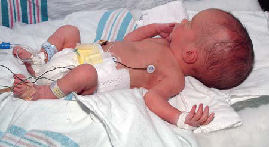
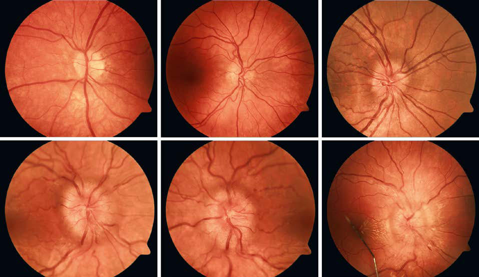

# Chapter 630: Neurologic Evaluation
> **Course:** Vikkypaedia Pediatric Basic Course (*Nelson Textbook of Pediatrics, 22nd Edition (2025)*)  
> **Part XXV:** The Nervous System  
> **Authors:** Yolanda F. Holler-Managan  
> **Metrics:** 12,285 words · 3 tables/boxes · 2 figures · 0 genes · 8 flashcards · 5 MCQs  
> **Quick Navigation:** [🃏 Study 8 Flashcards](../flashcards/630_flashcards.md) · [📝 Take 5-Q MCQ Quiz](../mcqs/630_mcqs.md) · [📚 Part XXV Guide](../parts/Part_XXV.md) · [🧬 Syndrome & Genetics Atlas](../omim_gene_atlas.md) · [💊 Therapeutics Matrix](../therapies_matrix.md) · [🏠 Course Index](../../index.md)

## ⚡ High-Yield Nelson Pediatric Board Pearls
- A detailed history might suggest that vomiting is a result of increased intracranial pressure (ICP) rather than gastritis or that constipation and urinary incontinence are caused by a spinal cord tumor rather than behav ioral stool withholding.
- Inquiring about fetal movement might provide clues to an underlying diagnosis, because decreased or absent fetal activity can be associated with chromosomal anomalies and CNS or neuromuscular disorders.
- Double-checking the newborn screening results may provide a clue to abnormal neurologic manifestations in an infant.
- Rarely, anosmia is congenital, in which case it can occur as an isolated deficit or as part of Kallmann syndrome, a familial disorder characterized by hypo gonadotropic hypogonadism and congenital anosmia.
- This normal finding can cause confu sion and can lead to the improper diagnosis of optic atrophy.
- E, Stage 4: Marked papilledema characterized by elevation of the entire nerve head and total obscuration of a segment of a major blood vessel on the disc.
- Internuclear ophthalmoplegia, caused by a lesion in the medial longitudinal fasciculus of the brainstem which functionally serves the conjugate gaze by connecting CN VI on one side to CN III on the other, results in paralysis of the medial rectus function in the adducting eye and nystagmus in the abducting eye.

---
## Full Chapter Text, Tables & Figures
# Chapter 630: Neurologic Evaluation

*Yolanda F. Holler-Managan*

<!-- p.4517 -->
**HISTORY** A detailed history is the cornerstone of neurologic assessment. Although parents may be the primary informants, most children older than 3-4 years can contribute to their history and should be questioned. The history should begin with the chief complaint and its significance in the context of normal development (see Chapters 21-28). The lat ter step is critical because a 13-month-old who cannot walk may be normal, whereas a 4-year-old who cannot walk might have a serious neurologic condition.

Next, the history of the present illness should provide a chronologi cal outline of the patient’s symptoms, with attention paid to location, quality, intensity, duration, associated features, and alleviating or exac erbating factors. It is essential to perform a review of systems because abnormalities of the central nervous system (CNS) often manifest with vague, nonfocal symptoms that may be misattributed to other organ systems (e.g., vomiting, constipation, urinary incontinence). A detailed history might suggest that vomiting is a result of increased intracranial pressure (ICP) rather than gastritis or that constipation and urinary incontinence are caused by a spinal cord tumor rather than behav ioral stool withholding. In addition, a systemic illness may produce CNS manifestations, as do lupus erythematosus (seizures, psycho sis, demyelination), mitochondrial disorders (developmental delay, strokes, hypotonia), or celiac disease (headaches, seizures, peripheral neuropathy).

After obtaining the chief complaint and history of the present illness, the physician should obtain a complete birth history, particularly if a congenital or perinatal disorder is suspected. The birth history should begin with a review of the pregnancy, including specific questions about common complications, such as pregnancy-induced hyperten sion, preeclampsia, gestational diabetes, vaginal bleeding, infections, and falls. It is important to quantify any cigarette, alcohol, or drug (pre scription, herbal, illicit) use. Inquiring about fetal movement might provide clues to an underlying diagnosis, because decreased or absent fetal activity can be associated with chromosomal anomalies and CNS or neuromuscular disorders. Finally, any abnormal ultrasound or amniocentesis results should be noted.

The mother’s labor history should address the gestational age at birth and mode of delivery (spontaneous vaginal, vacuum- or forcepsassisted, cesarean section) and should comment on the presence or absence of fetal distress. If delivery was by cesarean section, it is essen tial to record the indication for surgery.

The birthweight, length, and head circumference provide useful information about the duration of a given problem, as well as insights into the uterine environment. Parents can usually provide a reliable his tory of their child’s postnatal course; however, if the patient was resus citated or had a complicated hospital stay, it is often helpful to obtain the hospital records. The physician should inquire about the infant’s general well-being, feeding and sleeping patterns, activity level, and the nature of the infant’s cry. If the infant had jaundice, it is important to determine both the degree of jaundice and how it was managed. Fea tures of neurologic dysfunction at full term include inability to breathe spontaneously; poor, uncoordinated suck; or the need for an inordinate amount of time to feed or a requirement for gavage feeding. Again,

it is important to consider the developmental context because all of these issues would be expected in premature infants, particularly those with a very low birthweight. Double-checking the newborn screening results may provide a clue to abnormal neurologic manifestations in an infant.

A major component of the neurologic history is the **developmental assessment** (see Chapters 21-28). Careful evaluation of a child’s social, cognitive, language, fine motor skills, and gross motor skills is required to distinguish normal development from either an isolated or a global (i.e., in two or more domains) developmental delay. A static abnor mality in development from birth suggests a congenital, intrauterine, or perinatal cause, but a loss of skills **(regression)** over time strongly suggests an underlying degenerative disease of the CNS, such as an inborn error of metabolism or genetic disorder. The ability of parents to recall the precise timing of their child’s developmental milestones is extremely variable. It is often helpful to request old photographs of the child or to review the baby book, where the milestones may have been dutifully recorded. In general, parents are aware when their child has a developmental problem, and the physician should show appropriate concern. Table 630.1 outlines the upper limits of normal for attaining specific developmental milestones. Chapter 28 includes a comprehen sive review of developmental screening tests and their interpretation.

Next, the family history must be reviewed. Most parents are coop erative in securing medical information about family members, par ticularly if it might have relevance for their child. The history should document the age and history of neurologic disease, including devel opmental delay, epilepsy, migraine, stroke, and inherited disorders, for all first- and second-degree relatives. It is important to inquire directly about miscarriages or fetal deaths and to document the sex of the relevant embryo or fetus, as well as the gestational age at the time of demise. When available, the results of postmortem examina tions should be obtained, because they can have a direct bearing on the patient’s condition. The parents should be questioned about their ethnic backgrounds because some genetic disorders occur more com monly within specific populations (e.g., Tay-Sachs disease in the Ash kenazi Jewish population). They should also be asked if there is any chance that they could be related to each other, because the incidence of metabolic and degenerative disorders of the CNS is increased signifi cantly in children of *consanguineous* marriages.

The social history should detail the child’s current living environment and the child’s relationship with other family members. It is important to inquire about recent stressors, such as divorce, remarriage, birth of a sibling, or death of a loved one, because they can affect the child’s behavior. If the child is in daycare or school, one should document the child’s academic and social performance, paying particular attention to any abrupt changes. Academic performance can be assessed by asking about the child’s latest report card, and peer relationships can be evalu ated by having the child name his or her best friends. Any child who is unable to name at least two or three playmates might have abnor mal social development. In some cases, discussions with the daycare worker or teacher provide useful ancillary data.

**NEUROLOGIC EXAMINATION** The neurologic examination begins during the interview. Indirect observation of the child’s appearance and movements can yield valu able information about the presence of an underlying disorder. For instance, it may be obvious that the child has dysmorphic facies, an unusual posture, or an abnormality of motor function manifested by a hemiparesis or gait disturbance. The child’s behavior while playing and interacting with his or her parents may also be telling. A normal child usually plays independently early in the visit but then engages in the interview process. A child with attention-deficit/hyperactivity disorder

*Yolanda F. Holler-Managan*

<!-- p.4518 -->
might display impulsive behavior in the examining room, and a child with neurologic impairment might exhibit complete lack of awareness of the environment. Finally, note should be made of any unusual odors about the patient, because some metabolic disorders produce charac teristic scents (e.g., the musty smell of phenylketonuria or the sweaty feet smell of isovaleric acidemia; see Chapter 104). If such an odor is present, it is important to determine whether it is persistent or tran sient, occurring only with illnesses.

The examination should be conducted in a nonthreatening, childfriendly setting. The child should be allowed to sit where the child is most comfortable, whether it be on a parent’s lap or on the floor of the examination room. The physician should approach the child slowly, reserving any invasive, painful, or discomforting tests for the end of the examination (e.g., measurement of head circumference, gag reflex). In the end, the more that the examination seems like a game, the more the child will cooperate. Because the neurologic examination of an infant requires a somewhat modified approach from that of an older child, these two groups are considered separately (see Chapters 21-23 and 115 vs Chapters 24-27).

**Mental State** Age aside, the neurologic examination should include an assessment of the patient’s mental state in terms of both the level of arousal and the interaction with the environment. Premature infants born at <28 weeks of gestation do not have consistent periods of alertness, whereas slightly older infants arouse from sleep with gentle physical stimula tion. Sleep–wake patterns are well developed at term. Because the level of alertness of a neonate depends on many factors, including the time of the last feeding, room temperature, and gestational age, serial exami nations are critical when evaluating for changes in neurologic function. An older child’s mental state can be assessed by watching the child play. Having the child tell a story, draw a picture, or complete a puzzle can also be helpful in assessing cognitive function. Memory can be evalu ated informally as patients recount their personal information, as well as more formally by asking them to register and recall three objects or perform a digit span.

**Head** Correct measurement of the **head circumference** is important. It should be performed at every visit for patients younger than 3 years and should be recorded on a suitable head growth chart. To measure, a nondistensible plastic measuring tape is placed over the mid-forehead and extended circumferentially to include the most prominent por tion of the occiput. If the patient’s head circumference is abnormal, it is important to document the head circumferences of the parents and siblings. Errors in the measurement of a newborn skull are common because of scalp edema, overriding sutures, and the presence of cepha lohematomas. The average rate of head growth in a healthy premature infant is 0.5 cm in the first 2 weeks, 0.75 cm in the third week, and 1.0 cm in the fourth week and every week thereafter until the fortieth week of development. The head circumference of an average term infant measures 34-35 cm at birth, 44 cm at 6 months, and 47 cm at 1 year of age (see Chapters 21 and 22).

If the brain is not growing, the skull will not grow; therefore a small head frequently reflects a small brain, or **microcephaly**. Microcephaly

may develop in utero or postnatally and may, for example, be related to intrauterine infection or drug exposure or to perinatal or postnatal injury. Conversely, a large head may be associated with a large brain, or **macrocephaly**, which is most commonly familial but may be from a disturbance of growth (Sotos syndrome), neurocutaneous disorder (e.g., neurofibromatosis), chromosomal defect (e.g., Klinefelter syn drome), or lysosomal storage disorder. Alternatively, the head size may be increased secondary to hydrocephalus (Fig. 630.1) or chronic sub dural hemorrhages. In the latter case, the skull tends to assume a square or boxlike shape, because the long-standing presence of fluid in the subdural space causes enlargement of the middle fossa.

The shape of the head should be documented carefully. Plagioceph aly, or flattening of the skull, can be seen in normal infants but may be particularly prominent in hypotonic or weak infants, who are less mobile. A variety of abnormal head shapes can be seen when cranial sutures fuse prematurely, as in the various forms of inherited **cranio synostosis** (see Chapter 631.10).

An infant has two **fontanels** at birth: a diamond-shaped anterior fontanel at the junction of the frontal and parietal bones that is open at birth, and a triangular posterior fontanel at the junction of the parietal and occipital bones that can admit the tip of a finger or may be closed at birth. If the posterior fontanel is open at birth, it should close over the ensuing 6-8 weeks; its persistence suggests underlying hydrocepha lus or congenital hypothyroidism. The anterior fontanel varies greatly in size, but it usually measures approximately 2 × 2 cm. The average time of closure is 18 months, but the fontanel can close normally as early as 9 months. A very small or absent anterior fontanel at birth might indicate craniosynostosis or microcephaly, whereas a very large fontanel can signify a variety of problems. The fontanel is normally slightly depressed and pulsatile and is best evaluated by holding the infant upright while the infant is asleep or feeding. A bulging fontanel is a potential indicator of increased ICP, but vigorous crying can cause a protuberant fontanel in a normal infant.

Inspection of the head should include observation of the venous pattern, because increased ICP and thrombosis of the superior sagittal sinus can produce marked venous distention. Dysmorphic facial fea tures can indicate a neurodevelopmental aberration. Likewise, cutane ous abnormalities, such as cutis aplasia or abnormal hair whorls, can suggest an underlying brain malformation or genetic disorder.

**Fig. 630.1** Congenital hydrocephalus. Note the enlarged cranium and prominent scalp veins.

#### **Table 630.1** Screening Scheme for Developmental Delay: Upper Range

| Category / Parameter | Clinical Details & Findings |
| --- | --- |
| **LANGUAGE** | 3; Supports weight on forearms; Opens hands spontaneously; Smiles appropriately; Coos, laughs; 6; Sits momentarily; Transfers objects; Shows likes and dislikes; Babbles; 9; Pulls to stand; Pincer grasp; Plays pat-a-cake, peek-a-boo; Imitates sounds; 12; Walks with one hand held; Releases an object on command; Comes when called; One to two meaningful words; 18; Walks upstairs with assistance; Feeds self from a spoon; Mimics actions of others; At least six words; 24; Runs; Builds a tower of six blocks; Plays with others; Two- to three-word sentences |

<!-- p.4519 -->
Palpation of a newborn’s skull characteristically reveals **molding** of the skull accompanied by **overriding sutures**—a result of the pres sures exerted on the skull during its descent through the pelvis. Marked overriding of the sutures beyond the early neonatal period is cause for alarm, because it suggests an underlying brain abnormality. Palpation additionally might reveal bony bridges between sutures **(craniosynos tosis)**, cranial defects, or, in premature infants, softening of the parietal bones **(craniotabes)**.

Auscultation of the skull is an important adjunct to the neurologic examination. **Cranial bruits** may be noted over the anterior fontanel, temporal region, or orbits and are best heard using the diaphragm of the stethoscope. Soft symmetric bruits may be discovered in normal children younger than 4 years of age or in association with a febrile illness. Demonstration of a loud or localized bruit is usually signifi cant and warrants further investigation because it may be associated with severe anemia, increased ICP, or arteriovenous malformations of the middle cerebral artery or vein of Galen. It is important to exclude murmurs arising from the heart or great vessels, because they may be transmitted to the cranium.

**Cranial Nerves Olfactory Nerve (Cranial Nerve I) Anosmia**, or loss of smell, most commonly occurs as a transient abnormality in association with an upper respiratory tract infection or allergies. Permanent causes of anosmia include head trauma with damage to the ethmoid bone or shearing of the olfactory nerve fibers as they cross the cribriform plate, tumors of the frontal lobe, intranasal drug use, and exposure to toxins (acrylates, methacrylates, cadmium). Occasionally, a child who recovers from purulent meningitis or devel ops hydrocephalus has a diminished sense of smell. Rarely, anosmia is congenital, in which case it can occur as an isolated deficit or as part of **Kallmann syndrome**, a familial disorder characterized by hypo gonadotropic hypogonadism and congenital anosmia. Although not

a routine component of the examination, smell can be tested reliably as early as the 32nd week of gestation by presenting a stimulus and observing for an alerting response or withdrawal, or both. Care should be taken to use appropriate stimuli, such as coffee or peppermint, as opposed to strongly aromatic substances (e.g., ammonia inhalants) that stimulate the trigeminal nerve. Each nostril should be tested indi vidually by pinching shut the opposite side.

**Optic Nerve (Cranial Nerve II; see also Part XXVII)** Assessment of the optic disc and retina (see Chapters 659, 670, and 671) is a critical component of the neurologic examination. Although the ret ina is best visualized by dilating the pupil, most physicians do not have ready access to mydriatic agents at the bedside; therefore it may be nec essary to consult an ophthalmologist in some cases. Mydriatics should not be administered to patients whose pupillary responses are being followed as a marker for impending cerebral herniation or to patients with glaucoma or cataracts. When mydriatics are used, both eyes should be dilated, because unilateral papillary fixation and dilation can cause confusion and worry in later examiners unaware of the pharmacologic intervention. Examination of an infant’s retina may be facilitated by pro viding a nipple or soother and by turning the head to one side. The phy sician gently strokes the patient to maintain arousal while examining the closer eye. An older child should be placed in the parent’s lap and should be distracted by bright objects or toys. The color of the optic nerve is salmon-pink in a child but may be gray-white in a newborn, particularly if the newborn has fair coloring. This normal finding can cause confu sion and can lead to the improper diagnosis of optic atrophy.

**Disc edema** refers to swelling of the optic disc, and **papilledema** specifically refers to swelling that is secondary to increased ICP. Papill edema rarely occurs in infancy because the skull sutures can separate to accommodate the expanding brain. In older children, papilledema may be graded according to the Frisen scale (Fig. 630.2). Disc edema must be differentiated from **papillitis**, or inflammation of the optic nerve.

B C A

E F D

**Fig. 630.2** Stages of papilledema (Frisen scale). A, Stage 0: Normal optic disc. B, Stage 1: Very early papilledema with obscuration of the nasal border of the disc only, without elevation of the disc borders. C, Stage 2: Early papilledema showing obscuration of all borders, elevation of the nasal border, and a complete peripapillary halo. D, Stage 3: Moderate papilledema with elevation of all borders, increased diameter of the optic nerve head, obscuration of vessels at the disc margin, and a peripapillary halo with finger-like extensions. E, Stage 4: Marked papilledema characterized by elevation of the entire nerve head and total obscuration of a segment of a major blood vessel on the disc. F, Stage 5: Severe papilledema with obscuration of all vessels and obliteration of the optic cup. Note also the nerve fiber layer hemorrhages and macular exudate. (A-C courtesy Dr. Deborah Friedman; D-F courtesy Flaum Eye Institute, University of Rochester.)

<!-- p.4520 -->
Both conditions manifest with enlargement of the blind spot, but visual acuity and color vision tend to be spared in early papilledema in con trast to what occurs in optic neuritis.

Retinal hemorrhages occur in 30–40% of all full-term newborn infants. The hemorrhages are more common after vaginal delivery than after cesarean section and are not associated with birth injury or with neurologic complications. They disappear spontaneously by 1-2 weeks of age. The presence of retinal hemorrhages beyond the early neonatal period should raise a concern for nonaccidental trauma.

**Vision** A full description of the age-appropriate evaluation of vision can be found in Chapter 659. Evaluation of vision in the premature infant pres ents unique challenges. At 28 weeks of corrected gestational age, a pre mature infant blinks in response to a bright light, and at 32 weeks, the infant maintains eye closure until the light source is removed. The pupil reacts to light by 29-32 weeks of corrected gestational age; however, the pupillary response is often difficult to evaluate, because premature infants resist eye opening and have poorly pigmented irises. A normal 37-week infant turns the head and eyes toward a soft light, and a term infant is able to fix on and follow a target, such as the examiner’s face.

**Oculomotor (Cranial Nerve III), Trochlear (Cranial Nerve IV), and Abducens (Cranial Nerve VI) Nerves** The globe is moved by six extraocular muscles, which are innervated by the oculomotor, trochlear, and abducens nerves. These muscles and nerves can be assessed by having the patient follow an interesting toy or the examiner’s finger in the six cardinal directions of gaze. The physi cian observes the range and nature (conjugate vs dysconjugate, smooth vs choppy or saccadic) of the eye movements, particularly noting the presence and direction of any abnormal eye movements. Premature infants older than 25 weeks of gestational age and comatose patients can be evaluated using the oculocephalic (doll’s eye) maneuver, in which the patient’s head is quickly rotated to evoke reflex eye move ments. If the brainstem is intact, rotating the patient’s head to the right causes the eyes to move to the left and vice versa. Similarly, rapid flex ion and extension of the head elicits vertical eye movement.

Dysconjugate gaze can result from extraocular muscle weakness; cranial nerve (CN) III, IV, or VI palsies; or brainstem lesions that dis rupt the medial longitudinal fasciculus. Infants who are younger than 2 months can have a slightly dysconjugate gaze at rest, with one eye hori zontally displaced from the other by 1 or 2 mm **(strabismus)**. Vertical displacement of the eyes requires investigation because it can indicate trochlear nerve (CN IV) palsy or **skew deviation** (supranuclear ocu lar malalignment that is often associated with lesions of the posterior fossa). Strabismus is discussed further in Chapter 663.

The oculomotor nerve innervates the superior, inferior, and medial recti, as well as the inferior oblique and levator palpebrae superioris muscles. Complete paralysis of the oculomotor nerve causes ptosis, dilation of the pupil, displacement of the eye outward and downward, and impairment of adduction and elevation. The trochlear nerve sup plies the superior oblique muscle, which depresses and internally rotates the globe during activities such as reading and walking down stairs. Patients with an isolated paralysis of the trochlear nerve often have a compensatory head tilt away from the affected side, which helps to alleviate their diplopia. The abducens nerve innervates the lateral rectus muscle; its paralysis causes medial deviation of the eye with an inability to abduct beyond the midline. Patients with increased ICP often respond positively when questioned about double vision **(dip lopia)** and exhibit incomplete abduction of the eyes on lateral gaze as a result of partial palsies of nerve VI. This false-localizing sign occurs because CN VI has a long intracranial course, making it particularly susceptible to being stretched. **Internuclear ophthalmoplegia**, caused by a lesion in the medial longitudinal fasciculus of the brainstem which functionally serves the conjugate gaze by connecting CN VI on one side to CN III on the other, results in paralysis of the medial rectus function in the adducting eye and nystagmus in the abducting eye.

When there is a subtle eye movement abnormality, the **red glass test** may be helpful in localizing the lesion. To perform this test, a red glass

is placed over one of the patient’s eyes and the patient is instructed to follow a white light in all directions of gaze. The child sees one red/ white light in the direction of normal muscle function but notes a sepa ration of the red and white images that is greatest in the plane of action of the affected muscle.

In addition to gaze palsies, the examiner might encounter a variety of adventitious movements. **Nystagmus** is an involuntary, rapid move ment of the eye that may be subclassified as being **pendular**, in which the two phases have equal amplitude and velocity, or **jerk**, in which there is a fast and a slow phase. Jerk nystagmus can be further charac terized by the direction of its fast phase, which may be left-, right-, up-, or downbeating; rotatory; or mixed. Many patients have a few beats of nystagmus with extreme lateral gaze **(end-gaze nystagmus)**, which is of no consequence. Pathologic horizontal nystagmus is most often congenital, drug-induced (e.g., alcohol, anticonvulsants), or a result of vestibular system dysfunction. By contrast, vertical nystagmus is often associated with structural abnormalities of the brainstem and cerebel lum. **Ocular bobbing** is characterized by a downward jerk followed by a slow drift back to primary position and is associated with pontine lesions. **Opsoclonus** describes involuntary, chaotic, conjugate oscilla tions of the eyes, which are often seen in the setting of neuroblastoma or viral infection.

**Trigeminal Nerve (Cranial Nerve V)** The three divisions of the trigeminal nerve—ophthalmic, maxillary, and mandibular—convey information about facial protopathic (pain, temperature) and epicritic (vibration, proprioception) sensation. Each modality should be tested and compared with the contralateral side. In patients who are uncooperative or comatose, the integrity of the trigeminal nerve can be assessed by the corneal reflex, elicited by touching the cornea with a small pledget of cotton and observing for symmetric eye closure, and nasal tickle, obtained by stimulating the nasal passage with a cotton swab and observing for symmetric grimace. An absent reflex may be because of a sensory defect (trigeminal nerve) or a motor deficit (facial nerve). The motor division of the trigeminal nerve can be tested by examining the masseter, pterygoid, and tem poralis muscles during mastication and by evaluation of the jaw jerk.

**Facial Nerve (Cranial Nerve VII)** The facial nerve is a predominantly motor nerve that innervates the muscles of facial expression—the buccinator, platysma, stapedius, and stylohyoid muscles—and the posterior belly of the digastric muscle. It also has a separate division, called the *chorda tympani,* that contains sensory, special sensory (taste), and parasympathetic fibers. Because the portion of the facial nucleus that innervates the upper face receives bilateral cortical input, lesions of the motor cortex or corticobulbar tract have little effect on upper face strength. Rather, such lesions mani fest with flattening of the contralateral nasolabial fold or drooping of the corner of the mouth. Conversely, lower motor neuron or facial nerve lesions tend to involve upper and lower facial muscles equally. Facial strength can be evaluated by observing the patient’s spontaneous movements and by asking the patient to mimic a series of facial move ments (e.g., smiling, raising the eyebrows, inflating the cheeks). A facial nerve palsy may be congenital; idiopathic **(Bell palsy)**; or secondary to trauma, demyelination (Guillain-Barré syndrome), infection (Lyme disease, herpes simplex virus, HIV), granulomatous disease, neoplasm, or meningeal inflammation or infiltration. Facial nerve lesions that are proximal to the junction with the chorda tympani will result in an inability to taste substances with the anterior two thirds of the tongue. If necessary, taste can be tested by placing a solution of saline or glu cose on one side of the extended tongue. Normal children can identify the test substance in <10 seconds. Other findings that may be associ ated with facial nerve palsy include hyperacusis, resulting from stape dius muscle involvement, and impaired tearing.

**Vestibulocochlear Nerve (Cranial Nerve VIII)** The vestibulocochlear nerve has two components within a single trunk: the vestibular nerve, which innervates the semicircular canals of the inner ear and is involved with equilibrium, coordination, and

<!-- p.4521 -->
orientation in space, and the cochlear nerve, which innervates the cochlea and carries auditory sensory information.

Dysfunction of the vestibular system results in **vertigo**, the sensa tion of environmental motion. On examination, patients with ves tibular nerve dysfunction typically have nystagmus, in which the fast component is directed away from the affected nerve. With their arms outstretched and eyes closed, their limbs tend to drift toward the injured side. Likewise, if they march in place, they slowly pivot toward the lesion **(Fukuda stepping test)**. On Romberg and tandem gait test ing, they tend to fall toward the abnormal ear. Vestibular function can be further evaluated with **caloric testing**. Before testing, the tympanic membrane should be visualized to ensure that it is intact and unob structed. In an obtunded or comatose patient, 30-50 mL of ice water is then delivered by syringe into the external auditory canal with the patient’s head elevated 30 degrees. If the brainstem is intact, the eyes deviate toward the irrigated side. A much smaller quantity of ice water (2 mL) is used in awake, alert patients to avoid inducing nausea. In nor mal subjects, introduction of ice water produces eye deviation toward the stimulated labyrinth followed by nystagmus, with the fast compo nent away from the stimulated labyrinth.

Because hearing is integral to normal language development, the physician should inquire directly about hearing problems. The parents’ concern is often a reliable indicator of hearing impairment and war rants a formal audiologic assessment with either audiometry or brain stem auditory evoked potential testing (see Chapter 677). Even in the absence of parents’ concern, formal testing is recommended in all new borns with the goal for all infants to be tested within the first month of life. Children at risk for hearing problems include those with a fam ily history of early-life or syndromic deafness or a personal history of prematurity, severe asphyxia, exposure to ototoxic drugs, hyperbiliru binemia, congenital anomalies of the head or neck, bacterial meningi tis, and congenital TORCH (toxoplasmosis, other infections, rubella, cytomegalovirus, herpes simplex virus) infections. For all other infants and children, a simple bedside assessment of hearing is usually suf ficient. Newborns might have subtle responses to auditory stimuli, such as changes in breathing, cessation of movement, or opening of the eyes and/or mouth. If the same stimulus is presented repeatedly, nor mal neonates cease to respond, a phenomenon known as *habituation.* By 3-4 months of age, infants begin to orient to the source of sound. Hearing-impaired toddlers are visually alert and appropriately respon sive to physical stimuli but might have more frequent temper tantrums and abnormal speech and language development.

**Glossopharyngeal Nerve (Cranial Nerve IX)** The glossopharyngeal nerve conveys motor fibers to the stylopharyn geus muscle; general sensory fibers from the posterior third of the tongue, pharynx, tonsil, internal surface of the tympanic membrane, and skin of the external ear; special sensory (taste) fibers from the pos terior third of the tongue; parasympathetic fibers to the parotid gland; and general visceral sensory fibers from the carotid bodies. The nerve is tested by stimulating one side of the lateral oropharynx or soft palate with a tongue blade and observing for symmetric elevation of the pal ate **(gag reflex)**. An isolated lesion of CN IX is rare because it runs in close proximity to CN X. Potential causes of injury and/or dysfunction include birth trauma, ischemia, mass lesions, motor neuron disease, retropharyngeal abscess, and Guillain-Barré syndrome.

**Vagus Nerve (Cranial Nerve X)** The vagus nerve has 10 terminal branches: meningeal, auricular, pha ryngeal, carotid body, superior laryngeal, recurrent laryngeal, cardiac, pulmonary, esophageal, and gastrointestinal. The pharyngeal, superior laryngeal, and recurrent laryngeal branches contain motor fibers that innervate all of the muscles of the pharynx and larynx, with the excep tion of the stylopharyngeus (CN IX) and tensor veli palatini (CN V) muscles. Thus unilateral injury of the vagus nerve results in weakness of the ipsilateral soft palate and a hoarse voice; bilateral lesions can produce respiratory distress as a result of vocal cord paralysis, as well as nasal regurgitation of fluids, pooling of secretions, and an immo bile, low-lying soft palate. Isolated lesions to the vagus nerve may be a

complication of thoracotomies or may be seen in neonates with type II Chiari malformations. If such a lesion is suspected, it is important to visualize the vocal cords. In addition to motor information, the vagus nerve carries somatic afferents from the pharynx, larynx, ear canal, external surface of the tympanic membrane, and meninges of the pos terior fossa; visceral afferents; taste fibers from the posterior pharynx; and preganglionic parasympathetics.

**Accessory Nerve (Cranial Nerve XI)** The accessory nerve innervates the sternocleidomastoid (SCM) and trapezius muscles. The left SCM acts to turn the head to the right side and vice versa; acting together, the SCMs flex the neck. The trapezius acts to elevate the shoulder. Lesions to the accessory nerve result in atrophy and paralysis of the ipsilateral SCM and trapezius muscles, with resultant depression of the shoulder. Because several cervical muscles are involved in head rotation, unilateral SCM paresis might not be evident unless the patient is asked to rotate the head against resistance. Skull base fractures or lesions, motor neuron disease, myo tonic dystrophy, and myasthenia gravis commonly produce atrophy and weakness of these muscles; congenital torticollis is associated with SCM hypertrophy.

**Hypoglossal Nerve (Cranial Nerve XII)** The hypoglossal nerve innervates the tongue. Examination of the tongue includes assessment of its bulk and strength, as well as obser vation for adventitious movements. Malfunction of the hypoglossal nucleus or nerve produces atrophy, weakness, and fasciculations of the tongue. If the injury is unilateral, the tongue deviates toward the side of the injury; if it is bilateral, tongue protrusion is not possible, and the patient can have difficulty swallowing **(dysphagia)**. Werdnig-Hoffmann disease (infantile spinal muscular atrophy, or spinal muscular atrophy type 1) and congenital anomalies in the region of the foramen magnum are the principal causes of hypoglossal nerve dysfunction.

**Motor Examination** The motor examination includes assessment of muscle bulk, tone, and strength, as well as observation for involuntary movements that might indicate central or peripheral nervous system pathology.

**Bulk** Decreased muscle bulk **(atrophy)** may be secondary to disuse or to diseases of the lower motor neuron, nerve root, peripheral nerve, or muscle. In most cases, neurogenic atrophy is more severe than myo genic atrophy. Increased muscle bulk **(hypertrophy)** is usually physi ologic (e.g., body builders). **Pseudohypertrophy** refers to muscle tissue that has been replaced by fat and connective tissue, giving it a bulky appearance with a paradoxical reduction in strength, as in Duchenne muscular dystrophy.

**Tone** Muscle tone, which is generated by an unconscious, continuous, par tial contraction of muscle, creates resistance to passive movement of a joint. Tone varies greatly based on a patient’s age and state. At 28 weeks of gestation, all four extremities are extended and there is little resis tance to passive movement. Flexor tone is visible in the lower extremi ties at 32 weeks and is palpable in the upper extremities at 36 weeks. A normal term infant’s posture is characterized by flexion of all four extremities.

There are three key tests for assessing postural tone in neonates: the traction response, vertical suspension, and horizontal suspension (Fig. 630.3; see Chapters 115 and 122). To evaluate the **traction response**, the physician grasps the infant’s hands and gently pulls the infant to a sitting position. Normally, the infant’s head lags slightly behind the infant’s body and then falls forward upon reaching the sitting position. To test **vertical suspension**, the physician holds the infant by the axil lae without gripping the thorax. The infant should remain suspended with the infant’s lower extremities held in flexion; a hypotonic infant will slip through the physician’s hands. With **horizontal suspension**, the physician holds the infant prone by placing a hand under the

<!-- p.4522 -->
infant’s abdomen. The head should rise and the limbs should flex, but a hypotonic infant will drape over the physician’s hand, forming a U shape. Assessing tone in the extremities is accomplished by observ ing the infant’s resting position and passively manipulating the infant’s limbs. When the upper extremity of a normal term infant is pulled gen tly across the chest, the elbow does not quite reach the mid-sternum **(scarf sign)**, whereas the elbow of a hypotonic infant extends beyond the midline with ease. Measurement of the **popliteal angle** is a useful method for documenting tone in the lower extremities. The examiner flexes the hip and extends the knee. Normal term infants allow exten sion of the knee to approximately 80 degrees. Similarly, tone can be evaluated by flexing the hip and knee to 90 degrees and then internally rotating the leg, in which case the heel should not pass the umbilicus.

Abnormalities of tone include spasticity, rigidity, and hypotonia. **Spasticity** is characterized by an initial resistance to passive movement, followed by a sudden release, referred to as the **clasp-knife** phenom enon. Because spasticity results from upper motor neuron dysfunction, it disproportionately affects the upper-extremity flexors and lowerextremity extensors and tends to occur in conjunction with disuse atrophy, hyperactive deep tendon reflexes, and extensor plantar reflexes **(Babinski sign)**. In infants, spasticity of the lower extremities results in scissoring of the legs upon vertical suspension. Older children can present with prolonged commando crawling or toe-walking. **Rigidity**, seen with lesions of the basal ganglia, is characterized by resistance to passive movement that is equal in the flexors and extensors regardless of the velocity of movement **(lead pipe)**. Patients with either spasticity or rigidity might exhibit **opisthotonos**, defined as severe hyperexten sion of the spine caused by hypertonia of the paraspinal muscles (Fig. 630.4), although similar posturing can be seen in patients with Sandi fer syndrome (gastroesophageal reflux or hiatal hernia associated with torsional dystonia). **Hypotonia** refers to abnormally diminished tone and is the most common abnormality of tone in neurologically com promised neonates. A hypotonic infant is floppy and often assumes a frog-leg posture at rest. Hypotonia can reflect pathology of the cerebral hemispheres, cerebellum, spinal cord, anterior horn cell, peripheral nerve, neuromuscular junction, or muscle.

**Strength** Older children are usually able to cooperate with formal strength test ing, in which case muscle power is graded on a scale of 0-5 as follows: 0 = no contraction; 1 = flicker or trace of contraction; 2 = active move ment with gravity eliminated; 3 = active movement against gravity; 4 = active movement against gravity and resistance; and 5 = normal power. An examination of muscle power should include all muscle groups, including the neck flexors and extensors and the muscles of respiration. It is important not only to assess individual muscle groups but also to determine the pattern of weakness (i.e., proximal vs distal; segmental vs regional). Testing for **pronator drift** can be helpful in localizing the lesion in a patient with weakness. This test is accomplished by having the patient extend his or her arms away from the body with the palms facing upward and the eyes closed. *Together, pronation and downward drift of an arm indicate a lesion of the contralateral corticospinal tract.*

Because infants and young children are not able to participate in for mal strength testing, they are best assessed with functional measures. Proximal and distal strength of the upper extremities can be tested by

having the child reach overhead for a toy and by watching the child manipulate small objects. In infants younger than 2 months, the physi cian can also take advantage of the palmar grasp reflex in assessing distal power and the Moro reflex in assessing proximal power. Infants with decreased strength in the lower extremities tend to have dimin ished spontaneous activity in their legs and are unable to support their body weight when held upright. Older children may have difficulty climbing or descending steps, jumping, or hopping. They might also use their hands to climb up their legs when asked to rise from a prone position, a maneuver called **Gowers sign** (Fig. 630.5).

**Involuntary Movements** Patients with lower motor neuron or peripheral nervous system lesions might have **fasciculations**, which are small, involuntary muscle con tractions that result from the spontaneous discharge of a single motor unit and create the illusion of a bag of worms under the skin. Because most infants have abundant body fat, muscle fasciculations are best observed in the tongue in this age-group.

Most other involuntary movements, including tics, dystonia, chorea, and athetosis, stem from disorders of the basal ganglia. Tremor seems to be an exception, as it is thought to be mediated by cerebellothalamo cortical pathways. Further detail on the individual movement disor ders is provided in Chapter 637.

**Sensory Examination** The sensory examination is difficult to perform on an infant or unco operative child and has a relatively low yield in terms of the informa tion that it provides. A gross assessment of sensory function can be achieved by distracting the patient with an interesting toy and then touching the patient with a cotton swab in different locations. Normal infants and children indicate an awareness of the stimulus by crying, withdrawing the extremity, or pausing briefly; however, with repeated testing, they lose interest in the stimulus and begin to ignore the exam iner. It is therefore critical that any areas of concern are tested efficiently and, if necessary, reexamined at an appropriate time.

Fortunately, isolated disorders of the sensory system are less common in the very young pediatric population than in the adult population, so

A B C D

**Fig. 630.3** Normal tone in a full-term neonate. A, Flexed resting posture. B, Traction response. C, Vertical suspension. D, Horizontal suspension.

**Fig. 630.4** Opisthotonos in a brain-injured infant.

<!-- p.4523 -->
detailed sensory testing is rarely warranted. Furthermore, most patients who are old enough to voice a sensory complaint are also old enough to cooperate with formal testing of light touch, pain, temperature, vibra tion, proprioception, and cortical sensation (e.g., stereognosis, twopoint discrimination, extinction to double simultaneous stimulation). A notable exception is when the physician suspects a spinal cord lesion in an infant or young child and needs to identify a sensory level. In such situations, observation might suggest a difference in color, tem perature, or perspiration, with the skin cool and dry below the level of injury. Lightly touching the skin above the level can evoke a squirming movement or physical withdrawal. Other signs of spinal cord injury include decreased anal sphincter tone and strength and absence of the superficial abdominal, anal wink, and cremasteric reflexes.

**Reflexes Deep Tendon Reflexes and the Plantar Response** Deep tendon reflexes are readily elicited in most infants and children. In infants, it is important to position the head in the midline when assessing reflexes, because turning the head to one side can alter reflex tone. Reflexes are graded from 0 (absent) to 4+ (markedly hyperac tive), with 2+ being normal. Reflexes that are 1+ or 3+ can be normal as long as they are symmetric. Sustained clonus is always pathologic, but infants younger than 3 months old can have 5-10 beats of clonus, and older children can have 1-2 beats of clonus, provided that it is symmetric.

The ankle jerk is hardest to elicit, but it can usually be obtained by passively dorsiflexing the foot and then tapping on either the Achilles tendon or the ball of the foot. The knee jerk is evoked by tapping the patellar tendon. If this reflex is exaggerated, extension of the knee may be accompanied by contraction of the contralateral adductors **(crossed**

**adductor response)**. Hypoactive reflexes generally reflect lower motor neuron or cerebellar dysfunction, whereas hyperactive reflexes are consistent with upper motor neuron disease, although acute upper motor neuron injury can result in hypoactive or absent deep tendon reflexes. The plantar response is obtained by stimulation of the lateral aspect of the sole of the foot, beginning at the heel and extending to the base of the toes. The **Babinski sign**, indicating an upper motor neuron lesion, is characterized by extension of the great toe and fanning of the remaining toes. Too vigorous stimulation may produce withdrawal, which may be misinterpreted as a Babinski sign. Plantar responses have limited diagnostic utility in neonates because they are mediated by sev eral competing reflexes and can be either flexor or extensor, depending on how the foot is positioned. Asymmetry of the reflexes or plantar response is a useful lateralizing sign in infants and children.

**Primitive Reflexes** Primitive reflexes appear and disappear at specific times during devel opment (Table 630.2), and their absence or persistence beyond those times signifies CNS dysfunction. Although many primitive reflexes have been described, the Moro, grasp, tonic neck, and parachute reflexes are the most clinically relevant. The **Moro reflex** is elicited by supporting the infant in a semierect position and then allowing the infant’s head to fall backward onto the examiner’s hand. A normal response consists of symmetric extension and abduction of the fingers and upper extremi ties, followed by flexion of the upper extremities and an audible cry. An asymmetric response can signify a fractured clavicle, brachial plexus injury, or hemiparesis. Absence of the Moro reflex in a term newborn is ominous, suggesting significant dysfunction of the CNS. The **grasp response** is elicited by placing a finger in the open palm of each hand; by 37 weeks of gestation, the reflex is strong enough that the examiner

A B C D

**Fig. 630.5** A-D, Gowers sign in a child with hip girdle weakness because of Duchenne muscular dystrophy. When asked to rise from a prone posi tion, the patient uses his hands to walk up his legs to compensate for proximal lower extremity weakness.

#### **Table 630.2** Timing of Selected Primitive Reflexes

| Category / Parameter | Clinical Details & Findings |
| --- | --- |
| **DURATION** | Palmar grasp; 28 wk gestation; 32 wk gestation; 2-3 mo postnatal; Rooting; 32 wk gestation; 36 wk gestation; 4-6 mo postnatal; Moro; 28-32 wk gestation; 37 wk gestation; 5-6 mo postnatal; Tonic neck; 35 wk gestation; 1 mo postnatal; 6-7 mo postnatal; Parachute; 7-8 mo postnatal; 10-11 mo postnatal; Remains throughout life |

<!-- p.4524 -->
can lift the infant from the bed with gentle traction. The **tonic neck reflex** is produced by manually rotating the infant’s head to one side and observing for the characteristic fencing posture (extension of the arm on the side to which the face is rotated and flexion of the contra lateral arm). An obligatory tonic neck response, in which the infant becomes stuck in the fencing posture, is always abnormal and implies a CNS disorder. The **parachute reflex**, which occurs in slightly older infants, can be evoked by holding the infant’s trunk and then suddenly lowering the infant as if he or she were falling. The arms will spontane ously extend to break the infant’s fall, making this reflex a prerequisite to walking (Fig. 630.6).

**Coordination Ataxia** refers to a disturbance in the smooth performance of voluntary motor acts and is usually the result of cerebellar dysfunction. Lesions to the cerebellar vermis result in unsteadiness while sitting or stand ing **(truncal ataxia)**. Affected patients might have a wide-based gait or may be unable to perform tandem gait testing. Lesions of the cerebel lar hemispheres cause appendicular ataxia, which may be apparent as the patient reaches for objects and performs finger-to-nose and heelto-shin movements. Other features of cerebellar dysfunction include errors in judging distance **(dysmetria)**, inability to inhibit a muscular action **(rebound)**, impaired performance of rapid alternating move ments **(dysdiadochokinesia)**, intention tremor, nystagmus, scanning dysarthria, hypotonia, and decreased deep tendon reflexes. Acute ataxia suggests an infectious or postinfectious, endocrinologic, toxic, traumatic, vascular, or psychogenic process, and chronic symptoms suggest a metabolic, neoplastic, or degenerative process.

**Station and Gait** Observation of a child’s station and gait is an important aspect of the neurologic examination. Normal children can stand with their feet close together without swaying; however, children who are unsteady may sway or even fall. On gait testing, the heels should strike either side of an imaginary line, but children with poor balance tend to walk with their legs farther apart to create a more stable base. Tandem gait testing forces patients to have a narrow base, which highlights subtle balance difficulties.

There are a variety of abnormal gaits, many of which are associated with a specific underlying etiology. Patients with a **spastic gait** appear stiff-legged like a soldier. They may walk on tiptoe as a result of tight ness or contractures of the Achilles tendons, and their legs may scissor as they walk. A **hemiparetic gait** is associated with spasticity and cir cumduction of the leg, as well as decreased arm swing on the affected side. **Cerebellar ataxia** results in a wide-based, reeling gait like that of a drunk person, whereas **sensory ataxia** results in a wide-based **step page gait**, in which the patient lifts the legs up higher than usual in the

swing phase and then slaps the foot down. A **myopathic**, or waddling, **gait** is associated with hip girdle weakness. Affected children often develop a compensatory lordosis and have other signs of proximal muscle weakness, such as difficulty climbing stairs. During gait test ing, the examiner might also note hypotonia or weakness of the lower extremities; extrapyramidal movements, such as dystonia or chorea; or orthopedic deformities, such as pelvic tilt, genu recurvatum, varus or valgus deformities of the knee, pes cavus (high arches) or pes planus (flat feet), and scoliosis.

**GENERAL EXAMINATION** Examination of other organ systems is essential because myriad sys temic diseases affect the nervous system. Dysmorphic features can indicate a genetic syndrome (see Chapter 95). Heart murmurs may be associated with rheumatic fever (Sydenham chorea), cardiac rhabdo myoma (tuberous sclerosis), cyanotic heart disease (cerebral abscess or thrombosis), and endocarditis (cerebral vascular occlusion). Hepato splenomegaly can suggest an inborn error of metabolism, storage dis ease, HIV infection, or malignancy. Cutaneous lesions may be a feature of a neurocutaneous syndrome (see Chapter 636).

**SPECIAL DIAGNOSTIC PROCEDURES Lumbar Puncture and Cerebrospinal Fluid Examination** Examination of the cerebrospinal fluid (CSF) and measurement of the pressure it creates in the subarachnoid space is essential in confirm ing the diagnosis of meningitis, encephalitis (autoimmune, infectious), and idiopathic intracranial hypertension (previously referred to as *pseudotumor cerebri*), and it is often helpful in assessing subarachnoid hemorrhage; demyelinating, degenerative, and collagen vascular dis eases; and intracranial neoplasms. Having an experienced assistant who can position, restrain, and comfort the patient is critical to the success of the procedure.

The patient should be situated in a lateral decubitus or seated posi tion with the neck and legs flexed to enlarge the intervertebral spaces. As a rule, sick neonates should be maintained in a seated position to prevent problems with ventilation and perfusion. Regardless of the position chosen, it is important to make sure that the patient’s shoul ders and hips are straight to prevent rotating the spine.

Once the patient is situated, the physician identifies the appropriate interspace by drawing an imaginary line from the iliac crest downward perpendicular to the vertebral column. In adults, lumbar punctures are usually performed in the L3-L4 or L4-L5 interspaces. Next, the phy sician dons a mask, gown, and sterile gloves. The skin is thoroughly prepared with a cleansing agent, and sterile drapes are applied. The skin and underlying tissues are anesthetized by injecting a local anes thetic (e.g., 1% lidocaine) at the time of the procedure or by apply ing a eutectic mixture of lidocaine and prilocaine (EMLA) to the skin 30 minutes before the procedure. A 22-gauge, 1.5- to 3.0-inch, sharp, beveled spinal needle with a properly fitting stylet is introduced in the midsagittal plane and directed slightly cephalad. The physician should pause frequently, remove the stylet, and assess for CSF flow. Although a pop can occur as the needle penetrates the dura, it is more common to experience a subtle change in resistance.

Once CSF has been detected, a manometer and three-way stopcock can be attached to the spinal needle to obtain an opening pressure. If the patient was seated as the spinal needle was introduced, the patient should be moved carefully to a **lateral decubitus position** with the head and legs extended before the manometer is attached. In children between 1 and 18 years of age, the reference range parameter for abnor mally elevated opening pressure, determined as the 90th percentile for all patients in the reference population, is 28 cm of water. The threshold for an abnormally reduced pressure in the 10th percentile is 11.5 cm of water. The most common cause of an elevated opening pressure is an agitated patient. Sedation and a high body mass index can also increase the opening pressure (see Chapter 645).

**Contraindications** to performing a lumbar puncture include sus pected mass lesion of the brain, especially in the posterior fossa or

**Fig. 630.6** Infant in the parachute reflex position. This primitive reflex develops later in infancy (around 6 mo), and its absence can signal de layed walking. It is elicited by holding the infant face down and rapidly lowering the infant, causing the infant to extend out the arms.

<!-- p.4525 -->
above the tentorium and causing shift of the midline; suspected mass lesion of the spinal cord; symptoms and signs of impending cerebral herniation in a child with probable meningitis; critical illness (on rare occasions); skin infection at the site of the lumbar puncture; and throm bocytopenia with a platelet count of <20 × 109/L. If optic disc edema or focal findings suggest a mass lesion, a rapid CT scan of the head should be obtained before proceeding with lumbar puncture to prevent uncal or cerebellar herniation as the CSF is removed. In the absence of these findings, routine head imaging is not warranted. The physician should also be alert to clinical signs of impending herniation, including altera tions in the respiratory pattern (e.g., hyperventilation, Cheyne-Stokes respirations, ataxic respirations, respiratory arrest), abnormalities of pupil size and reactivity, loss of brainstem reflexes, and decorticate or decerebrate posturing. If any of these signs are present or the child is so ill that the lumbar puncture might induce cardiorespiratory arrest, blood cultures should be drawn and supportive care, including anti biotics, should be initiated. Once the patient has stabilized, it may be possible to perform a lumbar puncture safely.

Normal CSF contains up to 5/mm3 white blood cells, and a new born can have as many as 15/mm3. Polymorphonuclear cells are always abnormal in a child, but 1-2/mm3 may be present in a normal neonate. An elevated polymorphonuclear count suggests bacterial meningitis or the early phase of aseptic meningitis (see Chapter 643). CSF lym phocytosis can be seen in aseptic, tuberculous, or fungal meningitis; demyelinating diseases; brain or spinal cord tumor; immunologic dis orders, including collagen vascular diseases; and chemical irritation (after myelogram, intrathecal methotrexate).

Normal CSF contains no red blood cells; thus their presence indi cates a traumatic tap or a subarachnoid hemorrhage. Progressive clearing of the blood between the first and last samples indicates a traumatic tap. Bloody CSF should be centrifuged immediately. A clear supernatant is consistent with a bloody tap, whereas **xantho chromia** (yellow color that results from the degradation of hemoglo bin) suggests a subarachnoid hemorrhage. Xanthochromia may be absent in bleeds <12 hours old, particularly when laboratories rely on visual inspection rather than spectroscopy. Xanthochromia can also occur in the setting of hyperbilirubinemia, carotenemia, and mark edly elevated CSF protein.

The normal CSF protein is 10-40 mg/dL in a child and as high as 120 mg/dL in a neonate. The CSF protein falls to the normal childhood range by 3 months of age. The CSF protein may be elevated in many processes, including infectious, immunologic, vascular, and degenera tive diseases; blockage of CSF flow; as well as tumors of the brain (pri mary CNS tumors, systemic tumors metastatic to the CNS, infiltrative acute lymphoblastic leukemia) and spinal cord. With a traumatic tap, the CSF protein is increased by approximately 1 mg/dL for every 1,000 red blood cells/mm3. Elevation of CSF immunoglobulin G, which nor mally represents approximately 10% of the total protein, is observed in subacute sclerosing panencephalitis, in postinfectious encephalomyeli tis, and in some cases of multiple sclerosis. If the diagnosis of multiple sclerosis is suspected, the CSF should be tested for the presence of oli goclonal bands.

The CSF glucose content is approximately 60% of the blood glu cose in a healthy child. To prevent a spuriously elevated blood:CSF glucose ratio in a case of suspected meningitis, it is advisable to col lect the blood glucose before the lumbar puncture when the child is relatively calm. Hypoglycorrhachia is found in association with diffuse meningeal disease, particularly bacterial and tubercular meningitis. Widespread neoplastic involvement of the meninges, subarachnoid hemorrhage, disorders involving the glucose transporter protein type 1 (e.g., GLUT1 deficiency), fungal meningitis, and, occasionally, aseptic meningitis can produce low CSF glucose as well.

A Gram stain of the CSF is essential if there is a suspicion for bac terial meningitis; an acid-fast stain and India ink preparation can be used to assess for tuberculous and fungal meningitis, respectively. CSF is then plated on different culture media depending on the suspected pathogen. When indicated by the clinical presentation, it can also be helpful to assess for the presence of specific antigens or

polymerase chain reaction studies (e.g., *Neisseria meningitidis, Hae mophilus influenzae* type b, or *Streptococcus pneumoniae*) or to obtain antibody or polymerase chain reaction studies (e.g., herpes simplex virus 1 and 2, West Nile virus, Zika, enteroviruses). In noninfectious cases, levels of CSF metabolites, such as lactate, amino acids, and autoimmune encephalitis panel, can provide clues to the underlying metabolic disease.

**Neuroradiologic Procedures Skull x-rays** have limited diagnostic utility. They can demonstrate fractures, bony defects, intracranial calcifications, or indirect evi dence of increased ICP. Acutely increased ICP causes separation of the sutures, whereas chronically increased ICP is associated with erosion of the posterior clinoid processes, enlargement of the sella turcica, and increased convolutional markings.

**Cranial ultrasonography** is the imaging method of choice for detecting intracranial hemorrhage, periventricular leukomalacia, and hydrocephalus in infants younger than 6 months with patent anterior fontanels. Ultrasound is less sensitive than either cranial CT scanning or MRI for detecting hypoxic-ischemic injury, but the use of color Doppler or power Doppler sonography, both of which show changes in regional cerebral blood flow velocity, improve its sensitivity. In general, ultrasound is not a useful technique in older children, although it can be helpful intraoperatively when placing shunts, locating small tumors, and performing needle biopsies.

**Cranial CT** is a valuable diagnostic tool in the evaluation of many neurologic emergencies and in some nonemergent conditions. It is a noninvasive, rapid procedure that can usually be performed without sedation. CT scans use conventional x-ray techniques, meaning that they produce ionizing radiation. Because children younger than 10 years of age are several times more sensitive to radiation than adults, it is important to consider whether imaging is actually indicated and, if it is, whether an ultrasound or MRI might be the more appropriate study. In the emergency setting, a noncontrast CT scan can demonstrate skull fractures, pneumocephalus, intracranial hemorrhages, hydro cephalus, and impending herniation. If the noncontrast scan reveals an abnormality and an MRI cannot be performed in a timely fashion, nonionic contrast should be used to highlight areas of breakdown in the blood-brain barrier (e.g., abscesses, tumors) and/or collections of abnormal blood vessels (e.g., arteriovenous malformations). CT is less useful for diagnosing acute infarcts in children because radiographic changes might not be apparent for up to 24 hours. Some subtle signs of early (<24 hours) infarction include sulcal effacement, blurring of the gray-white junction, and the hyperdense middle cerebral artery sign (increased attenuation in the middle cerebral artery that is often associ ated with thrombosis). In the routine setting, CT imaging can be used to demonstrate intracranial calcifications or, with the addition of threedimensional reformatting, to evaluate patients with craniofacial abnor malities or craniosynostosis. Although other pathologic processes may be visible on CT scan, *MR is generally preferred because it provides a more detailed view of the anatomy without exposing the patient to ion izing radiation* (Table 630.3).

**Cranial CT angiography** is a useful tool for visualizing vascu lar structures and is accomplished by administering a tight bolus of iodinated contrast through a large-bore intravenous catheter and then acquiring CT images as the contrast passes through the arteries.

**Brain MRI** is a noninvasive procedure that is well suited for detect ing a variety of abnormalities, including those of the posterior fossa and spinal cord. MR scans are highly susceptible to patient motion artifact; consequently, many children younger than age 8 years require sedation to ensure an adequate study. The need for sedation has decreased in some centers as MRI technology improves and allows for faster performance of studies and as visual distraction techniques are better designed to be used by a child while in the MRI scanner. Because the American Academy of Pediatrics recommends that infants be kept nothing by mouth (NPO) for 4 hours or longer and older children for 6 hours or longer before deep sedation, it is often difficult to obtain an MRI on an infant or young child in the acute

<!-- p.4526 -->
setting. MRI can be used to evaluate for congenital or acquired brain lesions, migrational defects, dysmyelination or demyelination, post traumatic gliosis, neoplasms, cerebral edema, and acute stroke (see Table 630.3). Paramagnetic MR contrast agents (e.g., gadoliniumdiethylenetriaminepentaacetic acid [DTPA]) are efficacious in iden tifying areas of disruption in the blood-brain barrier, such as those occurring in primary and metastatic brain tumors, meningitis, cereb ritis, abscesses, and active demyelination. **MR angiography** and **MR venography** provide detailed images of major intracranial vascula ture structures and assist in the diagnosis of conditions such as stroke, vascular malformations, and cerebral venous sinus thrombosis. MR angiography is the procedure of choice for infants and young children because of the lack of ionizing radiation and contrast; however, CT angiography may be preferable in older children because it is faster and can eliminate the need for sedation; it is particularly useful for looking at blood vessels in the neck, where there is less interference from bone artifact than in the skull-encased brain.

**Functional MRI** is a noninvasive technique used to map neuronal activity during specific cognitive states and/or sensorimotor functions. Data are usually based on blood oxygenation, although they can also be based on local cerebral blood volume or flow. Functional MRI is use ful for presurgical localization of critical brain functions and has sev eral advantages over other functional imaging techniques. Specifically, functional MRI produces high-resolution images without exposure to ionizing radiation or contrast, and it allows coregistration of functional and structural images.

**Proton MR spectroscopy (MRS)** is a molecular imaging tech nique in which the unique neurochemical profile of a preselected brain region is displayed in the form of a spectrum. Many metabo lites can be detected, the most common of which are *N*-acetylaspartate, creatine and phosphocreatine, choline, myoinositol, and lactate. Changes in the spectral pattern of a given area can yield clues to the underlying pathology, making MRS useful in the diagnosis of inborn errors of metabolism, as well as the preoperative and posttherapeutic

#### **Table 630.3** Preferred Imaging Procedures in Neurologic Diseases

| Category / Parameter | Clinical Details & Findings |
| --- | --- |
| **ISCHEMIC INFARCTION OR TRANSIENT ISCHEMIC ATTACK** | CT/CTA (head and neck) ± CT perfusion for patients who are; unstable or are potential candidates for tissue plasminogen; activator or other acute interventions; Otherwise, MRI/MRA (head and neck) with and without gadolinium; and with diffusion-weighted images; If the examination findings localize to the anterior circulation, carotid; ultrasound should be performed rather than neck CTA or MRA; Obtain an MRV if the infarct does not follow an arterial distribution; CT or MRI can detect infarcts more than 24 hours old, although MRI; is generally preferred to avoid exposure to ionizing radiation |
| **INTRAPARENCHYMAL HEMORRHAGE** | CT if <24 hr; MRI if >24 hr; MRI and MRA to assess for underlying vascular malformation, tumor,; and so on; Catheter angiography if MRA is nondiagnostic |
| **ARTERIOVENOUS MALFORMATION** | CT for acute hemorrhage; MRI and MRA with and without; gadolinium as early as possible; Catheter angiography if noninvasive imaging is nondiagnostic |
| **CEREBRAL ANEURYSM** | CT without contrast for acute subarachnoid hemorrhage; MRA or CTA to identify the aneurysm; Catheter angiography may be necessary in some cases; TCD to detect vasospasm |
| **HYPOXIC-ISCHEMIC BRAIN INJURY** | Ultrasound in infants; If ultrasound is negative or there is a discrepancy between the; clinical course and the sonogram, obtain an MRI; In older children, CT if unstable; otherwise, MRI; MRS can show a lactate peak even in the absence of structural; abnormalities and can be useful for prognostication purposes |
| **METABOLIC DISORDERS** | MRI, particularly T2-weighted and FLAIR images; Diffusion-weighted images may be useful in distinguishing acute and; chronic changes; MRS, SPECT, and PET may be useful in certain disorders |
| **HYDROCEPHALUS** | Ultrasound (in infants), CT with and without contrast, or MR with and; without gadolinium for diagnosis of communicating hydrocephalus; MR with and without gadolinium for diagnosis of noncommunicating; hydrocephalus; Ultrasound (in infants) or CT to follow ventricular size in response to; treatment |
| **HEADACHE** | CT with and without contrast or MRI with and without gadolinium if; a structural disorder is suspected (MRI is preferred in nonemergent; situations because it does not involve ionizing radiation and; provides a better view of the parenchyma) |
| **HEAD TRAUMA** | CT without contrast initially; MRI after initial assessment and treatment if clinically indicated;; diffusion tensor imaging and/or diffusion kurtosis sequences may; be useful to detect subtle white matter abnormalities |
| **EPILEPSY** | MRI with and without gadolinium; thin slices through the mesial; temporal lobes may be helpful if a temporal focus is suspected |
| **PET** | Interictal SPECT |
| **BRAIN TUMOR** | MRI with and without gadolinium |
| **MULTIPLE SCLEROSIS** | MRI with and without gadolinium; Obtain sagittal FLAIR images |
| **MENINGITIS OR ENCEPHALITIS** | CT without and with contrast before lumbar puncture if there are; signs of increased ICP on examination; MRI with and without gadolinium after initial assessment and; treatment for patients with complicated meningitis or encephalitis |
| **BRAIN ABSCESS** | MRI with and without gadolinium; Diffusion-weighted images and MRS can help to differentiate; abscess from necrotic tumor; If the patient is unstable, CT with and without contrast followed by; MRI with and without contrast when feasible |
| **MOVEMENT DISORDERS** | MRI with and without gadolinium |
| **PET** | DaTscan (SPECT scan using ioflupane iodine-123 as the contrast; agent for detecting dopamine transporters in suspected; parkinsonian syndromes); CTA, computed tomographic angiography; FLAIR, fluid-attenuated inversion recovery; ICP, intracranial pressure; MRA, magnetic resonance angiography; MRS, magnetic resonance; spectroscopy; MRV, magnetic resonance venography; PET, positron emission tomography; SPECT, single-photon emission computed tomography; TCD, transcranial Doppler; ultrasonography. |

<!-- p.4527 -->
assessment of intracranial tumors. MRS can also detect areas of cortical dysplasia in patients with epilepsy because these patients have low *N*acetylaspartate:creatine ratios. Finally, MRS may be useful in detecting hypoxic-ischemic injury in newborns in the first day of life because the lactate peak enlarges and the *N*-acetylaspartate peak diminishes before MRI sequences become abnormal.

**Catheter angiography** is the gold standard for diagnosing vascular disorders of the CNS, such as arteriovenous malformations, aneurysms, arterial occlusions, and vasculitis. A four-vessel study is accomplished by introducing a catheter into the femoral artery and then injecting contrast media into each of the internal carotid and vertebral arteries. Because catheter angiography is invasive and requires general anesthe sia, it is typically reserved for treatment planning of endovascular or open procedures and for cases in which noninvasive imaging results are not diagnostic.

**Positron emission tomography** (PET) provides unique informa tion on brain metabolism and perfusion by measuring blood flow, oxygen uptake, and/or glucose consumption. PET is an expensive technique that is most often used in the context of epilepsy surgery programs. **Single-photon emission CT** using 99mTc hexamethylpro pyleneamine oxime is a sensitive and inexpensive technique to study regional cerebral blood flow. Single-photon emission CT is particularly useful in assessing for vasculitis, herpes encephalitis, dysplastic cor tex, and recurrent brain tumors. PET-MRI is only available in a few pediatric centers in the United States; it provides better resolution and tissue definition than single-photon emission CT. This emerging clini cal modality is of particular use in epilepsy surgery evaluation and neuro-oncology.

**Electroencephalography** An electroencephalogram (EEG) provides a continuous record ing of electrical activity between reference electrodes placed on the scalp. Although the genesis of the electrical activity is not certain, it likely originates from postsynaptic potentials in the dendrites of cortical neurons. Even with amplification of the electrical activity, not all potentials are recorded because there is a buffering effect of the scalp, muscles, bone, vessels, and subarachnoid fluid. EEG waves are classified according to their frequency as delta (1-3 Hz), theta (4-7 Hz), alpha (8-12 Hz), and beta (13-20 Hz). These waves are altered by many factors, including age, level of alertness, eye closure, drugs, and disease states.

The normal waking EEG is characterized by the posterior dominant rhythm—a sinusoidal, 8- to 12-Hz rhythm that is most prominent over the occipital region in a state of relaxed wakefulness with the eyes closed. This rhythm first becomes apparent at 3-4 months of age, and most children have achieved the adult frequency of 8-12 Hz by age 8 years.

Normal sleep is divided into three stages of non–rapid eye move ment sleep—designated N1, N2, and N3—and rapid eye movement sleep. N1 corresponds to drowsiness, and N3 represents deep, restor ative, slow-wave sleep. Rapid eye movement sleep is rarely captured during a routine EEG but may be seen on an overnight recording. The American Electroencephalography Society Guideline and Technical Standards states that “sleep recordings should be obtained whenever possible”; however, it appears that sleep deprivation—not sleep dur ing the EEG—is what increases the yield of the study, particularly in children with one or more clinically diagnosed seizures and in children older than 3 years of age.

EEG abnormalities can be divided into two general categories: epi leptiform discharges and slowing. Epileptiform discharges are par oxysmal spikes or sharp waves, often followed by slow waves, which interrupt the background activity. They may be focal, multifocal, or generalized. Focal discharges are often associated with cerebral dys genesis or irritative lesions, such as cysts, slow-growing tumors, or glial scar tissue; generalized discharges typically occur in children with structurally normal brains. Generalized discharges can occur as an

epilepsy trait in children who have never had a seizure and, by them selves, are not an indication for treatment. Epileptiform activity may be enhanced by activation procedures, including hyperventilation and photic stimulation.

As with epileptiform discharges, slowing can be either focal or diffuse. Focal slowing should raise a concern for an underlying functional or structural abnormality, such as an infarct, hema toma, or tumor. Diffuse slowing is the hallmark of encephalopathy and is usually secondary to a widespread disease process or toxicmetabolic insult.

**Long-term video EEG monitoring** provides a precise characteriza tion of seizure types, which allows specific medical or surgical manage ment. It facilitates more accurate differentiation of epileptic seizures from paroxysmal events that mimic epilepsy, including recurrent psy chogenic seizure-like attacks. Long-term EEG monitoring can also be useful during medication adjustments.

**Evoked Potentials** An evoked potential is an electrical signal recorded from the CNS after the presentation of a specific visual, auditory, or sensory stimulus. Stimulation of the visual system by a flash or patterned stimulus, such as a black-and-white checkerboard, produces **visual evoked potentials** (VEPs), which are recorded over the occiput and averaged in a computer. Abnormal VEPs can result from lesions to the visual pathway anywhere from the retina to the visual cortex. Many demyelinating disorders and neurodegenerative diseases, such as Tay-Sachs, Krabbe, or Pelizaeus-Merzbacher disease, or neuronal ceroid lipofuscinoses show characteristic VEP abnormali ties. Flash VEPs can also be helpful in evaluating infants who have sustained an anoxic injury; however, detection of an evoked poten tial does not necessarily mean that the infant will have functional vision.

**Brainstem auditory evoked responses** (BAERs) provide an objec tive measure of hearing and are particularly useful in neonates and in children who have failed, or are uncooperative with, audiometric testing. BAERs are abnormal in many neurodegenerative diseases of childhood and are an important tool in evaluating patients with suspected tumors of the cerebellopontine angle. BAERs can be help ful in assessing brainstem function in comatose patients because the waveforms are unaffected by drugs or by the level of consciousness; however, they are not accurate in predicting neurologic recovery and outcome.

**Somatosensory evoked potentials** (SSEPs) are obtained by stimu lating a peripheral nerve (peroneal, median) and then recording the electrical response over the cervical region and contralateral parietal somatosensory cortex. SSEPs determine the functional integrity of the dorsal column-medial lemniscal system and are useful in monitoring spinal cord function during operative procedures for scoliosis, aortic coarctation, and myelomeningocele repair. SSEPs are abnormal in many neurodegenerative disorders and are the most accurate evoked potential in the assessment of neurologic outcome after a severe CNS insult.

**Specific and General Genetic and Metabolic Testing** Children with intellectual disability or developmental delay are often evaluated with metabolic and/or genetic testing. Newborn screening study results should be rechecked before new studies are done. Specific accompanying features of the child’s history and physical examination may point to a particular disorder or group of disorders, allowing for specific genetic or metabolic testing or for chromosomal studies to be fruitful. Whole exome sequencing is often used in situations in which these studies are negative or there are no distinguishing features of the child’s history or physical examination that point to a particular sub group of diagnoses.

*Visit Elsevier eBooks+ at eBooks.Health.Elsevier.com** for Bibliography.*

<!-- p.4528 -->
