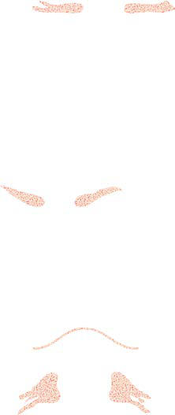

# Chapter 631: Congenital Anomalies of the Central Nervous System
> **Course:** Vikkypaedia Pediatric Basic Course (*Nelson Textbook of Pediatrics, 22nd Edition (2025)*)  
> **Part XXV:** The Nervous System  
> **Authors:** Sara K. Trowbridge, Edward Yang, and Christopher J. Yuskaitis  
> **Metrics:** 16,897 words · 9 tables/boxes · 1 figures · 100 genes · 8 flashcards · 5 MCQs  
> **Quick Navigation:** [🃏 Study 8 Flashcards](../flashcards/631_flashcards.md) · [📝 Take 5-Q MCQ Quiz](../mcqs/631_mcqs.md) · [📚 Part XXV Guide](../parts/Part_XXV.md) · [🧬 Syndrome & Genetics Atlas](../omim_gene_atlas.md) · [💊 Therapeutics Matrix](../therapies_matrix.md) · [🏠 Course Index](../../index.md)

## Key Chapter Topics & Subchapters
`631.1 Neural Tube Defects` · `631.2 Myelomeningocele` · `631.3 Occult Spinal Dysraphism` · `631.4 Encephalocele` · `631.5 Anencephaly` · `631.6 Malformations of Cortical Development` · `631.7 Disorders with Midline Defects` · `631.8 Dysgenesis of the Cranial Nerves and the Posterior Fossa` · `631.9 Hydrocephalus` · `631.10 Craniosynostosis` · `631.1 Neural Tube Defects Sara K. Trowbridge, Edward Yang, and Christopher J. Yuskaitis` · `631.2 Myelomeningocele Sara K. Trowbridge, Edward Yang, and Christopher J. Yuskaitis`

## Key Genetic & Molecular Targets
`AKT1`, `AKT3`, `ALDH7A1`, `AP1S2`, `AR`, `ARX`, `ASPM`, `ATP6V0A2`, `BICD2`, `BRAF`, `CCND2`, `CDK5RAP2`, `COL18A`, `COL18A1`, `COL25A1`, `COL3A1`

## Indexed OMIM Identifiers
`#182940`, `#601634`

## ⚡ High-Yield Nelson Pediatric Board Pearls
- Myelomeningocele is the most common NTD and results from incom plete closure of the posterior neural tube, leading to protrusion of neu ral tissue through a defect in the vertebra.
- In particular, folate is intricately involved in the prevention and etiology of NTDs.
- Although this decreased the incidence of NTDs, the added folic acid is insufficient to maximize the prevention of preventable NTDs, and it is believed that many women may still have suboptimal folate levels, estimated as a red blood cell folate level less than 900-1,000 nmol/L.
- Diagnosis is usually made prenatally by fetal ultrasonography.
- Early diagnosis allows time for prenatal counseling, further testing, and early treatment options, including fetal surgery.
- When a prenatal diagnosis is made, it is help ful to look for other associated anomalies.
- Therefore patients with these lesions generally have a more favorable prognosis, although they can have bowel/bladder dysfunction.

---
## Full Chapter Text, Tables & Figures
# Chapter 631: Congenital Anomalies of the Central Nervous System

*Sara K. Trowbridge, Edward Yang, and Christopher J. Yuskaitis*

<!-- p.4529 -->

## 631.1  Neural Tube Defects Sara K. Trowbridge, Edward Yang, and Christopher J. Yuskaitis

Neural tube defects (NTDs) account for the largest proportion of congenital anomalies of the CNS and result from failure of the neural tube to close properly during development. The etiology of NTDs appears to be multifactorial and remains incompletely understood. There is evidence for various environmental risk factors, including hyperthermia, teratogens (e.g., valproic acid, dolutegravir), maternal malnutrition, suboptimal folate levels, and maternal obesity or diabetes. Genetic determinants also play a role; studies have revealed relatively few monogenic causes and suggest a polygenic mode of inheritance. Genes associated with NTDs are also linked to known environmental risk factors (maternal obesity/ diabetes and folate metabolism). NTDs vary widely in type and severity, depending on when and how the developmental process is disrupted.

The human nervous system originates from the primitive ectoderm, which, along with the endoderm and mesoderm, form the three pri mary germ layers (Fig. 631.1). During primary neurulation (3-4 weeks postgestation), the dorsal neural ectoderm differentiates into the neu ral plate. The neural plate then begins to invaginate as the edges fold upward, forming the neural tube, the structure that will ultimately give rise to the brain and spinal cord. Initial closure of the neural tube is accomplished in the area corresponding to the future junction of the spinal cord and medulla and moves rapidly both caudally and rostrally. As the neural tube is closing, a conglomerate of cells from the dorsal tube differentiates into the neural crest, which forms the peripheral nervous system, leptomeninges, and Schwann cells. The surrounding mesoderm gives rise to the dura and vertebrae. Defects in primary neu rulation lead to open NTDs, in which neural tissue is exposed. Failure of the neural tube to close allows excretion of fetal substances (e.g., αfetoprotein [AFP], acetylcholinesterase) into the amniotic fluid. *Fetal ultrasonography has a higher sensitivity to detect NTDs and has largely replaced prenatal screening of maternal serum for AFP in the 16th to 18th wk of gestation; both can be used to identify pregnancies at risk for fetuses with NTDs in utero.* The type of open NTD depends on the location of the defect. Anterior NTDs affect the brain (anenceph aly, encephalocele), whereas posterior lesions affect the spinal cord (myelomeningocele).

Secondary neurulation occurs after completion of primary neurula tion during weeks 5-6 of gestation and refers to the formation of the caudal neural tube. Defects in secondary neurulation are thought to underlie closed NTDs (occult spinal dysraphism), in which the neural tissue is covered by skin and not exposed. Relative to the severity of open NTDs, closed NTDs usually present with relatively mild, if any, neurologic deficits.

*Visit Elsevier eBooks+ at eBooks.Health.Elsevier.com** for Bibliography.*

## 631.2  Myelomeningocele Sara K. Trowbridge, Edward Yang, and Christopher J. Yuskaitis

Myelomeningocele is the most common NTD and results from incom plete closure of the posterior neural tube, leading to protrusion of neu ral tissue through a defect in the vertebra. This is also known as an *open* NTD because the neural tissue is exposed to the environment.

**ETIOLOGY** The etiology of myelomeningocele remains incompletely understood, but as with all neural tube closure defects, a genetic predisposition exists. The risk of recurrence after one affected child is 3–4% and increases to 10% with two prior affected children. Both epidemiologic evidence and the familial aggregation studies indicate polygenic risk factors contribute to the etiology of NTDs.

Nutritional and environmental factors have a role in the etiology of myelomeningocele as well. In particular, folate is intricately involved in the prevention and etiology of NTDs. Folate coenzymes are involved in DNA synthesis, purine synthesis, and amino acid interconversion— specifically, the conversion of homocysteine to methionine. Pathogenic variants in the genes encoding the enzymes involved in homocysteine metabolism may play a role in the pathogenesis of meningomyelo cele. These enzymes include 5,10-methylenetetrahydrofolate reduc tase (encoded by *MTHFR*), cystathionine β-synthase, and methionine synthase. An association between a thermolabile variant of *MTHFR* and mothers of children with NTDs might account for up to 15% of preventable NTDs.

**PREVENTION** See also Chapter 67.6.

Maternal periconceptional use of folic acid supplementation reduces the incidence of NTDs in pregnancies at risk by at least 50%. The US Public Health Service recommends that all women of childbear ing age who can become pregnant take 0.4-0.8 mg of folic acid daily. To be effective, folic acid supplementation should be initiated before conception and continued until at least the 12th week of gestation, when neurulation is complete. If a pregnancy is planned in high-risk women (previously affected child), supplementation should be started with 4 mg of folic acid daily, beginning 1 month before the time of the planned conception.

The modern diet provides about half the daily requirement of folic acid. To increase folic acid intake, fortification of flour, pasta, rice, and cornmeal with 0.15 mg folic acid per 100 g was mandated in the United States and Canada in 1998. Although this decreased the incidence of NTDs, the added folic acid is insufficient to maximize the prevention of preventable NTDs, and it is believed that many women may still have suboptimal folate levels, estimated as a red blood cell folate level less than 900-1,000 nmol/L. Therefore informative educational programs and folic acid vitamin supplementation remain essential for women planning a pregnancy and possibly for all women of childbearing age. In addition, certain drugs, including drugs that antagonize folic acid, such as trimethoprim and some anticonvulsants (valproic acid, car bamazepine, phenytoin, phenobarbital, and primidone), increase the risk of myelomeningocele. The anticonvulsant valproic acid causes NTDs in approximately 1–2% of pregnancies when administered dur ing pregnancy, prompting some epilepsy clinicians to recommend that all female patients of childbearing potential who take anticonvulsant medications also receive folic acid supplements.

Diagnosis is usually made prenatally by fetal ultrasonography (see Chapter 117.7). Measurement of maternal serum AFP is an alternative screening test, although it has been shown to have a lower sensitiv ity than second-trimester ultrasonography. Early diagnosis allows time for prenatal counseling, further testing, and early treatment options, including fetal surgery. When a prenatal diagnosis is made, it is help ful to look for other associated anomalies. Genetic testing, particularly

*Sara K. Trowbridge, Edward Yang, and Christopher J. Yuskaitis*

<!-- p.4530 -->

<!-- p.4531 -->
chromosomal microarray, can be considered because chromosomal abnormalities are found at higher rates in fetuses with NTDs, par ticularly in the setting of other associated anomalies. Current cell-free fetal DNA prenatal tests only detect trisomies and sex aneuploidies as screening tests and are not diagnostic and do not detect NTDs.

**CLINICAL MANIFESTATIONS** Neurologic deficits are hypothesized to be caused in part by neurode generation of the exposed area of the spinal cord secondary to contact with amniotic fluid in utero. The extent and degree of the neurologic deficit depend largely on the location of the myelomeningocele and any associated intracranial abnormalities.

Although a myelomeningocele may be located anywhere along the neuraxis, the lumbosacral region accounts for ∼75% of the cases. The majority of patients with myelomeningocele have bowel and bladder incontinence. Ambulation and motor control over the lower extremi ties depend greatly on the level of the lesion. Generally, patients with a lesion in the low sacral region are ambulatory, in contrast to patients with lesions above L2, who are usually nonambulatory; those with intermediate lesions may walk with assistive devices (crutches, braces). Cervical myelomeningoceles are rare and differ in their anatomy from other myelomeningoceles because the spinal cord structure is usually close to normal and the neural tissue itself is covered by skin (i.e., a closed NTD). Therefore patients with these lesions generally have a more favorable prognosis, although they can have bowel/bladder dysfunction.

On exam, the myelomeningocele is generally readily apparent as a saclike cystic structure covered by a thin layer of partially epithelial ized tissue or an exposed flat neural placode without overlying tissues (Fig. 631.2C). When a cyst or membrane is present, remnants of neural tissue are visible beneath the membrane, which occasionally ruptures and leaks CSF.

Examination of the infant generally shows a flaccid paralysis of the lower extremities, an absence of deep tendon reflexes, a lack of response to touch and pain, and a high incidence of lower-extremity deformities (clubfeet, ankle and/or knee contractures, and subluxation of the hips). Some children have constant urinary dribbling and a relaxed anal sphincter. Other children do not leak urine and in fact have a highpressure bladder and sphincter dyssynergy. Myelomeningocele above the midlumbar region tends to produce lower motor neuron signs because of abnormalities and disruption of the conus medullaris and higher spinal cord structures.

Most children with a myelomeningocele also have displacement of the cerebellum and brainstem down through the foramen magnum, which is termed a **Chiari II malformation** (see Fig. 631.2A). Because this malformation can lead to obstruction of CSF outflow, hydro cephalus is a common complication, particularly if surgical repair is not pursued early. Therefore there should be a low threshold for con sideration of hydrocephalus, which can present with classic signs of increased intracranial pressure (ICP), including a bulging anterior fon tanel, dilated scalp veins, setting-sun appearance of the eyes, irritabil ity, and vomiting in association with an increased head circumference. Older children may also have headache, emesis, and lethargy. Addi tionally, approximately 15% of infants with hydrocephalus and Chiari II malformation develop symptoms of hindbrain (brainstem) dysfunc tion, including difficulty feeding, choking, stridor, apnea, vocal cord paralysis, pooling of secretions, and spasticity of the upper extremities, which, if untreated, can lead to death. This **Chiari crisis** is caused by downward herniation of the medulla and cerebellar tonsils through the foramen magnum, as well as endogenous malformations in the cer ebellum and brainstem.

Other CNS anomalies are associated with myelomeningocele, including cortical dysplasias, polymicrogyria, callosal abnormalities, and cerebellar abnormalities. Long-term complications include teth ered cord, usually secondary to scar tissue at the surgical repair site, and hydromyelia, which is CSF buildup in the central canal of the spi nal cord caused by worsening hydrocephalus.

**TREATMENT (SEE ALSO CHAPTER 754****)** Management and supervision of a child and family with a myelome ningocele require a multidisciplinary team approach, including sur geons, other physicians, and therapists, with one individual (often a pediatrician) acting as the advocate and coordinator of the treatment program.

Surgery to close the lesion is usually performed prenatally or within the first 72 hours of life (see Chapters 117 and 118). After repair of a myelomeningocele (especially postnatal repair), most infants require a shunting procedure for hydrocephalus. If symptoms or signs of hind brain dysfunction appear, early surgical decompression of the pos terior fossa is indicated. Clubfeet can require taping or casting. The

Neural groove

Neural groove

Neural crest

Neural groove

Rostral neuropore

Somites

Caudal neuropore

Neural tube

Neural canal

Mantle zone

Central canal

Ventricular zone

Marginal zone

Developing spinal ganglion

Developing epidermis

Somite

Notochord

Surface ectoderm

Yolk sac A

B

D

C

E

Notochordal plate Intraembryonic mesoderm

Neural fold

Neural plate

**Fig. 631.1** Diagrammatic illustration of the developing nervous sys tem. A, Transverse sections of the neural plate during the third wk. B, Formation of the neural groove and the neural crest. C, The neural tube is developed. D, Longitudinal drawing showing the initial closure of the neural tube in the central region. E, Cross-sectional drawing of the em bryonic neural tube (primitive spinal cord).

<!-- p.4532 -->
** **

B

A B C

**Fig. 631.2** Typical MRI imaging and physical exam findings of a lumbosacral myelomeningocele. A, Single-shot sagittal T2-weighted image of a fetus at 28 wk gestation demonstrates a lumbosacral spinal defect with protruding myelomeningocele sac (asterisk) and herniation of the brainstem/ cerebellum into the upper spinal canal, a Chiari II malformation (arrow). B, Single-shot axial T2-weighted images of the same fetus at the level of the myelomeningocele demonstrates a neural placode (arrow) at the base of the myelomeningocele sac (asterisk). Urinary bladder marked with B. C, A lumbar myelomeningocele is covered by a thin layer of skin.

Management of Myelomeningocele Study (MoMS) has demonstrated the success of in utero surgical closure (see Chapters 117.7 and 118) with a lower incidence of hindbrain abnormalities and hydrocepha lus (fewer shunts). Long-term follow-up of prenatal treatment into the school-age years demonstrates improved motor outcomes, although there are no differences in cognitive functioning. This suggests that some deficits may be progressive in utero and that prenatal closure might prevent the development of further loss of function.

Careful evaluation and reassessment of the genitourinary system is an important component of management. Teaching the parents and, ultimately, the patient, to regularly catheterize a neurogenic bladder is a crucial step in maintaining a low residual volume and bladder pres sure that prevents urinary tract infections and reflux, which can lead to pyelonephritis, hydronephrosis, and bladder damage. *Latex-free cath eters and gloves must be used to prevent development of latex allergy*. Periodic urine cultures and assessment of renal function, including serum electrolytes and creatinine as well as renal scans, vesiculoure thrograms, renal ultrasonograms, and cystometrograms, are obtained according to the risk status and progress of the patient and the results of the physical examination. This approach to urinary tract management has greatly reduced the need for urologic diversionary procedures and has decreased the morbidity and mortality associated with progressive renal disease in these patients. Some children can become continent with bladder augmentation at a later age.

Incontinence of fecal matter is common and distressing to patients and families; occasionally, fecal impaction and/or megacolon may develop. Many children can be bowel-trained with a regimen of timed enemas or suppositories that allows evacuation at a predetermined time once or twice a day. Special attention to low anorectal tone and enema administration and retention is often required. Appendicos tomy for antegrade enemas may also be helpful.

Functional ambulation may be possible, depending on the level of the lesion and on intact function of the iliopsoas muscles (see Chap ter 754). Most children with a sacral or lumbosacral lesion obtain functional ambulation; approximately half the children with higher defects ambulate with the use of braces, other orthotic devices, and canes. Ambulation is often more difficult as adolescence approaches and when body mass increases. *Deterioration of ambulatory function, particularly during earlier years, should prompt referral for evaluation of tethered spinal cord, shunt malfunction, hydromyelia, and other neuro surgical issues.*

**PROGNOSIS** For a child who is born with a myelomeningocele and who is treated aggressively, the mortality rate is 10–15%, and most deaths occur before age 4 years, often the result of hydrocephalus, infections, and cardiac/ respiratory complications. However, life-threatening complications

occur at all ages, and renal dysfunction is one of the most important determinants of mortality. At least 70% of individuals (nonsyndromic, no associated anomalies) have no intellectual disability, but learning problems and seizure disorders are more common than in the gen eral population. Previous episodes of meningitis (shunt infections) or ventriculitis may adversely affect intellectual and cognitive function. Because myelomeningocele is a chronic disabling condition, periodic and consistent multidisciplinary follow-up is required for life.

*Visit Elsevier eBooks+ at eBooks.Health.Elsevier.com** for Bibliography.*

## 631.3  Occult Spinal Dysraphism Sara K. Trowbridge, Edward Yang, and Christopher J. Yuskaitis

Occult spinal dysraphisms, often called *spina bifida occulta,* are a closed NTD that consist of a midline defect of the vertebral bodies without protrusion of the spinal cord or meninges. The most common type only affects the vertebra, which are often asymptomatic and lack neurologic signs. Other clinically more significant forms of closed spinal cord mal formations can be associated with developmental abnormalities of the spinal cord, including syringomyelia, diastematomyelia, lipoma, fatty filum, dermal sinus, and/or a tethered cord. In most of these cases, there are overlying cutaneous manifestations such as a hemangioma, discoloration of the skin, pit, lump, dermal sinus, or hairy patch (Figs. 631.3 and 631.4). A spine x-ray in simple spina bifida occulta shows a defect in closure of the posterior vertebral arches and laminae, typically involving L5 and S1; there is no abnormality of the meninges, spinal cord, or nerve roots. However, a spine x-ray in cases with spinal cord involvement might show bone defects or may be normal. *All cases of occult spinal dysraphism are best investigated with MRI* (Fig. 631.5 and see Fig. 631.4). Initial *screening* in the neonate may include ultrasonog raphy, but MRI is more accurate at any age.

A **meningocele** is formed when the meninges herniate through a defect in the posterior vertebral arches or the anterior sacrum. The spi nal cord is usually normal and assumes a normal position in the spinal canal; therefore neurologic outcome is often normal. However, there may be tethering of the cord, syringomyelia, or diastematomyelia, so careful neurologic examination and follow-up are necessary. Ortho pedic and urologic examination should also be considered. In asymp tomatic children with normal neurologic findings and full-thickness skin covering the meningocele, surgery may be delayed. Given the high rate of association between meningocele and tethered cord syndrome, exploration of the spinal canal is necessary to potentially release the associated tethered cord.

<!-- p.4533 -->

<!-- p.4534 -->
A **congenital dermal sinus** is a tract between the skin and the spinal cord, sometimes indicated at the skin surface by protruding hairs, a hairy patch, or a vascular nevus. Dermal sinuses occur in the midline at the sites where meningoceles or encephaloceles can occur: the lumbo sacral region or occiput, respectively, and occasionally in the cervical or thoracic area. Dermal sinus tracts can pass through the dura, acting as a conduit for the spread of infection. Recurrent meningitis of occult origin should prompt careful examination for a small sinus tract in the posterior midline region, including the back of the head. Lumbosa cral sinuses are usually *above* the gluteal fold and are *directed* cephalad. Tethered spinal cord syndrome may also be an associated problem.

**Diastematomyelia** is when the spinal cord is split, or bifid, and com monly has bony abnormalities that require surgical intervention along with untethering of the spinal cord.

An approach to imaging of the spine in patients with cutaneous lesions is noted in Table 631.1.

*Visit Elsevier eBooks+ at eBooks.Health.Elsevier.com** for Bibliography.*

## 631.4  Encephalocele Sara K. Trowbridge, Edward Yang, and Christopher J. Yuskaitis

Two major forms of dysraphism affect the skull, resulting in protrusion of tissue through a bony midline defect, called **cranium bifidum**. A cranial *meningocele* consists of a CSF-filled meningeal sac only. Cranial *encephalocele* contains the sac plus cerebral cortex, cerebellum, or por tions of the brainstem (Fig. 631.6). These abnormalities are one tenth as common as neural tube closure defects involving the spine. Micro scopic examination of the neural tissue within an encephalocele often reveals abnormalities, but not always, which has led to speculation that the primary problem is not abnormal neurulation, but rather abnor mal mesodermal development leading to skull anomalies. The cranial defect occurs most commonly in the occipital region at or below the inion. However, in certain parts of the world, frontal or nasofrontal encephaloceles (transethmoidal, sphenoethmoidal, sphenomaxillary, sphenoorbital, transsphenoidal) are more common. Some frontal lesions are associated with a cleft lip and palate.

Cranial encephalocele is often part of a larger syndrome. One of the more commonly associated genetic syndromes is **Meckel-Gruber syndrome**, a rare autosomal recessive condition caused by pathogenic variants in multiple genes involved in cilia function. This syndrome is characterized by an occipital encephalocele, cleft lip or palate, micro cephaly, microphthalmia, abnormal genitalia, polycystic kidneys, and polydactyly. Other associated syndromes include muscular dystro phy–dystroglycanopathy type A1 (Walker-Warburg syndrome, due to pathogenic variants in *POMT*) and Knobloch syndrome (due to patho genic variants in *COL18A*).

Determination of maternal serum AFP levels and ultrasound mea surement of the biparietal diameter, as well as identification of the encephalocele itself, can diagnose encephaloceles in utero. Fetal MRI can help define the extent of associated CNS anomalies and the degree of brain herniated into the encephalocele.

Infants with a cranial encephalocele are at increased risk for devel oping hydrocephalus because of **aqueductal stenosis**, **Chiari mal formation**, or **Dandy-Walker syndrome**. Examination might show a small sac with a pedunculated stalk or a large cystlike structure that can exceed the size of the cranium. The lesion may be completely covered with skin, but areas of denuded lesion can occur and require urgent surgical management. Transillumination of the sac can indicate the presence of neural tissue. A plain x-ray of the skull and cervical spine is indicated to define the anatomy of the cranium and vertebrae. Ultraso nography is most helpful in determining the contents of the sac. MRI or CT further helps define the spectrum of the lesion. Children with a cranial meningocele generally have a good prognosis, whereas patients with an encephalocele are at risk for vision problems, microcephaly, intellectual disability, and seizures. Generally, children with neural

B C A D

**Fig. 631.3** Clinical aspects of congenital median lumbosacral cutaneous lesions. A, Midline sacral hemangioma in a patient with an occult lipo myelomeningocele. B, Capillary malformation with a subtle patch of hypertrichosis in a patient with a dermal sinus. C, Human tail with underlying lipoma in an infant with lipomyelomeningocele. D, Midline area of hypertrichosis (faun tail) overlying a patch of hyperpigmentation. (A-C from Kos L, Drolet BA. Developmental abnormalities. In: Eichenfield LF, Frieden IJ, Esterly NB, eds. Neonatal Dermatology, 2nd ed. Philadelphia: WB Saunders; 2008; D from Tay VS, Kornberg A, Cook M. Spine and spinal cord: developmental disorders. In: Schapira AH, ed. Neurology and Clinical Neurosci ence. Philadelphia: Mosby; 2007, Fig. 38-11C.)

A B C D

**Fig. 631.4** A, Lumbosacral ulcerative plaque with surrounding red vas cular rim was noted on initial examination. B, Midline sagittal contrast- enhanced, T1-weighted, fat-saturated image of the lumbosacral spine at presentation reveals low-lying conus at the L4 vertebral level sug gestive of tethered cord. C, Recurrence of lumbosacral hemangioma after discontinuation of oral propranolol. D, Midline sagittal contrast- enhanced, T1-weighted, fat-saturated image of the lumbosacral spine at 6 mo of age shows new nodular enhancing lesion at the lower end of the conus (arrow) compatible with intrathecal hemangioma. In addition, there is a large hemangioma in the epidural space in the sacral spinal canal (asterisks) with presacral extension (arrowheads). (From Yu J, Ma heshwari M, Foy AB, et al. Neonatal lumbosacral ulceration masking lumbosacral and intraspinal hemangiomas associated with occult spinal dysraphism. J Pediat. 2016;175:211–215.)

<!-- p.4535 -->

<!-- p.4536 -->
tissue within the sac and associated hydrocephalus have the least favor able prognosis.

*Visit Elsevier eBooks+ at eBooks.Health.Elsevier.com** for Bibliography.*

## 631.5  Anencephaly Sara K. Trowbridge, Edward Yang, and Christopher J. Yuskaitis

An anencephalic infant presents with a large defect of the calvarium, meninges, and scalp associated with a rudimentary brain. Anencephaly is a result of failure of closure of the rostral neuropore, the opening of the anterior neural tube. The opened neural tube leads to failure of the development of the skull vault. The embryologic precursor stages of anencephaly start with acrania (absence of the skull), followed by exencephaly (cerebral tissue protruding without an overlying skull), and ultimately the cerebral tissue degenerates because of prolonged exposure to the amniotic fluid.

In anencephaly, the cerebral hemispheres and cerebellum are usu ally absent, and only a residue of the brainstem can be identified

(Fig. 631.7). The pituitary gland is hypoplastic, and the spinal cord pyramidal tracts are missing because of the absence of the cerebral cor tex. Additional anomalies, including folding of the ears, cleft palate, and congenital heart defects, occur in 10–20% of cases. Most anen cephalic infants are stillborn or die within several days of birth.

The incidence of anencephaly in the United States has been decreas ing since the 1990s and approximates 0.2-0.3 in 1,000 live births; this varies across the world. As with myelomeningoceles, the recurrence risk is approximately 4% and increases to 10% if a couple has had two previously affected pregnancies. Environmental factors in addition to genetics are implicated as a cause of anencephaly, including low socioeconomic status, nutritional and vitamin deficiencies, as well as certain exposures. It is very likely that several noxious stimuli inter act on a genetically susceptible host to produce anencephaly. Approxi mately 50% of cases of anencephaly have associated polyhydramnios. Couples who have had an anencephalic infant should have successive

*****

B C D A

**Fig. 631.5** Clinical features and imaging findings associated with occult spinal dysraphism. A, Lumbosacral lipoma. The subcutaneous lipoma is in continuity with the spinal cord via a defect in the underlying muscles, bone, and dura. B, Sagittal T1-weighted image shows a huge intradural lipoma merging with the conus medullaris superiorly. C, Lipoma and central dermal sinus. D, A sagittal T2-weighted MRI of the lumbar spine demonstrates a dermal sinus (black arrow) looping underneath the lowest lamina before ascending to the low-lying conus medullaris, which it tethers. The intradural portion of the sinus tract (white arrow) is encircled by intradural lipoma (asterisk). (A from Thompson DNP. Spinal dysraphic anomalies: classification, presentation and management. Paed Child Health. 2014;24:431–438. Fig. 4; B from Rossi A, Biancheri R, Cama A, et al. Imaging in spine and spinal cord malformations. Eur J Radiol. 2004;50[2]:177–200, Fig. 9a; C, From Jaiswal AK, Garg A, Mahapatra AK. Spinal ossifying lipoma. J Clin Neurosci. 2005;12:714–717, Fig. 1.)

Spinal Dysraphism

#### **Table 631.1** Cutaneous Lesions Associated with Occult

| Category / Parameter | Clinical Details & Findings |
| --- | --- |
| **IMAGING INDICATED** | Subcutaneous mass or lipoma; Hairy patch; Dermal sinus or cyst; Atypical dimples (deep, >5 mm, >25 mm from anal verge); Vascular lesion (e.g., hemangioma or telangiectasia); Skin appendages or polypoid lesions (e.g., skin tags, tail-like; appendages); Scarlike lesions (aplasia cutis) |
| **IMAGING UNCERTAIN** | Hyperpigmented patches; Deviation of the gluteal fold |
| **IMAGING NOT REQUIRED** | Simple dimples (<5 mm, <25 mm from anal verge); Coccygeal pits; From Williams H. Spinal sinuses, dimples, pits and patches: what lies beneath? Arch Dis; Child Educ Pract Ed. 2006;91:ep75–80. |

**Fig. 631.6** Occipital encephalocele. Sagittal T2-weighted MRI of a newborn with prenatally diagnosed cephalocele demonstrates en cephalomalacic brain protruding through an occipital skull defect with entrapped CSF in the cephalocele sac representing a mixture of suba rachnoid (deep) and subdural (superficial) fluid. Note that the intracra nial subarachnoid spaces (e.g., basal cistern) are contracted because of the large extracranial CSF reservoir.

<!-- p.4537 -->

<!-- p.4538 -->
pregnancies monitored, including with amniocentesis, determination of AFP levels, and ultrasound examination, between the 14th and 16th weeks of gestation. Prenatal folic acid supplementation decreases the risk of this condition.

*Visit Elsevier eBooks+ at eBooks.Health.Elsevier.com** for Bibliography.*

## 631.6  Malformations of Cortical Development Sara K. Trowbridge, Edward Yang, and Christopher J. Yuskaitis

Disorders of neuronal proliferation, migration, and organization can cause a spectrum of abnormalities of CNS structure and/or function. Often these present with developmental delays/intellectual disability and/or epilepsy; less severe cases may be detected as incidental find ings on a brain MRI.

The major period for neuronal proliferation in the developing human brain occurs between 8 and 15 weeks of gestation. Neural pro genitor cells and radial glial cells (which generate both neurons and glial cells) proliferate in the ventricular and subventricular zones. The radial glial cells then play a critical role in the control of neuronal migration, as they form the radial glial fiber system that guides cortical projection neurons to their proper sites. Migrating neurons attach to the radial glial fiber and disembark at predetermined sites to form the precisely designed six-layered cerebral cortex by 28 weeks of gestation. Another important mechanism is the tangential migration of progeni tor neurons destined to become cortical interneurons. The severity and the extent of a disorder of neuronal proliferation, migration, and/or organization depend on numerous factors, including the timing of a particular insult and a host of environmental and genetic contributors.

Disorders of neuronal *proliferation* generally present with abnor mal brain size (microcephaly, megalencephaly). Disorders of neuronal

*migration* and *organization* may also present with associated abnormal ities in brain size, but this is not always present. *These disorders often present clinically with either seizures and/or developmental delays and are best diagnosed by identification of the specific cortical malformation by brain MRI.* Although many brain malformations can be apparent from early in life (even on fetal MRI), some more subtle malformations (e.g., focal cortical dysplasias) may not be clearly visible until myelin ation is largely completed (around 2 years of age). *Genetic testing is indicated given the increasing number of identifiable genetic causes of brain malformations* (Table 631.2)*. Somatic variants* have been found to cause some disorders of migration/organization. Somatic variants are genetic changes that *occur after* conception and do not affect the germ cells. Mosaicism from somatic variants is often not detected by standard clinical genetic testing.

**MICROCEPHALY** Microcephaly is defined as a head circumference that measures more than 2-3 standard deviations (SD) below the mean for age and sex. Microcephaly may be subdivided into two main groups: primary (genetic) microcephaly, thought to be caused by defects in neuronal proliferation, and secondary (nongenetic) microcephaly, generally associated with destructive events after initial neuronal proliferation (e.g., hypoxic-ischemic injury, infection). A precise diagnosis is impor tant for genetic counseling and for prediction of future pregnancies.

**ETIOLOGY** Primary microcephaly refers to a group of conditions that follow a mendelian pattern of inheritance or are associated with a specific genetic syndrome and is generally thought to be secondary to a disrup tion in neuronal proliferation. Affected infants are usually identified prenatally or at birth because of a small head circumference. **Micro cephaly vera** refers to a group of autosomal recessive disorders char acterized by isolated microcephaly, with 16 genetic loci implicated to date. Many of the causative genes at those loci have been identified, including several involved in normal mitosis (e.g., *CDK5RAP2*, *ASPM*, *CENPJ*). The genetic causes of microcephaly also include autosomal dominant and X-linked recessive disorders, as well as a series of chro mosomal syndromes (Table 631.3); some of these are associated with other malformations of cortical development. **Secondary microceph aly** can result from a number of noxious agents that affect early neu rodevelopment; these include irradiation, maternal alcohol or cocaine use, maternal hyperphenylalaninemia, and infections (rubella, cyto megalovirus, HIV, Zika virus).

Acquired microcephaly, which develops postnatally, can be seen as a result of parenchymal injury (e.g., hypoxic ischemic injury), as well as various genetic conditions, including Rett, Seckel, and Angelman syndromes and developmental epileptic encephalopathy syndromes.

**CLINICAL MANIFESTATIONS AND DIAGNOSIS** A thorough family history should be taken, seeking additional cases of microcephaly or disorders affecting the nervous system. It is impor tant to measure a patient’s head circumference at birth to diagnose microcephaly as early as possible. A very small head circumference implies a process that began early in embryonic or fetal development. An insult to the brain that occurs later in life, particularly beyond the age of 2 years, is less likely to produce severe microcephaly. Serial head circumference measurements are more meaningful than a single mea surement, particularly when the measurement is borderline or if the microcephaly is progressive. The head circumference of each parent and any siblings should be recorded. The timing and progression of microcephaly, along with familial measurements, may help narrow the differential diagnosis.

Laboratory investigation of a microcephalic child is determined by the history and physical examination. If the cause of the microcephaly is unknown, the mother’s serum phenylalanine level should be deter mined. High phenylalanine serum levels in an asymptomatic mother can produce marked brain damage in an otherwise normal nonphe nylketonuric infant. Newborn screening in the United States will detect most of these cases. *Array comparative genomic hybridization*

**Fig. 631.7** Anencephaly. On this sagittal MR image of an 18-wk-gestational-age fetus, there is abrupt truncation of the neuraxis above the brainstem (arrow), no cerebral tissue, and an open skull de fect exposed to amniotic fluid consistent with anencephaly.

<!-- p.4539 -->

<!-- p.4540 -->
*(chromosome microarray) study and/or karyotype is obtained if a chro mosomal syndrome is suspected or if the child has abnormal facies, short stature, or any additional congenital anomalies. Whole exome sequenc ing or gene panel testing should also be considered, as pathogenic genetic variants can also cause primary microcephaly and syndromic microceph aly.* MRI is useful in identifying any associated structural abnormali ties of the brain, such as lissencephaly, pachygyria, and polymicrogyria. CT scanning is useful to detect intracerebral calcification. Additional studies include a fasting plasma and urine amino acid and organic acid analysis; serum ammonia determination; *to*xoplasmosis, *r*ubella, *c*yto megalovirus, and *h*erpes simplex (TORCH) titers; HIV testing of the mother and child; and a urine sample for the culture of cytomegalo virus. Zika virus–specific testing is also indicated when the infant is born in a high-risk environment or if a parent has a history of travel to endemic areas.

**MACROCEPHALY AND MEGALENCEPHALY** Megalencephaly is an anatomic disorder of brain growth defined as a brain weight:volume ratio of more than the 98th percentile for age (or ≥2 SD above the mean) that is usually accompanied by macrocephaly (an occipitofrontal circumference >98th percentile). Macrocephaly can also be secondary to enlarged skull bones, hydrocephalus/ventriculo megaly, and enlarged extraaxial spaces.

Megalencephaly can be categorized as anatomic or metabolic. Although metabolic diseases can present with microcephaly as well, there are certain syndromes (e.g., Alexander disease, Canavan disease,

megalencephalic leukoencephalopathy with subcortical cysts) that classically present with macrocephaly and should be considered in the differential diagnosis.

The most common cause of anatomic megalencephaly is **benign familial macrocephaly**. This condition is easily diagnosed by a careful family history and measurement of the parents’ head circumferences (occipitofrontal circumferences). Other common megalencephalyassociated macrocephaly syndromes include syndromes with prenatal and/or postnatal somatic overgrowth, such as Sotos *(NSD1)*, Simpson- Golabi-Behmel (*GPC3* and *GPC4*), fragile X *(FMR1)*, Weaver *(EZH2)*, and macrocephaly–cutis marmorata telangiectatica congenita syn dromes. Multiple somatic overgrowth syndromes are associated with macrocephaly and pathogenic variants in *PTEN,* including Bannayan- Ruvalcaba-Riley, Cowden, and Proteus-like syndromes. *PTEN* has also been commonly implicated in patients with autism spectrum disorder and macrocephaly.

Additionally, many of the neurocutaneous syndromes, includ ing neurofibromatosis (*NF1* and *NF2*), Sturge-Weber syndrome, and tuberous sclerosis, can present with macrocephaly. Tuberous sclero sis results from pathogenic variants in *TSC1* or *TSC2,* encoding the proteins hamartin and tuberin, which act in the mammalian target of rapamycin (mTOR) signaling pathway, a pathway known to be critical to regulating cell growth and proliferation. Indeed, variants in many genes in the mTOR signaling pathway have emerged as important causes of cortical malformations (Fig. 631.8) (see Hemimegalenceph aly and Focal Cortical Dysplasia).

#### **Table 631.2** Malformations of Cortical Development

| Category / Parameter | Clinical Details & Findings |
| --- | --- |
| **GENETIC/METABOLIC ETIOLOGY** | Disorders primarily of; neuronal proliferation; Microcephaly; Primary microcephaly (MCPH 1-18)*: MCPH1, WDR62, CDK5RAP2, CASC5, ASPM, |
| **ANKLE2, CIT, WDFY3** | Syndromic microcephaly; Acquired microcephaly; Macrocephaly†; Metabolic:; • Organic acid disorders (e.g., glutaric aciduria – GCDH); • Lysosomal storage disorders (e.g., Tay-Sachs disease – HEXA); • Leukoencephalopathies (e.g., Alexander disease – GFAP); Somatic overgrowth: NSD1, GPC3, GPC4, FMR1, EZH2, PTEN; Neurocutaneous: NF1, NF2, TSC1, TSC2; More than 300 listed conditions in OMIM; Disorders primarily of; neuronal migration; Lissencephaly-pachygyria; spectrum; Isolated: PAFAH1B1 (LIS1); Miller-Dieker syndrome: 17p13.3 deletion (PAFAH1B1, YWHAE); Subcortical band heterotopia: DCX (female); X-linked: DCX (male), ARX; Tubulinopathies: TUBA1A, TUBB2A, TUBB2B; Cobblestone: POMT1, POMT2, POMGNT1, FKTN, FKRP, LARGE; More than 50 listed conditions in OMIM (e.g., RELN, VDLR); Neuronal heterotopias; Isolated periventricular nodular heterotopias: FLNA (female); Also seen in association with other malformations, more than 10 listed conditions in |
| **OMIM** | Disorders primarily of; neuronal organization; Polymicrogyria; Over 200 listed conditions in OMIM (also see Table 631.4); Schizencephaly; In utero injury/infection; For most cases, unclear genetic etiology; few cases associated with COL4A1, SHH, SIX3; Mixed disorders; Hemimegalencephaly |
| **AKT1, AKT3, DEPDC5, MTOR, PIK3CA, PIK3R2, PTEN, TSC1, TSC2** | Focal cortical dysplasia |
| **DEPDC5, MTOR, NPRL2, NPRL3, PIK3CA, TSC1, TSC2** | *See Jayaraman D, Bae BI, Walsh CA. The genetics of primary microcephaly. Annu Rev Genomics Hum Genet. 2018;19:177–200 for comprehensive review.; †See Winden KD, Yuskaitis CJ, Poduri A. Megalencephaly and macrocephaly. Semin Neurol. 2015;35(3):277–287 for comprehensive review. |

<!-- p.4541 -->
**HEMIMEGALENCEPAHLY** Hemimegalencephaly, or unilateral macrocephaly, appears to result from a more focal aberrancy in neuronal proliferation during devel opment, which also results in abnormal neuronal migration and organization (see Fig. 631.8). These patients generally present with early-onset refractory epilepsy and developmental delays. Various syn dromes are associated with hemimegalencephaly, including epidermal nevus syndrome, Proteus syndrome, and hypomelanosis of Ito. As with other malformations of cortical development (see Macrocephaly and Megalencephaly and Focal Cortical Dysplasias), the mTOR signaling pathway appears to play a critical role in the pathogenesis of hemi megalencephaly, with many cases resulting from variants in genes involved in this pathway, including *AKT1* in Proteus syndrome.

**FOCAL CORTICAL DYSPLASIAS** Focal cortical dysplasias consist of abnormal cortical lamination in a discrete area of cortex and are thought to be disorders of neuronal proliferation, migration, and organization. These can be difficult to detect, particularly in younger children with immature myelination. Therefore high-resolution, thin-section MRI can be useful, particularly in patients with refractory epilepsy undergoing consideration for sur gery (see Fig. 631.8). Increasingly, germline and somatic pathogenic variants in genes involved in the mTOR pathway (*DEPDC5, NPRL2, NPRL3, AKT3,* others) have been implicated in the pathogenesis of focal cortical dysplasias.

**LISSENCEPHALY-PACHYGYRIA** Lissencephaly, or agyria, is a rare disorder that is characterized by the absence of cerebral convolutions and a poorly formed sylvian fissure, giving the appearance of a 3- to 4-month-old fetal brain. The condition is probably a result of faulty neuronal migration during early embry onic life. The cortical layering of a lissencephalic brain is disrupted and results in a two- to four-layered cortex, rather than the usual sixlayered one. A unique form of lissencephaly is subcortical band hetero topia, or double-cortex syndrome, in which a thick band of gray matter is located deep to the cortex, which may appear normal. **Pachygyria** is on the milder end of the lissencephaly spectrum, with some gyri pres ent, although these are abnormal and markedly reduced in number.

Infants with lissencephaly-pachygyria present with failure to thrive, progressive microcephaly, marked developmental delay, and

#### **Table 631.3** Causes of Microcephaly

| Category / Parameter | Clinical Details & Findings |
| --- | --- |
| **PRIMARY MICROCEPHALY** | Isolated; microcephaly; Microcephaly vera (autosomal recessive; microcephaly); Autosomal dominant microcephaly; X-linked microcephaly; Syndromic; microcephaly; Chromosomal abnormalities; • Trisomy 13; • Trisomy 18; • Trisomy 21; Chromosomal deletions; • 4p deletion (Wolf-Hirschhorn syndrome); • 5p deletion (Cri-du-chat syndrome); • 7q11.23 deletion (Williams syndrome); • 17p13.3 deletion (Miller-Dieker syndrome); Over 1000 other syndromes listed in OMIM,; including:; • Feingold syndrome (MYCN, MIR17HG); • Cornelia de Lange syndrome (NIPBL, |
| **SMC1A, SMC3, RAD21, HDAC8)** | • Smith-Lemli-Opitz syndrome (DHCR7); • Rubinstein-Taybi syndrome (CREBBP, EP300) |
| **ACQUIRED MICROCEPHALY** | Genetic acquired; microcephaly; Rett syndrome (MECP2); Angelman syndrome (UBE3A); Developmental epileptic encephalopathies; Intrauterine; infection; Toxoplasmosis; Cytomegalovirus; Rubella; Zika virus; Teratogens; Alcohol; Hydantoin; Radiation; Other exposures/; injury; Maternal hyperphenylalaninemia; Maternal diabetes mellitus; Hypoxic-ischemic injury; Adapted from Abuelo D. Microcephaly syndromes. Semin Pediatr Neurol.; 2007;14(3):118–127. |

*****

A B C

**Fig. 631.8** Spectrum of mTOR-related cortical malformations on brain MRI. A, An axial T2-weighted image of a 4-mo-old female with hemimega lencephaly caused by a somatic mTOR variant demonstrates diffuse enlargement of the left hemisphere, cortical thickening, and white matter T2 hypointensity consistent with some combination of accelerated myelination and heterotopic neurons. B, Axial FLAIR imaging of a 6-yr-old female with intractable epilepsy demonstrates a transmantle region of signal abnormality (arrow), which fans out as it extends centrifugally from the perive ntricular white matter to the cortex, a typical appearance of focal cortical dysplasia type IIB. C, By comparison, an axial FLAIR image of a 4-yr-old male with tuberous sclerosis demonstrates a multiplicity of transmantle signs consistent with tubers (largest right occipital focus denoted by an arrow) as well as subependymal nodules lining the lateral ventricles and a subependymal giant cell tumor at the left caudothalamic groove (asterisk).

<!-- p.4542 -->
often refractory epilepsy. Various genetic causes of lissencephaly have been identified, including pathogenic variants in *PAFAH1B1 (LIS1)* on chromosome 17p13.3 (Fig. 631.9); larger deletions at this locus (encompassing the *YWHAE* gene in addition to the *PAFAH1B1* gene) are linked to **Miller-Dieker syndrome**, characterized by lissenceph aly and other features, including distinctive facies (a prominent fore head, bitemporal hollowing, anteverted nostrils, a prominent upper lip, and micrognathia), and cardiac and genital anomalies. *DCX* is on the X chromosome, with genetic disruption leading to lissencephaly in males and subcortical band heterotopia in females (see Fig. 631.9). Pathogenic variants in *ARX* are a rarer cause of X-linked lissenceph aly in males. The tubulinopathies (related to variants in *TUBA1A, TUBB2A, TUBB2B,* and others) are another important cause of lis sencephaly. Certain disorders (e.g., Walker-Warburg syndrome, Fukuyama congenial muscular dystrophy, and muscle-eye-brain disease) present with a cobblestone lissencephaly, an overmigration disorder, with a bumpy cortical surface composed of groups of het erotopic neurons and altered myelination (see Fig. 631.9).

**NEURONAL HETEROTOPIAS** Subtypes of neuronal heterotopias include **periventricular nodular heterotopias**, **subcortical heterotopia** (including band type), and marginal glioneuronal heterotopias. Intractable seizures are a common feature. Several genes have been identified that are a cause of these conditions, including most commonly the X-linked *FLNA* gene, which causes bilateral periventricular nodular heterotopia in affected females (Fig. 631.10).

**POLYMICROGYRIA AND SCHIZENCEPHALY Polymicrogyria** is characterized by an augmentation of small con volutions separated by shallow enlarged sulci (Fig. 631.11). Polymi crogyria is commonly seen in the temporal lobes in the perisylvian region. Pathogenic variants in numerous genes have been associated with polymicrogyria, as noted in Table 631.4. Epilepsy, including drugresistant forms, and oromotor discoordination are common features.

**Schizencephaly** is the presence of unilateral or bilateral *clefts* within the cerebral hemispheres caused by an abnormality of morphogenesis (see Fig. 631.11). The cleft may be fused or unfused and, if unilateral and large, may be confused with a porencephalic cyst. Not infrequently, the borders of the cleft are surrounded by abnormal brain, particularly polymicrogyria.

When the clefts are bilateral, many patients are severely intel lectually challenged, with seizures that are difficult to control and microcephaly with spastic quadriparesis. Some cases of bilateral schizencephaly are associated with **septo-optic dysplasia** and endocrinologic disorders. Unilateral schizencephaly is a common cause of *congenital hemiparesis*. Schizencephaly is associated with fetal cytomegalovirus infection. It can also be secondary to in utero vascular injury, sometimes in the setting of pathogenic variants in *COL4A1,* a gene associated with increased risk of intracranial hemorrhage. Some reports have suggested the involvement of the sonic hedgehog signaling pathway, but most cases remain without a clearly defined genetic etiology.

*Visit Elsevier eBooks+ at eBooks.Health.Elsevier.com** for Bibliography.*

## 631.7  Disorders with Midline Defects Sara K. Trowbridge, Edward Yang, and Christopher J. Yuskaitis

**HOLOPROSENCEPHALY** Holoprosencephaly encompasses a group of developmental disor ders that result from defective prosencephalic cleavage. These disor ders span a spectrum of severity and are classified into three groups, alobar, semilobar, and lobar, depending on the degree of the cleav age abnormality (Fig. 631.12). **Alobar holoprosencephaly** is the most severe form, with complete fusion of the cerebral hemispheres and deep nuclei and complete absence of the corpus callosum and olfactory bulbs and tracts. **Semilobar holoprosencephaly** presents with fusion of the anterior cerebral hemispheres and absence of the anterior corpus callosum. **Lobar holoprosencephaly**, the least severe form, generally presents with full separation between the cerebral hemispheres, partial or full separation between the deeper nuclei, and full development of the posterior corpus callosum, with some underdevelopment of the anterior corpus callosum. A fourth type, the middle interhemispheric variant, or **syntelencephaly**, involves a segmental area of nonseparation of the posterior frontal and parietal lobes. Facial abnormalities, including cyclopia, syn ophthalmia, cebocephaly, single nostril, choanal atresia, solitary

A B C D

**Fig. 631.9** Pachygyria and subcortical band heterotopia spectrum on brain MRI. A, An axial T1-weighted image of an 18-mo-old male demon strates thickening of the cortex and attenuation of gyration, hallmarks of pachygyria. In this patient with a pathogenic DCX variant, there is greater severity of the pachygyria anteriorly, which is typically the case for pachygyria caused by mutations in this gene. B, By contrast, an axial T1-weighted sequence of a 10-yr-old female demonstrates a normal-thickness cortical ribbon with a subjacent layer of gray matter signal, consistent with subcorti cal band heterotopia. This patient also has a pathogenic DCX variant but has an attenuated phenotype because of X-linked inactivation and mosaic expression of the disease-causing variant. C, An axial T2-weighted image of a 4-yr-old female demonstrates marked cortical thickening and severe posterior predominant agyria (lissencephaly), the latter being a classic manifestation of the patient’s LIS1 variant. D, An axial T2-weighted image of cobblestone malformation (previously called type II lissencephaly) from a 3-mo-old female with infantile spasms, occipital cephalocele, devel opmental delay, and elevated creatine kinase levels. Note the centrifugal streaks of gray matter extending to a smooth thickened cortex. Although superficially reminiscent of lissencephaly like that in the prior case, a key distinguishing feature is the nodularity of the gray-white matter interface and the centrifugal islands of gray matter (e.g., arrowed right occipital foci). The islands of gray matter represent migration of neurons through the pial limiting membrane into the subarachnoid space, a typical feature of cobblestone malformation.

<!-- p.4543 -->

<!-- p.4544 -->
central incisor tooth, and premaxillary agenesis, are common in severe cases, because the prechordal mesoderm that induces the ventral prosencephalon is also responsible for induction of the median facial structures. Milder facial abnormalities, such as ocular hypotelorism, can be seen in milder forms.

Affected children with the severe alobar type have a high mortality rate within the first year of life, but some can live for years. Mortality and morbidity with milder types are more variable, with neurologic symptoms generally correlating with the severity of the underly ing abnormality. In addition to neurologic symptoms, patients with impaired hypothalamic cleavage can also have various endocrinopa thies. The incidence of holoprosencephaly is 1 in 10,000 live births. A prenatal diagnosis can be confirmed by ultrasonography after the 10th week of gestation for more severe types, but fetal MRI at later gestational ages gives far greater anatomic, and therefore diagnostic, precision.

Genetic and environmental factors both play a role in the devel opment of holoprosencephaly. Chromosomal abnormalities account for approximately 60% of all cases, of which trisomy 13 is the most common. Other associated chromosomal abnormalities include tri somy 18 and deletions or trisomies of chromosomes 2, 3, 7, and 21. Diagnosis with a chromosomal abnormality in the setting of holo prosencephaly is a negative prognostic factor, with most patients not surviving past the first year of life. Monogenic syndromic causes include CHARGE syndrome *(CHD),* Pallister-Hall *(GLI3),* Rubenstein-Taybi *(CREB-BP),* and Smith-Lemli-Opitz *(DHCR7)* syndromes. Genetic variants, particularly in the sonic hedgehog signaling pathway *(SHH, SIX3),* have also been implicated in non syndromic holoprosencephaly. Environmental factors, particularly maternal diabetes, are risk factors for holoprosencephaly.

**Fig. 631.10** Periventricular nodular heterotopia. An axial T1-weighted brain MR image of a 16-yr-old female with valvular heart disease and joint laxity demonstrates confluent subependymal nodules of gray mat ter signal consistent with periventricular nodular heterotopia (marked with dashed oval). The patient was ultimately found to have a patho genic FLNA variant.

A B C D

H G F E

*****

**Fig. 631.11** Polymicrogyria spectrum by brain MRI. Axial (A) and sagittal (B) T1-weighted images of a 17-yr-old male with 22q11 deletion syn drome demonstrate diffusely increased gyral frequency and a bumpy surface contour of the cerebral cortex consistent with polymicrogyria, with some sparing of the frontal poles and occipital lobes. Axial (C) and sagittal (D) T1-weighted images of a 23-yr-old male demonstrate a unilateral area of right perisylvian polymicrogyria (dashed ovals) with reduced underlying white matter volume. Axial T2-weighted (E) and sagittal T1-weighted (F) sequences demonstrate diffuse polymicrogyria in a 28-mo-old with hearing loss, developmental delay, and congenital cytomegalovirus (CMV) exposure. Although the calcifications associated with TORCH infections are frequently not evident on MRI, clues to CMV as the etiology for polymi crogyria include microcephaly on clinical evaluation and subependymal cysts, the latter evident in this patient at the classic temporal horn location (asterisk) where it is separated from the remaining ventricular system by a thin membrane (arrow, F). Axial (G) and sagittal (H) T1-weighted images of a 17-yr-old male demonstrate an absent septum pellucidum and an apposed gray matter lined cleft through the left frontal lobe consistent with closed-lip schizencephaly (arrow, G). As is invariably the case in schizencephaly, the schizencephalic cleft is marginated by polymicrogyria (ovals, G and H).

<!-- p.4545 -->

#### **Table 631.4** Genes Associated with Polymicrogyria

| Category / Parameter | Clinical Details & Findings |
| --- | --- |
| **N/MS** | mTORopathies |
| **AKT3** | x; Bilateral perisylvian PMG; MPPH syndrome |
| **CCND2** | x |
| **MTOR** | x; Smith-Kingsmore syndrome |
| **DEPDC5** | x; Diffuse, focal, or multifocal; PMG (less common than |
| **PI4KA** | x; Perisylvian PMG |
| **PIK3CA** | x; Bilateral perisylvian PMG; MCAP syndrome; See footnote 4 |
| **PIK3R2** | x; MPPH syndrome |
| **PTEN** | x; Diffuse, focal, or multifocal |
| **AD** | Tubulinopathies |
| **DYNC1H1** | x; x; Frontal or diffuse PMG |
| **KIF5C** | x; Perisylvian PMG |
| **TUBA1A** | x; x; Diffuse, focal, or multifocal; PMG; bilateral, asymmetric,; perisylvian PMG; Lissencephaly 3 |
| **TUBB** | x |
| **TUBB2A** | x; Bilateral, asymmetric, anterior; predominant PMG |
| **TUBB2B** | x; x |
| **TUBB3** | x; x; Frontoparietal PMG |
| **AD** | Cobblestone; dysplasia –; alpha; dystroglycan-; opathies |
| **FKTN** | x; Diffuse (cerebral and; cerebellar) PMG |
| **POMGNT1** | x |
| **POMT2** | x |
| **AR** | Cobblestone; dysplasia – other; (laminopathies; and congenital; disorders of; glycosylation) |
| **ADGRG1 (GPR56)** | x; Bilateral frontoparietal PMG |
| **COL3A1** | x; x; Diffuse cobblestone cortex; |
| **ATP6V0A2** | x; x; Frontoparietal PMG; Autosomal recessive cutis; laxa type 2A |
| **LAMA2** | x; Occipital PMG; white-matter; signal abnormalities; Muscular dystrophy,; congenital; merosin-deficient, 1A |
| **LAMB1** | x; x; Porencephaly; cobblestone; lissencephaly P > A; Lissencephaly 5 |
| **LAMC3** | x; Occipital PMG |
| **SNAP29** | x; Perisylvian or diffuse PMG |
| **SRD5A3** | x; Frontal PMG; SRD5A3-CDG (CDG-Iq) |
| **AR** | Continued |

<!-- p.4546 -->
**PATHWAY/
 PATHOLOGY GENE****1**

**HEAD SIZE****2**

**BRAIN FINDINGS DISORDER NAME MOI MAC MIC N/MS**

Other *BICD2* x Perisylvian PMG AD

*COL18A1* x Frontal PMG Knobloch syndrome 1 AR

*DDX3X* x x Frontoparietal or diffuse PMG *DDX3X*-related

neurodevelopmental disorder

*EML1* x Ribbon-like heterotopia with

overlying PMG; ACC

AR

*EOMES (TBR2)* x Bilateral perisylvian or diffuse

PMG

AR

*EZH2* x Bilateral perisylvian PMG Weaver syndrome AD

*FIG4* x x Bilateral or temporo-occipital

PMG

AR

*GPSM2* x Parasagittal PMG; ACC Chudley-McCollough

syndrome

AR

*GRIN1* x Extensive bilateral PMG AD

*GRIN2B* x x Diffuse PMG AD

*KIFBP (KIAA1279)* x Diffuse PMG Goldberg-Shprintzen

syndrome

AR

*MAP1B* Perisylvian PMG; PNH AD

*NDE1* x Diffuse PMG AR

*NEDD4L* x Bilateral perisylvian PMG;

PNH

AD

*OCLN* x Bandlike calcifications with

diffuse PMG

Pseudo-TORCH syndrome 1 AR

*OFD1* x Frontal and parietal PMG Joubert syndrome (XLR);

orofaciodigital syndrome 1 (XLD)

*PAX6* x Variable temporal PMG AR

*RAB18* x x Diffuse or frontal PMG RAB18 deficiency3 AR

*RAB3GAP1* x x

*RAB3GAP2* x x

*RTTN* x Variable diffuse, asymmetric

PMG

AR

*TBC1D20* x Diffuse or bilateral frontal

PMG

RAB18 deficiency3 AR

*TCTN1* x Frontal PMG Joubert syndrome AR

*TMEM216* x Variable PMG Meckel-Gruber syndrome,

Joubert syndrome

AR

*WDR62* x ± Diffuse or asymmetric PMG AR

Metabolic

disorders

*FH* x Variable PMG Fumeric aciduria AR

*PEX* genes x x Perisylvian PMG Zellweger spectrum

disorders

AR

1Genes are in alphabetic order. 2Head size: N/MS = normal/mildly small (i.e., head circumference >3 SD and <97%) MIC = severe microcephaly (i.e., birth head circumference <3 SD or earliest HC <4 SD) MAC = macrocephaly (i.e., head circumference >97%) 3RAB18 deficiency is a spectrum that includes Warburg microsyndrome (at the severe end) and Martsolf syndrome (at the mild end). Additional findings are eye involvement (bilateral congenital cataracts, microphthalmia, and microcornea); severe-to-profound intellectual disability; and hypogonadism. 4De novo germline pathogenic variants in PIK3CA are reported; however, most affected individuals with MCAP reported had somatic mosaicism for pathogenic variants in PIK3CA, suggesting that the mutation occurred post fertilization in one cell of the multicellular embryo.https://www.ncbi.nlm.nih.gov/books/n/gene/glossary/def-item/de-novo/ A, Anterior; ACC, absence of the corpus callosum; AD, autosomal dominant; AR, autosomal recessive; CDG, congenital disorder of glycosylation; FCD, focal cortical dysplasia; MCAP,

megalencephaly-capillary malformation-PMG; MOI, mode of inheritance; MPPH, megalencephaly-polymicrogyria-polydactyly-hydrocephalus; P, posterior; PNH, periventricular nodular heterotopia; XL, X-linked; XLD, X-linked dominant; XLR, X-linked recessive Adapted from Stutterd CA, Dobyns WB, Jansen A, et al. Polymicrogyria overview. In: Adam MP, Ardinger HH, Pagon RA, et al., eds. GeneReviews. Seattle, WA: University of

#### **Table 631.4** Genes Associated with Polymicrogyria—cont’d

<!-- p.4547 -->
**AGENESIS OF THE CORPUS CALLOSUM** Agenesis of the corpus callosum consists of a heterogeneous group of disorders that result from defective midline prosencephalic develop ment. These disorders vary in clinical presentation from patients with severe intellectual deficits and neurologic abnormalities to the asymp tomatic and normally intelligent patient (Fig. 631.13). In addition, patients may experience hypethermia or hypothermia and hyperhi drosis (Shapiro syndrome).

When agenesis of the corpus callosum is an *isolated* phenomenon, the patient may be asymptomatic. When it is accompanied by associ ated brain anomalies, such as heterotopias, polymicrogyria, and pachy gyria (broad, wide gyri), and/or other syndromic or genetic disorders, patients often have significant neurologic abnormalities, including intel lectual disability, microcephaly, hemiparesis or diplegia, and seizures.

The anatomic features of agenesis of the corpus callosum are best depicted on MRI and include widely separated frontal horns with an abnormally high position of the third ventricle between the lateral ven tricles. MRI precisely outlines the extent of the corpus callosum defect. **Colpocephaly** refers to an abnormal enlargement of the occipital horns of the ventricular system and can be identified as early as the fetal period. It is often associated with agenesis of the corpus callosum, but it can occur in isolation. There are numerous genetic causes of agenesis of the corpus callosum, including chromosomal abnormalities, syndromic genetic dis orders, and nonsyndromic monogenetic disorders (Table 631.5).

**Aicardi syndrome** is one syndrome that presents with partial or com

(e.g., cortical dysplasias, periventricular nodular heterotopias, intracra nial cysts) and distinctive chorioretinal lacunae. Patients are almost all female, suggesting that the genetic abnormality is X-linked dominant. Seizures, including infantile spasms, are common and are typically resis tant to anticonvulsants. An electroencephalogram shows independent activity recorded from both hemispheres as a result of the absent corpus callosum and often shows hemihypsarrhythmia. All patients have severe intellectual disability and can have abnormal vertebrae that may be fused or only partially developed (hemivertebra).

**ABSENCE OF THE SEPTUM PELLUCIDUM** Absence of the septum pellucidum is another developmental midline defect that is almost always associated with other brain anomalies, particularly schizencephaly, although it can also be seen with holo prosencephaly, agenesis of the corpus callosum, and septo-optic dys plasia. It can also result through destruction of the septum pellucidum, secondary to hydrocephalus or ischemic injury. Therefore the clinical presentation of patients with absence of the septum pellucidum largely depends on the etiology, associated brain anomalies, and any underly ing chromosomal and/or genetic diagnosis. Cavum septum pellucidum refers to the cavity between the two septal leaflets; although this is nor mal in the fetal brain, the septal leaflets generally fuse during develop ment. A persistent cavum septum pellucidum is generally considered to be a normal variant (Fig. 631.14).

A

C

AC

E

C

B

*****

D

*****

AC

F

*****

C

**Fig. 631.12** Gradations of severity in holoprosencephaly. Holoprosencephaly results from incomplete cleavage of the cerebral hemispheres early in embryogenesis. As illustrated in these pairs of brain MRI sagittal T1-weighted (A, C, and E) and axial T2-weighted images (B, D, and F), sever ity ranges from mildly affected patients with lobar holoprosencephaly (A, B), to more severely affected patients with semilobar holoprosencephaly (C, D), to the most severely affected patients with alobar holoprosencephaly (E, F). More mildly affected holoprosencephaly patients have greater separation of the cerebral hemispheres, particularly anteriorly and ventrally (e.g., less deep gray matter structure fusion marked with asterisks in B, D, and F). Milder holoprosencephaly also demonstrates greater formation of the corpus callosum (arrows in A, C) which is absent in alobar holopros encephaly (E). Unlike alobar holoprosencephaly, which typically demonstrates a monoventricle with or without a dorsal cyst (C in E, F), semilobar and lobar holoprosencephaly demonstrate partial to complete formation of the lateral ventricles (e.g., frontal/temporal horns). The shown case of semilobar holoprosencephaly (C, D) has an arachnoid cyst (AC), but it is not in communication with the ventricular system.

<!-- p.4548 -->

<!-- p.4549 -->
A B C

*****

**Fig. 631.13** Complete corpus callosum (callosal) agenesis by brain MRI. A, Sagittal T1-weighted sequence of a newborn with callosal agenesis demonstrates lack of a normal corpus callosum (dashed arrows along expected course) with multiple sulci radiating without interruption from the third ventricle (asterisk). B, An axial T2-weighted image of this patient demonstrates a parallel rather than curved course of the lateral ventricles (missing callosal genu and rostrum denoted by dashed arrows). C, Redirection of white matter tracts (Probst bundles) can be directly visualized in callosal agenesis using colored fractional anisotropy maps, where green denotes anteroposterior fiber tracts running parallel to the lateral ventricles rather than crossing the midline.

#### **Table 631.5** Disorders Associated with Agenesis of the Corpus Callosum*

| Category / Parameter | Clinical Details & Findings |
| --- | --- |
| **WITH IDENTIFIED GENES†** | Andermann syndrome (KCC3); ACC, progressive neuropathy, and dementia; Donnai-Barrow syndrome (LRP2); Diaphragmatic hernia, exomphalos, ACC, deafness; Frontonasal dysplasia (ALX1); ACC, bilateral extreme microphthalmia, bilateral oblique facial cleft |
| **XLAG (ARX)** | Lissencephaly, ACC, intractable epilepsy; Microcephaly (TBR2); ACC, polymicrogyria; Microcephaly with simplified gyral pattern and ACC (WDR62); ACC, other brain malformations; Mowat-Wilson syndrome (ZFHX1B); Hirschsprung disease, ACC; Pyridoxine-dependent epilepsy (ALDH7A1); ACC, seizures, other brain malformations; Pyruvate dehydrogenase deficiency (PDHA1, PDHB, PDHX); ACC with other brain changes; ACC with fatal lactic acidosis (MRPS16); Complexes I and IV deficiency, ACC, brain malformations; HSAS/MASA syndromes (L1CAM); Hydrocephalus, adducted thumbs, ACC, MR |
| **ACC SEEN CONSISTENTLY (NO GENE YET IDENTIFIED)** | Acrocallosal syndrome; ACC, polydactyly, craniofacial changes, MR; Aicardi syndrome; ACC, chorioretinal lacunae, infantile spasms, MR; Chudley-McCullough syndrome; Hearing loss, hydrocephalus, ACC, colpocephaly; FG syndrome; MR, ACC, craniofacial changes, macrocephaly; Genitopatellar syndrome; Absent patellae, urogenital malformations, ACC; Temtamy syndrome; ACC, optic coloboma, craniofacial changes, MR; Toriello-Carey syndrome; ACC, craniofacial changes, cardiac defects, MR; Vici syndrome; ACC, albinism, recurrent infections, MR |
| **ACC SEEN OCCASIONALLY (PARTIAL LIST)‡** | ACC with spastic paraparesis (SPG11, SPG15); Progressive spasticity and neuropathy, thin corpus callosum; Craniofrontonasal syndrome; Coronal craniosynostosis, facial asymmetry, bifid nose; Fryns syndrome; CDH, pulmonary hypoplasia, craniofacial changes; Marden-Walker syndrome; Blepharophimosis, micrognathia, contractures, ACC; Meckel-Gruber syndrome; Encephalocele, polydactyly, polycystic kidneys |

<!-- p.4550 -->

## 631.8  Dysgenesis of the Cranial Nerves and the Posterior Fossa Sara K. Trowbridge, Edward Yang, and Christopher J. Yuskaitis

The classification of disorders of development of the cranial nerve, brainstem, and cerebellum remains anatomic, but future classification systems will likely be based on the molecular biology of brain develop ment based on the genes involved and the roles they play in orchestrat ing brain architecture.

**CONGENITAL CRANIAL DYSINNERVATION DISORDERS** Congenital cranial dysinnervation disorders (CCDDs) are congenital nonprogressive disorders that affect the cranial nerves, primarily pre senting with abnormal eye and/or facial movements. These disorders include Möbius syndrome, Duane syndrome, and congenital fibrosis of the external ocular muscles (CFEOM). Increasingly, genetic causes for these disorders have been identified.

**Möbius syndrome** is generally characterized by bilateral facial weakness (seventh cranial nerve) and sixth nerve palsies (limited eye abduction). Injury or abnormal development at any level (i.e., cranial nerve nuclei, roots, nerves, or muscles) can lead to Möbius syndrome, but most patients have pathology at the level of the cranial nerve nuclei. The genetics of Möbius syndrome remain incompletely understood. Genetic linkage mapped inheritance to chromosome 13q12.2-q13, with identification of de novo pathogenic variants in *PLXND1* and *REV3L* in some patients. Environmental factors may also play a role. Affected infants present in the newborn period with facial weakness, causing feeding difficulties owing to a poor suck. Möbius syndrome can also be associated with other congenital anomalies, including tali pes equinovarus (clubfoot), arthrogryposis, and syndactyly. Over 30% of patients with Möbius syndrome are reported to have autism spec trum disorder and/or intellectual disability.

**Duane retraction syndrome** is characterized by congenital limita tion of horizontal globe movement and globe retraction and palpebral fissure narrowing on attempted adduction. This is caused by under development or absence of the abducens nuclei and nerves, as well as aberrant innervation of the lateral rectus muscle by the oculomotor nerve. Duane syndrome often occurs in families with an autosomal dominant pattern of inheritance, with three genes (*CHN1, MAFB,* and *SALL4*) identified thus far as well as associations with chromosome 8q13, 20q12, and 2q21.1. **Congenital fibrosis of the extraocular muscles (CFEOM)** is char acterized by severe restriction of eye movements and ptosis from abnormal oculomotor and trochlear nerve development and/or from abnormalities of extraocular muscle innervation. The most common form is caused by pathogenic autosomal dominant variants in *KIF21A,* which encodes a kinesin motor protein. Variants in *KIF21A* therefore lead to abnormal axonal transport. Other autosomal dominant causes

*****

C C

A B

**Fig. 631.14** Age-expected evolution of the septum pellucidum. Throughout fetal life, the septum pellucidum exists as paired leaflets enclosing a midline CSF space. This configuration is known as a cavum septum pellucidum and undergoes fusion into a single membrane dur ing the first months of postnatal life. A, A brain MRI axial T2-weighted image of a 42-day-old female followed for a cistern of the velum inter positum cyst (C) demonstrates normal separation of the septal leaflets with an intervening CSF pocket, the cavum septum pellucidum (aster isk). B, An axial single-shot T2-weighted brain MR image at 13 mo in the same patient demonstrates expected fusion of the leaflets into a single membrane (arrow).

**DISORDER SALIENT FEATURES**

Nonketotic hyperglycinemia *(GLDC, GCST, GCSH)* ACC, cerebral and cerebellar atrophy, myoclonus, progressive

encephalopathy

Microphthalmia with linear skin defects Microphthalmia, linear skin markings, seizures

Opitz G syndrome Pharyngeal cleft, craniofacial changes, ACC, MR

Orofaciodigital syndrome Tongue hamartoma, microretrognathia, clinodactyly

Pyruvate decarboxylase deficiency Lactic acidosis, seizures, severe MR and spasticity

Rubinstein-Taybi syndrome Broad thumbs and great toes, MR, microcephaly

Septooptic dysplasia (de Morsier syndrome) Hypoplasia of septum pellucidum and optic chiasm

Sotos syndrome Physical overgrowth, MR, craniofacial changes

Warburg micro syndrome Microcephaly, microphthalmia, microgenitalia, MR

Wolf-Hirschhorn syndrome Microcephaly, seizures, cardiac defects, 4p−

*Reliable incidence data are unavailable for these very rare syndromes. †Gene symbols in parentheses. ‡Many of these also may consistently have a thin dysplastic corpus callosum, such as Sotos syndrome or agenesis of the corpus callosum (ACC) with spastic paraparesis (SPG11). The

overlap between ACC and these conditions is still under investigation. Other gene symbols are omitted from this section. 4p−, Deletion of the terminal region of the short arm of chromosome 4, defines the genotype for Wolf-Hirschhorn patients; ACC, agenesis of the corpus callosum; ARX, Aristalessrelated homeobox gene; CDH, congenital diaphragmatic hernia; HSAS/MASA, X-linked hydrocephalus/mental retardation, aphasia, shuffling gait, and adducted thumbs; KCC3, KCl co-transporter 3; L1CAM, L1 cell adhesion molecule; MR, mental retardation; MRPS16, mitochondrial ribosomal protein S16; SPG11, spastic paraplegia 11; XLAG, X-linked lissencephaly with absent corpus callosum and ambiguous genitalia; ZFHX1B, zinc finger homeobox 1b. From Sherr EH, Hahn JS. Disorders of forebrain development. In: Swaiman KF, Ashwal S, Ferriero DM, Schor NF, eds. Swaiman’s Pediatric Neurology, 5th ed. Philadelphia: WB Saunders; 2012: Table 23-2.

#### **Table 631.5** Disorders Associated with Agenesis of the Corpus Callosum*—cont’d

<!-- p.4551 -->
of CFEOM include pathogenic variants in the tubulin genes *TUBA1A, TUBB2B,* and *TUBB3*. Malformations of cortical development can also be associated with these and other tubulinopathy genes. Autosomal recessive forms of CFEOM are associated with variants in *PHOX2A* and *COL25A1*.

**BRAINSTEM AND CEREBELLAR DISORDERS** Disorders of the posterior fossa structures include abnormalities not only of the brainstem and cerebellum but also of the CSF spaces.

**Chiari malformation**, the most common malformation of the pos terior fossa and hindbrain, consists of downward displacement of the cerebellum and sometimes the brainstem through the foramen mag num. Often, there is an associated developmental abnormality of the bones of the skull base leading to a small posterior fossa. Chiari mal formations are divided into three groups (type I, II, and III). In **Chiari type I**, the cerebellar tonsils are downwardly displaced (Fig. 631.15). Chiari type I malformations can be asymptomatic. When symptoms develop, they often do not do so until late childhood. Symptoms include headaches that are worse with straining and other Valsalva maneuvers that increase ICP. Symptoms of brainstem compression such as diplo pia, oropharyngeal dysfunction, spasticity, tinnitus, sleep apnea, and

vertigo can also occur. Type I malformations are not associated with hydrocephalus. Syrinx of the spinal cord, especially in the cervical region, should be looked for on MRI imaging. This can result in neck pain, urinary frequency, and progressive lower extremity spasticity. Although the pathogenesis is unknown, a prevailing theory suggests that obstruction of the caudal portion of the fourth ventricle during fetal development is responsible. Chiari type I malformations may be associated with Ehlers-Danlos syndrome.

With **Chiari type II**, the inferior cerebellar vermis, cerebellar ton sils, and medulla are displaced through the foramen magnum. Most patients with myelomeningocele have a Chiari type II malformation (also see Neural Tube Defects). **Chiari type III**, the rarest form, also consists of downward displacement of the medulla, as well as a high cervical or occipital encephalocele. Chiari type II is usually identified early in life because of the association with myelomeningocele and, as with Chiari type I, can cause symptoms from brainstem compression. Complications for all the Chiari malformations include obstructive hydrocephalus and/or syringomyelia. Patients with Chiari type III are more severely affected, with high mortality and neurologic morbidity.

**Dandy-Walker malformation** consists of cystic dilation of the fourth ventricle, hypoplasia or agenesis of the cerebellar vermis, and an enlarged posterior fossa with elevation of the lateral venous sinuses and the tentorium (Fig. 631.16). Various associated brain malformations can also be seen, including agenesis of the corpus callosum and malfor mations secondary to abnormal neuronal migration. Most patients will develop hydrocephalus in infancy, and variable degrees of neurologic impairment are usually present. The etiology of Dandy-Walker mal formation is heterogeneous and includes chromosomal abnormalities, single gene disorders, and exposure to teratogens. It is important to dis tinguish Dandy-Walker malformation from other causes of posterior fossa CSF collections (see Fig. 631.16). These include the **Blake pouch cyst**, a benign variant that consists of enlargement of the fourth ven tricle, caused by persistence of the developmental Blake pouch struc ture. Isolated **mega cisterna magna**, another benign normal variant, refers to an enlarged cisterna magna with otherwise normal cerebellar architecture and size. Finally, posterior fossa **arachnoid cysts** can lead to hydrocephalus caused by obstruction of CSF flow but often remain asymptomatic.

**Joubert syndrome and related disorders** are a group of autosomal recessive disorders in which there is cerebellar vermis hypoplasia and the pontomesencephalic **molar tooth sign** (a deepening of the interpe duncular fossa with thick and straight superior cerebellar peduncles) (Fig. 631.17). It is associated with hypotonia, ataxia, characteristic breathing abnormalities including episodic apnea and hyperpnea (which improves with age), global developmental delay, nystagmus, strabismus, ptosis, and oculomotor apraxia. Joubert syndrome is

A B C

**Fig. 631.16** Dandy-Walker spectrum posterior fossa abnormalities. Abnormal fenestration of embryologic outlets of the fourth ventricle and as sociated hypoplasia of the vermis (V in A-C) result in so-called Dandy-Walker spectrum. As illustrated by these sagittal T1-weighted brain MRI se quences, the most severe end of the spectrum consists of the classic Dandy-Walker malformation (A) where there is severe vermian hypoplasia and a remodeling of an enlarged posterior fossa CSF space (e.g., elevation of the tentorium and torcula above the confluence of the lambdoid sutures, arrows). At the least severe end of the spectrum, the vermis is fully formed but there is a prominent retrocerebellar and cisterna magna CSF space without expansion of the posterior fossa: a mega cisterna magna (C). In between these extremes, one may encounter vermian hypoplasia and pos terior fossa CSF space prominence without overt expansion of the posterior fossa (e.g., vermian hypoplasia with rotation in B).

1

2

H

H

A B

**Fig. 631.15** A, A 16-yr-old male with Chiari malformation type 1 (ar row 1) and syringomyelia (arrow 2). B, Postoperative MRI reveals de compression of the Chiari malformation and resolution of the syrinx. (From Albert GW. Chiari malformation in children. Pediatr Clin N Am. 2021;68:783–792, Fig. 1, p. 786.)

<!-- p.4552 -->
considered a ciliopathy, as many of the 35 genes implicated encode for proteins important in cilia function (e.g., *AHI1, CC2D2A, CEP290*). There can also be associated systemic features, including progressive retinal dysplasia (Leber congenital amaurosis), coloboma, congenital heart disease, microcystic kidney disease, liver fibrosis, polydactyly, tongue protrusion, and soft tissue tumors of the tongue (Fig. 631.18).

**Rhombencephalosynapsis** consists of an absent or small vermis associated with a nonseparation or fusion of the deep midline cerebel lar structures. Ventriculomegaly or hydrocephalus is often seen. There is a variable clinical presentation from normal function to cognitive and language impairments, epilepsy, and spasticity.

The **pontocerebellar hypoplasias** (PCHs) are a group of autosomal recessive disorders characterized by impairment of cerebellar and pon tine development. Ten types have been defined to date, with increas ing identification of underlying genetic causes (e.g., *TSEN2, TSEN34, RARS2*). Patients tend to be severely affected, with hypotonia, feeding dif ficulties, developmental delay, breathing difficulties, and seizures. Other disorders can also present with some PCH, most commonly including Walker-Warburg syndrome, muscle-eye-brain disease, congenital disor ders of glycosylation type 1A, and mitochondrial cytopathies.

*Visit Elsevier eBooks+ at eBooks.Health.Elsevier.com** for Bibliography.*

## 631.9  Hydrocephalus Sara K. Trowbridge, Edward Yang, and Christopher J. Yuskaitis

Hydrocephalus is not a specific disease; it represents a diverse group of conditions that result from impaired circulation and/or absorption of CSF or, in rare circumstances, from increased production of CSF by a choroid plexus papilloma (Tables 631.6 and 631.7).

**PHYSIOLOGY** The CSF is formed primarily in the ventricular system by the cho roid plexus, which is situated in the lateral, third, and fourth ven tricles. Although most CSF is produced in the lateral ventricles, approximately 25% originate from extrachoroidal sources, includ ing the capillary endothelium within the brain parenchyma. There is active neurogenic control of CSF formation because adrenergic and cholinergic nerves innervate the choroid plexus. Stimulation of the adrenergic system diminishes CSF production, whereas exci tation of the cholinergic nerves may double the normal CSF pro duction rate. In a normal child, approximately 20 mL/hr of CSF is produced. The total volume of CSF approximates 50 mL in an infant and 150 mL in an adult. Most of the CSF is extraventricular. The choroid plexus forms CSF in several stages; through a series of intricate steps, a plasma ultrafiltrate is ultimately processed into a secretion, the CSF.

CSF flow results from the pressure gradient that exists between the ventricular system and venous channels. Intraventricular pres sure may be as high as 180 mmH2O in the normal state, whereas the pressure in the superior sagittal sinus is in the range of 90 mmH2O. Normally, CSF flows from the lateral ventricles through the foram ina of Monro into the third ventricle. It then traverses the narrow aqueduct of Sylvius, which is approximately 3 mm long and 2 mm in diameter in a child, to enter the fourth ventricle. The CSF exits the fourth ventricle through the paired lateral foramina of Luschka and the midline foramen of Magendie into the cisterns at the base of the brain. Hydrocephalus resulting from obstruction within the ventricular system is called *obstructive* or *noncommunicating hydro cephalus*. The CSF then circulates from the basal cisterns poste riorly through the cistern system and over the convexities of the cerebral hemispheres. CSF is absorbed primarily by the arachnoid villi through tight junctions of their endothelium by the pressure forces that were noted earlier. CSF is absorbed to a much lesser

B C A D

**Fig. 631.17** Neuroimaging findings in a 2-yr-old child with pure Joubert syndrome (upper panels) compared with a healthy control (lower panels). A, Parasagittal T1-weighted image shows the thickened, elongated, and horizontally oriented superior cerebellar peduncles (white arrow). B, Mid sagittal T1-weighted image demonstrates a moderate hypoplasia and dysplasia of the cerebellar vermis (white arrows) with secondary distortion and enlargement of the fourth ventricle, with rostral shifting of the fastigium (white arrowhead). A deepened interpeduncular fossa is also noted. C, Axial T1-weighted image at the level of the pontomesencephalic junction shows the molar tooth sign with a deepened interpeduncular fossa (white arrow head) and elongated, thickened, and horizontally oriented superior cerebellar peduncles (white arrows). Additionally, the cerebellar vermis appears to be hypoplastic and its remnants dysplastic. D, Coronal T1-weighted image reveals the thickened superior cerebellar peduncles (white arrows). (From Romani M, Micalizzi A, Valente EM. Joubert syndrome: congenital cerebellar ataxia with the molar tooth. Lancet Neurol. 2013;12:894–905, Fig. 1.)

<!-- p.4553 -->

<!-- p.4554 -->

**Fig. 631.18** Spectrum of organ involvement in Jou bert syndrome and classification in clinical subgroups (in bold). Chorioretinal colobomas are more frequently found in the subgroup of Joubert syndrome with liver involvement but can be present also in other subgroups. Similarly, polydactyly (especially if preaxial or mesoaxial) is invariably present in the orofaciodigital type VI sub group, but postaxial polydactyly is frequently observed also in association with other Joubert syndrome pheno types. Other clinical features outside the circles occur more rarely, without a specific association to a clinical subgroup. CNS, Central nervous system; COR, cerebel looculorenal; OFDVI, orofaciodigital type VI syndrome. (From Romani M, Micalizzi A, Valente EM. Joubert syndrome: congenital cerebellar ataxia with the molar tooth. Lancet Neurol. 2013;12:894–905, Fig. 3.)

#### **Table 631.6** Causes of Pediatric Hydrocephalus

| Category / Parameter | Clinical Details & Findings |
| --- | --- |
| **Inflammatory** | Subarachnoid hemorrhage or infection; Arachnoid scar; Dysfunctional subarachnoid space; Intraventricular hemorrhage or infection; Ependymal scar; Ventricular obstruction |
| **Neoplasm** | Parenchymal brain tumor; Mass effect; Ventricular obstruction; Spinal cord tumor; Altered CSF composition; Dysfunctional subarachnoid space; Disseminated tumor; Tumors with meningeal infiltration (e.g., primitive; neuroectodermal tumor); Dysfunctional subarachnoid space; Choroid plexus tumor; Altered CSF composition; Dysfunctional subarachnoid space; Choroid plexus tumor; Mass effect; Ventricular obstruction; Choroid plexus tumor or hyperplasia; Altered choroid plexus function; CSF overproduction or hyperdynamic; intraventricular pulsations |
| **Vascular** | Vascular malformation; Ventricular obstruction (e.g., vein of Galen; malformation); venous hypertension (e.g.,; arteriovenous malformation); Ventricular obstruction; decreased venous; compliance or decreased CSF absorption; Disordered cerebral venous function; Extrinsic venous obstruction (e.g., skeletal; dysplasias); intrinsic venous obstruction (e.g.,; venous sinus thrombosis); idiopathic venous; dysfunction (e.g., congenital idiopathic; hydrocephalus); Decreased venous compliance or; decreased CSF absorption |
| **CONGENITAL OR DEVELOPMENTAL HYDROCEPHALUS** | Congenital aqueduct stenosis; Third ventricle outlet obstruction; Ventricular obstruction; Neural tube defects (e.g.,; myelomeningocele and Chiari II; malformation); Third or fourth ventricle outlet obstruction; altered; venous compliance; arachnoid or ependymal scar; Variable; Posterior fossa malformations; Fourth ventricle outlet obstruction (e.g.,; Dandy-Walker complex); Chiari I malformation; Ventricular obstruction; Developmental cysts; Mass effect; Ventricular obstruction; Congenital foramen of Monro atresia; Lateral ventricle outlet obstruction; Ventricular obstruction; From Kahle KT, Kulkarni AV, Limbick DD Jr, et al. Hydrocephalus in children. Lancet. 2016;387:788–798, Table 1. |

<!-- p.4555 -->
extent by the lymphatic channels directed to the paranasal sinuses, along nerve root sleeves, and by the choroid plexus itself. Hydro cephalus resulting from obliteration of the subarachnoid cisterns or malfunction of the arachnoid villi is called *nonobstructive* or *com municating hydrocephalus.*

**PATHOPHYSIOLOGY AND ETIOLOGY Obstructive or noncommunicating** hydrocephalus develops most commonly in children because of an abnormality of the aqueduct of Sylvius or a lesion in the fourth ventricle. Aqueductal stenosis results from an abnormally narrow aqueduct of Sylvius that is often associated with branching or forking (Fig. 631.19). In a small percentage of cases, aqueductal stenosis is inherited as a sex-linked recessive trait. These patients occasionally have minor neural tube closure defects, including spina bifida occulta. Rarely, aqueductal stenosis is associated with neu rofibromatosis. Aqueductal gliosis can also give rise to hydrocephalus. As a result of neonatal meningitis or a subarachnoid hemorrhage in a premature infant, the ependymal lining of the aqueduct is interrupted, and a brisk glial response results in complete obstruction. Intrauter ine viral infections can also produce aqueductal stenosis followed by hydrocephalus. A vein of Galen malformation can expand and, because of its midline position, obstruct the flow of CSF. Lesions or malfor mations of the posterior fossa are prominent causes of hydrocepha lus, including posterior fossa brain tumors, Chiari malformation, and Dandy-Walker syndrome, as previously discussed.

**Nonobstructive or communicating** hydrocephalus most com monly follows a subarachnoid hemorrhage, which is usually a result of intraventricular hemorrhage in a premature infant. Blood in the subarachnoid spaces can disrupt CSF flow through the cisterns or damage the arachnoid villi resulting in obstruction of CSF flow. Pneumococcal and tuberculous meningitis have a propensity to pro duce a thick, tenacious exudate that obstructs the basal cisterns, and intrauterine infections can also destroy the CSF pathways. Leukemic infiltrates can seed the subarachnoid space and produce communi cating hydrocephalus. Tumors or arteriovenous malformations in the spinal cord or cauda equina are uncommon etiologies of communi cating hydrocephalus.

**CLINICAL MANIFESTATIONS** The clinical presentation of hydrocephalus is variable and depends on many factors, including the age at onset, the nature of the lesion causing the obstruction, and the duration and rate of increase of the ICP. In an infant, an accelerated rate of enlargement of the head is the most prominent sign. In addition, the anterior fontanel is wide open and bulging, and scalp veins can be dilated. The forehead is broad, and the eyes might deviate downward (i.e., setting-sun eye sign) because of impingement of the dilated suprapineal recess on the brainstem tectum. Long-tract signs, including brisk tendon reflexes, spasticity, clonus (particularly in the lower extremities), and Babinski sign, are common because of stretching and disruption of the corticospinal fibers originating from the leg region of the motor cortex. In an older child, the cranial sutures are less accommodating, so that the signs of hydrocephalus may be subtler. Irritability, leth argy, poor appetite, and vomiting are common to both age-groups, and headache is a prominent symptom in older patients. A gradual

Pediatric Hydrocephalus

#### **Table 631.7** Genetic Abnormalities Associated with

| Category / Parameter | Clinical Details & Findings |
| --- | --- |
| **PUTATIVE GENETIC LINK** | X-linked hydrocephalus with; aqueduct stenosis (307000) |
| **L1CAM** | Nonsyndromic autosomal; recessive hydrocephalus (HYC; |
| **CCDC88C; MPDZ** | Fried-type syndromic mental; retardation (304340) |
| **AP1S2** | Walker-Warburg syndrome; (multiple subtypes) |
| **POMT1, POMT2, POMGNT1,** | and others; Neural tube defects; (folate-sensitive [601634] and; insensitive [182940] forms); Multiple susceptibility genes; involved in planar-cell polarity; (e.g., FUZ, VANGL1/2, CCL2,; and others); folate-sensitive; neural tube defects associated; with genes in folate synthesis; pathway (MTR, MTRR, MTHFR, |
| **MTHFD)** | Primary ciliary dyskinesias and; other ciliopathies (including the; many heterogeneous subtypes; of Meckel-Gruber syndrome; and Joubert syndrome); Multiple genes involved in; cilia structure, function, and; regulation (e.g., CC2D2A,; TMEM67, MKS1, and others); RAS-opathies (e.g.,; neurofibromatosis type; 1, Noonan syndrome,; Costello syndrome,; cardiofaciocutaneous; syndrome); NF1; Ras-Raf-MEK-ERK pathway; genes) e.g., KRAS, BRAF,; PTPN11, and others); VACTERL-H (association of; vertebral, anal, cardiac,; tracheoesophageal, renal,; and limb anomalies plus; hydrocephalus; 276950) |
| **PTEN** | X-linked VACTERL-H (300515) |
| **FANCB** | Numbers given are Online Mendelian Inheritance in Man (OMIM) identifiers.; From Kahle KT, Kulkarni AV, Limbick DD Jr, et al. Hydrocephalus in children. Lancet.; 2016;387:788–798, Table 2. |

A B C D

**Fig. 631.19** Aqueduct stenosis. A, Sagittal brain T2-weighted MRI of infant with hydrocephalus secondary to congenital aqueduct stenosis. Arrow indicates point of obstruction. B, Same patient after endoscopic third ventriculostomy; note dark flow void indicating flow across endoscopic third ventriculostomy. C, Endoscopic view of healthy patent aqueduct. D, Endoscopic view of obstructed aqueduct in aqueduct stenosis; note posterior commissure at dorsal margin of the aqueduct ostium in both A and B. (From Kahle KT, Kulkarni AV, Limbick Jr DD, et al. Hydrocephalus in children. Lancet. 2016;387:788–798, Fig. 1.)

<!-- p.4556 -->
change in personality and deterioration in academic productivity suggest a slowly progressive form of hydrocephalus. Percussion of the skull might produce a cracked pot sound or Macewen sign, indi cating separation of the sutures. Serial head circumference measure ments, with special attention to the velocity of growth, are important measurements when identifying hydrocephalus and tracking reso lution. A foreshortened occiput suggests Chiari malformation, and a prominent occiput suggests Dandy-Walker malformation. Papill edema, abducens nerve palsies, and pyramidal tract signs, which are most evident in the lower extremities, are apparent in many cases.

Type II Chiari malformations can manifest with progressive hydro cephalus. Approximately 10% of type II malformations produce symp toms during infancy, consisting of stridor, weak cry, and apnea, which may be relieved by shunting or by decompression of the posterior fossa. A more indolent form consists of abnormalities of gait, spasticity, and increasing incoordination (including the arms and hands) during childhood. Plain skull radiographs show a small posterior fossa and a widened cervical canal. CT scanning with contrast and MRI display the cerebellar tonsils protruding downward into the cervical canal and the hindbrain abnormalities. The anomaly is treated by surgical decom pression, but asymptomatic or mildly symptomatic patients may be managed conservatively.

Approximately 90% of patients with Dandy-Walker malforma tion have hydrocephalus, and a significant number of children have associated anomalies, including agenesis of the posterior cerebellar vermis and corpus callosum. Infants present with a rapid increase in head size and a prominent occiput. Most children have evidence of long-tract signs, cerebellar ataxia, and delayed motor and cogni tive milestones, probably because of the associated structural anoma lies. Dandy-Walker malformation is managed by shunting the cystic cavity (and on occasion the ventricles as well) in the presence of hydrocephalus.

**DIAGNOSIS AND DIFFERENTIAL DIAGNOSIS** Investigation of a child with hydrocephalus begins with the history. Familial cases suggest X-linked or autosomal hydrocephalus second ary to aqueduct stenosis. A history of prematurity with intracra nial hemorrhage, meningitis, or mumps encephalitis is important to ascertain. Multiple café-au-lait spots and other clinical features of neurofibromatosis point to aqueductal stenosis as the cause of hydrocephalus.

Examination includes careful inspection, palpation, and auscul tation of the skull and spine. The occipitofrontal head circumfer ence is recorded and compared with previous measurements. The size and configuration of the anterior fontanel are noted, and the back is inspected for abnormal midline skin lesions, including tufts of hair, lipoma, or angioma, that might suggest spinal dysraphism. The presence of a prominent forehead or abnormalities in the shape of the occiput can suggest the pathogenesis of the hydrocephalus. A cranial bruit is audible in association with many cases of vein of Galen arteriovenous malformation (Fig. 631.20). Transillumination of the skull is positive with massive dilation of the ventricular sys tem or in Dandy-Walker syndrome. A fundoscopic exam is manda tory because the finding of chorioretinitis suggests an intrauterine infection, such as toxoplasmosis, as a cause of the hydrocephalus. Papilledema is observed in older children but is rarely present in infants because the cranial sutures separate in the setting of the increased pressure.

An ultrasound is a quick and easy study to perform on infants with an open fontanelle to identify and monitor the trajectory of hydro cephalus. Brain MRI has the capability to perform specific sequences to evaluate CSF flow dynamics as well as evaluating for etiology and addi tional abnormalities that may be present. In many centers, CT scans are often limited to evaluating for acute symptomatic hydrocephalus and skull abnormalities to avoid radiation exposure. Although rarely used, plain skull films can show separation of the sutures, erosion of the posterior clinoids in an older child, and an increase in convolutional

markings (beaten-silver appearance) on the inside of the skull with long-standing increased ICP.

Rapid head growth raises suspicion of hydrocephalus; however, other etiologies must be considered. Accelerated skull growth from a thickened cranium can result from chronic anemia, rickets, osteo genesis imperfecta, and epiphyseal dysplasia. Chronic subdural col lections can produce bilateral parietal bone prominence. Benign external hydrocephalus is often associated with macrocephaly with notable increase in volume of the subarachnoid spaces on brain imaging. No intervention is required for this self-limited hydroceph alus, which is hypothesized to be the result of a delayed maturation of the arachnoid villi. Various metabolic and degenerative disorders of the CNS produce megalencephaly as a result of abnormal storage of substances within the brain parenchyma. These disorders include lysosomal diseases (Tay-Sachs disease, gangliosidosis, and the muco polysaccharidoses), the aminoacidurias (maple syrup urine disease), and the leukodystrophies (metachromatic leukodystrophy, Alexan der disease, Canavan disease). In addition, cerebral gigantism (Sotos syndrome), other overgrowth syndromes, and neurofibromatosis are characterized by increased brain mass. Familial megalencephaly is inherited as an autosomal dominant trait and is characterized by delayed motor milestones and hypotonia but normal or near-normal intelligence. Measurement of the parents’ head circumferences is nec essary to establish the diagnosis.

Ventriculomegaly can exist without increased ICP (normal-pressure hydrocephaly) or in patients with loss of white or gray matter sec ondary to prior injury (cerebral atrophy with ventricular dilation ex vacuo). It can be difficult to distinguish between ventriculomegaly and true hydrocephalus by static neuroimaging alone unless CSF flow assessment is included in the MRI. Additional clinical information (e.g., clinical context, fundoscopic exam, lumbar puncture with pres sure measurements) may also be required. This is an important clinical distinction to make, as the management of ventriculomegaly second ary to hydrocephalus is quite different from the management of ven triculomegaly secondary to brain volume loss.

MPV

FS

**Fig. 631.20** Vein of Galen malformation. A vein of Galen malforma tion is an arteriovenous fistula between intracranial arteries and the embryologic median prosencephalic vein. As seen in this postcontrast sagittal T1-weighted brain MR image of a newborn with a prenatally diagnosed vein of Galen malformation, this vascular malformation is characterized by marked distension of the median prosencephalic vein (MPV) and distension of downstream dural sinuses, commonly through a persistent embryologic falcine sinus (FS). The ensuing high-velocity arteriovenous shunting can cause venous hypertension, communicating hydrocephalus, and high-output cardiac failure. Although large median prosencephalic veins can compress the cerebral aqueduct (arrow), the primary treatment modality is still endovascular intervention (emboliza tion) rather than CSF diversion.

<!-- p.4557 -->
**HYDRANENCEPHALY** Hydranencephaly may be confused with hydrocephalus. The cerebral hemispheres are absent or represented by membranous sacs with rem nants of frontal, temporal, or occipital cortex dispersed over the mem brane. The midbrain and brainstem are relatively intact (Fig. 631.21). The cause of hydranencephaly is unknown, but bilateral occlusion of the internal carotid arteries during early fetal development would explain most of the pathologic abnormalities. Affected infants can have a normal circumference at birth that grows at an excessive rate post natally because of excessive CSF production and absorption. Transil lumination shows an absence of the cerebral hemispheres. The child is irritable, feeds poorly, develops seizures and spastic quadriparesis, and has little or no cognitive development. A ventriculoperitoneal shunt prevents massive enlargement of the cranium.

**PORENCEPHALY** Porencephaly is the presence of cysts or cavities within the brain that result from developmental defects or acquired lesions, including

infarction of tissue. True porencephalic cysts are most commonly located in the region of the sylvian fissure and typically communi cate with the subarachnoid space or the ventricular system, or both. They represent developmental abnormalities of cell migration and are often associated with other malformations of the brain, including microcephaly, abnormal patterns of adjacent gyri, and encephalocele. Affected infants tend to have many problems, including intellectual disability, spastic hemiparesis or quadriparesis, optic atrophy, and seizures.

Several risk factors for porencephalic cyst formation have been identified, including hemorrhagic venous infarctions, various thrombophilias such as protein C deficiency and factor V Leiden variants, perinatal alloimmune thrombocytopenia, von Willebrand disease, maternal warfarin use, maternal cocaine use, congenital infections, trauma such as amniocentesis, and maternal abdomi nal trauma. Pathogenic variants in the *COL4A1* and *COL4A2* genes have been described in cases of familial porencephaly (Fig. 631.22).

A B C

**Fig. 631.22** Porencephaly from in utero encephaloclastic/hemorrhagic injury. High-grade in utero germinal matrix hemorrhage results in venous infarction and hemorrhagic injury to the brain parenchyma. As a result, there is focal lysis and thinning of the brain parenchyma, resulting in a hemi spheric cavity in communication with the ventricular system called porencephaly. A, Axial single-shot brain MR T2-weighted imaging of a fetus at 32 wk demonstrates severe ventriculomegaly with a clot in the ventricular system (arrows) and hemosiderin-stained (hypointense) tissue lysis in the surrounding cerebral hemispheres. Axial (B) and coronal (C) T2-weighted imaging of the same patient during the first day of life better depicts the areas of hemosiderin staining and parenchymal thinning/lysis as well as residual clot in the ventricular system (arrows).

B

B

T T

A B C

**Fig. 631.21** Hydranencephaly. Brain MRI sagittal (A), coronal (B), and axial (C) single-shot T2-weighted images of a 13-yr-old female with severe neurologic impairment demonstrates lysis of the cerebral hemispheres apart from small remnants of the frontal/occipital poles and left temporal pole. There is preservation of the thalami (T) and brainstem (B). This congenital lysis of the cerebrum is dubbed hydranencephaly and believed to reflect anterior circulation vascular insufficiency in utero.

<!-- p.4558 -->
**TREATMENT** Therapy for hydrocephalus depends on the cause. Medical manage ment, including the use of acetazolamide and furosemide, can pro vide temporary relief by reducing the rate of CSF production, but long-term results have been disappointing. Most cases of hydroceph alus require extracranial shunts, particularly a ventriculoperitoneal shunt. Endoscopic third ventriculostomy is a viable approach, and criteria have been developed for its use, but the procedure might need to be repeated to be effective. Endoscopic fenestration of the floor of the third ventricle with drainage into the subarachnoid space (pre pontine cistern) is attempted in patients over 6 months of age with noncommunicating hydrocephalus. It often requires cauterization of the choroid plexus as an additional procedure (see Fig. 631.19). Ventricular shunting may be avoided with this approach. The major complications of shunting are occlusion (characterized by headache, papilledema, emesis, and mental status changes) and bacterial infec tion (fever, headache, meningismus), usually caused by *Staphylococ cus epidermidis.* With meticulous preparation, the shunt infection rate can be reduced to <5%. The results of intrauterine surgical man agement of fetal hydrocephalus have been poor (possibly because of the high rate of associated cerebral malformations in addition to the hydrocephalus) except for some promise in cases of hydrocephalus associated with fetal meningomyelocele.

**PROGNOSIS** The prognosis depends on the cause of the dilated ventricles and not on the size of the cortical mantle at the time of operative intervention, except in cases in which the cortical mantle has been severely com pressed and stretched. Children with hydrocephalus are at increased risk for various developmental disabilities. The mean intelligence quo tient is reduced compared with the general population, particularly for performance tasks as compared with verbal abilities. Many children have abnormalities in memory function. Vision problems are common, including strabismus, visuospatial abnormalities, visual field defects, and optic atrophy with decreased acuity secondary to increased ICP. The visual evoked potential latencies are delayed and take some time to recover after correction of the hydrocephalus. Accelerated pubertal development in patients with shunted hydrocephalus or myelomenin gocele is relatively common, possibly because of increased gonadotro pin secretion in response to increased ICP. It is imperative that children with hydrocephalus receive long-term follow-up in a multidisciplinary setting.

*Visit Elsevier eBooks+ at eBooks.Health.Elsevier.com** for Bibliography.*

## 631.10  Craniosynostosis Irene M.J. Mathijssen

See also Chapter 101.4.

Craniosynostosis is defined as premature closure of the cranial sutures and is classified as primary or secondary. It is associated with varying types of abnormal skull shape (see Fig. 101.5). Primary craniosynostosis refers to closure of one or more sutures owing to abnormalities of skull development, whereas secondary craniosyn ostosis results from failure of brain growth and expansion (e.g., microcephaly or after insertion of a ventriculoperitoneal shunt), specific medication during pregnancy (e.g., valproate), or metabolic disorders. The incidence of primary craniosynostosis approximates 1 in 2,000 live births. The cause is unknown in the majority of chil dren; however, genetic syndromes account for 10–20% of cases (see Table 101.5). The distinction between craniosynostosis and defor mational forces is important in occipital and frontal plagiocephaly to allow successful intervention to be offered in the form of physical therapy for torticollis and other positional asymmetries that lead to plagiocephaly.

**DEVELOPMENT AND ETIOLOGY** The bones of the cranium are well developed by the fifth month of gestation (frontal, parietal, temporal, and occipital) and are separated by sutures and fontanels. The brain grows rapidly in the first sev eral years of life and is normally not impeded because of equivalent growth along the suture lines. The cause of craniosynostosis is largely unknown. Genetic factors have been identified for some isolated and for many syndromic causes of craniosynostosis (Table 631.8; see Table 101.5).

**CLINICAL MANIFESTATIONS AND TREATMENT** Most cases of craniosynostosis are evident at birth and are character ized by a progressive skull deformity that is a direct result of premature suture fusion. Fusion of metopic and sagittal suture reveals a palpable prominent bony ridge, and fusion of the suture may be confirmed by plain skull roentgenograms, ultrasound, 3D-CT scan, or black bone MRI (Table 631.9).

**Scaphocephaly** is the result of premature closure of the sagittal suture and produces a long and narrow skull, the most common form of craniosynostosis. Scaphocephaly is associated with a prom inent occiput, a broad forehead, and a triangular-shaped anterior fontanel. The condition is sporadic, is more common in males, and can cause difficulties during labor because of cephalopelvic dis proportion resulting from a head circumference of ≥2 SD. Scapho cephaly is associated with increased ICP in about 10% of patients

Classifications of Craniosynostoses

#### **Table 631.8** Commonly Used Clinical Genetic

| Category / Parameter | Clinical Details & Findings |
| --- | --- |
| **ISOLATED CRANIOSYNOSTOSIS** | Unicoronal synostosis; Unknown, consider TWIST1, |
| **FGFR1, FGFR2, FGFR3, TCF12,** | IL11RA, ERF pathogenic; variants; Metopic and sagittal synostosis |
| **SYNDROMIC CRANIOSYNOSTOSIS** | Antley-Bixler syndrome |
| **FGFR2, POR** | Apert syndrome; Usually one of two pathogenic; variants in FGFR2; Beare-Stevenson syndrome |
| **FGFR2** | Baller-Gerold syndrome |
| **RECQL4** | Carpenter syndrome; RAB23 in most; MEGF8 in some; Craniofrontonasal syndrome |
| **EFNB1** | Crouzon syndrome (and Pfeiffer; syndrome); Numerous different pathogenic; variants at FGFR2; rarely FGFR1; Crouzon acanthosis nigricans; syndrome; Ala391Glu pathogenic variants; in FGFR3; Muenke syndrome; Pro250Arg pathogenic variants; in FGFR3; Saethre-Chotzen syndrome; Pathogenic variants or deletion; in TWIST1; TCF-12 related craniosynostosis; Pathogenic variants or deletion; of TCF12; IL11RA-related craniosynostosis |
| **IL11RA** | ERF-related craniosynostosis |
| **ERF** | Shprintzen-Goldberg syndrome; Pathogenic variants in FBN1 or |

<!-- p.4559 -->

<!-- p.4560 -->
at the age of 12 months if left untreated and thus requires surgical treatment.

**Trigonocephaly** is the next most common form of craniosynos tosis, caused by premature fusion of the metopic suture. These chil dren have a keel-shaped forehead and hypotelorism and are at risk for associated cognitive impairment, behavioral problems and visual dis turbances. The phenotype also includes milder presentations, which are usually self-limiting over time. Metopic ridging occurs with clo sure of the suture around the time of birth and is a physiologic pro cess. The risk on increased ICP is limited, even in the more severe presentation.

**Frontal plagiocephaly** is characterized by unilateral flattening of the forehead, elevation of the orbit and eyebrow, and a caudal displacement of the ear on the corresponding side, with contralateral bossing of the forehead. The condition is more common in females and is the result of premature fusion of one of the coronal sutures. These children can present with raised ICP in up to 16% at 1 year of age and have a high risk of visual disturbances. Therefore skull surgery is indicated in addi tion to close monitoring by the optometrist. Unicoronal synostosis can be a presentation of a syndrome, and genetic analysis is always indi cated (see Table 101.5).

**Occipital plagiocephaly** is most often a result of positioning during infancy and is more common in an immobile child or a child with a disability, but fusion of the lambdoid suture can cause uni lateral occipital flattening and caudal displacement of the ipsilateral ear and mastoid and of the contralateral parietal bone. Surgery is indicated to prevent the development of distinct asymmetry of the face.

**GENETIC DISORDERS** The most prevalent genetic disorders associated with craniosyn ostosis include Crouzon, Apert, Saethre-Chotzen, and Muenke syndromes.

**Crouzon syndrome** (including Pfeiffer syndrome) is character ized by premature craniosynostosis and is inherited as an autoso mal dominant trait. The shape of the head depends on the timing and order of suture fusion but often is a compressed back-to-front diameter or **brachycephaly** resulting from bilateral closure of the coronal sutures. Pansynostosis is also common, in which all sutures close and the skull shape appears to be normal initially. The orbits

are underdeveloped, and ocular proptosis is prominent. Hypoplasia of the maxilla and orbital hypertelorism are typical facial features. Crouzon syndrome can be associated with the skin condition acan thosis nigricans.

**Apert syndrome** has many features in common with Crouzon syn drome. Apert syndrome is usually a sporadic condition and linked to increased paternal age, although autosomal dominant inheritance can occur. It is associated with premature fusion of multiple sutures, especially the two coronal sutures. Apert syndrome is characterized by symmetric complex syndactyly of the hands and feet. Severe acne often develops during puberty, and most patients have a developmental delay.

**Saethre-Chotzen syndrome** is characterized by unicoronal or bicoronal synostosis. The condition is inherited as an autosomal dominant trait. It is associated with ptosis of one or both eyelids, short fingers, and soft tissue syndactyly of the second and third fin gers and/or toes.

**Muenke syndrome** is the most prevalent of the genetic syndromes and usually presents with bicoronal synostosis. It is associated with sensorineural hearing loss and behavioral issues.

Pathogenic variants of the fibroblast growth factor receptor (FGFR) gene family have been shown to be associated with spe cific types of craniosynostosis. Crouzon syndrome is mainly caused by variants in *FGFR2* and incidentally of *FGFR1* and *FGFR3*. Apert syndrome is mainly caused by two specific types of *FGFR2* variants. Saethre-Chotzen syndrome results from variants or deletions in *TWIST1,* and Muenke syndrome is solely caused by the Pro250Arg variant in *FGFR3*.

Each of the genetic syndromes poses a risk of additional anoma lies, including hydrocephalus, increased ICP, optic atrophy, respira tory problems secondary to upper airway anomalies, and disorders of speech and hearing. Vault expansion is mandatory for manage ment of increased ICP, treatment to reduce the respiratory difficulties such as midface advancement, and a multidisciplinary craniofacial team is essential for the long-term follow-up of affected children until adulthood. Craniosynostosis may be surgically corrected with good outcomes and relatively low morbidity and mortality, especially for nonsyndromic infants.

*Visit Elsevier eBooks+ at eBooks.Health.Elsevier.com** for Bibliography.*

#### **Table 631.9** Epidemiology and Clinical Characteristics of the Common Craniosynostoses

| Category / Parameter | Clinical Details & Findings |
| --- | --- |
| **CLINICAL PRESENTATION** | Sagittal; Most common CSO affecting a; single suture, 80% male; Dolichocephaly or scaphocephaly; (boat-shaped); Frontal bossing, prominent occiput, palpable keel ridge;; OFC increased and reduced biparietal diameter; Coronal; More common in girls; Associated with various; syndromes; Unilateral: plagiocephaly; Bilateral: brachycephaly; Unilateral: flattened forehead and elevated orbit on; affected side, nose deviation; higher supraorbital margin; Bilateral: broad, flattened forehead.; Lambdoid; Rare; Unilateral: Lambdoid/occipital; plagiocephaly; Bilateral: pachycephaly; Unilateral: flattening of ipsilateral occiput, bulging of; ipsilateral forehead, ipsilateral ear and mastoid is; inferiorly displaced, curvature in face; Bilateral: brachycephaly with bilateral inferiorly displaced; ears and mastoids; Metopic; SMAD 6 mutation; genetic; overlap with developmental; delay disorders; Trigonocephaly; Pointed forehead and midline ridge, hypotelorism; Multiple; Often syndromic; Depending on which sutures are; involved; CSO, Craniosynostosis; OFC, occipital–frontal circumference. |

<!-- p.4561 -->
