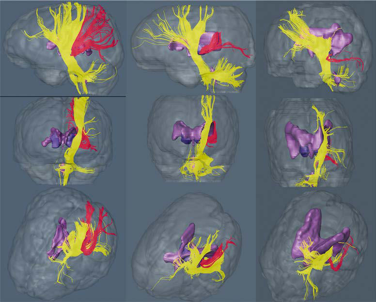

# Chapter 638: Encephalopathies
> **Course:** Vikkypaedia Pediatric Basic Course (*Nelson Textbook of Pediatrics, 22nd Edition (2025)*)  
> **Part XXV:** The Nervous System  
> **Authors:** Elizabeth Barkoudah  
> **Metrics:** 17,538 words · 14 tables/boxes · 1 figures · 42 genes · 8 flashcards · 5 MCQs  
> **Quick Navigation:** [🃏 Study 8 Flashcards](../flashcards/638_flashcards.md) · [📝 Take 5-Q MCQ Quiz](../mcqs/638_mcqs.md) · [📚 Part XXV Guide](../parts/Part_XXV.md) · [🧬 Syndrome & Genetics Atlas](../omim_gene_atlas.md) · [💊 Therapeutics Matrix](../therapies_matrix.md) · [🏠 Course Index](../../index.md)

## Key Chapter Topics & Subchapters
`638.1 Cerebral Palsy` · `638.2 Mitochondrial Encephalomyopathies` · `638.3 Other Encephalopathies` · `638.4 Autoimmune Encephalitis` · `638.1 Cerebral Palsy Elizabeth Barkoudah` · `638.2 Mitochondrial Encephalomyopathies Shamima Rahman` · `638.3 Other Encephalopathies Michael Perry and Cheryl Hemingway` · `638.4 Autoimmune Encephalitis Thaís Armangué and Josep Dalmau`

## Key Genetic & Molecular Targets
`ANE1`, `AR`, `ATL1`, `BSCL2`, `COA7`, `COA8`, `COQ4`, `COQ9`, `DARS2`, `DGUOK`, `EARS2`, `GAA`, `KIAA1840`, `KIF1A`, `KIF5A`, `LYRM7`

## ⚡ High-Yield Nelson Pediatric Board Pearls
- EPIDEMIOLOGY AND ETIOLOGY Cerebral palsy is the most common neuromotor disorder in child hood, with an overall incidence of 2.6-2.9 cases per 1,000 live births in the United States.
- The estimated lifetime cost to care for someone with CP in 2003, according to the Centers for Dis ease Control and Prevention (CDC), was $1 million.
- CP is caused by a broad group of developmental, genetic, metabolic, ischemic, infectious, and other etiologies that produce a common group of neurologic phenotypes.
- The inci dence of cystic PVL caused by a more diffuse injury pattern is being replaced by focal necrosis.
- PVL reflects the enhanced vulnerability of immature oligodendroglia in premature infants to oxidative stress caused by ischemia or infectious/inflammatory insults.
- The most common cause in this category is perinatal stroke, which can be ischemic, hemorrhagic, or thromboembolic in nature.
- The second most common cause is men ingitis or encephalitis during infancy.

---
## Full Chapter Text, Tables & Figures
# Chapter 638: Encephalopathies

*Elizabeth Barkoudah*

<!-- p.4693 -->
Oral medications are not the only options for treatment. Segmen tal dystonia, such as torticollis, often responds well to botulinum toxin injections. Safe dosage restrictions limit the use of botulinum toxin in generalized dystonia, but it may be used as a supplemental treatment if symptoms in particular muscle groups are the most bothersome or functionally impairing.

Intrathecal baclofen delivered through an implantable constantinfusion pump may be helpful in some patients. It is often more effec tive in the lower extremities than the upper extremities.

Deep brain stimulation with leads implanted in the globus pallidus is most helpful for children with severe primary generalized dystonia. Deep brain stimulation may also be of benefit in children with second ary dystonias, such as cerebral palsy, although the effect is not as robust. A combination of factors are thought to reduce the efficacy in cerebral palsy, including a lack of normal neural substrate, reduced opportunity for motor learning during critical developmental windows, and the fre quent presence of other neurologic impairments such as spasticity and weakness. It should only be considered if a trial of two to three oral

Childhood-onset dystonia

Further investigation Dopa-responsive dystonia

Continue dopaminergic therapy

Generalized or segmental

Trihexyphenidyl Botulinum toxin

Gabapentin

Clonidine, tetrabenazine, baclofen, benzodiazepines

Severely impaired function in

activities of daily living, pain

Consider indications for intrathecal

baclofen or pallidal stimulation

Focal

Disease-specific

treatment

Effective Not effective

Pilot dose of combination

levodopa and carbidopa

**Fig. 637.9** Algorithm showing therapeutic approaches to the man agement of childhood-onset dystonia. Pharmacologic agents should be used sparingly where possible. High doses and polypharmacy inevi tably arise when dystonia is severe enough to cause pain and interferes with daily cares, sitting comfort, and sleep. As with intractable epilepsy, consideration for functional neurosurgery should be considered when two or more drugs have failed to control dystonia. (From Lin JP. Advanc es in pharmacotherapies for movement disorders in children: current limitations and future progress. Curr Opin Pediatr. 2017;29:652–664, Fig. 6.)

**DRUG-INDUCED DYSTONIAS** In the case of drug-induced dystonias, removal of the offending agent and treatment with intravenous diphenhydramine typically suffice. For neuroleptic malignant syndrome, dantrolene may be indicated. As tar dive symptoms may not always respond to removal of the offending agent, dopamine depletors may be necessary

*Visit Elsevier Ebooks+ at eBooks.Health.Elsevier.com** for Bibliography.*

Encephalopathy is a generalized disorder of cerebral function that may be acute or chronic, progressive or static. The etiologies of the encephalopathies in children include infectious, toxic (carbon mon oxide, drugs, lead), metabolic, genetic, and ischemic causes. Hypoxicischemic encephalopathy is discussed in Chapter 122.4.

## 638.1  Cerebral Palsy Elizabeth Barkoudah

See also Chapters 56 and 637.4.

Cerebral palsy (CP) is a complex and heterogeneous disorder denot ing a group of permanent motor conditions that cause physical dis ability in human development, chiefly in the various areas of body movement. It can be defined as a central motor dysfunction affecting muscle tone, posture, and movement that is attributed to *nonprogres sive* disturbances in the developing fetal or infant brain. Despite being described as a nonprogressive disorder (historically referred to as *static encephalopathy* by some), the clinical expression of brain injury or insult changes over time. Therefore the condition should be viewed as a dynamic disorder that evolves because of factors such as growth, ner vous system maturation, and aging.

Several classification systems are used to describe CP, which reflects the complexity underlying the heterogeneity of cause, dis tribution, type of motor involvement, and severity. Consideration of associated manifestations such as cognitive deficits, seizures, com munication difficulties, visual impairment, and so on, as well as addressing the medical, surgical, and psychosocial needs requires a multidisciplinary approach.

**EPIDEMIOLOGY AND ETIOLOGY** Cerebral palsy is the most common neuromotor disorder in child hood, with an overall incidence of 2.6-2.9 cases per 1,000 live births in the United States. Within developed countries, both crosssectional and cohort-based studies estimate prevalence of CP as nearly 1-4 per 1,000 live births. In developing countries, available estimates of prevalence are similar. The estimated lifetime cost to care for someone with CP in 2003, according to the Centers for Dis ease Control and Prevention (CDC), was $1 million. Adjusting for inflation, this is now $1.2 million per individual and will continue to increase over time.

CP is caused by a broad group of developmental, genetic, metabolic, ischemic, infectious, and other etiologies that produce a common group of neurologic phenotypes. Thus CP should be based on phe notype rather than etiology. The prevalence of CP is higher for chil dren born preterm or at a low birthweight, though this is influenced by sex, ethnicity, and socioeconomic status. There is a 30–40% greater

*Elizabeth Barkoudah*

<!-- p.4695 -->
high-income communities. Rates of CP have only recently begun to decrease in developed countries, though direct interpretation of trends is complicated by changing patterns of neonatal care and survivorhood. Although overall prevalence has fluctuated, the specific etiologies and injury patterns have shifted over time given advances in perinatal and neonatal management.

In addition to prematurity and birthweight, numerous other prena tal and perinatal risk factors have been reported, though for many of these, a causal relationship has not been established. These risk factors include antenatal infection (chorioamnionitis, urinary tract infection), multiple pregnancy, and neonatal infection. Infertility treatments are also associated with a higher rate of CP, probably because these treat ments are often associated with multiple pregnancies. CP is most often multifactorial, and multiple risk factors coexist.

The cerebral disruption associated with CP can occur prenatally, perinatally, or postnatally in the first 2 years of life given that brain development is ongoing during this critical period. Congenital CP (due to cerebral injury/maldevelopment before or during birth) accounts for 85–90% of total cases, whereas acquired CP (due to cerebral injury after 1 month of life) is responsible for the remaining cases.

One can also consider different etiologies based on premature ver sus term births. The major lesions that contribute to CP in preterm infants are **intracerebral hemorrhage** and **periventricular leuko malacia** (PVL). Although the incidence of intracerebral hemorrhage has declined significantly, PVL remains a major problem. The inci dence of cystic PVL caused by a more diffuse injury pattern is being replaced by focal necrosis. PVL reflects the enhanced vulnerability of immature oligodendroglia in premature infants to oxidative stress caused by ischemia or infectious/inflammatory insults. White matter abnormalities (loss of volume of periventricular white matter, extent of cystic changes, ventricular dilation, thinning of the corpus callo sum) present on MRI at 40 weeks of gestational age in former preterm infants are a predictor of later CP. MRI with diffusion tensor imaging is being used to map white matter tracts more precisely in patients with spastic diplegia, and this technique has shown that thalamocor tical sensory pathways are often injured as severely as motor cortico spinal pathways (Fig. 638.1).

In term births, causes historically have primarily been thought to be by events during labor and delivery causing hypoxia. The mechanisms are predominately the result of cerebral ischemia and excitotoxicity. The cause can be obvious (i.e., placental abruption, meconium aspira tion), though at other times the etiology can be difficult to pinpoint. Risk factors can include eclampsia, hypercoagulability, and placental pathology. For some, no predisposing clinical factors are identified. **Hypoxic-ischemic encephalopathy (HIE)** may be decreasing as an apparent cause of CP in developed countries. Therapeutic hypothermia may reduce the risk of CP in term patients with HIE.

There are several causes of acquired CP. The most common cause in this category is perinatal stroke, which can be ischemic, hemorrhagic, or thromboembolic in nature. The second most common cause is men ingitis or encephalitis during infancy. Kernicterus is a rare cause of CP in developed countries, though cases (particularly in very preterm infants) persist.

**Cryptogenic CP** traditionally refers to an individual in which no clear perinatal etiology has been identified and accounts for ∼30% of cases. Chromosomal copy number variants and single gene disorders have been identified in ∼30% of patients with CP. Monogenic genetic variants have been identified in ∼30% of cases who met diagnostic cri teria for CP. A wide range of genes have been implicated in CP phe notypes, though a few are relatively more frequently seen including *TUBA1A, TUBB4A, COL4A1, SPAST, CTNNB1, GNAO1, STXBP1,* and *KIF1A*. Factors associated with exome sequencing–identified gene variants include patients without a perinatal risk factor, those with a positive family history, and patients with intellectual disability, epi lepsy, or autism spectrum disorders.

**CLINICAL MANIFESTATIONS** There are several classification systems to describe CP, a reflection of the complexity underlying the heterogeneity of cause, distribution, type of motor involvement, and severity (Table 638.1). Classification aids in understanding cause, coordinating care, monitoring comor bidities, treatment offerings and their prognosis, and long-term out comes. One such classification system starts by determining the type of motor involvement: spastic or extrapyramidal. **Spastic** CP can then be

**Fig. 638.1** Diffusion tensor image of white matter pathways in the brains of two patients with spastic diplegia on the right compared with a normal child on the far left. Yellow fibers are corticospinal pathways projected from the motor cerebral cortex at the top downward into the brainstem, whereas red fibers are thalamocortical sensory fibers projected from the thalamus upward to the cortex. In children with spastic diplegia, both the corticospi nal and thalamocortical pathways are reduced in size but the ascending thalamocortical pathways are more affected. (From Nagae LM, Hoon AH Jr, Stashinko E, et al. Diffusion tensor imaging in children with periventricular leukomalacia: variability of injuries to white matter tracts. AJNR Am J Neuro radiol. 2007;28:1213–1222.)

Lateral

AP

Left superior oblique

Posterior thalamic radiation

Fibers penetrating the posterior limb of internal capsule

<!-- p.4696 -->
further truncated topographically (Fig. 638.2), whereas extrapyrami dal is further categorized based on the type of involuntary movement seen. In **extrapyramidal** CP, the brain injury or insult spares the pyra midal tracts that cause spasticity resulting in disorders of movement, coordination, and balance. Clinically, these patients exhibit dystonia and/or choreoathetosis (collectively referred to as *dyskinetic*) or ataxia associated with lesions in the cerebellum or its connections. Spastic CP accounts for 80% of cases, whereas extrapyramidal makes up 20% of cases (15% dyskinetic and 5% ataxic).

Historically, CP has been classified as mild, moderate, and severe without specified criteria for each group and primarily used for diag nostic purposes. The Gross Motor Function Classification System (GMFCS) was developed to categorize CP based on abilities and limita tions in motor functioning. Goals included improved communication for treatment decisions, research into treatment outcomes, improved understanding and communication of the development of a child with CP, and anticipated future ambulatory needs. The emphasis is on *usual* rather than *best* motor performance in a variety of settings: home, school, and community.

**Spastic hemiplegia** has decreased spontaneous movements on the affected side and shows hand (handedness) preference at a very early age. The arm is often more involved than the leg, and difficulty in hand manipulation is evident by 1 year of age. Walking is usually delayed until 18-24 months, and a circumductive gait is apparent. Examina tion of the extremities may show growth arrest leading to shortened limbs and decreased muscle bulk on the affected side. Spasticity refers to the quality of increased muscle tone, which increases with the speed of passive muscle stretching and is greatest in antigravity muscles. It is apparent in the affected extremities, particularly at the ankle, causing an equinovarus deformity of the foot. An affected child often walks on tiptoe (toe-walking) because of the increased tone in the antigrav ity gastrocnemius muscles and tight contracted Achilles tendon; the affected upper extremity assumes a flexed posture when the child runs. Ankle clonus and a Babinski sign may be present, the deep tendon reflexes are increased, and weakness of the hand and foot dorsiflexors is evident. Difficulty in selective motor control is also present.

**Spastic monoplegia** is when only one limb is affected and may not be as obvious as other types of CP. Depending on which limb is affected, the child’s motor disability ranges from challenges with either fine or gross motor skills. A monoplegia that affects the arm may result in challenges with bimanual tasks, whereas when the legs are involved, toe walking may be seen.

**Spastic diplegia** is bilateral spasticity of the legs that is greater than in the arms. Spastic diplegia is strongly associated with injury to the immature white matter during the vulnerable period of immature

oligodendroglia between 20 and 34 weeks of gestation, hence seen in those born prematurely. The first clinical indication of spastic diple gia is often noted when an affected infant begins to crawl. The child uses the arms in a normal reciprocal fashion but tends to drag the legs behind more as a rudder (commando crawl) rather than using the nor mal four-limbed crawling movement. If the spasticity is severe, appli cation of a diaper is difficult because of the excessive adduction of the hips. Examination of the child reveals symmetric spasticity in the legs with brisk reflexes, ankle clonus, and a bilateral Babinski sign. When the child is suspended by the axillae, an extended scissoring posture of the lower extremities is maintained. Walking can be significantly delayed, the feet are held in a position of equinovarus, and the child walks on tiptoes. Severe spastic diplegia is characterized by disuse atro phy, impaired growth of the lower extremities, and disproportionate growth with normal development of the upper torso.

**Spastic quadriplegia** is the most severe form of CP because of marked motor impairment of all extremities and the high association with other comorbidities, including intellectual disabilities, seizure disorders, communication and visual impairment, and feeding diffi culties. Swallowing difficulties are common as a result of supranuclear bulbar palsies, often leading to aspiration pneumonia and growth fail ure. Neurologic examination shows increased tone and spasticity in all extremities, decreased spontaneous movements, brisk reflexes, and plantar extensor responses. Flexion contractures of the knees, elbows, and wrists are often present by late childhood. Children with spastic quadriparesis can also have extrapyramidal findings given the diffuse involvement of the brain injury.

**Extrapyramidal CP** can be divided into the two main types of involuntary movement seen: ataxia and dyskinesias. In this type of CP, injury is typically to the subcortical areas, which are centers for coor dination in movement and balance. Injury may not produce weakness, but rather the inability to voluntarily control movements. This type is less common than spastic CP and makes up approximately 15–20% of patients with CP.

**Ataxic CP** is the rarest form whose clinical picture is variable rang ing from hypotonia to mild spasticity in addition to incoordination depending on the other systems involved. Walking gait is often very wide and sometimes irregular. Control of eye movements and depth perception can be impaired. Often, fine motor skills requiring coor dination of the eyes and hands, such as writing, are difficult. Other causes of ataxia in infancy and childhood, including hydrocephalus, neoplasms, and degenerative disorders, should be ruled out before CP is diagnosed (see Chapter 637.1).

**Dyskinetic CP** is further divided into two groups: athetoid and dystonic. **Athetoid** CP includes cases with involuntary movement,

#### **Table 638.1** Classification of Cerebral Palsy and Major Causes

| Category / Parameter | Clinical Details & Findings |
| --- | --- |
| **MAJOR CAUSES** | Spastic diplegia (35%); Periventricular leukomalacia; Periventricular cysts or scars in white matter,; enlargement of ventricles, squared-off; posterior ventricles; Prematurity; Ischemia; Infection; Endocrine/metabolic (e.g., thyroid); Spastic quadriplegia (20%); Periventricular leukomalacia; Ischemia, infection; Multicystic encephalomalacia; Cortical malformations; Endocrine/metabolic, genetic/developmental; Hemiplegia (25%); Stroke: in utero or neonatal; Focal infarct or cortical, subcortical damage; Cortical malformations; Thrombophilic disorders; Infection; Genetic/developmental; Periventricular hemorrhagic infarction; Extrapyramidal (athetoid, dyskinetic) (15%); Asphyxia: symmetric scars in putamen and; thalamus; Kernicterus: scars in globus pallidus,; hippocampus; Mitochondrial: scarring of globus pallidus,; caudate, putamen, brainstem; No lesions: ? dopa-responsive dystonia; Hypoxia; Kernicterus; Mitochondrial; Genetic/metabolic |

<!-- p.4697 -->
especially in the arms, legs, and hands. With the current management of Rh and ABO incompatibility, the incidence of CP characterized by athetosis has markedly decreased (see Chapter 637). Athetoid CP is often caused by **kernicterus** secondary to high levels of bilirubin, and in this case the MRI scan shows lesions in the globus pallidus bilater ally, or it may be normal. Cases are still seen as a result of HIE as well. The affected infant is initially hypotonic, but a tendency toward arch ing and opisthotonus (dystonia) is noted, and obligatory tonic neck reflexes are present. These primitive motor patterns preclude orderly motor development such as reaching, rolling, and sitting. **Dystonic CP** encompasses cases that affect the trunk muscles more than the limbs and results in a fixed, twisted posture. Toward the end of the first year, repetitive, involuntary movements become more consistent with the full-blown picture of dystonic CP. Dystonia in CP presents as hyperto nia, involuntary postures and movements, or a combination.

Nearly all individuals with CP will have one or more medical, neu rologic, or psychiatric comorbidities. Neuropsychiatric comorbidities that occur at higher rates with CP include intellectual disability, anxi ety, depression, and attention-deficit/hyperactivity disorder (ADHD) compared with the general population. Other associated comorbidi ties are common and include chronic pain, sleep difficulties, urinary dysfunction, decreased bone health, sialorrhea, respiratory disorders, feeding and growth challenges, gastrointestinal disorders includ ing constipation and dysmotility, speech/communication difficulties, visual impairment, and hearing loss.

**DIAGNOSIS** CP is a clinical diagnosis that considers elements from the history, physical examination, and ancillary testing including neuroimaging. The history should focus on whether there was perinatal or postnatal injury to the brain, what factors led to this injury, and contributory pregnancy factors. Another important factor is the developmental tra jectory. It is important to quantify rates of development in the vari ous domains and whether that trajectory has been one of continued acquisition of skills, plateauing, or regression. This—especially no loss of acquired milestones (regression)—helps preclude a **progressive dis order** of the central nervous system (CNS), including degenerative dis eases, metabolic disorders, spinal cord tumor, or muscular dystrophy.

Multiple components to the physical examination are necessary to char acterize abnormalities of tone, reflexes, movements, posture, and balance that may be consistent with the diagnosis of CP. The physical examina tion should focus on the following features: presence of any limb deformi ties, curvature of the spine, range of motion of joints, muscle tone, muscle strength, reflexes, presence of any movement disorders, and gait.

An MRI scan of the brain is indicated to determine the location and extent of structural lesions or associated congenital malformations; an MRI scan of the spinal cord is indicated if there is any question about spinal cord pathology. An MRI with abnormalities consistent with CP supports the diagnosis and increases the level of certainty, but the diagnosis remains a clinical one. An early diagnosis of CP is desirable to initiate appropriate services and therapies and to provide a definitive diagnosis for families.

Additional studies may include tests of hearing and visual function. Genetic evaluation should be considered in patients with congenital malformations, evidence of metabolic disorders (e.g., amino acids, organic acids, MR spectros copy), clinical features atypical of CP, or when there are no perinatal risk factors especially in term infants (Fig. 638.3, Tables 638.2 and 638.3).

The differential diagnosis must include disorders that may **mimic** the various types of CP (see Fig. 638.3). These may include the hereditary spastic diplegias (Table 638.4), monoamine transmitter disorders such as dihydroxyphenylalanine (DOPA)-responsive dystonia **(Segawa disease)** (Table 638.5 and Fig. 638.4), and many treatable inborn errors of metab olism, including disorders of amino acids, creatine, fatty acid oxidation, lysosomes, mitochondria, organic acids, and vitamin cofactors.

**TREATMENT** The treatment strategy for CP is best developed in a multidisciplinary patient-centered setting, where medical interventions are embedded in a rehabilitation context considering the patient’s individual goals (see Chapter 752). The overarching goal for patients with CP is to maximize functioning by improved biomechanics resulting from abnormal tone, musculoskeletal deformities, and muscle weakness. Other goals outside of those related to the neuromotor component can be equally important when they pertain to quality of life, comfort, and social stigmatization. Clear communication and coordination among the multidisciplinary team (physiatry, orthopedic, neurology/neurodevelopmentalists, neu rosurgery) as well as physical and occupational therapy, speech pathol ogy, social work, primary care physicians, developmental pediatricians, and educators maximize the chances of success.

Parents should be taught how to work with their child in daily activi ties such as feeding, carrying, dressing, bathing, and playing in ways that reduce the effects of abnormal muscle tone. Families and children also need to be instructed in the performance of a series of exercises designed to promote developmental progress, prevent long-term complications such as the development of contractures, preserve range of motion,

Monoplegia

Diplegia Triplegia Quadriplegia

**Bilateral Cerebral Palsy**

**Unilateral Cerebral Palsy**

Hemiplegia

**Fig 638.2**  Topographical description in spastic cerebral palsy. Spastic cerebral palsy accounts for 70–80% of cases and is caused by an in jury of the pyramidal tracts affecting voluntary movement. Monoplegia and hemiplegia affect one side of the body; in monoplegia one limb is affected, whereas in hemiplegia both the arm and leg on one side are affected. Hemiplegia can be asymmetric, affecting the arm or leg greater than the other extremity. Diplegia, triplegia, and quadriplegia affect both sides of the body. In diplegia, the predominant picture is in volvement of the lower extremities. However, the arms can be affected though not to the same degree. In triplegia, both lower extremities and one arm are affected. A common picture is diplegia from periventricular leukomalacia and hemiplegia from an interventricular hemorrhage. This results in one lower extremity being more severely affected because of a dual mechanism of injury. In quadriplegia, all extremities are involved. *(From Graham HK, Rosenbaum P, Paneth N, et al. Cerebral palsy. Nat Rev Dis Primers. 2016;2:15082, Fig. 2.)*

<!-- p.4698 -->
Genetic CP Mimics

#### **Table 638.3** Brain MRI Findings Suggestive of Selected

| Category / Parameter | Clinical Details & Findings |
| --- | --- |
| **SELECTED CONDITIONS** | Hypomyelination; PLP1-related dysmyelinating; disorders; H-ABC (TUBB4A variant); AGS (may also have basal; ganglia and WM calcification); GM1 gangliosidosis; Demyelination; Krabbe disease; Metachromatic leukodystrophy; Thin corpus callosum; HSP (i.e., SPG4, SPG11, SPG15,; and others); Globus pallidus lesions; T2-hypointense: NBIA (SN also; involved in BPAN, MPAN),; fucosidosis; T2-hyperintense: MMA, PDH; deficiency, creatine deficiency; syndromes; Focal atrophy or hypoplasia; Glutaric aciduria type 1; (frontotemporal); H-ABC (cerebellum ± putamen); Joubert syndrome (cerebellum); AGS, Aicardi-Goutières syndrome; BPAN, beta-propeller protein–associated; neurodegeneration; H-ABC, hypomyelination with atrophy of the basal ganglia; and cerebellum; HSP, hereditary spastic paraplegia; MMA, methylmalonic aciduria;; MPAN, mitochondrial membrane protein-associated neurodegeneration; NBIA,; neurodegeneration with brain iron accumulation; PDH, pyruvate dehydrogenase;; WM, white matter.; From Pearson TS, Pons R, Ghaoui R, et al. Genetic mimics of cerebral palsy. Mov |

and strengthen weak muscles. Therapists help children to achieve their full potential and often recommend further evaluations and adaptive equipment.

**Rehabilitative strategies** include orthotics, casting, and physiother apy (see Chapter 752). Adaptive equipment can help individuals with CP achieve a greater level of independence and autonomy. Equipment such as braces, wheelchairs, and walkers can significantly improve mobility and increase self-confidence. Orthotics are devices that are used to help prevent foot and ankle deformities, improve stability during walking, and

**Infantile developmental delay,**

**mixed motor syndrome**

• Serum TSH • Serum uric acid • Serum amino acids • Serum lactate, pyruvate • Serum acylcarnitines • Serum biotinidase activity • Urine organic acids • CSF studiesb

• SNP-CGH microarray*

**Spasticity**

*Normal/non-specific*

*Abnormal*

Consider multi-gene panel or WES based on

phenotype, clinical and family history

Initial biochemical and genetic studies to consider

MRI brain +/– spinal cord

History/exam inconsistent with CP

due to perinatal brain injury

Directed genetic testing based on specific findingsa

• Serum ammonia • Serum lactate • Serum amino acids (including arginine, serine) • Urine organic acids • Serum biotinidase activity

• Genetic testing for HSP • SNP-CGH microarray*

**Dystonia/chorea**

• Serum TSH • Serum uric acid • Serum AFP • Serum lactate, pyruvate • Serum acylcarnitines • Urine organic acids • Urine purines, pyrimidines • Urine creatine, GAA • CSF studiesb

• Genetic testing for *NKX2.1* • SNP-CGH microarray*

**Ataxia**

• Serum AFP • Serum lactate, pyruvate • Serum biotinidase activity • Urine organic acids • Mitochondrial genetic analysis, CoQ10 level • SNP-CGH microarray*

**Fig. 638.3** Genetic mimics of cerebral palsy. Algorithm showing the general diagnostic approach to the patient with an infantile-onset, appar ently nonprogressive motor disorder. Studies are grouped by predominant clinical presentation; it may be appropriate to consider investigations from more than one group depending on the specific clinical context. *In many situations WES has replaced microarray testing. aSee examples in Tables 638.2 and 638.3 bCSF studies: glucose (+ serum glucose), lactate, pyruvate, neurotransmitter metabolites (biogenic amines + GABA), pterins, 5-methyltetrahydrofolate; HSP, hereditary spastic paraplegia. (From Pearson TS, Pons R, Ghaoui R, Sue CM. Genetic mimics of cerebral palsy. Mov Disord. 2019;34:625–636, Fig. 1, p. 627.)

Evaluation for Genetic and Metabolic Conditions in a Patient Presenting with Symptoms of CP

#### **Table 638.2** Clinical Features That Should Prompt

| Category / Parameter | Clinical Details & Findings |
| --- | --- |
| **General** | Absent history of any perinatal risk factor for brain injury; Family history of sibling with similar neurologic symptoms; Motor symptom onset after an initial period of normal development; Developmental regression; Progressive neurologic symptoms; Paroxysmal motor symptoms or marked fluctuation of motor; symptoms; Clinical exacerbation in the setting of a catabolic state (e.g., febrile; illness); Isolated generalized hypotonia; Prominent ataxia; Signs of peripheral neuromuscular disease (reduced or absent; reflexes, sensory loss); Eye movement abnormalities (e.g., oculogyria, oculomotor apraxia,; or paroxysmal saccadic eye-head movements); From Pearson TS, Pons R, Ghaoui R, et al. Genetic mimics of cerebral palsy. Mov; Disord. 2019;34:625–636, Table. 1, p. 628. |

<!-- p.4699 -->

#### **Table 638.4** Clinical and Neuroimaging Findings in Hereditary Spastic Paraplegias (HSP) with Pediatric Onset*

| Category / Parameter | Clinical Details & Findings |
| --- | --- |
| **FINDINGS (BRAIN)** | Pure |
| **ATL1** | +++; None; Normal; Pure |
| **SPAST** | ++; None; Leukoencephalopathy,; thin corpus callosum; Pure |
| **NIPA1** | +; None; Normal; Pure |
| **KIF5A** | +++; Neuropathy; Normal; Pure |
| **RTN2** | +++; None; Normal; Pure |
| **REEP1** | ++; None; Normal; Complicated |
| **SPG1** | X-linked |
| **L1CAM** | ++; Intellectual disability, adducted; thumb; Thin corpus callosum; Complicated |
| **SPG2** | X-linked |
| **PLP1** | +++; Intellectual disability, epilepsy; Normal; Complicated |
| **SPG7** | +; Optic atrophy, neuropathy,; cerebellar ataxia; Cerebellar atrophy; Complicated |
| **KIAA1840** | +++; Intellectual disability, neuropathy; Leukoencephalopathy,; thin corpus callosum; Complicated |
| **ZFYVE26** | +++; Intellectual disability, retinopathy,; cerebellar ataxia; Leukoencephalopathy,; thin corpus callosum; Complicated |
| **BSCL2** | +; Neuropathy; Normal; *Onset before 18 yr of age.; †Other than the classic HSP symptoms, including spastic paraparesis, atrophy of the distal lower extremities, and neurogenic bladder dysfunction.; AD, autosomal dominant; AR., autosomal recessive; +, occasional; ++, common; +++, characteristic.; From Lee RW, Poretti A, Cohen JS, et al. A diagnostic approach for cerebral palsy in the genomic era. Neurol Med. 2014;16:821–844, Table 5, p. 832. |

#### **Table 638.5** Clinical Features of the Monoamine Neurotransmitter Disorders

| Category / Parameter | Clinical Details & Findings |
| --- | --- |
| **GTPCH-D** | Childhood (but; can occur at any; age); Not; common; Yes; Yes; No; No; No; Yes |
| **SR-D** | Infancy; In most; Yes; Yes; Yes; Yes; Yes; Yes |
| **GTPCH-D** | Infancy; Yes; Yes; Yes; Yes; Yes; Yes; Yes |
| **PTPS-D** | Infancy to; childhood; In most; Yes; Yes; Yes; Yes; Yes; Yes |
| **DHPR-D** | Infancy to; childhood; Yes; Yes; Yes; Yes; Yes; Yes; Yes |
| **PCD-D** | Infancy; No; No; No; No; No; No; No |
| **TH-D** | Infancy to early; childhood; In most; Yes; Yes; Yes; Yes; Yes; No |
| **AADC-D** | Mainly infancy; (but can occur; at any age); Yes; Yes; Yes; Yes; Yes; Yes; Yes |
| **PLP-DE** | Infancy to early; childhood; In most; Yes; Yes; Yes; Yes; Yes; Yes |
| **DTDS** | Infancy; Yes; Yes; Yes; Yes, in older; children; No; Yes; No; AD GTPCH-D, autosomal dominant GTP cyclohydrolase deficiency; SR-D, D-Serine; AR GTPCH-D, autosomal recessive GTP cyclohydrolase deficiency; PTPS-D, 6-pyruvoyl tetrahydropterin synthase; deficiency; DHPR-D, dihydropteridine reductase deficiency; PCD-D, pterin-4α carbinolamine dehydrase deficiency; TH-D, tyrosine hydroxylase deficiency; AADC-D, aromatic l-amino acid; decarboxylase deficiency; PLP-DE, pyridoxal 5 phosphate dependent enzymes; DTDS, dopamine transporter deficiency syndrome.; From Kurian MA, Gissen P, Smith M, et al. The monoamine neurotransmitter disorders: an expanding range of neurological syndromes. Lancet Neurol. 2011;10:721–731, Table, p. 722. |

<!-- p.4700 -->
sometimes relieve pain. Additional equipment needs address activities of daily living such as bathing and hygiene, communication, and driving.

**Pharmacotherapy** is often the first-line approach used to manage the various tone abnormalities seen in CP and includes both enteral options and targeted injections. Systemic medications are often cho sen for more widespread management of spasticity and dyskinesias. Although baclofen is routinely favored, other antispasticity medica tions such as tizanidine, dantrolene, and benzodiazepines are also available. Second-line medications such as clonidine or gabapentin may provide dual benefit for both tone management and other neuro logic associations, including sleep disruption, dysautonomia, pain, and neuroirritability. Medications used to treat dystonia include enteral baclofen, benzodiazepines, trihexyphenidyl, clonidine, dantrolene, levodopamine, and gabapentin, but practice varies widely. Tetrabena zine can be useful for hyperkinetic movement disorders, including ath etosis or chorea.

The management of focal/segmental spasticity or dystonia includes chemodenervation agents that target these specific locations. Tar geted injections are often used in combination with systemic medica tions to augment tone management in specific areas that are more problematic. Examples include **botulinum toxin A** (BoNT-A), phe nol, and ethyl alcohol. Targeted injections combined with rehabilita tive therapies can allow for improved motor functioning and delay or avoid orthopedic surgery; these injections require repeat adminis tration. Typically repeat injections are performed every 4-6 months, primarily to avoid the development of resistance; 3 months may be necessary. Injections into salivary glands may also help reduce the severity of drooling if it is not adequately treated with anticholinergic agents.

**Neurosurgical options** include intrathecal baclofen (ITB), selective dorsal rhizotomy (SDR), and deep brain stimulation (DBS). **ITB** can be considered in patients whose spasticity is not adequately treated with enteral baclofen or who are experiencing side effects such as sedation,

weakness, or gastrointestinal (GI) symptoms. Baclofen is delivered with an implanted pump in children with severe spasticity; it is useful because it delivers the drug directly around the spinal cord, where it reduces neurotransmission of afferent nerve fibers. Direct delivery to the spinal cord overcomes the problem of CNS side effects caused by the large oral doses needed to penetrate the blood-brain barrier. ITB may reduce dystonia with evidence for benefit with higher catheter placement.

The main goal of **SDR** is to improve the gait or functioning in those that function at GMFCS I-III with good selective motor control and minimal weakness. However, SDR is being looked at for manage ment of tone, minimizing pain, and ease of caregiving in patients functioning on a GMFCS IV-V level. Because SDR is an irreversible treatment for spasticity, optimal selection of ideal candidates from a multidisciplinary approach is necessary to avoid short- and longterm complications. SDR’s spasticity benefits are caused by a partial sensory deafferentation of the spinal cord. This is achieved by resec tion of dorsal nerve rootlets based on abnormal motor responses to electrical stimulation (Fig. 638.5). The total number of nerve root lets resected ranges from 25% to 40%, though in some institutions it exceeds >40%. Combining both ventral and dorsal rhizotomies can help manage both spasticity and dystonia. SDR manages lower extremity tone equally as the ITB pump, may provide more upperextremity tone control compared with the ITB pump, and improves bladder function.

**DBS** can be considered if there is severe hypertonia with com bined spasticity and dystonia. DBS is a neurosurgical procedure that evolved from the recognition that pallidotomies and thalamotomies could help patients with medically refractory dystonia. It involves the introduction of stimulating electrodes in areas of the brain such as the globus pallidus and the subthalamic nucleus, which are con nected to an extracranial pulse generator (see Chapter 637). After the surgical procedure, the beneficial effects are not immediately

Mitochondrial diseases Rett syndrome Epileptic encephalopathies Pontocerebellar hypoplasia Perinatal asphyxia Disorders of folate metabolism Phenylketonuria Lesch-Nyhan disease Opsoclonus-myoclonus Leukodystrophies Neuropsychiatric disorders Dystonic disorders Neuromuscular disorders Spontaneous periodic hypothermia and hyperhidrosis Pelizeaus-Merzbacher HIE PKAN Cerebral palsy Autistic spectrum disorder Non-specific developmental delay

Disorders of selective serotonin deficiency DNRD Idiopathic focal dystonia PKD

Secondary monoamine neurotransmitter defects in neurologic disorders

Monoamine neurotransmitter disorders of unknown origin Primary monoamine neurotransmitter disorders

The monoamine neurotransmitter disorders

Cofactor deficiency Enzyme deficiency Defective monoamine transport

Vitamin B6 deficiency

TH-D AADC-D

DTDS BH4 deficiency

Phenylalanine level normal

PLP-DE P-DE

AR GTPCH-D PTPS-D DHPR-D

AD GTPCH-D SR-D

Phenylalanine level abnormal

**Fig. 638.4** Classification of the monoamine neurotransmitter disorders. BH4, Tetrahydrobiopterin; TH-D, tyrosine hydroxylase deficiency; AADC- D, aromatic L-amino acid decarboxylase deficiency; DTDS, dopamine transporter deficiency syndrome; PLP-DE, pyridoxal-phosphate–dependent epilepsy; P-DE, pyridoxine-dependent epilepsy; AD GTPCH-D, autosomal dominant GTP cyclohydrolase 1 deficiency; SR-D, sepiapterin reductase deficiency; AR GTPCH-D, autosomal recessive GTP cyclohydrolase 1 deficiency; PTPS-D, 6-pyruvoyltetrahydropterin synthase deficiency; DHPR-D, dihydropteridine reductase deficiency; HIE, hypoxic-ischemic encephalopathy; PKAN, pantothenate kinase associated neurodegeneration; DNRD, dopa-nonresponsive dystonia; PKD, paroxysmal kinesigenic dyskinesia. (From Kurian MA, Gissen P, Smith M, et al. The monoamine neurotransmitter disorders: an expanding range of neurological syndromes. Lancet Neurol. 2011;10:721–731, Fig. 1.)

<!-- p.4701 -->
B

A

**Fig. 638.5** Schematic of the technique of selective dorsal rhizotomy. A, After laminectomy, the dura is opened and the dorsal spinal rootlets are exposed. The rootlets are stimulated so that abnormal rootlet activ ity can be identified. B, A proportion of rootlets is transected. (From Koman LA, Smith BP, Shilt JS. Cerebral palsy. Lancet. 004;363:1619– 1631. Reproduced with permission from Wake Forest University Ortho paedic Press.)

visible, often taking several months. The procedure is associated with perioperative risks as well as infection and hardware compli cations. Therefore patient selection and consideration of the appro priate target for stimulation for DBS are key. Most agree that the presence of spasticity, contractures/deformities, and myelopathy are poor predictors of response and that neurosurgical expertise, anatomic factors, and severity/time of dystonic symptoms may influence response.

**Orthopedic interventions** address musculoskeletal pathol ogy, including fixed muscle contractures, torsion of long bones, hip displacement, and spine deformities. Several surgical meth ods exist for lengthening the muscle-tendon units for contraction management, though these are rarely necessary before 6 years of age. Before this, prevention of contracture development is key and often is a combination of tone management, bracing, and stretching exercises. Femoral and tibial torsion occur, respectively, because of failure of remodeling fetal anteversion and mostly as a response to abnormal biomechanical forces during walking. Derotational osteotomies are ideally performed between 6 and 12 years of age. With increasing GMFCS level comes increased risk of developing hip displacement and neuromuscular scoliosis. Monitoring and prevention strategies are paramount, as both hip displacement and scoliosis may progress with age. Conservative treatment and surgical approaches can be challenging when bal ancing the complexity of these surgical interventions and outcome goals defined presurgically.

*Visit Elsevier eBooks+ at eBooks.Health.Elsevier.com** for Bibliography.*

## 638.2  Mitochondrial Encephalomyopathies Shamima Rahman

Mitochondrial encephalomyopathies are complex neurologic disor ders caused by disturbed mitochondrial function. Mitochondria are dynamic cellular organelles with multitudinous roles, most notably energy generation via oxidative phosphorylation (OXPHOS), but other mitochondrial functions include intermediary metabolism (the Krebs cycle, fatty acid beta oxidation, and part of the urea cycle are housed in the mitochondrion), calcium homeostasis, intracellular sig naling, apoptosis, and biosynthesis of coenzyme Q10, heme, iron-sulfur

clusters, and lipoic acid. Aberrant mitochondrial function most com monly involves disturbed energy generation via the OXPHOS system, but other mechanisms include oxidative stress mediated by increased production of reactive oxygen species (ROS), alterations of other meta bolic processes within the mitochondria (such as pyruvate dehydroge nase, the Krebs cycle, vitamin metabolism and transport, and cofactor biosynthesis) and of the mitochondrial lipid membranes, protein qual ity control, import system, and organelle dynamics (disturbed fission and fusion).

Mitochondria are unique among cellular organelles in that they contain their own genome: the maternally inherited circular mito chondrial DNA (mtDNA) molecule comprising 16,569 base pairs in humans encoding 37 genes: 13 protein-coding genes, 22 transfer RNAs (tRNAs), and 2 ribosomal RNAs (rRNAs). The mitochondrial genome is present in multiple copies within each mitochondrion, and there are hundreds to thousands of mtDNA molecules per cell. mtDNA gene variants may be heteroplasmic (only a percentage of the mtDNA is mutated) or homoplasmic (100% of the mtDNA is mutated). Pri mary mitochondrial disease may be caused by maternally inherited or sporadic variants affecting the mtDNA or by recessive, dominant, X-linked, or de novo variants in nearly 400 nuclear genes involved in mitochondrial function and structure.

Mitochondrial disorders, especially those presenting in childhood, have a predilection for high-energy-consuming organs: the brain, skel etal muscle, eyes, ears, heart, kidneys, and liver. Neurologic features of primary mitochondrial disease in childhood include hypotonia, dysto nia, spasticity, ptosis, progressive external ophthalmoplegia (PEO), sei zures, and ataxia. Multisystem features that may be observed in children with mitochondrial disease are illustrated in Figure 638.6. Some mito chondrial syndromes with characteristic constellations of symptoms and signs were recognized many decades before their genetic basis was understood; several of these syndromes are summarized in Table 638.6.

Mitochondrial encephalomyopathies can be considered according to age at onset of symptoms. In early **infancy** the most frequent pre sentations include Leigh syndrome, the mtDNA depletion syndromes (MDDS), disorders of coenzyme Q10 (CoQ10) biosynthesis, and revers ible infantile respiratory chain disease (RIRCD). Clinical syndromes observed later in **childhood** include Kearns-Sayre syndrome (KSS), mitochondrial encephalomyopathy with lactic acidosis and stroke like episodes (MELAS), myoclonic epilepsy with ragged red fibers (MERRF), and neurogenic muscle weakness, ataxia, and retinitis pig mentosa (NARP). However, many children presenting with mitochon drial disease have overlapping features not specific to an individual

Encephalopathy–strokes, seizures, developmental delay and regression

Enteropathy

SNHL Ptosis, PEO, optic atrophy, pigmentary retinopathy

Cardiomyopathy, conduction defects

Liver failure

Anemia

Myopathy

Diabetes, pancreatic exocrine insufficiency

Peripheral neuropathy

Renal tubulopathy

**Fig. 638.6** Clinical features of mitochondrial encephalomyopathies. PEO, progressive external ophthalmoplegia; SNHL, sensorineural hear ing loss. (Adapted from Rahman S. Mitochondrial disease in children. J Intern Med. 2020;287[6]:609–633.)

<!-- p.4702 -->

<!-- p.4703 -->

#### **Table 638.6** Clinical Manifestations of Syndromic Mitochondrial Encephalomyopathies

| Category / Parameter | Clinical Details & Findings |
| --- | --- |
| **CNS** | Regression; +; +; +; +; Seizures; ±; +; +; Ataxia; ±; +; +; +; +; Cortical blindness; ±; +; Deafness; ±; +; +; Migraine; +; Hemiparesis; +; Myoclonus; +; +; Movement disorder; +; +; +; ±; Nerve; Peripheral neuropathy; ±; +; +; +; +; Muscle; Ophthalmoplegia; ±; +; Weakness; +; +; +; +; +; RRF on muscle biopsy; ±; +; +; +; Ptosis; ±; +; Eye; Pigmentary; retinopathy; ±; +; +; Optic atrophy; +; +; +; Heart; Conduction block; +; ±; Cardiomyopathy; ±; +; Lactic acidosis; +; +; +; +; +; Endocrine; Diabetes mellitus; +; +; Short stature; +; +; +; +; Kidney; Tubulopathy; ±; +; +; +; KSS, Kearns-Sayre syndrome; LHON, Leber hereditary optic neuropathy; MELAS, mitochondrial myopathy, encephalopathy, lactic acidosis, and strokelike episodes; MERRF,; myoclonic epilepsy with ragged red fibers; NARP, neuropathy, ataxia, and retinitis pigmentosa; RRF, ragged red fibers.; Courtesy Prof. Shamima Rahman, Great Ormond Street Institute of Child Health, London, United Kingdom. |

syndrome, whereas others may present with a single clinical feature, such as an epileptic encephalopathy, leukoencephalopathy, myopathy, or isolated optic atrophy.

**LEIGH SYNDROME** Leigh syndrome, or subacute necrotizing encephalomyelopathy, is a clinical syndrome of neurodevelopmental delay and/or regression and variable other neurologic features, including dystonia, hypotonia, spas ticity, ataxia, and seizures, with characteristic MRI brain appearances and biochemical evidence of mitochondrial dysfunction. Peak onset is usually in the first 2 years of life (mean 7 months), although longer sur viving cases and adult onset are both recognized. Initial symptoms may be nonneurologic, including feeding difficulties, vomiting, and poor weight gain in infancy. Eye involvement is a frequent finding, including nystagmus, ptosis, PEO, optic atrophy, and retinitis pigmentosa. MRI reveals bilateral, usually symmetric T2-weighted hyperintense lesions variably affecting the basal ganglia, thalamus, midbrain, and brainstem structures (Fig. 638.7). These imaging lesions reflect the neuropathol ogy, which consists of spongiform lesions with cavitation, neuronal loss, demyelination, and capillary proliferation.

Biochemical features are variable in Leigh syndrome and include elevated lactate in blood and/or cerebrospinal fluid (CSF) and isolated or combined deficiency of one or more OXPHOS enzymes. Normal biochemical findings do not exclude the diagnosis. Leigh syndrome is genetically heterogeneous, and more than 100 monogenic causes have been identified, including variants in both mtDNA-encoded

genes (responsible for 25–30% of cases) and nuclear genes. Modes of inheritance include maternal (for mtDNA variants), autosomal reces sive, X-linked, and de novo dominant. **MEGDEL** (3-**me**thyl**g**lutaconic aciduria with **d**eafness and **e**ncephalopathy, **L**eigh-like) syndrome is a subtype of Leigh syndrome caused by biallelic variants in *SERAC1* encoding a protein involved in remodeling mitochondrial membrane lipids. Affected infants typically fail the newborn hearing screen and have problems with hypoglycemia and hyperammonemia related to hepatic dysfunction. Some infants succumb to liver failure, but hepatic function improves in most affected individuals, who later progress to a neurodegenerative course with prominent dystonia and loss of skills.

A few causes of Leigh syndrome are potentially treatable. These include deficiencies of biotinidase (an enzyme required for biotin recycling within the cell), the thiamine transporter SLC19A3 (also associated with biotin-thiamine–responsive basal ganglia disease), and proteins required for biosynthesis of CoQ10, a mobile electron car rier in the mitochondrial respiratory chain. All other forms of Leigh syndrome have no curative treatments and are associated with a pro gressive neurodegenerative course with early death, usually caused by respiratory failure secondary to brainstem lesions affecting the respi ratory center. Median age at death was reported as 2.4 years in one cohort, but this is variable and related to the underlying genetic cause. Longer survival has been reported in some forms of Leigh syndrome, including MEGDEL and deficiencies of SURF1 (an assembly factor for OXPHOS complex IV) and SUCLA2 (a subunit of the Krebs cycle enzyme succinyl-CoA ligase).

<!-- p.4704 -->
**MITOCHONDRIAL DNA DEPLETION SYNDROMES** The most prevalent MDDS is **Alpers-Huttenlocher syndrome** (pro gressive neuronal degeneration of childhood with epilepsy, PNDE) caused by recessively inherited gene variants in *POLG* encoding the catalytic subunit of DNA polymerase γ, the polymerase responsible for replicating the mtDNA. Affected individuals frequently present with intractable epilepsy, particularly epilepsia partialis continua, around 12 months of age. A characteristic EEG finding in the early stages of the disease is rhythmic high amplitude with delta spikes (RHADS).

Repeated episodes of status epilepticus frequently lead to a median age of death of around 16 months (there is typically a median of 4 months between presentation with seizures and death). Sodium val proate is absolutely contraindicated in Alpers-Huttenlocher syndrome and other presentations of *POLG* disease because exposure to valproate may trigger fatal hepatic failure.

Recessive pathologic variants of at least 12 genes have been linked to infantile- and childhood-onset MDDS (Table 638.7). There is often a period of normal development lasting weeks to months before clinical

A

D

B

Cho

MI

Cr

NAA

Lactate

C

Cho

Cr

NAA

Lactate

E

Cho MI

Cr

NAA

Lactate

F

Cho

Cr

NAA

Lactate

**Fig. 638.7** Complex I deficiency in an 8-yr-old child with magnetic resonance examinations acquired approximately 3 mo apart. Axial T2-weighted (A), short echo magnetic resonance spectroscopy (MRS) (B), and long echo MRS (C) images were obtained. The imaging reveals a pattern char acteristic of Leigh syndrome with an abnormal hyperintense signal bilaterally within the caudate and globus pallidus. The MRS image acquired in the left basal ganglia at a period of clinical exacerbation caused by febrile illness demonstrates a dramatic elevation of lactate compared with her routinely observed levels as shown in axial T2-weighted (D), short echo MRS (E), and long echo MRS (F) images. The spectra acquired 3 mo later demonstrate a significant reduction in lactate. A comparison of the imaging data is unremarkable between the examinations. The dramatic elevation of lactate revealed on MRS in (B) and (C) corresponds to worsening clinical symptoms (seizures and leg stiffening). The lactate levels observed in (E) and (F) are typical and consistent with this mitochondrial defect. (From Cecil KM. MR spectroscopy of metabolic disorders. Neuroimaging Clin N Am. 2006;16:87–116.)

#### **Table 638.7** Mitochondrial DNA Depletion Syndromes

| Category / Parameter | Clinical Details & Findings |
| --- | --- |
| **POLG** | mtDNA replication; Alpers, juvenile epilepsy; syndromes, ataxia, PEO; +; + |
| **TWNK** | mtDNA replication; Hepatocerebral disease,; IOSCA, juvenile epilepsy; syndromes, PEO; +; + |
| **TFAM** | mtDNA replication; Hepatocerebral disease; + |
| **MGME1** | mtDNA replication; Encephalomyopathic; +; + |
| **SLC25A4** | Nucleoside metabolism; Encephalomyopathic, cardiac; +; + |
| **DGUOK** | Nucleoside metabolism; Hepatocerebral disease; +; + |
| **TK2** | Nucleoside metabolism; Progressive myopathy; +; + |
| **MPV17** | Nucleoside metabolism; Hepatocerebral disease; +; + |
| **RRM2B** | Nucleoside metabolism; Encephalomyopathic, SNHL,; renal tubulopathy; +; + |
| **SUCLA2** | Nucleoside metabolism; Encephalomyopathic (LSS), |
| **SNHL** | + |
| **SUCLG1** | Nucleoside metabolism; Encephalomyopathic,; hepatocerebral disease; + |
| **TYMP** | Nucleoside metabolism |
| **MNGIE** | +; +; *All are recessive disorders, but, in addition, de novo dominant variants of SLC25A4 may also present as MDDS.; IOSCA, Infantile-onset spinocerebellar ataxia; LSS, Leigh syndrome spectrum; MNGIE, mitochondrial neurogastrointestinal encephalopathy; PEO, progressive external; ophthalmoplegia.; Courtesy Prof. Shamima Rahman, Great Ormond Street Institute of Child Health, London, United Kingdom. |

<!-- p.4705 -->
A B C

**Fig. 638.8** Mitochondrial encephalomyopathy, lactic acidosis, and strokelike symptoms (MELAS) in a 13-yr-old male. Axial diffusion-weighted im aging (A), axial apparent diffusion coefficient (ADC) map (B), and an axial arterial spin labeling color map (C) are shown. Scattered foci of vasogenic edema denoted by arrows corresponding to increased perfusion are identified in the acute phase of the disease in the right cerebral hemisphere. (From Zuccoli G, Cecil KM. Inherited metabolic and neurogenerative disorders. In: Coley BD, ed. Caffey’s Pediatric Diagnostic Imaging, 13th ed. Philadelphia: Elsevier; 2019: Fig. 33.8, p. 312.)

manifestations become apparent. Associated organ involvement may provide a clue to the underlying genetic diagnosis: sensorineural hear ing loss (SNHL) and methylmalonic aciduria occur in *SUCLA2* defects, SNHL and renal tubular involvement in *RRM2B* defects, and hepatic involvement is associated with *DGUOK, MPV17, POLG, TWNK, TFAM,* and *SUCLG1* gene variants. **Thymidine kinase 2 (TK2) defi ciency** appears to be a special case because this disorder leads to a pure myopathic presentation in most affected cases. Clinical response to nucleoside supplementation has been reported for TK2 deficiency but not for any other form of MDDS.

**DISORDERS OF COENZYME Q****10**** BIOSYNTHESIS** CoQ10 functions as a mobile electron carrier and antioxidant in the mitochondrial inner membrane. CoQ10 is synthesized by a complex biosynthetic pathway, 10 defects of which have been linked to human disease. Clinical presentations of these recessive disorders include an infantile encephalomyopathy with prominent seizures and dys tonia variably associated with multisystem features: SNHL, optic atrophy, pigmentary retinopathy, cardiomyopathy, and renal disease. Other presentations include ataxia, myopathy, and steroid-resistant nephrotic syndrome. Affected patients should be treated with highdose CoQ10 supplementation, although clinical response is variable.

**REVERSIBLE INFANTILE RESPIRATORY CHAIN DEFICIENCY** RIRCD, also known as *benign reversible mitochondrial myopathy,* typi cally presents after a period of normal development lasting 3-6 weeks with profound lactic acidosis and progressive muscle weakness, often leading to a need for enteral tube feeding and, in some cases where the respiratory muscles are severely affected, artificial ventilation. A ventilatory requirement may persist for up to 18 months. Muscle biopsy reveals ragged red and cytochrome *c* oxidase negative fibers with multiple OXPHOS enzyme deficiencies on spectrophotometric assay. This condition is linked to two homoplasmic variants at the same nucleotide in mtDNA: m.14674T>G and m.14674T>C. Although all maternally related individuals are homoplasmic for the variant, only a small proportion are clinically affected. Studies have also identi fied potential modifying variants in several nuclear-encoded genes involved in mitochondrial translation, particularly *EARS2*. Spontane ous recovery of muscle strength is associated with excellent neurode velopmental outcomes. Because it is not possible to distinguish RIRCD

from fatal infantile mitochondrial myopathies, rapid testing for the m.14674T>G/C variants is recommended in all infants presenting with severe muscle weakness and lactic acidosis, so that ventilatory support can be provided to affected infants if needed.

Another form of RIRCD is a reversible hepatopathy caused by reces sive variants in the *TRMU* gene encoding a protein required to modify mitochondrial tRNAs. Affected infants present with acute liver failure, variably associated with encephalomyopathic features.

**KEARNS-SAYRE SYNDROME** KSS is defined by a *clinical triad* of PEO, pigmentary retinopathy, and heart block, with age of onset <20 years. Other neurologic features include cerebellar ataxia, elevated CSF protein levels, progressive myopathy, and cognitive decline. A peculiar feature of KSS is white matter disease associated with cerebral folate deficiency. Low levels of CSF 5-methyltetrahydrofolate (5-MTHF) and clinical response to folinic acid supplementation have been documented in some patients. Variable associated multisystem disease features include SNHL, renal tubulopathy, endocrine dysfunction (diabetes mellitus, hypoparathyroidism, and short stature with growth hormone defi ciency in some cases), and cardiomyopathy. KSS is usually a sporadic condition caused by single large-scale mtDNA deletions (SLSMDs); many individuals have a common 4.9kb mtDNA deletion. SLSMDs are associated with a continuous clinical spectrum ranging from infantile-onset Pearson syndrome to adult-onset isolated PEO with out systemic features.

**MITOCHONDRIAL ENCEPHALOMYOPATHY WITH LACTIC ACIDOSIS AND STROKELIKE EPISODES** MELAS is a maternally inherited disorder that typically presents toward the end of the first decade with migraine headache, vomiting, and seizures, which may lead to a strokelike episode. MRI of the brain reveals focal lesions with a parieto-occipital predilection not confined to a vascular territory (Fig. 638.8). Other clinical features include hemianopia during the strokelike episodes, ptosis, optic atrophy, pig mentary retinopathy, SNHL, exercise intolerance, cognitive decline, GI dysmotility, cardiomyopathy, renal impairment, and diabetes mellitus. Eighty percent of cases have a common maternally inherited mtDNA gene variant m.3243A>G in the *MT-TL1* gene encoding a tRNA for leucine. This gene variant is present in 1 in 400 of the general popu lation, yet MELAS is a rare disorder. Most individuals harboring the

<!-- p.4706 -->
m.3243A>G variant are asymptomatic or oligosymptomatic or have non-MELAS presentations, including **maternally inherited diabetes and deafness (MIDD)**, cardiomyopathy, sudden unexpected death, or isolated renal involvement (focal segmental glomerulosclerosis). Other causes of MELAS include other mtDNA variants, particularly in the *MT-TL1* gene or in mtDNA-encoded subunits of complex I (especially ND5), and occasionally *POLG* disease can mimic MELAS.

**MYOCLONIC EPILEPSY WITH RAGGED RED FIBERS** MERRF is a maternally inherited syndrome characterized by pro gressive myoclonic epilepsy and cerebellar ataxia with nystagmus and dysarthria. Onset may be in late childhood or adult life, and the disor der may be rapidly progressive or have a more indolent course. Other neurologic features include other seizure types, spasticity, peripheral neuropathy, SNHL, ptosis, PEO, optic atrophy, cognitive decline, and psychiatric manifestations. MERRF can also mimic MELAS, includ ing strokelike episodes. MERRF is typically a multisystemic disorder; extraneurologic features include multiple symmetric lipomatosis, endocrine disturbance (growth hormone deficiency, hypothyroid ism, adrenal insufficiency), and cardiomyopathy. A common mtDNA pathologic variant, m.8344A>G in the *MT-TK* gene encoding the tRNA for lysine, accounts for 80% of cases of MERRF. Patients with a very high percentage of this variant (typically >90%) present with **Leigh syndrome** in infancy. The remaining patients with MERRF have other mtDNA tRNA gene variants; occasionally *POLG* disease may mimic MERRF.

**NEUROGENIC MUSCLE WEAKNESS, ATAXIA, AND RETINITIS PIGMENTOSA** NARP is a maternally inherited disorder caused by a relatively com mon mtDNA gene variant, m.8993T>G, in the *MT-ATP6* gene encod ing the ATP6 subunit of ATP synthase (OXPHOS complex V). Patients usually have a gene variant load of ∼70%, but those with a higher vari ant load (typically >90%) of the same variant present with maternally inherited Leigh syndrome. Clinical presentation of NARP is usually in late childhood or early adult life with numbness and paresthesias caused by the sensory neuropathy associated with muscle weakness and ataxia. Retinitis pigmentosa initially causes poor night vision and progresses slowly to severe visual loss. Other clinical features include developmental delay, learning disability, dementia, seizures, SNHL, diabetes mellitus, and cardiac conduction defects. *MT-ATP6* variants have also been reported to cause axonal **Charcot-Marie-Tooth disease** without CNS or other features.

**MITOCHONDRIAL NEUROGASTROINTESTINAL ENCEPHALOMYOPATHY** Mitochondrial neurogastrointestinal encephalomyopathy (MNGIE) is a late-onset MDDS characterized by widespread demyelinating poly neuropathy leading to predominant GI symptoms and peripheral neu ropathy with a relatively asymptomatic leukoencephalopathy. Onset of symptoms is usually toward the end of the second decade, but pre sentation in early childhood may occur. Major symptoms relate to GI dysmotility and pseudo-obstruction (nausea, vomiting, early satiety, abdominal pain, diarrhea) leading to severe weight loss and cachexia. Other clinical features include ptosis, PEO, SNHL, painful paresthe sias, and foot drop. The disorder is caused by recessive variants in the *TYMP* gene encoding thymidine phosphorylase, a cytosolic enzyme whose function is essential to the maintenance of intramitochondrial nucleotide pools. Allogeneic hematopoietic stem cell or liver trans plantation may be beneficial if performed early in the disease course.

**JUVENILE POLG**** SYNDROMES* POLG* variants may also present in later childhood or adult life with a range of clinical presentations, including PEO, proximal or distal myopathy, and juvenile and adult-onset epilepsy syndromes. Myo clonic epilepsy, myopathy, and sensory ataxia (MEMSA), incorporat ing an entity previously known as *spinocerebellar ataxia with epilepsy (SCAE),* typically presents with cerebellar ataxia in adolescence or young adult life, with later development of epilepsy. The seizures are

focal initially, often affecting the right hand. Later they become gener alized, including epilepsia partialis continua (EPC), and are refractory to therapy. The ataxia neuropathy spectrum (ANS) is characterized by ataxia and neuropathy and includes the previous acronyms MIRAS (mitochondrial recessive ataxia syndrome) and SANDO (sensory ataxia, neuropathy, dysarthria, ophthalmoplegia). ANS also frequently leads to an encephalopathy with seizures, so there is some overlap between MEMSA and ANS. *POLG* disease may also mimic MELAS, MERRF, and MNGIE. Variants in the *MT-ATP6* gene have also been linked to this condition.

**MITOCHONDRIAL LEUKOENCEPHALOPATHIES** Several recessive mitochondrial disorders cause *cavitating* leukoen cephalopathies (Table 638.8) that typically present in infancy or early childhood with acute- or subacute-onset of motor regression. Other clinical features include epileptic encephalopathy, hemiparesis, spastic paraparesis, bulbar problems, and visual loss (optic atrophy). Mito chondrial leukoencephalopathies may also present later in childhood or in adult life. Some of the mitochondrial tRNA aminoacyl synthe tase deficiencies appear to cause specific white matter changes. Other genetic causes of mitochondrial leukoencephalopathy include variants in subunits of complexes I and II and defects of iron-sulfur cluster bio synthesis (see Table 638.8).

**LEBER HEREDITARY OPTIC NEUROPATHY AND AUTOSOMAL DOMINANT OPTIC ATROPHY** Leber hereditary optic neuropathy (LHON) and autosomal dominant optic atrophy (ADOA) are two mitochondrial optic neuropathies that may occasionally present with additional encephalomyopathic features. **LHON** is maternally inherited and typically presents in the second or third decade of life (mean onset ∼20 years, but childhood presenta tion is well-recognized) with subacute or acute visual loss sequentially affecting *both* eyes. Three common mtDNA variants in genes encoding complex I subunits (m.3460G>A in *MT-ND1*, m.11778G>A in *MT- ND4*, and m.14484T>C in *MT-ND6*) account for 90% of cases. Pen etrance is incomplete, and there is an extreme male preponderance, which may be explained by a protective effect of estrogen in females with LHON variants. In most cases LHON presents as an isolated optic neuropathy, but other clinical manifestations in occasional cases include dystonia (with bilateral striatal necrosis), peripheral neuropa thy, or cardiac conduction defects.

**ADOA**, also known as *Kjer disease,* is the most frequent genetic optic neuropathy and is caused by dominant variants of *OPA1,* encoding a protein needed for mitochondrial fusion. Usually this is an isolated optic neuropathy but may be associated with SNHL. In some patients there are biallelic variants of *OPA1* leading to multiple mtDNA dele tions and additional manifestations, including PEO, RRF myopathy and white matter lesions, and cerebellar atrophy associated with ataxia, pyramidal signs, spasticity, and learning disability.

**NONSYNDROMIC MITOCHONDRIAL DISORDERS** In childhood, many patients affected by mitochondrial disease pres ent with complex multisystem features that do not align closely with any of the specific known mitochondrial syndromes or with nonsyn dromic features, such as isolated epilepsy, leukoencephalopathy, or myopathy. These patients may lack biochemical features of mitochon drial disease such as lactic acidosis and are identified by exome and genome sequencing as a first-line diagnostic strategy in children with encephalomyopathies.

**APPROACH TO DIAGNOSIS** When a mitochondrial disease is suspected, it is important to take a thorough personal and family history, including enquiring about early deaths within the extended family, and to screen for multisys temic involvement. This may include formal ophthalmologic, audio logic, and cardiac evaluation. There is no single diagnostic test that can detect all mitochondrial diseases. There are some characteristic MRI appearances, such as bilateral symmetric involvement of the basal ganglia and/or brainstem in Leigh syndrome, strokelike lesions

<!-- p.4707 -->
in MELAS, and the specific leukoencephalopathies outlined in Tables 638.6 and 638.8. However, brain MRI rarely leads to a specific genetic diagnosis other than in these distinctive leukoencephalopathies. Met abolic investigations that may provide diagnostic clues include blood lactate, plasma amino acids and acylcarnitines, urine organic acids, and CSF lactate, amino acids, neurotransmitters, and 5-MTHF. The traditional approach to diagnose a mitochondrial disease included a muscle biopsy, which was subject to histologic, histochemical, and electron microscopic analysis, as well as spectrophotometric or polarographic assay of the individual OXPHOS enzyme complexes. However, in most centers muscle biopsy has been replaced by firstline genetic approaches that utilize next-generation sequencing to sequence the mtDNA, a large panel of nuclear genes, the exome or the whole genome. Muscle biopsy still retains a place in the investigation of critically unwell children with suspected mitochondrial disease and to provide functional validation of variants of unknown significance identified by genetic testing.

**MANAGEMENT** There are no curative therapies for most mitochondrial encephalo myopathies, but there are a few notable exceptions. Leigh syndrome caused by deficiency of the SLC19A3 thiamine transporter may respond to a combination of biotin and thiamine, and some patients with disorders of CoQ10 biosynthesis may improve with high-dose CoQ10 supplementation. High-dose CoQ10 supplementation appears to be particularly effective in preventing (but not reversing) the renal manifestations of CoQ10 deficiency but has proved ineffec tive in treating the CNS manifestations of this disorder in prenatal/ neonatal-onset CoQ10 biosynthesis disorders associated with *COQ4* and *COQ9* variants.

Symptomatic therapies are the mainstay of management for children with mitochondrial encephalomyopathies. Supportive measures may include antiepileptic drugs, hearing aids, cochlear implantation, pto sis surgery, enteral feeding, pancreatic enzyme supplements, hormone replacement (thyroxine, cortisol, growth hormone, insulin, estrogen),

cardiac pacing (which can be lifesaving in heart block caused by KSS), and medical management of heart failure.

Emerging therapies under investigation for mitochondrial encepha lomyopathies can be divided broadly into pharmacologic and genetic approaches. Pharmacologic therapies under development include redox modulation and strategies to replenish reduced nicotinamide adenine dinucleotide (NAD) boost mitochondrial biogenesis, and stabilize cardiolipin, the membrane lipid unique to mitochondria. A successful trial of adeno-associated virus (AAV) gene replacement has been published for LHON caused by *MT-ND4* variants, and gene ther apy has been reported for mouse models of several nuclear-encoded mitochondrial diseases but has yet to be translated to the clinic.

*Visit Elsevier eBooks+ at eBooks.Health.Elsevier.com** for Bibliography.*

## 638.3  Other Encephalopathies Michael Perry and Cheryl Hemingway

**POSTERIOR REVERSIBLE ENCEPHALOPATHY SYNDROME** Posterior reversible encephalopathy syndrome (PRES) is a rare clinical syndrome of acute neurologic dysfunction in the presence of vasogenic subcortical brain edema.

The pathophysiologic mechanisms underlying PRES are poorly understood. Endothelial injury, however, with subsequent blood-brain barrier breakdown and vasogenic edema, appears to be a critical fac tor. Sudden increases in blood pressure exceeding capacity for cerebral blood flow autoregulation, direct cytokine effects, and cytotoxic drugs are all plausible mediators of the endothelial dysfunction. The poste rior circulation may be more vulnerable to increased blood pressure because of a relative lack of sympathetic innervation. Children taking immunosuppressant or cytotoxic drugs (e.g., calcineurin inhibitors,

#### **Table 638.8** Mitochondrial Leukoencephalopathies

| Category / Parameter | Clinical Details & Findings |
| --- | --- |
| **NDUFV1** | Complex I deficiency; Cystic leukoencephalopathy |
| **NDUFA2** | Complex I deficiency; Cystic leukoencephalopathy with tigroid-like changes |
| **NUBPL** | Complex I deficiency; Complex leukoencephalopathy involving deep; cerebral white matter, basal ganglia, thalami and; corpus callosum, with progressive cerebellar atrophy |
| **SDHA, SDHB, SDHAF1** | Complex II deficiency; Cystic leukoencephalopathy with succinate peak on |
| **LYRM7** | Complex III deficiency; Cystic leukoencephalopathy |
| **COA7** | Complex IV deficiency; Cystic leukoencephalopathy with spinal cord; hypotrophy |
| **COA8** | Complex IV deficiency; Cystic leukoencephalopathy with posterior; predominance |
| **TYMP** | Disorder of mtDNA maintenance; Demyelinating leukoencephalopathy; mtDNA deletion; Disorder of mitochondrial translation; T2-hyperintense abnormalities of subcortical cerebral; white matter, globus pallidus and substantia nigra; (Kearns-Sayre syndrome) |
| **DARS2** | Disorder of mitochondrial translation |
| **Leukoencephalopathy with Brainstem and Spinal cord** | involvement and Lactate elevation on proton MRS |
| **EARS2** | Disorder of mitochondrial translation |
| **Leukoencephalopathy (sparing periventricular rim)** | with Thalamus and Brainstem involvement and |
| **IBA57, ISCA2, NFU1** | Iron-sulfur cluster biosynthesis defect; Cystic leukoencephalopathy; Courtesy Prof. Shamima Rahman, Great Ormond Street Institute of Child Health, London, United Kingdom. |

<!-- p.4708 -->

<!-- p.4709 -->
cyclosporine, tacrolimus) in the context of organ transplantation, can cer, and autoimmune disease are at highest risk of developing PRES; renal disease (e.g., glomerulonephritis, IgA vasculitis) is also a risk factor.

Neurologic symptoms in PRES (i.e., seizures, encephalopathy, head ache, and visual disturbances) develop over hours to days. Seizures occur almost universally; a focal onset with subsequent generalization is common, and status epilepticus may occur. Encephalopathy can range from mild alteration of mental state to coma. Focal deficits (e.g., hemiparesis) are seen in a small minority of patients.

MRI characteristically shows asymmetric T2/FLAIR high-signal intensities corresponding to vasogenic edema predominantly in the parieto-occipital regions (Fig. 638.9). The basal ganglia, cerebellar hemispheres, and brainstem may also be involved. The changes are almost always seen bilaterally and invariably involve the subcortical white matter with or without hemorrhage (intraparenchymal, pete chial, or subarachnoid), restricted diffusion, or contrast enhancement (leptomeningeal, cortical, or nodular). Radiologic resolution typically occurs in days to weeks.

There are no PRES-specific treatments. Care is therefore supportive and should be directed at restoration of a normotensive state, control of seizures with appropriate anticonvulsants, and discontinuation of any offending agent (e.g., cytotoxic drugs). Continuous infusions of antihyper tensives may be useful to prevent dramatic fluctuations of blood pressure.

Contrary to what its name suggests, PRES is not always reversible (nor does it always occur posteriorly). Despite this, the prognosis is generally favorable with complete recovery seen in up to 85% of chil dren. Clinical and radiologic improvement becomes evident days to weeks after symptom onset. Hemorrhage is most often responsible for permanent disability.

**ACUTE NECROTIZING ENCEPHALOPATHY** Acute necrotizing encephalopathy (ANE) is a rare severe encepha lopathy characterized by a rapid and fulminant course. It is seen most often in children under 2 years old in East Asian countries, particu larly Japan and Taiwan. Most cases are monophasic and sporadic. However, a familial and recurrent form has been reported in White children in North America and Europe. Approximately half of these cases are associated with pathogenic variants in the mitochondriarelated RAN-binding protein 2 *(RANBP2)* gene; this variant is termed *ANE1*. The pathogenesis is not well understood but may be driven by hyper-cytokinemia (e.g., interleukin [IL]-6) triggered by a preceding

viral infection (e.g., influenza, rotavirus, respiratory syncytial virus [RSV], parainfluenza virus, enterovirus, human herpesvirus [HHV]- 6, SARS-CoV-2) in a genetically susceptible host. ANE presents with a dramatic encephalopathy after a febrile, “viral” prodrome. Neurologic deficits are profound with rapid progression to coma. Seizures are normally present, and progression of systemic inflammatory dysregulation such as shock, organ failure, and dissemi nated intravascular coagulation is common. Elevated hepatic enzymes without hyperammonemia are a unique feature. MRI is characterized by bilateral symmetric thalamic lesions with or without lesions in the tegmentum, cerebellar medulla, internal capsule, or periventricular white matter (Fig. 638.10). Table 638.9 lists the diagnostic criteria.

A B C

**Fig. 638.9** Posterior reversible encephalopathy syndrome (PRES). A, Emergent head CT was performed for acute hypertension in this 2-yr-old female with a history of severe aplastic anemia undergoing bone marrow transplantation. A symmetric pattern of posterior-predominant vasogenic edema was evident. Also noteworthy is the moderate parenchymal volume loss, likely related to the patient’s other underlying medical conditions. Subsequently obtained T2-weighted (B) and FLAIR (C) MRIs showed a symmetric abnormally high signal in the posterior cerebral white matter. (From Nazarian JP, Wolansky L, Gupta A, Coffey M. Demyelinating disease and leukoencephalopathies. In: Haaga JR, Boll DT, eds. CT and MRI of the Whole Body, 6th ed. Philadelphia: Elsevier; 2017: Fig. 19.18, p. 580.)

Encephalopathy of Childhood

#### **Table 638.9** Diagnostic Criteria for Acute Necrotizing

| Category / Parameter | Clinical Details & Findings |
| --- | --- |
| **General** | 1.	 Acute encephalopathy after (1-3 days) a febrile disease. Rapid; deterioration in the level of consciousness. Seizures.; 2.	 No cerebrospinal fluid pleocytosis. Increase in cerebrospinal fluid; protein.; 3.	 CT or MRI evidence of symmetric, multifocal brain lesions.; Involvement of the bilateral thalami. Lesions also common in the; cerebral periventricular white matter, internal capsule, putamen,; upper brainstem tegmentum, and cerebellar medulla. No; involvement of other central nervous system regions.; 4.	 Elevation of serum aminotransferases of variable degrees. No; increase in blood ammonia.; 5.	 Exclusion of mimics.; A.	 Differential diagnosis from clinical viewpoints.; Overwhelming bacterial and viral infections, and fulminant; hepatitis; toxic shock, hemolytic-uremic syndrome, and other; toxin-induced diseases; Reye syndrome, hemorrhagic shock; and encephalopathy syndrome, and heat stroke; B.	 Differential diagnosis from radiologic viewpoints.; Leigh encephalopathy and related mitochondrial cytopathies;; glutaric acidemia, methylmalonic acidemia, and infantile; bilateral striatal necrosis; Wernicke encephalopathy; and carbon monoxide poisoning; acute disseminated; encephalomyelitis, acute hemorrhagic leukoencephalitis,; other types of encephalitis, and vasculitis; arterial or venous; infection, and the effects of severe hypoxia or head trauma; Modified from Hoshino A, Saitoh M, Oka A, et al. Epidemiology of acute; encephalopathy in Japan, with emphasis on the association of viruses and syndromes.; Brain Dev. 2012;34:337–343, Table 1. |

<!-- p.4710 -->
There are no formal treatment guidelines. There is limited evidence from small case series demonstrating some response to early (<24 hours from symptom onset) and aggressive high-dose pulsed IV meth ylprednisolone. Intravenous immunoglobulin (IVIG) may also be of some benefit. Treatment is otherwise supportive, usually in an inten sive care setting. Prognosis in ANE is poor, particularly in children with brainstem involvement. Mortality rates approach 40%, and severe neurologic sequelae are typical in surviving children.

*Visit Elsevier eBooks+ at eBooks.Health.Elsevier.com** for Bibliography.*

## 638.4  Autoimmune Encephalitis Thaís Armangué and Josep Dalmau

Autoimmune encephalitis comprises an expanding group of clinical syndromes that can occur at all ages (<1 year to adult) but prefer entially affect children and younger adults. Some of these disorders are associated with antibodies against neuronal cell surface proteins and synaptic receptors involved in synaptic transmission, plastic ity, or neuronal excitability. The syndromes vary according to the

associated antibody, with phenotypes that resemble those in which the function of the target antigen is pharmacologically or geneti cally modified.

Most of these disorders are severe and potentially fatal, but patients frequently respond to immunotherapy with good outcomes. Moreover, because of the broad spectrum of symptoms—including alterations of behavior, psychosis, catatonia, insomnia, memory deficits, seizures, abnormal movements, and autonomic dysregulation—patients usually require a multidisciplinary treatment approach.

The identification of autoimmune mechanisms has provided a defini tive diagnosis to many cases of encephalitis previously considered idio pathic, infectious, or postinfectious even though no causative agents were found. More than half of cases previously defined as encephali tis lethargica or choreoathetosis post–herpes simplex encephalitis are currently known to be anti–*N*-methyl-d-aspartate receptor **(NMDAR) encephalitis**.

The mechanisms that trigger the production of the antibodies are unknown. In a small subgroup of adolescent or young adult patients, the presence of a tumor that expresses the target neuronal antigen likely contributes to the triggering of the immune response. In addi tion, the high prevalence of prodromal viral-like symptoms has sug gested that nonspecific viral infections may contribute to altering the

A B C

F E D

**Fig. 638.10** Acute necrotizing encephalopathy. MRI at presentation. A, Axial diffusion-weighted image. B, Axial apparent diffusion coefficient (ADC) map. C, Axial T2-weighted image. D, Axial fluid-attenuated inversion recovery (FLAIR) image. E, Contrast-enhanced axial T1-weighted image. F, Axial susceptibility weighted image. Diffusion-weighted images (A) and corresponding ADC map (B) clearly show multiple areas of restricted dif fusion against a background of increased diffusion involving both thalami, which are swollen. On T2-weighted (C) and FLAIR (D) images, the thalami are markedly swollen and hyperintense. On T1-weighted images obtained after intravenous gadolinium chelate injection (E), multiple necrotic portions are well delineated by peripheral faint, linear enhancement. Incidental choroid plexus cysts are detected. Susceptibility weighted image (F) shows multiple hypointense spots, consistent with petechial hemorrhage. (From Bergamino L, Capra V, Biancheri R, et al. Immunomodulatory therapy in recurrent acute necrotizing encephalopathy ANE1: is it useful? Brain Dev. 2012;34:384–391, Fig. 1.)

<!-- p.4711 -->

<!-- p.4712 -->
immune tolerance for neuronal proteins and increasing the perme ability of the blood-brain barrier to antibodies. Nonetheless, in many of these diseases the blood-brain barrier appears intact, and there is evidence that the autoantibodies are synthesized within the CNS by plasma cells that form part of the local brain and meningeal inflam matory infiltrates.

**GENERAL DIAGNOSTIC APPROACH TO AUTOIMMUNE ENCEPHALITIS** Most autoimmune encephalitides have a rapid presentation of multiple symptoms, usually in less than 3 months, including neurologic and/or psychiatric alterations frequently associated with seizures or abnormal EEG, and CSF or MRI evidence of inflammatory changes.

Depending on the combination of clinical features and presence of neuronal-specific antibodies, three diagnostic categories have been established: possible autoimmune encephalitis, probable antibodynegative autoimmune encephalitis, and definite antibody-positive autoimmune encephalitis (Table 638.10).

In the pediatric population, the number of autoimmune encephali tis cases associated with well-defined antibodies is substantially lower than that affecting the adult population (Table 638.11).

**ANTI-****N****-METHYL-D-ASPARTATE RECEPTOR ENCEPHALITIS** In this disease, the immunoglobulin G antibodies target the GluN1 subunit of the NMDA receptor. The estimated annual incidence of this disorder is 1.2-1.5 cases per million persons, and it is considered the second most common cause of autoimmune encephalitis after acute disseminated encephalomyelitis (ADEM) in children and adoles cents. Overall, the disease predominates in females (80%); in patients younger than 12 years, the frequency of males is >40%. The resulting syndrome is highly predictable and usually evolves in stages. In teen agers and young adults, the disorder usually presents with *prominent psychiatric manifestations* that may include rapidly progressive anxiety, agitation, delusional thoughts, bizarre behavior, labile affect, mood disturbances (mania), catatonic features, memory deficit, language disintegration, aggression, and insomnia or other sleep disturbances. In many cases, these symptoms had been preceded by a few days of prodromal headache, fever, or viral infection–like symptoms. Patients are often misdiagnosed with new-onset psychosis or a primary psychi atric disorder. However, in a few days or weeks, additional symptoms occur, including a decreased level of consciousness, seizures (includ ing status epilepticus), limb or oral dyskinesias, choreoathetoid move ments, and *autonomic instability* that usually includes tachycardia, bradycardia, fluctuation of blood pressure, hypoventilation, hyperther mia, and sialorrhea. In rare instances, bradycardia and cardiac pauses occur, at times requiring the transient use of a pacemaker. The disorder also occurs in toddlers and infants (the youngest patient identified to date was 2 months old), and although the evolution of the syndrome is similar to that of adults, young patients more frequently present with seizures and movement disorders. Because of the age of patients, the psychiatric-behavioral features may be missed. In this young age-group, behavior changes include irritability, new-onset temper tantrums, agitation, aggression, reduced speech, mutism, and autisticlike regression. Moreover, compared with adults, some children also develop cerebellar ataxia and hemiparesis; in contrast, autonomic dys function is usually milder and less severe in children.

Brain MRI studies are abnormal in approximately 35% of patients, usually showing nonspecific cortical and subcortical T2–fluidattenuated inversion recovery (FLAIR) signal abnormalities, sometimes with transient cortical or meningeal enhancement; nonspecific white matter abnormalities can occur. However, if white matter changes are predominant, an overlapping syndrome with a demyelinating disease should be suspected (Fig. 638.11A). The CSF is initially abnormal in approximately 80% of patients, showing moderate lymphocytic pleo cytosis and, less frequently, increased protein synthesis and oligoclonal bands. The EEG is abnormal in *virtually all* patients; it usually shows focal or diffuse slow activity in the delta and theta ranges, which does not correlate with abnormal movements. In addition, many patients

develop epileptic activity, requiring video monitoring for adequate clinical management. A distinctive EEG pattern called *extreme delta brush,* characterized by beta-delta complexes, occurs in 30% of adults and less frequently in children (Fig. 638.12).

The diagnosis of the disorder is established by demonstrating NMDAR antibodies in CSF. The sensitivity is higher in CSF compared with serum (100% vs 85%), and the levels of antibodies in CSF appear to correlate better with the outcome. Antibodies may remain detect able, albeit at lower titers, after patients recover.

The presence of an underlying tumor, usually a teratoma, is age and sex dependent. Whereas 40% of females older than 12 years have an underlying teratoma of the ovary, the presence of a tumor is unusual in young males and females or young adult male patients. In children, an MRI of the abdomen and pelvis and abdominal and testicular ultra sound are the preferred tumor screening tests.

In a small number of patients, anti-NMDAR encephalitis occurs simultaneously with or after infections with a variety of pathogens, including *Mycoplasma pneumoniae,* herpes simplex virus (HSV), human herpesvirus 6, enterovirus, COVID-19, and influenza virus. With the exception of HSV1, a pathogenic link with most of these infections has not been established. There is evidence that about 50% of patients with HSV encephalitis develop antibodies against the GluN1 subunit of the NMDAR and other neuronal cell surface proteins and receptors, and of these about half the patients develop new or relapsing neurologic symptoms 2-12 weeks after completing treatment for HSV encephalitis. In children younger than 4 years, this type of autoimmune encephalitis usually manifests with cho reoathetosis and dyskinesias (known as *choreoathetosis post-HSV encephalitis;* see **Videos 638.1, 638.2, and 638.3**). In contrast, older children and adults more often develop predominantly behavioral symptoms. A similar complication has been reported in patients with Japanese encephalitis, who develop autoimmune encephalitis (usually with NMDAR antibodies) after the viral encephalitis has subsided.

There is evidence that tumor removal, when appropriate, and prompt immunotherapy improve the outcome. Most children receive first-line immunotherapies, including corticosteroids, IVIG, or plasma exchange. However, because these treatments fail in ∼50% of patients, and with multiple reports showing that rituximab is effec tive, this treatment is increasingly being used in combination with IVIG and steroids or after first-line immunotherapies fail. Cyclophos phamide can be effective when there has been no response to these treatments.

Approximately 80% of patients recover substantially or fully; mor tality is estimated to be ∼5%, usually as a result of infections or auto nomic dysregulation during the acute phase of the disease. Recovery is usually slow and can take as long as 2 years after symptom onset. The last symptoms to improve are problems in social interactions and lan guage and executive functions. **Relapses** occur in approximately 15% of patients; they can develop as partial syndromes, are usually milder than the initial episode, and respond equally well to immunotherapy. Initial comprehensive immunotherapy and rituximab appear to pre vent or reduce the number of relapses. The efficacy of chronic immuno suppression with drugs such as azathioprine or mycophenolate mofetil in preventing relapses is unknown. Young children with autoimmune encephalitis, post-HSV encephalitis, and NMDAR antibodies have a poorer prognosis than patients with classical anti-NMDAR encepha litis (see Fig. 638.11B).

The differential diagnosis of anti-NMDAR encephalitis is exten sive and varies according to the stage of the disease (Table 638.12). The most frequently considered disorders are viral encephali tis, neuroleptic malignant syndrome, acute psychosis, and drug misuse.

**OTHER TYPES OF ENCEPHALITIS ASSOCIATED WITH ANTIBODIES AGAINST NEURONAL CELL SURFACE ANTIGENS Encephalitis with antibodies against the** γ**-aminobutyric acid A receptor (GABA****A****R)** is a rare autoimmune encephalitis that can affect

<!-- p.4713 -->
Antibody-Negative Pediatric Autoimmune Encephalitis

#### **Table 638.10** Classification Criteria for Possible and Definite Antibody-Positive Autoimmune Encephalitis and Probable

| Category / Parameter | Clinical Details & Findings |
| --- | --- |
| **ANTIBODY-POSITIVE AE** | 1.	 Evidence of acute or; subacute symptom; onset; Onset of neurologic and/; or psychiatric symptoms; over ≤3 mo in a; previously healthy child; Yes; Yes; Yes; 2.	 Clinical evidence of; neurologic dysfunction; Features include:; ≥2 features present; ≥2 features present; ≥2 features present; Altered mental status/; level of consciousness; or EEG with slowing; or epileptiform activity; (focal or generalized); Focal neurologic deficits; Cognitive difficultiesa; Acute developmental; regression; Movement disorder; (except tics); Psychiatric symptoms; Seizures not explained; by a previously known; seizure disorder or other; condition; 3.	 Paraclinical evidence of; neuroinflammation; Features include:; Not available*; ≥1 feature present; ≥1b feature present; CSF inflammatory changes; (leukocytosis >5 cells/; mm3 and/or oligoclonal; banding); MRI features of encephalitis; Brain biopsy showing; inflammatory infiltrates; and excluding other; disorders; 4.	 Autoimmune; encephalitis serology; Presence in serum and/or; CSF of well-characterized; autoantibodies; associated with; autoimmune; encephalitisb; Not available; No; Yes; 5.	 Exclusion of other; etiologies; Reasonable exclusion; of alternative causes,; including other causes of; CNS inflammation; Yes; Yes; Yes; aSevere cognitive dysfunction that is not attributable to a primary psychiatric syndrome as documented by a qualified clinician (e.g., neurologist, psychiatrist, and neuropsychologist); or a significant drop in IQ (>20 points).; bWhen antibodies against N-methyl-d-aspartate receptor (NMDAR), gamma-aminobutyric acid A receptor (GABAAR), or glutamic acid decarboxylase 65 (GAD65) are present in the; CSF, further paraclinical biomarkers of neuroinflammation are not required to diagnose definite autoimmune encephalitis. When only serum antibodies are present, one or more; paraclinical marker(s) of neuroinflammation is required.; *If clinical criteria of possible AE are met, the authors recommend proceeding with paraclinical and antibody testing and consider initiating immune therapy if the paraclinical tests; are abnormal.; AE, Autoimmune encephalitis.; Adapted from Cellucci T, Van Matter H, Graus F, et al. Clinical approach to the diagnosis of autoimmune encephalitis in the pediatric patient. Neurol Neuroimmunol Neuroinflamm.; 2020;7:e663. |

<!-- p.4714 -->
γ2 subunits of the GABAAR. ∼40% of adults have an

#### **Table 638.11** Autoimmune Encephalitis in Children

| Category / Parameter | Clinical Details & Findings |
| --- | --- |
| **TREATMENT/PROGNOSIS** | Anti-NMDAR; encephalitis; Antibodies against the; GluN1 subunit of the; NMDAR. In children, most; cases are idiopathic. In a; subgroup of patients, the; disease is triggered by; the presence of a tumor.; In another subgroup, the; disease is triggered by HSV; encephalitis.; Psychiatric symptoms,; decreased verbal output,; sleep disorder (mainly; insomnia), seizures,; dyskinesias (orofacial,; limbs), dystonia,; rigidity and other; abnormal movements,; autonomic dysfunction,; hypoventilation; EEG: almost always abnormal; (epileptic and/or slow; activity). In some patients; it shows the pattern of; extreme delta brush.; Brain MRI: nonspecific; abnormal findings in ∼35%; CSF: pleocytosis and/or; increased proteins in ∼80%; 80% substantial or; complete recovery; after immunotherapy; and tumor removal (if; appropriate). About 50%; of patients need second-; line immunotherapies.*; Relapses in ∼15% of; patients.; Worse outcome when post-; HSV encephalitis; Encephalitis; associated; with GABAAR; antibodies; Antibodies against α1, β3, or; underlying tumor (thymoma).; Children usually do not have; tumor association.; Refractory seizures,; epilepsia partialis; continua. Patients may; develop limb or orofacial; dyskinesias.; EEG: almost always abnormal;; frequent epileptic activity; MRI: multifocal; corticosubcortical FLAIR/T2; hyperintensities in 77% of; patients; CSF: pleocytosis and/or; increased proteins; 80% show moderate or; good recovery after; immunotherapy.; Encephalitis; with mGluR5; antibodies**; (Ophelia; syndrome); Antibodies against mGluR5; Frequent association with; Hodgkin lymphoma; Abnormal behavior,; seizures, memory deficits; EEG: frequently abnormal; with nonspecific findings; MRI: normal or nonspecific; findings; CSF: frequent pleocytosis; and/or increased proteins; Good recovery after; tumor treatment and; immunotherapy; Other; autoimmune; encephalitis**; (very infrequent; in children); Antibodies against neuronal; cell surface (GABABR, DPPX,; GlyR, mGluR2, LGI1, Caspr2,; GluK2) or intraneuronal; antigens (Hu, Ma2, GAD65; amphiphysin); All these antibodies rarely; associate with tumors in; children.; The syndrome varies; depending on the; autoantibody, and the; phenotypes are often; different from those; reported in adults.; GABABR: encephalitis,; seizures, cerebellar ataxia |
| **DPPX: CNS** | hyperexcitability, PERM; GlyR: PERM, stiff person; syndrome***; mGluR2: paraneoplastic; cerebellar ataxia; LGI1: similar syndrome; as that of the adults; but without FBDS and; hyponatremia.; Caspr2: similar syndrome; as that of the adults; and hypertensive; encephalopathy,; hormonal dysfunction,; palmoplantar erythema; Gluk2: cerebellitis and/or; autoimmune encephalitis; with prominent ataxia; Hu: brainstem or limbic; encephalitis; GAD65****: encephalitis; with epilepsy; MRI: variable changes; depending on the; syndrome.; CSF: frequent pleocytosis; and/or increased proteins; Disorders with antibodies; against cell surface; antigens are substantially; more responsive to; immunotherapy than those; with antibodies against; intracellular antigens.; Encephalitis; associated; with MOG; antibodies; In children the most common; clinical manifestation is |
| **ADEM** | Seizures, motor deficits,; ataxia, or visual; dysfunction accompanied; by encephalopathy; MRI with T2/FLAIR large,; hazy abnormalities, with or; without involvement of the; deep gray matter; Some patients develop; encephalitis with; predominant cortical; involvement; CSF: frequent pleocytosis; and/or increased proteins; In ∼70-80% of patients, the; disease is monophasic and; shows good response to; steroids. Some patients; develop relapsing; disease (with prolonged; detection of serum MOG; antibodies).; Continued |

<!-- p.4715 -->

#### **Table 638.11** Autoimmune Encephalitis in Children—cont’d

| Category / Parameter | Clinical Details & Findings |
| --- | --- |
| **NMOSD** | Patients can have AQP4 or; MOG antibodies; some; patients are seronegative.; Typical involvement of; optic nerves and spinal; cord; Encephalopathy in the; context of diencephalic or; area postrema syndromes; Characteristic involvement; of brain areas rich in AQP4; (periaqueductal gray matter,; hypothalamus, optic nerve; and central involvement of; the spinal cord); High risk of relapses and long-; term disability. Requires; chronic immunotherapy.; Patients with MOG; antibodies have better long-; term outcome than those; with AQP4 antibodies or; seronegative cases.; Acute cerebellar; ataxia and acute; cerebellitis; Frequently triggered by; infections. Most patients; do not have detectable; autoantibodies (a few; patients have GluK2; antibodies).; Ataxia and dysmetria.; Some patients present; with headache, vomiting,; and decreased level of; consciousness caused by; intracranial hypertension; MRI: normal in acute; cerebellar ataxia; several; MRI patterns in acute; cerebellitis: diffuse; (more frequent) or focal; bihemispheric acute; cerebellitis with T2/FLAIR; hyperintensities in the; cerebellar parenchyma;; hemicerebellitis (only one; hemisphere involved).; Usually self-limiting; and benign course; in acute cerebellar; ataxia; Immunotherapy; is usually effective in; acute cerebellitis, but; some patients may need; urgent decompressive; craniectomy, and residual; neurologic symptoms are; frequent.; Opsoclonus-; myoclonus and; other cerebellar-; brainstem; encephalitis; Most patients do not have; detectable autoantibodies; (a few patients with; neuroblastoma have Hu; antibodies). Neuroblastoma; occurs in 50% of children; <2 yr old; teratoma in; teenagers and young adults.; Opsoclonus often; accompanied by; irritability, ataxia, falling,; myoclonus, tremor, and; drooling; MRI: usually normal; it may; show cerebellar atrophy; over time.; EEG: Normal.; CSF: may be normal or show; abnormalities suggesting; B-cell activation.; Neuroblastoma treatment (if; it applies).; Partial neurologic response; to immunotherapy in many; young children regardless; of presence or absence; of neuroblastoma. (Better; outcomes if aggressive; immunotherapy is used.); Good response to; treatment in teenagers; with teratoma-associated; opsoclonus.; Bickerstaff; encephalitis; GQ1b antibodies (∼65%,; nonspecific for this disorder); Ophthalmoplegia, ataxia,; and decreased level of; consciousness. Frequent; hyperreflexia. Patients; may develop hyporeflexia; and overlap with Miller-; Fisher syndrome.; MRI: abnormal in ∼30% (T2-; signal abnormalities in the; brainstem, thalamus, and; cerebellum); Nerve conduction studies:; abnormal in ∼45%; (predominant axonal; degeneration, and less; often demyelination); Good response to steroids,; IVIG, or plasma exchange; Steroid responsive; encephalopathy; with autoimmune; thyroiditis (SREAT); (Hashimoto; encephalitis); TPO antibodies† (nonspecific; for this disorder); Strokelike symptoms,; tremor, myoclonus,; aphasia, seizures, ataxia,; sleep and behavioral; problems; 48% hypothyroidism (usually; subclinical), MRI often; normal; EEG: slow activity; CSF: elevated protein; Steroid-responsive. Partial; responses are frequent.; Rasmussen; encephalitis; Most likely immune mediated; (unclear mechanism); Progressive refractory; partial seizures, cognitive; decline, focal deficits, and; brain hemiatrophy; MRI: progressive unilateral; hemispheric atrophy; Limited response to; immunotherapy.; The most effective; treatment is functional; hemispherectomy.; Basal ganglia; encephalitis; Infrequent antibodies against |
| **D2R** | Lethargy, abnormal; movements, behavioral; change, agitation,; psychosis; MRI: Basal ganglia T2/FLAIR; abnormalities, but may be; normal in up to 50%; CSF: frequently, elevated; protein; Mostly monophasic,; variable outcome; 40%; complete recovery with; immunotherapy. |
| **CLIPPERS** | No specific autoantibody; association; Probably represents different; diseases. Important; differential diagnosis with; lymphoma; Episodic diplopia or; facial paresthesias with; subsequent development; of symptoms of brainstem; and occasionally spinal; cord dysfunction; MRI: symmetric curvilinear; gadolinium enhancement; peppering the pons and; extending variably into the; medulla, brachium pontis,; cerebellum, midbrain, and,; occasionally, spinal cord; Steroid-responsive but; patients may require; chronic steroid or other; immunosuppressive; therapy. |

<!-- p.4716 -->
**DISEASE**

**ANTIBODIES AND/OR MECHANISMS SYNDROME ANCILLARY TEST TREATMENT/PROGNOSIS**

ROHHAD Postulated autoimmune or

genetic; some patients have antibodies against ZSCAN1. Frequently associated with

neural crest tumors

Rapid-onset obesity,

hyperphagia, abnormal behavior, autonomic dysfunction, and central hypoventilation

Brain MRI, usually normal Symptomatic treatment.

In some patients, limited response to immunotherapy.

*Includes rituximab and cyclophosphamide. **Commercial testing panels do not include GluK2, D2R, or mGluR antibodies. Therefore when one of these conditions is suspected, the samples should be investigated in a research laboratory. ***Low titers of GlyR ab have been reported in the serum of multiple different disorders, and their clinical significance is unclear; demonstration of antibodies in CSF has higher disease-specificity and is found usually associated with PERM. ****Lower titers of GAD65 antibodies in serum are found in patients with diabetes mellitus (∼100-fold lower titers than those associated with GAD-antibody–associated neurologic disorders), other non-neurologic autoimmune conditions, and healthy persons. †Diagnosis of exclusion, after ruling out relevant autoantibodies (e.g., NMDAR, AMPAR, among others). AQP4, Aquaporin 4; CLIPPERS, chronic lymphocytic inflammation with pontine perivascular enhancement responsive to steroids; Caspr2, contactin-associated protein-like 2; CSF,

cerebrospinal fluid; D2R, dopamine 2 receptor; DPPX, dipeptidyl-peptidase-like protein-6; EEG, electroencephalography; FBDS, faciobrachial dystonic seizures; FLAIR, fluidattenuated inversion recovery; GABAAR, γ-aminobutyric acid-A receptor; GABABR, γ-aminobutyric acid-B receptor; GAD65, glutamic acid decarboxylase 65; GluK2, glutamate kainate receptor 2; HSV, herpes simplex virus; IVIG, intravenous immunoglobulin; LGI1, leucine-rich glioma-inactivated 1; mGluR, metabotropic glutamate receptor; MOG, myelin oligodendrocyte glycoprotein; MRI, magnetic resonance imaging; NMDAR, N-methyl-d-aspartate receptor; NMOSD, neuromyelitis optica spectrum disorder; PERM, progressive encephalomyelitis with rigidity and myoclonus; ROHHAD, rapid-onset obesity with hypothalamic dysfunction, hypoventilation, and autonomic dysregulation; TPO, thyroid peroxidase; ZSCAN1, Zinc finger and SCAN domain-containing protein 1.

A B C

F E D

**Fig 638.11**  Brain MRI patterns in autoimmune encephalitis. A, FLAIR MRI image of a patient with anti-NMDAR encephalitis and concurrent MOG antibodies; it shows a prominent right frontal abnormality compatible with demyelination. B, T1-weighted MRI image of a 2-yr-old male with anti-NMDAR encephalitis after herpes simplex encephalitis. There are extensive necrotic areas in temporal regions that are residual from the viral encephalitis, without new MRI lesions produced by the autoimmune encephalitis. C, FLAIR MRI image from a patient with anti-GABAAR encephali tis; it shows multiple cortical-subcortical bilateral right frontal predominant hyperintensities. D, FLAIR MRI image showing typical features of limbic encephalitis with bilateral medial temporal lobe abnormalities; this adult patient with autopsy-proven limbic encephalitis did not have serum or CSF antineuronal antibodies. E, FLAIR MRI image showing extensive cortical involvement in a 9-yr-old with fatal encephalitis associated with MOG antibodies and severe intracranial hypertension. F, Typical FLAIR MRI findings in a 4-yr-old female with acute disseminated encephalomyelitis associ ated with MOG antibodies; it shows bilateral large abnormalities in the white matter. Left side of images = right side of brain. *(**A**and D**from Graus F, Titulaer MJ, Balu R, et al. A clinical approach to diagnosis of autoimmune encephalitis. Lancet Neurol. 2016;15:391–404. Fig. 2.;* C*courtesy Dr.*

<!-- p.4717 -->

**Fig. 638.12** Electroencephalogram showing a pat tern called extreme delta brush in a 14-yr-old female with anti–N-methyl-d-aspartate receptor (NMDAR) encephalitis. This pattern has been found to be char acteristic of anti-NMDAR encephalitis. It consists of a nearly continuous combination of delta activity with superimposed fast activity, usually in the beta range, symmetrically involving all regions, with a frontal pref erence in patients who are not under sedation or anes thesia. (From Armangue T, Titulaer MJ, Málaga I, et al. Pediatric anti-N-methyl-D-aspartate receptor encepha litis: clinical analysis and novel findings in a series of 20 patients. J Pediatr. 2012;162:850–856, Fig. 2.)

children (40% of patients are <18 years) and develops with status epi lepticus, refractory seizures, or epilepsia partialis continua in associa tion with antibodies against the α1, β3, or γ2 subunits of the GABAAR. Young children can develop abnormal movements suggestive of anti- NMDAR encephalitis but with studies negative for NMDAR anti bodies. Unlike other types of autoimmune encephalitis in which the brain MRI is usually normal or shows nonspecific findings, pediatric and adult patients with this disorder frequently develop multifocal hyperintense cortical-subcortical FLAIR/T2 abnormalities (see Fig. 638.11C). In adults, this encephalitis may occur with thymoma, but children rarely have an underlying tumor.

**Ophelia syndrome** is a form of encephalitis that occurs in asso ciation with Hodgkin lymphoma and predominantly affects young adults, teenagers, or children. Some patients develop antibodies against mGluR5, a receptor involved in learning and memory. Neu rologic symptoms are highly responsive to treatment of the tumor and immunotherapy.

**Autoimmune limbic encephalitis** refers to an inflammatory process of the limbic system, including the medial temporal lobes, amygdala, and cingulate gyri (see Fig. 638.11D). In adults, the most frequent immune-mediated limbic encephalitis occurs in associa tion with antibodies against proteins that were once thought to be voltage-gated potassium channels (VGKCs) but which, in fact, target a secreted neuronal protein called *leucine-rich glioma-inactivated 1* (LGI1) and a protein called *Caspr2* expressed in the brain and the juxtaparanodal regions of myelinated nerves. Adult patients with LGI1 antibody–associated limbic encephalitis often develop *hypo natremia;* in some patients, the disorder is preceded by dystonic or myoclonic-like movements, described as *faciobrachial dystonic seizures.* Adult patients with Caspr2 antibodies can develop limbic encephalitis, neuromyotonia, or **Morvan syndrome**, which includes encephalopathy, seizures, a sleep disorder, autonomic dysfunction, and neuromyotonia. In children, encephalitis with LGI1 or Caspr2 antibodies is extremely rare. Children with LGI1 antibodies do not develop hyponatremia or faciobrachial dystonic seizures. Younger children with Caspr2 antibodies often have similar symptoms to those of the adults, which can also be accompanied by generalized weakness, flaccid paresis, hypertensive encephalopathy, hormonal dysfunction, and palmoplantar erythema or eczema that has been attributed to sweating and itching. Children with Caspr2 antibodies do not have associated tumors.

VGKC-complex antibodies have very limited clinical utility unless they are specifically characterized as antibodies against LGI1 or Caspr2 proteins. Thus a positive test for VGKC-complex antibodies without further information on LGI1 or Caspr2 specificity should be inter preted with caution because it does not necessarily indicate autoim mune encephalitis.

Excluding patients with anti-NMDAR– or GABAAR antibody– associated encephalitis, an exceptionally low number of children with

limbic and other types of neuronal antibody-associated encephalitis have been reported in the English literature, some of them with anti bodies against neuronal cell surface proteins (GABABR, DPPX, GlyR) or intracellular proteins (Hu, Ma2, GAD65, amphiphysin). In some patients, an underlying malignancy was identified, including leukemia, ganglioneuroblastoma, neuroblastoma, or small cell carcinoma of the ovary.

Determination of the type of autoantibodies and location of the target antigens is important because an encephalitis in which the antigens are on the cell surface (e.g., NMDAR or GABAAR) responds better to immu notherapy than one in which the antigens are intracellular (e.g., GAD65).

**ACQUIRED DEMYELINATING SYNDROMES WITH ENCEPHALOPATHY ADEM** is the most frequent autoimmune encephalitis in children (see Chapter 640.1). Symptoms may include seizures, motor deficits, ataxia, and visual dysfunction, among others. The brain MRI typically shows multifocal demyelinating lesions that can also involve the basal gan glia, brainstem, or cerebellum, with variable contrast enhancement (see Fig. 638.11F). Antibodies against myelin oligodendrocyte glycoprotein (MOG) occur in 50–60% of patients with ADEM and have a negative predictive value for evolution to multiple sclerosis in children with a first demyelinating event (see Chapter 640.1). Some children with MOG antibodies develop a clinical picture resembling autoimmune encephali tis with MRI FLAIR/T2 increased signal involving cortical regions, with variable contrast enhancement, or presenting as nondemyelinating focal or diffuse lesions (see Fig. 638.11E). MOG antibodies may also coex ist with NMDAR antibodies; these patients usually develop overlapping syndromes related to these autoimmunities.

**Neuromyelitis optica spectrum disorder (NMOSD)** can present as an encephalopathy with predominant involvement of diencephalic and area postrema regions. These patients often harbor aquaporin 4 (AQP4) antibodies or MOG antibodies. Determination of these anti bodies should be considered in patients with encephalopathy and MRI findings showing involvement of AQP4-rich regions, such as the peri aqueductal gray matter, hypothalamus, optic nerves, and central region of the spinal cord (see Chapter 640.2).

**HASHIMOTO ENCEPHALOPATHY** Hashimoto encephalopathy, also known as **steroid-responsive encephalopathy with autoimmune thyroiditis (SREAT)**, is a contro versial disorder defined by the detection of thyroid peroxidase (TPO) antibodies in patients with acute or subacute encephalitis that responds to corticosteroids. Clinical features are not specific and may include strokelike episodes, tremor, myoclonus, transient aphasia, sleep and behavior abnormalities, hallucinations, seizures, and ataxia. The CSF, MRI, and EEG findings are not specific. The diagnosis of this disorder should be based on the exclusion of other inflammatory and autoim mune diseases. Pretreatment criteria of Hashimoto encephalopathy do

<!-- p.4718 -->

#### **Table 638.12** Differential Diagnosis of Anti-NMDAR and Other Types of Autoimmune Encephalitis in Children

| Category / Parameter | Clinical Details & Findings |
| --- | --- |
| **COMMENTS** | Viral encephalitis; Viral encephalitis is often suggested by the acute onset of symptoms, CSF pleocytosis, and; hyperthermia. Most viral encephalitides (except rabies) occur with higher levels of CSF pleocytosis and; protein concentration. Psychosis and dyskinesias are significantly less frequent in viral encephalitis than; in anti-NMDAR encephalitis.; New neurological symptoms post-; HSV encephalitis; Occurs ∼2-12 wk after successful treatment of HSV encephalitis. This may represent a true viral relapse; of encephalitis (CSF PCR-positive, progression of necrotic MRI changes, response to acyclovir) or; an autoimmune disorder (CSF PCR-negative, no new necrotic lesions on MRI, lack of response to; acyclovir). In a proportion of the latter patients, the disorder is anti-NMDAR encephalitis.; New-onset psychosis; Because most patients with anti-NMDAR encephalitis present with psychosis, a psychiatric disorder is; frequently considered. When the disease evolves, the development of neurologic symptoms usually; reveals the diagnosis.; Drugs/toxins; The acute development of personality and behavioral changes and symptoms suggesting involvement; of dopaminergic pathways (rigidity, dystonia, orofacial movements) usually leads to a suspicion of drug; use (e.g., ketamine, phencyclidine, synthetic cannabinoids, among others).; Neuroleptic malignant syndrome |
| **(NMS)** | The occurrence of an altered level of consciousness, episodes of rigidity, hyperthermia, and autonomic; instability often suggest NMS. In addition, some patients with anti-NMDAR encephalitis have elevated; serum creatine kinase and rhabdomyolysis (in the absence of antipsychotic medication). The frequent; use of neuroleptics to control the abnormal behavior adds further confusion between both syndromes.; The presence of dyskinesias and catatonia suggest anti-NMDAR encephalitis.; Limbic encephalitis (LE); Criteria of LE are well defined. Patients with LE do not have dyskinesias or central hypoventilation;; the MRI usually shows abnormalities restricted to the medial temporal lobes, and the EEG findings; (epileptic or slow activity) are largely restricted to the temporal lobes.; Encephalitis lethargica; This is an ill-defined entity, likely representing multiple disorders. Criteria include acute or subacute; encephalitis with at least three of the following: signs of basal ganglia involvement; oculogyric crises;; ophthalmoplegia; obsessive-compulsive behavior; akinetic mutism; central respiratory irregularities;; and somnolence and/or sleep inversion. Many patients categorized as encephalitis lethargica; hyperkinetica have anti-NMDAR encephalitis.; Childhood disintegrative disorder/; late-onset autism; Children with anti-NMDAR encephalitis often show cognitive regression, rapid loss of language function,; autistic features, and seizures, suggesting a childhood disintegrative disorder. Although the prognosis; of CDD is poor, most patients with anti-NMDAR encephalitis respond to immunotherapy and have a; substantial clinical recovery.; Kleine-Levin syndrome; Symptoms of hypersomnia, compulsive hyperphagia, hypersexuality, apathy, and childlike behavior,; which are typical components of Kleine-Levin syndrome, may occur transiently during the process of; recovery of anti-NMDAR encephalitis or as permanent sequelae. However, different from the Kleine-; Levin syndrome, the symptoms in anti-NMDAR encephalitis are not relapsing-remitting; Inborn errors of metabolism; Glutaric aciduria type I can present in previously asymptomatic patients as episodes of encephalopathy; with dystonia, coinciding with an infection or febrile process. Several inborn errors of metabolism; can also occur with acute or subacute encephalopathy with extrapyramidal signs, including; 3-methylglutaconic aciduria, creatine transport deficiency, mitochondrial disorders (Leigh syndrome),; Wilson syndrome, and Lesch-Nyhan syndrome. Pantothenate kinase–associated neurodegeneration,; porphyria, and urea cycle defects should also be considered.; Genetic disorders that can manifest; as autoimmune encephalitis; HLH (often initial presentation as primary CNS with later 1-2 yr onset of systemic features) RANBP2; variants, interferonopathies, autoinflammatory syndromes including cryopyrin-associated periodic; syndromes, Aicardi-Goutières syndrome, and CTLA4 deficiency can present with clinical features; mimicking ADEM or autoimmune or infectious encephalitis. MRI often shows hyperintense T2/FLAIR; abnormalities involving white matter with contrast enhancement in HLH and CTLA4 deficiency; both; thalami in RANBP2 variants; and may show striatal necrosis with or without associated hypomyelination; in ADAR1 interferonopathy. CSF is abnormal in most patients. Some patients develop systemic; symptoms (e.g., fever, arthralgias or rash in autoinflammatory syndromes, or autoimmune cytopenias or; hypogammaglobulinemia in CTLA4 deficiency) that can help to make the diagnosis, which is confirmed; by genetic testing.; Monoamine neurotransmitter; disorders; Deficiency of dopamine or serotonin, or both, can result in encephalopathy, epilepsy, and pyramidal; and extrapyramidal symptoms. The diagnosis is established by examining the CSF for levels of these; neurotransmitters.; Acquired demyelinating disorders; ADEM and NMOSD are immune-mediated inflammatory and demyelinating disorders of the central; nervous system. These disorders should be considered in the differential diagnosis of multifocal; neurologic abnormalities and encephalopathy in children. As with anti-NMDAR encephalitis, these; disorders may be preceded by an infection and can show pleocytosis. The diagnosis is suggested by; the MRI findings. In NMOSD, the presence of AQP4 antibodies in serum or CSF is associated with; relapses and poor prognosis. MOG antibodies occur in ∼50% of children with ADEM and some patients; with NMOSD.; Continued |

<!-- p.4719 -->
not predict steroid responsiveness. Because TPO antibodies occur in approximately 10% of asymptomatic children (i.e., nonencephalopathic and, in most cases, euthyroid) and can also be found in some patients who have more relevant antibody-associated diseases, the detection of TPO antibodies should be viewed as a marker of autoimmunity rather than a disease-specific or pathogenic antibody. Therefore detection of TPO antibodies should not prevent testing for more relevant antibod ies, such as NMDAR antibodies.

**Acute cerebellar ataxia and acute cerebellitis** are the most fre quent causes of cerebellar dysfunction in children. Ataxia and dys metria are usually the main presenting symptoms, but some patients present with headache, vomiting, and decreased level of conscious ness caused by intracranial hypertension. Brain MRI is normal in patients with acute cerebellar ataxia, but in cases of cerebellitis it shows T2/FLAIR hyperintensities in the white and gray matter of the cerebellum along with edema that may cause obstruction of the fourth ventricle and hydrocephalus. Treatment with steroids is usually effective, but some patients may need decompressive crani ectomy. Whereas acute cerebellar ataxia with normal MRI is often self-limiting and has a benign course, cerebellitis with MRI abnor malities associates with a less favorable prognosis and almost half of them have residual neurologic deficits. The most frequent cause of acute cerebellar ataxia and cerebellitis is a viral infection; much less frequently, they may occur after bacterial infections or vaccines. A few cases with antibodies against the glutamate kainate 2 (GluK2) receptor have been reported.

**OPSOCLONUS-MYOCLONUS AND OTHER TYPES OF RARE BRAINSTEM-CEREBELLAR ENCEPHALITIS** Opsoclonus-myoclonus occurs in infants, teenagers, and adults, although it probably represents different diseases and pathogenic mechanisms. In infants, the syndrome usually develops in the first 2 years of life (mean: 20 months), and at least 50% of patients have an underlying neuroblastoma. The child often presents with irrita bility, ataxia, falling, myoclonus, tremor, and drooling. Additional symptoms may include a refusal to walk or sit, speech problems, hypotonia, and the typical features of opsoclonus characterized by rapid, chaotic, multidirectional eye movements without saccadic intervals. Because opsoclonus may be absent at symptom presen tation, patients may initially be diagnosed with acute cerebellitis. Typically, CSF abnormalities suggest B-cell activation, and the pres ence of antibodies against neuronal proteins has been demonstrated in rare instances, but the identification of a specific autoantigen has been elusive.

Immunotherapy, including corticosteroids and IVIG, often improves the abnormal eye movements, but residual behavioral, language, and cognitive problems persist in the majority of patients.

In addition, insomnia and an abnormal response to pain are com mon. Relapses occur in 50% of patients, usually as a result of an intercurrent infection or drug tapering. Patients treated with more aggressive immunosuppression (often including rituximab) have bet ter outcomes compared with historic control series or patients who did not receive these treatments. Delay in treatment appears to be associated with a poorer neurologic outcome; therefore in cases with neuroblastoma, removal of the tumor should not delay the start of immunotherapy.

In teenagers and young adults, opsoclonus-myoclonus and brainstem-cerebellar encephalitis without opsoclonus are often considered idiopathic or postinfectious; however, there is evidence that some of these patients have an underlying **teratoma**, usually in the ovaries. These patients do not harbor NMDAR antibodies, and compared with those with anti-NMDAR encephalitis, they are less likely to present with psychiatric symptoms or dyskinesias. Although these patients do not appear to have neuronal antibod ies, the CSF often shows pleocytosis and an elevated protein con centration. Treatment with immunotherapy (corticosteroids, IVIG, and/or plasma exchange) and removal of the ovarian teratoma fre quently associate with full recovery. The prognosis of opsoclonusmyoclonus in teenagers and young adults seems better than that of young children (with or without neuroblastoma) or of the para neoplastic opsoclonus of older patients, usually related to breast, ovarian, or lung cancer.

**BICKERSTAFF ENCEPHALITIS** This term is used to describe patients with rapid progression (<4 weeks) of bilateral external ophthalmoplegia, ataxia, and decreased level of consciousness. Although this entity has been described more fre quently in adults, children as young as 3 years old have been identified. Most patients are treated with steroids, IVIG, or plasma exchange; they often have a good outcome. Serum GQ1b immunoglobulin G antibod ies are found in 66% of patients. Brain MRI abnormalities occur in 30% of patients and usually include increased T2-signal abnormalities in the brainstem, thalamus, and cerebellum and sometimes in the cerebral white matter. Some patients develop hyporeflexia and limb weakness, with predominant axonal involvement, overlapping with symptoms of Miller-Fisher syndrome and the axonal subtype of Guillain-Barré syndrome.

**CHRONIC LYMPHOCYTIC INFLAMMATION WITH PONTINE PERIVASCULAR ENHANCEMENT RESPONSIVE TO STEROIDS** This is a clinically and radiologically distinct pontine-predominant encephalomyelitis. Patients usually present with episodic diplopia or facial paresthesias with subsequent development of symptoms of

#### **Table 638.12** Differential Diagnosis of Anti-NMDAR and Other Types of Autoimmune Encephalitis in Children—cont’d

| Category / Parameter | Clinical Details & Findings |
| --- | --- |
| **COMMENTS** | CNS vasculitis; CNS vasculitis (including RVCLS:TREX1) results in neurologic deficits and psychiatric manifestations.; The diagnosis is established by angiography in large-vessel angiitis and brain biopsy in small vessel; angiitis. In the latter, serum inflammatory markers (erythrocyte sedimentation rate, C-reactive protein,; Complement 3, von Willebrand factor antigen) are usually elevated, and the MRI shows FLAIR/T2; abnormalities in the white and/or gray matter suggesting ischemia and microhemorrhages, but are not; restricted to vascular territories and frequent leptomeningeal and/or local enhancement.; Systemic rheumatic disorders; Systemic lupus erythematosus and other rheumatic disorders can result in encephalopathy and multifocal; neurologic and psychiatric manifestations. These disorders are usually suggested by the presence of; signs and symptoms of involvement of systemic organs: skin, joints, kidneys, blood-forming cells, and; blood vessels.; ADEM, Acute disseminated encephalomyelitis; CDD, childhood disintegrative disorder; CNS, central nervous system; CSF, cerebrospinal fluid; HSV, herpes simplex virus; EEG,; electroencephalography; FLAIR, fluid-attenuated inversion recovery; HLH, hemophagocytic lymphohistiocytosis; LE, limbic encephalitis; MOG, myelin oligodendrocyte; glycoprotein; MRI, magnetic resonance imaging; NMDAR, N-methyl-d-aspartate receptor; NMOSD, neuromyelitis optica spectrum disorders; NMS, neuroleptic malignant; syndrome; PCR, polymerase chain reaction; RANBP2, Ras-related nuclear protein-binding protein 2; RVCLS, retinovasculopathy and cerebral leukodystrophy with systemic features,; CTLA4, cytotoxic T-lymphocyte–associated protein 4; ADAR1, adenosine deaminase acting on RNA 1. |

<!-- p.4721 -->
