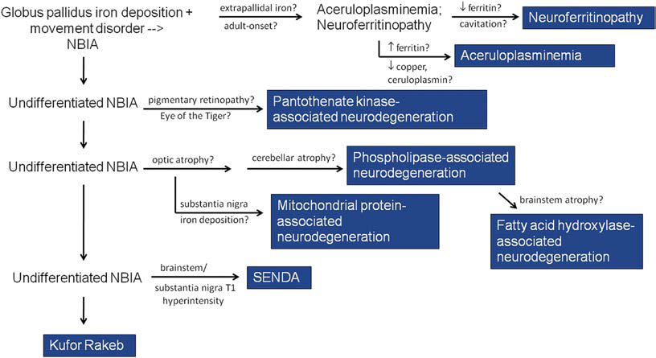
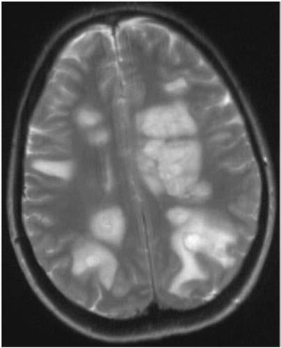

# Chapter 640: Demyelinating Disorders of the Central Nervous System
> **Course:** Vikkypaedia Pediatric Basic Course (*Nelson Textbook of Pediatrics, 22nd Edition (2025)*)  
> **Part XXV:** The Nervous System  
> **Authors:** Michael Perry and Cheryl Hemingway  
> **Metrics:** 14,750 words · 15 tables/boxes · 2 figures · 5 genes · 8 flashcards · 5 MCQs  
> **Quick Navigation:** [🃏 Study 8 Flashcards](../flashcards/640_flashcards.md) · [📝 Take 5-Q MCQ Quiz](../mcqs/640_mcqs.md) · [📚 Part XXV Guide](../parts/Part_XXV.md) · [🧬 Syndrome & Genetics Atlas](../omim_gene_atlas.md) · [💊 Therapeutics Matrix](../therapies_matrix.md) · [🏠 Course Index](../../index.md)

## Key Chapter Topics & Subchapters
`640.1 Acute Disseminated Encephalomyelitis` · `640.2 Optic Neuritis` · `640.3 Transverse Myelitis` · `640.4 Multiple Sclerosis` · `640.5 Myelin Oligodendrocyte Glycoprotein– Associated Disorders` · `640.6 Neuromyelitis Optica Spectrum Disorders` · `640.1 Acute Disseminated Encephalomyelitis Michael Perry and Cheryl Hemingway` · `640.2 Optic Neuritis Michael Perry and Cheryl Hemingway` · `640.3 Transverse Myelitis Michael Perry and Cheryl Hemingway` · `640.4 Multiple Sclerosis Michael Perry and Cheryl Hemingway` · `640.5 Myelin Oligodendrocyte Glycoprotein–Associated Disorders Michael Perry and Cheryl Hemingway` · `640.6 Neuromyelitis Optica Spectrum Disorders Michael Perry and Cheryl Hemingway`

## Key Genetic & Molecular Targets
`ATM`, `GLA`, `POLG`, `PRF1`, `UNC13D`

## ⚡ High-Yield Nelson Pediatric Board Pearls
- They present with neu rologic dysfunction caused by immune-mediated injury to the myelin sheath of the brain, optic nerves, and spinal cord.
- MRI of the brain and spine is essential to characterize both symp tomatic and clinically silent demyelinating lesions, aid in the diagnosis of the specific demyelinating syndrome, predict likelihood of recur rence, and rule out other etiologies.
- Serial MRIs may be needed to confirm the diagnosis and can also be used to monitor the treatment response and guide DMT use.
- The presence of oligoclonal bands (OCBs) in cerebrospinal fluid (CSF) analysis is useful to help confirm the diagnosis of multiple sclerosis (MS); their absence may suggest an alternative diagnosis.
- Relapsing disease is often characterized by gradual accrual of physical disability and cognitive impairment.
- This leukodystrophy-like picture is characterized by large lesions, edema with mass affect, and a polymorphonucleated cell pleocytosis; this contrasts with the CSF lym phocytic pleocytosis typically noted in ADEM.
- PROGNOSIS Most children experience full motor recovery after ADEM, but residual deficits can be seen.

---
## Full Chapter Text, Tables & Figures
# Chapter 640: Demyelinating Disorders of the Central Nervous System

*Michael Perry and Cheryl Hemingway*

<!-- p.4736 -->

**Fig. 639.8** Algorithm showing the clinical and radiographic approach to neurodegeneration with brain iron accumulation. NBIA, neurodegenera tion with brain iron accumulation; SENDA, static encephalopathy of childhood with neurodegeneration in adulthood. (From Kruer MC, Boddaert N. Neurodegeneration with brain iron accumulation: a diagnostic algorithm. Semin Pediatr Neurol. 2012;19:67–74, Fig. 1.)

**Acquired demyelinating syndromes (ADSs)** of the central nervous system (CNS) are rare disorders, occurring with an approximate annual incidence of 9.8 per million children per year. They present with neu rologic dysfunction caused by immune-mediated injury to the myelin sheath of the brain, optic nerves, and spinal cord. In contrast to geneti cally determined **leukodystrophies** (sometimes called *dysmyelinating disorders*) that *produce* disrupted white matter, acquired demyelinating disorders target normally formed white matter. They can be monopha sic or relapsing.

The pathogenesis often involves demyelination together with B cells and CNS antibodies. Two immunoglobulin G (IgG) antibodies recognized as playing an important part in demyelination are aqua porin 4-antibody (AQP4-Ab) and myelin oligodendrocyte glycopro tein antibody (MOG-Ab). The aquaporins are plasma membrane water-transporting proteins expressed in astrocytes and are primar ily involved in water movement, cell migration, and neuroexcitation. Myelin oligodendrocyte glycoprotein (MOG) is exclusively expressed in the CNS. Although MOG comprises only a minor component of the myelin sheath, its location on the outermost lamellae and on the cell surface of oligodendrocytes makes it available for antibody binding. Increasing knowledge of the importance of these antibod ies in disease, together with available disease-modifying treatments (DMTs) has made accurate diagnosis in demyelinating disorders

*Michael Perry and Cheryl Hemingway*

crucial. Pediatric demyelinating syndromes may be clinically char acterized by: 1.	Localization of neurologic deficits: monofocal vs polyfocal 2.	Presence or absence of encephalopathy 3.	Disease course: monophasic vs polyphasic 4.	Presence or absence of specific antibodies

MRI of the brain and spine is essential to characterize both symp tomatic and *clinically silent* demyelinating lesions, aid in the diagnosis of the specific demyelinating syndrome, predict likelihood of recur rence, and rule out other etiologies. Serial MRIs may be needed to confirm the diagnosis and can also be used to monitor the treatment response and guide DMT use. The presence of **oligoclonal bands (OCBs)** in cerebrospinal fluid (CSF) analysis is useful to help confirm the diagnosis of multiple sclerosis (MS) (Table 640.1); their absence may suggest an alternative diagnosis. OCBs, matched or unmatched (to blood OCB), may also be seen in other CNS inflammatory dis eases. Additional laboratory studies, including an autoimmune profile, antibody testing, metabolic testing, genetic testing, catheter angiogra phy, and less often, brain biopsy, may be required to evaluate for mim ics of demyelination. These mimics may include conditions such as migraine, systemic rheumatologic disorders, mitochondrial disorders, primary CNS angiitis, infection, neoplasm, and genetic conditions such as the inherited white matter disorders (e.g., leukodystrophies) and primary CNS hemophagocytic lymphohistiocytosis (HLH) (Tables 640.2 and 640.3).

Most children presenting with a first episode of demyelination will experience a monophasic course and do not relapse. Monophasic demyelinating disorders of childhood may include acute disseminated encephalomyelitis (ADEM), optic neuritis (ON), and transverse myeli tis (TM); relapsing forms of demyelination include MS, MOG, mul tiphasic disseminated encephalomyelitis (MDEM), relapsing ON, and AQP4-Ab–associated demyelination and neuromyelitis optica spec trum disorder (NMOSD). Relapsing disease is often characterized by gradual accrual of physical disability and cognitive impairment.

*Visit Elsevier eBooks+ at eBooks.Health.Elsevier.com** for Bibliography.*

<!-- p.4738 -->

## 640.1  Acute Disseminated Encephalomyelitis Michael Perry and Cheryl Hemingway

Acute disseminated encephalomyelitis is an inflammatory, demyelin ating event of early childhood presenting with acute-onset *polyfocal* neurologic deficits, accompanied by *encephalopathy* and MRI changes consistent with demyelination (see Table 640.1).

**EPIDEMIOLOGY** Although ADEM can occur at any age, most studies report a mean age between 5 and 8 years with a slight male predominance and an incidence of 0.1-0.6 per 100,000 children per year. ADEM is usually *monophasic,* but recurrence can occur; this is termed **multiphasic disseminated**

**encephalomyelitis (MDEM)** if the recurrence is 3 months or longer after the incident episode*.* Approximately 50% of ADEM cases are associated with serum MOG-Ab positivity (MOGAD) (see Chapter 640.5). MDEM patients are almost exclusively MOG-Ab positive. An episode of ADEM can also be followed by non-ADEM demyelination in a new location. If ADEM is followed by a relapse in a specific loca tion, such as the optic nerve, then **ADEM-ON** is diagnosed. If the optic nerve and spinal cord are involved, then **NMOSD** (see Table 640.1) is diagnosed. Both ADEM-ON and NMOSD are associated with MOG- Ab positivity.

**PATHOGENESIS** Molecular mimicry induced by infectious exposure has long been thought to trigger the production of CNS autoantigens, though causal ity has never been proven. Many patients experience a transient febrile

#### **Table 640.1** Acute Demyelinating Disorders of the Central Nervous System

| Category / Parameter | Clinical Details & Findings |
| --- | --- |
| **DEFINITION** | Acute disseminated encephalomyelitis (ADEM); A first polyfocal CNS event with presumed inflammatory cause; Encephalopathy present that cannot be explained by fever; MRI often showing bilateral diffuse, poorly demarcated T2 lesions; No new symptoms, signs, or MRI findings after initial 3 mo; Multiphasic ADEM; New event of ADEM 3 mo or more after the initial event that can be associated with new or; reemerging clinical and MRI findings; Frequently associated with the presence of MOG-Ab; Clinically isolated syndrome (CIS); A first monofocal or multifocal CNS demyelinating event; Encephalopathy is absent, unless caused by fever; Multiple sclerosis (MS); MS can be diagnosed in those for whom there is no better explanation if both; dissemination in time (DIT) and dissemination in space (DIS) can be demonstrated. |
| **DIS** | Demonstrated by one or more T2 lesions affecting at least two of the following CNS sites:; • Periventricular; • Juxtacortical or cortical; • Infratentorial; • Spinal cord |
| **DIT** | Demonstrated by one of the following:; • Simultaneous presence on MRI of one or more gadolinium-enhancing lesions AND; one or more nonenhancing lesions; • CSF oligoclonal bands; • Follow-up MRI (>30 days from previous scan) with one or more new enhanced OR; nonenhanced lesions; • Two or more acute episodes typical of MS each lasting >24 hr and at least 30 days; apart; Primary progressive MS (PPMS); PPMS is exceedingly rare in childhood, and therefore in cases of suspected PPMS, or; diagnostic uncertainty, specialist advice should be obtained. Biopsy and/or further; genetic investigation may be appropriate to rule out mimics.; MOG-Ab–associated demyelination; MDEM: recurrent ADEM (see earlier); ADEM-ON: ADEM or MDEM followed by optic neuritis (ON); NMOSD: ON and acute transverse myelitis (ATM), either sequentially or simultaneously; Relapsing inflammatory ON (RION); Brainstem demyelination: recurrent episodes of demyelination often involving the; posterior fossa and brainstem; Neuromyelitis optica spectrum disorder (NMOSD); If AQP4–positive, one of the following core criteria is required:; • Optic neuritis; • Acute myelitis; • Area postrema syndrome (nausea, vomiting, hiccups); • Acute brainstem syndrome; • Narcolepsy, acute diencephalic syndrome with MRI lesions; • Symptomatic cerebral syndrome with MRI lesions; If AQP4-negative or unavailable, two core criteria and all the following:; 1.	 At least one core criteria must be optic neuritis, longitudinally extensive TM, or area; postrema syndrome; 2.	 Dissemination in space (≥2 different core criteria); 3.	 Exclusion of alternative diagnoses; If Mog-Ab–positive with both ON and TM, then MOG + NMOSD may be diagnosed |

<!-- p.4739 -->

<!-- p.4740 -->
illness in the month before ADEM onset. Preceding infections associ ated with ADEM include influenza, Epstein-Barr virus (EBV), cyto megalovirus, varicella, enterovirus, measles, mumps, rubella, herpes simplex, *Mycoplasma pneumoniae,* and COVID-19.

**CLINICAL MANIFESTATIONS** Initial symptoms of ADEM may include lethargy, fever, headache, vomiting, meningeal signs, and seizures, including status epi lepticus. Encephalopathy is the hallmark of ADEM. It can range from behavioral change and persistent irritability to coma. Com mon neurologic signs include visual loss, ataxia, motor and sen sory deficits, and cranial neuropathies. In cases with concurrent spinal cord involvement, bladder/bowel dysfunction may be seen. Focal neurologic deficits, however, can be difficult to ascertain in the obtunded or very young child. The clinical course is usually rapidly progressive over days, and intensive care may be required, particularly for patients with brainstem dysfunction or raised intracranial pressure.

**NEUROIMAGING** Brain MRI typically shows large (sometimes confluent), bilateral, multifocal, edematous, masslike T2 lesions of the cerebral hemi spheres, cerebellum, and brainstem. Deep gray matter structures (e.g., thalami, basal ganglia) are often involved (Figs. 640.1 and 640.2). Contrast enhancement is variable. The spinal cord may have an abnormal T2 signal or enhancement, with or without clini cal signs of myelitis. ADEM lesions will typically appear to be of similar age on MRI, but their evolution often lags the clinical pre sentation. Serial MRI imaging 3-12 months after ADEM frequently demonstrates near-complete resolution of T2 abnormalities, though residual gliosis may remain.

Severe involvement may progress to an **acute hemorrhagic leuko encephalopathy** (Weston-Hurst disease). This leukodystrophy-like picture is characterized by large lesions, edema with mass affect, and a polymorphonucleated cell pleocytosis; this contrasts with the CSF lym phocytic pleocytosis typically noted in ADEM.

**LABORATORY FINDINGS** There is no biologic marker for ADEM, and laboratory findings can vary widely. CSF studies are often normal or can exhibit pleocytosis with lymphocytic or monocytic predominance. CSF protein can be elevated, especially on repeat studies. Elevated CSF immunoglobulin production can be present, but true OCB positivity is rare. Electroen cephalograms often show generalized slowing, consistent with enceph alopathy*.* Polyregional demyelination of ADEM can also cause focal slowing or epileptiform discharges.

Disorders

#### **Table 640.2** Differential Diagnosis of Demyelinating

| Category / Parameter | Clinical Details & Findings |
| --- | --- |
| **General** | Multifocal white matter; lesions; Demyelination (e.g., ADEM, MS, CIS, |
| **NMOSD, AHL)** | Autoantibody (e.g., NMDAR-Ab,; Hashimoto encephalopathy); Migraine; Prior insult and residual gliosis (e.g.,; congenital infections or hypoxic; damage); Primary and secondary vasculitides; (e.g., primary angiitis of the CNS,; neurosarcoidosis, SLE, Behçet; syndrome, scleroderma); Mitochondrial (e.g., Leber hereditary; optic neuropathy [LHON], POLG); Leukoencephalopathy (e.g., DARS); X-linked Charcot-Marie-Tooth disease; Bilateral or diffuse white; matter lesions; Leukodystrophy (e.g., X-linked; adrenoleukodystrophy, Alexander; disease, metachromatic LD, Krabbe; disease); Leukoencephalopathy (e.g., Aicardi-; Goutières syndrome); Mitochondrial (e.g., LHON, Leigh; disease, MELAS, MERFF); Infection; Tumor (e.g., gliomatosis cerebri,; astrocytoma, lymphoma); Hemophagocytic lymphohistiocytosis |
| **(HLH)** | Deep gray, thalamic,; and striatal lesions; Infection (e.g., mycoplasma, Epstein-; Barr virus, West Nile virus, Japanese B; encephalitis, enterovirus); Biotin-responsive basal ganglia disease; (e.g., SLC19A3); Acute necrotizing encephalopathy (ANE); and RANBP2 pathogenic variant |

#### **Table 640.3** MR Imaging Red Flags for the Diagnosis of Children with Acquired Demyelinating Syndromes

| Category / Parameter | Clinical Details & Findings |
| --- | --- |
| **ENHANCEMENT** | SVcPACNS; Infection; Tumor |
| **HLH** | Leptomeningeal enhancement is not a feature of MS in adults; it has; emerged as a red flag for vasculitic or malignant processes in the pediatric; cohort. |
| **LESION EXPANSION** | Tumor; Lymphoma |
| **PML** | Sarcoidosis; Increased size of T2 lesions on serial imaging is well recognized in MS,; although this should always prompt consideration of malignancy. Increasing; size of a white matter–predominant lesion without lesion enhancement in a; patient treated with immunosuppressant therapy (or a patient with known; HIV) should prompt consideration of PML. PML is a risk for MS patients; exposed to more intense immunosuppressive therapies. |
| **ANE** | Stroke; Cerebellitis |
| **AHLE** | Large-vessel CNS vasculitis; SVcPACNS; Although susceptibility-weighted imaging reveals tiny microfoci of; hemosiderin in MS patients, hemorrhage large enough to be visible on; conventional MRI sequences is not a feature of ADS or MS and should; prompt consideration of disorders in which the cerebral vasculature is; specifically involved.; ADS, Acquired demyelinating syndrome; AHLE, acute hemorrhagic leukoencephalitis; CNS, central nervous system; HIV, human immunodeficiency virus; HLH, hemophagocytic; lymphohistiocytosis; MS, multiple sclerosis; PML, progressive multifocal leukoencephalopathy; SVcPACNS, small-vessel childhood primary angiitis of the central nervous system.; From O’Mahony J, Shroff M, Banwell B. Mimics and rare presentations of pediatric demyelination. Neuroimaging Clin North Am. 2013;23:321–336, Table 2. |

<!-- p.4741 -->
**DIFFERENTIAL DIAGNOSIS** ADEM is a clinical diagnosis supported by MRI, CSF, and serum findings. The differential diagnoses for ADEM are broad; empirical antibiotic and antiviral treatment should be considered while infectious evaluations are pending. Follow-up MRI examinations 3-12 months after typical ADEM should show improvement; new or enlarging T2 lesions should prompt reevaluation for other etiologies such as MS, antibody-associated disor ders, leukodystrophies, tumor, vasculitis, mitochondrial, metabolic, or rheumatologic disorders (Table 640.4 and see Tables 640.1-640.3).

**TREATMENT** High-dose intravenous steroids are often prescribed (most commonly methylprednisolone 20-30 mg/kg/day for 5 days with a maximum dose of 1,000 mg/day) followed by an oral prednisolone taper of 1-2 mg/kg/day (maximum 40-60 mg/day) over 4-6 weeks. In *refractory* or *severe* cases, additional treatment options include intravenous

immunoglobulin (2 g/kg administered over 2-5 days) or plasmapher esis (5-7 exchanges administered every other day). There is no consen sus about the timing of these treatments for ADEM.

**PROGNOSIS** Most children experience full motor recovery after ADEM, but residual deficits can be seen. Cognitive impairment or behavioral changes are not uncommon. Recovery starts within days to weeks, but symptoms can fluctuate throughout the course.

*Visit Elsevier eBooks+ at eBooks.Health.Elsevier.com** for Bibliography.*

## 640.2  Optic Neuritis Michael Perry and Cheryl Hemingway

Optic neuritis (ON) is inflammation of one or both optic nerves. It presents with visual dysfunction. ON can occur in three phenotypes: (1) as a clinically isolated monophasic syndrome; (2) recurrently in isolation; or (3) as part of other multifocal systemic or CNS-specific inflammatory conditions such as ADEM, MS, or antibody-associated demyelination (e.g., AQP-4-Ab NMOSD or MOGAD).

**EPIDEMIOLOGY AND CLINICAL PRESENTATION** ON is one of the most common of the acquired demyelinating syn dromes, accounting for ∼25% of all demyelinating presentations in childhood. The typical presentation is unilateral or bilateral visual loss over hours to days with abnormal color vision (typically red-green desaturation), visual field loss, and sometimes a relative afferent pupil lary defect. The visual loss is often severe, with most children at 20/200 visual acuity (VA) or worse. Periocular pain and painful eye move ments (often reported as headache in young children) are common. Bilateral ON is more common in younger children and frequently associated with MOG-Ab disease. Unilateral ON is more common in older children and more likely to be associated with MS. Funduscopic examination in over half of children reveals acute optic nerve head swelling (papillitis). However, when the inflammation occurs in the retrobulbar optic nerve portion, the appearance of the optic nerve may be normal. Optic nerve pallor is more often noted in the chronic stage after an initial episode or in those with relapsing ON. Bilateral ON, longitudinally extensive (>50% of the optic nerve), perineural optic sheath enhancement (perineuritis), and optic disc edema are features suggestive of ON caused by MOG-Ab disease. ON without papillitis and that involves the optic chiasm or tract is more typical of AQP4-Ab (NMOSD) disease.

**Fig. 640.1** 6-year-old patient diagnosed with ADEM presenting with encephalopathy, ataxia, and motor deficits after mild viral infection. Axi al T2-weighted MRI shows bilateral, diffuse, poorly demarcated lesions. Gray matter involvement, including the thalamus and basal ganglia, is commonly seen.

B C D A

**Fig. 640.2** Acute disseminated encephalomyelitis (ADEM). A and B, T2-weighted FLAIR images show numerous asymmetric, rounded, hyperin tense, predominantly subcortical white matter lesions. Some lesions involve the cortex. A right pulvinar lesion is also seen. C and D, Postcontrast T1-weighted image demonstrates incomplete ring enhancement associated with these lesions. All the lesions show similar imaging features. Marked improvement was seen after steroid therapy. (From Lerner A, Rajamohan A, Shiroishi MS, et al. Cerebral infections and inflammation. In: Haaga JR, Boll DT, eds. CT and MRI of the Whole Body, 6th ed. Philadelphia: Elsevier; 2017: Fig. 10-15, p. 280.)

<!-- p.4742 -->

<!-- p.4743 -->
**DIAGNOSTIC EVALUATION** MRI, optical coherence tomography (OCT), and visual evoked poten tials (VEPs) are useful for evaluating and quantifying the functional and structural integrity of the optic nerve of a child with suspected ON.

Orbital MRI is useful but not required for a diagnosis of ON. Though sometimes normal, it will usually show optic nerve thick ening on T1-weighted images with T2 hyperintensities and con trast enhancement. (Fig. 640.3F, G). Longitudinally extensive ON

involving the chiasm is thought to be more commonly associated with antibody-mediated demyelination (see Fig. 640.3C). **Optical coherence tomography** can detect structural neuronal and retinal change, such as retinal nerve fiber layer (RNFL) thinning and may be helpful in monitoring the young child experiencing recurrent disease. In acute ON, VEPs may detect prolonged latency. VEPs in children may also detect clinically silent episodes of ON in the seemingly unaffected contralateral eye.

**Fig. 640.3** MRI images highlighting the spectrum of possible phenotypes in relapsing myelin oligodendrocyte glycoprotein (MOG) antibody–as sociated disorders. A, Axial T2-weighted FLAIR MRI of brain from a 6-yr-old female with bilateral ON, ataxia, and lethargy, initially diagnosed with ADEM until her relapse (B) with further multiple brainstem lesions associated with MOG-Ab positivity. C, Coronal T2-weighted MRI with longitudi nally extensive ON with both pre- and post-chiasm involvement and (D) sagittal MRI of spine with longitudinally extensive TM from a 9-yr-old female diagnosed with MOG-Ab–associated NMOSD after simultaneous presentation of bilateral visual impairment and paraparesis requiring ventilatory support. E, T2-weighted FLAIR MRI of brain demonstrating asymmetric, bilateral, poorly defined lesion involving the brainstem and extending into the middle cerebellar peduncle. F and G, Orbital MRI shows a thickened left optic nerve in a 13-yr-old female with recurrent left ON associated with positive MOG-Ab. H, Axial T2-weighted image shows diffuse, bilateral, asymmetric leukodystrophy-like phenotype associated with MOG-Ab. I, Coronal T2-weighted FLAIR MRI of brain similarly showing the leukodystrophy-like appearance seen over time in those with young-onset relapsing MOG-Ab–associated demyelination.

A

B

C

D E

F

H

#### **Table 640.4** Features that May Distinguish ADEM from a First Attack of MS

| Category / Parameter | Clinical Details & Findings |
| --- | --- |
| **MS** | Age and sex; <10 yr; Males and females equal; >10 yr; Female preponderance; Seizures; +; −; Encephalopathy; + /+/− for MOG-Ab; −; Fever/vomiting; +; −; Family history; No; 20%; Optic neuritis; Bilateral; Unilateral; Manifestations; Polysymptomatic; Monosymptomatic |
| **CSF** | Pleocytosis (lymphocytosis); OCBs negative; Acellular; OCBs positive |
| **MRI** | Large, fluffy, poorly demarcated T2 lesions; involving white and gray matter; Ovoid T2 lesions involving juxtacortical,; periventricular, or infratentorial areas or; spinal lesions; T1 hypointense lesions; MRI follow-up after 30 days; No new lesions; New lesions seen; +, More likely to be present; −, less likely to be present; ADEM, acute disseminated encephalomyelitis; CSF, cerebrospinal fluid; MS, multiple sclerosis; MOG-Ab, myelin; oligodendrocyte glycoprotein antibody; OCBs, oligoclonal bands. |

<!-- p.4744 -->
CSF OCB analysis is not always indicated; however, in the context of a normal MRI brain scan, negative OCBs predict a very low risk of subsequent MS development.

Many conditions can both mimic and be associated with ON. Therefore although a detailed ophthalmologic review is essential, other investigations must be carefully considered to exclude systemic rheumatologic disorders (e.g., systemic lupus erythematosus [SLE], sarcoidosis, celiac disease, Behçet disease), infectious diseases (viral disease, Lyme disease, syphilis, tuberculosis), mitochondrial disorders (e.g., Leber hereditary optic neuropathy), vascular events, toxic (meth anol, ethylene, glycol, chloroquine, hydroxychloroquine), nutritional (folate, vitamin B12, copper deficiencies), or metabolic disorders, and optic nerve sheath meningioma or optic nerve glioma. Antibody test ing in serum with live cell-based assays (CBAs) for both AQP4-Ab and MOG-Ab is recommended to ensure that prophylactic treatment can be provided if indicated (e.g., AQP4-Ab positive) or to provide coun seling on the risk of recurrence (MOG-Ab positivity).

**TREATMENT** The standard of care is based on expert clinical opinion and adult tri als and typically includes high-dose intravenous steroids (e.g., methyl prednisolone 20-30 mg/kg/day for 3-5 days, maximum 1000 mg/day). In adults, steroid administration leads to faster recovery, but with no difference in long-term visual outcome. As with other severe episodes of demyelination, further treatment options include intravenous immuno globulin (usually 2 g/kg administered over 2-5 days) or plasmapheresis (typically 5-7 exchanges administered every other day); there is neither definitive trial evidence of their benefit nor consensus about when to use them in isolated ON. Trials in adults have concentrated on neuroprotec tion; phenytoin has a beneficial effect on RNFL thinning in acute ON.

The initiation of chronic immunotherapy is dependent on etiology, the presence or absence of glial antibodies (e.g., MOG-Ab), and risk of relapse (i.e., ON caused by AQP4 +NMOSD) and is best considered by a multidisciplinary team experienced in the treatment of pediatric neuroinflammatory disorders.

**PROGNOSIS** Although it is reassuring that full recovery of high-contrast visual acu ity (HCVA) does usually occur in children, irreversible damage is often detected in the structural integrity of affected optic nerves. This may be evidenced by RNFL thinning on OCT, defective color vision, and impairments in low-contrast visual acuity (LCVA). Pediatric patients with AQP4-antibody–associated optic nerve demyelination are more commonly left with long-term visual disability than patients with other causes of ON.

*Visit Elsevier eBooks+ at eBooks.Health.Elsevier.com** for Bibliography.*

## 640.3  Transverse Myelitis Michael Perry and Cheryl Hemingway

Transverse myelitis (TM) is a condition characterized by the rapid development of both motor and sensory deficits of the spinal cord. It presents acutely as either partial or complete cord involvement at any level with bilateral neurologic signs; in adults and older children, there will usually be a clear sensory level. TM has multiple causes (Tables 640.5 and 640.6). It can be secondary to an immune-mediated condition (postinfectious or antibody-driven), a result of direct infec tion (e.g., infectious myelitis), or idiopathic. In TM, evidence of spi nal cord inflammation can be demonstrated by an enhancing lesion on MRI, CSF pleocytosis (>10 cells), or an increased IgG index. The progression is rapid. Time to maximal disability typically occurs 5-6 days after symptom onset.

**EPIDEMIOLOGY** TM is more common in adults but is estimated to affect ∼2 children/ million per year. A bimodal age distribution is observed in those

younger than 5 years and older than 10 years. Children less than 5 years of age develop spinal cord dysfunction over hours to a few days. They often have a history of an infectious disease (e.g., viral or mycoplasma) in the weeks preceding development of neurologic symptoms. The motor dysfunction is often severe, approaching a complete loss of func tion. Recovery is slow (weeks to months) and usually incomplete, most commonly with residual bowel and bladder dysfunction (15–50%). Pathologic findings of perivascular infiltration with mononuclear cells suggest an infectious or inflammatory basis. Overt necrosis of the spi nal cord may occur.

The syndrome may differ in older children, and outcomes vary by etiology. Although the onset is also rapid, recovery is faster and more

#### **Table 640.5** Reported Cases of Transverse Myelitis

| Category / Parameter | Clinical Details & Findings |
| --- | --- |
| **General** | 1.	 Acquired demyelinating disorders; a.	 Multiple sclerosis; b.	 NMO; c.	 ADEM; d.	 MOGAD; 2.	 Systemic inflammatory autoimmune disorders; a.	 SLE; b.	 SS; c.	 Antiphospholipid syndrome; d.	 Behçet disease; e.	 Vogt-Koyanagi-Harada disease; f.	 Ankylosing spondylitis; g.	 Mixed connective tissue disease; h.	 Others: systemic sclerosis, anti-Jo-1 antibody, urticarial vasculitis,; psoriatic arthritis, perinuclear ANCA systemic vasculitis, graft-versus-; host disease, common variable immunodeficiency, celiac disease; 3.	 Neurosarcoidosis; 4.	 Parainfectious TM; a.	 Viral: hepatitis A, hepatitis B, hepatitis C, hepatitis E, measles,; mumps, rubella, varicella zoster, Epstein-Barr, cytomegalovirus,; herpes simplex, influenza A/B, lymphocytic choriomeningitis; virus, chikungunya, hantavirus, HIV, human T-cell lymphotropic; virus, human herpes virus 6, Japanese encephalitis, Murray; Valley encephalitis, St. Louis encephalitis, tickborne; encephalitis, vaccinia, Rocky Mountain spotted fever, dengue; virus, enterovirus 71, coxsackievirus A and B, West Nile virus,; parvovirus B19, human corona virus, and echovirus; b.	 Bacterial: Mycoplasma pneumoniae, Campylobacter jejuni,; Borrelia burgdorferi, Acinetobacter baumannii, Coxiella; burnetii, Bartonella henselae, Chlamydia psittaci, Leptospira,; Chlamydia pneumoniae, Legionella pneumonia, Orientia; tsutsugamushi (scrub typhus), Salmonella paratyphi B,; Mycobacterium tuberculosis, Treponema pallidum, Brucellosis; melitensis, and groups A and B streptococci; c.	 Fungal: Actinomyces, Blastomyces, Coccidioides, Aspergillus,; Cryptococcus, and Cladophialophora bantiana; d.	 Parasitic: Toxocara species, Schistosoma species,; Gnathostoma spinigerum, Echinococcus granulosus,; Taenia solium, Toxoplasma gondii, Acanthamoeba species,; Paragonimus westermani, and Trypanosoma brucei; 5.	 Paraneoplastic syndromes; a.	 Anti-Ri (ANNA-2) antibody; b.	 CRMP-5-IgG antibody; c.	 Anti-amphiphysin IgG antibody; d.	 Anti-GAD65 antibody; e.	 NMDAR antibody; 6.	 Atopic myelitis; 7.	 Drugs and toxins; a.	 Tumor necrosis factor-alpha inhibitors; b.	 Sulfasalazine; c.	 Epidural anesthesia; d.	 Chemotherapeutic agents: gemcitabine, cytarabine, cisplatin; e.	 Heroin; f.	 Benzene; g.	 Brown recluse spider toxin; 8.	 Idiopathic TM; MOGAD, MOG antibody disease.; From Beh SC, Greenberg BM, Frohman T, et al. Transverse myelitis. Neurol Clin.; 2013;31:79–138, Box 5, p. 88–89. |

<!-- p.4745 -->

<!-- p.4746 -->
likely to be complete. Necrosis and irreversible injury may occur in a small but important number of cases. Potentially associated underly ing etiologies include systemic vasculitic entities (e.g., SLE), antibodymediated CNS disorders (e.g., AQP4-Ab– or MOG-Ab–associated NMOSD), infectious etiologies (e.g., mycoplasma, enterovirus), or idiopathic disease. Pathology and imaging studies show acute inflam mation with demyelination in some cases.

**Acute Flaccid Myelitis** Acute flaccid myelitis (AFM) is an idiopathic neurologic disorder pre senting with acute weakness and/or paralysis in previously healthy children. It is predominantly of infectious etiology. Although many viruses have been implicated, the recent biennial outbreaks since 2014 are likely to have been caused by enterovirus-D68. Abnormalities are often seen in the lower motor neurons of the anterior horn gray matter

#### **Table 640.6** Mimics of Transverse Myelitis

| Category / Parameter | Clinical Details & Findings |
| --- | --- |
| **DESCRIPTION** | Vitamin B12 deficiency; May present as an isolated myelopathy or in combination with neuropathy, encephalopathy, and/or; behavioral changes.; Dorsal column impairment is the most common manifestation, followed by pyramidal dysfunction; (the classic subacute combined degeneration of the cord).; Hematologic manifestations may be absent in up to 30% of patients with neurologic manifestations.; MRI reveals T2-hyperintense signal in the posterior columns (the “inverted V” or “inverted rabbit; ear” sign on axial views).; In severe cases, MRI shows the “anchor” sign (because of involvement of the posterior, anterior, and; pyramidal tracts).; Vitamin E deficiency; May cause a predominantly dorsal column syndrome associated with a peripheral neuropathy; because of axonal degeneration.; Preferentially affects the cervical cord.; Clinically and radiologically similar to B12 deficiency.; Copper deficiency; May cause both myelopathy and optic neuropathy.; Causes of acquired copper deficiency include malnutrition, zinc toxicity, Menke disease, bariatric; surgery, gastrectomy, malabsorption syndromes, and use of copper chelating agents.; Clinically and radiologically indistinguishable from B12 deficiency.; Nitrous oxide (N2O) toxicity; Analgesic gas commonly abused because of euphoric effects.; N2O inactivates vitamin B12 by irreversible oxidation of the cobalt center of methylcobalamin,; thereby inhibiting the methionine synthesis pathway. In healthy subjects, this does not cause clinical; manifestations. In subclinically B12-deficient individuals, N2O exhausts residual stocks of vitamin B12,; leading to neurologic manifestations.; Neurolathyrism and neurocassivism; Neurolathyrism is caused by consumption of grass pea.; Neurocassivism (konzo) is caused by bitter cassava root consumption.; Both are found in malnourished populations and are characterized by subacute paraparesis with; prominent UMN features.; Intramedullary primary spinal cord tumors; May be ependymomas, astrocytomas, or hemangioblastomas.; Typically cause an insidious, progressive myelopathy.; Hemorrhage or infarction of the tumor may result in an acute presentation and radiologic; appearance mimicking TM.; Primary CNS lymphoma; May give rise to a clinical and radiologic picture mimicking TM compounded by its corticosteroid; responsiveness.; Congenital or acquired immunodeficiency is the only established risk factor.; More common in middle-age and older men.; Insidious onset of myelopathy with back pain and constitutional symptoms.; Serum lactate dehydrogenase may be elevated.; CSF: lymphocytic pleocytosis, markedly elevated protein, and hypoglycorrhachia. OCBs and; IgG index are absent. Cytologic analysis may demonstrate malignant cells (large-volume CSF; examination can increase the diagnostic yield).; MRI: T2 hyperintensity, gadolinium enhancement, cord swelling, conus medullaris involvement, and; concomitant brain lesions.; Intravascular lymphoma; Predominantly affects vessels in the skin and neurologic system.; May mimic TM and even LETM.; CSF: lymphocytic pleocytosis and increased protein, but no malignant cells.; MRI: affects the conus medullaris (unlike TM).; Radiation myelitis; Early radiation myelopathy: begins 10-16 wk after starting radiotherapy with predominantly sensory; phenomena (including Lhermitte sign) and typically resolves spontaneously.; Delayed radiation myelopathy: begins months or years after radiation exposure and manifests as a; subacute or insidious myelopathy.; Concurrent use of chemotherapeutic agents may cause widespread white matter necrosis owing to; synergistic toxicity.; Preexisting myelopathy from any cause may be risk factors for radiation myelitis.; MRI: cord swelling on T1-weighted images, intramedullary T2 hyperintensity, ringlike gadolinium; enhancement.; CNS, Central nervous system; CSF, cerebrospinal fluid; Ig, immunoglobulin; LETM, longitudinally extensive transverse myelitis; MRI, magnetic resonance imaging; OCB, oligoclonal; bands; TM, transverse myelitis; UMN, upper motor neuron.; Modified from Beh SC, Greenberg BM, Frohman T, et al. Transverse myelitis. Neurol Clin. 2013;31:79–138, Table 10, p. 102–103. |

<!-- p.4747 -->
(Fig. 640.4). Symptoms can progress rapidly; paralysis is often asym metric and is not usually accompanied by a sensory deficit; cranial nerve involvement may include facial weakness, dysarthria, and dys phagia (Table 640.7).

In the United States, AFP is considered a generalized “umbrella” term for multiple clinical entities, including paralytic poliomyelitis, transverse myelitis, AFM, Guillain-Barré syndrome, toxic neuropathy, and muscle disorders. Essentially, this grouping helps with case ascer tainment of AFM, but the individual diagnoses still remain important because each has its own differential diagnoses to consider.

A pragmatic case definition of AFP is “a clinical syndrome with rapid onset of weakness that frequently involves the respiratory and bulbar muscles.” Whenever these criteria are met and poliomyelitis is a pos sibility, thorough investigation and reporting of potential poliomyelitis is required. Two diagnostic stool samples more than 24 hours apart should be collected within 14 days of onset of paralysis and then pro cessed in a World Health Organization–approved laboratory. If polio myelitis is confirmed, it may be caused by *wild poliovirus* (serotypes 1-3) or *vaccine-associated paralytic poliomyelitis*, and it will need full epidemiologic investigation. In the individual patient, disease progres sion with paralysis (with sensory preservation) is rapid, asymmetrical, and involves proximal more than distal muscles.

Other potential viral causes of AFP include coxsackie and echovi ruses, Japanese B encephalitis, Murray Valley encephalitis, St. Louis encephalitis, and Russian spring encephalitis, tickborne viruses, and herpes virus. These causes vary by geography with, for example, EV- A71 being the cause in parts of Southeast Asia and West Nile virus being a cause in the United States. Therefore consider the following investigations for possible viral causes of AFP, as well as other condi tions in the differential diagnosis: • Imaging with MRI of the spine (and possibly brain) • CSF sampling for differential cell counts, glucose, and protein;

microbiology and diagnostic polymerase chain reaction (PCR) testing for enteroviruses and other infectious diseases; and for autoantibod ies such as anti–myelin oligodendrocyte glycoprotein (anti-MOG, see later) • Respiratory/nasopharyngeal secretion samples for viral PCR testing

(e.g., enterovirus) • Peripheral neurophysiology with nerve conduction studies (NCS) if

differentiation from GBS is needed or botulism is suspected • Studies for identification of possible metabolic disease (e.g., acute

hypokalemic periodic paralysis, thyrotoxic periodic paralysis, acute intermittent porphyria) and/or toxin exposures (e.g., sporadic hy pokalemic paralysis secondary to licorice, barium, or cottonseed oil exposure) • Investigations to exclude paralytic syndromes that mimic or are

misdiagnosed as AFP, such as vitamin B12 deficiency, which may be exacerbated by chronic cycad poisoning from evergreens, cyanide toxicity from cassava ingestion, and lathyrism.

**CLINICAL MANIFESTATIONS OF TM** TM is often preceded within the previous 1-3 weeks by a mild nonspe cific illness or minimal trauma. Discomfort or overt pain in the neck or back is common. Depending on its severity, the condition progresses to numbness, anesthesia, ataxia, areflexia, and motor weakness in the truncal and appendicular musculature at or distal to the lesion. Paraly sis begins as flaccidity (paraparesis, tetraparesis). Spasticity then devel ops over weeks, accompanied by hyperreflexia and clonus. Weakness may rarely be unilateral, but usually such a finding suggests a hemicord lesion, which is most often associated with MS (particularly in adoles cence). Urinary retention is a common early symptom; incontinence occurs later in the course. Early sensory findings may be isolated to the posterior column, necessitating evaluation of vibratory sensation. Progressive sensory loss may manifest as anesthesia, paresthesia, or

B

C

D

A

B

C

D E

**Fig. 640.4** Typical MRI findings in the acute phase of AFM. Spinal MRIs are shown of an 8-yr-old child with AFM, acquired 24 hr after onset of neurologic symptoms. A, Sagittal T2-weighted image showing an ill-defined, longitudinally extensive central/anterior spinal cord lesion. B, Axial T2-weighted image from C5–C6 shows hyperintensity of the entire gray matter of the spinal cord, with associated edema and some surrounding white matter hyperintensity. C, Axial T2-weighted image from T7 shows asymmetric hyperintensity of the gray matter (right more than left). D, Axial T2-weighted image from T10 shows hyperintensity of the entire gray matter. E, Axial FLAIR image at the level of the middle cerebellar peduncle demonstrates hyperintensity of the dorsal pons (arrow). AFM, acute flaccid myelitis. (From Murphy OC, Messacar K, Benson L, et al. Acute flaccid myelitis: cause, diagnosis, and management. Lancet. 2021;397:334–344, Fig. 1, p. 338.)

<!-- p.4748 -->
allodynia. Other potential findings include priapism, respiratory com promise, and spinal shock with subsequent autonomic dysreflexia. Rarely an overlap syndrome of TM with features of Guillain-Barré syn drome may occur.

**DIAGNOSTIC EVALUATION** TM is a diagnosis of exclusion, and a thorough evaluation should be completed in all cases. The differential diagnoses include, among others, Guillain-Barré syndrome, demyelinating disorders, systemic rheumatologic conditions, meningitis, infectious myelitis, spinal cord infarction, arteriovenous malformations, trauma, mass lesions, bony and intervertebral disk distortion, abscess, and tumors of the spine and spinal cord (see Tables 640.5 and 640.6).

MRI with and without contrast enhancement is essential to rule out a mass lesion. T1-weighted images of the spine at the anatomic level of involvement may be normal or show spinal cord distension. In the infan tile form, T2-weighted images show high signal intensity over multiple spinal segments. In the adolescent form, the high signal is often centrally located and involves both gray and white matter. It may be limited to one or two segments but is frequently more extensive. A limited degree of gadolinium contrast enhancement is expected (especially in the infan tile form) and is indicative of an inflammatory condition. Cervical and cervicothoracic lesions represent most acute TM lesions. Axial cuts of the spinal cord are invaluable and can help to establish potential etiolo gies. Hemicord involvement may indicate MS. Holocord involvement with typical brain and optic nerve involvement suggests NMOSD. If

gray matter involvement predominates, consider a vasculitic or infec tious process (e.g., SLE or enterovirus). Nerve root enhancement is occa sionally seen and should raise suspicion for a mixed picture (central and peripheral demyelination) or anterior horn cell involvement (Fig. 640.5). Up to 6% of cases do not show spinal cord lesions on MRI. Repeat imag ing at 7 days may reveal atrophy in these cases. *MRI of the brain is also indicated.* Evidence of other foci of demyelination is seen in at least 40% of patients; lesion localization should guide further consideration for MS, ADEM, NMOSD, SLE, and enterovirus-associated acute flaccid myelitis. In any child with *encephalopathy,* ADEM must be considered.

Lumbar puncture is indicated after exclusion of a mass on MRI and should be analyzed for cells, protein, immunoglobulin index, OCBs, and infectious pathogens. Mononuclear cells are usually elevated in TM. Protein may be elevated or normal. The presence of CSF inflam matory cells is essential for the diagnosis of TM.

Because one of the most important possibilities for this condition is NMOSD, the serum and CSF of all patients should be analyzed for both AQP-4 and MOG antibodies. Older children should also have serum studies sent for other autoimmune disorders, particularly SLE.

**TREATMENT** Treatment of childhood TM has not been standardized. Available evidence suggests immune response modulation may be effective in reducing the severity and duration of disease. High-dose steroids (i.e., methylprednisolone) are used acutely in TM. In cases of poor response to high-dose steroids, other acute therapeutic approaches include

**H1:** Acute onset of limb(s) weakness (period from onset to nadir: hours to 10 days)

**H2:** Prodromal fever or illness†

**E1:** Weakness involving one or more limbs, neck, face,

or cranial nerves

**E2:** Decreased muscle tone in at least one weak limb

**E3:** Decreased or absent deep tendon reflexes in at least

one weak limb‡

**MRI:** Spinal cord lesion with predominant gray matter

involvement, with or without nerve root enhancement§

**CSF:** Pleocytosis (white cell count >5 cells/L)¶

P

P/A

P

P

P

P

P

P

P/A

P

P

P

P

A or ND

P*

P/A

P*

P/A

P/A

P

P/A or ND

P

P

P

P

P

ND

P/A or ND

**Definite Possible Uncertain Diagnostic items**

**Factors that might suggest an alternative diagnosis** 1. Encephalopathy that cannot be explained by fever, illness, respiratory distress, metabolic abnormalities, or medications 2. Presence of sensory deficits on examination|| 3. Presence of lesions in supratentorial white matter or cortex, which should prompt consideration of ADEM, MOG-antibody associated disease, neuromyelitis optica spectrum disorder, encephalomyelitis, and others 4. Absence of CSF pleocytosis, which should prompt consideration of Guillain-Barré syndrome, botulism, ischemic cord lesions, and others 5. Positive serum aquaporin-4 (AQP-4) antibody, which would exclude AFM 6. Positive serum MOG antibody, which would suggest MOG-antibody associated disease||

**Probable**

#### **Table 640.7** Diagnostic Criteria for AFM

| Category / Parameter | Clinical Details & Findings |
| --- | --- |
| **General** | From Murphy OC, Messacar K, Benson L, et al. Acute flaccid myelitis: cause, diagnosis, and management. Lancet. 2021;397:334–344, Fig. 2, p. 339. |

<!-- p.4749 -->
intravenous immunoglobulin (IVIG) and plasma exchange (PLEX). Rituximab may be considered if an antibody-driven TM is suspected. Long-term prophylactic therapy is recommended for children with either relapsing disease or biomarkers indicating a risk for recurrence.

**PROGNOSIS** Older children with acute TM have a better outcome than adults, with nearly 50% making a good recovery by 2 years. This may reflect the higher likelihood of MOG-Ab–associated disorders in the older child. The most common sequelae in the remaining 50% are sensory problems and bladder dysfunction. Outcomes in younger children with TM are comparatively poor. Recovery is slow and usually incomplete; the likelihood of independent ambulation is approximately 40%.

*Visit Elsevier eBooks+ at eBooks.Health.Elsevier.com** for Bibliography.*

## 640.4  Multiple Sclerosis Michael Perry and Cheryl Hemingway

Multiple sclerosis (MS) is a chronic demyelinating autoimmune disor der of the brain, spinal cord, and optic nerves. It exhibits a relapsingremitting course of neurologic events *without* encephalopathy separated in time (i.e., more than one episode of at least 24 hours at least 30 days apart) and space (i.e., in more than one CNS region). When occurring in those under 18 years, it is known as **pediatric-onset MS (POMS)**. Recurrent events lead to a characteristic accumulation of physical dis ability, cognitive impairment, and brain atrophy.

**EPIDEMIOLOGY AND RISK FACTORS** MS is rare in childhood. In northern countries such as the United Kingdom and Canada, the annual incidence is estimated at 2 children per million. Interestingly, 5% of adult MS patients report in retrospect that they first experienced symptoms before age 18. POMS affects pre pubescent males and females equally, but after puberty there is a 2:1 female predominance. Childhood MS is almost invariably relapsingremitting in nature; features suggestive of primary progressive MS should prompt careful specialist evaluation for alternative conditions (Table 640.8).

In adults, a complex interplay of environmental (e.g., low sun light exposure, low vitamin D, obesity, toxins), infectious (e.g., EBV

exposure), and genetic/epigenetic factors (e.g., HLADRB1*15:01 homozygosity) are thought to synergistically influence MS susceptibil ity*.* Studies in pediatric MS have so far confirmed the role of some of the earlier factors; however, the rarity of MS, the modest effects of a multitude of candidate risk factors, and the near ubiquity of EBV in the general population have made identification of causality and quan tification of risk challenging. A landmark study of U.S. military service members, however, has provided the best evidence yet that EBV infec tion, long postulated as a putative cause of MS, precedes the onset of disease and confers a 32-fold increase in the risk of disease develop ment. B cells, then, a reservoir of latent EBV infection, may help to explain the effectiveness of anti-CD20 DMTs in MS and provide a tar get for future therapeutics or vaccines.

**PATHOGENESIS** Dysregulation of both the innate and adaptive immune systems is at the heart of MS pathogenesis. The precise sequence of events leading to aberrant production of autoreactive immune cells is not well under stood. Restriction of inflammation to the CNS suggests the presence of a CNS autoantigen. How and where an immune response (i.e., B- and T-cell activation) to a purported autoantigen is initiated is unclear; it is possible that CNS antigens migrate into the peripheral lymph nodes (via antigen-presenting cells) where autoreactive T and B cells become activated or that the triggering antigen is derived from the periphery itself (e.g., systemic infection). Clonal cells targeting the brain and spinal cord initiate a self-perpetuating deleterious cycle of inflamma tion, axonal demyelination, and astrocytic gliosis, and eventual axonal degeneration occurs in both white and gray matter. It is this axonal degeneration that directly contributes to permanent disability. DMTs target inflammatory infiltrates within actively demyelinating lesions of relapsing-remitting MS in an attempt to attenuate this cycle before axonal loss.

**CLINICAL MANIFESTATIONS** Presenting symptoms are polyregional in more than half of patients. These include focal sensory loss or other paresthesia (39–63%); cer ebellar symptoms such as ataxia or dysarthria (50%); unilateral (and sometimes bilateral) painful eye movement and reduced visual acuity (ON) (37%); brainstem symptoms in 30%; and motor deficits in up to 50%. Such motor dysfunction can manifest as focal deficits, hemipa resis, paraparesis, and bowel/bladder dysfunction (from TM or other spinal lesions). Except in cases of significant brainstem involvement, encephalopathy is not a feature.

**Fig. 640.5** Transverse myelitis. A, Sag ittal T2-weighted image demonstrates a longitudinal hyperintense spinal cord le sion in a 12-yr-old female with first presen tation of AQP4-Ab–positive NMOSD (ar row). B, Sagittal T1-weighted image shows a short segment at T1-weighted (arrow) in a 14-yr-old female with ON and MS. Axial T2-weighted images of the spine with dif ferent etiologies showing typical hemicord appearance in MS (C), anterior horn cell involvement in polio (D), and holocord in volvement in NMOSD (E). (C- E courtesy Dr. Felice D’Arco, Great Ormond Street Hospital, London.)

A B

D

E

C

<!-- p.4750 -->

<!-- p.4751 -->

**Fig. 640.6** 5-year-old patient diagnosed on imaging with MS after presentation with left-sided weakness. A, Axial T2-weighted MRI of brain shows multiple discrete, ovoid white matter lesions in the perive ntricular region and cortical, juxtacortical, and infratentorial lesions (B). C, Axial T1- weighted area of hypointensity and two contrast-enhancing lesions (arrows).

A B C

#### **Table 640.8** Differential Diagnosis of Multiple Sclerosis: Selected Disorders with a Progressive Course

| Category / Parameter | Clinical Details & Findings |
| --- | --- |
| **OTHER INVESTIGATIONS** | HTLV1-associated; myelopathy; Progressive myelopathy;; residence or travel to an; endemic area (especially; West Indies or Japan); Spinal cord atrophy (thoracic; more than cervical);; T2-hyperintense brain lesions; in some patients; OCBs sometimes; present; CSF HTLV1 antibody testing; Tumor; Progressive, variable; features; headache,; nonlocalizing; symptoms of raised; intracranial pressure;; encephalopathy,; vomiting, seizures,; motor and/or sensory; disturbances; Progressive enhancing and; nonenhancing T2 lesions on; serial imaging; OCBs absent; MRI; biopsy ± genetic; investigations; Nutritional myelopathy; (vitamin B12 or copper; deficiency); Subacute progressive; myelopathy or; myeloneuropathy; optic; atrophy (severe vitamin; B12 deficiency); anemia or; pancytopenia; T2 hyperintensity of upper; cervical cord classically; affecting posterior columns;; brain MRI normal; OCBs absent; Serum B12, methylmalonic; acid; serum copper levels,; ceruloplasmin; Leukodystrophies:; adrenomyeloneuropathy;; Krabbe disease;; Alexander disease;; hereditary diffuse; leukoencephalopathy; with axonal spheroids; Progressive myelopathy; (adrenomyeloneuropathy,; Krabbe disease); bulbar; symptoms, ataxia; (Alexander disease); early; cognitive impairment; (hereditary diffuse; leukoencephalopathy; with axonal spheroids); Highly variable; diffuse,; symmetric T2 hyperintensity; sparing subcortical U-; fibers; with posterior; hemispheric predominance; (adrenomyeloneuropathy);; spinal cord MRI normal or; showing atrophy; OCBs absent; Very long-chain fatty acids; (adrenomyeloneuropathy);; genetic testing available; for some leukodystrophies; Hereditary spastic; paraplegia (especially |
| **SPG5)** | Slowly progressive; myelopathy (spasticity; greater than weakness); with or without other; neurologic symptoms; and family history; Spinal cord atrophy;; supratentorial and; infratentorial white matter; lesions (SPG5); atrophy of; corpus callosum; OCBs absent; Genetic testing; Spinocerebellar ataxias; Progressive cerebellar; ataxia, with or without; other neurologic; symptoms and family; history; Early, prominent cerebellar; findings, with or without spinal; cord atrophy; OCBs absent; Genetic testing; CSF, Cerebrospinal fluid; HTLV1, human T-lymphotropic virus type 1; OCB, oligoclonal band.; From Brownlee WJ, Hardy TA, Fazekas F, et al. Multiple sclerosis 1: diagnosis of multiple sclerosis: progress and challenges. Lancet. 2017;389:1336–1346, Table 2, p. 1341. |

**IMAGING AND LABORATORY FINDINGS** Brain MRI exhibits typically discrete, ovoid, asymmetric T2 lesions in cerebral white matter, particularly periventricular, juxtacortical, cor tical, brainstem and cerebellar. Less commonly, lesions are noted in the deep gray matter (Fig. 640.6). When involved, spine MRI typically

reveals partial-width cord lesions restricted to one to two spinal seg ments. Longitudinally extensive lesions are more likely to occur in NMOSD (associated with MOG-Ab and AQP4-Ab) than in MS. CSF may be normal or exhibit mild lymphocytosis. OCBs are positive in CSF but not in serum (type 2 pattern) in more than 90% of pediatric

<!-- p.4752 -->
MS patients. In NMOSD, OCBs are usually either negative (type 1 pattern) or present in both CSF and serum (type 4 pattern). Evoked potential studies can localize disruptions in visual, auditory, or somato sensory pathways.

**DIAGNOSIS AND DIFFERENTIAL DIAGNOSIS** Pediatric MS can usually be diagnosed after two demyelinating episodes *without* encephalopathy. Episodes must localize to one of four distinct CNS regions, last longer than 24 hours, and be separated by more than 30 days. Importantly in pediatric MS, there must exist no other plau sible explanation for the symptoms. MRI may serve as a surrogate for recurrent demyelination, thereby enabling MS diagnosis after the first clinical event so long as it demonstrates dissemination in space (at least two T2 lesions involving juxtacortical, periventricular, infratentorial, or spine regions) and time (presence of gadolinium-enhancing lesion and nonenhancing T2 lesion in the same scan). A 10-year longitudinal study demonstrated that 96% of children diagnosed with POMS met 2017 McDonald criteria at presentation. Alternatively, MS can be diag nosed with a follow-up MRI at any time interval that exhibits accumu lation of T2 or gadolinium-enhancing lesions in the brain or spine. The 2017 McDonald diagnostic criteria allow the presence of intrathecal OCBs to substitute for dissemination in time (see Table 640.1). Chal lenges may arise in distinguishing a first attack of pediatric MS from other acquired demyelinating syndromes, particularly those associated with antibodies (e.g., AQP4-Ab, MOG-Ab) or ADEM (Table 640.9 and see Table 640.4). Although irritability and lethargy may be present (particularly with brainstem lesions), encephalopathy is a highly atypi cal feature of MS, and one should be extremely cautious in making this diagnosis in a child with such symptoms. Indeed, the 2017 McDon ald criteria’s positive predictive value (PPV) was shown to be reduced because of the relative predominance of ADEM compared with MS in the under-12-years cohort. The absence of encephalopathy is therefore required to make a diagnosis of MS in this age-group.

**TREATMENT** Relapses causing functional disability may be treated with intravenous methylprednisolone 20-30 mg/kg/day (maximum 1000 mg/day) for 3-5 days, with or without prednisolone taper. It should be noted that a study in adults demonstrated noninferiority of oral vs intravenous methylprednisolone in acute relapses in MS.

DMTs reduce both relapse frequency and T2 lesion load by target ing elements of the inflammatory response that predominates during the relapsing-remitting phase of MS. There is an increasing number of immunomodulatory and immunosuppressive treatment options available. They include injectables, oral medications, and infusions. The choice and sequencing of medications are becoming increasingly highly specialized (Table 640.10). Nearly all DMT use in pediatrics is currently off-label, though several randomized controlled trials are in progress. The only medication with FDA approval at the present time is fingolimod. One trial comparing oral fingolimod with intramuscular interferon-beta-1α demonstrated that fingolimod reduced the annual ized relapse rate by 82% when compared with interferon-beta-1α in children between 10 and 18 years of age. This efficacy is greater than that seen in adults, possibly because of the greater inflammatory bur den in POMS. This is but one of the reasons that prompt initiation of treatment is recommended for all those diagnosed with POMS.

An ongoing debate about DMT use concerns escalation vs induc tion—that is, whether to start with safer, less efficacious first-line agents and only escalate if treatment fails or whether remission should first be induced with the more aggressive and effective treatments before then maintaining on safer medications. Adult trials to answer this question are underway, and currently, the more efficacious treatments are generally reserved only for those with highly active MS. However, the increased inflammatory activity, higher relapse rate, and young age at which disability occurs in POMS have inspired research to inves tigate the theorized benefits of high-efficacy early treatment (HEET). One effectiveness study of DMTs in pediatric MS provided evidence in favor of HEET, having demonstrated marked superiority of highefficacy medications in preventing both relapses and new brain lesions.

**PROGNOSIS** Reliable prognostication in POMS remains a challenge for several rea sons. The first is the long time over which the disease progresses. The second is the disconnect between inflammatory activity (e.g., lesion accumulation, relapse rate) and neuronal/axonal degeneration, which more directly corresponds to disability. Pediatric MS studies before widespread DMT use suggested a higher relapse rate but slower rate of disability accumulation compared with adults. Despite this longer interval to irreversible disability (20-30 years), pediatric MS patients acquire disability at a younger age than adults owing to the earlier age of onset of disease. Indeed, emerging evidence suggests the plasticity of the young brain likely accounts for the relative delays in disability accu mulation and cognitive impairment. Nonetheless, like adults with MS, pediatric MS patients can acquire fixed neurologic deficits affecting the visual and other cranial nerves, motor and sensory function, balance, and bowel/bladder function. Children with MS have also been shown to have an overall smaller head size and brain volume that can be attributed to gray matter degeneration. Despite the marked reduction in annualized relapse rate (ARR), lesion load, and overall inflamma tory burden compared with interferon-beta-1α, children treated with fingolimod still lost brain volume and failed to achieve age-expected brain volume increase. This underscores the difficulty in addressing cognitive impairment, which is increasingly recognized and present in up to 50% of young people with POMS, more than that seen in adultonset MS.

Fatigue is also a major symptom in pediatric MS that can lead to a poor quality of life. It is important to address this in a multidisciplinary setting together with other factors, such as mood, sleep quality, and sleep hygiene. Pharmacologic management of fatigue is challenging, but psychology-based therapy with cognitive-behavioral therapy and pacing has been shown to be effective.

*Visit Elsevier eBooks+ at eBooks.Health.Elsevier.com** for Bibliography.*

## 640.5  Myelin Oligodendrocyte Glycoprotein–Associated Disorders Michael Perry and Cheryl Hemingway

Myelin oligodendrocyte glycoprotein antibody–associated disease (MOGAD) encompasses a group of demyelinating disorders charac terized by IgG autoantibodies to the MOG glycoprotein expressed in the outer layer of the myelin sheath. MOG antibodies are present in about 40% of all children with acquired demyelinating syndromes at first presentation. This increases to half of children with ADEM and nearly all those with relapsing ADEM (MDEM).

There is considerable *phenotypic* overlap between MOGAD, MS, and AQP4-Ab–positive NMOSD. Children with MOG-Ab seropositivity have often been classified as early MS or NMOSD; emerging evidence is drawing lines of demarcation between these entities. This paradigm is owed primarily to improved MOG-Ab assay techniques and specific clinical phenotypic description; differences in symptomatology, epide miology, disease course, treatment response, prognosis, and histopathol ogy between MOGAD, MS, and AQP4-Ab–positive NMOSD have been described. MOGAD may be either monophasic or relapsing; both MS and AQP4-NMOSD are characterized by a relapsing course. MOGAD has also demonstrated age-dependent variation of phenotype not seen in either MS or AQP4-NMOSD. Indeed, a minority of children with MOG antibodies may fit strict clinical and imaging criteria for a diagnosis of NMOSD with MOG (see Chapter 640.6). Most MOG-positive children (∼60%) previously classified as NMOSD would no longer fit this crite rion and thus represent a cohort distinct from NMOSD.

**CLINICAL PRESENTATION** There are four main clinical phenotypes of MOGAD: (1) ADEM, (2) ON, (3) TM (NMOSD: ON and TM sequentially or simultaneously), and (4) cortical encephalitis. These may be monophasic or relapsing in nature, such as is seen with relapsing inflammatory optic neuritis (RION) or ADEM followed by

<!-- p.4753 -->

<!-- p.4754 -->
Resemble Relapsing-Remitting Disease

#### **Table 640.9** Differential Diagnosis of Multiple Sclerosis: Clinical, MRI, and Serologic Findings of the Main Disorders that Can

| Category / Parameter | Clinical Details & Findings |
| --- | --- |
| **BLOOD TEST AND CSF FINDINGS** | Acute disseminated; encephalomyelitis (most; typically found in in; pediatric cohorts); Similar to MS symptoms but; encephalopathy is typical;; frequently multifocal; symptoms; Large spectrum from small punctate; lesions to tumefactive lesions with; mass effect, in the supratentorial or; infratentorial white matter, bilateral,; and asymmetric; involvement; of cerebral cortex, deep gray; matter, brainstem, and spinal cord;; enhancement; CSF pleocytosis; serum antibody to |
| **MOG** | Antibody-associated disease; (e.g., AQP-4 NMOSD,; MOG-Ab ON); ON or TM (often concomitant; and/or severe in NMOSD);; nausea and vomiting; Variable depending on etiology;; longitudinally extensive spinal cord; lesion (>3 vertebral segments); (NMOSD); longitudinally extensive; optic nerve lesions (MOG); posterior; optic nerve or chiasmal involvement; (NMOSD); spinal lesions with; prominent gray matter involvement; (H-sign) (MOG); pencil-thin ependymal; enhancement and cloudlike; enhancement; Serum antibody to AQP4 or MOG;; possible mild pleocytosis; CSF; OCBs infrequent; Neurosarcoidosis; Cranial nerve involvement; (primarily facial and optic; nerve); headache; raised; intracranial pressure;; meningitis; seizures;; myelopathy; Meningeal enhancement with pituitary,; hypothalamic, and cranial nerve; involvement; brain white matter; lesions; simultaneous enhancement of; all lesions; Raised serum and CSF ACE; (not sensitive or specific for; sarcoidosis); CSF OCBs sometimes; present; CNS vasculitis; Confusion, headache,; personality change; seizures;; strokelike symptoms; Ischemic, multiple lesions;; predominance of lesions at cortico-; subcortical junction; intracranial; hemorrhage; meningeal enhancement;; simultaneous enhancement of all; lesions; microbleeds; Serum antineutrophil cytoplasmic; antibodies; CSF OCBs sometimes; present; Susac syndrome; Visual loss; sensorineural; hearing loss;; encephalopathy; headache;; memory loss; behavioral; disturbances; Focal and small lesions in supratentorial; and infratentorial regions (both white; matter and gray matter); involvement; of corpus callosum (snowball lesions);; leptomeningeal enhancement; CSF OCBs usually absent; Hypoxic-ischemic; vasculopathies (particularly; small-vessel disorder); Stroke events; cognitive; decline; focal neurologic; signs; gait disturbance; Punctate and peripheral white matter; lesions, sparing U-fibers; symmetric; and confluent periventricular lesions;; lacunar infarcts; involvement of central; transverse fibers in pons; microbleeds; Serum testing for vascular; risk factors (diabetes,; hypercholesterolemia); CSF OCBs; absent; Cerebral autosomal; dominant arteriopathy; with subcortical infarcts; and leukoencephalopathy |
| **(CADASIL)** | Migraine; stroke events;; psychiatric problems and; dementia; Temporal pole lesions; external capsule; and U-fiber lesions; microbleeds; CSF OCBs absent; testing for; NOTCH3 gene variant; Connective tissue disorders; (SLE, Sjögren syndrome,; antiphospholipid antibodies; syndrome); Optic nerve, brain, and; spinal cord involvement;; neuropsychiatric symptoms;; seizures; ischemic episodes; Brain infarcts and hemorrhage; basal; ganglia lesions; punctate (subcortical); lesions; spinal cord lesions; cerebral; venous sinus thrombosis; parotid gland; involvement in Sjögren syndrome; Serum antinuclear antibody;; extractable nuclear antigens; (in particular, anti SS-A(Ro) and; SS-B(La) antibodies for Sjögren; syndrome, and anti-Sm for SLE);; CSF OCBs usually absent; Neuro-Behçet disease; Brainstem syndrome;; myelopathy;; meningoencephalitis; Large brainstem lesions; basal; ganglia, subcortical white matter,; and spinal cord lesions; gadolinium; enhancement; cerebral venous sinus; thrombosis; HLA-B5; CSF pleocytosis; CSF OCBs; usually absent; Chronic lymphocytic; inflammation with pontine; perivascular enhancement; responsive to steroids |
| **(CLIPPERS)** | Cranial nerve dysfunction and; long-tract signs; symptoms; referable to brainstem or; cerebellar dysfunction; spinal; cord syndrome; cognitive; dysfunction; Multiple punctate, patchy, and linear; regions of gadolinium enhancement; relatively confined to pons; lesions also; involving cerebellum, basal ganglia,; supratentorial white matter, brainstem,; and spinal cord; CSF OCBs sometimes present;; consider testing for primary; CNS hemophagocytic; lymphohistiocytosis even if; meeting criteria for CLIPPERS (see; later) |

<!-- p.4755 -->
Resemble Relapsing-Remitting Disease—cont’d

#### **Table 640.9** Differential Diagnosis of Multiple Sclerosis: Clinical, MRI, and Serologic Findings of the Main Disorders that Can

| Category / Parameter | Clinical Details & Findings |
| --- | --- |
| **BLOOD TEST AND CSF FINDINGS** | Primary CNS hemophagocytic; lymphohistiocytosis (HLH); Mimic of CLIPPERS, MDEM,; and small vessel CNS; vasculitis with a treatment-; resistant and steroid-; dependent disease pattern;; symptoms include seizures,; encephalopathy, weakness,; ataxia, nystagmus, vomiting; Multifocal cerebral and cerebellar; matter lesions with variable T2; hyperintensities; homogeneous; enhancing nodules and curvilinear and; punctate lesions of pons like that seen; in CLIPPERS; diffuse cerebellar cortical; edema; Genetic testing (e.g., PRF1,; UNC13D); natural killer (NK)–cell; function; CSF proteinosis or; pleocytosis; neopterin may be a; useful biomarker of disease activity; Fabry disease; Stroke events; vertigo; Posterior infarcts; multiple white matter; lesions with pulvinar involvement (T1; hypointense lesions); Reduced activity of GLA enzyme;; analysis of GLA gene; Leber hereditary optic; neuropathy; Bilateral sequential optic; neuropathies with poor; visual recovery; more; common in men than; women; Normal or might show white matter; lesions (Harding disease); OCBs absent; mitochondrial DNA; (mtDNA) genetic testing for three; most common (∼90%) variants in; first instance: MTND1m.3460G>A,; MTND4m.11778G>A,; MTND6m.14484T>C); full mtDNA; sequencing indicated if targeted; sequencing negative and clinical; suspicion remains high; Infectious diseases are not included in this table but should be considered, especially in cases of atypical demyelinating lesions.; CSF, Cerebrospinal fluid; ACE, angiotensin-converting enzyme; GLA, α galactosidase A; OCB, oligoclonal band.; Modified from Thompson AJ, Baranzini SE, Geurts J, et al. Multiple sclerosis. Lancet. 2018;391:1622–1636, Table 3, pp. 1628–1629. |

Demyelinating Disorders

∼33% decrease in ARR and

∼33% decrease in ARR and

#### **Table 640.10** Overview of Available and Emerging Therapies Used in Pediatric Multiple Sclerosis and Other Relapsing

| Category / Parameter | Clinical Details & Findings |
| --- | --- |
| **FIRST-LINE THERAPIES APPROVED FOR MS IN ADULTS** | Interferon-β-1a and β-1b; (subcutaneous or; intramuscular injection; on alternate days, 3; times weekly, weekly or; bimonthly depending; on preparation); Immunomodulator; Modulates T cells and; cytokine production; Injection site reaction;; flulike symptoms;; headache, muscle aches,; transaminitis; leukopenia;; tissue necrosis at injection; site (rare); slows progression of disability; Glatiramer acetate; (daily or 3 times; weekly, subcutaneous; injection); Immunomodulator; Stimulation of Th-2; regulatory T-cells; Injection site reactions;; transient flushing, chest; tightness and shortness of; breath. Lipodystrophy at; injection sites; slows progression of disability; Dimethyl fumarate |
| **(DMF)** | (oral medication 12; hourly with food, i.e.,; twice a day); Immunomodulator; Unclear mechanism;; likely antiinflammatory; promotion via; modulation of nuclear; factor κB; modulates; cytokine production; and reduces; lymphocyte count.; neuroprotectant;; antioxidant; Flushing; viral URTI;; dysmenorrhea; GI upset;; headache; proteinuria,; leukopenia. Rare reports of; PML in those with severe; prolonged lymphopenia; Reduces number of relapses; by ∼ 50% compared with; placebo in adults; this has; recently been shown to; remain stable over 10 yr of; treatment (ENDORSE). Small; single-arm pediatric phase 2; + extension study (FOCUS +; CONNECTED) demonstrates; favorable safety and efficacy; profile. Phase 3 pediatric RCT; (CONNECT) ongoing |
| **SECOND-LINE THERAPIES APPROVED FOR MS IN ADULTS** | Teriflunomide; Immunomodulator; Pyrimidine synthesis; impairment via; dihydroorotate; dehydrogenase; inhibition;; reduction of T and B; cells proliferation; Infections (respiratory tract);; pancreatitis; headaches;; diarrhea; liver inflammation; or injury; alopecia; nail; and skin disorders;; teratogenicity; 43% reduction in combined; risk of clinical relapse or high; MRI activity vs placebo; 55%; reduction in new or enlarged; T2 lesions vs placebo; (TERIKIDS trial) |

<!-- p.4756 -->
Demyelinating Disorders—cont’d

∼70% in adults

#### **Table 640.10** Overview of Available and Emerging Therapies Used in Pediatric Multiple Sclerosis and Other Relapsing

| Category / Parameter | Clinical Details & Findings |
| --- | --- |
| **EFFICACY** | Natalizumab; (infusion over 2-3 hr; every 4 wk; alternatively; subcutaneous injection; every 4 wk); Monoclonal antibody; Targets α4-integrin on; vascular endothelium,; preventing T- and B-; cell migration into CNS; Infusion reactions with; headache, dizziness, rash;; rare anaphylaxis. May; affect liver function. Risk of; PML able to be stratified; by JC virus status, length; of treatment, and previous; treatments. Immune; reconstitution syndrome; after discontinuation;; melanoma; Reduces number of relapses by; Fingolimod; (daily oral medication:; first dose, cardiac; monitoring required; and need to ensure; good compliance; because of risks of; first-dose bradycardia; and heart block)*; Immunomodulator; Modulates sphingosine-; 1-phosphate; receptors; causes; T-cell sequestration; in lymphoid; compartments; First-dose bradycardia;; cardiac arrhythmia; systemic; viral infection; persistent; lymphopenia with risk; of severe herpetic and; varicella infection; macular; edema; transaminitis; basal; cell carcinoma. Rare cases; of PML; FDA approved for pediatrics; May 2018 after first; prospective RCT in children; with POMS (PARADIGMS); showing 82% decrease in ARR; compared with interferon β; Alemtuzumab; (infusions 2 courses: first; for 5 consecutive days;; second 12 mo later for; 3 consecutive days)†; Monoclonal antibody; Anti-CD52 antibody; target; depletes; mature B and T cells; Vascular disorders (see; footnotes re: FDA black; box warning: ischemic; stroke, arterial dissection);; Infusion reactions within; first 2-3 hr; opportunistic; infection, secondary; autoimmune disorders,; including thyroiditis (50%; risk), hemophagocytic; lymphohistiocytosis; (HLH), autoimmune; hepatitis, immune; thrombocytopenia (1%);; glomerular nephropathies; including anti–glomerular; basement membrane; disease (Goodpasture; syndrome). Monthly blood; tests required for 4 yr after; last course; Highly effective in adults; ∼ 55%; decrease in ARR compared; with interferons. Pediatric; single-arm, before and; after switch study (LemKids); ongoing.; Cladribine; (oral tablets two courses:; first for 4-5 consecutive; days during mo 1 and; 2; second as before; 12 mo later); Immunomodulator; Selective activity against; CD4 and CD8 T cells; and CD19 B cells via; adenosine deaminase; activity; Neutropenia, lymphopenia,; infection, oral herpes, GI; disorders, and rash; Reduced relapses by ∼58% vs; placebo in adults and delay in; disability progression.; No pediatric trials conducted; to date; Rituximab; (infusions given 2 wk; apart ∼every 6 mo); Monoclonal antibody; Targets CD20, a marker; of immature B cells;; depletes B-cell; populations; Infusion-related side effects;; hepatitis, PML (rate; undefined); Used off-label for adult MS; no; efficacy assessments available; in pediatric MS; Ocrelizumab; (infusions given 2 wk; apart ∼every 6 mo); Monoclonal antibody; Targets CD20, a marker; of immature B cells;; depletes B-cell; populations; Headache; infusion-related; side effects; theoretic risk; of PML (undefined) and,; possibly, malignancy; In adult MS showed 50%; reduction in ARR compared; with interferons; a phase 3; pediatric trial (OPERETTA 2) is; ongoing |
| **OTHER MEDICATIONS USED FOR DEMYELINATING DISORDERS** | Azathioprine; (intravenous infusion or; oral tablets daily); Chemotherapeutic; Disrupts purine; metabolism; effects; include cytotoxic; immune cell depletion; GI side effects, alopecia,; bone marrow suppression,; and blood dyscrasias,; transaminitis, infections,; secondary malignancy,; alopecia. Increased side; effects with low TPMT; enzyme activity; No efficacy assessments; available in pediatric MS;; small retrospective studies for |

<!-- p.4757 -->
optic neuritis (ADEM-ON) (see Table 640.1). Tumefactive lesions, cerebellar demyelination, cranial neuropathies, monofocal or polyfocal cerebral motor deficits, and occasionally a widespread progressive leukodystrophy-like pat tern may also be seen. Children with cortical encephalitis may present with seizures, headache, fever, and cortical symptoms with cortical hyperintensi ties on T2-weighted MRI sequences. Symptoms may be preceded by a viral prodrome, but no pathogens have been causally linked.

The diagnostic guideline of the International MOGAD Panel requires fulfillment of three criteria (Table 640.11): 1.	Presence of one of six core clinical demyelinating events: optic

neuritis, myelitis, ADEM, cerebral monodical or polyfocal deficits, brainstem or cerebellar deficits, or cerebral cortical encephalitis 2.	Serum MOG-Ab positivity 3.	Exclusion of MS and other demyelinating syndromes

**IMAGING AND LABORATORY FINDINGS** MRI findings are atypical for MS (Fig. 640.7 and see Fig. 640.3). Brain MRI may show widespread involvement of the supratentorial and infratentorial white matter that can over time develop into a leukodystrophy-like pattern. This may extend into the pons, middle cerebellar peduncle, medulla, or deep gray matter. Spinal imaging suspicious for MOG-Ab disease may show longitudinally exten sive myelitis, a characteristic H-sign of the central cord, or a lesion of the conus medullaris. Accrual of MRI lesions in the absence of relapse (i.e., clinically silent), a hallmark of MS, is not a typical fea ture of MOGAD. MRI of the optic nerves can be particularly useful in discrimination of phenotype and may show specific findings that together may indicate MOG-Ab disease. These include perineural sheath enhancement, papilledema, bilateral ON, and longitudinal nerve involvement. Previously attributed to those with POMS, these findings are now recognized as hallmarks of MOG-Ab–associated disease.

Suspected cases should have serum tested for MOG antibodies via live CBA for the IgG Fc or IgG1 secondary antibodies; impor tantly, laboratories should ideally report both quantitative (i.e., titers) and qualitative results (i.e., low-positive or high-positive) (Fig. 640.8). Despite variation in assay protocols across laboratories

globally, high positivity is reliably predictive of true MOG-Ab posi tivity. Low-positive or borderline results less reliably differentiate MOG-Ab disease from other entities and should prompt reconsid eration of other diagnoses, particularly MS. Fixed CBAs may be used with some caution if live CBA is not available, but enzymelinked immunosorbent assay (ELISA) should be avoided. Although useful for diagnostic purposes, MOG-Ab titer *levels* are unhelpful in predicting risk of relapse.

Intrathecal OCBs are not normally present. However, OCB pos itivity should not preclude a diagnosis of MOG in the presence of supportive clinical features (particularly TM) and high MOG-IgG antibodies. Elevated CSF white blood cells with pleocytosis is often present.

**TREATMENT** Treatment of acute attacks is similar to other demyelinating disorders: high-dose methylprednisolone, PLEX, and IVIG. Most children with MOGAD will experience a monophasic course and thus should not be offered DMT after a first event.

There is currently no clarity about DMTs that may be helpful over the long term and in relapsing disease. A complicating factor is the potential for long intervals between relapses. This makes it exceedingly difficult to determine the true efficacy of DMTs and guide early deci sions about initiating treatment. Some studies have even demonstrated an exacerbation of MOG-Ab disorders treated with traditional MS medications, highlighting again the importance of an accurate clinical diagnosis.

The decision to use long-term immunosuppressive agents after induction therapy can be difficult. Unlike MS and AQP4-NMOSD, MOGAD may be monophasic or relapsing. At present, reliable predictors for risk of relapse do not exist. Therefore children with MOGAD are assessed holistically to determine the appropriateness of chronic therapy based on the risk:benefit ratio of each individual patient. This may include the severity of initial presentation, response to acute treatment, recovery from index attack, and likelihood of relapse. In children assessed as likely to benefit from DMTs, medica tions such as mycophenolate mofetil and azathioprine are frequently

Demyelinating Disorders—cont’d

#### **Table 640.10** Overview of Available and Emerging Therapies Used in Pediatric Multiple Sclerosis and Other Relapsing

| Category / Parameter | Clinical Details & Findings |
| --- | --- |
| **EFFICACY** | Intravenous; immunoglobulin (IVIG); Immunotherapy; Inhibits complement; binding; promotes; antiinflammatory; interleukin secretion;; promotes regulatory; T cells; Generally better tolerated; than PLEX; headache; rash;; allergic reaction; Limited class C evidence (small; pediatric case series) suggests; improved outcomes in severe; and/or relapsing cases of ADS; Mycophenolate mofetil |
| **(MMF)** | (intravenous infusion or; oral tablets twice daily); Immunosuppressant; Disrupts purine; synthesis and impairs; B- and T-lymphocyte; proliferation; GI side effects, alopecia,; bone marrow suppression; and blood dyscrasias,; transaminitis, infections,; secondary malignancy,; alopecia. Teratogenic.; Plasma exchange (PLEX); Extracorporeal; immunotherapy; Removal of pathogenic; autoantibodies and; proinflammatory; macromolecules; Electrolyte abnormalities; (particularly hypocalcemia);; infection; hypotension;; allergic reaction; anemia; Limited pediatric case series; and adult studies available; support use as rescue and/or; second-line therapy; Vitamin D; Vitamin/hormone; Modulates immune cell; expression; Hypercalcemia and kidney; stones at serum 25(OH); vitamin D level > 100 ng/mL; Prospective trials in pediatric; and adult MS are currently; underway; *Additional S1P inhibitors with more specific receptor selectivities (i.e., less cardiac cross reactivity) are coming to market; pediatric trials are currently ongoing.; †U.S. FDA black box warning regarding rare but serious vascular side effects including ischemic and hemorrhagic stroke and cervicocephalic dissection. To be used with caution only; in specialist centers.; CNS, Central nervous system; ARR, annualized relapse rate; MS, multiple sclerosis; JC virus, John Cunningham virus; PML, progressive multifocal leukoencephalopathy; TPMT,; thiopurine methyltransferase; GI, gastrointestinal. |

<!-- p.4758 -->
offered. This can be done with or without steroids. Rituximab has been used with some reports of benefit. However, there have also been concerning cases of severe exacerbations despite B-cell deple tion, particularly in those with relapsing brainstem demyelination. It is important to remember that although both AQP4 and MOG dis orders are antibody-driven, the former is an astrocytopathy, whereas the latter is an oligodendrocytopathy. Therefore extrapolation of treatment effects from one condition to the other is not necessarily possible. Monthly IVIG is the only treatment to date to consistently have shown benefit in high-risk individuals. However, there is great promise in new treatments such as satralizumab, an anti-IL-6 anti body, and anti-neonatal Fc receptor antibodies, which aim to reduce levels of pathogenic autoantibody by blocking IgG recycling.

**PROGNOSIS** MOGAD is generally associated with a more benign course and favorable recovery compared with AQP4-Ab demyelination. Dra matic resolution is often seen in as little as 30 days on follow-up MRIs. MOGAD is particularly heterogenous, however, and cer tain phenotypes such as brainstem demyelination can have a very high relapse rate. Progression of disability is directly related with relapse rate, and therefore predictors of relapse rate is a focus of intense research. Approximately one third of MOG-positive chil dren will relapse within 8 years of the first presentation. This risk is slightly higher in MOG-related ON and lower in isolated TM. Relapses can also occur many years after the first event, with intervals of more than 10 years having been reported. Cognitive deficits are seen frequently in those with young onset and frequent relapses.

*Visit Elsevier eBooks+ at eBooks.Health.Elsevier.com** for Bibliography.*

## 640.6  Neuromyelitis Optica Spectrum Disorders Michael Perry and Cheryl Hemingway

The neuromyelitis optica spectrum disorders (NMOSDs) are severe autoimmune inflammatory diseases classically characterized by episodes of ON and/or longitudinally extensive TM. The discovery of pathogenic antibodies to the astrocyte water channel protein aquaporin-4 (AQP4) and the incorporation of these antibodies into the 2015 revised diagnos tic criteria for NMOSDs have helped to distinguish AQP4-Ab–related disorders from other demyelinating conditions; it has also widened the spectrum of the group of disorders to include brainstem syndromes (e.g., area postrema syndrome) and recurrent forms of ON and TM (see Table 640.1). MOG-Ab has also been identified in many cases that were initially thought to have been AQP4-antibody–negative presentations. Reports of both antibodies being simultaneously present in a single indi vidual are exceedingly rare; in these circumstances, a diagnosis of AQP4- Ab–positive NMOSD should take precedence and guide management.

**EPIDEMIOLOGY** AQP4-Ab–positive NMOSD typically presents in older adults, whereas MOG-Ab NMOSD is much more common in children and young peo ple. Both, however, can occur across a wide age spectrum. Population studies vary significantly but suggest a pediatric incidence for NMOSDs of 0.5–4.5% of all ADS presentations. AQP4-Ab–driven NMOSD is sig nificantly more common in females than in males. NMOSD appears to have a higher mortality rate in Black people. Most cases of NMOSD are idiopathic; only occasionally have familial cases have been reported. Several genetic risk factors have been described, including the HLA- DRB1*0301 allele and a single-nucleotide polymorphism in CD58.

#### **Table 640.11** Proposed Diagnostic Criteria for MOGAD*

| Category / Parameter | Clinical Details & Findings |
| --- | --- |
| **event** | • Optic neuritis; • Myelitis |
| **• ADEM** | • Cerebral monofocal or polyfocal deficits; • Brainstem or cerebellar deficits; • Cerebral cortical encephalitis often with seizures |
| **(B) Positive MOG-IgG test** | Cell-based assay: serum; Clear positive; No additional supporting features; required; Low positive; Positive without reported titer; Negative but CSF positive; AQP4-IgG seronegative AND; ≥1 supporting clinical or MRI; feature |
| **features** | Optic neuritis; • Bilateral simultaneous clinical involvement; • Longitudinal optic nerve involvement (> 50% length of the optic nerve); • Perineural optic sheath enhancement; • Optic disc edema; Myelitis; • Longitudinally extensive myelitis; • Central cord lesion or H-sign; • Conus lesion; Brain, brainstem, or; cerebral syndrome; • Multiple ill-defined T2 hyperintense lesions in supratentorial and often; infratentorial white matter; • Deep gray matter involvement; • Ill-defined T2-hyperintensity involving pons, middle cerebellar peduncle, or; medulla; • Cortical lesion with or without lesional and overlying meningeal enhancement |
| **(C) Exclusion of better diagnoses including multiple sclerosis** | *Requires fulfillment of A, B, and C.; Modified from Banwell B, Bennett JL, Marignier R et al. Diagnosis of myelin oligodendrocyte glycoprotein antibody-associated disease: International MOGAD Panel proposed; criteria. Lancet Neurol. 2023;22(3):268-282. |

<!-- p.4759 -->

<!-- p.4760 -->
**PATHOGENESIS** The water channels against which the AQP4-IgG antibody is directed are most abundant on the astrocyte foot processes within the periven tricular regions, brainstem, optic nerves, and spinal cord; thus strictly speaking, NMOSD can be characterized as an autoimmune *astrocyto pathy* with secondary demyelination. Antibody (primarily IgG1 sub type) binding occurs at the extracellular loops of the AQP4 protein. This activates the classical complement pathway with C5b-C9 compo nent, stimulating leukocyte migration and degranulation, ultimately resulting in astrocytic death. Chemokine secretion from the dying astrocytes and activated leukocytes further attract additional macro phages, leading to oligodendrocyte and neuronal death. Subsequent necrosis or cavitation may occur.

**CLINICAL MANIFESTATIONS** AQP4-positive NMOSD presents most commonly with ON, TM, or area postrema syndrome (i.e., hiccups, nausea, and/or intractable vom iting); vomiting is highly unusual in MOG-Ab NMOSD. The symp toms and signs of TM depend on the spinal level and completeness of the inflammatory changes. ON or TM may occur simultaneously or may be separated in time by weeks or even years. Some patients, par ticularly in MOG-Ab NMOSD, present with seizures and encephalopa thy mimicking ADEM. Others exhibit endocrinopathies such as the syndrome of inappropriate antidiuretic hormone secretion (SIADH),

diabetes insipidus (DI), hyperinsulinemia, disrupted puberty, or obe sity. NMOSD may also be associated with other autoimmune condi tions, such as SLE, Sjögren syndrome, diabetes mellitus (DM), and thyroiditis.

**IMAGING AND LABORATORY FINDINGS** Neuroimaging studies must include the entire spine, optic nerves if visual symptoms are present, and brain. Although often manifesting with large, hazy, ill-defined white matter lesions and/or gray matter involvement, such as thalamic lesions, brain imaging may have only subtle white matter changes, or even be normal. Brain lesions most frequently localize to areas of high AQP4-Ab expression such as the periaqueductal gray matter, dorsal brainstem, and diencephalon (Fig. 640.9). Spinal imaging may reveal short or longitudinally extensive TM; longitudinally extensive ON involving the chiasm is more common in MOG-Ab disease. Imaging does not reliably differentiate AQP4-Ab and MOG-Ab. Both, however, are readily distinguished from MS by the absence of discrete, well-defined oval lesions in the periventricular white matter.

Although AQP4-Ab and MOG-Ab can be found in both the serum and CSF, their relative increased prevalence in the serum suggests extrathecal production of antibody. There are several different methods of varying sensitivity for antibody testing; the gold standard is the live CBA. Repeat testing is advised in cases of high clinical suspicion of an antibody-driven

A

B C D E F

G H I J

**Fig. 640.7** Spectrum of anti-MOG–associated diseases. A, Coronal T1-weighted MRI of brain post-gadolinium contrast showing contrast enhance ment of bilateral optic nerves and right optic nerve sheath consistent with perioptic neuritis. B, Sagittal STIR MRI of spine showing longitudinal extensive patchy lesion spanning from cervical to thoracic cord. C, Sagittal T2-weighted MRI of spine showing hyperintense, longitudinally extensive “pseudo-dilation” of central canal. D, Sagittal T1-weighted MRI of spine post-gadolinium contrast showing patchy enhancement of the conus med ullaris. E, Axial FLAIR MRI of brain showing large subcortical and septal white matter lesions in a pediatric patient presenting with ADEM. F, Axial T2-weighted MRI of brain with hyperintense “H” sign outlining the central gray matter of the upper cervical cord in a teenager with myelitis. G, Axial T2-weighted MRI of brain with “fluffy” hyperintense lesion of gray and white matter of the left caudate and left occipital parietal regions in a pediatric patient who presented with ADEM. H, Axial T2-weighted MRI of brain showing unilateral FLAIR hyperintensity and edema of the right mesial frontal cortex in a patient with FLAMES syndrome. I, Axial T1-weighted MRI of brain post-gadolinium contrast showing leptomeningeal enhancement of the midbrain and right mesial temporal lobe. J, Axial T1-weighted MRI of brain post-gadolinium contrast showing a lesion adjacent to the cerebellar vermis and dorsal medulla in a patient with brainstem syndrome and no other lesions. (From Parrotta E, Kister I. The expanding clinical spectrum of myelin oligodendrocyte glycoprotein [MOG] antibody associated diseases in children and adults. Front Neurol. 2020;11:Article 960, Fig. 1.)

<!-- p.4761 -->

**Fig. 640.8** Diagnostic algorithm that can be applied to any episode of CNS demyelination in children. The first recommended diagnostic test is brain and spinal cord MRI. If MRI findings are considered to be typical or suggestive of adult MS, then the McDonald diagnostic criteria should be applied. In children whose MRI is not typical or suggestive of MS but who have clinical and radiologic features suggestive of NMOSD, AQP4-Ab testing is recommended. In particular, this test is advised in children presenting with an area postrema syndrome, MRI abnormalities localized to the brainstem and hypothalamus, and destructive lesions. If AQP4-Ab is negative, then MOG-Ab should be tested. In children whose MRI is not typical of MS or NMOSD but the clinical and radiologic presentation has features of ADEM, MOG-Ab testing is recommended. Supporting features for MOG-Ab–associated disease include lesions in the cerebellar peduncle and leukodystrophy-like MRI pattern in the very young. Alternative diagno ses should be considered in the remaining Ab-negative patients. (From Hacohen Y, Mankad K, Chong WK, et al. Diagnostic algorithm for relapsing acquired demyelinating syndromes in children. Neurology. 2017;89:269–287, Fig. 2.)

MRI brain and spinal cord

Monitor

Relapse

First (or subsequent) episode of central nervous

system demyelination

Typical of “adult” multiple sclerosis

Features of

NMOSD

No

Yes

Yes

Yes

–ve

–ve

+ve

+ve

No

No

Features of

ADEM

Check AQP4

antibody

Check MOG

antibody

Diagnose AQP4 Ab-associated disease (NMOSD with AQP4-Abs)

Diagnose MOG Ab-associated disease

Antibody-negative relapsing demyelinating

syndrome: Consider alternative diagnoses

Diagnose multiple sclerosis if McDonald

criteria are met

A

B

C D

J K

E F

G

H

**Fig. 640.9** Spinal cord and optic nerve MRI patterns in NMOSD. Spinal cord imaging in the context of acute myelitis in NMOSDs usually reveals a longitudinally extensive transverse myelitis (LETM) lesion extending over three or more vertebral segments. A, Sagittal T2-weighted MRI of the thoracic spinal cord demonstrates a typical LETM lesion involving most of the thoracic spinal cord (arrows). LETM lesions have a predilection for the central cord, as shown by axial T2-weighted (B; arrowhead) and T1-weighted MRIs with gadolinium (C; arrowhead). Cervical LETM may extend into the medulla, a characteristic NMOSD pattern demonstrated in D (arrows; sagittal T2-weighted MRI) and E (arrows; sagittal T1-weighted MRI with gadolinium). Acute LETM lesions can be associated with intralesional hypointensity, as shown by sagittal T1-weighted MRI (F; arrow); in this example, a rim of gadolinium enhancement surrounds the hypointense region. Chronic sequelae of LETM may include longitudinally extensive segments of spinal cord atrophy, as shown by T2-weighted MRI using the sagittal plane (G; the two arrowheads indicate the atrophic segment, and the top ar row indicates the normal diameter of unaffected cervical spinal cord) and axial plane (H; arrowhead shows an atrophic spinal cord). Fast spin echo fat-suppressed T2-weighted MRI in the axial (I) and coronal (J) planes shows increased signal throughout most of the length of the left optic nerve, especially its posterior portion (arrows). K, Axial T1-weighted MRI with gadolinium shows enhancement of the optic chiasm (arrows). These images

<!-- p.4762 -->
disorder despite a negative test. CSF typically reveals elevated white blood cells (WBCs) and, unlike in MS, is usually negative for OCBs.

**DIAGNOSIS AND DIFFERENTIAL DIAGNOSIS** The International Panel for NMO Diagnosis (IPND) published new criteria for NMOSD in 2015. Emphasis is now placed on the pres ence or absence of AQP4 antibody (see Table 640.1). In seropositive patients (after exclusion of alternative diagnoses), only one core clinical criterion is required from the following six: (1) ON, (2) TM, (3) area postrema syndrome, (4) acute brainstem syndrome, (5) narcolepsy *or* diencephalic syndrome with compatible MRI lesions, and (6) symp tomatic cerebral syndrome with typical brain lesions. If AQP4-Ab negative, the diagnosis is more stringent and two core clinical criteria are required, one of which must be ON, longitudinally extensive trans verse myelitis (LETM), or area postrema syndrome. The heterogenous nature of this seronegative cohort suggests that further antibodies are yet to be discovered and likely represent multiple subgroups.

The differential diagnoses include other demyelinating disorders, such as MS or ADEM; vasculitis and rheumatologic disorders, includ ing SLE, Behçet disease, and neurosarcoidosis (usually accompanied by other nonneurologic manifestations); idiopathic TM, tropical spastic paraparesis, and viral encephalomyelitis (none of which have NMO antibodies in the serum or CSF); genetic disorders such as familial HLH or pathogenic variants in *DARS*; metabolic causes such as bio tinidase deficiency and riboflavin-responsive conditions; idiopathic causes of isolated ON; or other acute forms of monocular or binocular visual loss (Table 640.12; see also Chapter 671). Additional consider ations include lymphoma, Langerhans cell histiocytosis, tuberculosis, and vitamins B12 and E deficiencies.

**TREATMENT** In principle, treatment of NMOSD involves acute treatment with early aggressive antiinflammatory therapy (e.g., steroids) and removal of the antibody (PLEX or monoclonal) and longer-term relapse prevention with DMTs.

Initial episodes and relapses may be treated acutely with methyl prednisolone 20-30 mg/kg/day (maximum 1,000 mg/day) usually for 5 days; this can be extended for severe attacks. An oral taper (though there is no consensus regarding length) is recommended, particu larly if antibody results are not available at the time of discharge. In certain circumstances, treatment escalation in the acute phase may be indicated: for example, when minimal or no improvement is seen with steroids, or even initially in patients deemed to be high-risk (i.e., brainstem symptoms or ON in a child with preexisting deficit in the contralateral eye). In these cases, PLEX either before or after IVIG (2 g/kg over 2-5 days) with a repeat course of steroids may be considered. Rituximab can be used both acutely and to prevent further relapses.

In adults, AQP4-Ab–positive NMOSD has historically been treated with a range of DMTs, including azathioprine, mycophenolate mofetil (MMF), and rituximab. A study of satralizumab (interleukin [IL]-6 reuptake inhibitor of T- and B-cell activation, Th17 differentiation, and plasmablast survival) in NMOSD demonstrated clear benefit in pedi atric patients, particularly those who were AQP4-Ab–positive, and it is licensed for use in children in the United States and Canada. Prelimi nary evidence in adults suggests that eculizumab, a monoclonal anti body against the C5 complement protein, reduces recurrence and may improve disability in patients with severe NMOSD. A pilot study of tocilizumab, an anti–IL-6 monoclonal antibody, demonstrated efficacy in AQP4-NMOSD in adults. Inebilizumab, an anti-CD19 antibody, has been shown to effectively ameliorate multiple NMOSD endpoints (time to relapse, disability scores, new MRI lesions) in adults and is now in pediatric clinical trials. Importantly, medications used for the treatment of MS are ineffective and can even exacerbate relapses, again highlighting the criticality of accurate diagnosis.

**PROGNOSIS** The relapsing and aggressive nature of AQP4-positive NMOSD in pedi atric patients very often results in poor recovery and a progressive accrual of disability. MOG-Ab–positive NMOSD is more likely to be monopha sic. In relapsing phenotypes (either AQP4-Ab or MOG-Ab), the relapse

rate is higher in those with AQP4-Ab, with emerging consensus for a better recovery and long-term prognosis for MOG-Ab–associated dis orders. Like adults with NMOSD, pediatric patients are often (>50%) left with fixed neurologic deficits affecting VA, visual fields, color vision, motor and sensory function, balance, and bowel/bladder function, and the best outcomes are achieved with prompt treatment by a multidisci plinary team experienced in pediatric neuroinflammatory care.

and TM*

#### **Table 640.12** Red Flags: Findings Atypical for NMOSD

| Category / Parameter | Clinical Details & Findings |
| --- | --- |
| **RED FLAGS (CLINICAL AND LABORATORY)** | 1.	 Clinical features and laboratory findings; Progressive overall clinical course (neurologic deterioration; unrelated to attacks; consider MS); Atypical time to attack nadir: less than 4 hr (consider cord; ischemia/infarction); continual worsening for more than 4 wk from; attack onset (consider sarcoidosis or neoplasm); Partial TM, especially when not associated with LETM MRI lesion; (consider MS); Presence of CSF OCBs (OCBs occur in <20% of NMO cases vs; >80% of MS cases); 2.	 Comorbidities associated with neurologic syndromes that mimic |
| **NMOSD** | Sarcoidosis, established or suggestive clinical, radiologic, or; laboratory findings thereof (e.g., mediastinal adenopathy, fever; and night sweats, elevated serum angiotensin-converting enzyme; or interleukin-2 receptor levels); Cancer, established or with suggestive clinical, radiologic, or; laboratory findings thereof; consider lymphoma or paraneoplastic; disease (e.g., collapsin response mediator protein-5–associated; optic neuropathy and myelopathy or anti-Ma–associated; diencephalic syndrome); Chronic infection, established or with suggestive clinical,; radiologic, or laboratory findings thereof (e.g., HIV, syphilis) |
| **RED FLAGS AND MIMICS (CONVENTIONAL NEUROIMAGING)** | 1.	 Brain; a.	 Imaging features (T2-weighted MRI) suggestive of MS (MS; typical); Lesions with orientation perpendicular to a lateral ventricular; surface (Dawson fingers); Lesions adjacent to lateral ventricle in the inferior temporal lobe; Juxtacortical lesions involving subcortical U-fibers; Cortical lesions; b.	 Imaging characteristics suggestive of diseases other than MS; and NMOSD; Lesions with persistent (>3 mo) gadolinium enhancement; 2.	 Spinal cord; a.	 Spinal nerve root inflammation (e.g., Guillain-Barré syndrome); b.	 Tumor (e.g., neuroblastoma, Wilms tumor, Ewing sarcoma); c.	 Destructive lesions (e.g., tuberculosis, lymphoma, Langerhans; cell histiocytosis); d.	 Vascular disorders (e.g., arteriovenous infarct, arteriovenous; malformation, cavernomas, Cobb syndrome, spinal cord; infarction); e.	 Vasculitis (e.g., SLE, Behçet disease); f.	 Characteristics more suggestive of MS than TM/NMOSD:; Lesions in <3 complete vertebral segments on sagittal T2-; weighted sequences; Lesions located predominantly (>70%) in the peripheral cord; on axial T2-weighted sequences; Diffuse, indistinct signal change on T2-weighted sequences (as; sometimes seen with long-standing or progressive MS); *These are some common or key findings that should prompt a thorough investigation; for competing differential diagnoses before making a diagnosis of NMOSD or; isolated TM.; LETM, Longitudinally extensive transverse myelitis lesions; TM, transverse myelitis;; MS, multiple sclerosis; NMO, neuromyelitis optica; NMOSD, neuromyelitis optica; spectrum disorders.; Modified from Wingerchuk DM, Banwell B, Bennett JL, et al. International consensus; diagnostic criteria for neuromyelitis optica spectrum disorders. Neurology.; 2015;85:177–189, Table 2, p. 180 and 182; with data from Thomas T, Branson HM.; Childhood transverse myelitis and its mimics. Neuroimaging Clin North Am.; 2013;23:267–278, Box 1. |

<!-- p.4763 -->
