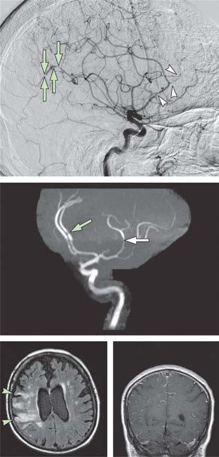

# Chapter 642: Central Nervous System Vasculitis
> **Course:** Vikkypaedia Pediatric Basic Course (*Nelson Textbook of Pediatrics, 22nd Edition (2025)*)  
> **Part XXV:** The Nervous System  
> **Authors:** Sona Narula  
> **Metrics:** 3,392 words · 3 tables/boxes · 2 figures · 1 genes · 8 flashcards · 5 MCQs  
> **Quick Navigation:** [🃏 Study 8 Flashcards](../flashcards/642_flashcards.md) · [📝 Take 5-Q MCQ Quiz](../mcqs/642_mcqs.md) · [📚 Part XXV Guide](../parts/Part_XXV.md) · [🧬 Syndrome & Genetics Atlas](../omim_gene_atlas.md) · [💊 Therapeutics Matrix](../therapies_matrix.md) · [🏠 Course Index](../../index.md)

## Key Genetic & Molecular Targets
`ATP1A3`

## ⚡ High-Yield Nelson Pediatric Board Pearls
- The latter is characterized by chronic, progressive vessel wall inflamma tion affecting both proximal and distal vessel segments in one or both hemispheres.
- Smallvessel cPACNS (SVcPACNS) is considered a progressive illness; the diagnosis is confirmed by brain biopsy, as angiography is typically normal.
- DIAGNOSIS The first step is considering vasculitis as a possible underlying etiol ogy of newly acquired neurologic deficits and/or psychiatric symptoms.
- Evidence of vessel stenosis confirms the diagnosis in large/mediumvessel cPACNS subtypes; brain biopsies are not required.
- Vessel wall imaging is often normal in children with SVcPACNS, often man dating a brain biopsy to definitively confirm the diagnosis.
- In the appropriate clinical context, nonlesional biopsies can also be done to confirm the diagnosis of SVcPACNS and are typically taken from the nondomi nant frontal lobe.
- In adults, one study reported the diagnostic yield of biopsies for PACNS to be 11%, with an identified alternative diagnosis reported in about 30% of cases.

---
## Full Chapter Text, Tables & Figures
# Chapter 642: Central Nervous System Vasculitis

*Sona Narula*

<!-- p.4780 -->
neurologic deficits (stroke). MRI is useful in differentiating RCVS from other disorders, especially primary angiitis of the central nervous system.

**SEIZURE** Prolonged focal motor seizure activity is typified by stiffening or jerk ing movements, termed *positive* symptoms frequently followed by a period of focal neurologic deficit (so-called **Todd paresis**), which typi cally resolves rapidly over hours after the seizure (see Chapter 633). Very rarely, focal seizures can manifest with only “negative” symptoms producing only hemiparesis or other acute-onset focal neurologic defi cits. A known history of seizures and epileptiform EEG findings may be helpful. Urgent brain imaging should be considered in new cases of prolonged or recurrent focal seizure with persisting Todd paresis because stroke in children is often associated with seizures at onset.

**INFECTION** Life-threatening and treatable brain infections, including abscess, bac terial meningitis, and herpes encephalitis, can be mistaken for stroke (see Chapter 643). However, symptom onset in primary CNS infec tion is typically more gradual and less focal with fever as a consistent feature. Children with bacterial meningitis are at risk for both venous and arterial stroke.

**DEMYELINATION** Acute disseminated encephalomyelitis, clinically isolated syndrome, multiple sclerosis, and other demyelinating conditions can present with acute focal neurologic deficits (see Chapter 640). The symptom onset and initial progression are, however, more gradual compared with stroke onset (i.e., typically hours or days versus minutes). Mul tifocal deficits, or concurrent encephalopathy in the case of acute dis seminated encephalomyelitis, decreases the probability of stroke.

**HYPOGLYCEMIA** Acute lowering of blood glucose levels can produce focal deficits mim icking stroke. New-onset hypoglycemia in otherwise healthy children is rare, but predisposing conditions include insulin-dependent diabe tes, adrenal insufficiency, steroid withdrawal, and ketogenic diet.

**GLOBAL HYPOXIC-ISCHEMIC ENCEPHALOPATHY** Generalized reduction in cerebral perfusion can produce focal areas of watershed brain infarction, which, when asymmetric, can mimic vasoocclusive forms of stroke. Watershed ischemic injury should be accompanied by recognized hypotension or conditions predisposing to low cerebral perfusion, such as sepsis, dehydration, or cardiac dysfunc tion. Clinical presentations tend to be generalized and include bilateral cerebral dysfunction compared with stroke, and the anatomic location of the infarct on MRI or CT scanning is in typical bilateral watershed zones rather than conforming to an established arterial territory.

**HYPERTENSIVE ENCEPHALOPATHY** Posterior reversible leukoencephalopathy syndrome is seen in children with hypertension, often in the context of an acute rise in blood pres sure. The posterior regions are selectively involved, possibly resulting in symptoms of bilateral cortical visual dysfunction in addition to encephalopathy and seizures.

**INBORN ERRORS OF METABOLISM** Mitochondrial myopathy, encephalopathy, lactic acidosis, and strokelike episodes (MELAS; see Chapter 638.2) is the classic example of a metabolic strokelike condition, though other mitochondrial diseases can mimic stroke. Features favoring MELAS include a history of devel opmental regression, deafness, posterior (and often bilateral) lesions not respecting vascular territories on MRI, and elevated serum or CSF lactate on MR spectroscopy. In contrast to these types of metabolic infarctions, children with Fabry disease (see Chapter 653.6), hyperho mocysteinemia, and homocystinuria (see Chapter 105.4) are at risk of true ischemic stroke.

**VESTIBULOPATHY AND ATAXIA** Acute-onset vertigo and/or ataxia can be confused with brainstem or cerebellar stroke. Simple bedside tests of vestibular function with oth erwise intact brainstem functions are reassuring. This differential diag nosis includes acute vestibular neuronopathy, viral labyrinthitis, and the benign paroxysmal vertigos, as well as acute postviral cerebellar ataxia and episodic ataxias.

**CHANNELOPATHIES** An increasing number of nervous system ion channel mutations are described that feature sudden focal neurologic deficits, thereby mim icking stroke. These include the migraine syndromes, as well as a grow ing list of episodic ataxias. A strong family history raises suspicion, but most require additional investigation.

**ALTERNATING HEMIPLEGIA OF CHILDHOOD** Alternating hemiplegia of childhood typically presents in late infancy with acute intermittent episodes of hemiplegia that alternate from one side of the body to the other. The hemiplegia persists for minutes to weeks and then resolves spontaneously. Choreoathetosis and dystonic movements are commonly observed in the hemiparetic extremity. Signs spontaneously regress with sleep but recur with awakening. Affected children may also experience sudden attacks of redness and warmth (i.e., flushing) or unusual paleness (i.e., pallor) of the skin occurring during or separately from episodes of hemiplegia. Almost all affected individuals have some level of developmental delay and intellectual disability that typically progresses over time. Neuroimaging, including MRA, should be completed to exclude moyamoya disease. Alternating hemiplegia of childhood is linked to variants in the *ATP1A3* gene.

*Sona Narula*

Autoimmune-mediated inflammatory brain diseases include primary central nervous system (CNS) vasculitis, secondary CNS vasculitis, and autoimmune encephalitis (Fig. 642.1; see Chapter 638.4).

Primary vasculitis or angiitis of the CNS (PACNS) is recognized as an underlying etiology of a broad spectrum of neurologic and psychi atric symptoms in children. Criteria characteristic of primary angiitis of the CNS in childhood (cPACNS) include (1) newly acquired focal and/ or diffuse neurologic deficits and/or psychiatric symptoms in a child 18 years of age or younger, **plus** (2) angiographic and/or histologic evi dence of vasculitis **in the absence of** (3) a systemic underlying condition known to cause or mimic the findings. Two broad categories of cPACNS are recognized based on the predominant vessel size affected: large/ medium-vessel cPACNS and small-vessel cPACNS. Large/mediumvessel cPACNS is diagnosed by angiography demonstrating features of vessel wall inflammation, such as wall thickening and resulting luminal stenosis. Based on the clinical course and the corresponding distribution of vessel stenosis within the vascular tree of the CNS, children with large/ medium-vessel cPACNS are classified as having a monophasic, nonpro gressive subtype (NPcPACNS) or a progressive subtype (PcPACNS). The latter is characterized by chronic, progressive vessel wall inflamma tion affecting both proximal and distal vessel segments in one or both hemispheres. In contrast, NPcPACNS is a monophasic illness; vessel inflammation occurs in a characteristic distribution and is limited to

<!-- p.4781 -->

**Fig. 642.1** Classification algorithm for CNS vasculitis within the spec trum of immune-mediated inflamma tory brain diseases. Non-progressive

**Inflammatory brain disease**

See Table 642-1

Progressive

Angiography

positive

Primary CNS

Vasculitis

Secondary CNS

Vasculitis

Antibody-mediated

encephalitis

Intracellular

antigen

Receptor/Cell surface antigen Angiography

negative Brain biopsy

positive

the proximal vessel segments of the anterior and/or middle cerebral artery and/or distal internal carotid artery of one hemisphere. Smallvessel cPACNS (SVcPACNS) is considered a progressive illness; the diagnosis is confirmed by brain biopsy, as angiography is typically normal.

Secondary childhood CNS vasculitis can affect all cerebral vessel segments and can occur in the context of infections, or rheumatic or other inflammatory conditions, or as a result of systemic or local vas cular irritation (Table 642.1). The neuropsychiatric manifestations of secondary CNS vasculitis are the same as those of primary CNS vas culitis. Secondary CNS vasculitis is distinguished from primary CNS vasculitis largely by the non-CNS manifestations of the underlying sys temic vasculitic disease.

**EPIDEMIOLOGY** The incidence and prevalence of primary CNS vasculitis are undeter mined. Increased physician awareness, improved diagnostic markers, sensitive neuroimaging techniques, and utilization of brain biopsies have led to dramatically increased recognition and decreased mortal ity rates. The disease has many names, including *isolated angiitis of the CNS, transient cerebral angiitis, postvaricella angiopathy,* and *focal cerebral arteriopathy*. Furthermore, children are frequently diagnosed with their presenting clinical phenotype, such as stroke, movement disorder, psychosis, or cognitive decline. Within clinical phenotypes such as arterial ischemic stroke or status epilepticus in children with out preexisting epilepsy, cPACNS should be considered an important etiology.

**CLINICAL MANIFESTATIONS** Recognition of childhood CNS vasculitis requires a very high level of suspicion because any neurologic or psychiatric presentation can be the result of an underlying CNS vasculitis. The clinical phenotype may provide clues to the size of the primarily affected vessel segments and resulting cPACNS subtype: the majority of children with large/ medium cPACNS present with arterial ischemic stroke. Focal neuro logic deficits, such as hemiparesis, facial droop, aphasia, or any other distinct gross or fine motor deficits, may be the result of large-vessel inflammation causing stenosis and a decreased blood supply to the specific functional areas of the brain. Initially, these focal deficits wax and wane; they may even briefly resolve without therapeutic intervention and can therefore be easily overlooked. Headaches can be a symptom of vascular disease and are commonly reported in cPACNS. New-onset headaches in children without any family his tory of migraine can serve as a diagnostic clue. Cognitive dysfunction in cPACNS often includes loss of higher executive function, concen tration difficulties, learning and memory problems, atypical behavior or personality changes, and loss of social and emotional control. Sei zures are a hallmark of SVcPACNS, as more than 80% of children with

SVcPACNS present with seizures. In many centers, refractory status epilepticus is increasingly recognized as the presenting phenotype of SVcPACNS. Optic neuritis and spinal cord disease can also occur in the setting of SVcPACNS.

Constitutional features of fever or fatigue may point toward an underlying systemic illness causing a secondary CNS vasculitis. All children with suspected or confirmed CNS vasculitis require a careful assessment for a systemic illness.

**DIAGNOSIS** The first step is considering vasculitis as a possible underlying etiol ogy of newly acquired neurologic deficits and/or psychiatric symptoms (Table 642.2). The likelihood of CNS vasculitis in general and a specific

#### **Table 642.1** Causes of Secondary CNS Vasculitis

| Category / Parameter | Clinical Details & Findings |
| --- | --- |
| **VIRAL INFECTIONS** | Varicella-zoster virus, HIV, hepatitis C virus, cytomegalovirus,; parvovirus B19 |
| **BACTERIAL INFECTIONS** | Treponema pallidum, Borrelia burgdorferi, Mycobacterium; tuberculosis, Mycoplasma pneumoniae, Bartonella henselae,; Rickettsia spp. |
| **FUNGAL INFECTIONS** | Aspergillosis, mucormycosis, coccidioidomycosis, candidiasis |
| **PARASITIC INFECTIONS** | Cysticercosis |
| **SYSTEMIC VASCULITIDES** | Granulomatosis with polyangiitis, eosinophilic granulomatosis with; polyangiitis, Behçet disease, polyarteritis nodosa, IgA vasculitis,; Kawasaki disease, giant-cell arteritis, Takayasu arteritis, Degos; disease, ADA2 deficiency, TREX1-associated diseases |
| **CONNECTIVE TISSUE DISEASES** | Systemic lupus erythematosus, rheumatoid arthritis, Sjögren; syndrome, dermatomyositis, mixed connective tissue disease |
| **MISCELLANEOUS** | Antiphospholipid antibodies syndrome, Hodgkin and non-Hodgkin; lymphomas, neurosarcoidosis, inflammatory bowel disease,; graft-versus-host disease, bacterial endocarditis, acute bacterial; meningitis, drug-induced CNS vasculitis (cocaine, amphetamine,; ephedrine, phenylpropanolamine, immune checkpoint inhibitors),; hemophagocytic lymphohistiocytosis, reversible vasoconstriction; syndrome, Fabry disease, migrainous infarction, primary (RNF213) and; secondary moyamoya disease, NOTCH3 and HTRA1 vasculopathies,; genetic structural disorders (COL4A1, ACTA2, MOPD2).; From Salvarani C, Brown RD Jr, Hunder GG. Adult primary central nervous system; vasculitis. Lancet. 2012;380:767–776. |

<!-- p.4782 -->
subtype of CNS vasculitis in particular depends on the demographic characteristics of the patient, the CNS and non-CNS features of the clinical presentation, the preceding symptoms, and the mode of onset of the disease. SVcPACNS is more commonly seen in females, whereas large/medium cPACNS has a clear male predominance. Seizures are a hallmark of SVcPACNS, whereas strokes often reflect large/mediumvessel inflammation. Laboratory markers of vasculitis typically include C-reactive protein, erythrocyte sedimentation rate, and complete blood counts. *However, inflammatory markers lack sensitivity and spec ificity in cPACNS, particularly when the CNS is involved in isolation.* More than 50% of children with large/medium-vessel cPACNS have normal inflammatory markers at diagnosis. In contrast, the majority of children with SVcPACNS present with mild to moderately raised markers. Von Willebrand factor antigen, an endothelial cell–derived protein, is a proposed biomarker of vasculitis correlating closely with disease activity in cPACNS. It may be of particular importance for distinguishing SVcPACNS from demyelinating disorders. Cerebro spinal fluid (CSF) analysis is abnormal in up to 90% of SVcPACNS patients and less than half of large/medium-vessel cPACNS patients. Within the latter group, children with the progressive subtype have a higher likelihood of presenting with abnormal CSF findings, includ ing elevated opening pressure, raised CSF cell count (typically with lymphocyte predominance), and raised CSF protein. Oligoclonal bands are positive in 20% of children with SVcPACNS. They are rarely seen in other subtypes. Autoimmune encephalitis (see Chapter 638.4) and anti–myelin oligodendrocyte glycoprotein (MOG)–associated

encephalitis are two of the key neuroinflammatory differential diag noses of SVcPACNS.

Neuroimaging is a valuable diagnostic modality for cPACNS. Parenchymal lesions may be inflammatory or ischemic in nature and are best viewed on MRI, including T2/fluid-attenuated inver sion recovery (FLAIR) sequences and diffusion-weighted images (DWIs) (Fig. 642.2). CNS lesions in children with large/mediumvessel cPACNS are predominantly ischemic in nature and restricted to large vascular territories. In contrast, MRI lesions in children with SVcPACNS are not restricted to major vascular territories; lesions are primarily inflammatory and may enhance with contrast. In this subtype, focal or generalized meningeal enhancement is commonly seen if children are imaged before initiation of immunosuppressive therapy.

Evidence of vessel stenosis confirms the diagnosis in large/mediumvessel cPACNS subtypes; brain biopsies are not required. Important information about the disease activity can be obtained from post– gadolinium contrast studies of the vascular wall. The vessel wall of an inflamed cerebral vessel in active large/medium-vessel cPACNS subtypes is thickened and enhances contrast. Vessel wall enhance ment may also be useful for the assessment of ongoing disease activ ity. Conventional angiography, when compared with MR angiography, has a higher sensitivity in detecting vessel stenosis in the distal vessel segments, the posterior circulation, and in very young children. Vessel wall imaging is often normal in children with SVcPACNS, often man dating a brain biopsy to definitively confirm the diagnosis. Studies of regional blood flow or therapeutic trials of antiinflammatory or immu nosuppressive agents are nonsurgical alternatives that do not afford specific diagnostic information.

If a biopsy is pursued, a targeted lesional biopsy is preferred if an accessible lesion is identified on imaging. Biopsies should target low-risk, nonfunctional areas identified on MRI. In the appropriate clinical context, nonlesional biopsies can also be done to confirm the diagnosis of SVcPACNS and are typically taken from the nondomi nant frontal lobe. Diagnostic yield is improved if the biopsy is full thickness and includes the meninges and gray and white matter and if it is done before initiation of immunosuppression. In adults, one study reported the diagnostic yield of biopsies for PACNS to be 11%, with an identified alternative diagnosis reported in about 30% of cases. In this study, smaller biopsies and closed procedures were less likely to be diagnostic, and biopsy-related complications occurred in 16% of patients. Characteristic findings on biopsy in SVcPACNS include an intra mural and/or perivascular lymphocytic infiltrate, evidence of endo thelial activation, and reactive astrocyte activation. Gliosis and perivascular demyelination are hallmarks of long-standing disease. Hemorrhagic lesions have also been reported. Findings typically seen in adult PACNS, including granulomas or vessel wall necrosis, are less commonly seen in children with SVcPACNS. Disorders that may be seen in adolescents and young adults that produce the reversible vasoconstriction syndrome must also be considered. These include migraine, drug-induced vasospasm, and postpartum angiopathy. Differentiating vasculitis from these other etiologies is important for therapy and prognosis (Table 642.3).

**TREATMENT** Corticosteroids are the mainstay of acute immunosuppressive man agement of cPACNS. Usually pulse therapy is initially given. Anti thrombotic therapy is equally important, particularly in large/ medium-vessel cPACNS subtypes, because children are at high risk for recurrent ischemic events. For the distinct cPACNS sub types, different treatment regimens should be considered. Non progressive cPACNS is a monophasic inflammatory illness with the highest risk of poor neurologic outcome. Vessel wall inflam mation causes severe proximal stenosis and a high risk of stroke recurrence. High-dose corticosteroid pulses are commonly given,

Suspected Childhood Primary CNS Vasculitis

#### **Table 642.2** Proposed Diagnostic Evaluation of

| Category / Parameter | Clinical Details & Findings |
| --- | --- |
| **General** | 1.	 Clinical evaluation: Newly acquired symptom or deficit in a; previously healthy child; • Focal neurologic deficit: hemiparesis, hemisensory loss,; aphasia, ataxia, movement abnormality, paresthesia, facial; droop, ataxia, vision loss, spinal cord symptoms, others; • Seizures or status epilepticus; • Diffuse neurologic deficit, including cognitive decline with loss; of higher executive function, concentration difficulties, learning; or memory problems, behavior or personality changes, loss of; social skills or emotional/impulse control, others; • Headaches; • Meningitis symptoms, abnormal level of consciousness; • Psychiatric symptoms, including hallucinations; Differential diagnosis approach:; • Underlying illness known to cause, be associated or mimic CNS; vasculitis: check all potential clinical features; 2.	 Laboratory tests; • Blood inflammatory markers: C-reactive protein, erythrocyte; sedimentation rate and complete blood counts; • Endothelial markers: von Willebrand factor (vWF) antigen; • Cerebrospinal fluid (CSF) inflammatory markers: opening; pressure, cell count, protein, oligoclonal bands; Differential diagnosis approach:; • Infections/postinfectious inflammation: cultures, serologies,; Gram stain; • Autoimmune encephalitis: check neuronal antibodies in CSF; and blood; • Systemic inflammation/rheumatic disease: characteristic; laboratory markers such as complement, autoantibodies; • Thromboembolic conditions: procoagulatory profile; 3.	 Neuroimaging; • Parenchymal imaging on MRI; • Inflammatory lesions: T2/fluid attenuated inversion recovery; sequences plus gadolinium; • Ischemic lesions: diffusion-weighted images/apparent diffusion; coefficient mapping; • Vessel imaging; 4.	 Brain biopsy |

<!-- p.4783 -->
followed by a 6- to 12-week course of oral steroids at tapering doses. Second-line immunosuppressive agents are uncommonly used. All children require antithrombotic therapy, though no uni fying regimen exists. Many centers initially use low molecular weight heparin followed by long-term antiplatelet therapy. When reimaged at 3 months, children should have stable or improved vessel disease, no newly affected vessel segments, and no evidence of vessel wall enhancement. At this point, the immunosuppressive therapy is commonly discontinued, and children are only kept on antiplatelet therapy.

Progressive cPACNS and SVcPACNS are considered chronic pro gressive vasculitis subtypes requiring a prolonged course of combina tion immunosuppression. High-dose corticosteroids are initially used, followed by long-term oral corticosteroids with a slow taper. Many centers use an induction-maintenance protocol, adding cyclophos phamide to corticosteroids (for 6 months), followed by mycophenolate mofetil or other oral second-line agents during maintenance therapy (usually 18 months). Symptomatic therapy is essential, including anticonvulsants or psychotropic medication if required. Supportive

therapy includes bone protection with calcium and vitamin D, prophy laxis against *Pneumocystis* pneumonia, and gastric mucosal protection as required.

**PROGNOSIS** The mortality rate of cPACNS has significantly improved. In largevessel cPACNS, the risk of stroke recurrence is thought to be high in patients who are found to have progression on vascular imaging at 12 months (especially if there was simultaneous progression and improve ment occurring across multiple vessels).

Some treatment protocols for SVcPACNS report a good outcome, defined as no functional neurologic deficits, in two thirds of children. Children presenting with status epilepticus and SVcPACNS have the poorest cognitive outcome. Multidisciplinary care involving neurol ogy, rheumatology, hematology, and rehabilitation is ideal and may improve outcomes.

*Visit Elsevier eBooks+ at eBooks.Health.Elsevier.com** for Bibliography.*

D B C A

**Fig. 642.2** Imaging of patients with primary CNS vasculitis. A, Cerebral angiogram shows alternating stenosis and dilation of the distal middle cerebral artery (arrows) and the anterior cerebral artery (arrowheads). B, MR angiography of the brain shows a short-segment stenosis of the anterior cerebral artery (green arrow) and stenosis of the distal middle cerebral artery (white arrow). C, Fluid attenuation inversion recovery–weighted MRI shows a large abnormality within the right cerebral hemisphere consistent with ischemia (arrowheads). D, MRI shows diffuse, asymmetric, nodular, and linear leptomeningeal enhancement, with the dura only slightly affected. (From Salvarani C, Brown RD Jr, Hunder GG. Adult primary central nervous system vasculitis. Lancet. 2012;380:767–776, Fig. 2.)

#### **Table 642.3** Characteristics of Primary CNS Vasculitis and Reversible Cerebral Vasoconstriction Syndrome

| Category / Parameter | Clinical Details & Findings |
| --- | --- |
| **RCVS** | Precipitating factor; None; Postpartum onset or onset after exposure to vasoactive; substances; Onset; More insidious, progressive course; Acute onset followed by a monophasic course; Headaches; Chronic and progressive; Acute, thunderclap type; CSF findings; Abnormal (leukocytosis and high total protein concentration); Normal to near normal |
| **MRI** | Abnormal in almost all patients; Initially may be normal or demonstrate vasogenic; edema, vasospasm, or sequelae of vasospasm; Angiography; Possibly normal; otherwise, diffuse abnormalities are; often indistinguishable from RCVS; irregular and; asymmetric arterial stenoses or multiple occlusions are; more suggestive of PCNSV; abnormalities might be; irreversible; Always abnormal, strings-of-beads appearance of; cerebral arteries; abnormalities reversible within 6-; 12 wk; Cerebral biopsy; Vasculitis; No vasculitic changes; Drug treatment; Prednisone with or without cytotoxic agents; Nimodipine; CSF, Cerebrospinal fluid; PCNSV, primary CNS vasculitis; RCVS, reversible cerebral vasoconstriction syndrome.; From Salvarani C, Brown RD Jr, Hunder GG. Adult primary central nervous system vasculitis. Lancet. 2012;380:767–776, Table 2. |

<!-- p.4784 -->
